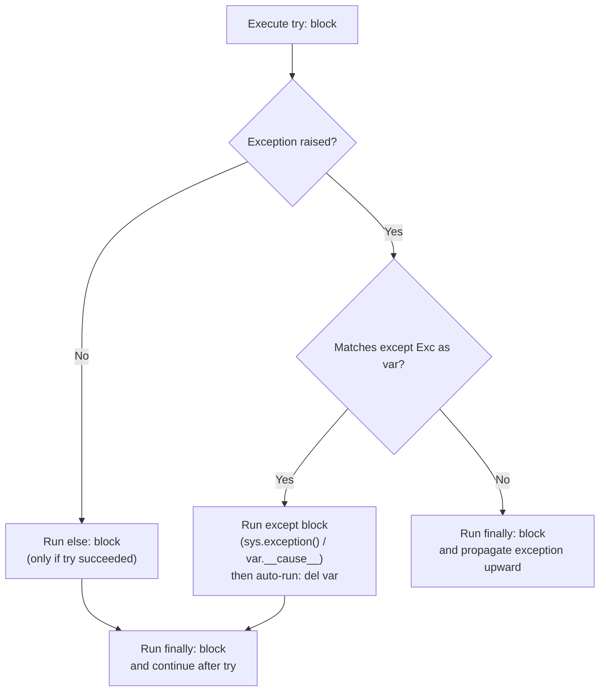

# 3.5 Errors, files, text and bytes, subprocess and system scripting

| | |
|---|---|
| Level | Intermediate |
| Priority tier | 0 |
| Lab venue | Linux VM (root for some exercises), Python 3.11+ |
| Part | Part 3: Python for infrastructure |
| Status | Drafted, labs **untested** |

## Why this matters for AI infrastructure

Infrastructure code lives at the edge of a messy world. Files may not exist, or they may be half-written. Commands fail with partial output. Hosts disagree on encodings, signals arrive in the middle of an operation, and under cron or systemd there may be no terminal at all. A script that runs fine on a laptop can still corrupt a checkpoint directory at 3 a.m. The fault usually lies in one of these places.

This chapter teaches the discipline of failure: exceptions, cleanup, retries, exit codes and logging. It then covers file and path handling, including `pathlib`, atomic writes, permissions, temporary files and locking. Next come text versus bytes and the serialisation formats JSON, YAML, CSV, TOML and struct. You will see how to run external programs safely with `subprocess`, and how to interact with the OS through environment variables, signals, processes, `psutil`, `/proc` and `/sys`. The chapter ends with a template for robust operational scripts.

## Prerequisites and outcomes

You should already know functions and collections (3.1), idioms (3.3) and classes (3.4). Linux fundamentals from Part 1 will help too.

After this chapter, you can handle failure deliberately. You will use `try`/`except`/`else`/`finally`, raise and chain exceptions, define exception hierarchies, use `with`, and work with `ExceptionGroup`/`except*`. You will decide what to catch, where to catch it and how to report it, including exit codes. You will also use `logging` correctly, with its levels, handlers, formatters and structured logs, and you will use `warnings`.

You will read and write files safely. That covers modes, encodings, buffering, atomic replace, permissions, temp files, file locks, `pathlib`, `shutil`, `os`, globbing, directory walks, `os.scandir` and `mmap`. You will convert between text and bytes, and handle encodings and errors. You will use `struct`, `base64`, `hashlib`, and the `zlib`, `gzip`, `tarfile` and `zipfile` modules. You will also parse and emit JSON, YAML, TOML, CSV and INI safely, including large and malformed data.

You will run subprocesses safely, using `subprocess.run`, `Popen`, pipes, timeouts, environment variables, working directories, streaming output and process groups. You will avoid shell injection and wrap CLI tools robustly. You will handle signals and shut down gracefully, and you will inspect processes and system state with `psutil`, `/proc`, `/sys`, `os`, `platform`, `socket` and `ipaddress`. The goal is operational scripts that are idempotent, observable and safe to re-run, with a dry-run mode and clear exit codes.

## 1. Exceptions

### Why exceptions exist

Picture a pizza-making robot. It runs a plan written as a Python program. The plan takes an order, prepares the dough, adds the toppings and bakes the pie. Now suppose something goes badly wrong in the bake step. The oven might be broken, or the robot might miscalculate its reach and spontaneously combust. There is no point in finishing the plan, so the robot should jump straight to code that deals with the problem.

Exceptions let a program do exactly that. When something goes wrong, Python jumps to an exception handler in one step. Any work started since the handler was entered is abandoned. The handler then decides how to respond, for example by calling the fire department.

Think of an exception as a structured goto. A `try` statement leaves a marker and runs some code. Later, an exception sends Python back to that marker, and any functions called after it are dropped. The program then resumes at the marker.

The big payoff is simpler code. You do not check a status code after every operation and every function call. You catch errors only in the places where you can actually recover from them.

### Exception roles

Exceptions do more than report errors. They play five common roles.

**Error handling.** Python raises an exception whenever it finds an error while the program runs. You can catch it and recover, or you can ignore it. If you ignore it, Python stops the program and prints an error message. A `try` statement lets your program keep going after the error.

**Event notification.** An exception can also signal a normal but important condition. Consider a search routine that raises an exception when nothing is found. That beats returning an integer result code, because a code might also be a real answer.

**Special-case handling.** Some conditions are so rare that handling them in many places clutters the code. You can handle them once, in a handler higher up the program. An `assert` can also check that conditions hold while you develop.

**Termination actions.** The `finally` clause guarantees that closing work runs, whether or not an error happened. The `with` statement gives you the same guarantee for objects that support it.

**Unusual control flows.** Python has no go to statement and no built-in backtracking. Exceptions can still fill some of these roles. A `raise` can jump out of several nested loops, which a `break` cannot do.

### Mechanics

An **exception** is an object that represents an error or an unusual condition. When you raise one, Python unwinds the call stack until it finds a matching handler. If no handler exists, the program prints a traceback and exits with status 1.

```python
try:
    value = int(text)
    result = 100 / value
except ValueError as exc:                 # specific exception first
    print(f"not a number: {exc}")
except ZeroDivisionError:
    result = float("inf")
except (KeyError, IndexError) as exc:     # multiple types
    raise                                  # bare raise re-raises the current exception with its traceback
else:                                      # runs only if no exception occurred in try
    print("ok", result)
finally:                                   # ALWAYS runs: cleanup
    print("done")
```

Python checks the handlers in order, using `isinstance`, so put specific handlers before general ones. The exception hierarchy starts with `BaseException` and then `Exception`. Under `Exception` sit `OSError`, which has `FileNotFoundError`, `PermissionError`, `TimeoutError` and `ConnectionError` beneath it, along with `ValueError`, `TypeError`, `RuntimeError`, `AttributeError`, `ImportError` and `StopIteration`, plus others. `KeyError` and `IndexError` both fall under `LookupError`. `KeyboardInterrupt` and `SystemExit` derive from `BaseException`, not from `Exception`, on purpose. That is why `except Exception` does not swallow Ctrl-C or `sys.exit()`.

**Never use a bare `except:`.** It also catches `KeyboardInterrupt` and `SystemExit`. Avoid `except Exception: pass` as well, because silent failure is how data loss hides. Catch the narrowest exceptions you can actually handle, and let the others propagate to a boundary that logs them and exits.

The `else` clause keeps the `try` body small. Only the code that may raise what you catch belongs there. That prevents you from accidentally catching unrelated errors on the success path. The `finally` clause and the `with` statement both guarantee cleanup. Avoid a `return` inside `finally`, because it swallows exceptions.

To raise an exception, write `raise ValueError("bad value")`, and add context when you can, as in `raise ConfigError(f"missing key {key!r} in {path}")`. Chaining links one error to another. `raise NewError("...") from exc` sets `__cause__`, which makes the translation of a low-level error into a domain error explicit. Without `from`, Python still chains the errors implicitly, and it shows "During handling of the above exception, another exception occurred". Use `raise ... from None` when the original error is only noise.

An exception object gives you several handles. These include `exc.args`, `str(exc)`, `repr(exc)` and `exc.__traceback__`. Python 3.11 added `exc.add_note("hint")`, which attaches a note to the exception. `traceback.format_exc()` returns the traceback as text. `logging.exception()` logs your message together with the traceback, and you call it inside a handler.



**The `except Exc as var:` scope rule.** The name var lives only inside its `except` block. Python **automatically unbinds it (`del var`) when that block exits**, even if var held a value before the `try`. The reason is the traceback. The exception's `__traceback__` attribute references the call stack frames and their local variables. If var stayed bound, that reference would form a cycle, which delays garbage collection and keeps memory in use. If you need the exception object after the `try` statement finishes, assign it to a separate variable inside the handler:

```python
# In the book's examples (untested here):
X = 99
try:
    1 / 0
except Exception as X:
    print(X)               # division by zero
    saveit = X             # assign to another name if you need the exception after the block
# Here X is unbound (raises NameError: name 'X' is not defined), whereas saveit is ZeroDivisionError('division by zero')
```

**Custom exceptions.** Name each exception after the condition it reports, such as `NodeUnreachable`. Derive it from `Exception`. Never use a standalone class that does not inherit from `BaseException`. Group related library exceptions under a common superclass. In *Learning Python*, chapter 35, `class NumErr(Exception): pass` serves as that category. Its subclasses `Divzero(NumErr)`, `Oflow(NumErr)` and `Uflow(NumErr)` inherit from it. Callers who write `except mathlib.NumErr:` also catch future subclasses such as `Uflow`, without editing their `except` lists. The same book's other example uses `General` as the category, with `Specific1` and `Specific2` in `categoric.py`.

Any positional arguments passed to `Exception(...)` are stored in the `exc.args` tuple and displayed by `str(exc)`. To customize that display, override `__str__` rather than `__repr__`, because the built-in `BaseException` already defines `__str__`. The better approach is to attach explicit attributes and methods. In `parsely.py`, the example `class FormatError(Exception): def __init__(self, line, file): self.line = line; self.file = file; def logerror(self): ...` stores the line and the file on the exception and adds a method for logging.

**Control flow and nested `try` statements.** *Learning Python* covers this in chapters 33, 34 and 36, and its `action1..3` functions show the nesting. Python does not undo mutations made before an exception. `L.append('added')` inside a `try` block stays in `L` after `except IndexError:` runs. Also, once an `except` block finishes, execution continues after the `try` statement. It does not return to the line that raised the error. Python keeps a stack of active `try` handlers at runtime. This holds whether the `try` statements nest across function calls, as in `action1 -> action2 -> action3` in `nested_exc_normal.py`, or nest in the source text. When an exception is raised, Python unwinds to the nearest matching `except`. Along the way it runs **every** enclosing `finally` block, as in `Inner try` -> `Outer try`.

Inside an `except` handler without an `as var` target, **`sys.exception()`**, added in Python 3.11, returns the active exception instance directly. **`sys.exc_info()`** returns the three-item tuple `(exc_type, exc_value, exc_traceback)`. The `traceback.print_exc(file=open('badly.txt', 'w'))` call in `badly.py` and the `traceback.format_exc()` call both work from that information.

Two classic bugs show why a bare `except:` is dangerous. The first is in `exiter.py`, from *Learning Python*, chapter 36. `sys.exit(62)` raises `SystemExit`, which is a subclass of `BaseException` and not of `Exception`. A bare `except:` catches it and ignores the exit request, so the program prints `Got it` and then `Continuing...` instead of terminating. The second bug involves a typo. In `try: x = myditctionary[key] except: x = None`, the misspelled name raises `NameError`. The bare `except:` swallows that error and turns the typo into silent data corruption.

```python
class OpsError(Exception):
    """Base class for errors in this tool."""
class ConfigError(OpsError): ...
class RemoteError(OpsError):
    def __init__(self, host, status, body=""):
        super().__init__(f"{host}: HTTP {status}")
        self.host, self.status, self.body = host, status, body

def load_config(path):
    try:
        text = Path(path).read_text(encoding="utf-8")
    except FileNotFoundError as exc:
        raise ConfigError(f"config file not found: {path}") from exc
    ...
```

**Assertions.** An `assert` statement checks a programmer's assumption, such as an internal invariant or a test condition. *Learning Python*, chapter 34, shows it in `asserter.py`. The statement `assert cond, "message"` works like `if __debug__: if not cond: raise AssertionError("message")`. Run Python with `python -O`, and `__debug__` becomes `False`, so every assert is compiled out completely. For that reason, never use assertions for input validation or security checks.

**Warnings.** Call `warnings.warn("x is deprecated", DeprecationWarning, stacklevel=2)` to report a deprecation. You control warnings with `-W` flags and filters. Tests can turn them into errors.

**Exception groups (3.11, *Learning Python*, chapter 35).** Python 3.11 added `ExceptionGroup`. An example is `ExceptionGroup("batch failed", [IndexError(), TypeError(1), TypeError(2)])`. The **`except*`** clause handles part of a group. In the example, `except* IndexError as E:` followed by `except* TypeError as E:` lets one `try` statement run **multiple** handler clauses. Each `E` is bound to a sub-`ExceptionGroup` that holds the matching exceptions, available as `E.exceptions`. Any unmatched exceptions continue upward in a new `ExceptionGroup`. The `asyncio.TaskGroup` class, covered in chapter 3.6, uses this mechanism. Keep two limits in mind. You cannot mix `except*` with a plain `except` in the same `try`, and you cannot put `return`, `break` or `continue` inside an `except*` clause.

**Context managers.** A `with` statement guarantees deterministic teardown for objects such as `decimal.localcontext()`, `threading.Lock()` and files. You can list several managers in one statement, as in `with expr1 as v1, expr2 as v2:`. In Python 3.10 and later, you can also write the list across several lines in parentheses, as in `with (open('lines1.txt') as input, open('uppers.txt', 'w') as output):`.

*Fluent Python*, chapter 18, builds a `LookingGlass` class across Examples 18-1 to 18-8. The handbook models those examples in `code/part03/python_errors_files_subprocess.py`. Its `__enter__(self)` method patches `sys.stdout.write` so that printed strings come out reversed, and it returns `'JABBERWOCKY'` to the `as what` variable. Its `__exit__(self, exc_type, exc_value, traceback)` method restores `sys.stdout.write`. If `exc_type is ZeroDivisionError`, it logs a divide-by-zero message and returns `True`, which suppresses the exception.

When you write the same idea as a `@contextlib.contextmanager` generator, such as `@contextmanager def looking_glass():`, you must wrap the `yield` in a `try ... finally:` block. The shape is `try: yield 'JABBERWOCKY' except ZeroDivisionError: ... finally: sys.stdout.write = original_write`. The reason is that an unhandled exception inside the `with` body is thrown into the generator at the `yield` point, through `gen.throw(exc)`. That is why the restore step belongs in the `finally` block.

When a function must enter a dynamic number of context managers, such as one file for each name in a list, avoid nesting `with` blocks by hand. Use **`contextlib.ExitStack`** instead, as in `with ExitStack() as stack: files = [stack.enter_context(open(f)) for f in filenames]`. On exit, it unwinds all the registered callbacks and context managers in LIFO order.

### Default exception handler

Consider a small function that picks one item out of an object by index.

```python
def fetcher(obj, index):
    return obj[index]

food = 'pizza'
fetcher(food, 4)    # like food[4], the last item: 'a'
fetcher(food, 5)    # off the end of the string
```

With a legal index, fetcher returns a character. Index 5 falls off the end of `pizza`, so Python raises the built-in `IndexError`. Your code does not catch it here. The exception travels up to the top of the program, where Python's default handler prints a message and a traceback.

```
Traceback (most recent call last):
File "<stdin>", line 1, in <module>
File "<stdin>", line 2, in fetcher
IndexError: string index out of range
```

A traceback lists the lines and functions that were active when the error happened. Its wording can change a little between releases and between interactive shells, so do not write code that depends on the exact text. In a console, the filename may appear as `<stdin>`. In IDLE's shell, it appears as `<pyshell...>`, and the source lines show up too. When no file sits behind the code, the line numbers tell you little.

Outside the REPL, the default handler also stops the program right after it prints. For a simple script that is fine, since many errors are fatal anyway. Your best move is to read the message and fix the cause.

### Catching exceptions

Some programs must stay running after an internal error. A server that quits on the first bad index is not much use to anyone. So you wrap the risky call in a `try` statement and catch the exception yourself.

```python
try:
    fetcher(food, 5)
except IndexError:          # handle the error here
    print('got exception')
```

When an exception is raised while the `try` block runs, Python jumps to the block under `except`. The handler wraps a nested block of code. If you type a top-level `try` into a REPL, leave out the `...` continuation prompts. The `except` and `finally` lines must line up with their `try`.

Inside a real function, the handler lets the program carry on:

```python
def catcher():
    try:
        fetcher(food, 5)
    except IndexError:
        print('got exception')
    print('continuing')

catcher()
```

This prints `got exception` and then `continuing`. The program resumes after the whole `try` statement, so the default message never appears. Python cannot return to the line that failed. You would have to run that code again. Functions that the error exited lose their variables, and they cannot be resumed. In other words, the `try` serves as both the catch point and the resume point.

Python also leaves earlier work in place. Changes to mutable objects and to global names survive the error.

```python
L, S = [], 'text'

def modder():
    L.append('added')           # change a mutable object
    global S; S = 'changed'     # change a global name
    fetcher(food, 5)            # raise an exception

try:
    modder()
except IndexError:
    print('got exception')

L, S    # (['added'], 'changed')
```

Once you know about this, it is fine. A `try` can also use `except*` clauses to handle several exceptions at once. That feature is convoluted and has a narrow scope, so study it after you master the basics.

### Raising exceptions

Your own code can also detect a bad state. When it does, signal the problem the same way Python does, with the `raise` statement. Raising is how your code reports trouble to the rest of the program.

```python
try:
    raise IndexError            # trigger the exception ourselves
except IndexError:
    print('got exception')
```

This prints `got exception`. Exceptions you raise yourself get caught just like the ones Python raises. If nothing catches them, they reach the default handler and stop the program:

```
Traceback (most recent call last):
File "<stdin>", line 1, in <module>
IndexError
```

The `assert` statement is a conditional `raise`. It fires only when its test is false, and it is mostly used for debugging and sanity checks during development. Here the test `1 < 0` is false, so Python raises `AssertionError` with the message `Not in this universe!`.

```python
assert 1 < 0, 'Not in this universe!'
```

A `raise` can also use a `from` clause to chain exceptions. You will not use this often, but it adds useful context in the right place.

### User-defined exceptions

Built-in names such as `IndexError` cannot describe every problem. A failed pizza, for example, needs its own name. You create one by writing a class that inherits from a built-in exception, usually `Exception`.

```python
class Combust(Exception): pass      # user-defined exception

def makePizza():
    raise Combust()                 # raise an instance

try:
    makePizza()
except Combust:                     # catch the class name
    print('got exception')
```

This prints `got exception`. Exception classes let scripts build categories. Each class can inherit behavior, hold state and define methods. An `as` clause on `except` gives you the exception object itself.

An exception class can also control the message it shows when nothing catches it:

```python
class Combust(Exception):
    def __str__(self):
        return 'Call the fire department!...'

raise Combust()
```

Because nothing catches this one, the default handler prints the usual traceback. The last line shows the class name, followed by the text your `__str__` method returned.

### Termination actions with `finally`

Some steps must run no matter how a block ends. Closing a file is the usual example. The `finally` clause guarantees that these closing steps run, whether or not your program raised an exception. Putting cleanup code after a call is a weak fix, because that code never runs when the call raises an error.

```python
fetcher(food, 4)
print('after fetch')
```

If fetcher raises an exception, the `print` is skipped. A `try` with a `finally` clause fixes that. Its `finally` block runs on the way out, whether or not an error happened.

```python
try:
    fetcher(food, 4)
finally:
    print('after fetch')
```

When nothing goes wrong, the `finally` block runs and the program continues after the `try`. Now look at the error case inside a function:

```python
def after():
    try:
        fetcher(food, 5)
    finally:
        print('after fetch')
    print('after try?')
```

Calling `after()` prints `after fetch` first, and then the traceback follows. You never see `after try?`, because control does not come back after the `try` when an exception occurs. Python runs the `finally` block and then passes the exception up. Here, the handler above is the default one.

If the index is legal, both lines run:

```python
def after():
    try:
        fetcher(food, 4)
    finally:
        print('after fetch')
    print('after try?')
```

This prints `after fetch` and then `after try?`. Use `except` when you can recover from an error, such as one raised by a third-party library. Use `try` with `finally` to make sure files close and server connections end. You can combine `except` and `finally` in one `try`, and the `finally` block still runs either way.

For some object types, the `with` statement offers a shorter form. It runs the object's setup and cleanup methods, so the cleanup happens even if the block raises an exception.

```python
with open('pizzarobot.txt', 'w') as file:     # always close the file on exit
    file.write('Catch fire!\n')
```

This form needs fewer lines, but it works only with object types that support it. `try`/`finally` is more general. When `with` is not supported, `try`/`finally` is often simpler than writing a class. The `with` statement can also run startup actions, and it accepts your own context managers.

### Exceptions and backtracking

Backtracking undoes the work done before it jumps back, but Python exceptions do not. Local variables in the functions called inside a `try` are discarded. Changes to globals and to objects stay in place.

You can still build backtracking yourself. Pair exceptions with logic that unwinds your assignments. Generators, covered in *Learning Python*, chapter 20, do not backtrack fully either. They save their state and resume when `next()` asks for the next value. For more on true backtracking, look at books on AI or at the Prolog and Icon languages.

### Nested try statements

Real programs often put one `try` inside another. A `try` can also sit in a function that another `try` calls. Both cases follow one rule, and it helps to know that rule before you read a traceback.

Python keeps a stack of the `try` statements that are active while the program runs. When an exception is raised, Python returns to the most recently entered `try` that has a matching `except`. That handler runs, and the program resumes after that `try`. Only this first match gets the chance to handle the exception. Once it is caught, the exception is done, so outer handlers do not run unless the handler raises it again.

Example 36-1 shows this with three functions. `action3` adds a number and a list, which raises a `TypeError`. `action2` catches the error, prints a message and re-raises it with a bare `raise`. Then `action1` catches the error a second time.

```python
def action3():
    print(1 + [])                  # Generate TypeError

def action2():
    try:                           # Most recent matching try
        action3()
    except TypeError:
        print('Inner try')         # Match kills the exception
        raise                      # Unless manually reraised

def action1():
    try:
        action2()
    except TypeError:
        print('Outer try')         # Run only if action2 reraises

if __name__ == '__main__':
    action1()
```

When `action3` fails, two `try` statements are active. One is older, in `action1`, and the other is newer, in `action2`. Python runs only the newer one, since it is the most recent match. The outer handler runs only because `action2` re-raised the error.

```
$ python3 nested_exc_normal.py
Inner try
Outer try
```

Exception groups follow the same routing, with one difference. A group keeps moving until every item in it has been matched. Each `except*` clause takes the items it matches and lets the rest pass on. Example 36-2 shows three nested functions, with three kinds of error in one group.

```python
def action3():
    raise ExceptionGroup('Nest*', [IndexError(1), TypeError(2), SyntaxError(3)])

def action2():
    try:
        action3()
    except* IndexError:            # Consume matches, rest propagate
        print('Got IE')

def action1():
    try:
        action2()
    except* TypeError:             # Consume matches, rest propagate
        print('Got TE')

if __name__ == '__main__':
    action1()
```

Each `try` consumes what it matches. Nothing matches the `SyntaxError`, so the top-level handler prints it last.

```
$ python3 nested_exc_group.py
Got IE
Got TE
+ Exception Group Traceback (most recent call last):
…etc…
| ExceptionGroup: Nest* (1 sub-exception)
+-+---------------- 1 ----------------
| SyntaxError: 3
+------------------------------------
```

Where an exception lands depends on the path the program took to get there. To predict where it goes, you need to know where the program has been. Handler routing is a matter of runtime control flow, not only of how the statements are written.

A `try` that contains only a `finally` clause behaves differently. When an exception occurs, each `finally` block runs in turn as the error moves up the stack. A `finally` block does not stop the error. It runs cleanup code on the way out. If no `except` catches the error along the way, the default handler at the top receives it.

Example 36-3 shows an `except` and a `finally` working together on each pass through a loop. The `raise1` function raises an error, `noraise` does nothing, and `raise2` raises a different error.

```python
def raise1(): raise IndexError
def noraise(): return
def raise2(): raise SyntaxError

for func in (raise1, noraise, raise2):
    print(f'<{func.__name__}>')
    try:
        func()
    except IndexError:
        print('caught IndexError')
    finally:
        print('finally run')
    print('...')
```

The `finally` block runs on every pass. The `except` block runs only for `IndexError`. This single `try` gives the same result as a nested pair of `try` statements, so you can choose the form that reads better.

```
$ python3 except-finally.py
<raise1>
caught IndexError
finally run
...
<noraise>
finally run
...
<raise2>
finally run
Traceback (most recent call last):
…etc…
SyntaxError: None
```

You can also nest `try` statements in the source text itself. The nesting then lines up with the way the code is written. This is the same stack as before, just written in one place. Here the error comes from `action3` in the module `nested_exc_normal`.

```python
from nested_exc_normal import action3

try:
    try:
        action3()
    except TypeError:              # Most-recent matching try
        print('Inner try')
        raise
except TypeError:                  # Here, only if nested handler reraises
    print('Outer try')
```

The output matches Example 36-1. The same holds for nested `finally` blocks. Both of them run when the error passes through, whether the nesting is in the source or spread across functions.

```python
try:
    try:
        action3()
    finally:
        print('Inner try')
finally:
    print('Outer try')
```

```
Inner try
Outer try
Traceback (most recent call last):
…etc…
TypeError: unsupported operand type(s) for +: 'int' and 'list'
```

Syntactic nesting mostly makes the roles of `except` and `finally` easier to see. In a larger program, the runtime nesting from function calls is the more common case.

### Why exceptions save code

In languages without exceptions, you check every result. Here is a C-style sketch of a function that runs several steps.

```c
int run_job(void) {
    if (doFirstThing() == ERROR)
        return ERROR;
    if (doNextThing() == ERROR)
        return ERROR;
    ...
    return doLastThing();
}
```

Robust C code often has as much error checking as real work. Python does not need that much care. You wrap a large part of the program in a handler, and you write only the steps that do the work.

```python
def do_stuff():
    do_first_thing()    # no error checks here,
    do_next_thing()     # so we do not need to detect errors
    ...
    do_last_thing()

if __name__ == '__main__':
    try:
        do_stuff()      # the one place where we check results
    except Exception:
        bad_ending()
    else:
        good_ending()
```

The *Learning Python* version uses a bare `except:`. This handbook prefers `except Exception:`, since a bare `except:` also catches Ctrl-C and `sys.exit()`. Control jumps straight to the handler when an error happens. You do not guard every line, and the normal path runs no extra checks. Python also finds many errors on its own, so your code often never has to look for them.

### Exception idioms

Exceptions do more than report errors. Several common patterns use them as a control-flow tool. Each one is a small, structured way to jump somewhere else in the program.

### Breaking out of several loops

Python's `break` exits only the closest loop. When you need to leave three nested loops at once, a `raise` can do it. In this role, `raise` works like a go to, and the `except` clause with its exception name takes the place of a label. You can jump only out of code wrapped in a `try`. That limit is useful, because a truly arbitrary go to makes code hard to follow.

Example 36-4 shows the pattern. The `raise` inside the `for` loop leaves all three loops in one step.

```python
class Exitloop(Exception): pass

try:
    while True:
        while True:
            for i in range(10):
                if i > 3: raise Exitloop    # break exits just one level
                print('loop3: %s' % i)      # raise can exit many
            print('loop2')
        print('loop1')
except Exitloop:
    print('continuing')                     # Or just pass, to move on
print(f'{i=}')                              # Loop variable not undone
```

```
$ python3 breaker.py
loop3: 0
loop3: 1
loop3: 2
loop3: 3
continuing
i=4
```

If you change the `raise` to a `break`, you get an infinite loop. The `break` leaves only the innermost `for` loop, and the program then lands back in the second-level `while` loop. Try that change yourself, but keep Ctrl+C ready to stop it.

The variable `i` keeps its value after the `try` ends. Assignments made inside a `try` are not undone in general. Local variables in functions that a `raise` exits are discarded, because they leave the call stack.

### Exceptions that are signals, not errors

In Python, every error is an exception, but not every exception is an error. A file's read methods return an empty string at the end of a file. The built-in input function reads one line from `sys.stdin` on each call. At end-of-file, it raises `EOFError` instead.

An empty string from input means a blank line, not the end of the input. Here, `EOFError` is only a signal. Unless end-of-file should stop the whole script, wrap input in a `try` inside a loop.

```python
while True:
    try:
        line = input()             # Read line from stdin
    except EOFError:
        break                      # Exit loop at end-of-file
    else:
        ...process next line here...
```

Other built-in exceptions also act as signals. Calling `sys.exit()` raises `SystemExit`. Pressing Ctrl+C raises `KeyboardInterrupt`. Some built-in exceptions represent warnings instead of errors, and some of these flag deprecated language features. The standard library manual describes the built-in exceptions, and the `warnings` module documents the ones raised as warnings.

### Raising to signal a result

User-defined exceptions can signal normal conditions, not only errors. A search routine can raise an exception when it finds a match, instead of returning a status flag that the caller must read. The `try`/`except`/`else` statement then does the work of an `if`/`else` test on the return value.

```python
class Found(Exception): pass

def searcher():
    if …success…:
        raise Found()              # Raise exceptions instead of returning flags
    else:
        return

try:
    searcher()
except Found:                      # Exception if item was found
    …success…
else:                              # else returned: not found
    …failure…
```

This pattern also helps when a function cannot return a special value to mean failure. A sentinel is a special return value, such as None, that stands for "no result." If every object can be a valid return value, no sentinel is safe. An exception can carry the failure without using the return value at all.

```python
class Failure(Exception): pass

def searcher():
    if …success…:
        return founditem
    else:
        raise Failure()

try:
    item = searcher()
except Failure:
    …not found…
else:
    …use item here…
```

Because Python is dynamically typed and polymorphic to the core, exceptions are generally preferred over sentinel return values for these cases.

### Closing files and server connections

Exception tools also make sure resources are released, whether or not an error happens. Some servers need a connection closed before a session ends. Output files may need a `close` to flush their buffers to disk. Input files hold file descriptors until they are closed. CPython closes open files when it garbage-collects them, but that timing is not always predictable or reliable.

The most general way to guarantee cleanup for one block of code is `try`/`finally`.

```python
myfile = open('somefile', 'w')
try:
    ...process myfile...
finally:
    myfile.close()
```

Some objects are easier to handle with a context manager. A `with` statement closes or cleans up the resource for you.

```python
with open('somefile', 'w') as myfile:
    ...process myfile...
```

Compare the two forms with the termination-action section above, and decide for yourself which one reads better.

### Outer try for debugging

You can also replace Python's default top-level error handling with your own. Wrap the whole program, or one call into it, in an outer `try`. An empty `except` then catches any uncaught exception, and the program does not end with the default error message.

To learn what happened, read the result of `sys.exc_info()`. It returns a tuple, and its first two items are the exception's class and the instance that was raised.

```python
try:
    ...run program...
except:                            # All uncaught exceptions come here
    import sys
    print('uncaught!', sys.exc_info()[0], sys.exc_info()[1])
```

Developers use this structure to keep a program running after an error. It is also useful for testing. If you put it inside a loop, you can run more tests without restarting the program.

### Running in-process tests

A test driver can combine these patterns. It imports other code and runs the tests inside the same process. The sketch below sends the results to a log file.

```python
import sys
log = open('testlog', 'a')
from testapi import moreTests, runNextTest, testName

def testdriver():
    while moreTests():
        try:
            runNextTest()
        except:
            print('FAILED', testName(), sys.exc_info()[:2], file=log)
        else:
            print('PASSED', testName(), file=log)

testdriver()
```

The `try` keeps the driver going after one test fails. Without it, an uncaught exception in any test would end the driver. The empty `except` catches any error from a test case and records it with `sys.exc_info`. The `else` runs only when the test succeeds.

This boilerplate fits code that tests imported functions, modules and classes. Testing external programs needs a different approach. You check status codes or output from tools such as `os.system` and `os.popen`. Those tools do not usually raise exceptions for errors in external programs, and the test cases may run in parallel with the driver.

The testing tools in the development section below, `doctest` and PyUnit, go further. Both compare expected output with actual results.

### sys.exc_info, sys.exception, and tracebacks

The `sys.exc_info` result gives a handler a generic way to see the exception it is handling. This is most useful with an empty `except`, which catches everything. You can then check what was raised.

```python
try:
    ...
except:
    # sys.exc_info()[0:2] are the exception class and instance
```

If no exception is being handled, the call returns a tuple of three None values. Otherwise, it returns `(type, value, traceback)`. The first item is type, the class of the exception being handled. The second is `value`, the instance that was raised. The third is `traceback`, a traceback object. It records the call stack where the exception first happened, and the `traceback` module uses it to build error messages.

When you catch a category superclass, `sys.exc_info` can also tell you the specific type. You can get the same type from the instance itself, through `__class__` or type. So `sys.exc_info` is rarely needed outside an empty `except`.

```python
try:
    ...
except General as instance:
    # instance.__class__ or type(instance) is the exception class
    # but instance.method() does the right thing for this instance
```

Catching `Exception` here catches everything except exit events. It works like an empty `except` but is less extreme, and it still gives you the instance. Calling the instance's methods is often better than checking its type.

Python 3.11 added `sys.exception`. It returns the exception instance that is being handled, the same object that the `as` variable receives. It matches the second item of `sys.exc_info()`, which is `sys.exc_info()[1]`. The two calls below print the same information.

```python
except ...:
    print('uncaught!', sys.exc_info()[0], sys.exc_info()[1])
except ...:
    print('uncaught!', type(sys.exception()), sys.exception())
```

There are three ways to get the same information inside a `try`. The example below prints each one in a tuple, so the output shows the same `repr` form.

```python
>>> class E(Exception): pass
...
>>> try:
...     raise E('info')
... except E as X:
...     print((type(X), X))
...     print(sys.exc_info()[:2])
...     print((type(sys.exception()), sys.exception()))
...
(<class '__main__.E'>, E('info'))
(<class '__main__.E'>, E('info'))
(<class '__main__.E'>, E('info'))
```

With `sys.exception`, the class comes from the instance through `__class__` or type. The traceback is usually in the instance's `__traceback__` attribute. The new call is a small convenience, because it skips the index or slice you need from `sys.exc_info`.

Python's documentation now labels `sys.exc_info` as "old-style". The book disagrees with that label. Both calls work, and either one is fine. The book recommends tools that are traditional, common and widely understood.

The `traceback` module uses the traceback object to build the standard error text by hand, and you can send that text to a file. Example 36-5 is a short script named `badly.py`.

```python
import traceback

def inverse(x):
    return 1 / x

try:
    inverse(0)
except Exception:
    traceback.print_exc(file=open('badly.txt', 'w'))
print('Bye')
```

The script prints `Bye` to the screen, and the error text goes to `badly.txt`. This is useful when a program must catch an error and still keep a full record of it.

```
$ python3 badly.py
Bye
$ cat badly.txt
Traceback (most recent call last):
File "/…/LP6E/Chapter36/badly.py", line 7, in <module>
inverse(0)
File "/…/LP6E/Chapter36/badly.py", line 4, in inverse
return 1 / x
~~^~~
ZeroDivisionError: division by zero
```

On Windows, type plays the role that `cat` plays here. The `traceback` module has more options for customizing this output. For more on traceback objects, see a Python reference.

### Exception design tips and gotchas

Most exception mistakes come from design choices, not from syntax. Exceptions are easy to use in Python. The hard part is choosing how specific each `except` should be, and how much code to put inside each `try`.

**What to wrap.** You could wrap every statement in its own `try`, but that would be silly, because those `try` statements would then need wrapping too. The book suggests a few rules of thumb. Wrap operations that often fail, such as file opens and socket calls that touch system state. Some failures should stop the program instead. In a simple script, a failure that blocks the rest of the work may be better left to kill the program. Python usually prints a useful message rather than crashing hard, which is often the best outcome. Cleanup that must run either way belongs in `try`/`finally`, unless a context manager is available through `with`. Wrapping one function call in a single `try` often means less code than wrapping each step inside the function, because every exception raised in that function travels up to the one `try`.

The kind of program also matters. Servers, test runners and GUIs generally must catch and recover from exceptions. A simple one-shot script often skips exception handling, because any failure means it must stop anyway.

**Catching too much.** An empty `except` clause catches every exception. That is easy to write, and sometimes it is what you want. It can also catch an error that another `try` elsewhere expects:

```python
def func():
    try:
        ...                        # IndexError is raised in here
    except:
        ...                        # But everything comes here and dies!

try:
    func()
except IndexError:                 # Exception should be processed here
    ...
```

A broad handler can also catch critical events you never meant to touch. Memory errors, program typos, iteration stops, keyboard interrupts and system exits all raise exceptions in Python. Unless you are writing a debugger or a similar tool, your code should usually let these pass.

A call to `sys.exit(statuscode)` ends a script early. It raises the built-in `SystemExit` exception, so `try`/`finally` handlers run on the way out. An empty `except` can block that exit without you noticing. Example 36-6 shows the problem.

```python
import sys

def bye():
    sys.exit(62)                   # Crucial error: abort now!

try:
    bye()
except:
    print('Got it')                # Oops--we ignored the exit
print('Continuing...')
```

```
$ python3 exiter.py
Got it
Continuing...
```

The script keeps going after the call to shut it down. You may not expect every kind of exception an operation can raise. The built-in `Exception` superclass helps, because `SystemExit` is not a subclass of it.

```python
try:
    bye()
except Exception:                  # Won't catch exits, but _will_ catch many others
    ...
```

`Exception` is still a broad net. It catches nearly every built-in exception except the exit events. It can take exceptions meant for other parts of the program, and it also catches programming errors, which should usually pass through. An empty `except` or `Exception` can effectively turn off Python's error reporting, which makes mistakes hard to notice.

Consider this example.

```python
mydictionary = {...}
...
try:
    x = myditctionary[key]         # Oops: misspelled name
except:
    x = None                       # Assume we got KeyError – only - here
...continue here with x...
```

The coder assumes that a dictionary lookup can fail in only one way, with a missing key. The name `myditctionary` is misspelled, so Python raises a `NameError` instead. The handler catches that error and silently fills in None, which hides the bug. Catching `Exception` here would do exactly the same thing.

If that code runs far from where `x` is used, finding the bug becomes a long debugging task.

As a rule of thumb, be as specific as you can in your handlers. Empty `except` clauses and `Exception` catchers are convenient, but they are easy to get wrong. In this example, listing `KeyError` avoids catching unrelated events. In a simple script, a catch-all may be worth the risk. In general, broad handlers cause trouble.

A few related tools are worth knowing. The `atexit` standard-library module lets a program run code at shutdown. The `sys.excepthook` can change what the top-level exception handler does. The `os._exit` call ends a program the way `sys.exit` does, but it stops immediately. It skips cleanup, including `atexit` handlers, and no `try` can intercept it. The book notes that it is mostly used in spawned child processes, a topic beyond its scope.

**Catching too little.** Being too specific can cause trouble too. When you list specific exceptions, you catch only those. If a system later raises a new exception, you may need to find and update every list that should catch it.

```python
try:
    ...
except (MyExcept1, MyExcept2):     # Breaks if you add a MyExcept3 later
    ...
```

Class-based categories avoid that maintenance trap. If you catch a common superclass, new subclasses need no change to the `except` clause.

```python
try:
    ...
except CommonCategoryName:         # OK if you add a MyExcept3 subclass later
    ...
```

Design goes a long way here. Be neither too general nor too specific in your handlers, and choose the granularity of each `try` wisely. In a large system, your exception policy should be part of the overall design.

### Summary of exception tools

Exceptions are a control-flow tool. Python raises them, or your own code does. If nothing catches one, the default handler prints the error and stops the program. A `try` statement catches and recovers, and its `finally` block runs cleanup either way. `raise` and `assert` trigger exceptions on demand, and `with` handles termination work for objects that support it.

This part of *Learning Python* ended with a survey of design concepts, common exception use cases and a short tour of development tools. Along with the rest of the core material, it covers the subset of Python that most programmers use. Keep the design rules in mind. Be specific in handlers, let unexpected errors reach one top-level handler, and remember that a bare `except:` also catches `SystemExit`.

### Error-handling strategy for tools and services

1. **Fail fast on programmer errors and invalid input.** Validate config and arguments at the boundary, right away, with clear messages.
2. **Handle expected operational failures where you can do something sensible.** Network timeouts, missing files, 404s and lock contention are examples. You can retry with backoff, skip with a log, fall back, or translate the failure into a domain error.
3. **Do not catch what you cannot handle.** Let unexpected exceptions bubble up to one top-level handler, which logs the traceback and exits non-zero.
4. **Preserve information.** Chain exceptions, include identifiers such as the host, path or request id in messages, and log tracebacks once rather than at every level.
5. **Make cleanup unconditional and idempotent.** Use `with` or `finally` for it.
6. **Be explicit about partial failure.** When you process 500 hosts, collect results per host, report a summary, and exit non-zero if any failed. Do not abort at the first error, and do not hide failures.
7. **Limit retries to transient errors and idempotent operations.** Use exponential backoff with jitter and a cap, limit both attempts and total time, and log each attempt. Libraries include `tenacity`, `backoff`, or a small helper from chapter 3.1.
8. **Set timeouts everywhere**, on network and subprocess calls, because the default is often "forever".

```python
import sys, logging
log = logging.getLogger("myops")

def main(argv=None) -> int:
    try:
        args = parse_args(argv)
        results = run(args)
    except OpsError as exc:
        log.error("%s", exc)                  # expected, user-facing errors: message only
        return 2
    except KeyboardInterrupt:
        log.warning("interrupted"); return 130
    except Exception:
        log.exception("unexpected failure")   # bug: full traceback
        return 1
    failed = [r for r in results if not r.ok]
    for r in failed: log.error("%s failed: %s", r.host, r.error)
    return 1 if failed else 0

if __name__ == "__main__":
    raise SystemExit(main())
```

Conventional exit codes are worth knowing. `0` means success, and `1` means a general error. `2` signals a usage or argument error, which argparse also uses. The shell reports `126` or `127` when a command is not executable or not found. A status of `128+N` means the process was killed by signal N, so `130` is SIGINT and `143` is SIGTERM. When callers such as CI, systemd or schedulers need to tell codes apart, use documented codes. For example, EX_TEMPFAIL 75 requests a retry.

## 2. Logging

When a job fails halfway through, the normal output of the program is rarely enough. You need to know which host failed, when it failed and what the script was trying to do. That is the job of logging. Use `print` for program output. Use **`logging`** for diagnostics, which come with levels, destinations and structure.

```python
import logging, sys

def setup_logging(verbosity=0, json_logs=False):
    level = {0: logging.WARNING, 1: logging.INFO}.get(verbosity, logging.DEBUG)
    handler = logging.StreamHandler(sys.stderr)                  # logs to stderr; stdout stays clean for data
    handler.setFormatter(logging.Formatter("%(asctime)s %(levelname)-8s %(name)s: %(message)s", "%Y-%m-%dT%H:%M:%S%z"))
    root = logging.getLogger(); root.setLevel(level); root.handlers[:] = [handler]

log = logging.getLogger(__name__)         # one logger per module; never configure handlers in library code
log.debug("polling %s", host)             # lazy formatting: args formatted only if the record is emitted
log.info("started job %s on %d nodes", job_id, len(nodes))
log.warning("retrying %s in %.1fs", host, delay)
log.error("failed to reach %s", host, exc_info=True)       # attaches the current traceback
log.exception("unexpected")               # error + traceback (use inside except)
log.critical("out of disk")
```

Pick the level with care. The levels are DEBUG, INFO, WARNING, ERROR and CRITICAL. Set them through configuration or environment variables, not by editing code.

Use `%s` placeholders instead of f-strings in log calls. The arguments are formatted only when the record is emitted, which costs less when a level is disabled. Consistent message formats also aggregate more cleanly.

Libraries should get a logger and add `logging.NullHandler()`. Applications configure their handlers once, at startup.

Logs can go to several destinations. stderr is a good default, because containers and systemd capture it into the journal. Other choices are `RotatingFileHandler`, `TimedRotatingFileHandler`, `SysLogHandler`, `SocketHandler`, and `QueueHandler`, which gives non-blocking logging. For declarative setups, use `logging.config.dictConfig`.

Structured logging writes JSON lines with fields such as `host`, `job_id` and `duration_ms`. Those logs are far easier to search. You can use `structlog`, `python-json-logger` or a custom `Formatter`. Include a correlation or request id, and redact secrets and personal data.

Do not log inside tight loops at INFO. Log summaries and sampled details instead, and include units.

In containers, log to stdout and stderr and let the platform ship the logs, as the chapter on observability describes.

## 3. Files and paths

Many production failures come down to files. A checkpoint manifest is half-written when a job dies, or two operators run the same cleanup at once. Both problems start with how you open, write and lock a file.

### `open()` and modes

```python
with open(path, "r", encoding="utf-8", errors="strict", newline=None) as f: ...
# modes: 'r' read text, 'w' truncate+write, 'a' append, 'x' exclusive create (fails if exists), '+' read/write, 'b' binary
with open("/tmp/x.bin", "rb") as f:
    header = f.read(16); f.seek(0, 2); size = f.tell(); f.seek(0)
for line in f_text: ...        # iterate lazily
data = f.read(); f.readlines(); f.readline(); f.write("text"); f.writelines(items); f.flush(); os.fsync(f.fileno())
```

Text mode decodes and encodes with the `encoding` you pass, and it translates newlines. Always specify the encoding for text, such as `utf-8`. Binary mode returns `bytes` instead.

Python buffers file writes. `flush()` pushes Python's buffer to the OS. `os.fsync()` forces the data onto disk, which durability requires, for example before you rename a checkpoint. `buffering=0` makes a binary file unbuffered, and line buffering comes from `buffering=1` or the `-u` flag.

Always use `with`. It closes the file even when an exception occurs. Never leave file handles to the garbage collector.

For streaming, iterate line by line with `for line in f`. A `read()` loads the whole file into memory, which suits only small files.

Large files need other tools. Chunked reads, such as `iter(lambda: f.read(1<<20), b"")`, handle one piece at a time. `mmap` gives random access without copying, as in `mmap.mmap(f.fileno(), 0, access=mmap.ACCESS_READ)`. `os.sendfile` and `shutil.copyfileobj` move data without loading it all at once.

For logs and file names that may contain invalid UTF-8, use `errors="replace"`, `errors="backslashreplace"` or `errors="surrogateescape"`. Of these, `surrogateescape` round-trips arbitrary bytes.

### `pathlib`

```python
from pathlib import Path
p = Path("/etc/kubernetes") / "manifests" / "kube-apiserver.yaml"      # '/' joins
p.exists(), p.is_file(), p.is_dir(), p.is_symlink(), p.stat().st_size, p.stat().st_mtime, p.resolve(), p.parent, p.name, p.stem, p.suffix, p.suffixes, p.with_suffix(".bak"), p.relative_to("/etc"), p.expanduser()
p.read_text(encoding="utf-8"); p.write_text("x\n", encoding="utf-8"); p.read_bytes(); p.write_bytes(b"")
p.mkdir(parents=True, exist_ok=True); p.touch(); p.unlink(missing_ok=True); p.rename(q); p.replace(q); p.rmdir()
Path("/var/log").glob("*.log"); Path("/data").rglob("*.parquet"); sorted(Path(".").iterdir())
Path.home(), Path.cwd(), Path(__file__).resolve().parent
p.chmod(0o640); p.owner(); p.group(); os.chown(p, uid, gid)
p.walk()                       # 3.12+: like os.walk
```

Prefer `pathlib` over string manipulation and `os.path`. Most standard functions accept `Path` objects directly, because they implement `os.PathLike`. `os.scandir` is the fast, low-level directory iterator behind `os.walk`, and it returns file type information without extra `stat` calls. When you work with millions of files on a parallel file system, minimise metadata operations. Avoid a `stat` per file where you can, batch the work, or use the file system's own tools.

### Safe writes: atomic replace

Writing a file in place can leave it truncated. That happens if the process crashes or the disk fills up, and readers may see partial content. The safer pattern writes to a temporary file in the same directory, which keeps it on the same file system. It then flushes and fsyncs the file, and finally calls `os.replace()`, which performs an atomic rename.

```python
import os, tempfile
from pathlib import Path

def atomic_write(path, data: str | bytes, mode=0o644):
    path = Path(path); path.parent.mkdir(parents=True, exist_ok=True)
    binary = isinstance(data, bytes)
    fd, tmp = tempfile.mkstemp(dir=path.parent, prefix=f".{path.name}.", suffix=".tmp")
    try:
        with os.fdopen(fd, "wb" if binary else "w", **({} if binary else {"encoding": "utf-8"})) as f:
            f.write(data); f.flush(); os.fsync(f.fileno())
        os.chmod(tmp, mode)
        os.replace(tmp, path)                      # atomic on POSIX
        dirfd = os.open(path.parent, os.O_DIRECTORY); os.fsync(dirfd); os.close(dirfd)    # persist the rename
    except BaseException:
        Path(tmp).unlink(missing_ok=True); raise
```

Use this pattern for config files, state files, checkpoint manifests and anything other processes read. Network file systems need care. NFS and Lustre keep atomic rename within a directory on most setups, but their caching and consistency rules differ, so test before you rely on it.

### Temporary files and directories

Python offers `tempfile.TemporaryDirectory()`, `NamedTemporaryFile(delete=False)`, `mkstemp()` and `mkdtemp()`. `mkstemp()` creates secure, unique files with mode 0600. Never build temp file names yourself in `/tmp`, because predictable names enable symlink attacks and collisions. Clean up with context managers, and place large scratch data on the right file system by setting `TMPDIR`.

### Permissions, ownership and umask

Several calls manage permissions and ownership: `os.chmod`, `os.chown`, `os.umask`, `Path.chmod`, and `stat` modes such as `stat.S_IRUSR`. `os.access` also exists, but beware of TOCTOU races with it. Create secret files with restrictive modes from the start, using `os.open(path, os.O_WRONLY | os.O_CREAT | os.O_EXCL, 0o600)`. Do not create the file first and chmod it afterward. Check your `0o` octal literals carefully.

### Locking and races

Concurrent scripts can corrupt shared state. A cron job may overlap with its own previous run, or two operators may run the same tool at once. Several options guard against this. A **lock file** can use `fcntl.flock(fd, fcntl.LOCK_EX | fcntl.LOCK_NB)`, which is advisory and is released when the process exits. You can also create the file exclusively with `os.open(path, O_CREAT | O_EXCL)`, use the `filelock` library, wrap the `flock` command, or use database or etcd leases for distributed locks.

Avoid TOCTOU races, where TOCTOU stands for time of check to time of use. Instead of writing `if not exists: create`, attempt the operation and handle the exception. Examples are `open(..., "x")`, `os.mkdir` and `Path.mkdir(exist_ok=True)`.

```python
import fcntl, sys
lock = open("/run/myops.lock", "w")
try:
    fcntl.flock(lock, fcntl.LOCK_EX | fcntl.LOCK_NB)
except BlockingIOError:
    sys.exit("another instance is running")
```

### `shutil`, archives and compression

The `shutil` module covers everyday file work. `shutil.copy2` preserves metadata, and `copytree(dirs_exist_ok=True)` copies a whole tree. You will also use `move`, `rmtree`, `disk_usage`, `which`, `make_archive` and `unpack_archive`. `rmtree` is dangerous, so validate the path before you call it. `Path.walk` requires Python 3.12 or later.

Archives come from `tarfile`, `zipfile`, `gzip`, `bz2`, `lzma` and `zlib`. Be careful with `tarfile` when you extract untrusted archives, because of path traversal. Use `filter="data"` on Python 3.12 or later, or validate each member yourself. For integrity checks, `hashlib.sha256` can stream a digest, as in `for chunk in iter(lambda: f.read(1<<20), b""): h.update(chunk)`.

Use the atomic pattern for any file that other processes read, and test it on your network file system.

## 4. Text, bytes and encodings in practice

A file that decodes cleanly on your laptop can fail inside a container with a different locale. The cause is almost always an encoding that was assumed rather than stated. The fix starts with knowing what kind of data you hold at each point in the program.

The main rule comes from *Learning Python*, chapter 37, and *Fluent Python*, chapter 4. Decode data at the input boundary. Work with `str` inside the program. Encode it again at the output boundary. Python 3 keeps three types strictly apart.

A `str` is an immutable sequence of Unicode code points. For example, `ord('a') == 97 == 0x61`, `ord('Ä') == 196 == 0xc4`, and `ord('🙂') == 128578 == 0x1f642`. String literals accept the `\xNN`, `\uNNNN`, `\UNNNNNNNN` and `\N{NAME}` escapes.

`bytes` is an immutable sequence of 8-bit integers from `0..255`. Here `b'code'[0] == 99`, and slicing `b'code'[1:3] == b'od'` returns `bytes`. Mixing the two types fails. `b'ab' + 'cd'` raises `TypeError`, and so does `open('temp.txt', 'w').write(b'abc\n')`.

`bytearray` is the mutable version of `bytes`. For example, `C = bytearray(b'code'); C[0] = ord('x'); C.extend(b'LMNO')` changes the first byte and appends four more.

Learning Python, chapter 37, works an example with `'AÄBèC'`. That string has `len('AÄBèC') == 5` characters. Encoded as UTF-8 with `'AÄBèC'.encode('utf-8')`, it takes 7 bytes: `b'A\xc3\x84B\xc3\xa8C'`. The two accented characters need 2 bytes each. Encoded as Latin-1 with `'AÄBèC'.encode('latin-1')`, it takes 5 bytes, `b'A\xc4B\xe8C'`, because each code point from `0..255` needs one byte. Encoding it as ASCII with `'AÄBèC'.encode('ascii')` raises `UnicodeEncodeError`.

Python consults four separate encoding settings, and that is where many surprises come from. `sys.getdefaultencoding()` returns `'utf-8'`. `locale.getpreferredencoding(False)` gives the default for `open()` when you omit `encoding=`. In containers with `LANG=C`, it can be `'ANSI_X3.4-1968'` or `ASCII`, and on Windows it can be `'cp1252'`. `sys.stdout.encoding` controls `print` output, and `PYTHONIOENCODING` overrides it. `sys.getfilesystemencoding()` covers OS file names. `os.listdir` and `os.walk` return `str` paths when you pass a `str` directory, and `bytes` paths when you pass a `bytes` directory such as `os.walk(b'.')`. Set `PYTHONUTF8=1`, or pass `-X utf8`, to follow PEP 540, PEP 597 and PEP 686. Even so, always pass `encoding="utf-8"` explicitly.

`UnicodeDecodeError` means the bytes are not valid in the encoding you assumed. `UnicodeEncodeError` means the target codec cannot represent some characters. For that second case, you can use `errors="ignore"`, `errors="replace"`, `errors="xmlcharrefreplace"` or `errors="backslashreplace"`. To diagnose a file, try `file -i`, `chardet` or `charset-normalizer`, or call `bytes.decode("utf-8", errors="replace")`.

Filenames with opaque bytes need a different approach. Use `os.fsdecode` and `os.fsencode` together with **`errors="surrogateescape"`**. PEP 383 maps each lone byte from `0x80..0xFF` to a low surrogate code point, from `U+DC80..U+DCFF`, when decoding. When encoding, it restores the exact original bytes. UTF-16 files and Windows UTF-8 files often start with a Byte Order Mark, or BOM. The little-endian `utf-16-le` form starts with `b'\xff\xfe'`, and the big-endian `utf-16-be` form starts with `b'\xfe\xff'`. To strip an optional UTF-8 BOM, `b'\xef\xbb\xbf'`, when you read, use **`encoding="utf-8-sig"`**.

Unicode normalization is the next trap. The precomposed `'caf\u00e9'` has `len == 4`, while the decomposed `'cafe\u0301'` has `len == 5`, because the `e` is followed by a COMBINING ACUTE ACCENT. Both render as `'café'`, yet `s1 == s2` is `False` until you normalize them. Call `unicodedata.normalize('NFC', s)`, and then `nfc_equal(s1, s2)` returns `True`. The W3C recommends `'NFC'`. `'NFKC'` and `'NFKD'` also convert compatibility characters, so `'½'` becomes `'1⁄2'` and `'µ'` becomes `'μ'`. Singletons such as the Ohm sign `'\u2126'` normalize to the Greek capital Omega, `'\u03a9'`, under `'NFC'`.

For case-insensitive comparisons, normalize with `'NFC'` and then call **`.casefold()`**, as in `'Straße'.casefold() == 'strasse'`. The `fold_equal` function in *Fluent Python* does exactly this.

To strip accents from Latin letters without damaging Greek or Cyrillic text, see `shave_marks_latin` in *Fluent Python*, Example 4-16. Decompose the text with `'NFD'`. Drop each `unicodedata.combining(c)` mark only when the base character before it is in `string.ascii_letters`. Then recompose with `'NFC'`. The result turns `'São Paulo: Zéphyr & Ελληνικά'` into `'Sao Paulo: Zephyr & Ελληνικά'`. To sort accented words in human alphabetical order, such as `['caju', 'atemoia', 'cajá', 'açaí', 'acerola']`, use `locale.strxfrm` or `pyuca.Collator()`.

Regular expressions behave differently on text and bytes. In *Fluent Python*, chapter 4, `Example 4-23` in `ramanujan.py` shows this. A `str` pattern such as `r'\d+'` matches ASCII and Unicode digits, including Tamil digits like `'\u0be7\u0bed\u0be8\u0bef'`. A `bytes` pattern such as `rb'\d+'` matches only ASCII `0..9`. You can also pass `re.ASCII` to a `str` regex to get that behavior.

Binary protocols use `struct`. For example, `struct.pack(">i4sh", 7, b"code", 8)` produces `b'\x00\x00\x00\x07code\x00\x08'`, as Learning Python, chapter 37, shows. `struct.unpack(">i4sh", B)` returns `(7, b'code', 8)`. Other tools include `struct.pack("<IHB", 1, 2, 3)`, `struct.unpack_from`, `int.from_bytes(b, "big")`, `.to_bytes(4, "little")`, `memoryview` and `bytearray`. Endianness matters. Network order is big-endian, which you write as `!` or `>`. For C structures, use `ctypes` or `cffi`, and for complex formats, `construct` and `kaitai` help.

Text protocols have their own encodings. HTTP headers use Latin-1 or ASCII, and JSON must be UTF-8. YAML uses UTF-8 or UTF-16. CSV files from spreadsheets may use `utf-8-sig`, which includes a BOM, or `cp1252`.

Newlines come as `\n` or `\r\n`. Open CSV files with `newline=""`. To strip line endings, use `rstrip("\n")` or `splitlines()`.

For Base64 and hex encoding, use `base64.b64encode(b).decode("ascii")`, `urlsafe_b64encode` or `bytes.hex()`.

For terminal output, print ANSI colours only when `sys.stdout.isatty()` is true, and honour `NO_COLOR`. Send progress bars to stderr. When output is piped, switch to machine-readable JSON lines.

Decode at the input boundary, keep `str` in the middle, and encode at the output boundary.

## 5. Data formats

Configuration and data arrive in many shapes, and each parser has its own traps. The examples below show the safe call for each format.

```python
import json, csv, tomllib, configparser
# JSON
data = json.loads(text); text = json.dumps(data, indent=2, sort_keys=True, ensure_ascii=False, default=str)
with open("x.json", encoding="utf-8") as f: data = json.load(f)
for line in open("events.jsonl", encoding="utf-8"): rec = json.loads(line)          # JSON Lines: stream-friendly
# YAML (PyYAML)
import yaml
cfg = yaml.safe_load(open("cfg.yaml", encoding="utf-8"))             # never yaml.load on untrusted input (arbitrary object construction)
yaml.safe_dump(cfg, sort_keys=False, default_flow_style=False)
docs = list(yaml.safe_load_all(open("k8s.yaml")))                    # multi-document manifests
# TOML (read-only stdlib since 3.11; use tomli-w to write)
cfg = tomllib.loads(Path("pyproject.toml").read_text(encoding="utf-8"))
# CSV
with open("nodes.csv", newline="", encoding="utf-8") as f:
    for row in csv.DictReader(f): ...
with open("out.csv", "w", newline="", encoding="utf-8") as f:
    w = csv.DictWriter(f, fieldnames=["name", "gpus"]); w.writeheader(); w.writerows(rows)
# INI
cp = configparser.ConfigParser(); cp.read("/etc/app.ini"); cp["db"].getint("port", fallback=5432)
```

Choose each format for its purpose. Use JSON for machine interchange. Use YAML for configs that people edit by hand, and if you must keep comments when you edit them, `ruamel.yaml` preserves them. Use TOML for tool settings, and CSV for tabular exports. When CSV data gets big, switch to pandas, as chapter 3.10 explains. For large datasets, use JSON Lines or Parquet.

Validate parsed data with a schema or pydantic, as chapters 2.28 and 3.4 describe. Handle `JSONDecodeError` and `YAMLError` with file and line context. Never `eval` data. Watch for float precision, large integers, `NaN` and duplicate keys. For dates, use ISO 8601 with a timezone, parse with `datetime.fromisoformat` and `zoneinfo`, and store UTC.

### Dates and times

Several tools cover time, and each suits a different question. Use `datetime.now(timezone.utc)` for aware datetimes. Use `time.monotonic()` to measure durations, because it is immune to clock changes. `time.time()` gives you the wall clock, and `time.perf_counter()` suits benchmarks. For time zones, use `zoneinfo.ZoneInfo("Europe/Berlin")`. You will also work with `timedelta`, `strftime/strptime` and `datetime.fromisoformat`. In infrastructure, avoid naive datetimes, and log in UTC.

Validate what you parse, and store timestamps in UTC.

## 6. Running external programs: `subprocess`

### Safe defaults

```python
import subprocess, shlex

# Preferred: argument list, no shell, capture output, check status, set a timeout
result = subprocess.run(
    ["kubectl", "get", "nodes", "-o", "json"],
    capture_output=True,         # stdout=PIPE, stderr=PIPE
    text=True, encoding="utf-8", errors="replace",
    check=True,                  # raise CalledProcessError on non-zero exit
    timeout=30,                  # raise TimeoutExpired (and kill the child) if it runs too long
    env={**os.environ, "KUBECONFIG": "/etc/kubernetes/admin.conf"},
    cwd="/tmp",
)
nodes = json.loads(result.stdout)
```

Use a list of arguments, not one string with `shell=True`, whenever any part of the command comes from outside. Shell metacharacters such as `;`, `$()`, backticks, `&&`, quotes and globs turn a hostname or file name into command injection. If you must use a shell for pipelines or globbing, quote each dynamic part with `shlex.quote()`. Or build the pipeline in Python with `Popen` pipes.

With `check=True`, failures become exceptions. Handle `CalledProcessError`, which has `returncode`, `stdout`, `stderr` and `cmd`. Also handle `TimeoutExpired`, and `FileNotFoundError` for a missing command, or `PermissionError`.

`capture_output` buffers all output in memory, so stream the output instead when it is huge. Pass an explicit `env`, built as a copy of `os.environ` with your changes, rather than mutating the global environment. Clear any secrets the child does not need.

Always set `timeout`. For services and daemons, use `Popen` and manage the lifecycle yourself. Prefer machine-readable output, such as `-o json`, `--format=json`, `ip -j`, `lsblk -J` or `nvidia-smi --query-gpu=... --format=csv,noheader,nounits`, and parse it. Avoid scraping human-readable tables with regular expressions.

Use `input="data"` to send text to stdin. Set `stdin=subprocess.DEVNULL` so an interactive prompt cannot hang your script. Use `stdout=subprocess.DEVNULL` to discard output. For encoding, set `text=True` with an explicit `encoding`, or keep the output as bytes. The old name for `text` is `universal_newlines`.

### Streaming, pipelines and process control

```python
# Stream output line by line (long-running command), still bounded by a deadline
import time
with subprocess.Popen(["ping", "-c", "5", "10.0.0.1"], stdout=subprocess.PIPE, stderr=subprocess.STDOUT, text=True, bufsize=1) as p:
    deadline = time.monotonic() + 30
    for line in p.stdout:
        handle(line.rstrip())
        if time.monotonic() > deadline:
            p.kill(); break
    rc = p.wait()

# Pipeline without a shell:  dmesg | grep -i error | tail -20
p1 = subprocess.Popen(["dmesg"], stdout=subprocess.PIPE)
p2 = subprocess.Popen(["grep", "-i", "error"], stdin=p1.stdout, stdout=subprocess.PIPE)
p1.stdout.close()                       # allow p1 to receive SIGPIPE if p2 exits
p3 = subprocess.run(["tail", "-20"], stdin=p2.stdout, capture_output=True, text=True)

# Run in a new session/process group so you can kill the whole tree on timeout
p = subprocess.Popen(cmd, start_new_session=True)
os.killpg(os.getpgid(p.pid), signal.SIGTERM)
```

Deadlocks happen when the parent reads only `stdout` while the child fills the `stderr` pipe buffer. Each side then waits for the other. You can avoid this with `communicate()`, with `capture_output=True`, by merging `stderr=STDOUT`, or with threads or `asyncio.create_subprocess_exec`, which chapter 3.6 covers.

Zombies appear when children are never reaped. `wait()` and `communicate()` reap children, and unreaped children linger as `<defunct>`.

A negative `returncode` means the child was killed by that signal. For example, `-9` means SIGKILL.

To find a program, `shutil.which("kubectl")` searches `PATH`. In privileged scripts, pin absolute paths and scrub `PATH`.

Security needs care too. Never run executable names that users control. Avoid `sudo` in scripts when you can run the whole script with the right capabilities. If you do use it, run `sudo -n` for non-interactive use, and restrict it with sudoers. Do not pass secrets on the command line, because `ps` shows them. Pass them through environment variables, stdin, or files with 0600 permissions.

For wrappers, write a small `run()` helper. It logs the command with secrets redacted, enforces the timeout and check, supports dry-run, and returns a typed result. Libraries such as `sh`, `plumbum`, `invoke`/`fabric` and `pyinfra` offer richer ergonomics. `paramiko`, `asyncssh` and `fabric` run commands over SSH, and `ansible-runner` runs Ansible.

```python
from dataclasses import dataclass

@dataclass(frozen=True)
class CmdResult:
    cmd: tuple[str, ...]
    rc: int
    out: str
    err: str

def run(cmd: list[str], *, dry_run=False, timeout=60, check=True, **kw) -> CmdResult:
    log.info("exec: %s", shlex.join(cmd))
    if dry_run:
        return CmdResult(tuple(cmd), 0, "", "")
    try:
        p = subprocess.run(cmd, capture_output=True, text=True, timeout=timeout, **kw)
    except subprocess.TimeoutExpired as exc:
        raise OpsError(f"timeout after {timeout}s: {shlex.join(cmd)}") from exc
    except FileNotFoundError as exc:
        raise OpsError(f"command not found: {cmd[0]}") from exc
    if check and p.returncode != 0:
        raise OpsError(f"{shlex.join(cmd)} exited {p.returncode}: {p.stderr.strip()[:500]}")
    return CmdResult(tuple(cmd), p.returncode, p.stdout, p.stderr)
```

### Avoid shelling out when Python can do it

Where Python has a library, prefer it to parsing command output. Use `socket` and `ipaddress` for networking, and `psutil` for processes, CPU, memory, disks and network counters. `os.statvfs` and `shutil.disk_usage` report disk space. `platform` and `pwd/grp` answer system questions. For devices and networking, `pyudev` and `netifaces` or `pyroute2` (netlink) help. The `docker` and `kubernetes` clients cover container platforms, while `boto3` and `paramiko` cover cloud and remote work. For GPUs, use NVML bindings such as `pynvml` or `nvidia-ml-py` instead of scraping `nvidia-smi`. Chapter 3.8 covers exporters.

Give every subprocess a timeout and an argument list, and check its return code.

## 7. Interacting with the operating system

### Environment, arguments, process info

```python
import os, sys, platform, socket, getpass, pwd, resource
os.environ.get("HOME"); os.environ["X"] = "1"; os.getenv("X", "default"); os.environ.copy()
sys.argv; sys.executable; sys.platform; platform.node(); platform.machine(); platform.release()
os.getpid(); os.getppid(); os.getuid(); os.geteuid(); os.cpu_count(); len(os.sched_getaffinity(0))      # usable CPUs (respects cgroups/affinity better than cpu_count)
socket.gethostname(); socket.getfqdn(); pwd.getpwuid(os.getuid()).pw_name
resource.getrlimit(resource.RLIMIT_NOFILE); resource.setrlimit(resource.RLIMIT_NOFILE, (65536, 65536))
os.nice(5); os.sched_setaffinity(0, {0, 1}); os.setsid()      # Linux process control
```

For command-line arguments, use `argparse`, which chapter 3.8 covers in full. Do not parse `sys.argv` by hand. Put configuration and secrets in environment variables, which systemd or Kubernetes can inject. Never log them wholesale.

### `/proc`, `/sys`, `psutil`

```python
import psutil
psutil.cpu_percent(interval=1, percpu=True); psutil.virtual_memory()._asdict(); psutil.disk_usage("/"); psutil.net_io_counters(pernic=True)
for p in psutil.process_iter(["pid", "name", "cmdline", "cpu_percent", "memory_info"]): ...
psutil.Process(pid).children(recursive=True); psutil.Process(pid).terminate()
psutil.sensors_temperatures(); psutil.boot_time()
open("/proc/meminfo").read(); Path("/sys/class/net/eth0/speed").read_text(); Path("/proc/loadavg").read_text().split()
```

Reading `/proc` and `/sys` directly is cheap, and it needs no extra dependency. The values come back as text. Files can vanish when a process exits, so handle `FileNotFoundError` and `ProcessLookupError`. Containers see namespaced and cgroup-limited views, such as `/sys/fs/cgroup/...`. In that case, `psutil` totals may show the host rather than your limit.

### Signals and graceful shutdown

```python
import signal, threading

stop = threading.Event()
def handle(signum, frame):
    log.warning("received %s, shutting down", signal.Signals(signum).name)
    stop.set()
signal.signal(signal.SIGTERM, handle)        # Kubernetes/systemd stop
signal.signal(signal.SIGINT, handle)         # Ctrl-C
signal.signal(signal.SIGHUP, lambda *_: reload_config())       # reload convention
signal.signal(signal.SIGPIPE, signal.SIG_DFL)                  # let 'script | head' end quietly
while not stop.is_set():
    do_work()
    stop.wait(5)                              # interruptible sleep
cleanup()
```

Signal handlers run in the main thread, between bytecode instructions. Keep them tiny, for example by setting a flag, and do the real work in the main loop. You cannot handle `SIGKILL` or `SIGSTOP`.

Kubernetes sends `SIGTERM`, waits for `terminationGracePeriodSeconds`, and then sends `SIGKILL`. Use that grace period to finish in-flight work and checkpoint.

Inside a container, Python running as PID 1 does not reap zombies or forward signals by default. Use `tini` or `--init`, or `exec` the process from a shell wrapper.

`atexit.register(fn)` runs on normal exit, but not on `SIGKILL` or `os._exit`. For hangs, `faulthandler.enable()` dumps tracebacks on crashes. Combined with `faulthandler.register`, it also dumps them when you send `kill -SIGUSR1`.

### Network and system helpers

`socket` covers TCP and UDP clients and servers, `getaddrinfo`, and timeouts such as `sock.settimeout(5)`. A connect check looks like `socket.create_connection((host, port), timeout=3)`. `ipaddress` parses addresses and networks, works out subnets, and checks containment. `ssl` and `urllib.request` handle HTTP without extra dependencies, while `requests` and `httpx` are covered in chapter 3.7. For multiplexing, use `select` and `selectors`. `datetime`, `uuid`, `secrets` (for tokens), `hashlib`, `hmac` and `getpass` complete the list. For password hashing, the chapter points to `bcrypt` and `argon2-cffi`.

### Development tools for larger projects

The examples in *Learning Python* are small on purpose, so you can learn the basics. This part closes the core language. You have now seen the built-in types, statements, exceptions, functions, modules and classes. Most of the remaining work is learning the tools around the language. Those tools change often, so this is only a short tour.

Python's tools form layers. Built-in types such as strings, lists and dictionaries let you write simple programs quickly. For bigger tasks, you write your own functions, modules and classes. Other extensions can be written in an external language, such as C, C++ or Java. You can stop at whichever layer your task needs.

**Documentation.** `help` and PyDoc give you documentation for modules and objects. PyDoc works with docstrings, and it ships with Python.

**Error checking.** Python is dynamic, so some errors appear only when the code runs. Even syntax errors appear only when a file runs or gets imported. You trade a compile phase for a testing phase. Python's error messages and exception model make bugs quicker to find than in some other languages. Unlike C, Python does not crash completely on errors. Third-party tools such as PyChecker, Pylint and Pyflakes catch common mistakes before a run, and they resemble the lint program used in C. Try one early, because it can teach you to spot common Python mistakes.

**Testing.** Earlier, the `__name__ == '__main__'` trick added self-tests to a file. For serious testing, Python provides two tools. PyUnit, called `unittest` in the library manual, is a class-based framework for test cases and expected results, and it follows the JUnit style from Java. `doctest` is simpler. You paste a log of an interactive session into a docstring, and `doctest` reads the docstring, pulls out the tests and results, and reruns them.

**IDEs.** IDEs such as PyCharm and IDLE give you a graphical place to edit, run, debug and browse code. Some advanced IDEs add source control, refactoring and project tools. Jupyter notebooks can also count as a kind of IDE.

**Profilers.** Python's dynamic nature means speed habits from other languages often do not carry over. To find a real bottleneck, add timing code with the `time` or `timeit` modules, or run the code under the `profile` module. The usual order is to write clear code first, profile it to find the slow parts, and then time alternative versions of those parts. The `cProfile` module is a faster version of `profile`, and the `pstats` module analyzes its results.

**Debuggers.** Most IDEs support graphical debugging. The standard library also includes `pdb`, a command-line debugger that works much like `gdb` or `dbx`. It helps when no GUI is available or when you want more control. In practice, many programmers read error messages, add `print` calls and run again. Practical habits often win.

**Shipping.** Tools can package Python programs as standalone executables that do not need Python on the host. Programs can also ship as source (`.py`) or bytecode (`.pyc`) files, and a `.zip` file can act like a package folder. If you release an open source tool, look into `pip` for distribution.

**Optimization.** Once speed matters, you have several options. PyPy can give an automatic speed boost. Shed Skin and Cython offer other routes to faster code. The `-O` flag optimizes bytecode, but it gives only a small speedup, and it mostly removes debugging code and `assert` statements. Moving a hot part of the program into C is a last resort, and Python's manuals cover C extensions. Newer Python releases often run faster, but check that an upgrade speeds up your own code.

**Installation management.** The `venv` module creates virtual environments. Each one has its own packages, lives in its own directory, and is turned on and off with console commands. When one is active, `pip` installs packages into it, and the search paths point to it.

**Other hints for larger projects.** Several core topics become more useful in bigger projects. These include module packages, exception classes, pseudoprivate class attributes, docstrings, module data hiding, and the design guidelines for objects, statements, functions, modules, classes and exceptions. For more tools, browse the PyPI website, `python.org` and the wider web.

Try one checker early, since it can teach you to spot common Python mistakes.

## 8. A template for robust operational scripts

```python
#!/usr/bin/env python3
"""drain_nodes: cordon and drain Kubernetes nodes matching a label, safely and idempotently."""
from __future__ import annotations
import argparse, json, logging, shlex, signal, subprocess, sys, threading
from dataclasses import dataclass

log = logging.getLogger("drain_nodes")
stop = threading.Event()

class OpsError(Exception): ...

@dataclass
class Result:
    node: str
    ok: bool
    detail: str = ""

def kubectl(*args, dry_run=False, timeout=120):
    cmd = ["kubectl", *args]
    log.info("exec: %s", shlex.join(cmd))
    if dry_run and args[0] in {"drain", "cordon", "uncordon", "delete"}:
        return ""
    try:
        p = subprocess.run(cmd, capture_output=True, text=True, timeout=timeout, check=True)
    except subprocess.CalledProcessError as exc:
        raise OpsError(f"{shlex.join(cmd)}: {exc.stderr.strip()}") from exc
    except subprocess.TimeoutExpired as exc:
        raise OpsError(f"timeout: {shlex.join(cmd)}") from exc
    return p.stdout

def select_nodes(selector):
    out = kubectl("get", "nodes", "-l", selector, "-o", "json")
    return [i["metadata"]["name"] for i in json.loads(out)["items"]]

def drain(node, *, dry_run):
    if stop.is_set(): return Result(node, False, "interrupted")
    try:
        kubectl("cordon", node, dry_run=dry_run)                       # idempotent
        kubectl("drain", node, "--ignore-daemonsets", "--delete-emptydir-data", "--timeout=300s", dry_run=dry_run)
        return Result(node, True)
    except OpsError as exc:
        return Result(node, False, str(exc))

def parse_args(argv):
    ap = argparse.ArgumentParser(description=__doc__)
    ap.add_argument("--selector", required=True, help="label selector, e.g. pool=gpu-a")
    ap.add_argument("--max-failures", type=int, default=0)
    ap.add_argument("--dry-run", action="store_true", help="show what would be done")
    ap.add_argument("-v", "--verbose", action="count", default=0)
    return ap.parse_args(argv)

def main(argv=None):
    args = parse_args(argv)
    logging.basicConfig(level=[logging.WARNING, logging.INFO, logging.DEBUG][min(args.verbose, 2)], format="%(asctime)s %(levelname)s %(message)s", stream=sys.stderr)
    signal.signal(signal.SIGINT, lambda *_: stop.set()); signal.signal(signal.SIGTERM, lambda *_: stop.set())
    try:
        nodes = select_nodes(args.selector)
    except OpsError as exc:
        log.error("%s", exc); return 2
    if not nodes:
        log.warning("no nodes match %r", args.selector); return 0
    results = []
    for n in nodes:                                                    # sequential for safety (rolling): parallelise cautiously
        r = drain(n, dry_run=args.dry_run); results.append(r)
        log.info("%s: %s %s", n, "ok" if r.ok else "FAILED", r.detail)
        if sum(not x.ok for x in results) > args.max_failures: break
    failed = [r for r in results if not r.ok]
    print(json.dumps({"drained": [r.node for r in results if r.ok], "failed": [vars(r) for r in failed]}, indent=2))
    return 1 if failed else 0

if __name__ == "__main__":
    raise SystemExit(main())
```

This template shows several qualities worth copying. A single `main()` returns the exit code, and `--dry-run` lets you preview the work. Each step is idempotent, and each node is isolated from the others, with a failure budget that stops the run. Every subprocess has a timeout. Logs go to stderr, while machine-readable results go to stdout. The script handles interrupts gracefully and uses no shell. Its error messages include the command and its stderr, and it is built from small, testable functions.

## 9. Lab

Start with the self-checking Python lab, `code/part03/python_errors_files_subprocess_lab.py`, and run it on your own machine. It checks the execution order of `try`, `except`, `else` and `finally`. It tests the `except Exc as var` unbinding rule (`del var`), and `raise ... from` (`__cause__`), and it covers `sys.exception()` from *Learning Python*, chapters 34 and 36. It also exercises the `NumErr -> Divzero` exception hierarchies, and `ExceptionGroup` with `except*` selective handling, from chapter 35. The lab compares `'AÄBèC'` in UTF-8, which takes 7 bytes, with Latin-1, which takes 5 bytes. It checks `struct.pack('>i4sh')`, `NFC` normalization, `casefold()`, `shave_marks_latin()`, and `r'\d+'` against `rb'\d+'`, drawing on *Learning Python*, chapter 37, and *Fluent Python*, chapter 4. It tests `LookingGlass` and `@contextmanager safe_looking_glass` from *Fluent Python*, chapter 18. Last, it covers `TemporaryDirectory` with exclusive file creation through `open(..., 'x')`.

```bash
python3 code/part03/python_errors_files_subprocess_lab.py
```

Next, on any machine with Python 3.11 or later (all interactive shell steps below are `untested here`), work through these exercises.

1. Write functions that raise and catch `ValueError` and `FileNotFoundError`, plus a custom `ConfigError` chained with `from`. Demonstrate `else` and `finally`, a `raise` re-raise, `suppress`, and exception groups with `except*`. Then show what a bare `except:` swallows, such as Ctrl-C, and explain why that is wrong.
2. Build the `main()` pattern, then check its exit codes. Run `echo $?` in a shell, run the script under `systemd-run --wait`, and run it in a Kubernetes Job or with `docker run`.
3. Configure a console handler and a rotating file handler, and add a JSON formatter. Attach a correlation id with `LoggerAdapter` or `contextvars`. Then compare `%s` arguments with f-strings using `timeit` while DEBUG is off.
4. Implement `atomic_write` and test it against a process killed mid-write with `kill -9`, then compare it with a naive `open("w")`. Add `fsync`. Mount a full tmpfs with `mount -t tmpfs -o size=1m` and see how `ENOSPC` is handled. Create a file with 0600 permissions securely. Show a TOCTOU race and its fix. Finally, you implement a lock file and run two instances at once.
5. Generate a 5 GB file. Compare `read()`, line iteration, chunked reads and `mmap`, measuring memory and time. Then compute a streaming SHA-256 digest, and compress the file with `gzip` in streaming mode.
6. Create files in UTF-8, UTF-8-BOM, Latin-1 and UTF-16. Write a loader that detects the encoding and decodes the file. Reproduce `UnicodeDecodeError`, then fix it with `errors="replace"`. Handle undecodable filenames with `surrogateescape`. Finally, run the code with `LANG=C` and again with `PYTHONUTF8=1` inside a container.
7. Round-trip data through JSON, YAML with `safe_load`, TOML and CSV. Show the YAML "Norway problem". Show why `yaml.load` is unsafe by constructing a harmless object. Finally, stream a large JSON Lines file.
8. Wrap `ip -j addr`, `lsblk -J` and `nvidia-smi --query-gpu=...` (if available), and parse their output. Demonstrate shell injection with `shell=True` and an attacker-controlled string, then fix it with an argument list. Reproduce a pipe deadlock and fix it. Implement timeout-and-kill for a whole process tree with `start_new_session` and `killpg`. Last, you build the `run()` helper with dry-run support.
9. Write a worker that checkpoints on SIGTERM and reloads its config on SIGHUP. Test it with `kill`, with `systemctl stop`, and in a container with `docker stop`, watching the 10 s grace period. Run it as PID 1 without `--init` and then with `--init`, and compare the zombie and signal behaviour.
10. Write a node-info script that uses `psutil`, `/proc` and `/sys`. It should report CPU, memory, disks, NIC speed and MTU, and load, plus GPU data through `pynvml` if it is available, all as JSON. Then you compare what a container sees with what the host sees.
11. Implement the `drain_nodes` template against a kind cluster. Add unit tests with a fake `kubectl`, either as a stub executable on `PATH` or as a monkeypatched `subprocess.run`. Run the script in dry-run mode and in real mode. Kill it mid-run, then re-run it to check idempotency.
12. Clean up when you are done.

## 10. Common mistakes

Many of these mistakes come from exception handling that is too broad or too silent. Avoid bare `except` and `except Exception: pass`. If you catch too much around too much code, you lose tracebacks and hide bugs.

Files cause their own problems. Writing a file in place leads to partial writes. You should not declare success before an `fsync`, and exists-then-create checks leave gaps. Open files with an explicit `encoding=`, and do not mix bytes and str.

Subprocess calls need the same care. Using `shell=True` with interpolated input is risky, and so are missing timeouts, ignored return codes, parsing human-formatted output and secrets in command lines. Capturing huge output in memory, pipe deadlocks and unreaped children also cause trouble. Avoid `os.system`, `os.popen` and the deprecated `commands` module.

Global state is easy to break. Mutating `os.environ` or `os.chdir` inside a library affects every caller, and assuming the current directory is fragile.

Scripts should be safe to re-run. Check that yours have a dry-run mode, a lock against overlapping runs, and UTC timestamps rather than naive ones.

Signals catch many people out. Keep heavy work out of signal handlers, and do not ignore SIGTERM in containers.

Finally, validate paths before you extract untrusted tar or zip archives, and never use `yaml.load` or `pickle` on data from the network.

## 11. Interview angles

You may hear these questions in an interview. Try to answer each one out loud, in your own words.

- "What's the difference between `try/except/else/finally`? When use `else`?"
- "Why shouldn't you use a bare `except`? What does `raise ... from` do?"
- "How do you write a file atomically? Why `os.replace` and why same directory?"
- "How do you run a command safely from Python? What's wrong with `shell=True`?"
- "How would you avoid deadlocks when reading a subprocess's stdout and stderr?"
- "A script works interactively but not under cron/systemd. What could differ?" (PATH, env, cwd, locale, TTY, umask, user, HOME, signals.)
- "How do you handle SIGTERM in a container?"
- "How would you make an operational script safe to re-run, and safe to run concurrently?"
- "Explain text vs bytes and the failure modes of encodings."
- "How would you process a 50 GB file safely?"

## Exercises

1. Using `trace_try_except_else_finally()` in `code/part03/python_errors_files_subprocess.py`, explain three things. First, when `else:` runs compared with `finally:`, and why `try` bodies should stay minimal. Second, why Python runs `del var` automatically when it leaves an `except Exc as var:` block. Third, why a bare `except:` is dangerous around `sys.exit()` in `exiter.py` and around dictionary lookups on `myditctionary`. The relevant chapters are *Learning Python*, chapters 33, 34 and 36.
2. Using `NumErr`, `Divzero`, `FormatError`, `split_exception_group_demo()`, `LookingGlass` and `safe_looking_glass()` in `code/part03/python_errors_files_subprocess.py`, explain three things. Why should library exceptions inherit from a common category base class, and store structured attributes? How does `except*` split an `ExceptionGroup`? Why must a `@contextlib.contextmanager` generator wrap its `yield` in `try ... finally:`? The exception material is in *Learning Python*, chapter 35, and the context managers are in *Fluent Python*, chapter 18.
3. Trace every step of `atomic_write(path, data)`. Explain why `tempfile.mkstemp` must create the temp file in `path.parent`. Explain why you call both `f.flush()` and `os.fsync(f.fileno())` before `os.replace(tmp, path)`, and why you `fsync` the parent directory descriptor afterward. Then contrast `open(path, "x")`, which avoids TOCTOU races, with `fcntl.flock(fd, fcntl.LOCK_EX | fcntl.LOCK_NB)`, which prevents overlapping cron runs.
4. Using `inspect_unicode_and_struct()` and `shave_marks_latin()` in `code/part03/python_errors_files_subprocess.py`, explain two things. First, why `'AÄBèC'` is 5 characters, 7 UTF-8 bytes and 5 Latin-1 bytes, and how `struct.pack('>i4sh', 7, b'code', 8)` works. Second, why `'caf\u00e9' != 'cafe\u0301'` until you normalize it with `unicodedata.normalize('NFC', s)`. Also explain how `shave_marks_latin` strips Latin accents while preserving Greek, how `errors="surrogateescape"` round-trips undecodable filenames, and why `r'\d+'` and `rb'\d+'` differ on non-ASCII digits. The Unicode material comes from *Learning Python*, chapter 37, and *Fluent Python*, chapter 4.
5. Work with the serialization formats (`json`, `yaml.safe_load`, `tomllib` and `csv`) and with structured logging. First, explain why `yaml.safe_load` and `tarfile` with `filter="data"` are mandatory on untrusted inputs. Explain why CSV files need `newline=""` and sometimes `encoding="utf-8-sig"`, and why timestamps should use `datetime.now(timezone.utc)` while durations use `time.monotonic()`. Second, explain why `logging` handlers belong in the application entry point, with `sys.stderr` and `%s` lazy formatting, while libraries attach `NullHandler()`.
6. Using `subprocess.run(["kubectl", ...], capture_output=True, text=True, check=True, timeout=30)`, explain three things. Explain how an argument list prevents shell injection compared with `shell=True`. Explain how a child that fills `stderr` while the parent reads `stdout` ends up deadlocked. Explain how `start_new_session=True` together with `os.killpg` terminates an entire subprocess tree on timeout. Then explain how `drain_nodes` uses `threading.Event` inside a `SIGTERM` or `SIGINT` handler to finish in-flight work, and how it returns the conventional exit codes `0`, `1`, `2` and `130`.
7. Write a function called `oops` that raises an `IndexError` when it is called. Then write a second function that calls `oops` inside a `try`/`except` and catches the error. What happens if you change `oops` to raise a `KeyError` instead? Where do the names `KeyError` and `IndexError` come from? As a hint, unqualified names generally come from one of four scopes.
8. Change `oops` so that it raises your own exception, called `MyError`, defined with a class of your own. Extend the `try` in the catcher to handle both `MyError` and `IndexError`. Print the instance you catch.
9. Write `safe(func, *pargs, **kargs)`. It should run any function with any number of positional and keyword arguments, using the `*` header and call syntax. It catches any exception raised while the function runs, and prints it with `sys.exc_info`. Put `safe` in a module named `exctools.py`, then pass it `oops` interactively. What kind of messages do you see? Next, expand `safe` so that it prints a full stack trace by calling `traceback.print_exc`. The book covers decorators in the next part, and `safe` could also be written as one.

The book's cover shows a mouse, which is really a wood rat (*Neotoma*). The publisher chose it in the 1990s because it is common food for a python. A wood rat must learn about the python to avoid being eaten. The animal also collects shiny objects, which fits Python's growing list of language features. So enjoy the shiny objects, but do not get eaten by the constricting reptiles along the way.

## Checkpoint questions (20)

<details>
<summary>1. In a `try / except / else / finally` statement, when does `else:` run versus `finally:`, and why should the `try:` block be kept as small as possible (*Learning Python*, chapters 33 and 34)?</summary>

- **`else:`** runs **only if no exception was raised** in the `try:` block. It also skips the `except:` clauses. Keep only the statement that can raise the expected exception inside `try:`, and put follow-up work in `else:`. That way `except:` cannot catch unrelated bugs from the follow-up code.
- **`finally:`** runs **on every exit path**. That covers success, a caught exception, an uncaught exception that unwinds the stack, and a `return`, `break` or `continue`. It is the right place for deterministic cleanup, alongside `with`.
</details>

<details>
<summary>2. Why should you never use a bare `except:` (`exiter.py`), and what happens to `X` after `except Exception as X:` exits (*Learning Python*, chapters 34 and 36)?</summary>

- **Bare `except:` traps:** It catches `SystemExit`, which `sys.exit(62)` raises. It also catches `KeyboardInterrupt` (Ctrl-C) and `GeneratorExit`. These inherit directly from **`BaseException`**, not from `Exception`, so that `except Exception:` lets the program exit cleanly. A bare `except:` swallows `sys.exit()` and Ctrl-C, and it also hides typos such as `NameError` from `myditctionary`.
- **`except Exception as X:` unbinding rule:** When the `except` block exits, Python runs **`del X`**, even if `X = 99` existed before the `try`. The reason is that `X.__traceback__` references the stack frames and their local variables. Keeping `X` bound would form a reference cycle that delays garbage collection. If you need the exception later, save it with `saveit = X` inside the handler.
</details>

<details>
<summary>3. How do `raise NewError(...) from exc`, `raise ... from None`, and bare `raise` work (*Learning Python*, chapter 34)?</summary>

- **Bare `raise`** inside an `except` handler re-raises the active exception and keeps its original traceback. You can read it with `sys.exception()` or `sys.exc_info()`.
- **`raise ConfigError("...") from exc`** sets **`__cause__`** on the new exception, and the output then reads `The above exception was the direct cause of the following exception`. This translates a low-level `FileNotFoundError` into a domain error without losing the root cause.
- **`raise ConfigError("...") from None`** sets `__suppress_context__ = True`. That hides the chained traceback when the low-level exception is only noise.
</details>

<details>
<summary>4. Why should library exceptions form a class hierarchy (`NumErr -> Divzero, Oflow, Uflow`) and store structured attributes (`FormatError`), and why are `assert` statements unsuitable for input validation (*Learning Python*, chapters 34 and 35)?</summary>

- **Exception hierarchies:** When all library exceptions inherit from a common base class, such as `class NumErr(Exception)` or `class OpsError(Exception)`, callers can write `except OpsError:`. That catches new subclasses added in later releases, without changing their `try` statements. Defining `__init__(self, line, file)` on `FormatError` attaches structured fields, `exc.line` and `exc.file`, so callers do not have to parse error strings.
- **`assert` statements (`asserter.py`):** Python compiles them into `if __debug__: if not test: raise AssertionError(msg)`. Running Python with **`python -O`** sets `__debug__ = False` and strips every `assert` from the bytecode. Production input and security checks must therefore use explicit `if` tests that raise `ValueError` or `OpsError`.
</details>

<details>
<summary>5. How do Python 3.11+ `ExceptionGroup` and `except*` differ from a standard `try / except` (*Learning Python*, chapter 35)?</summary>

In a standard `try`, at most **one** `except` clause runs for each raised exception. An `ExceptionGroup` behaves differently. Take `ExceptionGroup("msg", [IndexError(), TypeError(1), TypeError(2)])`, which concurrent tasks in `asyncio.TaskGroup` can raise. Python checks **every matching `except*` clause in turn**. `except* IndexError as E:` receives an `ExceptionGroup` holding `(IndexError(),)`. Then `except* TypeError as E:` receives an `ExceptionGroup` holding `(TypeError(1), TypeError(2))`. Any unhandled sub-exceptions move upward in a new `ExceptionGroup`.
</details>

<details>
<summary>6. How do `LookingGlass` (`__enter__`/`__exit__`), `@contextlib.contextmanager`, and `contextlib.ExitStack` work (*Fluent Python*, chapter 18)?</summary>

- **Class context manager (`LookingGlass`):** `__enter__(self)` sets up state and returns the object bound to `as what`, here `'JABBERWOCKY'`. `__exit__(self, exc_type, exc_val, exc_tb)` restores state, and it returns `True` only when it intentionally suppresses the exception.
- **`@contextmanager` generator (`looking_glass`):** Everything before `yield val` runs on entry, and `val` goes to `as what`. If the `with` block raises, Python throws that exception into the generator at the `yield`, through `gen.throw(exc)`. So the cleanup after `yield` must sit inside a `finally:` block.
- **`contextlib.ExitStack`:** It manages a dynamic number of context managers, such as `[stack.enter_context(open(p)) for p in paths]`, and unwinds them in reverse (LIFO) order.
</details>

<details>
<summary>7. What are the conventional POSIX exit codes for operational scripts, and how should a top-level `main()` structure its error handling?</summary>

- **`0`** means success.
- **`1`** means a general operational failure, or an unhandled runtime failure.
- **`2`** means a CLI usage or configuration error, which is the `argparse` default.
- **`126` and `127`** mean the command was found but is not executable, or was not found.
- **`128 + N`** means the process was terminated by signal `N`. So **`130`** is `SIGINT` (`128 + 2`), and **`143`** is `SIGTERM` (`128 + 15`).

A clean `main(argv=None) -> int` catches expected `OpsError`s, logs a concise message to `stderr`, and returns `2`. It catches `KeyboardInterrupt`, logs a warning, and returns `130`. It catches other `Exception`s with `log.exception(...)`, which records the full traceback, and returns `1`. The script then runs through `if __name__ == "__main__": raise SystemExit(main())`.
</details>

<details>
<summary>8. Why should operational scripts log to `sys.stderr` using `%s` lazy formatting, and why should libraries use `NullHandler`?</summary>

- **`sys.stderr` versus `sys.stdout`:** Diagnostic logs go to `stderr`, which keeps `stdout` clean for machine-readable data such as JSON or CSV when the output is piped, as in `myops --json | jq .`. systemd and container runtimes capture `stderr` into the journal or the log collector.
- **`%s` lazy formatting:** `log.debug("polling %s", host)` formats the string only when DEBUG logging is enabled. If you write an f-string, as in `log.debug(f"polling {host}")`, you pay the formatting cost on every call, even when the message is discarded.
- **Libraries and applications:** Libraries call `logging.getLogger(__name__).addHandler(logging.NullHandler())`, and they never configure global handlers or levels. Only the application entry point configures root handlers and formatters.
</details>

<details>
<summary>9. Explain the difference between `f.flush()` and `os.fsync(f.fileno())`, and walk through the `atomic_write` pattern.</summary>

- **`f.flush()`** copies data from Python's user-space `BufferedWriter` into the OS kernel page cache. A power loss or kernel crash can still lose that data.
- **`os.fsync(f.fileno())`** tells the kernel to flush those dirty pages to physical disk or NVMe media.

If you need to update a config or state file atomically (`atomic_write`), so readers never see a half-written file, follow these steps.

1. Create a temp file **in the same directory (`dir=path.parent`)** with `tempfile.mkstemp`. This keeps it on the same filesystem mount.
2. Write the content, call `f.flush()`, and call `os.fsync(f.fileno())`.
3. Set the permissions with `os.chmod(tmp, mode)`, then call **`os.replace(tmp, path)`**, which is an atomic POSIX `rename(2)` syscall.
4. Call `os.fsync()` on the parent directory file descriptor, to persist the directory entry update.
</details>

<details>
<summary>10. How do you prevent TOCTOU file races and overlapping script executions (`open(..., "x")` and `fcntl.flock`)?</summary>

- **Avoiding TOCTOU (Time-of-Check to Time-of-Use):** You should not check `if not os.path.exists(p)` and then open the file. Open it with **`open(p, "x", encoding="utf-8")`** instead, or with `os.open(p, os.O_WRONLY | os.O_CREAT | os.O_EXCL, 0o600)` for secret files. The open fails atomically with `FileExistsError` if another process created the file first.
- **Preventing overlapping cron or systemd runs:** Open a lock file such as `/run/myops.lock`, and take a non-blocking exclusive advisory lock with **`fcntl.flock(lock_fd, fcntl.LOCK_EX | fcntl.LOCK_NB)`**. If another instance holds the lock, `flock` raises `BlockingIOError` right away. If the holder crashes, the kernel releases the lock when its file descriptors close.
</details>

<details>
<summary>11. Compare `str`, `bytes`, and `bytearray`, and explain why `'AÄBèC'` has `len == 5`, 7 UTF-8 bytes, and 5 Latin-1 bytes (*Learning Python*, chapter 37, and *Fluent Python*, chapter 4).</summary>

- **`str`** is an immutable sequence of Unicode code points. `'AÄBèC'` has 5 code points: `'A'`, `'Ä'`, `'B'`, `'è'` and `'C'`.
- **`bytes`** is immutable, and **`bytearray`** is mutable. Both are sequences of 8-bit integers, from `0..255`.

In **UTF-8**, a variable-length encoding that uses 1 to 4 bytes per code point, the ASCII characters `'A'`, `'B'` and `'C'` take one byte each. `'Ä'` (`U+00C4`) and `'è'` (`U+00E8`) take two bytes each. The total is **7 bytes**, `b'A\xc3\x84B\xc3\xa8C'`. In **Latin-1**, also called `iso-8859-1`, every code point from `0..255` maps to one byte, so the total is 5 bytes, `b'A\xc4B\xe8C'`.
</details>

<details>
<summary>12. What four default encodings exist in Python, and why should you set `PYTHONUTF8=1` and pass `encoding="utf-8"` explicitly (*Learning Python*, chapter 37, and *Fluent Python*, chapter 4)?</summary>

1. `sys.getdefaultencoding()`, which is used by `str.encode()` and `bytes.decode()`, and returns `'utf-8'`.
2. `locale.getpreferredencoding(False)`, the default for **`open()`** when `encoding=` is omitted. In minimal Linux containers with `LANG=C` or `POSIX`, or on Windows where it is `cp1252`, leaving out `encoding="utf-8"` makes `open()` fail or corrupt non-ASCII text.
3. `sys.stdout.encoding` and `sys.stderr.encoding`, which `print()` uses. `PYTHONIOENCODING` can override them.
4. `sys.getfilesystemencoding()`, which encodes and decodes OS filenames, through `os.fsencode` and `os.fsdecode`.

Setting **`PYTHONUTF8=1`**, or `-X utf8`, forces UTF-8 across all the locale-dependent defaults.
</details>

<details>
<summary>13. How do Unicode normalization (`NFC` vs `NFD` vs `NFKC`), `.casefold()`, `shave_marks_latin()`, and `errors="surrogateescape"` work (*Fluent Python*, chapter 4)?</summary>

- **`unicodedata.normalize('NFC', s)`** composes base characters and combining marks into the canonical precomposed form, so `'caf\u00e9'` and `'cafe\u0301'` compare equal. `'NFD'` decomposes instead. `'NFKC'` and `'NFKD'` also convert compatibility characters such as `'½'` to `'1⁄2'`, which helps with search indexing.
- **`s.casefold()`** gives aggressive lowercase conversion for caseless matching, as in `'Straße'.casefold() == 'strasse'`.
- **`shave_marks_latin(txt)`** decomposes to `'NFD'`, strips `unicodedata.combining(c)` marks only after ASCII letters, and recomposes to `'NFC'`.
- **`errors="surrogateescape"`**, from PEP 383, maps undecodable bytes `0x80..0xFF` to lone surrogate code points `U+DC80..U+DCFF` on decode, and back to the exact original bytes on encode. Python can therefore read, change and return broken POSIX filenames without crashing.
</details>

<details>
<summary>14. How do `struct.pack('>i4sh', 7, b'code', 8)` and `r'\d+'` vs. `rb'\d+'` work (*Learning Python*, chapter 37, and *Fluent Python*, chapter 4)?</summary>

- **`struct.pack('>i4sh', 7, b'code', 8)`** packs values into binary `bytes`, following the format string. `>` means big-endian, which is the network order. `i` is a 4-byte signed int, here `\x00\x00\x00\x07`. `4s` is 4 raw bytes, `b'code'`. `h` is a 2-byte signed short, `\x00\x08`. The result is the 10-byte sequence `b'\x00\x00\x00\x07code\x00\x08'`, and `struct.unpack('>i4sh', B)` unpacks it back to `(7, b'code', 8)`.
- **`str` versus `bytes` regexes** (`ramanujan.py`): `re.compile(r'\d+')` matches all Unicode decimal digits, including Tamil digits. `re.compile(rb'\d+')` matches only the ASCII digits `0..9`.
</details>

<details>
<summary>15. What are the critical safety and portability rules when parsing JSON, YAML, TOML, CSV, and tar archives in Python?</summary>

- **YAML:** Always use **`yaml.safe_load()`**, and `yaml.safe_load_all()` for multi-document Kubernetes manifests. Never call `yaml.load()` on untrusted input, because it can instantiate arbitrary Python objects and run code.
- **CSV:** Pass **`newline=""`** to `open()`, so the `csv` module handles embedded newlines inside quoted fields correctly. Use `encoding="utf-8-sig"` for CSVs exported from Excel, which may start with a UTF-8 BOM.
- **JSON and JSON Lines (`.jsonl`):** Stream large event logs one line at a time, with `for line in f: json.loads(line)`.
- **TOML:** Use the standard library's `tomllib.loads()`. It is available in Python 3.11 and later, and it is read-only.
- **`tarfile`:** Pass **`filter="data"`** (Python 3.12 or later), or validate the member paths before `extractall()`, to prevent `../` directory-traversal attacks.
</details>

<details>
<summary>16. Why must `subprocess.run` use an argument list instead of `shell=True`, and what do `check=True`, `timeout=30`, and `stdin=subprocess.DEVNULL` do?</summary>

When you pass a list such as `["kubectl", "get", "node", host]`, Python calls `execve(2)` directly, without a shell. Shell metacharacters in `host`, such as `; rm -rf /`, `$(...)` or backticks, stay literal argument strings and are never executed as commands.

- **`check=True`** raises `subprocess.CalledProcessError` when the command exits non-zero. The exception carries `.returncode`, `.stdout`, `.stderr` and `.cmd`.
- **`timeout=30`** kills the child and raises `subprocess.TimeoutExpired` if the command does not finish within 30 seconds.
- **`stdin=subprocess.DEVNULL`** closes standard input right away. If a child tool unexpectedly prompts for confirmation, it fails fast, instead of hanging an unattended cron or CI job.
</details>

<details>
<summary>17. What causes a `subprocess.Popen` pipe deadlock, how do you build a shell-free pipeline, and how do you kill an entire subprocess tree on timeout?</summary>

- **Pipe deadlock:** Suppose you start a child with `stdout=PIPE, stderr=PIPE`, and read `p.stdout.read()` to the end. If the child writes enough to `stderr` to fill the OS pipe buffer, which is about 64 KB, the child blocks while the parent waits for `stdout` to reach EOF. Fix it with **`p.communicate(timeout=...)`**, with `subprocess.run(..., capture_output=True)`, or by merging `stderr=subprocess.STDOUT`.
- **Shell-free pipeline (`p1 | p2`):** Wire `p2 = Popen(cmd2, stdin=p1.stdout, stdout=PIPE)`, then immediately call **`p1.stdout.close()`** in the parent. That lets `p1` receive `SIGPIPE` if `p2` exits early.
- **Killing a process tree:** Start the child with **`start_new_session=True`**, which creates a new process group whose PGID equals `p.pid`. On timeout, call **`os.killpg(os.getpgid(p.pid), signal.SIGTERM)`**, so grandchild processes do not survive as orphans.
</details>

<details>
<summary>18. How should a long-running Python daemon handle `SIGTERM`, `SIGINT`, `SIGHUP`, and `SIGPIPE`, and why does PID 1 in a container need `--init` / `tini`?</summary>

- **Keep signal handlers minimal:** Inside `def handle(signum, frame):`, set a `threading.Event` flag with `stop.set()`. Let the main loop finish its current unit of work, checkpoint its state, and exit cleanly within Kubernetes's `terminationGracePeriodSeconds`, before `SIGKILL` arrives. Use `SIGHUP` to reload the config. Set `signal.signal(signal.SIGPIPE, signal.SIG_DFL)`, so piping output into `head` exits quietly without a `BrokenPipeError` traceback.
- **PID 1 in containers:** On Linux, PID 1 has two special kernel responsibilities. It reaps orphaned zombie processes, and it must register its own signal handlers, because the kernel ignores default `SIGTERM` delivery to PID 1 when no handler is installed. Running under **`tini` or `docker run --init`**, or installing explicit `SIGTERM` and `SIGINT` handlers and reaping children, prevents zombie buildup and hung `docker stop` or pod termination.
</details>

<details>
<summary>19. Why should you use `len(os.sched_getaffinity(0))` instead of `os.cpu_count()` and `time.monotonic()` instead of `time.time()` in infrastructure scripts?</summary>

- **`len(os.sched_getaffinity(0))` versus `os.cpu_count()`:** `os.cpu_count()` returns the total physical or logical CPUs on the host, for example `128`. `os.sched_getaffinity(0)` returns the CPUs the current process may actually run on, under Linux `taskset`, Slurm or Kubernetes CPU pinning.
- **`time.monotonic()` versus `time.time()`:** `time.time()` reads the wall clock, which can jump backward or forward when NTP (`chronyd`) steps the clock. **`time.monotonic()`** always moves forward, so it is essential for timeouts, retry backoffs and latency measurements.
</details>

<details>
<summary>20. What design properties make an operational script (such as `drain_nodes`) safe for production use at 3 a.m.?</summary>

1. **Idempotency:** You can re-run the script on a node that is already cordoned or drained, and it succeeds without side effects.
2. **`--dry-run` mode:** Logs every destructive command with `shlex.join(cmd)`, without changing cluster state.
3. **Per-item error isolation and a failure budget (`--max-failures`):** Records a `Result(node, ok, detail)` for each node. It stops once failures exceed the budget, rather than crashing mid-loop with unlogged state.
4. **Bounded timeouts on every external call** (`timeout=120`) and **graceful `SIGTERM` and `SIGINT` interruption** (`stop.is_set()`).
5. **Clean stream separation and exit codes:** A structured JSON summary goes to `stdout`, and logs go to `stderr`. The exit code is `0` when everything succeeds, `1` for a node failure, `2` for a config or CLI error, and `130` when the run is interrupted.
</details>

## Sources and review notes

- **Sources read in full:**
  - `learning-python-6th-edition` — Mark Lutz, *Learning Python*, 6th ed., **Part VII: Exceptions and Tools** (`Chapter 33. Exception Basics`, `Chapter 34. Exception Coding Details`, `Chapter 35. Exception Objects`, `Chapter 36. Exception Odds and Ends`) and **Part VIII (`Chapter 37. Unicode and Byte Strings`)** read in full: `fetcher(obj, index)`, no backtracking on mutations before raise, combined `try`/`except`/`else`/`finally` order, `raise NewExc from OldExc` (`__cause__`), `except Exc as X` unbinding (`del X`) to avoid traceback frame reference cycles, `assert` (`asserter.py`) stripped under `python -O`, multiple-context `with`, exception hierarchies (`General`/`Specific1`/`Specific2` in `categoric.py`, `NumErr -> Divzero/Oflow/Uflow`), custom state and methods in `FormatError` (`parsely.py`), `ExceptionGroup` and `except*`, control-flow and syntactic `try` nesting (`action1..3`, `except-finally.py`), `sys.exc_info()` vs `sys.exception()`, `traceback.print_exc` (`badly.py`), bare `except:` bugs (`exiter.py` `sys.exit(62)` and `myditctionary`), `str` vs `bytes` vs `bytearray`, `'AÄBèC'` UTF-8 (7 B) vs Latin-1 (5 B), 4 default encodings and `PYTHONUTF8=1`, `NFC` vs `NFD`, `struct.pack('>i4sh', 7, b'code', 8)`, and text vs binary file I/O.
  - `fluent-python-2nd-edition` — Luciano Ramalho, *Fluent Python*, 2nd ed., **Chapter 4: Unicode Text Versus Bytes** (codecs, `UnicodeEncodeError`/`UnicodeDecodeError` error handlers, UTF-8 BOM `utf-8-sig`, `surrogateescape` PEP 383, `nfc_equal` and `fold_equal` with `NFC`/`NFKC` and `casefold()`, `shave_marks` and `shave_marks_latin`, `locale.strxfrm` / `pyuca`, Unicode character metadata, and `ramanujan.py` `str` vs `bytes` regexes) and **Chapter 18: `with`, `match`, and `else` Blocks** (`LookingGlass` context manager class, `@contextlib.contextmanager` `looking_glass` with `try/except/finally` around `yield`, `contextlib.ExitStack`, and `EAFP` vs `LBYL`).
  - `nvidia-devops` (`volume-02/00-python-fundamentals-for-infrastructure-masterclass.md` and `volume-02/03-python-tooling-operations-masterclass.md`) and Brian Ward, *How Linux Works*, 3rd ed. (`how-linux-works-3rd-edition`) for signals, process groups, and `/proc`/`/sys`.
- **Run here:** `python3 code/part03/python_errors_files_subprocess_lab.py` (6 passed, 0 failed).
- **Explicitly labelled inferences:** The `OpsError`/`RemoteError` classes, `setup_logging`, `atomic_write`, `run()` wrapper, and Section 8 `drain_nodes` operational script template are the author's constructions applying *Learning Python* Chapters 33–37 and *Fluent Python* Chapters 4 & 18 to Linux and Kubernetes operations (plus original study items 21, 22, 23, 24, 25, 26, 27, 28, 29, 30, 31, 32, 33, 34, 35, 36, 37, 38, 39, and 40).
- **Not verified on live hardware:** Interactive `kubectl`, `ping`, `dmesg`, `psutil`, `/proc`, `/sys`, `fcntl.flock`, and `killpg` commands (`10.0.0.1`, `5432`, `65536`, `0o644`, `0o640`, `0o600`, `75`, `126`, `127`, `130`, `143`, `300s`, `500`, `5 GB`, `50 GB`) are marked (`untested here`) where not executed by `python_errors_files_subprocess_lab.py`.
