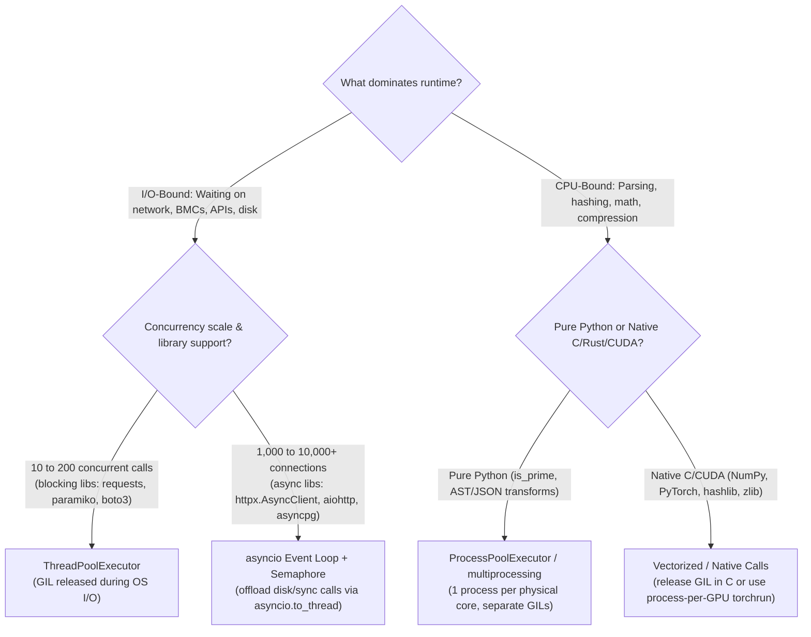

# 3.6 Concurrency: threads, processes and asyncio

| | |
|---|---|
| Level | Advanced |
| Priority tier | 0 |
| Lab venue | Any machine with Python 3.11+, several cores, optionally a fleet of test endpoints (local mock servers) |
| Part | Part 3: Python for infrastructure |
| Status | Drafted, labs **untested** |

## Why this matters for AI infrastructure

Infrastructure work is fan-out: query 5,000 BMCs, health-check 800 nodes, upload 10 million objects, tail logs from every pod, pre-process shards of a dataset, serve many inference requests while a model runs. Doing it sequentially is too slow; doing it concurrently without understanding the model produces hangs, resource exhaustion, race conditions and runaway memory. Python offers three concurrency models (threads, processes, asyncio) with different costs and the Global Interpreter Lock (GIL) shaping which one fits which workload. This chapter explains the models from first principles, shows how to choose, and covers the production patterns that matter: bounded concurrency, backpressure, timeouts, cancellation, error aggregation, retries, graceful shutdown, and diagnosing hangs. It prepares the ground for FastAPI services (3.7), exporters and agents (3.8) and data pipelines (3.10).

## Prerequisites and outcomes

You should know functions, generators and classes (3.1 to 3.4) and subprocess/signal basics (3.5).

After this chapter you can:

- Distinguish concurrency from parallelism; I/O-bound from CPU-bound work; explain the GIL, what it protects, when it is released, and the status of free-threaded builds and subinterpreters.
- Use `threading` (Thread, Lock, RLock, Event, Condition, Semaphore, Queue), `concurrent.futures` (`ThreadPoolExecutor`, `ProcessPoolExecutor`), and `multiprocessing` (Process, Pool, Queue, shared memory), with correct synchronisation and cleanup.
- Write `asyncio` code: coroutines, tasks, `gather`, `TaskGroup`, `wait_for`/`timeout`, semaphores, queues, cancellation, async context managers and iterators, async HTTP and subprocess; integrate blocking code via `to_thread`/executors; avoid blocking the event loop.
- Choose the model for a workload, size pools, and implement backpressure with bounded queues.
- Recognise and avoid data races, deadlocks, livelocks, starvation, thundering herds, fork-safety issues and orphaned work.
- Aggregate results and errors from many concurrent operations; implement retries with jitter, circuit breakers and rate limits; shut down gracefully.
- Profile and debug concurrency problems (faulthandler, py-spy, asyncio debug mode).

## 1. Concepts

- **Concurrency**: structuring a program so multiple tasks make progress in overlapping time periods ("dealing with lots of things at once", as Rob Pike defined it in *Fluent Python* Chapter 19). **Parallelism**: executing multiple computations simultaneously on multiple cores ("doing lots of things at once"). You can have concurrency without parallelism (one core interleaving tasks).
- **I/O-bound** work spends time waiting (network, disk, subprocesses, sleeping): concurrency helps even on one core because waiting overlaps. **CPU-bound** work spends time computing: only parallelism across cores (or faster code, native libraries) helps.
- **Latency vs throughput**; **Amdahl's law**: speed-up is limited by the serial fraction. Overheads (thread creation, context switches, serialisation between processes) can exceed gains for small tasks.
- **Shared state is the enemy**: the more tasks share mutable data, the more locks, races and bugs. Prefer **message passing** (queues), immutable data, and per-task state.



### The Global Interpreter Lock and the 3 spinner scripts (`FP` Chapter 19)

CPython's reference implementation has a **GIL**: a mutex ensuring only one thread executes Python bytecode at a time within a process. It simplifies memory management (reference counting is not thread-safe without it) and the implementation of C extensions. Consequences:

- **Threads do not speed up pure-Python CPU-bound code**; they can slow it down (contention, switching).
- **The GIL is released** during blocking I/O (`socket`, file reads, `time.sleep`, `subprocess` waits), and by many C extensions during long computations (NumPy, hashlib on large buffers, compression, regex in some cases, PyTorch ops, `zlib`, `bz2`), so threads *do* give speed-ups for I/O-bound code and for native-code-heavy work.
- Individual bytecode operations are atomic-ish, but compound operations (`x += 1`, check-then-act on a dict) are **not** thread-safe: races still occur. The GIL does not remove the need for locks.
- Since Python 3.2 (contributed by Antoine Pitrou), the interpreter switches threads on a time slice (`sys.getswitchinterval()`, `0.005`s = `5 ms` default).
- **A side-by-side comparison of Threads, Processes, and Coroutines (`spinner_thread.py`, `spinner_proc.py`, `spinner_async.py`, and `primes.py` in `FP` Chapter 19 `Examples 19-1` to `19-13`):**
  1. **Threaded spinner (`spinner_thread.py`):** Starts `spinner = Thread(target=spin, args=('thinking!', done))` where `done = threading.Event()` and `spin` loops `for char in itertools.cycle(r'\|/-'):` checking `if done.wait(.1): break` (printing `f'\r{char} {msg}'` with `flush=True`), runs `slow()`, and signals `done.set(); spinner.join()`. Even if `slow()` runs a CPU-bound Python `is_prime(5_000_111_000_222_021)` check instead of `time.sleep(3)`, the threaded spinner keeps animating because CPython suspends the `is_prime` thread every `5 ms` (`sys.getswitchinterval()`) just long enough for the `spin` thread to print a frame and go back to sleep in `done.wait(.1)`. However, running 12 threads on a 20-number primality benchmark (`NUMBERS` from `2` to `9_999_999_999_999_999`, `10**16 - 1`) gives **zero speedup** over sequential execution (`~40.81s`) because all threads contend for a single GIL.
  2. **Multiprocess spinner and worker queues (`spinner_proc.py` and `procs.py`):** Replaces `threading.Thread` with `multiprocessing.Process` and `done: synchronize.Event = Event()`. Because each child process has its own independent Python interpreter and **its own GIL**, running `procs.py` across a 6-core (12-thread hyperthreaded) laptop with `SimpleQueue[int]` `jobs` (terminated by a `0` **poison pill** per worker) and `SimpleQueue[PrimeResult]` `results` drops the 20-prime benchmark median time from `40.81s` (1 process) down to **`10.39s` with 6 processes** (with diminishing returns from 7 to 12 processes due to hyperthreading contention).
  3. **Asyncio spinner (`spinner_async.py`):** Runs on a single thread via `asyncio.run(main())`: `supervisor()` schedules `spinner = asyncio.create_task(spin('thinking!'))`, awaits `await slow()` (`await asyncio.sleep(3)`), and calls `spinner.cancel()`, which raises `asyncio.CancelledError` at the `await asyncio.sleep(.1)` inside `spin` so it breaks out of its loop and clears the status line. Crucially, if you replace `await asyncio.sleep(3)` inside `slow()` with a CPU-bound `is_prime(5_000_111_000_222_021)` call, **the async spinner freezes completely** because cooperative multitasking has no preemptive 5 ms time-slicing—`spin` never gets control until `slow()` hits an `await`.
  4. **Production Python web/API scaling (`WSGI` vs `ASGI`, `FP` Chapter 19 Figure 19-4):** Rather than relying on a single multi-threaded process, production Python stacks scale horizontally across CPU cores by running an application server (`gunicorn`, `uWSGI`, or `uvicorn` for ASGI) that preforks **one worker process per CPU core** behind an NGINX/Envoy reverse proxy and offloads shared state to external caches (`Redis`, `memcached`), databases (`PostgreSQL`), and task queues (`Celery`, `RabbitMQ`).
- **Free-threaded CPython** (PEP 703): optional builds (3.13+ experimental `python3.13t`, supported builds in later releases) run without the GIL; extension compatibility and single-thread overhead are evolving; check each dependency. **Subinterpreters** (PEP 684/734, `concurrent.interpreters` in 3.14) give per-interpreter GILs. Treat both as emerging; the models below remain the practical toolkit.
- Alternative implementations/approaches: processes (separate GILs), native extensions (Cython, Numba, Rust via PyO3), vectorised libraries (NumPy, pandas, PyTorch) that spend time outside the interpreter.

### Choosing a model

| Workload | Best fit | Why |
|---|---|---|
| Many network calls / API polls / SSH sessions (hundreds to thousands) | **asyncio** (with async libraries), or threads (simpler with blocking libraries) | Waiting dominates; lightweight tasks |
| Moderate fan-out with blocking libraries (`requests`, `paramiko`, `boto3`) | **ThreadPoolExecutor** | Easy; GIL released on I/O; pool size 10 to 200 |
| CPU-bound pure Python (parsing, hashing many small items, simulation) | **ProcessPoolExecutor / multiprocessing** | Separate GIL per process; use cores |
| CPU-bound numeric | NumPy/pandas/PyTorch/Numba (vectorised, releases GIL) or processes | Native speed |
| Mixed: async server + blocking calls / CPU work | asyncio + `to_thread` / process pool | Keep the loop free |
| Long-running background work in a web service | Task queues (Celery, RQ, Dramatiq, Arq, Kubernetes Jobs) | Isolation, retries, scaling |
| Distributed compute across nodes | Ray, Dask, MPI (`mpi4py`), Slurm arrays, Kubernetes | Beyond one machine |
| Simple one-off parallelism | Shell (`xargs -P`, GNU `parallel`) | Sometimes the right answer |

A common sizing heuristic: threads for I/O = (expected concurrency of the remote system you can tolerate) rather than "as many as possible"; processes for CPU = number of cores (`os.cpu_count()` / `len(os.sched_getaffinity(0))`, or the cgroup CPU limit in containers); asyncio concurrency limited by a semaphore to what the target and your sockets can sustain. Always apply **bounded concurrency**: unbounded fan-out overwhelms targets (a thundering herd on a BMC network or an API) and your own file descriptors and memory.

## 2. Threads

### Basics

```python
import threading, time

def worker(name, delay):
    time.sleep(delay)                              # releases the GIL
    print(f"{name} done")

threads = [threading.Thread(target=worker, args=(f"t{i}", 1), name=f"worker-{i}", daemon=True) for i in range(5)]
for t in threads: t.start()
for t in threads: t.join(timeout=10)               # wait; join with timeout so you can detect stuck threads
print(threading.active_count(), threading.current_thread().name)
```

- **Daemon threads** are killed abruptly at interpreter exit (no cleanup): use them only for background chores that can be dropped. Non-daemon threads keep the process alive until they finish.
- **Exceptions in threads** don't propagate to the main thread: they print a traceback and the thread ends. Capture them (use executors/futures) or set `threading.excepthook`.
- There is **no way to kill a thread** from outside. Design cooperative cancellation with a `threading.Event` that workers check, and time-bounded blocking calls (socket timeouts, queue `get(timeout=)`).
- `threading.local()` for thread-local state; `contextvars` for context that follows tasks/threads.

### Synchronisation primitives

| Primitive | Purpose |
|---|---|
| `Lock` | Mutual exclusion; use `with lock:` |
| `RLock` | Re-entrant lock (same thread may acquire repeatedly) |
| `Event` | One-bit flag: `set`, `clear`, `wait(timeout)`; shutdown signals |
| `Condition` | Wait for a condition under a lock; `notify`, `wait_for(predicate)` |
| `Semaphore` / `BoundedSemaphore` | Limit concurrent access to N resources (connection limits) |
| `Barrier` | Rendezvous N threads |
| `Timer` | Run a function after a delay |
| `queue.Queue` / `LifoQueue` / `PriorityQueue` / `SimpleQueue` | Thread-safe FIFO/LIFO/priority; `maxsize` bounds; `task_done`/`join` |

```python
import threading
counter = 0
lock = threading.Lock()
def incr(n):
    global counter
    for _ in range(n):
        with lock:                    # without the lock, 'counter += 1' (load, add, store) can lose updates
            counter += 1
```

**Data races** (lost updates, torn invariants), **deadlock** (two threads each hold a lock the other needs; avoid by a global lock order, acquiring with timeouts, or holding at most one lock), **livelock**, **starvation**, **priority inversion**. Rules: keep critical sections tiny and free of I/O; never call unknown callbacks while holding a lock; prefer queues and immutable messages over shared mutable data; test with stress loops.

### Producer/consumer with a bounded queue

```python
import queue, threading

q: queue.Queue = queue.Queue(maxsize=100)          # bounded: put() blocks when full = backpressure
SENTINEL = object()

def producer(items):
    for it in items:
        q.put(it)                                   # blocks if consumers are slower
    for _ in range(N_CONSUMERS):
        q.put(SENTINEL)

def consumer():
    while (item := q.get()) is not SENTINEL:
        try: handle(item)
        finally: q.task_done()
```

### `concurrent.futures`

The high-level API for pools: submit callables, get `Future` objects.

```python
from concurrent.futures import ThreadPoolExecutor, as_completed, wait, FIRST_EXCEPTION
import requests

def check(host):
    r = requests.get(f"https://{host}/healthz", timeout=5)
    return host, r.status_code

hosts = [...]
results, errors = {}, {}
with ThreadPoolExecutor(max_workers=50, thread_name_prefix="probe") as pool:
    futs = {pool.submit(check, h): h for h in hosts}
    for fut in as_completed(futs, timeout=120):                 # yields as each completes; overall deadline
        h = futs[fut]
        try:
            results[h] = fut.result()[1]                          # re-raises the worker's exception here
        except Exception as exc:
            errors[h] = repr(exc)
print(len(results), "ok;", len(errors), "failed")
```

- `pool.map(fn, iterable, timeout=..)` returns a generator yielding results **in the exact order of the input `iterable`** (and raises the first exception when that item is iterated). In *Fluent Python* Chapter 20 (`Examples 20-1` to `20-16`), downloading the 20 most populous countries' flag images (`POP20_CC = 'CN IN US ID BR PK NG BD RU JP MX PH VN ET EG DE TR CD FR IR'.split()`) with `httpx.get` takes **`7.18s`** sequentially (`flags.py`), versus **`1.40s`** with `ThreadPoolExecutor.map(download_one, sorted(cc_list))` (`flags_threadpool.py`, a `5x` speedup) and **`1.35s`** with `asyncio` (`flags_asyncio.py`). However, when `proc_pool.py` (`Example 20-6`) runs `executor.map(check, sorted(NUMBERS, reverse=True))` on `ProcessPoolExecutor`, it prints the first result (`9999999999999999`, divisible by 9) immediately and then **appears to freeze** while computing the second number (`9999999999999917`, the largest prime, taking `~11s`)—even though the remaining worker processes have already finished checking all the smaller numbers—because `executor.map` must yield results strictly in input order.
- **`executor.submit` + `futures.as_completed` + `to_do_map` (`flags2_threadpool.py`, `Example 20-16`):** To process results as soon as each task finishes, report live progress (`tqdm.tqdm(done_iter, total=len(cc_list))`), and associate any raised exception (`httpx.HTTPStatusError`, `httpx.RequestError`) with the exact input argument (`cc`) that caused it, build a dictionary mapping each submitted `Future` to its input key (`to_do_map[future] = cc`) and iterate `for future in futures.as_completed(to_do_map):` (modeled in `run_threadpool_to_do_map()` in `code/part03/python_concurrency_models.py`).
- `Future.result(timeout)`, `.exception()`, `.cancel()` (only if not started), `.add_done_callback()`, `.done()`.
- Leaving the `with` block waits for all pending work (`shutdown(wait=True)`); on exceptions `shutdown(wait=False, cancel_futures=True)` (3.9+) drops queued tasks.
- Executors **do not interrupt running tasks** on timeout: always set timeouts on the I/O inside the task.

### Backpressure with executors (avoiding the "10 million futures" OOM)

`for x in huge_iterable: pool.submit(...)` creates all futures immediately and holds them; memory explodes before work begins. Feed the pool in a bounded way:

```python
from itertools import islice
from concurrent.futures import ThreadPoolExecutor, wait, FIRST_COMPLETED

def bounded_map(fn, iterable, *, workers=50, max_inflight=200):
    it = iter(iterable)
    with ThreadPoolExecutor(max_workers=workers) as pool:
        inflight = {pool.submit(fn, x) for x in islice(it, max_inflight)}
        while inflight:
            done, inflight = wait(inflight, return_when=FIRST_COMPLETED)
            for fut in done:
                yield fut.result()                            # or handle errors here
            for x in islice(it, len(done)):                    # refill to keep max_inflight outstanding
                inflight.add(pool.submit(fn, x))
```

This keeps memory O(max_inflight) regardless of input size (a classic production fix for S3 listing/copy jobs and fleet-wide commands).

### Thread safety of common objects

`queue.Queue`, `logging`, `list.append`/`pop` (atomic operations), `dict` single operations are safe; compound operations are not. Many third-party clients are **not thread-safe** (a `requests.Session` is mostly safe for reads but share carefully; `paramiko` clients, database connections, `boto3` clients are generally safe for concurrent use while `boto3` *sessions*/resources are not; check documentation) — create one client per thread (thread-local) when in doubt. SQLite connections are per-thread by default.

## 3. Processes

### `multiprocessing` and `ProcessPoolExecutor`

```python
from concurrent.futures import ProcessPoolExecutor
import os, hashlib

def sha(path):                       # must be a top-level function: arguments and results are pickled
    h = hashlib.sha256()
    with open(path, "rb") as f:
        for chunk in iter(lambda: f.read(1 << 20), b""): h.update(chunk)
    return path, h.hexdigest()

if __name__ == "__main__":           # REQUIRED on spawn platforms (macOS, Windows, and default in 3.14 on Linux): guards re-import
    files = [...]
    with ProcessPoolExecutor(max_workers=os.cpu_count()) as pool:
        for path, digest in pool.map(sha, files, chunksize=16):          # chunksize batches IPC for many small tasks
            print(digest, path)
```

- **Start methods**: `fork` (copy-on-write child, fast, but unsafe with threads, locks held at fork time, CUDA contexts, open sockets; the default on Linux until 3.13/3.14), `spawn` (fresh interpreter importing your module; safe, slower, requires picklable arguments and `if __name__ == "__main__"`), `forkserver` (a clean server process forks workers). Select with `multiprocessing.set_start_method("spawn")` or `mp_context=multiprocessing.get_context("forkserver")`. **Never use `fork` after initialising CUDA** (PyTorch DataLoader workers and distributed launchers use `spawn`/`forkserver` for this reason); also avoid forking a process with running threads or gRPC/OpenMP state.
- **Pickling**: arguments and return values cross process boundaries via pickle; lambdas, nested functions, open files, sockets and locks can't be pickled (use top-level functions and plain data); large objects are copied (slow): pass file paths/indices or use shared memory.
- **Sharing data**: `multiprocessing.Queue/Pipe/Manager`, `Value`/`Array` (ctypes, with locks), **`multiprocessing.shared_memory.SharedMemory`** (zero-copy buffers; the basis for NumPy arrays shared across processes), memory-mapped files (`numpy.memmap`), `fork` copy-on-write for read-only data (beware reference-count writes that trigger page copies: `gc.freeze()` helps).
- **Pools**: `multiprocessing.Pool(processes)` with `map`, `imap_unordered`, `apply_async`, `starmap`; `maxtasksperchild` to recycle leaky workers; `initializer` to set up per-worker state (open a model, DB connection).
- **Overheads**: process start time (tens of ms, plus imports), IPC serialisation, memory duplication. Use chunking, long-lived workers, and coarse-grained tasks.
- **Error handling**: exceptions in workers re-raise in the parent (traceback text attached); a worker killed by the OOM killer raises `BrokenProcessPool`; handle and restart; set resource limits.
- **Signals and cleanup**: children inherit signal handlers under fork; handle `SIGTERM` in the parent to terminate children (`pool.terminate()`); orphaned workers when the parent is `SIGKILL`ed need `prctl(PR_SET_PDEATHSIG)` or a supervisor (systemd, Kubernetes) to clean them up; use `daemon=True` carefully.
- **Containers and cgroups**: `os.cpu_count()` reports host CPUs, not the container's CPU limit; use `len(os.sched_getaffinity(0))` or read cgroup `cpu.max`; oversubscribing a CPU-limited container causes throttling (visible in `cpu.stat`).

### GPUs and data loading

PyTorch's `DataLoader(num_workers=N)` uses worker processes for decoding/augmentation; tune `num_workers`, `prefetch_factor`, `pin_memory`, `persistent_workers`, avoid fork-after-CUDA, and watch memory duplication; for training launchers (`torchrun`, `accelerate`, `deepspeed`, `mpirun`, Slurm `srun`) each GPU gets its own process: concurrency models here are process-per-GPU, with NCCL for communication (Part 14). Multi-threading within a rank is for I/O (prefetch threads), not compute.

## 4. asyncio

### Why asyncio

Threads are heavy (each has a stack, kernel scheduling) and limited to thousands; asyncio runs **many tasks cooperatively on one thread** using an **event loop** and non-blocking I/O (epoll/kqueue). A task runs until it hits an `await` on something that isn't ready, then yields control, so tens of thousands of concurrent connections cost little. Costs: all code on the loop must be non-blocking, libraries must be async-aware, and CPU-bound or blocking calls stall every task.

### Core concepts

```python
import asyncio, time

async def fetch(session, host):                   # coroutine function: calling it returns a coroutine object (does not run yet)
    async with session.get(f"https://{host}/healthz", timeout=5) as r:      # aiohttp / httpx.AsyncClient
        return host, r.status

async def main(hosts):
    sem = asyncio.Semaphore(100)                  # bounded concurrency
    async with aiohttp.ClientSession() as session:
        async def bounded(h):
            async with sem:
                try:
                    return await asyncio.wait_for(fetch(session, h), timeout=10)
                except Exception as exc:
                    return h, repr(exc)
        return await asyncio.gather(*(bounded(h) for h in hosts))
results = asyncio.run(main(hosts))                # creates the loop, runs main, closes the loop
```

- **Coroutine**: `async def` function; `await` suspends it until the awaited coroutine/Future/Task completes. `await` is only allowed inside `async def`.
- **Task**: `asyncio.create_task(coro)` schedules a coroutine to run concurrently; keep a reference (the loop holds only weak references; a dropped task can be garbage collected mid-flight). Tasks can be awaited, cancelled, and inspected.
- **Event loop**: single-threaded scheduler; `asyncio.run()` is the entry point; avoid `get_event_loop()` outside running contexts.
- **`gather(*aws, return_exceptions=True)`** runs awaitables concurrently and collects results (with `return_exceptions=False`, the first exception propagates but others keep running); **`TaskGroup`** (3.11) provides structured concurrency: tasks started in the group are awaited on exit; if one fails, the others are cancelled and an `ExceptionGroup` is raised.

```python
async def poll_all(nodes):
    results = {}
    try:
        async with asyncio.TaskGroup() as tg:                  # structured concurrency
            for n in nodes:
                tg.create_task(poll(n, results))
    except* TimeoutError as eg:
        log.error("timeouts: %s", [str(e) for e in eg.exceptions])
    return results
```

- **Timeouts**: `await asyncio.wait_for(coro, timeout)` or the `async with asyncio.timeout(10):` context (3.11). **Every network await must have a timeout** (the classic silent hang: a half-open connection waits forever).
- **Cancellation**: `task.cancel()` raises `asyncio.CancelledError` at the task's current `await`; clean up in `finally`, **re-raise `CancelledError`** (never swallow it), and use `asyncio.shield()` to protect critical sections. Timeouts and `TaskGroup` rely on cancellation.
- **Synchronisation**: `asyncio.Lock`, `Semaphore`, `Event`, `Condition`, `Queue` (bounded with `maxsize`: `await q.put()` provides backpressure) — async versions; not thread-safe across threads. In *Fluent Python* Chapter 21 (`flags2_asyncio.py`, `Example 21-7`), an `asyncio.Semaphore(concur_req)` (`async with semaphore: image = await get_flag(client, base_url, cc)`) throttles active HTTP requests on `httpx.AsyncClient` while `asyncio.as_completed(to_do_iter)` streams results into a `tqdm` progress bar as they arrive.
- **Async iteration, async generators, async context managers (`__aenter__/__aexit__`), and async comprehensions (`LP` Chapter 20 & `FP` Chapter 21)**:
  - An **asynchronous iterable** (`class AsyncRange:` in `LP` Chapter 20 `all_async_demos.py`) implements `def __aiter__(self):` returning an **asynchronous iterator** that defines `async def __anext__(self):` (raising `StopAsyncIteration` when exhausted), while `async with` uses `__aenter__/__aexit__` or `contextlib.asynccontextmanager`.
  - An **asynchronous generator function** (`async def multi_probe(names: Iterable[str]) -> AsyncIterator[Result]:` in `FP` Chapter 21 `Example 21-18 domainlib.py`) combines `async def` and `yield`—launching `coros = [probe(name, loop) for name in names]` (where `await loop.getaddrinfo( domain, None)` queries DNS asynchronously) and iterating `for coro in asyncio.as_completed(coros): result = await coro; yield result`.
  - **Asynchronous comprehensions and generator expressions (PEP 530):** `[x ** 2 async for x in AsyncRange(1, 5)]`, `{name: found async for name, found in multi_probe(names)}`, and `{name for name in names if (await probe(name)).found}` allow `async for` and `await` directly inside list/dict/set comprehensions and generator expressions (note that `async for` awaits each item sequentially as the async iterator yields it; to run a batch of coroutines concurrently, use `await asyncio.gather(*coros)` or `asyncio.TaskGroup`).
- **Offloading blocking disk/CPU work (`asyncio.to_thread`) and multi-stage `await` (`FP` Chapter 21)**: Because the OS lacks portable non-blocking filesystem writes in standard Python, `flags_asyncio.py` (`Example 21-3`) calls `await asyncio.to_thread(save_flag, image, f'{cc}.gif')` inside `download_one` so writing files never stalls the event loop. Also remember that async database drivers (`asyncpg` in `Example 21-4`) and stream writers (`asyncio.start_server` in `tcp_mojifinder.py`, `Examples 21-12` to `21-15`, vs FastAPI/`uvicorn` `web_mojifinder.py`) split operations into explicit `await` stages (`tr = connection.transaction(); await tr.start(); ... await tr.commit()`, and `writer.write(data); await writer.drain(); writer.close(); await writer.wait_closed()`).
- **Subprocesses**: `asyncio.create_subprocess_exec(*cmd, stdout=PIPE)`, `await proc.communicate()`: non-blocking command execution, no pipe deadlocks if you read both streams (communicate does).
- **Blocking calls**: `await asyncio.to_thread(blocking_fn, args)` (3.9+) or `loop.run_in_executor(executor, fn, *args)` run blocking/CPU code off the loop. For CPU-bound work use a `ProcessPoolExecutor` via `run_in_executor`.
- **Async libraries**: `aiohttp`, `httpx.AsyncClient`, `asyncssh`, `aiofiles` (threads under the hood), `asyncpg`, `aioredis/redis.asyncio`, `aiokafka`, `kubernetes_asyncio`, `aioboto3`/`aiobotocore`, `grpc.aio`. Mixing sync libraries (requests, paramiko, boto3) inside coroutines blocks the loop: wrap with `to_thread`.
- **Debugging**: `asyncio.run(main(), debug=True)` or `PYTHONASYNCIODEBUG=1` logs slow callbacks (>100 ms), un-awaited coroutines ("coroutine ... was never awaited" warnings), and tasks destroyed while pending; `loop.slow_callback_duration`; `asyncio.all_tasks()` and `task.print_stack()` to see where tasks are stuck; `py-spy dump --pid` shows blocked loop stacks.
- **Event loop implementations**: `uvloop` (drop-in faster loop on Linux/macOS) improves throughput for servers.
- **Windows/macOS differences** exist (selector vs proactor); production Linux is the norm.

### A worker-pool template

```python
import asyncio, logging, random, signal
log = logging.getLogger("pool")

async def worker(name, q: asyncio.Queue, results: list, handler):
    while True:
        item = await q.get()
        try:
            results.append(await asyncio.wait_for(handler(item), timeout=30))
        except asyncio.CancelledError:
            raise
        except Exception as exc:
            log.warning("%s failed on %r: %r", name, item, exc)
            results.append(exc)
        finally:
            q.task_done()

async def run_pool(items, handler, concurrency=50, queue_size=500):
    q: asyncio.Queue = asyncio.Queue(maxsize=queue_size)       # bounded: producer awaits when workers lag
    results: list = []
    workers = [asyncio.create_task(worker(f"w{i}", q, results, handler)) for i in range(concurrency)]
    stop = asyncio.Event()
    loop = asyncio.get_running_loop()
    for sig in (signal.SIGINT, signal.SIGTERM):
        loop.add_signal_handler(sig, stop.set)
    try:
        for it in items:                                        # works with a (sync) generator of any length
            if stop.is_set(): break
            await q.put(it)
        await q.join()                                          # wait until all queued items are processed
    finally:
        for w in workers: w.cancel()
        await asyncio.gather(*workers, return_exceptions=True)
    return results
```

Properties: bounded memory, bounded concurrency, per-item timeouts and error isolation, clean cancellation on signals.

## 5. Patterns for infrastructure fan-out

### Retries, backoff and jitter

Retry only idempotent operations and transient errors (timeouts, connection resets, 429/503); use exponential backoff with **full jitter** to avoid synchronised retry storms; cap total time; honour `Retry-After`; log attempts.

```python
async def retry(fn, *, attempts=5, base=0.5, cap=20.0, retry_on=(asyncio.TimeoutError, ConnectionError)):
    for i in range(attempts):
        try:
            return await fn()
        except retry_on as exc:
            if i == attempts - 1: raise
            delay = random.uniform(0, min(cap, base * 2 ** i))            # full jitter
            await asyncio.sleep(delay)
```

Libraries: `tenacity`, `backoff`; HTTP clients have retry adapters (`urllib3.util.Retry` with `requests.adapters.HTTPAdapter`).

### Rate limiting and circuit breaking

Protect targets and yourself: token bucket (`aiolimiter`, `asyncio` semaphore + sleep), per-host concurrency limits (a semaphore per host/rack/BMC network), circuit breaker (stop calling a failing dependency for a cool-down), `Retry-After` handling, adaptive concurrency (AIMD like TCP). For BMC/Redfish fleets limit per-rack concurrency to avoid overwhelming management switches.

### Aggregating results

Return structured results per item (`Result(host, ok, value|error, duration)`), summarise at the end (success/failure counts, slowest, error classes), exit non-zero if any critical failure, and keep raw errors for diagnosis. Avoid letting one exception abort everything unless intended (use `return_exceptions=True` or catch inside the worker).

### Streaming and pagination

Combine async generators with queues for pipelines: `async for page in client.list_pages(): await q.put(page)`; consumers process in parallel with bounded concurrency; memory stays flat.

### Scheduling and periodic tasks

A simple periodic loop: `while not stop.is_set(): await run_once(); await asyncio.wait_for(stop.wait(), timeout=interval)` (interruptible sleep). Use `time.monotonic()` for drift-free intervals; for cron-like needs prefer systemd timers, Kubernetes CronJobs, or APScheduler; avoid `sleep` drift by computing the next deadline.

### Combining models

- **asyncio + processes**: `await loop.run_in_executor(process_pool, cpu_fn, data)`.
- **Threads + asyncio**: `asyncio.run_coroutine_threadsafe(coro, loop)` to submit from threads; `loop.call_soon_threadsafe` to touch the loop.
- **Multiprocess web servers**: gunicorn/uvicorn workers (one event loop per process) scale across cores; share state via external stores (Redis), not memory.
- **Background tasks in services**: FastAPI `BackgroundTasks` for short fire-and-forget; real queues for durable work (chapter 3.7).

### Distributed concurrency

When one machine isn't enough: Slurm job arrays and `srun`, Kubernetes Jobs with `completions`/`parallelism` and indexed jobs, Ray remote functions/actors, Dask, Celery/RQ workers. Idempotency, checkpointing and at-least-once semantics matter more than the in-process model.

## 6. Pitfalls and diagnosis

| Problem | Symptom | Cause / remedy |
|---|---|---|
| Blocking the event loop | Tasks stall, timeouts everywhere, loop "slow callback" warnings | Sync I/O (`requests`, `time.sleep`, subprocess.run, heavy CPU) in a coroutine: use async APIs or `to_thread` |
| Un-awaited coroutine | Work never happens; "was never awaited" warning | Forgot `await`/`create_task` |
| Dropped task reference | Tasks vanish or exceptions never seen ("Task exception was never retrieved") | Keep references; await or add done callbacks |
| Swallowed `CancelledError` | Cannot cancel/shutdown | Re-raise it; don't use bare `except` |
| Missing timeouts | Hangs after network blips | `wait_for`/`timeout` on every await; socket timeouts; `timeout=` in clients |
| Unbounded fan-out | OOM, too many open files, target overload | Semaphores, bounded queues, `islice` feeding |
| Thread-unsafe shared state | Rare wrong results | Locks, queues, thread-local, immutable data |
| Deadlock | Everything idle forever | Lock ordering, timeouts, avoid nested locks; `faulthandler.dump_traceback_later(60)`; `py-spy dump` |
| Fork with threads/CUDA/locks | Hangs in children, CUDA errors | Use `spawn`/`forkserver`; fork early before threads |
| Pickle errors | `Can't pickle local object` | Top-level functions; data classes; avoid lambdas |
| Worker leaks | Memory growth in pools | `maxtasksperchild`, recycle, fix leaks, `tracemalloc` |
| Zombie/orphaned processes | Defunct processes, leftover workers | `wait()`, context managers, process groups, supervisors |
| Oversubscription | CPU throttling, slow runs | Match workers to cgroup limits; avoid nested parallelism (NumPy threads x process pool: set `OMP_NUM_THREADS=1`) |
| Thundering herd / retry storm | Target collapse | Jittered backoff, limits, circuit breakers |
| Lost exceptions in threads | Silent partial results | Use futures; `threading.excepthook` |
| `signal` in non-main thread | `ValueError: signal only works in main thread` | Install handlers in the main thread / `loop.add_signal_handler` |
| `asyncio.run()` inside a running loop | `RuntimeError` (Jupyter, frameworks) | `await` instead; `nest_asyncio` only for notebooks |

Tools: `faulthandler.enable()` and `faulthandler.dump_traceback_later(timeout, repeat=True)`, `kill -SIGUSR1` with `faulthandler.register`, `py-spy dump/top/record` (sampling, no code changes), `threading.enumerate()`, `sys._current_frames()`, `asyncio.all_tasks()`, `psutil.Process().num_threads()`, `ss -s`, `lsof -p`, `strace -f -p`, `perf`, `tracemalloc`, metrics for in-flight tasks, queue depth, and latency percentiles.

## 7. Lab

First, run the self-checking Python lab (`code/part03/python_concurrency_models_lab.py`) locally. It verifies CPU-bound `is_prime(n)`, `spinner_thread.py` (`threading.Event`), and `spinner_async.py` (`Task.cancel` and `CancelledError`, `FP` Ch. 19), `flags2_threadpool.py`'s `to_do_map` + `as_completed` pattern and `bounded_map` backpressure (`FP` Ch. 20), and `asyncio.Semaphore` bounded fan-out, `asyncio.to_thread` offloading, `multi_probe` async generators, and PEP 530 async comprehensions over `AsyncRange` (`FP` Ch. 21 & `LP` Ch. 20).

```bash
python3 code/part03/python_concurrency_models_lab.py
```

Next, on any machine with Python 3.11+ (all interactive shell steps below are `untested here`), work through these exercises:

1. **GIL experiment**: time a CPU-bound function sequentially, with 4 threads, with 4 processes; time an I/O-bound function (sleep/HTTP to a local server) sequentially, with threads, with asyncio; plot or tabulate; check `sys.getswitchinterval()`; try a NumPy function and `hashlib` on large buffers with threads to see GIL release.
2. **Races and locks**: reproduce a lost update with `counter += 1`; fix with a lock; demonstrate a deadlock with two locks and fix by ordering; use `queue.Queue` producer/consumer with a bounded queue and sentinel shutdown.
3. **Executors**: build the health-check fan-out with `ThreadPoolExecutor` against a local mock server with random latency/failures; add per-call timeouts, aggregate errors; implement `bounded_map` and prove memory stays flat when mapping over 10 million generated items (compare with naive submit-all using `tracemalloc`/`/usr/bin/time -v`).
4. **Processes**: hash many files with `ProcessPoolExecutor`; compare `chunksize`, `spawn` vs `fork`, pickling failure with a lambda; use `SharedMemory` with NumPy to share a large array; show copy-on-write behaviour and `gc.freeze()`; kill a worker with `kill -9` and handle `BrokenProcessPool`.
5. **asyncio**: write the async fan-out with `aiohttp`/`httpx` and a semaphore, timeouts and error aggregation; scale to 5,000 concurrent requests against a local server; compare throughput and memory with threads; add `TaskGroup` and `except*`.
6. **Event-loop blocking**: insert `time.sleep(1)` and `requests.get` into a coroutine and observe stalls and debug-mode warnings; fix with `to_thread`; use `PYTHONASYNCIODEBUG=1`.
7. **Cancellation and shutdown**: implement the worker pool template; send SIGTERM mid-run; verify in-flight work finishes or cancels cleanly, no "Task exception was never retrieved" messages, and exit code is correct; test `CancelledError` swallowing bug.
8. **Backpressure**: slow consumer + fast producer with bounded `asyncio.Queue`; show memory with unbounded vs bounded queues.
9. **Retries**: implement jittered retries and circuit breaker; simulate a flapping dependency; show synchronized retry storm without jitter vs smooth with jitter.
10. **Subprocess concurrency**: run 200 `ping`/`ssh` commands with `asyncio.create_subprocess_exec` limited by a semaphore; compare with threads + `subprocess.run`; handle timeouts and zombie prevention.
11. **Diagnose hangs**: write a program with a deadlock and one with a blocked event loop; diagnose using `faulthandler`, `py-spy dump`, `asyncio.all_tasks()`.
12. **Containers**: run the process pool inside a container with `--cpus=2`; show `os.cpu_count()` vs `sched_getaffinity` and CPU throttling (`cpu.stat`).
13. **Clean up.**

## 8. Common mistakes

- Using threads to speed up CPU-bound pure Python, or asyncio for blocking libraries without offloading.
- Unbounded concurrency (no semaphore, queue or pool limits), unbounded queues, and creating millions of futures.
- No timeouts; swallowing `CancelledError`; fire-and-forget tasks without references or error handling.
- Sharing mutable state across threads/processes instead of messages; assuming the GIL makes code thread-safe.
- Forking after threads/CUDA initialisation; forgetting `if __name__ == "__main__"` with spawn; passing unpicklable objects.
- Forgetting that exceptions in workers must be collected; aborting an entire fleet operation on the first failure (or hiding all failures).
- Retrying non-idempotent operations or retrying without jitter and caps.
- Sizing pools by `cpu_count()` in containers; nested parallelism (process pool x BLAS threads).
- Treating async as "faster"; for a few requests the overhead and complexity are not worth it.

## 9. Interview angles

- "Explain the GIL. When do threads help? When do you need processes?"
- "How would you query 10,000 servers concurrently and safely?"
- "Threads vs asyncio: trade-offs; how do they handle blocking calls?"
- "What's `asyncio.gather` vs `TaskGroup`? How does cancellation work?"
- "What is backpressure and how do you implement it in Python?"
- "A service's async handlers hang after a network blip. What do you check?" (timeouts, blocked loop, dropped tasks.)
- "Why does fork after CUDA initialisation fail? How do DataLoader workers avoid it?"
- "How do you shut down a multi-threaded/async worker gracefully on SIGTERM?"
- "How would you parallelise processing of a 5 TB dataset?" (shards, processes/Ray/Dask/Slurm arrays, IO, checkpointing.)

## Exercises

1. **Concurrency vs. Parallelism, the GIL, and the Three Spinner Scripts (`FP` Chapter 19):** Using `is_prime()`, `run_thread_spinner_demo()`, and `run_async_spinner_cancellation_demo()` in `code/part03/python_concurrency_models.py`, explain: (a) Rob Pike's distinction between concurrency and parallelism, what the CPython GIL protects, and when it is released; and (b) why replacing `sleep(3)` with `is_prime(5_000_111_000_222_021)` allows `spinner_thread.py` and `spinner_proc.py` to keep spinning (`5 ms` `sys.getswitchinterval()`) while freezing `spinner_async.py`.
2. **Thread Synchronization, Producer/Consumer Backpressure, and `ThreadPoolExecutor` (`to_do_map` + `as_completed` vs. `map`, `FP` Chapter 20):** (a) Explain why `counter += 1` is not thread-safe despite the GIL, how `threading.Event` and bounded `queue.Queue(maxsize=100)` with sentinel objects work, and how to prevent deadlocks; (b) using `run_threadpool_to_do_map()` and `bounded_map()`, compare `executor.map` (and why `proc_pool.py` stalls on `9999999999999917`) with `executor.submit` + `as_completed(to_do_map)` and `bounded_map` (`max_inflight` backpressure).
3. **Multiprocessing (`ProcessPoolExecutor`), Start Methods (`fork` vs. `spawn` vs. `forkserver`), Pickling, and `SharedMemory` (`FP` Chapters 19 & 20):** (a) Explain why `procs.py` drops the 20-prime benchmark from `40.81s` to `10.39s` on a 6-core machine and how poison-pill shutdown works on `SimpleQueue`; (b) explain why `fork` after initializing CUDA or threads hangs or crashes, why `spawn` requires `if __name__ == "__main__":` and picklable top-level functions, and how `multiprocessing.shared_memory.SharedMemory` and `gc.freeze()` avoid memory duplication.
4. **Asyncio Core: Event Loop, `Task`, `gather` vs. `TaskGroup`, Timeouts, Cancellation, and `asyncio.to_thread` (`FP` Chapter 21 & `LP` Chapter 20):** Using `run_async_semaphore_and_comprehension_demo()`, explain: (a) how `asyncio.Semaphore(concur_req)` bounds concurrent requests, how `asyncio.gather` differs from Python 3.11 `asyncio.TaskGroup` (`except*`), and why `CancelledError` must be re-raised; and (b) why `flags_asyncio.py` wraps `save_flag` in `await asyncio.to_thread(save_flag, image, f'{cc}.gif')`.
5. **Asynchronous Iterators (`AsyncRange`), Async Generators (`multi_probe`), and PEP 530 Async Comprehensions (`LP` Ch. 20 & `FP` Ch. 21):** Using `AsyncRange` and `multi_probe_async_gen()` in `code/part03/python_concurrency_models.py`, contrast `__aiter__` / `__anext__` (`StopAsyncIteration`) with `async def` + `yield` async generators, and explain the difference between sequential `async for` iteration and concurrent `asyncio.as_completed` / `asyncio.gather`.
6. **Production Fan-Out Patterns: Bounded Worker Pools, Jittered Exponential Backoff, Signal Shutdown, and Hang Diagnosis:** (a) Trace how `run_pool()` combines a bounded `asyncio.Queue(maxsize=queue_size)`, fixed worker tasks, `wait_for(..., timeout=30)`, and `loop.add_signal_handler(sig, stop.set)` for graceful `SIGTERM` drain; (b) write the full-jitter exponential backoff formula `random.uniform(0, min(cap, base * 2 ** i))` and list the tools used to diagnose a hung or throttled Python service (`PYTHONASYNCIODEBUG=1`, `faulthandler`, `py-spy dump`, `len(os.sched_getaffinity(0))`).

## Checkpoint questions (20)

<details>
<summary>1. Distinguish Concurrency from Parallelism and I/O-bound from CPU-bound workloads (`FP` Chapter 19).</summary>

- **Concurrency** ("dealing with lots of things at once") is structuring a program so multiple tasks overlap in time (even on a single CPU core via interleaving). **Parallelism** ("doing lots of things at once") is executing multiple computations simultaneously across multiple physical CPU cores or GPUs.
- **I/O-bound** workloads spend most of their wall-clock time waiting on network sockets, disks, or subprocesses (concurrency via `asyncio` or threads overlaps the waits). **CPU-bound** workloads spend their time executing instructions (requiring multi-process parallelism or native C/Rust/CUDA code to go faster).
</details>

<details>
<summary>2. What is the CPython GIL, when is it released, and why doesn't it make `counter += 1` thread-safe (`FP` Chapter 19)?</summary>

The **Global Interpreter Lock (`GIL`)** is a mutex in CPython that allows only one thread per process to execute Python bytecode at a time (protecting CPython's reference-counting memory management and C extension state).
- **When released:** The GIL is released automatically during **all blocking OS I/O syscalls** (`socket`, file read/write, `time.sleep`, `subprocess`) and by C extensions during heavy native work (`NumPy`, `PyTorch`, `hashlib`, `zlib`, `bz2`).
- **Why `counter += 1` still races:** CPython preempts bytecode threads every `5 ms` (`sys.getswitchinterval()`), and `counter += 1` compiles into multiple bytecode steps (`LOAD_GLOBAL`, `BINARY_OP`, `STORE_GLOBAL`). A thread switch between load and store causes **lost updates** unless guarded by `with threading.Lock():` (note: Python 3.13+ offers experimental free-threaded builds under PEP 703 and subinterpreters under PEP 684).
</details>

<details>
<summary>3. In *Fluent Python* Chapter 19's three spinner scripts (`spinner_thread.py`, `spinner_proc.py`, `spinner_async.py`), what happens if you replace `sleep(3)` with a CPU-bound `is_prime(5_000_111_000_222_021)` call?</summary>

- **`spinner_thread.py` (`threading.Thread` + `threading.Event`):** Keeps spinning. Even though `is_prime` is pure-Python CPU work holding the GIL, CPython suspends `is_prime` every `5 ms` (`sys.getswitchinterval()`), allowing the spinner thread to wake up from `done.wait(0.1)`, print one character, and release the GIL again.
- **`spinner_proc.py` (`multiprocessing.Process` + `multiprocessing.Event`):** Keeps spinning in true parallelism because the child process has its own separate Python interpreter and GIL on another CPU core.
- **`spinner_async.py` (`asyncio.create_task`):** **Freezes completely.** On a single-threaded cooperative event loop, there is no preemptive time-slicing; `is_prime` has no `await`, so it monopolizes the thread until it finishes, starving `spin()` the entire time.
</details>

<details>
<summary>4. How do you stop a Python `Thread` versus an `asyncio.Task`, and what does `daemon=True` mean?</summary>

- **Stopping a `Thread`:** Python threads **cannot be killed or interrupted from outside**. You must use cooperative cancellation: pass a **`threading.Event`** (`done`) that the worker checks in its loop (`while not done.wait(timeout):`), and keep all blocking I/O time-bounded so the thread can exit and be joined (`t.join(timeout=10)`).
- **Stopping an `asyncio.Task`:** Calling **`task.cancel()`** schedules an **`asyncio.CancelledError`** to be raised inside the coroutine at its currently suspended `await` expression; the coroutine runs its `finally:` cleanup and **must re-raise `CancelledError`**.
- **`daemon=True`:** Daemon threads are terminated abruptly when the main thread exits (without running `finally:` blocks or flushing files); non-daemon threads keep the process alive until they finish.
</details>

<details>
<summary>5. Compare `Lock`, `RLock`, `Event`, `Condition`, `Semaphore`, and `queue.Queue(maxsize=N)`.</summary>

- **`Lock`**: basic mutex; acquiring it twice in the same thread deadlocks.
- **`RLock`**: re-entrant mutex; the same thread can acquire it multiple times (and must release it the same number of times).
- **`Event`**: thread-safe boolean flag (`set()`, `clear()`, `wait(timeout)`) for start/shutdown signaling.
- **`Condition`**: lock + wait-set (`wait_for(predicate)`, `notify()`, `notify_all()`) for state transitions.
- **`Semaphore(N)` / `BoundedSemaphore(N)`**: caps concurrent access to at most `N` threads.
- **`queue.Queue(maxsize=N)`**: thread-safe FIFO queue where `put()` blocks when `maxsize` is reached, providing automatic **backpressure** to fast producers (`task_done()` + `join()` track completion, and a `SENTINEL = object()` poison pill signals workers to exit).
</details>

<details>
<summary>6. Contrast `executor.map()` with `executor.submit()` + `as_completed(to_do_map)` in `concurrent.futures` (`FP` Chapter 20).</summary>

- **`executor.map(fn, iterable)`**: returns an iterator that yields results **strictly in the order of `iterable`**. As shown in `FP` Chapter 20's `proc_pool.py`, if the second item (`9999999999999917`) takes 11 seconds while items 3..20 take microseconds, `executor.map` blocks waiting for item 2 before yielding items 3..20, and raises the first exception encountered during iteration.
- **`executor.submit(fn, x)` + `as_completed(to_do_map)` (`flags2_threadpool.py`):** Maps each `Future` to its input key (`to_do_map = {executor.submit(fn, h): h for h in hosts}`) and yields futures **in completion order** (`for fut in as_completed(to_do_map):`), allowing immediate progress reporting and per-host error isolation (`try: res = fut.result() except Exception as exc: errors[to_do_map[fut]] = exc`).
</details>

<details>
<summary>7. Why does `[pool.submit(fn, x) for x in ten_million_items]` cause an Out-Of-Memory crash, and how does `bounded_map` fix it?</summary>

Calling `pool.submit(fn, x)` in a loop over 10 million items eagerly allocates 10 million `Future` objects, closure arguments, and internal work-queue entries in RAM before workers can drain them—consuming gigabytes of memory. `bounded_map` seeds the pool with at most `max_inflight` futures via **`islice(it, max_inflight)`**, waits for at least one future to finish via **`done, inflight = wait(inflight, return_when=FIRST_COMPLETED)`**, yields results from `done`, and submits only `len(done)` replacement items from `islice(it, len(done))`, bounding memory to **$O(\text{max\_inflight})$**.
</details>

<details>
<summary>8. Compare the three `multiprocessing` start methods (`fork`, `spawn`, `forkserver`), and explain why you must never `fork` after initializing CUDA or threads.</summary>

- **`fork`**: clones the parent process via copy-on-write (`os.fork()`). Fast, but **only the calling thread is duplicated**—if any other thread held a mutex (in Python, glibc `malloc`, gRPC, OpenMP, or the **CUDA driver runtime**), that lock remains permanently locked in the child, causing deadlocks or `CUDA_ERROR_NOT_INITIALIZED` crashes.
- **`spawn`**: starts a fresh Python interpreter process and re-imports the main module (mandatory on macOS/Windows and default in Python 3.14+ on Linux; requires **`if __name__ == "__main__":`** and picklable top-level functions/arguments).
- **`forkserver`**: forks workers from a clean, single-threaded server process started before CUDA/threads were initialized.
</details>

<details>
<summary>9. How do you share large numeric arrays across worker processes without pickling overhead or copy-on-write page faults?</summary>

1. **`multiprocessing.shared_memory.SharedMemory`** (or `numpy.memmap`): allocates an OS shared-memory buffer that multiple processes attach to by name with **zero serialization or copying**.
2. **`gc.freeze()` before `fork`** (when using read-only data under `forkserver`/`fork`): moves all currently allocated Python objects into the permanent GC generation so reference-count/GC header mutations during reads do not dirty copy-on-write memory pages.
3. Pass **`chunksize=16`** (or higher) to `ProcessPoolExecutor.map` to batch IPC transfers across many small items, and use `maxtasksperchild` on `multiprocessing.Pool` to recycle leaky workers.
</details>

<details>
<summary>10. Why shouldn't you size a process pool with `os.cpu_count()` inside a Kubernetes pod or container (`FP` Chapter 19)?</summary>

`os.cpu_count()` returns the number of logical CPUs on the **physical host node** (for example, `128` on a dual-socket GPU server), ignoring container cgroup limits (`resources.limits.cpu: "4"`). Spawning 128 worker processes inside a 4-CPU container causes severe context-switch thrashing and CFS bandwidth throttling (`nr_throttled` in `/sys/fs/cgroup/cpu.stat`). Use **`len(os.sched_getaffinity(0))`** or inspect cgroup `cpu.max` instead (and set `OMP_NUM_THREADS=1` / `MKL_NUM_THREADS=1` when using process pools so native BLAS libraries do not oversubscribe cores).
</details>

<details>
<summary>11. How does the `asyncio` event loop achieve high concurrency on a single thread, and why must you hold a reference to `asyncio.create_task(coro)`?</summary>

An `asyncio` event loop multiplexes thousands of lightweight coroutine tasks on **one OS thread** using non-blocking sockets and OS readiness notification (`epoll` on Linux, `kqueue` on macOS). Calling an `async def` function returns a coroutine object without running it; **`asyncio.create_task(coro)`** wraps it in a `Task` and schedules it on the loop. Because the event loop only holds **weak references** to scheduled tasks, a fire-and-forget `asyncio.create_task(coro)` whose return value is not saved in a variable or `set` can be garbage-collected mid-execution.
</details>

<details>
<summary>12. Compare `asyncio.gather(*aws, return_exceptions=...)`, `asyncio.as_completed(aws)`, and Python 3.11+ `asyncio.TaskGroup()`.</summary>

- **`asyncio.gather(*aws, return_exceptions=True)`**: runs awaitables concurrently and returns results **in input order**; with `return_exceptions=True`, exceptions are returned as values in the result list rather than aborting; with `return_exceptions=False`, the first exception propagates immediately to the caller **while the remaining tasks continue running in the background as orphans**.
- **`asyncio.as_completed(aws)` (`domainlib.py`, `flags2_asyncio.py`):** yields futures/coroutines **in completion order** as each finishes.
- **`async with asyncio.TaskGroup() as tg:`**: provides **structured concurrency**—all tasks spawned via `tg.create_task(...)` are guaranteed to be awaited before the `async with` block exits; if any task raises an unhandled exception, `TaskGroup` automatically **cancels all sibling tasks**, waits for their cleanup, and raises an `ExceptionGroup` (handled via `except*`).
</details>

<details>
<summary>13. How do `asyncio.wait_for(coro, timeout)` / `asyncio.timeout(10)` and `CancelledError` interact?</summary>

When a timeout expires in `await asyncio.wait_for(coro, timeout=10)` or `async with asyncio.timeout(10):`, `asyncio` calls **`task.cancel()`** on the inner task, raising **`asyncio.CancelledError`** at its current `await` point, waits for its `finally:` blocks to finish, and then raises `TimeoutError` to the caller. If your coroutine catches `except Exception:` (in Python 3.8+, `CancelledError` inherits from `BaseException`, not `Exception`) or uses a bare `except:` / `except BaseException:` without **re-raising `CancelledError`**, you break timeouts and `TaskGroup` cancellation. Use `asyncio.shield(coro)` only when an operation must not be interrupted mid-flight.
</details>

<details>
<summary>14. Why does `flags_asyncio.py` (`FP` Chapter 21) call `await asyncio.to_thread(save_flag, image, filename)`, and what happens if you call `time.sleep` or `requests.get` inside a coroutine?</summary>

Calling synchronous blocking functions (`time.sleep()`, `requests.get()`, `subprocess.run()`, or blocking disk I/O `save_flag()`) directly inside an `async def` coroutine **blocks the single event-loop thread**, freezing every other concurrent task and triggering `Executing <Task ...> took 0.XXX seconds` warnings under `PYTHONASYNCIODEBUG=1`. Because OS file writes block and `asyncio` has no native file I/O API, **`await asyncio.to_thread(save_flag, image, filename)`** (or `loop.run_in_executor(None, ...)`) dispatches the blocking function to `asyncio`'s default `ThreadPoolExecutor` (which releases the GIL during disk/network I/O) and awaits the result without stalling the event loop.
</details>

<details>
<summary>15. How do Asynchronous Iterators (`__aiter__`/`__anext__`), Asynchronous Generators (`async def` + `yield`), and PEP 530 Asynchronous Comprehensions work (`LP` Ch. 20 & `FP` Ch. 21)?</summary>

- **Async iterator (`AsyncRange`):** `__aiter__(self)` returns the iterator object, and `async def __anext__(self)` awaits I/O and returns the next item or raises **`StopAsyncIteration`**.
- **Async generator (`multi_probe`):** Any `async def` function containing `yield` returns an `AsyncGenerator` object consumed with **`async for item in aiter:`**.
- **PEP 530 async comprehensions:** `[x async for x in aiter if cond]` and `{k: v async for k, v in multi_probe(names)}` consume async iterables, while `[await probe(n) for n in names]` awaits coroutines inside any comprehension inside an `async def` function.
</details>

<details>
<summary>16. How do you bound concurrency and memory in an `asyncio` service or fleet fan-out (`Semaphore` and bounded `asyncio.Queue` worker pool)?</summary>

1. **For a known list of targets (`flags2_asyncio.py`):** Create `sem = asyncio.Semaphore(100)` and wrap each request in `async with sem: return await fetch(h)` so at most 100 sockets are open simultaneously.
2. **For streaming/huge inputs (`run_pool`):** Create a bounded **`q = asyncio.Queue(maxsize=500)`** and spawn a fixed number of worker tasks (`concurrency=50`) looping `item = await q.get(); try: ... finally: q.task_done()`. When workers fall behind, `await q.put(item)` suspends the producer automatically (**backpressure**), keeping memory flat at $O(\text{queue\_size} + \text{concurrency})$.
</details>

<details>
<summary>17. Why do synchronized retries cause a "Retry Storm" (Thundering Herd), and how does Exponential Backoff with Full Jitter prevent it?</summary>

If 1,000 clients hit a transiently overloaded API or BMC switch and all retry at fixed intervals (`1s, 2s, 4s, 8s`), all 1,000 clients hammer the recovering server at the exact same millisecond on every wave. **Exponential backoff with full jitter** computes `delay = random.uniform(0, min(cap, base * 2 ** attempt))`, spreading retries uniformly across `[0, cap]` to smooth load while failed targets recover (complemented by per-host/per-rack semaphores and circuit breakers).
</details>

<details>
<summary>18. How do you bridge Threads and Asyncio safely (`to_thread`, `run_in_executor`, `run_coroutine_threadsafe`)?</summary>

- **From `asyncio` coroutine -> blocking thread/process:** Use **`await asyncio.to_thread(fn, *args)`** for blocking I/O or **`await loop.run_in_executor(process_pool, cpu_fn, *args)`** for CPU-bound work.
- **From an external OS thread -> running `asyncio` event loop:** `asyncio` objects (`Loop`, `Task`, `Queue`, `Event`) are **not thread-safe**; never call `loop.create_task()` or `q.put_nowait()` directly from another thread. Instead, call **`fut = asyncio.run_coroutine_threadsafe(coro, loop)`** (which returns a thread-safe `concurrent.futures.Future`) or `loop.call_soon_threadsafe(callback, *args)`.
</details>

<details>
<summary>19. How do production Python web/API servers (`uvicorn`, `gunicorn`, FastAPI) combine processes, threads, and `asyncio` (`FP` Chapters 19 & 21)?</summary>

A single Python process is bound to one core for Python bytecode by the GIL. Production ASGI deployments (`gunicorn -k uvicorn.workers.UvicornWorker -w N` or `uvicorn --workers N`, or multiple Kubernetes Pod replicas) run **one worker process per CPU core**, where each process runs its own independent `asyncio` event loop (often accelerated by `uvloop`) handling thousands of concurrent I/O connections, offloads any blocking calls to its local thread pool (`to_thread` / FastAPI `def` endpoints), and shares state across workers via external stores (`Redis`, `PostgreSQL`).
</details>

<details>
<summary>20. How do you diagnose a hung multi-threaded or `asyncio` Python process in production without restarting it?</summary>

1. **`py-spy dump --pid <PID>`** (or `py-spy top`): samples and prints the exact Python call stack of every thread in the live process from outside with zero code changes.
2. **`faulthandler`**: enable `faulthandler.enable()` and `faulthandler.register(signal.SIGUSR1)` at startup so `kill -SIGUSR1 <PID>` (or `faulthandler.dump_traceback_later(60, repeat=True)`) dumps all thread stacks to `stderr`.
3. **`asyncio` debug mode**: run with `PYTHONASYNCIODEBUG=1` or `asyncio.run(main(), debug=True)` to log callbacks taking `> 100 ms`, un-awaited coroutines, and pending tasks via `asyncio.all_tasks()`.
</details>

## Sources and review notes

- **Sources read in full:**
  - `fluent-python-2nd-edition` — Luciano Ramalho, *Fluent Python*, 2nd ed., **Chapter 19: Concurrency Models in Python** (Rob Pike concurrency vs parallelism, the GIL and `sys.getswitchinterval()` `5 ms`, `spinner_thread.py`, `spinner_proc.py`, and `spinner_async.py`, CPU-bound `is_prime` across 20 `NUMBERS` up to `9,999,999,999,999,999` with `sequential.py` `40.81s` vs `procs.py` `10.39s` on 6 cores using `SimpleQueue` poison pills, and WSGI/ASGI multi-process architectures), **Chapter 20: Concurrent Executors** (`flags.py` `7.18s` vs `flags_threadpool.py` `1.40s` vs `flags_asyncio.py` `1.35s` on `POP20_CC`, `proc_pool.py` `ProcessPoolExecutor.map` ordering stall on `9999999999999917`, and `flags2_threadpool.py` `executor.submit` + `futures.as_completed(to_do_map)` + `tqdm` + per-future error handling), and **Chapter 21: Asynchronous Programming** (native coroutines, `blogdom.py` and `domainlib.py` `loop.getaddrinfo`, `asyncio.as_completed`, `multi_probe` async generator, PEP 530 async comprehensions, `flags_asyncio.py` and `flags2_asyncio.py` with `asyncio.Semaphore(concur_req)`, `httpx.AsyncClient`, and `await asyncio.to_thread(save_flag, ...)`, `asyncpg` multi-stage `await` transactions, and `tcp_mojifinder.py` vs FastAPI/`uvicorn` `web_mojifinder.py`).
  - `learning-python-6th-edition` — Mark Lutz, *Learning Python*, 6th ed., **Chapter 20: Comprehensions and Generations** (`all_async_demos.py` comparing serial `time.sleep` vs `async def` + `await asyncio.sleep` with `asyncio.gather`, and `AsyncRange` implementing `__aiter__`/`__anext__` with `async for`).
  - `nvidia-devops` (`volume-02/02-python-systems-concurrency-masterclass.md`): GIL and concurrency model selection, subprocess pitfalls, `ThreadPoolExecutor` fan-out and backpressure (`bounded_map`), `asyncio` for BMC APIs, blocked-loop and thread-pool OOM scenarios, and retries with full jitter.
- **Run here:** `python3 code/part03/python_concurrency_models_lab.py` (4 passed, 0 failed).
- **Explicitly labelled inferences:** The Section 2 `bounded_map`, Section 4 `run_pool` worker-pool template, and Section 5 `retry` with full jitter are the author's constructions applying *Fluent Python* Chapters 19–21 to fleet-scale infrastructure automation (plus original study items 21, 22, 23, 24, 25, 26, 27, 28, 29, 30, 31, 32, 33, 34, 35, 36, 37, 38, 39, and 40).
- **Not verified on live hardware:** Fleet-scale benchmarks (`5,000` BMCs, `800` nodes, `10 million` objects, `10,000` servers, `5 TB` dataset, `python3.13t` PEP 703, `3.14` PEP 684/734 subinterpreters) are marked (`untested here`) where not executed by `python_concurrency_models_lab.py`.
