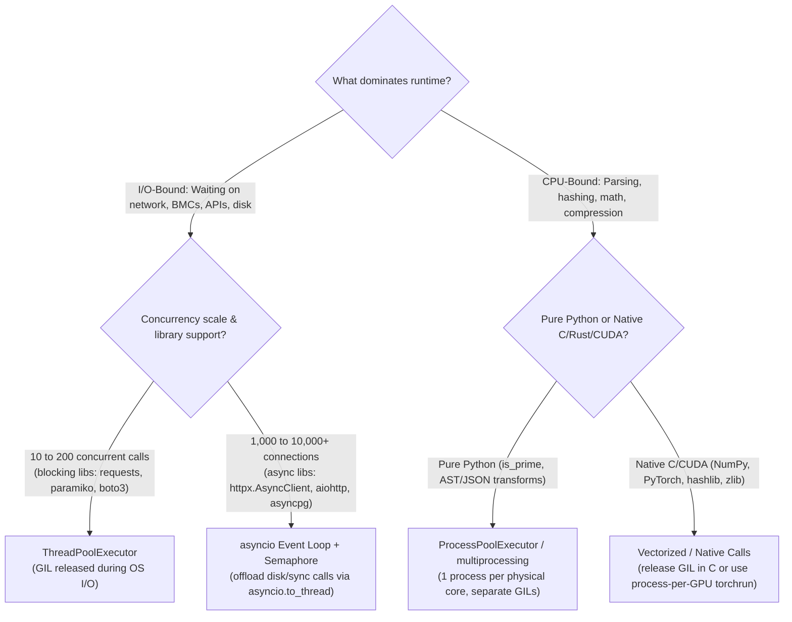

# 3.6 Concurrency: threads, processes and asyncio

| | |
|---|---|
| Level | Advanced |
| Priority tier | 0 |
| Lab venue | Any machine with Python 3.11+, several cores, optionally a fleet of test endpoints (local mock servers) |
| Part | Part 3: Python for infrastructure |
| Status | Drafted, labs **untested** |

## Why this matters for AI infrastructure

Suppose you have to query 5,000 BMCs, health-check 800 nodes and tail logs from every pod. Other jobs upload 10 million objects, pre-process shards of a dataset, or serve many inference requests while a model runs. This is fan-out work: one job touches many machines or items at once. Doing it one item at a time is far too slow. Doing it concurrently without understanding the model, however, produces hangs, resource exhaustion, race conditions and runaway memory.

Python offers three concurrency models: threads, processes and asyncio. Each one has a different cost. The Global Interpreter Lock (GIL) decides which model fits which workload.

This chapter explains the models from first principles and shows you how to choose between them. It then covers the production patterns that matter most: bounded concurrency, backpressure, timeouts, cancellation, error aggregation, retries, graceful shutdown and diagnosing hangs. The ground it lays also prepares you for FastAPI services in chapter 3.7, exporters and agents in chapter 3.8, and data pipelines in chapter 3.10.

## Prerequisites and outcomes

Before you start, you should be comfortable with functions, generators and classes from chapters 3.1 to 3.4. You should also know the basics of subprocess and signal handling from chapter 3.5.

By the end of this chapter, you should be able to:

- Tell concurrency apart from parallelism, and I/O-bound work apart from CPU-bound work. Explain the GIL: what it protects, when it is released, and where free-threaded builds and subinterpreters stand.
- Use the `threading` module (Thread, Lock, RLock, Event, Condition, Semaphore, Queue), the `concurrent.futures` module (ThreadPoolExecutor, ProcessPoolExecutor) and the `multiprocessing` module (Process, Pool, Queue, shared memory), with correct synchronisation and cleanup.
- Write `asyncio` code with coroutines, tasks, `gather`, `TaskGroup`, `wait_for` and `timeout`, semaphores, queues, cancellation, async context managers and iterators, and async HTTP and subprocess calls. Run blocking code through `to_thread` or executors, so the event loop stays free.
- Choose a model for a workload, size its pools, and add backpressure with bounded queues.
- Recognise and avoid data races, deadlocks, livelocks, starvation, thundering herds, fork-safety problems and orphaned work.
- Aggregate results and errors from many concurrent operations. Implement retries with jitter, circuit breakers and rate limits, and shut down gracefully.
- Profile and debug concurrency problems with `faulthandler`, py-spy and asyncio debug mode.

## 1. Concepts

Imagine a script that must poll many endpoints while also crunching numbers on the same machine. Before you pick a model, you need to know whether the time goes to waiting or to computing. Those two situations call for different tools, and the terms below name the difference.

**Concurrency** means structuring a program so that several tasks make progress in overlapping time periods. Rob Pike defined it as "dealing with lots of things at once", as *Fluent Python*, Chapter 19 explains. **Parallelism** means running several computations at the same moment on several cores, or "doing lots of things at once". You can have concurrency without parallelism, because one core can interleave tasks.

**I/O-bound** work spends its time waiting for the network, disks, subprocesses or a sleep. Concurrency helps here even on one core, because the waits overlap. **CPU-bound** work spends its time computing. Only parallelism across cores, or faster code such as native libraries, speeds it up.

Latency and throughput measure different things. Amdahl's law states that speed-up is limited by the serial fraction of the work. Overheads such as thread creation, context switches and serialisation between processes can exceed the gains for small tasks.

Shared state is the enemy of concurrent code. The more tasks share mutable data, the more locks, races and bugs you get. Prefer **message passing** through queues, immutable data and per-task state.



### The Global Interpreter Lock and the 3 spinner scripts (*Fluent Python*, Chapter 19)

CPython, the reference implementation of Python, has a **GIL**. This mutex lets only one thread execute Python bytecode at a time within a process. The lock keeps memory management simple, because reference counting is not thread-safe without it, and it keeps C extensions simpler to write. Three consequences follow from it.

Threads do not speed up pure-Python CPU-bound code. They can even slow it down through contention and switching.

The GIL is released during blocking I/O, such as socket calls, file reads, `time.sleep` and subprocess waits. Many C extensions also release it during long computations, including NumPy, hashlib on large buffers, compression, regex in some cases, PyTorch ops, `zlib` and `bz2`. Threads therefore do speed up I/O-bound code and work that is heavy on native code.

Individual bytecode operations are atomic-ish, but compound operations are not thread-safe. `x += 1` and a check-then-act on a dict can still race. The GIL does not remove the need for locks.

Since Python 3.2, contributed by Antoine Pitrou, the interpreter switches threads on a time slice. That interval is `sys.getswitchinterval()`, which defaults to `0.005`s, or `5 ms`.

*Fluent Python*, Chapter 19 compares threads, processes and coroutines with three spinner scripts and a primality benchmark, in Examples 19-1 to 19-13. The `spinner_thread.py`, `spinner_proc.py` and `spinner_async.py` files, and the `primes.py` benchmark, show how each model behaves.

The threaded spinner, `spinner_thread.py`, starts `spinner = Thread(target=spin, args=('thinking!', done))`, where `done = threading.Event()`. The `spin` function loops over `for char in itertools.cycle(r'\|/-'):` and checks `if done.wait(.1): break`, printing `f'\r{char} {msg}'` with `flush=True`. The main code runs `slow()`, then calls `done.set(); spinner.join()`. If `slow()` runs a CPU-bound `is_prime(5_000_111_000_222_021)` check instead of `time.sleep(3)`, the spinner keeps animating. CPython suspends the `is_prime` thread every `5 ms` (`sys.getswitchinterval()`), which is just long enough for `spin` to print a frame and go back to sleep in `done.wait(.1)`.

Running threads does not make the primality benchmark faster, though. Twelve threads on a 20-number benchmark give zero speedup over sequential execution, at `~40.81s`, because every thread contends for one GIL. The `NUMBERS` list runs from `2` to `9_999_999_999_999_999`, which is `10**16 - 1`.

The multiprocess version, `spinner_proc.py`, swaps `threading.Thread` for `multiprocessing.Process` and uses `done: synchronize.Event = Event()`. Each child process has its own interpreter and its own GIL, so the work runs in true parallel. The `procs.py` script runs the benchmark across a 6-core laptop with 12 hyperthreads. Jobs travel through a `SimpleQueue[int]` named `jobs`, and each worker stops when it receives a `0`, a poison pill. Results come back on a `SimpleQueue[PrimeResult]` named `results`. The median time for the 20-prime benchmark falls from `40.81s` with 1 process to `10.39s` with 6 processes. From 7 to 12 processes the gains shrink, because of hyperthreading contention.

The asyncio version, `spinner_async.py`, runs on one thread through `asyncio.run(main())`. The `supervisor()` coroutine schedules `spinner = asyncio.create_task(spin('thinking!'))`, awaits `await slow()`, which is `await asyncio.sleep(3)`, and then calls `spinner.cancel()`. Cancelling raises `asyncio.CancelledError` at the `await asyncio.sleep(.1)` inside `spin`, so the loop exits and clears the status line. Now replace `await asyncio.sleep(3)` with a CPU-bound `is_prime(5_000_111_000_222_021)` call, and the spinner freezes completely. Cooperative multitasking has no preemptive 5 ms time slices, so `spin` gets no control until `slow()` reaches an `await`.

Production web stacks take a different route. *Fluent Python*, Chapter 19, Figure 19-4 contrasts WSGI with ASGI. Instead of one multi-threaded process, production Python deployments scale across CPU cores. An application server such as `gunicorn`, `uWSGI`, or `uvicorn` for ASGI preforks one worker process per CPU core, behind an NGINX or Envoy reverse proxy. Shared state moves to external services: caches such as `Redis` or `memcached`, databases such as `PostgreSQL`, and task queues such as `Celery` or `RabbitMQ`.

Free-threaded CPython, defined in PEP 703, is an optional build that runs without the GIL. Builds from 3.13 onward offer it in experimental form as `python3.13t`, and later releases support it. Extension compatibility and single-thread overhead are still evolving, so check each dependency. Subinterpreters, defined in PEP 684 and PEP 734, give each interpreter its own GIL, and `concurrent.interpreters` arrives in 3.14. Treat both as emerging. The models in the rest of this chapter remain the practical toolkit.

Other options exist too. Processes have separate GILs. Native extensions such as Cython, Numba and Rust through PyO3 move the work out of Python. Vectorised libraries such as NumPy, pandas and PyTorch spend their time outside the interpreter.

### Choosing a model

The table is a lookup. Find your workload in the first column and read across to the model that fits it. Notice that blocking libraries point you toward threads, while async libraries point you toward asyncio.

| Workload | Best fit | Why |
|---|---|---|
| Many network calls / API polls / SSH sessions (hundreds to thousands) | **asyncio** (with async libraries), or threads (simpler with blocking libraries) | Waiting dominates; lightweight tasks |
| Moderate fan-out with blocking libraries (`requests`, `paramiko`, `boto3`) | **ThreadPoolExecutor** | Easy; GIL released on I/O; pool size 10 to 200 |
| CPU-bound pure Python (parsing, hashing many small items, simulation) | **ProcessPoolExecutor / multiprocessing** | Separate GIL per process; use cores |
| CPU-bound numeric | NumPy/pandas/PyTorch/Numba (vectorised, releases GIL) or processes | Native speed |
| Mixed: async server + blocking calls / CPU work | asyncio + `to_thread` / process pool | Keep the loop free |
| Long-running background work in a web service | Task queues (Celery, RQ, Dramatiq, Arq, Kubernetes Jobs) | Isolation, retries, scaling |
| Distributed compute across nodes | Ray, Dask, MPI (`mpi4py`), Slurm arrays, Kubernetes | Beyond one machine |
| Simple one-off parallelism | Shell (`xargs -P`, GNU `parallel`) | Sometimes the right answer |

Size your pools with a few simple rules. For threads that do I/O, match the concurrency the remote system can tolerate, not the largest number you can start. For processes that do CPU work, use the number of cores, which you can read with `os.cpu_count()` or `len(os.sched_getaffinity(0))`, or the cgroup CPU limit when you run in a container. For asyncio, cap concurrency with a semaphore at what the target and your sockets can sustain.

Always apply **bounded concurrency**. Unbounded fan-out overwhelms the targets, for example as a thundering herd on a BMC network or an API. It also exhausts your own file descriptors and memory. Set the limit before you write the loop, because the limit is what keeps the fan-out safe.

## 2. Threads

### Basics

Start with the simplest case: five threads that each wait and then report. The code joins them with a timeout, so a stuck thread shows up instead of freezing your script.

```python
import threading, time

def worker(name, delay):
    time.sleep(delay)                              # releases the GIL
    print(f"{name} done")

threads = [threading.Thread(target=worker, args=(f"t{i}", 1), name=f"worker-{i}", daemon=True) for i in range(5)]
for t in threads: t.start()
for t in threads: t.join(timeout=10)               # wait; join with timeout so you can detect stuck threads
print(threading.active_count(), threading.current_thread().name)
```

Daemon threads are killed abruptly when the interpreter exits, with no cleanup. Use them only for background chores you can afford to drop. Non-daemon threads keep the process alive until they finish.

An exception raised inside a thread does not reach the main thread. The thread prints a traceback and ends. Capture the error with executors and futures, or set `threading.excepthook`.

No code can kill a thread from outside. Design cooperative cancellation instead: give the workers a `threading.Event` to check, and bound every blocking call with a socket timeout or `queue.get(timeout=)`. Use `threading.local()` for state that belongs to one thread, and `contextvars` for context that follows tasks and threads.

### Synchronisation primitives

Threads share memory, so you need tools to coordinate them. The table lists each primitive and what it is for. Notice that `Lock` guards data, while `Event` and `Condition` signal between threads.

| Primitive | Purpose |
|---|---|
| `Lock` | Mutual exclusion; use `with lock:` |
| `RLock` | Re-entrant lock (same thread may acquire repeatedly) |
| `Event` | One-bit flag: `set`, `clear`, `wait(timeout)`; shutdown signals |
| `Condition` | Wait for a condition under a lock; `notify`, `wait_for(predicate)` |
| `Semaphore` / `BoundedSemaphore` | Limit concurrent access to N resources (connection limits) |
| `Barrier` | Rendezvous N threads |
| `Timer` | Run a function after a delay |
| `queue.Queue` / `LifoQueue` / `PriorityQueue` / `SimpleQueue` | Thread-safe FIFO/LIFO/priority; `maxsize` bounds; `task_done`/`join` |

Here is why the lock matters. Without it, two threads can interleave the load, add and store steps of `counter += 1` and lose an update.

```python
import threading
counter = 0
lock = threading.Lock()
def incr(n):
    global counter
    for _ in range(n):
        with lock:                    # without the lock, 'counter += 1' (load, add, store) can lose updates
            counter += 1
```

The `with lock:` block makes those steps one protected unit, so no update disappears.

Shared state brings several bugs. A **data race** loses updates or breaks an invariant. A **deadlock** happens when two threads each hold a lock the other one needs. You can avoid it with a global lock order, by acquiring locks with timeouts, or by holding at most one lock. Livelock, starvation and priority inversion are other traps. Keep critical sections tiny and free of I/O. Never call unknown callbacks while you hold a lock. Prefer queues and immutable messages over shared mutable data, and test with stress loops.

### Producer/consumer with a bounded queue

A bounded queue stops a fast producer from flooding memory. When the queue is full, `put()` waits until the consumers catch up. The sentinel object tells each consumer that no work is left.

```python
import queue, threading

q: queue.Queue = queue.Queue(maxsize=100)          # bounded: put() blocks when full = backpressure
SENTINEL = object()

def producer(items):
    for it in items:
        q.put(it)                                   # blocks if consumers are slower
    for _ in range(N_CONSUMERS):
        q.put(SENTINEL)

def consumer():
    while (item := q.get()) is not SENTINEL:
        try: handle(item)
        finally: q.task_done()
```

`task_done()` marks each item as finished, so `join()` can tell when all the work is complete.

### `concurrent.futures`

`concurrent.futures` is the high-level API for pools. You submit callables and get `Future` objects back.

```python
from concurrent.futures import ThreadPoolExecutor, as_completed, wait, FIRST_EXCEPTION
import requests

def check(host):
    r = requests.get(f"https://{host}/healthz", timeout=5)
    return host, r.status_code

hosts = [...]
results, errors = {}, {}
with ThreadPoolExecutor(max_workers=50, thread_name_prefix="probe") as pool:
    futs = {pool.submit(check, h): h for h in hosts}
    for fut in as_completed(futs, timeout=120):                 # yields as each completes; overall deadline
        h = futs[fut]
        try:
            results[h] = fut.result()[1]                          # re-raises the worker's exception here
        except Exception as exc:
            errors[h] = repr(exc)
print(len(results), "ok;", len(errors), "failed")
```

`as_completed` yields each future as soon as it finishes, so one slow host does not hold up the report. The `try` block around `fut.result()` re-raises the worker's exception at that point, where you can record it.

`pool.map(fn, iterable, timeout=..)` returns a generator. It yields results in the exact order of the input `iterable`, and it raises the first exception when that item is reached. The order matters. *Fluent Python*, Chapter 20 (Examples 20-1 to 20-16) downloads the flag images for the 20 most populous countries, `POP20_CC = 'CN IN US ID BR PK NG BD RU JP MX PH VN ET EG DE TR CD FR IR'.split()`. With `httpx.get`, the sequential run in `flags.py` takes `7.18s`. The thread pool, `ThreadPoolExecutor.map(download_one, sorted(cc_list))` in `flags_threadpool.py`, takes `1.40s`, a `5x` speedup. The `asyncio` version in `flags_asyncio.py` takes `1.35s`.

The same ordering can hide progress. In `proc_pool.py` (`Example 20-6`), `executor.map(check, sorted(NUMBERS, reverse=True))` on a `ProcessPoolExecutor` prints the first result, `9999999999999999`, which is divisible by 9, right away. It then appears to freeze while it computes the second number, `9999999999999917`, the largest prime. That takes `~11s`. The other worker processes have already finished checking all the smaller numbers, but `executor.map` must yield results strictly in input order.

When you want each result as soon as its task finishes, combine `executor.submit` with `futures.as_completed`. The `flags2_threadpool.py` script (`Example 20-16`) reports live progress with `tqdm.tqdm(done_iter, total=len(cc_list))`. It also ties each exception, such as `httpx.HTTPStatusError` or `httpx.RequestError`, to the input `cc` that caused it. A dictionary maps every submitted `Future` to its input key with `to_do_map[future] = cc`. The loop then runs `for future in futures.as_completed(to_do_map):`. The function `run_threadpool_to_do_map()` in `code/part03/python_concurrency_models.py` models this pattern.

A `Future` gives you `Future.result(timeout)`, `.exception()`, `.cancel()` (which works only if the task has not started), `.add_done_callback()` and `.done()`. Leaving the `with` block waits for all pending work, through `shutdown(wait=True)`. If an exception occurs, `shutdown(wait=False, cancel_futures=True)`, available from 3.9, drops the queued tasks. Executors do not interrupt running tasks when a timeout expires, so set timeouts on the I/O inside each task.

### Backpressure with executors (avoiding the "10 million futures" OOM)

A loop that calls `pool.submit(...)` for every item in a huge iterable creates all the futures at once and holds them. Memory grows before any work has started. The helper below feeds the pool in a bounded way instead.

```python
from itertools import islice
from concurrent.futures import ThreadPoolExecutor, wait, FIRST_COMPLETED

def bounded_map(fn, iterable, *, workers=50, max_inflight=200):
    it = iter(iterable)
    with ThreadPoolExecutor(max_workers=workers) as pool:
        inflight = {pool.submit(fn, x) for x in islice(it, max_inflight)}
        while inflight:
            done, inflight = wait(inflight, return_when=FIRST_COMPLETED)
            for fut in done:
                yield fut.result()                            # or handle errors here
            for x in islice(it, len(done)):                    # refill to keep max_inflight outstanding
                inflight.add(pool.submit(fn, x))
```

The helper keeps at most `max_inflight` futures alive. Each time some of them finish, it yields their results and submits the same number of new items. Memory therefore stays at `O(max_inflight)`, however large the input is. This is a classic production fix for S3 listing and copy jobs and for fleet-wide commands.

### Thread safety of common objects

`queue.Queue`, `logging`, single `list.append` and `pop` calls, and single `dict` operations are safe. Compound operations are not. Many third-party clients are not thread-safe. A `requests.Session` is mostly safe for reads, but share it carefully. `paramiko` clients, database connections and `boto3` clients are generally safe for concurrent use, while `boto3` sessions and resources are not. Check each library's documentation. When in doubt, create one client per thread using thread-local storage. SQLite connections are per-thread by default.

## 3. Processes

Processes get around the GIL, because each one runs its own interpreter. The example below hashes large files in a pool of worker processes, so the hashing can use several cores at once.

### `multiprocessing` and `ProcessPoolExecutor`

```python
from concurrent.futures import ProcessPoolExecutor
import os, hashlib

def sha(path):                       # must be a top-level function: arguments and results are pickled
    h = hashlib.sha256()
    with open(path, "rb") as f:
        for chunk in iter(lambda: f.read(1 << 20), b""): h.update(chunk)
    return path, h.hexdigest()

if __name__ == "__main__":           # REQUIRED on spawn platforms (macOS, Windows, and default in 3.14 on Linux): guards re-import
    files = [...]
    with ProcessPoolExecutor(max_workers=os.cpu_count()) as pool:
        for path, digest in pool.map(sha, files, chunksize=16):          # chunksize batches IPC for many small tasks
            print(digest, path)
```

Each process starts in one of three ways. `fork` copies the parent quickly, using copy-on-write, but it is unsafe with threads, with locks held at fork time, with CUDA contexts and with open sockets. It has been the default on Linux until 3.13/3.14. `spawn` starts a fresh interpreter that imports your module. It is safe but slower, and it needs picklable arguments and the `if __name__ == "__main__"` guard. `forkserver` has a clean server process fork the workers. Select a method with `multiprocessing.set_start_method("spawn")` or `mp_context=multiprocessing.get_context("forkserver")`.

**Never use `fork` after initialising CUDA.** That is why PyTorch DataLoader workers and distributed launchers use `spawn` or `forkserver`. Avoid forking a process that has running threads or gRPC or OpenMP state, too.

Arguments and return values cross process boundaries through pickle. Lambdas, nested functions, open files, sockets and locks cannot be pickled, so use top-level functions and plain data. Large objects get copied, which is slow. Pass file paths or indices instead, or use shared memory.

Several tools share data between processes: `multiprocessing.Queue/Pipe/Manager`, `Value` and `Array` (ctypes, with locks), and `multiprocessing.shared_memory.SharedMemory`. `SharedMemory` gives you zero-copy buffers, and it is the basis for NumPy arrays shared across processes. Memory-mapped files work too, through `numpy.memmap`. Under `fork`, read-only data is shared copy-on-write. Reference-count writes can trigger page copies, and `gc.freeze()` helps.

`multiprocessing.Pool(processes)` offers `map`, `imap_unordered`, `apply_async` and `starmap`. Set `maxtasksperchild` to recycle leaky workers. Use `initializer` to set up per-worker state, such as opening a model or a database connection.

Each process takes tens of milliseconds to start, plus the time for its imports. Serialising data between processes adds cost, and memory gets duplicated. Use chunking, long-lived workers and coarse-grained tasks to keep those costs small.

An exception in a worker re-raises in the parent, with its traceback text attached. If the OOM killer stops a worker, you get `BrokenProcessPool`, which you must handle and recover from. Set resource limits as well.

Under `fork`, children inherit signal handlers. Handle `SIGTERM` in the parent and call `pool.terminate()` to stop the children. If the parent is killed with `SIGKILL`, the workers can be orphaned. To clean them up, use `prctl(PR_SET_PDEATHSIG)` or a supervisor such as systemd or Kubernetes. Use `daemon=True` with care.

`os.cpu_count()` reports the host's CPUs, not the container's CPU limit. Use `len(os.sched_getaffinity(0))`, or read the cgroup `cpu.max` file. If you oversubscribe a CPU-limited container, the kernel throttles it, and the throttling shows up in `cpu.stat`.

Size your pools to the cores your container really gets, and keep the tasks coarse so the overhead stays small.

### GPUs and data loading

PyTorch's `DataLoader(num_workers=N)` uses worker processes to decode and augment data. Tune `num_workers`, `prefetch_factor`, `pin_memory` and `persistent_workers`. Avoid forking after CUDA is initialised, and watch for memory duplication. Training launchers such as `torchrun`, accelerate, DeepSpeed, `mpirun` and Slurm `srun` give each GPU its own process. Concurrency here means one process per GPU, with NCCL handling communication, as Part 14 covers. Threads inside a rank are for I/O, such as prefetching, not for compute. Keep one process per GPU, and let threads handle only the I/O.

## 4. asyncio

### Why asyncio

Threads are heavy. Each one has its own stack and is scheduled by the kernel, so you can run only thousands of them. asyncio takes another route. It runs many tasks cooperatively on one thread, using an event loop and non-blocking I/O through epoll or kqueue. A task runs until it hits an `await` on something that is not ready. Then it yields control, so tens of thousands of concurrent connections cost very little. The price is that all code on the loop must be non-blocking, libraries must be async-aware, and any CPU-bound or blocking call stalls every task.

### Core concepts

The example below fetches many health endpoints through a semaphore, so no more than 100 requests run at once.

```python
import asyncio, time

async def fetch(session, host):                   # coroutine function: calling it returns a coroutine object (does not run yet)
    async with session.get(f"https://{host}/healthz", timeout=5) as r:      # aiohttp / httpx.AsyncClient
        return host, r.status

async def main(hosts):
    sem = asyncio.Semaphore(100)                  # bounded concurrency
    async with aiohttp.ClientSession() as session:
        async def bounded(h):
            async with sem:
                try:
                    return await asyncio.wait_for(fetch(session, h), timeout=10)
                except Exception as exc:
                    return h, repr(exc)
        return await asyncio.gather(*(bounded(h) for h in hosts))
results = asyncio.run(main(hosts))                # creates the loop, runs main, closes the loop
```

A coroutine is an `async def` function. Calling it returns a coroutine object without running it. `await` suspends the caller until the awaited coroutine, future or task completes. You can use `await` only inside an `async def` function.

`asyncio.create_task(coro)` schedules a coroutine to run concurrently. Keep a reference to the task. The loop holds only weak references, so a task you drop can be garbage collected mid-flight. Tasks can be awaited, cancelled and inspected.

The event loop is a single-threaded scheduler. `asyncio.run()` is the entry point. Avoid `get_event_loop()` outside a running context.

`gather(*aws, return_exceptions=True)` runs awaitables concurrently and collects their results. With `return_exceptions=False`, the first exception propagates, but the others keep running. `TaskGroup`, added in 3.11, gives you structured concurrency. Tasks started in the group are awaited on exit. If one fails, the others are cancelled and an `ExceptionGroup` is raised.

```python
async def poll_all(nodes):
    results = {}
    try:
        async with asyncio.TaskGroup() as tg:                  # structured concurrency
            for n in nodes:
                tg.create_task(poll(n, results))
    except* TimeoutError as eg:
        log.error("timeouts: %s", [str(e) for e in eg.exceptions])
    return results
```

In `poll_all`, the `except*` clause handles the `TimeoutError` exceptions that the group collects. Then the function returns `results`.

Use `await asyncio.wait_for(coro, timeout)` or the `async with asyncio.timeout(10):` block, available from 3.11. Every network await needs a timeout. Without one, you get the classic silent hang, where a half-open connection waits forever.

`task.cancel()` raises `asyncio.CancelledError` at the task's current `await`. Clean up in a `finally` block and re-raise `CancelledError`. Never swallow it. Use `asyncio.shield()` to protect critical sections. Timeouts and `TaskGroup` both rely on cancellation.

`asyncio.Lock`, `Semaphore`, `Event`, `Condition` and `Queue` are the async versions of the thread primitives. A bounded `Queue`, created with `maxsize`, gives you backpressure, because `await q.put()` waits while the queue is full. These primitives are not thread-safe across threads. In *Fluent Python*, Chapter 21 (`flags2_asyncio.py`, `Example 21-7`), an `asyncio.Semaphore(concur_req)` throttles active HTTP requests on `httpx.AsyncClient`. Each request runs inside `async with semaphore: image = await get_flag(client, base_url, cc)`. Meanwhile, `asyncio.as_completed(to_do_iter)` streams results into a `tqdm` progress bar as they arrive.

Asynchronous iterators, asynchronous generators and async comprehensions come from *Learning Python*, Chapter 20 and *Fluent Python*, Chapter 21.

An asynchronous iterable implements `def __aiter__(self):`, which returns an asynchronous iterator. That iterator defines `async def __anext__(self):`, which raises `StopAsyncIteration` when it runs out. The `class AsyncRange:` in *Learning Python*, Chapter 20 (`all_async_demos.py`) shows the pattern. `async with` uses `__aenter__/__aexit__`, or the `contextlib.asynccontextmanager` decorator.

An asynchronous generator combines `async def` with `yield`. In *Fluent Python*, Chapter 21 (`Example 21-18`, `domainlib.py`), the function starts with `async def multi_probe(names: Iterable[str]) -> AsyncIterator[Result]:`. It launches `coros = [probe(name, loop) for name in names]`, where `await loop.getaddrinfo( domain, None)` queries DNS asynchronously. It then iterates over `for coro in asyncio.as_completed(coros): result = await coro; yield result`.

PEP 530 lets you use `async for` and `await` directly inside comprehensions and generator expressions. Examples include `[x ** 2 async for x in AsyncRange(1, 5)]`, `{name: found async for name, found in multi_probe(names)}`, and `{name for name in names if (await probe(name)).found}`. Note that `async for` awaits each item in turn, as the iterator yields it. To run a batch of coroutines concurrently, use `await asyncio.gather(*coros)` or `asyncio.TaskGroup`.

Standard Python has no portable non-blocking file writes. So `flags_asyncio.py` (`Example 21-3`) calls `await asyncio.to_thread(save_flag, image, f'{cc}.gif')` inside `download_one`, and writing files never stalls the event loop. Async database drivers and stream writers split their work into explicit `await` stages. The `asyncpg` example in `Example 21-4` runs `tr = connection.transaction(); await tr.start(); ... await tr.commit()`. The `asyncio.start_server` version in `tcp_mojifinder.py` (`Examples 21-12` to `21-15`) contrasts with the FastAPI and `uvicorn` version, `web_mojifinder.py`. Its stream writer runs `writer.write(data); await writer.drain(); writer.close(); await writer.wait_closed()`.

`asyncio.create_subprocess_exec(*cmd, stdout=PIPE)`, followed by `await proc.communicate()`, runs a command without blocking. Because `communicate` reads both streams, it avoids pipe deadlocks.

Use `await asyncio.to_thread(blocking_fn, args)`, available from 3.9, or `loop.run_in_executor(executor, fn, *args)`, to run blocking or CPU-heavy code off the loop. For CPU-bound work, pass a `ProcessPoolExecutor` to `run_in_executor`.

Common async libraries include aiohttp, httpx, asyncssh, aiofiles (which uses threads under the hood), asyncpg, aioredis/redis.asyncio, aiokafka, `kubernetes_asyncio`, aioboto3, aiobotocore and grpc.aio. Sync libraries such as requests, paramiko and boto3 block the loop when they run inside coroutines, so wrap them with `to_thread`.

Run `asyncio.run(main(), debug=True)`, or set `PYTHONASYNCIODEBUG=1`, to switch on debug mode. It logs callbacks that run longer than 100 ms, coroutines that were never awaited, and tasks destroyed while still pending. Use `loop.slow_callback_duration` for the slow-callback threshold. Use `asyncio.all_tasks()` and `task.print_stack()` to see where tasks are stuck. When the loop itself is blocked, `py-spy dump --pid` shows the stacks.

`uvloop` is a faster drop-in event loop for Linux and macOS, and it improves throughput for servers. Behaviour differs between platforms, with selector and proactor loops as one example. Production Linux is the norm.

### A worker-pool template

This template ties the earlier pieces together: a bounded queue, a fixed set of workers, per-item timeouts, and clean shutdown on signals.

```python
import asyncio, logging, random, signal
log = logging.getLogger("pool")

async def worker(name, q: asyncio.Queue, results: list, handler):
    while True:
        item = await q.get()
        try:
            results.append(await asyncio.wait_for(handler(item), timeout=30))
        except asyncio.CancelledError:
            raise
        except Exception as exc:
            log.warning("%s failed on %r: %r", name, item, exc)
            results.append(exc)
        finally:
            q.task_done()

async def run_pool(items, handler, concurrency=50, queue_size=500):
    q: asyncio.Queue = asyncio.Queue(maxsize=queue_size)       # bounded: producer awaits when workers lag
    results: list = []
    workers = [asyncio.create_task(worker(f"w{i}", q, results, handler)) for i in range(concurrency)]
    stop = asyncio.Event()
    loop = asyncio.get_running_loop()
    for sig in (signal.SIGINT, signal.SIGTERM):
        loop.add_signal_handler(sig, stop.set)
    try:
        for it in items:                                        # works with a (sync) generator of any length
            if stop.is_set(): break
            await q.put(it)
        await q.join()                                          # wait until all queued items are processed
    finally:
        for w in workers: w.cancel()
        await asyncio.gather(*workers, return_exceptions=True)
    return results
```

The template has bounded memory, bounded concurrency, per-item timeouts and error isolation, and clean cancellation on signals. Tune `concurrency` and `queue_size` to what your targets can take, and you have a fleet loop you can trust.

## 5. Patterns for infrastructure fan-out

### Retries, backoff and jitter

Retry only idempotent operations and transient errors, such as timeouts, connection resets, 429 or 503 responses. Use exponential backoff with **full jitter**, so that retries from many clients do not synchronise into a storm. Cap the total time, honour `Retry-After`, and log each attempt.

```python
async def retry(fn, *, attempts=5, base=0.5, cap=20.0, retry_on=(asyncio.TimeoutError, ConnectionError)):
    for i in range(attempts):
        try:
            return await fn()
        except retry_on as exc:
            if i == attempts - 1: raise
            delay = random.uniform(0, min(cap, base * 2 ** i))            # full jitter
            await asyncio.sleep(delay)
```

On each failed attempt, the `retry` helper waits a random delay between zero and the smaller of `cap` and `base * 2 ** i`. On the last attempt it re-raises the error instead.

Libraries such as `tenacity` and `backoff` implement this for you. HTTP clients also have retry adapters, for example `urllib3.util.Retry` with `requests.adapters.HTTPAdapter`.

### Rate limiting and circuit breaking

Protect the targets, and protect yourself. A token bucket, from `aiolimiter` or from an asyncio semaphore plus a sleep, limits the rate. Per-host concurrency limits, with one semaphore per host, rack or BMC network, keep any single target from being overloaded. A circuit breaker stops calling a failing dependency for a cool-down period. Handle `Retry-After` too, and consider adaptive concurrency, such as AIMD, the approach TCP uses. For BMC and Redfish fleets, limit concurrency per rack, so the management switches are not overwhelmed.

### Aggregating results

Return a `Result(host, ok, value|error, duration)` for each item. Summarise at the end with the success and failure counts, the slowest items and the error classes. Exit non-zero if a critical failure occurred, and keep the raw errors for diagnosis. Do not let one exception abort everything unless you mean it to. Use `return_exceptions=True`, or catch errors inside the worker.

### Streaming and pagination

Combine async generators with queues to build pipelines. A producer loops with `async for page in client.list_pages(): await q.put(page)`. Consumers process the pages in parallel, under bounded concurrency. Memory stays flat, because the queue's bound limits how many pages wait at once.

### Scheduling and periodic tasks

A simple periodic loop looks like `while not stop.is_set(): await run_once(); await asyncio.wait_for(stop.wait(), timeout=interval)`. The wait is interruptible, so a stop signal ends the loop without waiting out the full interval. Use `time.monotonic()` for intervals that do not drift. For cron-style schedules, prefer systemd timers, Kubernetes CronJobs or APScheduler. Compute the next deadline rather than sleeping a fixed amount, so the drift does not build up.

### Combining models

The three models can work together.

Mix asyncio with processes using `await loop.run_in_executor(process_pool, cpu_fn, data)`. Mix threads with asyncio by submitting coroutines from a thread with `asyncio.run_coroutine_threadsafe(coro, loop)`, and by touching the loop with `loop.call_soon_threadsafe`.

Multiprocess web servers, such as gunicorn or uvicorn workers, give each process its own event loop, so they scale across cores. Share state through external stores such as Redis, not through memory.

FastAPI `BackgroundTasks` suit short fire-and-forget work. For durable work, use real queues, which chapter 3.7 covers.

### Distributed concurrency

When one machine is not enough, you move to Slurm job arrays and `srun`, Kubernetes Jobs with `completions`, `parallelism` and indexed jobs, Ray remote functions and actors, Dask, or Celery and RQ workers. Idempotency, checkpointing and at-least-once semantics matter more than the in-process model. Design for those three first, before you choose the framework.

## 6. Pitfalls and diagnosis

Most concurrency bugs show up as a symptom first. Start from the symptom you see, then read across the row to its likely cause and remedy. If your service hangs, for instance, begin with the rows about timeouts and blocked loops.

| Problem | Symptom | Cause / remedy |
|---|---|---|
| Blocking the event loop | Tasks stall, timeouts everywhere, loop "slow callback" warnings | Sync I/O (`requests`, `time.sleep`, `subprocess.run`, heavy CPU) in a coroutine: use async APIs or `to_thread` |
| Un-awaited coroutine | Work never happens; "was never awaited" warning | Forgot `await`/`create_task` |
| Dropped task reference | Tasks vanish or exceptions never seen ("Task exception was never retrieved") | Keep references; await or add done callbacks |
| Swallowed `CancelledError` | Cannot cancel/shutdown | Re-raise it; don't use bare `except` |
| Missing timeouts | Hangs after network blips | `wait_for`/`timeout` on every await; socket timeouts; `timeout=` in clients |
| Unbounded fan-out | OOM, too many open files, target overload | Semaphores, bounded queues, `islice` feeding |
| Thread-unsafe shared state | Rare wrong results | Locks, queues, thread-local, immutable data |
| Deadlock | Everything idle forever | Lock ordering, timeouts, avoid nested locks; `faulthandler.dump_traceback_later(60)`; `py-spy dump` |
| Fork with threads/CUDA/locks | Hangs in children, CUDA errors | Use `spawn`/`forkserver`; fork early before threads |
| Pickle errors | `Can't pickle local object` | Top-level functions; data classes; avoid lambdas |
| Worker leaks | Memory growth in pools | `maxtasksperchild`, recycle, fix leaks, `tracemalloc` |
| Zombie/orphaned processes | Defunct processes, leftover workers | `wait()`, context managers, process groups, supervisors |
| Oversubscription | CPU throttling, slow runs | Match workers to cgroup limits; avoid nested parallelism (NumPy threads x process pool: set `OMP_NUM_THREADS=1`) |
| Thundering herd / retry storm | Target collapse | Jittered backoff, limits, circuit breakers |
| Lost exceptions in threads | Silent partial results | Use futures; `threading.excepthook` |
| `signal` in non-main thread | `ValueError: signal only works in main thread` | Install handlers in the main thread / `loop.add_signal_handler` |
| `asyncio.run()` inside a running loop | `RuntimeError` (Jupyter, frameworks) | `await` instead; `nest_asyncio` only for notebooks |

Most of these rows come down to two habits: put a timeout on every wait, and bound every queue and pool.

Several tools help you find the cause. Use `faulthandler.enable()` and `faulthandler.dump_traceback_later(timeout, repeat=True)`, or `kill -SIGUSR1` with `faulthandler.register`. `py-spy dump`, `py-spy top` and `py-spy record` sample a process without any code changes. Then there are `threading.enumerate()`, `sys._current_frames()`, `asyncio.all_tasks()`, `psutil.Process().num_threads()`, `ss -s`, `lsof -p`, `strace -f -p`, `perf` and `tracemalloc`. Track metrics for in-flight tasks, queue depth and latency percentiles as well.

## 7. Lab

Start by running the self-checking lab on your own machine, so you can see each model pass its checks. It verifies `is_prime(n)`, the threaded spinner that uses `threading.Event` (`spinner_thread.py`), and the asyncio spinner `spinner_async.py`, which uses `Task.cancel` and `CancelledError`, as *Fluent Python*, Chapter 19 covers. It also checks the `to_do_map` and `as_completed` pattern from `flags2_threadpool.py` and the `bounded_map` backpressure from *Fluent Python*, Chapter 20. Finally, it checks `asyncio.Semaphore` fan-out, `asyncio.to_thread` offloading, the `multi_probe` async generators, and PEP 530 async comprehensions over `AsyncRange`, from *Fluent Python*, Chapter 21 and *Learning Python*, Chapter 20.

```bash
python3 code/part03/python_concurrency_models_lab.py
```

Then, on any machine with Python 3.11 or later, work through these exercises yourself. Every interactive shell step is `untested here`, so you will confirm each result on your own hardware.

1. Run a GIL experiment. Time a CPU-bound function sequentially, with 4 threads, and with 4 processes. Time an I/O-bound function, a sleep or an HTTP call to a local server, sequentially, with threads, and with asyncio. Plot or tabulate the results. Check `sys.getswitchinterval()`, then try a NumPy function and `hashlib` on large buffers with threads, to see the GIL being released.
2. Reproduce a lost update with `counter += 1`, then fix it with a lock. Demonstrate a deadlock with two locks, and fix it by ordering them. Finally, build a producer and consumer with a bounded `queue.Queue`, shut down with a sentinel.
3. Build the health-check fan-out with `ThreadPoolExecutor` against a local mock server that has random latency and failures. Add per-call timeouts and aggregate the errors. Implement `bounded_map`, then prove that memory stays flat when it maps over 10 million generated items. Compare that with a naive submit-all approach, using `tracemalloc` or `/usr/bin/time -v`.
4. Hash many files with `ProcessPoolExecutor`. Compare `chunksize`, and compare `spawn` with `fork`. Trigger a pickling failure with a lambda. Use `SharedMemory` with NumPy to share a large array. Show copy-on-write behaviour and `gc.freeze()`. Kill a worker with `kill -9`, and handle `BrokenProcessPool`.
5. Write the async fan-out with `aiohttp` or `httpx` and a semaphore, with timeouts and error aggregation. Scale it to 5,000 concurrent requests against a local server, and compare throughput and memory with threads. Add `TaskGroup` and `except*`.
6. Insert `time.sleep(1)` and `requests.get` into a coroutine, and observe the stalls and the debug-mode warnings. Fix them with `to_thread`, and run again with `PYTHONASYNCIODEBUG=1`.
7. Implement the worker-pool template. Send SIGTERM in the middle of a run. Verify that in-flight work either finishes or cancels cleanly, that no "Task exception was never retrieved" messages appear, and that the exit code is correct. Test the `CancelledError` swallowing bug too.
8. Run a slow consumer with a fast producer, connected by a bounded `asyncio.Queue`. Show the memory use with an unbounded queue and with a bounded one.
9. Implement jittered retries and a circuit breaker. Simulate a flapping dependency, and show a synchronised retry storm without jitter, then smooth retries with jitter.
10. Run 200 `ping` or `ssh` commands with `asyncio.create_subprocess_exec`, limited by a semaphore. Compare with threads and `subprocess.run`. Handle timeouts, and prevent zombie processes.
11. Write one program with a deadlock and one with a blocked event loop. Diagnose both with `faulthandler`, `py-spy dump` and `asyncio.all_tasks()`.
12. Run the process pool inside a container with `--cpus=2`. Show `os.cpu_count()` and `sched_getaffinity` side by side, and show the CPU throttling in `cpu.stat`.
13. Clean up.

## 8. Common mistakes

Many mistakes come from picking the wrong tool. You might choose threads for CPU-bound pure Python, and asyncio with blocking libraries that never get offloaded is another. Treating async as faster by default is a third. For a handful of requests, the overhead is not worth it.

Unbounded work is a trap too. Concurrency with no semaphore, queue or pool limit, unbounded queues and millions of futures all exhaust memory and sockets.

Error handling fails quietly. Missing timeouts, swallowed `CancelledError`, and fire-and-forget tasks without references cause silent failures. Forgetting to collect worker exceptions, or aborting a fleet operation on the first failure, hides the failures that matter.

Shared state is risky. Sharing mutable state across threads or processes, instead of passing messages, invites races. So does assuming the GIL makes code thread-safe.

Process setup breaks quietly too. Forking after threads or CUDA initialisation, forgetting `if __name__ == "__main__"` with spawn, and passing unpicklable objects all cause failures.

Retries need care. Retrying non-idempotent operations, or retrying without jitter and caps, can make an outage worse.

Pool sizing is easy to get wrong. Sizing pools by `cpu_count()` inside containers, or nesting a process pool over BLAS threads, oversubscribes the cores. Check that every pool and queue has a limit, and every await has a timeout, before you ship.

## 9. Interview angles

Each question below tests a different part of the chapter. Answer it aloud before you check your reasoning against the sections above.

- "Explain the GIL. When do threads help? When do you need processes?"
- "How would you query 10,000 servers concurrently and safely?"
- "Threads vs asyncio: trade-offs; how do they handle blocking calls?"
- "What's `asyncio.gather` vs `TaskGroup`? How does cancellation work?"
- "What is backpressure and how do you implement it in Python?"
- "A service's async handlers hang after a network blip. What do you check? Start with timeouts, a blocked loop and dropped tasks."
- "Why does fork after CUDA initialisation fail? How do DataLoader workers avoid it?"
- "How do you shut down a multi-threaded/async worker gracefully on SIGTERM?"
- "How would you parallelise processing of a 5 TB dataset? Think about shards, processes or Ray, Dask and Slurm arrays, I/O and checkpointing."

## Exercises

Work through these six exercises, and check your reasoning against the code as you go. Each one asks you to explain a mechanism from the chapter, using the named functions and files.

1. Using `is_prime()`, `run_thread_spinner_demo()` and `run_async_spinner_cancellation_demo()` in `code/part03/python_concurrency_models.py`, along with the spinner examples from *Fluent Python*, Chapter 19, explain two things. First, explain Rob Pike's distinction between concurrency and parallelism, what the CPython GIL protects, and when it is released. Second, explain why replacing `sleep(3)` with `is_prime(5_000_111_000_222_021)` lets `spinner_thread.py` and `spinner_proc.py` keep spinning, using the `5 ms` `sys.getswitchinterval()`, while `spinner_async.py` freezes.
2. Work on thread synchronisation, producer and consumer backpressure, and `ThreadPoolExecutor`. First, explain why `counter += 1` is not thread-safe despite the GIL. Explain how `threading.Event` and a bounded `queue.Queue(maxsize=100)` with sentinel objects work, and how to prevent deadlocks. Second, using `run_threadpool_to_do_map()` and `bounded_map()`, compare `executor.map`, including why `proc_pool.py` stalls on `9999999999999917`, with `executor.submit` plus `as_completed(to_do_map)`. Then show how `bounded_map` gives backpressure through `max_inflight`.
3. Look at multiprocessing with `ProcessPoolExecutor`, the start methods, pickling and `SharedMemory`. First, explain why `procs.py` drops the 20-prime benchmark from `40.81s` to `10.39s` on a 6-core machine, and how poison-pill shutdown works on `SimpleQueue`. Second, explain why `fork` after initialising CUDA or threads hangs or crashes. Explain why `spawn` requires `if __name__ == "__main__":` and picklable top-level functions. Then explain how `multiprocessing.shared_memory.SharedMemory` and `gc.freeze()` avoid memory duplication.
4. Work on the asyncio core, as *Fluent Python*, Chapter 21 and *Learning Python*, Chapter 20 cover it. Using `run_async_semaphore_and_comprehension_demo()`, explain two things. First, explain how `asyncio.Semaphore(concur_req)` bounds concurrent requests, how `asyncio.gather` differs from Python 3.11's `asyncio.TaskGroup` with `except*`, and why `CancelledError` must be re-raised. Second, explain why `flags_asyncio.py` wraps `save_flag` in `await asyncio.to_thread(save_flag, image, f'{cc}.gif')`.
5. Work on asynchronous iterators, async generators and PEP 530 async comprehensions, as *Learning Python*, Chapter 20 and *Fluent Python*, Chapter 21 cover them. Using `AsyncRange` and `multi_probe_async_gen()` in `code/part03/python_concurrency_models.py`, contrast `__aiter__` and `__anext__`, which raises `StopAsyncIteration`, with `async def` plus `yield` async generators. Then explain the difference between sequential `async for` iteration and concurrent `asyncio.as_completed` or `asyncio.gather`.
6. Work on production fan-out patterns. First, trace how `run_pool()` combines a bounded `asyncio.Queue(maxsize=queue_size)`, fixed worker tasks, `wait_for(..., timeout=30)` and `loop.add_signal_handler(sig, stop.set)` for a graceful `SIGTERM` drain. Second, write the full-jitter exponential backoff formula, `random.uniform(0, min(cap, base * 2 ** i))`, and list the tools for diagnosing a hung or throttled Python service: `PYTHONASYNCIODEBUG=1`, `faulthandler`, `py-spy dump` and `len(os.sched_getaffinity(0))`.

## Checkpoint questions (20)

<details>
<summary>1. Distinguish Concurrency from Parallelism and I/O-bound from CPU-bound workloads (*Fluent Python*, Chapter 19).</summary>

- **Concurrency** means a program juggles several tasks so they overlap in time. For example, one core can interleave them, and that still counts. It is "dealing with lots of things at once". **Parallelism** means running several computations at the same moment on multiple physical CPU cores or GPUs. It is "doing lots of things at once".
- **I/O-bound** work mostly waits on network sockets, disks or subprocesses, and concurrency with `asyncio` or threads overlaps those waits. **CPU-bound** work spends its time executing instructions, so it needs multi-process parallelism, or native C, Rust or CUDA code, to go faster.
</details>

<details>
<summary>2. What is the CPython GIL, when is it released, and why doesn't it make `counter += 1` thread-safe (*Fluent Python*, Chapter 19)?</summary>

The **Global Interpreter Lock (`GIL`)** is a mutex in CPython. It lets only one thread per process run Python bytecode at a time, and it protects CPython's reference counting and C extension state.
- **When released:** The GIL is released during blocking OS I/O, such as `socket` calls, file reads and writes, `time.sleep` and `subprocess`. Many C extensions release it during heavy native work, including NumPy, PyTorch, `hashlib`, `zlib` and `bz2`.
- **Why `counter += 1` still races:** CPython switches threads every `5 ms` (`sys.getswitchinterval()`). The statement `counter += 1` compiles into several bytecode steps, `LOAD_GLOBAL`, `BINARY_OP` and `STORE_GLOBAL`, so a switch between the load and the store loses an update. Only a `with threading.Lock():` block prevents that. Python 3.13 and later offer experimental free-threaded builds under PEP 703, and subinterpreters use PEP 684.
</details>

<details>
<summary>3. In *Fluent Python* Chapter 19's three spinner scripts (`spinner_thread.py`, `spinner_proc.py`, `spinner_async.py`), what happens if you replace `sleep(3)` with a CPU-bound `is_prime(5_000_111_000_222_021)` call?</summary>

- **`spinner_thread.py` (`threading.Thread` + `threading.Event`):** Keeps spinning. `is_prime` is pure-Python CPU work, but CPython suspends it every `5 ms` (`sys.getswitchinterval()`). That gives the spinner thread time to wake from `done.wait(0.1)`, print one character and release the GIL again.
- **`spinner_proc.py` (`multiprocessing.Process` + `multiprocessing.Event`):** Keeps spinning in true parallelism, because the child process has its own interpreter and its own GIL, on another core.
- **`spinner_async.py` (`asyncio.create_task`):** Freezes completely. The event loop is single-threaded and cooperative, with no preemptive time slicing. `is_prime` has no `await`, so it holds the thread until it finishes, starving `spin()` the whole time.
</details>

<details>
<summary>4. How do you stop a Python `Thread` versus an `asyncio.Task`, and what does `daemon=True` mean?</summary>

- **Stopping a `Thread`:** You cannot kill or interrupt a Python thread from outside. Use cooperative cancellation instead. Pass a **`threading.Event`** (`done`), and have the worker check it in its loop, as in `while not done.wait(timeout):`. Keep all blocking I/O time-bounded, so the thread can exit and be joined with `t.join(timeout=10)`.
- **Stopping an `asyncio.Task`:** `task.cancel()` schedules an **`asyncio.CancelledError`** at the coroutine's suspended `await`. The coroutine runs its `finally:` cleanup, and it must re-raise `CancelledError`.
- **`daemon=True`:** A daemon thread stops abruptly when the main thread exits. It skips `finally:` blocks and does not flush files. Non-daemon threads keep the process alive until they finish.
</details>

<details>
<summary>5. Compare `Lock`, `RLock`, `Event`, `Condition`, `Semaphore`, and `queue.Queue(maxsize=N)`.</summary>

- **`Lock`** is a basic mutex. Acquiring it twice in the same thread deadlocks.
- **`RLock`** is re-entrant. The same thread can acquire it several times, but it must release it the same number of times.
- **`Event`** is a thread-safe boolean flag, with `set()`, `clear()` and `wait(timeout)`, used for start and shutdown signals.
- **`Condition`** pairs a lock with a wait set. It offers `wait_for(predicate)`, `notify()` and `notify_all()` for state changes.
- **`Semaphore(N)` and `BoundedSemaphore(N)`** cap concurrent access at `N` threads.
- **`queue.Queue(maxsize=N)`** is a thread-safe FIFO queue. `put()` blocks once `maxsize` is reached, which gives fast producers automatic **backpressure**. `task_done()` and `join()` track completion, and a `SENTINEL = object()` poison pill tells workers to exit.
</details>

<details>
<summary>6. Contrast `executor.map()` with `executor.submit()` + `as_completed(to_do_map)` in `concurrent.futures` (*Fluent Python*, Chapter 20).</summary>

- **`executor.map(fn, iterable)`** yields results strictly in the order of `iterable`. In *Fluent Python*, Chapter 20's `proc_pool.py`, the second item, `9999999999999917`, takes 11 seconds, while items 3 to 20 take microseconds. `executor.map` waits for item 2 before it yields items 3 to 20. It also raises the first exception it meets during iteration.
- **`executor.submit(fn, x)` + `as_completed(to_do_map)`** (`flags2_threadpool.py`) yields futures in completion order, through `for fut in as_completed(to_do_map):`. The dictionary `to_do_map = {executor.submit(fn, h): h for h in hosts}` maps each future back to its input. That allows immediate progress reporting and per-host error isolation, through `try: res = fut.result() except Exception as exc: errors[to_do_map[fut]] = exc`.
</details>

<details>
<summary>7. Why does `[pool.submit(fn, x) for x in ten_million_items]` cause an Out-Of-Memory crash, and how does `bounded_map` fix it?</summary>

Submitting every item up front creates 10 million `Future` objects, their closure arguments and their internal work-queue entries in RAM, before the workers can drain them. That can consume gigabytes. `bounded_map` seeds the pool with at most `max_inflight` futures, using `islice(it, max_inflight)`. It then waits for at least one to finish, with `done, inflight = wait(inflight, return_when=FIRST_COMPLETED)`, yields those results, and submits only `len(done)` replacements from `islice(it, len(done))`. Memory stays at **`O(max_inflight)`**.
</details>

<details>
<summary>8. Compare the three `multiprocessing` start methods (`fork`, `spawn`, `forkserver`), and explain why you must never `fork` after initializing CUDA or threads.</summary>

- **`fork`** clones the parent with copy-on-write. It is fast, but only the calling thread is duplicated. If another thread held a mutex, such as a Python lock, glibc `malloc`, gRPC, OpenMP or the **CUDA driver runtime**, that lock stays locked forever in the child. The result is a deadlock or a `CUDA_ERROR_NOT_INITIALIZED` crash.
- **`spawn`** starts a fresh interpreter and re-imports the main module. It is required on macOS and Windows, and it is the default on Linux from Python 3.14. It needs **`if __name__ == "__main__":`** and picklable top-level functions and arguments.
- **`forkserver`** forks workers from a clean, single-threaded server process. That server starts before CUDA or threads are initialised.
</details>

<details>
<summary>9. How do you share large numeric arrays across worker processes without pickling overhead or copy-on-write page faults?</summary>

1. Use **`multiprocessing.shared_memory.SharedMemory`**, or `numpy.memmap`. Both give you an OS shared-memory buffer that processes attach to by name, with no serialisation or copying.
2. Call **`gc.freeze()` before forking** when the data is read-only, under `forkserver` or `fork`. It moves all currently allocated Python objects into the permanent GC generation. Reference-count and GC header writes during reads then do not dirty copy-on-write pages.
3. Pass **`chunksize=16`**, or higher, to `ProcessPoolExecutor.map` to batch IPC transfers across many small items. Use `maxtasksperchild` on `multiprocessing.Pool` to recycle leaky workers.
</details>

<details>
<summary>10. Why shouldn't you size a process pool with `os.cpu_count()` inside a Kubernetes pod or container (*Fluent Python*, Chapter 19)?</summary>

For example, `os.cpu_count()` returns the logical CPUs of the physical host node, such as `128` on a dual-socket GPU server. It ignores the container's cgroup limit, such as `resources.limits.cpu: "4"`. Starting 128 workers inside a 4-CPU container causes heavy context-switch thrashing and CFS bandwidth throttling, which shows up as `nr_throttled` in `/sys/fs/cgroup/cpu.stat`. Use **`len(os.sched_getaffinity(0))`** or read the cgroup `cpu.max` file instead. When you use process pools, also set `OMP_NUM_THREADS=1` and `MKL_NUM_THREADS=1`, so that native BLAS libraries do not oversubscribe the cores.
</details>

<details>
<summary>11. How does the `asyncio` event loop achieve high concurrency on a single thread, and why must you hold a reference to `asyncio.create_task(coro)`?</summary>

The event loop multiplexes thousands of lightweight coroutine tasks on **one OS thread**. It uses non-blocking sockets and OS readiness notification, `epoll` on Linux or `kqueue` on macOS. Calling an `async def` function only returns a coroutine object. **`asyncio.create_task(coro)`** wraps that object in a `Task` and schedules it. The loop holds only **weak references** to tasks. So a fire-and-forget task whose result is not saved in a variable or a set can be garbage collected while it runs.
</details>

<details>
<summary>12. Compare `asyncio.gather(*aws, return_exceptions=...)`, `asyncio.as_completed(aws)`, and Python 3.11+ `asyncio.TaskGroup()`.</summary>

- **`asyncio.gather(*aws, return_exceptions=True)`** runs awaitables concurrently and returns results in input order. With `return_exceptions=True`, exceptions come back as values in the result list. With `return_exceptions=False`, the first exception reaches the caller at once, while the remaining tasks keep running in the background as orphans.
- **`asyncio.as_completed(aws)`**, used in `domainlib.py` and `flags2_asyncio.py`, yields each future or coroutine in completion order, as it finishes.
- **`async with asyncio.TaskGroup() as tg:`** gives you structured concurrency. Every task you add with `tg.create_task(...)` is awaited before the block exits. If one task raises an unhandled exception, the group cancels its sibling tasks, waits for their cleanup, and raises an `ExceptionGroup`, which you handle with `except*`.
</details>

<details>
<summary>13. How do `asyncio.wait_for(coro, timeout)` / `asyncio.timeout(10)` and `CancelledError` interact?</summary>

When the timeout expires in `await asyncio.wait_for(coro, timeout=10)` or `async with asyncio.timeout(10):`, `asyncio` calls **`task.cancel()`** on the inner task. It raises **`asyncio.CancelledError`** at the current `await`, waits for the `finally:` blocks to finish, and then raises `TimeoutError` to the caller. If your coroutine catches `except Exception:`, or uses a bare `except:` or `except BaseException:`, without re-raising `CancelledError`, you break timeouts and `TaskGroup` cancellation. In Python 3.8 and later, `CancelledError` inherits from `BaseException`, not `Exception`. Use `asyncio.shield(coro)` only when an operation must not be interrupted mid-flight.
</details>

<details>
<summary>14. Why does `flags_asyncio.py` (*Fluent Python*, Chapter 21) call `await asyncio.to_thread(save_flag, image, filename)`, and what happens if you call `time.sleep` or `requests.get` inside a coroutine?</summary>

Synchronous blocking calls, such as `time.sleep()`, `requests.get()`, `subprocess.run()` or a blocking disk write in `save_flag()`, freeze every other task on the single event-loop thread. Under `PYTHONASYNCIODEBUG=1`, they also trigger `Executing <Task ...> took 0.XXX seconds` warnings. Standard `asyncio` has no native file I/O API. So **`await asyncio.to_thread(save_flag, image, filename)`**, or `loop.run_in_executor(None, ...)`, sends the blocking function to asyncio's default `ThreadPoolExecutor`. That releases the GIL during disk and network I/O, and the loop keeps running while you await the result.
</details>

<details>
<summary>15. How do Asynchronous Iterators (`__aiter__`/`__anext__`), Asynchronous Generators (`async def` + `yield`), and PEP 530 Asynchronous Comprehensions work (*Learning Python*, Chapter 20 & *Fluent Python*, Chapter 21)?</summary>

- **Async iterator (`AsyncRange`):** `__aiter__(self)` returns the iterator. `async def __anext__(self)` awaits any I/O, then returns the next item, or raises **`StopAsyncIteration`** when none remain.
- **Async generator (`multi_probe`):** Any `async def` function that contains `yield` returns an `AsyncGenerator`. You consume it with **`async for item in aiter:`**.
- **PEP 530 async comprehensions:** `[x async for x in aiter if cond]` and `{k: v async for k, v in multi_probe(names)}` consume async iterables. Inside an `async def` function, `[await probe(n) for n in names]` awaits coroutines in any comprehension.
</details>

<details>
<summary>16. How do you bound concurrency and memory in an `asyncio` service or fleet fan-out (`Semaphore` and bounded `asyncio.Queue` worker pool)?</summary>

1. **For a known list of targets, as in `flags2_asyncio.py`:** Create `sem = asyncio.Semaphore(100)`, and wrap each request in `async with sem: return await fetch(h)`. That way, at most 100 sockets are open at once.
2. **For streaming or huge inputs, as in `run_pool`:** Create a bounded **`q = asyncio.Queue(maxsize=500)`**, and start a fixed number of worker tasks, here `concurrency=50`. Each worker loops on `item = await q.get()` inside a `try:` block, with `finally: q.task_done()`. When the workers fall behind, `await q.put(item)` suspends the producer. That is backpressure, and it keeps memory flat at `O(queue_size + concurrency)`.
</details>

<details>
<summary>17. Why do synchronized retries cause a "Retry Storm" (Thundering Herd), and how does Exponential Backoff with Full Jitter prevent it?</summary>

If 1,000 clients hit a briefly overloaded API or BMC switch, and all retry at fixed intervals such as `1s`, `2s`, `4s` and `8s`, they all hit the recovering server in the same millisecond, wave after wave. **Exponential backoff with full jitter** computes `delay = random.uniform(0, min(cap, base * 2 ** attempt))`. That spreads retries across `[0, cap]`, which smooths the load while the failed targets recover. Per-host or per-rack semaphores and circuit breakers help as well.
</details>

<details>
<summary>18. How do you bridge Threads and Asyncio safely (`to_thread`, `run_in_executor`, `run_coroutine_threadsafe`)?</summary>

- **From an `asyncio` coroutine to a blocking thread or process:** Use **`await asyncio.to_thread(fn, *args)`** for blocking I/O, or **`await loop.run_in_executor(process_pool, cpu_fn, *args)`** for CPU-bound work.
- **From an outside OS thread into a running event loop:** `asyncio` objects such as `Loop`, `Task`, `Queue` and `Event` are not thread-safe. Never call `loop.create_task()` or `q.put_nowait()` directly from another thread. Instead, use **`fut = asyncio.run_coroutine_threadsafe(coro, loop)`**, which returns a thread-safe `concurrent.futures.Future`, or `loop.call_soon_threadsafe(callback, *args)`.
</details>

<details>
<summary>19. How do production Python web/API servers (`uvicorn`, `gunicorn`, FastAPI) combine processes, threads, and `asyncio` (*Fluent Python*, Chapters 19 & 21)?</summary>

The GIL binds one Python process to one core for bytecode. Production ASGI deployments run one worker process per CPU core, such as `gunicorn -k uvicorn.workers.UvicornWorker -w N` or `uvicorn --workers N`, or several Kubernetes Pod replicas. Each process runs its own `asyncio` event loop, often accelerated by `uvloop`, that handles thousands of concurrent I/O connections. Blocking calls go to the process's local thread pool, through `to_thread` or FastAPI `def` endpoints. State is shared across workers through external stores such as `Redis` or `PostgreSQL`.
</details>

<details>
<summary>20. How do you diagnose a hung multi-threaded or `asyncio` Python process in production without restarting it?</summary>

1. **`py-spy dump --pid <PID>`** (or `py-spy top`) samples the live process from outside and prints the call stack of every thread, with no code changes.
2. **`faulthandler`**: enable it with `faulthandler.enable()` and `faulthandler.register(signal.SIGUSR1)` at startup. Then `kill -SIGUSR1 <PID>` dumps every thread's stack to `stderr`. You can also use `faulthandler.dump_traceback_later(60, repeat=True)`.
3. **`asyncio` debug mode:** Run with `PYTHONASYNCIODEBUG=1`, or with `asyncio.run(main(), debug=True)`. It logs callbacks that take longer than `100 ms`, un-awaited coroutines and pending tasks, which you can list with `asyncio.all_tasks()`.
</details>

## Sources and review notes

- **Sources read in full:**
  - `fluent-python-2nd-edition` — Luciano Ramalho, *Fluent Python*, 2nd ed., **Chapter 19: Concurrency Models in Python** (Rob Pike concurrency vs parallelism, the GIL and `sys.getswitchinterval()` `5 ms`, `spinner_thread.py`, `spinner_proc.py`, and `spinner_async.py`, CPU-bound `is_prime` across 20 `NUMBERS` up to `9,999,999,999,999,999` with `sequential.py` `40.81s` vs `procs.py` `10.39s` on 6 cores using `SimpleQueue` poison pills, and WSGI/ASGI multi-process architectures), **Chapter 20: Concurrent Executors** (`flags.py` `7.18s` vs `flags_threadpool.py` `1.40s` vs `flags_asyncio.py` `1.35s` on `POP20_CC`, `proc_pool.py` `ProcessPoolExecutor.map` ordering stall on `9999999999999917`, and `flags2_threadpool.py` `executor.submit` + `futures.as_completed(to_do_map)` + `tqdm` + per-future error handling), and **Chapter 21: Asynchronous Programming** (native coroutines, `blogdom.py` and `domainlib.py` `loop.getaddrinfo`, `asyncio.as_completed`, `multi_probe` async generator, PEP 530 async comprehensions, `flags_asyncio.py` and `flags2_asyncio.py` with `asyncio.Semaphore(concur_req)`, `httpx.AsyncClient`, and `await asyncio.to_thread(save_flag, ...)`, `asyncpg` multi-stage `await` transactions, and `tcp_mojifinder.py` vs FastAPI/`uvicorn` `web_mojifinder.py`).
  - `learning-python-6th-edition` — Mark Lutz, *Learning Python*, 6th ed., **Chapter 20: Comprehensions and Generations** (`all_async_demos.py` comparing serial `time.sleep` vs `async def` + `await asyncio.sleep` with `asyncio.gather`, and `AsyncRange` implementing `__aiter__`/`__anext__` with `async for`).
  - `nvidia-devops` (`volume-02/02-python-systems-concurrency-masterclass.md`): GIL and concurrency model selection, subprocess pitfalls, `ThreadPoolExecutor` fan-out and backpressure (`bounded_map`), `asyncio` for BMC APIs, blocked-loop and thread-pool OOM scenarios, and retries with full jitter.
- **Run here:** `python3 code/part03/python_concurrency_models_lab.py` (4 passed, 0 failed).
- **Explicitly labelled inferences:** The Section 2 `bounded_map`, Section 4 `run_pool` worker-pool template, and Section 5 `retry` with full jitter are the author's constructions applying *Fluent Python* Chapters 19–21 to fleet-scale infrastructure automation (plus original study items 21, 22, 23, 24, 25, 26, 27, 28, 29, 30, 31, 32, 33, 34, 35, 36, 37, 38, 39, and 40).
- **Not verified on live hardware:** Fleet-scale benchmarks (`5,000` BMCs, `800` nodes, `10 million` objects, `10,000` servers, `5 TB` dataset, `python3.13t` PEP 703, `3.14` PEP 684/734 subinterpreters) are marked (`untested here`) where not executed by `python_concurrency_models_lab.py`.
