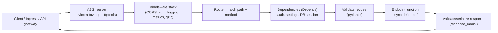

# 3.7 Building APIs and microservices with FastAPI

| | |
|---|---|
| Level | Intermediate |
| Priority tier | 0 |
| Lab venue | Python 3.11+, `pip install fastapi uvicorn[standard] pydantic httpx pytest`; Docker/kind optional |
| Part | Part 3: Python for infrastructure |
| Status | Drafted, labs **untested** |

## Why this matters for AI infrastructure

Almost every platform component eventually grows an HTTP API: an inventory service in front of NetBox and Redfish, a job-submission gateway over Slurm or Kubernetes, a webhook receiver for Alertmanager, a model-serving front end that does authentication, batching and streaming before calling Triton or vLLM, an internal control plane for GPU quotas, an "agent" that exposes health and metrics. FastAPI is the dominant Python framework for these: it is asynchronous (ASGI), type-driven (request validation and OpenAPI documentation come from Python type hints and pydantic models), and fast enough for most control-plane and many data-plane services. This chapter teaches FastAPI end to end with an infrastructure and inference bias: architecture (WSGI vs ASGI), routing and validation, dependency injection, error handling, authentication and security, databases, background and long-running work, streaming responses, testing, packaging and deployment on containers and Kubernetes (probes, graceful shutdown), and observability.

## Prerequisites and outcomes

You should know functions, classes, typing and pydantic basics (3.1 to 3.4), concurrency and asyncio (3.6), HTTP basics (2.10).

After this chapter you can:

- Explain WSGI vs ASGI, how an ASGI server (uvicorn/hypercorn) runs a FastAPI app, and how sync (`def`) and async (`async def`) endpoints are executed.
- Build REST APIs with routing, path/query/header/cookie/body parameters, pydantic request and response models, status codes, error responses and OpenAPI docs.
- Use dependency injection (`Depends`) for configuration, database sessions, authentication and shared clients; use lifespan events for startup and shutdown.
- Structure an application with `APIRouter`, settings, layers (routes, services, repositories), versioning and pagination.
- Implement authentication and authorisation (API keys, OAuth2 password/bearer with JWT, mTLS at the proxy), CORS, rate limiting hooks, input hardening.
- Connect to SQL (SQLAlchemy/SQLModel, async) and NoSQL databases; manage migrations and connection pools.
- Handle background and long-running work (BackgroundTasks, task queues, job-status endpoints), streaming (Server-Sent Events, chunked responses, WebSockets), file uploads/downloads.
- Test with `TestClient`/`httpx`, dependency overrides and fixtures; load test.
- Package, containerise and deploy behind a proxy; implement health/readiness probes, graceful shutdown, metrics and tracing; understand scaling and performance trade-offs.

## 1. Architecture: from WSGI to ASGI

**WSGI** (PEP 3333, Flask/Django classic) is a synchronous interface: one request occupies one worker thread/process until it finishes; concurrency comes from many workers (gunicorn). **ASGI** is the asynchronous successor: an event-loop-based interface supporting `async def` handlers, long-lived connections (WebSockets, SSE), and background tasks. FastAPI is built on **Starlette** (ASGI toolkit) and **pydantic** (validation); it adds routing declarations, dependency injection and automatic OpenAPI.



- **`async def` endpoints** run directly on the event loop: great for awaiting non-blocking I/O (`httpx.AsyncClient`, async DB drivers), terrible if they perform blocking calls or heavy CPU (they stall every request). **`def` endpoints** run in a **thread pool** (anyio, 40 threads by default), so blocking libraries are acceptable but concurrency is bounded by the pool. Rule: use `async def` only when everything you await is truly async; otherwise use `def` (or `await asyncio.to_thread(...)` / `run_in_threadpool` inside async code). Never call `requests.get`, `time.sleep`, `subprocess.run`, or heavy NumPy inside `async def`.
- Run with **uvicorn** (`uvicorn app.main:app --host 0.0.0.0 --port 8000`) or **gunicorn with uvicorn workers** (`gunicorn -k uvicorn.workers.UvicornWorker -w 4`) to use multiple cores: each worker is a separate process with its own event loop and memory (state is not shared; models loaded per worker multiply memory; GPU services typically run one worker per GPU). `--workers`, `--limit-concurrency`, `--timeout-keep-alive`, `--proxy-headers` (behind a proxy), `--log-config`, and graceful shutdown `--timeout-graceful-shutdown` matter in production.
- **Performance**: FastAPI + uvicorn handles thousands of simple requests per second per core; real latency is dominated by what the handler does (database, downstream calls, model inference). For ML inference prefer dedicated serving runtimes (Triton, vLLM, TGI, TorchServe, Ray Serve, KServe) behind a thin FastAPI gateway for auth, validation, routing, rate limiting, and request shaping.

## 2. A first application

```python
# app/main.py
from fastapi import FastAPI, HTTPException, status
from pydantic import BaseModel, Field

app = FastAPI(title="Fleet API", version="1.0.0", description="Inventory and job gateway")

class NodeIn(BaseModel):
    name: str = Field(pattern=r"^[a-z0-9-]{3,63}$")
    rack: str
    gpus: int = Field(8, ge=1, le=16)

class Node(NodeIn):
    id: int

DB: dict[int, Node] = {}                       # demo only: real services use a database

@app.get("/healthz")
async def healthz() -> dict:
    return {"status": "ok"}

@app.post("/nodes", response_model=Node, status_code=status.HTTP_201_CREATED)
async def create_node(node: NodeIn) -> Node:
    if any(n.name == node.name for n in DB.values()):
        raise HTTPException(status.HTTP_409_CONFLICT, f"node {node.name} exists")
    new = Node(id=len(DB) + 1, **node.model_dump())
    DB[new.id] = new
    return new

@app.get("/nodes/{node_id}", response_model=Node)
async def get_node(node_id: int) -> Node:
    try:
        return DB[node_id]
    except KeyError:
        raise HTTPException(status.HTTP_404_NOT_FOUND, "node not found") from None

@app.get("/nodes", response_model=list[Node])
async def list_nodes(rack: str | None = None, limit: int = 100, offset: int = 0) -> list[Node]:
    items = [n for n in DB.values() if rack in (None, n.rack)]
    return items[offset: offset + limit]
```

```bash
uvicorn app.main:app --reload                        # development with autoreload
curl -s localhost:8000/nodes -X POST -H 'content-type: application/json' -d '{"name":"gpu01","rack":"r1"}' | jq
# interactive docs: http://localhost:8000/docs (Swagger UI), /redoc, machine-readable /openapi.json
```

What FastAPI did for you: parsed and validated the JSON body into `NodeIn` (returning 422 with details for errors), converted types, documented the endpoint in OpenAPI, filtered the response through `response_model`, set the status code, and generated interactive docs.

## 3. Requests: routing and parameters

### Path, query, header, cookie, form and body

```python
from fastapi import Path, Query, Header, Cookie, Body, Form, File, UploadFile, Depends
from typing import Annotated

@app.get("/racks/{rack}/nodes/{name}")
async def get(
    rack: Annotated[str, Path(min_length=1, max_length=32)],          # path parameter (from the URL template)
    name: str,
    verbose: Annotated[bool, Query(description="include details")] = False,        # query ?verbose=true
    tags: Annotated[list[str] | None, Query()] = None,                              # ?tags=a&tags=b
    x_request_id: Annotated[str | None, Header()] = None,            # header X-Request-Id (underscores converted)
    session: Annotated[str | None, Cookie()] = None,
): ...

@app.post("/jobs")
async def submit(job: JobIn, priority: Annotated[int, Body(ge=0, le=10)] = 5): ...    # multiple body params embed by key
@app.post("/upload")
async def upload(file: UploadFile, desc: Annotated[str, Form()]):       # multipart/form-data; spooled to disk if large
    data = await file.read()                                              # or stream chunks: await file.read(1<<20)
```

- A parameter name appearing in the path template is a **path parameter**; scalar types without a body model become **query parameters**; pydantic models become the **JSON body**. `Annotated[..., Query/Path/Header/...]` adds validation and documentation (since FastAPI 0.95 this style is preferred over default-valued `Query(...)`).
- **Enums and literals** restrict values: `class State(StrEnum): ...`; invalid values yield 422.
- **Path order matters**: define fixed paths (`/nodes/summary`) before parameterised ones (`/nodes/{id}`).
- **Query parameter models** (0.115+): group query params into a pydantic model with `Annotated[Filter, Query()]`.
- **Pagination**: `limit`/`offset` or cursor-based (`page_token`); cap `limit` (`Query(le=1000)`); return total counts or `next` tokens; stable ordering.
- **Idempotency**: accept an `Idempotency-Key` header on POSTs that create resources; store results by key.

### Request and response models

Pydantic models define the schema. Separate **input**, **stored** and **output** models (`NodeIn`, `NodeDB`, `NodeOut`) so clients can't set server-controlled fields (id, owner, timestamps) and secrets never leak (mass-assignment protection). `response_model` filters/validates what you return (use `response_model_exclude_none=True`, `response_model_by_alias`, and `model_config = {"from_attributes": True}` to serialise ORM objects).

```python
from datetime import datetime
from pydantic import BaseModel, ConfigDict, EmailStr, field_validator, model_validator

class JobIn(BaseModel):
    model_config = ConfigDict(extra="forbid")
    name: str
    image: str
    gpus: int = 1
    command: list[str]
    env: dict[str, str] = {}

    @model_validator(mode="after")
    def check(self):
        if self.gpus > 8 and "multi-node" not in self.name:
            raise ValueError("more than 8 GPUs requires a multi-node job name")
        return self

class JobOut(BaseModel):
    model_config = ConfigDict(from_attributes=True)
    id: str
    state: Literal["queued", "running", "failed", "done"]
    created_at: datetime
```

Return types can be annotated directly (`-> JobOut`); FastAPI uses them as the response model. Use `JSONResponse`, `PlainTextResponse`, `StreamingResponse`, `FileResponse`, `RedirectResponse`, `ORJSONResponse`/`UJSONResponse` (faster JSON) for custom behaviour.

## 4. Dependency injection

`Depends` declares reusable components resolved per request (and cached within a request): configuration, database sessions, authenticated users, rate-limit checks, shared clients. Dependencies can be functions, classes, generators (with cleanup after `yield`), and can themselves depend on others.

```python
from fastapi import Depends
from functools import lru_cache
from collections.abc import AsyncIterator

class Settings(BaseSettings):                       # pydantic-settings
    db_url: str
    api_keys: set[str] = set()
    model_config = SettingsConfigDict(env_prefix="FLEET_")

@lru_cache
def get_settings() -> Settings: return Settings()

async def get_db(settings: Annotated[Settings, Depends(get_settings)]) -> AsyncIterator[AsyncSession]:
    async with SessionLocal() as session:           # setup
        yield session                               # injected into the endpoint
    # teardown after the response (commit/rollback/close)

async def require_key(x_api_key: Annotated[str, Header()], s: Annotated[Settings, Depends(get_settings)]):
    if x_api_key not in s.api_keys:                 # use secrets.compare_digest for constant-time comparison
        raise HTTPException(status.HTTP_401_UNAUTHORIZED, "invalid API key", headers={"WWW-Authenticate": "ApiKey"})

@app.get("/nodes", dependencies=[Depends(require_key)])          # applies without injecting a value
async def list_nodes(db: Annotated[AsyncSession, Depends(get_db)]): ...
router = APIRouter(prefix="/v1", dependencies=[Depends(require_key)])    # applies to all routes in a router
app = FastAPI(dependencies=[Depends(require_key)])                        # global
```

Benefits: testability (`app.dependency_overrides[get_db] = fake_db` swaps components in tests), consistency, and separation of concerns. Use **class-based dependencies** or `lru_cache`d factories for expensive shared objects (HTTP client pools, ML models), but create heavy resources once in **lifespan**, not per request.

### Lifespan: startup and shutdown

```python
from contextlib import asynccontextmanager
import httpx

@asynccontextmanager
async def lifespan(app: FastAPI):
    app.state.http = httpx.AsyncClient(timeout=10, limits=httpx.Limits(max_connections=200))
    app.state.model = load_model()               # blocking? run in thread: await asyncio.to_thread(load_model)
    app.state.ready = True
    yield                                         # application serves requests
    app.state.ready = False
    await app.state.http.aclose()                 # clean shutdown: close pools, flush logs/metrics, release GPU

app = FastAPI(lifespan=lifespan)
```

(The older `@app.on_event("startup")` hooks are deprecated in favour of lifespan.) Store shared objects on `app.state`, access via `request.app.state`.

## 5. Errors, validation and middleware

- **Validation errors** (422) are automatic; customise with `@app.exception_handler(RequestValidationError)` to return your error schema.
- **`HTTPException(status_code, detail, headers)`** for expected errors; define domain exceptions and map them: 

```python
class NodeNotFound(Exception):
    def __init__(self, name): self.name = name

@app.exception_handler(NodeNotFound)
async def nf_handler(request: Request, exc: NodeNotFound):
    return JSONResponse(status_code=404, content={"error": "node_not_found", "node": exc.name, "request_id": request.state.request_id})
```

- Use consistent error bodies (RFC 9457 `application/problem+json`: type, title, status, detail, instance), correct status codes (400 vs 422 vs 409 vs 429; 401 vs 403; 502/503/504 for upstream problems), never leak stack traces or secrets; log unexpected exceptions with a request id (a catch-all `Exception` handler returns 500).
- **Middleware**: `@app.middleware("http")` or Starlette classes: request ids, timing, logging, CORS (`CORSMiddleware` with explicit origins), GZip, trusted hosts, HTTPS redirect, `ProxyHeadersMiddleware` (behind a load balancer), body size limits (a proxy/ASGI setting), authentication for whole apps. Pure ASGI middleware is faster than `BaseHTTPMiddleware` (which has quirks with streaming and background tasks).

```python
import time, uuid, logging
log = logging.getLogger("access")

@app.middleware("http")
async def access_log(request: Request, call_next):
    rid = request.headers.get("x-request-id", uuid.uuid4().hex)
    request.state.request_id = rid
    t0 = time.perf_counter()
    try:
        response = await call_next(request)
    except Exception:
        log.exception("unhandled error rid=%s path=%s", rid, request.url.path); raise
    response.headers["x-request-id"] = rid
    log.info("rid=%s %s %s %d %.1fms", rid, request.method, request.url.path, response.status_code, (time.perf_counter() - t0) * 1000)
    return response
```

## 6. Structuring applications

```text
fleet/
├── pyproject.toml
├── src/fleet/
│   ├── main.py            # app factory: create_app(), lifespan, middleware, routers
│   ├── config.py          # Settings
│   ├── deps.py            # shared dependencies (auth, db)
│   ├── api/
│   │   ├── v1/
│   │   │   ├── nodes.py   # APIRouter: HTTP concerns only
│   │   │   └── jobs.py
│   ├── schemas/           # pydantic models (API contracts)
│   ├── services/          # business logic (pure-ish, testable)
│   ├── repositories/      # DB access
│   ├── models/            # ORM tables
│   └── clients/           # outbound HTTP clients (redfish, slurm)
└── tests/
```

- `APIRouter(prefix="/nodes", tags=["nodes"])`, then `app.include_router(nodes.router, prefix="/v1")`. Keep route functions thin: parse/validate → call a service → map to a response. Business logic in services (no FastAPI imports), data access in repositories: easy unit tests.
- **App factory** (`def create_app(settings=None) -> FastAPI`) lets tests build isolated apps.
- **Versioning**: URL prefix (`/v1`), deprecate with `deprecated=True` and `Sunset` headers; evolve schemas additively; keep OpenAPI as the contract and test for breaking changes (e.g. `oasdiff`).
- **Configuration**: environment variables via pydantic-settings (12-factor); secrets from files/secret managers; no config in code.
- **Mounting** sub-apps and static files (`app.mount("/static", StaticFiles(...))`); templating with Jinja2 (`Jinja2Templates`) for simple dashboards.

## 7. Authentication and security

- **API keys**: header `X-API-Key`, stored hashed; compare with `secrets.compare_digest`; per-key scopes and rate limits; rotation.
- **OAuth2 / JWT**: `OAuth2PasswordBearer(tokenUrl="token")` extracts a bearer token; verify signature, issuer, audience, expiry (`python-jose`/`PyJWT`/`authlib`) against the identity provider's JWKS (OIDC); authorise by scopes/roles/claims; keep tokens short-lived; never roll your own crypto. For service-to-service use workload identity (Kubernetes service account tokens, SPIFFE) or mTLS terminated at the mesh/ingress.

```python
from fastapi.security import OAuth2PasswordBearer, SecurityScopes
import jwt

oauth2 = OAuth2PasswordBearer(tokenUrl="token", scopes={"jobs:write": "submit jobs", "nodes:read": "read inventory"})

async def current_user(scopes: SecurityScopes, token: Annotated[str, Depends(oauth2)]):
    try:
        claims = jwt.decode(token, key=jwks_key_for(token), algorithms=["RS256"], audience="fleet-api", issuer="https://idp.example.com/")
    except jwt.PyJWTError:
        raise HTTPException(401, "invalid token", headers={"WWW-Authenticate": "Bearer"})
    if not set(scopes.scopes) <= set(claims.get("scope", "").split()):
        raise HTTPException(403, "insufficient scope")
    return claims

@app.post("/jobs", dependencies=[Security(current_user, scopes=["jobs:write"])])
```

- **Transport security**: TLS terminates at the ingress/gateway or uvicorn (`--ssl-keyfile`); redirect HTTP to HTTPS; HSTS; mTLS for internal APIs.
- **Hardening**: validate and bound all inputs (lengths, counts, sizes); `extra="forbid"` on models; limit request body size and upload sizes; avoid SSRF when accepting URLs (allow-lists, block link-local/metadata IPs); parameterised queries only (ORMs); output encoding for HTML; secure cookies (`HttpOnly`, `Secure`, `SameSite`); CSRF protection if cookies are used for auth; CORS only for needed origins; security headers; rate limiting (gateway, `slowapi`, Redis-based limiter); audit logging of mutating calls; dependency scanning; no debug mode in production (`docs_url=None` if the API must not expose docs publicly).
- **OWASP API Top 10** checklist: broken object-level authorisation (check ownership on every `/{id}` access), broken authentication, excessive data exposure (use response models), lack of resources/rate limiting, function-level authorisation, mass assignment, misconfiguration, injection, improper asset management, unsafe consumption of upstream APIs.
- **Secrets**: from environment/secret store, never in the image or repo; `SecretStr` for logging safety.

## 8. Databases

### SQL (SQLAlchemy 2.x / SQLModel)

```python
# async engine and session
from sqlalchemy.ext.asyncio import create_async_engine, async_sessionmaker, AsyncSession
from sqlalchemy.orm import DeclarativeBase, Mapped, mapped_column
from sqlalchemy import select, String

engine = create_async_engine("postgresql+asyncpg://user:pw@db/fleet", pool_size=10, max_overflow=20, pool_pre_ping=True)
SessionLocal = async_sessionmaker(engine, expire_on_commit=False)

class Base(DeclarativeBase): ...
class NodeRow(Base):
    __tablename__ = "nodes"
    id: Mapped[int] = mapped_column(primary_key=True)
    name: Mapped[str] = mapped_column(String(63), unique=True, index=True)
    rack: Mapped[str] = mapped_column(String(32), index=True)
    gpus: Mapped[int]

@app.get("/nodes", response_model=list[Node])
async def list_nodes(db: Annotated[AsyncSession, Depends(get_db)], rack: str | None = None, limit: int = Query(100, le=1000)):
    stmt = select(NodeRow).order_by(NodeRow.id).limit(limit)
    if rack: stmt = stmt.where(NodeRow.rack == rack)
    return (await db.scalars(stmt)).all()
```

- **SQLModel** (by the FastAPI author) merges pydantic and SQLAlchemy models (`class Event(SQLModel, table=True)`), convenient for small apps; larger systems keep API schemas and ORM models separate.
- **Migrations**: Alembic (`alembic revision --autogenerate`, `upgrade head`); run migrations as a separate job/init step, not at app start in multi-replica deployments.
- **Pools**: size to `workers × pool_size ≤ DB max_connections`; `pool_pre_ping`, timeouts, and a pooler (PgBouncer) for many replicas; avoid sessions shared across requests/tasks; keep transactions short; handle deadlocks/serialization retries; N+1 query avoidance (`selectinload`).
- **Blocking drivers** (psycopg2) inside `def` endpoints are fine (thread pool); with `async def` use async drivers (asyncpg, psycopg3 async, aiomysql).
- **NoSQL**: MongoDB with Beanie/Motor (document models as pydantic classes), Redis (`redis.asyncio`) for caches/queues/rate limits, etcd, DynamoDB, Elasticsearch/OpenSearch. Time-series metrics belong in Prometheus/VictoriaMetrics, not your service database.
- **Caching**: `cachetools`, `aiocache`, Redis; cache-aside with TTLs; ETags/`Cache-Control` for clients; invalidate on writes.

## 9. Long-running, background and streaming work

### Background tasks and queues

`BackgroundTasks` runs a callable **after the response is sent**, in the same process: fine for quick fire-and-forget work (send a notification), but lost if the process restarts and unsuitable for long or critical jobs.

```python
from fastapi import BackgroundTasks
@app.post("/jobs", status_code=202)
async def submit(job: JobIn, bg: BackgroundTasks):
    job_id = create_job_record(job)                   # persist first
    bg.add_task(run_job, job_id)                      # short work only
    return {"id": job_id, "state": "queued", "status_url": f"/jobs/{job_id}"}
```

For durable or heavy work use a **job queue and workers**: Celery, RQ, Dramatiq, Arq (asyncio), Taskiq, Temporal (workflows), Kubernetes Jobs, Slurm submissions. Pattern: `POST` returns **202 Accepted** with a job id; the client polls `GET /jobs/{id}` (or receives a webhook / SSE stream); the worker updates state in a database; make operations idempotent with job keys. Cancellation endpoints (`DELETE /jobs/{id}`), timeouts, retries with backoff and dead-letter handling complete the design.

### Streaming

```python
from fastapi.responses import StreamingResponse
import asyncio, json

async def event_stream(job_id: str, request: Request):
    last = None
    while not await request.is_disconnected():          # stop when the client goes away
        state = await get_state(job_id)
        if state != last:
            yield f"event: state\ndata: {json.dumps(state)}\n\n"        # Server-Sent Events framing
            last = state
        if state["state"] in {"failed", "done"}: break
        await asyncio.sleep(1)

@app.get("/jobs/{job_id}/events")
async def events(job_id: str, request: Request):
    return StreamingResponse(event_stream(job_id, request), media_type="text/event-stream",
                             headers={"Cache-Control": "no-cache", "X-Accel-Buffering": "no"})     # disable proxy buffering
```

- **SSE** (one-way server push over HTTP) suits token streaming from LLMs, log tailing and progress; **WebSockets** (`@app.websocket`) for bidirectional; **chunked/`StreamingResponse`** for large downloads (`async for chunk in aiofiles...`), **`FileResponse`** for static files.
- Proxies and load balancers buffer responses by default and enforce idle timeouts: disable buffering (`X-Accel-Buffering: no`, nginx `proxy_buffering off`), set long read timeouts, send periodic comment/heartbeat lines, and ensure HTTP/2 or keep-alive end to end (chapters 2.10 and 2.20).
- Backpressure: producers should await when clients are slow (the ASGI server applies flow control through `send`); bound queues.

### An inference gateway example

```python
# Thin FastAPI front end over a model server: auth, validation, timeouts, streaming passthrough, metrics
@app.post("/v1/chat", dependencies=[Security(current_user, scopes=["infer"])])
async def chat(req: ChatRequest, request: Request, settings: Annotated[Settings, Depends(get_settings)]):
    if req.max_tokens > settings.max_tokens: raise HTTPException(422, "max_tokens too large")
    client: httpx.AsyncClient = request.app.state.http
    async def gen():
        try:
            async with client.stream("POST", settings.backend_url, json=req.model_dump(), timeout=httpx.Timeout(10, read=300)) as r:
                if r.status_code >= 500: raise HTTPException(502, "backend error")
                async for line in r.aiter_lines():
                    if await request.is_disconnected(): break            # client left: stop consuming (frees GPU time upstream)
                    if line: yield line + "\n\n"
        except httpx.TimeoutException:
            yield 'event: error\ndata: {"error":"upstream_timeout"}\n\n'
    return StreamingResponse(gen(), media_type="text/event-stream", headers={"X-Accel-Buffering": "no"})
```

For batching, queue incoming requests into an `asyncio.Queue`, group them (up to N items or T ms) and send a single batched call to the model; return results through per-request futures (dynamic batching: Triton/vLLM do this better, but gateways may implement tiered logic). Add concurrency limits per user/tenant, token-based rate limits, request cancellation propagation, and metrics (TTFT, tokens/s).

## 10. Testing

```python
# tests/test_nodes.py
import pytest
from fastapi.testclient import TestClient
from httpx import AsyncClient, ASGITransport
from fleet.main import create_app
from fleet.deps import get_db

@pytest.fixture
def client():
    app = create_app(settings=Settings(db_url="sqlite+aiosqlite://", api_keys={"k"}))
    app.dependency_overrides[get_db] = fake_db            # swap the DB
    with TestClient(app) as c:                             # runs lifespan startup/shutdown
        c.headers["x-api-key"] = "k"
        yield c

def test_create_and_get(client):
    r = client.post("/v1/nodes", json={"name": "gpu01", "rack": "r1"})
    assert r.status_code == 201
    nid = r.json()["id"]
    assert client.get(f"/v1/nodes/{nid}").json()["name"] == "gpu01"

def test_validation(client):
    assert client.post("/v1/nodes", json={"name": "x"}).status_code == 422

def test_auth(client):
    client.headers.pop("x-api-key"); assert client.get("/v1/nodes").status_code in (401, 403, 422)

@pytest.mark.anyio
async def test_async():
    async with AsyncClient(transport=ASGITransport(app=create_app()), base_url="http://test") as ac:
        assert (await ac.get("/healthz")).json() == {"status": "ok"}
```

Test layers: unit tests for services/repositories (pure Python, fakes), API tests with `TestClient` (in-process, no network) and dependency overrides, integration tests with real DB containers (`testcontainers`), contract tests against the OpenAPI schema (`schemathesis` fuzzes endpoints from the spec), load tests (`locust`, `k6`, `wrk`, `hey`) for latency percentiles and saturation, and security tests (authz matrices). Run in CI with coverage (chapter 3.9).

## 11. Deployment and operations

### Packaging

```dockerfile
FROM python:3.12-slim AS base
ENV PYTHONUNBUFFERED=1 PYTHONDONTWRITEBYTECODE=1 PIP_NO_CACHE_DIR=1
WORKDIR /app
COPY requirements.txt .
RUN pip install -r requirements.txt
COPY src/ src/
USER 10001
EXPOSE 8000
HEALTHCHECK CMD python -c "import urllib.request,sys; sys.exit(0 if urllib.request.urlopen('http://127.0.0.1:8000/healthz').status==200 else 1)"
CMD ["uvicorn", "fleet.main:app", "--host", "0.0.0.0", "--port", "8000", "--proxy-headers", "--forwarded-allow-ips=*", "--timeout-graceful-shutdown", "25"]
```

- One uvicorn process per container; scale with replicas (Kubernetes HPA on CPU/RPS/queue depth/custom metrics); use gunicorn+uvicorn workers only when you want multi-process per container.
- Set `--limit-concurrency` or rely on the proxy to shed load; configure `--timeout-keep-alive` above the load balancer's idle timeout to avoid races.
- Multi-stage builds, non-root, read-only root file system, dropped capabilities (chapter 2.21).

### Kubernetes deployment essentials

```yaml
apiVersion: apps/v1
kind: Deployment
metadata: { name: fleet-api }
spec:
  replicas: 3
  strategy: { rollingUpdate: { maxSurge: 1, maxUnavailable: 0 } }
  selector: { matchLabels: { app: fleet-api } }
  template:
    metadata: { labels: { app: fleet-api } }
    spec:
      terminationGracePeriodSeconds: 40
      containers:
      - name: api
        image: registry.example.com/fleet-api:1.4.2
        ports: [ { containerPort: 8000 } ]
        env:
        - { name: FLEET_DB_URL, valueFrom: { secretKeyRef: { name: fleet-db, key: url } } }
        resources: { requests: { cpu: 250m, memory: 256Mi }, limits: { memory: 512Mi } }
        startupProbe:   { httpGet: { path: /healthz, port: 8000 }, failureThreshold: 30, periodSeconds: 2 }
        readinessProbe: { httpGet: { path: /readyz, port: 8000 }, periodSeconds: 5 }
        livenessProbe:  { httpGet: { path: /healthz, port: 8000 }, periodSeconds: 10, timeoutSeconds: 2, failureThreshold: 3 }
        lifecycle: { preStop: { exec: { command: ["sleep", "5"] } } }      # let endpoints deregister before SIGTERM handling
```

- **Liveness** (`/healthz`): process is alive and the event loop responsive; keep it cheap and independent of dependencies (otherwise a DB blip restarts every pod). **Readiness** (`/readyz`): can serve traffic now (model loaded, DB reachable, not draining); flip to not-ready on shutdown. **Startup** probe for slow model loads.
- **Graceful shutdown**: on SIGTERM uvicorn stops accepting connections and waits for in-flight requests up to the graceful timeout; align `terminationGracePeriodSeconds`, `preStop` sleep, LB deregistration delay and `--timeout-graceful-shutdown`; for streaming endpoints decide whether to cut or drain long-lived streams.
- **Resources**: memory limits for models and caches; for GPU inference services request `nvidia.com/gpu`; one worker per GPU; avoid CPU limits that throttle event loops (prefer requests).
- **Autoscaling** on concurrency or queue length rather than CPU for I/O-bound services; KEDA for event-driven scaling.
- **Config and rollout**: ConfigMaps/Secrets, immutable image tags/digests, canary or blue/green via ingress/mesh/Argo Rollouts, DB migrations as pre-deploy Jobs with backward-compatible schema changes (expand/contract).

### Observability

- **Logs**: structured JSON to stdout with request id, user/tenant, route, status, latency; redact secrets; sample noisy logs (chapter 3.5).
- **Metrics**: `prometheus-fastapi-instrumentator` or `starlette-exporter` expose `/metrics` (request counts, latencies by route/status, in-flight); add business metrics (jobs by state, queue depth, tokens/s, GPU utilisation from DCGM). Use the RED method (rate, errors, duration) and alert on SLOs (chapter 2.31).
- **Tracing**: OpenTelemetry instrumentation (`opentelemetry-instrumentation-fastapi`, `-httpx`, `-sqlalchemy`) propagates `traceparent` through downstream calls; export to Tempo/Jaeger/OTLP collector.
- **Health endpoints, build info endpoint** (`/version` with git SHA), and debug endpoints behind auth.
- **Profiling**: `py-spy`, `pyinstrument` middleware in staging, `uvicorn --log-level debug`, slow-request logs.

### Performance checklist

Use async drivers and shared `httpx.AsyncClient`; orjson responses for large JSON; avoid per-request model loading; pagination and streaming for big results; gzip/br compression at the proxy; connection pool tuning; keep the event loop free (offload CPU/blocking to threads/processes/queues); cache expensive lookups; measure with load tests and profile before optimising; remember pydantic validation of huge payloads costs CPU (limit sizes; consider `model_validate_json` and `TypeAdapter`).

## 12. Lab (untested)

1. **Hello API**: build the Fleet API with in-memory storage; explore `/docs` and `/openapi.json`; trigger 422 errors; add pagination and filtering; write requests with `curl` and `httpx`.
2. **Models and validation**: split schemas into In/DB/Out; use `extra="forbid"`, validators, enums; prove mass assignment is blocked; return `problem+json` errors via exception handlers.
3. **Dependencies and lifespan**: implement settings, API-key auth, a DB session dependency (SQLite then PostgreSQL in Docker), a shared `httpx.AsyncClient` in lifespan; override dependencies in tests; add request-id middleware and structured logs.
4. **Async vs sync**: write one endpoint with `async def` + `time.sleep(2)` and one with `def` + `time.sleep(2)`; load test with 50 concurrent requests (`hey`/`wrk`); observe the event-loop stall vs the thread pool; fix with `await asyncio.sleep` / `to_thread`.
5. **Database**: SQLAlchemy async models, Alembic migration, CRUD with pagination, unique-constraint conflict mapped to 409, transaction rollback on errors; test with `testcontainers`.
6. **Auth**: implement JWT bearer auth with scopes against a local Keycloak or a mocked JWKS; write an authorization matrix test (user A cannot read user B's jobs).
7. **Jobs**: implement `POST /jobs` (202) with a worker (Arq/RQ + Redis) and `GET /jobs/{id}`; add SSE progress streaming and cancellation; kill the worker mid-job and observe retry/idempotency behaviour; compare with `BackgroundTasks` losing work on restart.
8. **Inference gateway**: put a mock streaming backend (or vLLM/TGI if a GPU is available) behind the gateway; implement token streaming passthrough with disconnect handling, per-tenant concurrency limits and request timeouts; measure TTFT and throughput; test through nginx with and without `proxy_buffering off`.
9. **Testing**: reach 90% coverage with `pytest`; add `schemathesis run http://localhost:8000/openapi.json`; add a contract test that fails on removing a field.
10. **Deploy**: containerise; deploy to kind with probes, a PodDisruptionBudget, HPA and ingress; perform a rolling update during a load test and verify zero failed requests; send SIGTERM and verify graceful shutdown timing.
11. **Observability**: add `/metrics`, a Grafana dashboard of RED metrics, OpenTelemetry traces through the gateway to the backend, and an alert on p99 latency.
12. **Clean up.**

Mark tested only after execution.

## 13. Common mistakes

- Blocking calls in `async def` endpoints; assuming `async` makes blocking code concurrent.
- Using the same pydantic model for DB, input and output (mass assignment, data leaks).
- Loading models or creating clients per request; unbounded caches; global mutable state across workers assumed shared.
- No timeouts on downstream calls; no limits on concurrency, body size or pagination.
- Liveness probes that depend on external services; readiness never flips during shutdown; mismatched grace periods causing dropped requests on deploy.
- Running DB migrations from every replica at startup; connection pool exhaustion (`workers × pool` over database limits).
- Trusting `X-Forwarded-*` headers from the Internet; leaving docs/debug enabled publicly; permissive CORS (`*` with credentials).
- Using `BackgroundTasks` for work that must not be lost; no idempotency for retried POSTs.
- Proxy buffering breaking SSE; idle timeouts killing long streams.
- Leaking stack traces or secrets in error responses and logs.

## 14. Interview angles

- "WSGI vs ASGI? How does uvicorn run FastAPI? What runs sync endpoints?"
- "When do you use `async def` vs `def` in FastAPI?"
- "How does FastAPI validate requests and generate OpenAPI?"
- "Explain dependency injection and how you test with overrides."
- "How would you design a job-submission API for long-running GPU jobs?" (202, queue, status endpoint, idempotency, cancellation.)
- "How do you stream LLM tokens through an API and handle client disconnects?"
- "How do you deploy FastAPI to Kubernetes safely? Probes, graceful shutdown, scaling, config?"
- "How do you secure the API? Authn vs authz, OAuth2/JWT, rate limiting, OWASP API risks."
- "A service hangs under load. How do you debug?" (blocked loop, pool exhaustion, DB pool, downstream timeouts.)

## 15. Checkpoint questions (40)

1. What does ASGI add over WSGI? **A:** Async handlers, long-lived connections, websockets.
2. What is FastAPI built on? **A:** Starlette and pydantic.
3. How do `def` endpoints run? **A:** In a thread pool.
4. What breaks an `async def` endpoint? **A:** Blocking calls stalling the event loop.
5. What starts the app? **A:** An ASGI server like uvicorn.
6. Why multiple workers? **A:** Use multiple cores; each has its own loop and memory.
7. What generates `/docs`? **A:** The OpenAPI schema from type hints.
8. Default error status for validation failures? **A:** 422.
9. Path vs query parameter? **A:** In the URL template vs after `?`.
10. Why separate In/Out models? **A:** Prevent mass assignment and leaks.
11. What does `response_model` do? **A:** Validates and filters the response.
12. What is `Depends`? **A:** Declarative dependency injection per request.
13. How do you swap a dependency in tests? **A:** `app.dependency_overrides`.
14. What is lifespan for? **A:** Startup/shutdown of shared resources.
15. Where to store shared clients? **A:** `app.state` created in lifespan.
16. How to return domain errors? **A:** Custom exception handlers.
17. What's `problem+json`? **A:** Standard error body format (RFC 9457).
18. What does CORS control? **A:** Browser cross-origin access.
19. API key comparison method? **A:** `secrets.compare_digest`.
20. What must JWT verification check? **A:** Signature, issuer, audience, expiry.
21. What is BOLA? **A:** Broken object-level authorisation: not checking ownership.
22. Which SQLAlchemy mode for async? **A:** `create_async_engine` with async drivers.
23. Why Alembic? **A:** Schema migrations.
24. Pool sizing rule? **A:** `workers × pool_size` below DB limits.
25. When not to use `BackgroundTasks`? **A:** Durable/long jobs.
26. Which status for accepted async work? **A:** 202.
27. What is SSE? **A:** One-way server push over HTTP with `text/event-stream`.
28. How detect client disconnect? **A:** `await request.is_disconnected()`.
29. What header disables nginx buffering? **A:** `X-Accel-Buffering: no`.
30. Why heartbeats on streams? **A:** Avoid idle timeouts.
31. What is `TestClient`? **A:** In-process HTTP test client.
32. What does schemathesis do? **A:** Property-based API testing from OpenAPI.
33. Liveness vs readiness? **A:** Restart-if-dead vs route-traffic-if-ready.
34. Why should liveness avoid DB checks? **A:** DB outage would restart all pods.
35. What aligns with graceful shutdown? **A:** `terminationGracePeriodSeconds`, preStop, server timeout.
36. One worker per GPU because? **A:** Each worker loads its own model on a device.
37. Metrics method for services? **A:** RED.
38. What does OpenTelemetry propagate? **A:** Trace context across services.
39. Why `--proxy-headers`? **A:** Correct client IP/scheme behind a proxy.
40. Why idempotency keys? **A:** Safe retries of POSTs.

## 16. Sources and review notes

**Written in original words.** Principal sources:

- Abdulazeez Abdulazeez Adeshina, *Building Python Web APIs with FastAPI*: getting started and routing, response models and error handling, templating, structuring FastAPI applications, connecting to a database (SQLModel and MongoDB with Beanie), securing applications, testing and deploying.
- The author's `nvidia-devops` repository, volume 02 (FastAPI and microservices masterclass): blocking AI infrastructure APIs, WSGI versus ASGI, Pydantic validation at the edge, async handlers, retries with exponential backoff, background tasks and their limits, production hardening.
- FastAPI, Starlette, pydantic, SQLAlchemy and uvicorn documentation for API details.
- Examples are the author's constructions.

**Flagged for verification before publishing:** FastAPI/pydantic/SQLAlchemy API details against current versions (lifespan, `Annotated` style, query parameter models, `TestClient` usage), uvicorn option names, Kubernetes manifest fields, library names for metrics and tracing, and every code listing; all labs are **untested**.
