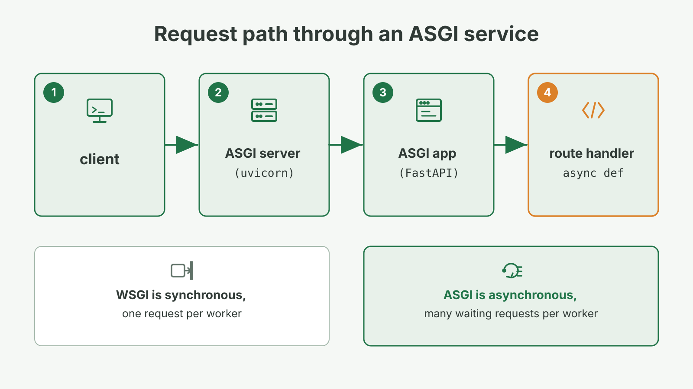
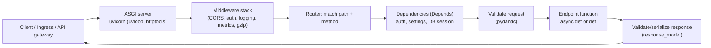
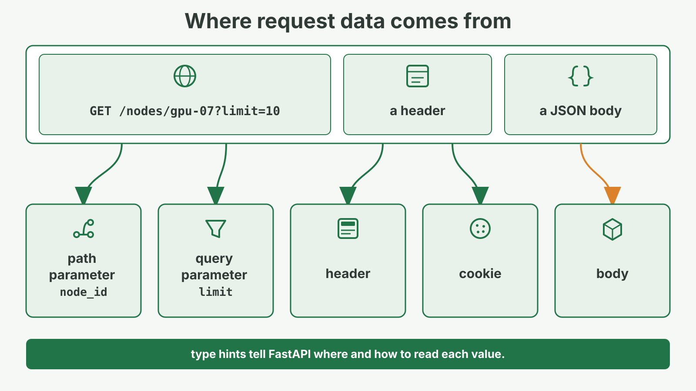
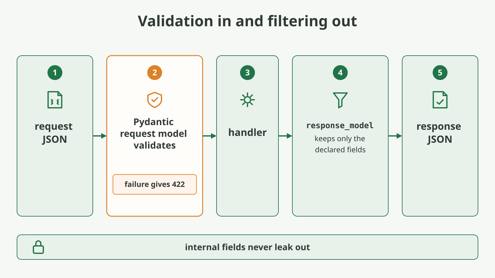
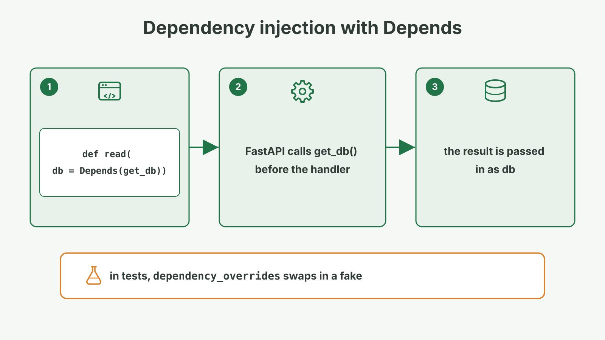
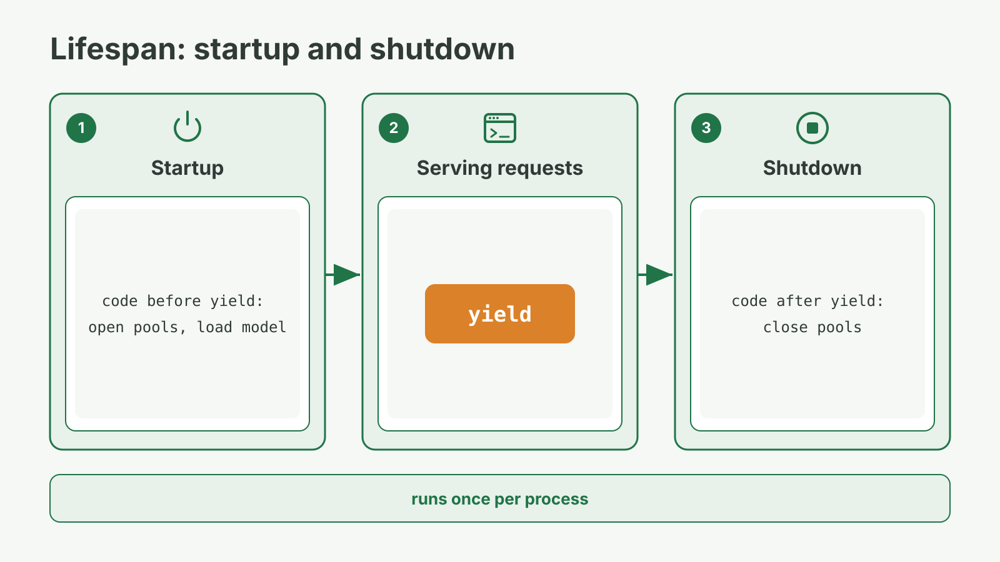
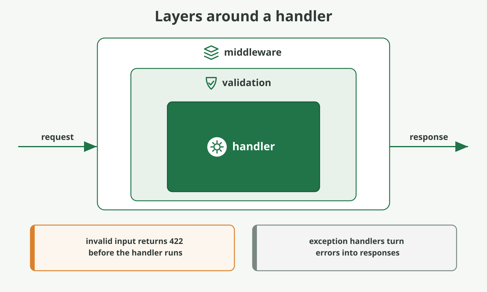
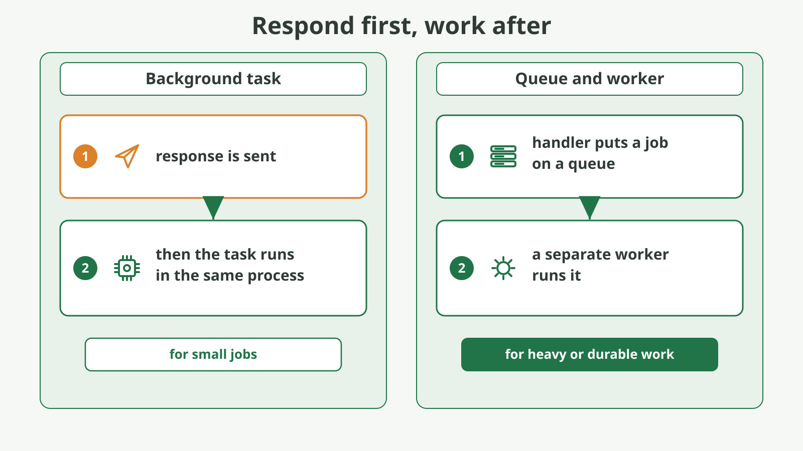

# 3.7 Building APIs and microservices with FastAPI

| | |
|---|---|
| Level | Intermediate |
| Priority tier | 0 |
| Lab venue | Python 3.11+, `pip install fastapi uvicorn[standard] pydantic httpx pytest`; Docker/kind optional |
| Part | Part 3: Python for infrastructure |
| Status | Drafted, labs **untested** |

## Why this matters for AI infrastructure

Sooner or later, almost every platform component grows an HTTP API, and that is usually a good sign. An inventory service sits in front of NetBox and Redfish. A job-submission gateway fronts Slurm or Kubernetes. A webhook receiver takes alerts from Alertmanager. A model-serving front end handles authentication, batching and streaming before it calls Triton or vLLM. An internal control plane manages GPU quotas, and an "agent" exposes health and metrics.

Each of those is a microservice: one small program that owns one job and talks to everything else over HTTP. FastAPI is the dominant Python framework for building them. It is asynchronous, built on ASGI, and type-driven. Request validation and OpenAPI documentation come from Python type hints and pydantic models. If you run control-plane services, it is fast enough for most of them, and for many data-plane services too.

The framework also does a great deal on your behalf, and that is the reason to read this chapter rather than skim a quickstart. A tool that writes your validation, your documentation and your error responses for you is worth understanding properly. Its mistakes are quiet ones.

This chapter teaches FastAPI from end to end, with an infrastructure and inference bias. It starts with the architecture, WSGI vs ASGI, and then moves through routing and validation, dependency injection, error handling, authentication and security, databases, background and long-running work, streaming responses, and testing. It finishes with packaging and deployment on containers and Kubernetes, including probes and graceful shutdown, and with observability.

As you read, keep one of these services in mind. The examples build a Fleet API that works as an inventory and job gateway.

## Prerequisites and outcomes

Before you start, you should be comfortable with functions, classes, typing and pydantic basics, which are covered in chapters 3.1 to 3.4. You also need concurrency and asyncio from chapter 3.6, and HTTP basics from chapter 2.10. None of that is decorative. This chapter leans on all of it, and it is easier to pause here than halfway through the streaming section.

After this chapter you can:

- Explain WSGI vs ASGI, how an ASGI server such as uvicorn or hypercorn runs a FastAPI app, and how sync `def` and async `async def` endpoints execute.
- Build REST APIs with routing, path, query, header, cookie and body parameters, pydantic request and response models, status codes, error responses and OpenAPI docs.
- Use dependency injection with `Depends` for configuration, database sessions, authentication and shared clients. Use lifespan events for startup and shutdown.
- Structure an application with `APIRouter`, settings and layers for routes, services and repositories, plus versioning and pagination.
- Implement authentication and authorisation with API keys, OAuth2 password and bearer flows with JWT, or mTLS at the proxy. Add CORS, rate limiting hooks and input hardening.
- Connect to SQL databases with SQLAlchemy or SQLModel in async mode, and to NoSQL databases. Manage migrations and connection pools.
- Handle background and long-running work with BackgroundTasks, task queues and job-status endpoints. Stream data with Server-Sent Events, chunked responses or WebSockets, and handle file uploads and downloads.
- Test with `TestClient` and `httpx`, using dependency overrides and fixtures, and load test your service.
- Package and containerise a service, deploy it behind a proxy, and add health and readiness probes, graceful shutdown, metrics and tracing. You will also understand the scaling and performance trade-offs.

If any prerequisite feels unfamiliar, go back to that chapter before you start the lab.

## 1. Architecture: from WSGI to ASGI



*Figure 3.7.1. ASGI architecture: the server hands each request to the app, and async handlers let waiting requests share a worker.*

Start with a scene you will meet in your first month. A health endpoint was meant to be three lines that return `{"status": "ok"}`. Then someone added a version stamp that reads a config file, and then a database ping so the dashboard shows green only when the database is reachable. Now every node in the fleet calls the endpoint every few seconds, and the dashboard starts timing out while the CPU on that pod barely moves.

Nothing in that endpoint is slow. Every request is simply waiting, and waiting is the whole story of this section. The way a server model handles waiting decides how much traffic one process can carry.

WSGI, defined in PEP 3333, is the classic synchronous interface that Flask and Django use. Synchronous means the server hands one request to one worker, then stands there until that worker comes back. Each request occupies one worker thread or process until it finishes. Concurrency therefore comes from running many workers, for example with gunicorn.

ASGI is the asynchronous successor. Asynchronous means one worker can hold many requests at once and move between them whenever one of them is waiting on I/O. It runs an event loop, supports `async def` handlers, and keeps long-lived connections open for WebSockets and SSE, which is Server-Sent Events. Background tasks fit this model too.

An event loop is worth a plain definition, because the rest of the chapter depends on it. Picture a single thread with a list of work on its desk. It picks up one item, starts it, and the moment that item has to wait for a disk or a socket, it sets it aside and picks up the next one. The thread never sits idle while something else could run.

FastAPI is built on Starlette, an ASGI toolkit, and on pydantic for validation. On top of those two, it adds route declarations, dependency injection and automatic OpenAPI.



An `async def` endpoint runs directly on the event loop. That suits code that awaits non-blocking I/O, such as an `httpx.AsyncClient` or an async database driver. The cost is that one blocking call or heavy CPU job stalls every other request, because there is only ever one thread to stall. A call is blocking when it holds the thread until it finishes, and `time.sleep` is the simplest example.

A `def` endpoint is treated differently. FastAPI runs it in a thread pool managed by anyio, which has 40 threads by default. Blocking libraries are acceptable there, because a thread pool is exactly what they expect. Concurrency is capped by the pool, though. With a 40-thread pool, 40 blocking calls can run at once, and a 41st call waits for a free thread.

The rule is simple. Use `async def` only when everything you await is truly async. Otherwise use `def`, or wrap the blocking call with `await asyncio.to_thread(...)` or `run_in_threadpool` inside async code. Never call `requests.get`, `time.sleep`, `subprocess.run` or heavy NumPy inside `async def`.

To use several cores, run uvicorn directly, as in `uvicorn app.main:app --host 0.0.0.0 --port 8000`. You can also run gunicorn with uvicorn workers, as in `gunicorn -k uvicorn.workers.UvicornWorker -w 4`. Each worker is a separate process with its own event loop and memory. State is not shared between workers, so a model loaded in each worker multiplies memory use. That is why GPU services typically run one worker per GPU. In production, several flags matter: `--workers`, `--limit-concurrency`, `--timeout-keep-alive`, `--proxy-headers` for use behind a proxy, `--log-config`, and `--timeout-graceful-shutdown` for graceful shutdown.

FastAPI with uvicorn handles thousands of simple requests per second per core. Real latency, though, depends on what the handler does. That might be a database call, a downstream call or model inference. For ML inference, use a dedicated serving runtime such as Triton, vLLM, TGI, TorchServe, Ray Serve or KServe. Put a thin FastAPI gateway in front of it to handle auth, validation, routing, rate limiting and request shaping.

Decide for each endpoint whether it truly awaits async work, because that choice sets how the server behaves under load.

## 2. A first application

Your first task is usually small and specific. A rack of nodes arrived, and the spreadsheet that tracks them is already behind. You want a service you can reach with `curl`, so that the next question about that rack goes to the API instead of to you.

The app below is a Fleet API. A dictionary stands in for a database, so you can focus on the framework.

```python
# app/main.py
from fastapi import FastAPI, HTTPException, status
from pydantic import BaseModel, Field

app = FastAPI(title="Fleet API", version="1.0.0", description="Inventory and job gateway")

class NodeIn(BaseModel):
    name: str = Field(pattern=r"^[a-z0-9-]{3,63}$")
    rack: str
    gpus: int = Field(8, ge=1, le=16)

class Node(NodeIn):
    id: int

DB: dict[int, Node] = {}                       # demo only: real services use a database

@app.get("/healthz")
async def healthz() -> dict:
    return {"status": "ok"}

@app.post("/nodes", response_model=Node, status_code=status.HTTP_201_CREATED)
async def create_node(node: NodeIn) -> Node:
    if any(n.name == node.name for n in DB.values()):
        raise HTTPException(status.HTTP_409_CONFLICT, f"node {node.name} exists")
    new = Node(id=len(DB) + 1, **node.model_dump())
    DB[new.id] = new
    return new

@app.get("/nodes/{node_id}", response_model=Node)
async def get_node(node_id: int) -> Node:
    try:
        return DB[node_id]
    except KeyError:
        raise HTTPException(status.HTTP_404_NOT_FOUND, "node not found") from None

@app.get("/nodes", response_model=list[Node])
async def list_nodes(rack: str | None = None, limit: int = 100, offset: int = 0) -> list[Node]:
    items = [n for n in DB.values() if rack in (None, n.rack)]
    return items[offset: offset + limit]
```

Two models do the work here, and the split between them matters later. `NodeIn` describes what a client sends, and `Node` adds the `id` the server assigns. The dictionary is for demo only.

```bash
uvicorn app.main:app --reload                        # development with autoreload
curl -s localhost:8000/nodes -X POST -H 'content-type: application/json' -d '{"name":"gpu01","rack":"r1"}' | jq
# interactive docs: http://localhost:8000/docs (Swagger UI), /redoc, machine-readable /openapi.json
```

Start the server, then send the `curl` request. Open `/docs` in a browser to see the Swagger UI, an interactive page built from your code. It shows the same schema the code declares, so it can never drift away from the real thing.

Notice what FastAPI did for you on that one request. It validated the JSON body and returned a 422 with details on failure. It converted types, documented the endpoint in OpenAPI, filtered the response through `response_model`, set the status code and generated the docs.

Send a name that breaks the pattern, and compare the 422 response with that rule. The message names the field and the rule it violated, which saves a support round trip.

## 3. Requests: routing and parameters

Picture the first support ticket of the week. `GET /nodes/summary` returns a 422 that complains `summary` is not a valid integer. The function that builds the summary exists and is correct, so the message makes no sense until you look at the order of the routes. The parameterised `/nodes/{node_id}` declared above it is answering first, and it is trying to read `summary` as a number.

That is routing in one incident. A route is a rule that says which function answers which path and method, and the rules are tried in the order you wrote them.

### Path, query, header, cookie, form and body



*Figure 3.7.2. Request parameters: the same request carries data in the path, query string, headers, cookies and body.*

A request can carry its input in several places: the URL path, the query string, headers, cookies, a form or a JSON body. You declare each input as a function parameter, and FastAPI finds the right source for it. That is the whole trick, and it is worth reading the code below slowly once.

```python
from fastapi import Path, Query, Header, Cookie, Body, Form, File, UploadFile, Depends
from typing import Annotated

@app.get("/racks/{rack}/nodes/{name}")
async def get(
    rack: Annotated[str, Path(min_length=1, max_length=32)],          # path parameter (from the URL template)
    name: str,
    verbose: Annotated[bool, Query(description="include details")] = False,        # query ?verbose=true
    tags: Annotated[list[str] | None, Query()] = None,                              # ?tags=a&tags=b
    x_request_id: Annotated[str | None, Header()] = None,            # header X-Request-Id (underscores converted)
    session: Annotated[str | None, Cookie()] = None,
): ...

@app.post("/jobs")
async def submit(job: JobIn, priority: Annotated[int, Body(ge=0, le=10)] = 5): ...    # multiple body params embed by key
@app.post("/upload")
async def upload(file: UploadFile, desc: Annotated[str, Form()]):       # multipart/form-data; spooled to disk if large
    data = await file.read()                                              # or stream chunks: await file.read(1<<20)
```

A parameter whose name appears in the path template is a path parameter. A scalar type without a body model becomes a query parameter, and a pydantic model becomes the JSON body. The `Annotated[..., Query/Path/Header/...]` style adds validation and documentation. Since FastAPI 0.95, this style is preferred over default-valued `Query(...)`.

The book *Building Python Web APIs with FastAPI* shows the same ideas in chapters 2 and 3, in `todo.py` and `model.py`. There, `Path(..., title="The ID of the todo to retrieve", gt=0, le=1000)` marks a path parameter as required. The ellipsis `...` in the first argument is what makes it required. The numeric bounds `gt`, `ge`, `lt` and `le` limit the values it accepts.

Nested pydantic models validate hierarchical JSON payloads. In that book, `class Item(BaseModel): item: str; status: str` sits inside `class Todo(BaseModel): id: int; item: Item`. Example data goes into `Config.schema_extra`, or into `model_config = ConfigDict(json_schema_extra={"example": ...})`. These models also fill the Swagger UI at `/docs` and the ReDoc page at `/redoc` automatically.

- Enums and literals restrict the values a client can send. Declare them as `class State(StrEnum): ...`, and an invalid value returns a 422.
- Path order matters, and that is the incident from the top of this section. Define fixed paths such as `/nodes/summary` before parameterised paths such as `/nodes/{id}`.
- Query parameter models arrived in version 0.115. Group query parameters into a pydantic model with `Annotated[Filter, Query()]`.
- Pagination can use `limit` and `offset`, or a cursor-based `page_token`. Cap `limit` with `Query(le=1000)`, return total counts or `next` tokens, and keep the ordering stable.
- For POST requests that create resources, accept an `Idempotency-Key` header. Store results by key, so a retried request can be matched to work already done.

Decide which of your routes create resources, because those are the ones that need an idempotency key.

### Request and response models



*Figure 3.7.3. Pydantic models validate incoming data and filter outgoing data.*

Pydantic models define the schema of your API, and a schema is simply a description of what the data must look like. Keep three kinds of model apart: input, stored and output. In this chapter, `NodeIn`, `NodeDB` and `NodeOut` play those three roles. The book uses the same idea in chapter 3 with `Todo`, `TodoItem` and `class TodoItems(BaseModel): todos: List[TodoItem]`. Its route is declared as `@todo_router.get("/todo", response_model=TodoItems)`, so `retrieve_todo()` returns only the `TodoItem` descriptions and hides the internal `id` fields.

The separation protects you in two ways. Clients cannot set server-controlled fields, such as `id`, `owner` or timestamps, and secrets never leak into a response. This is called mass-assignment protection, and the name describes the attack well: a client sends a field it has no business setting, and a careless server accepts it. The `response_model` filters and validates what you return. Options such as `response_model_exclude_none=True` and `response_model_by_alias` control the output further. To serialise ORM objects, set `model_config = {"from_attributes": True}`.

```python
from datetime import datetime
from pydantic import BaseModel, ConfigDict, EmailStr, field_validator, model_validator

class JobIn(BaseModel):
    model_config = ConfigDict(extra="forbid")
    name: str
    image: str
    gpus: int = 1
    command: list[str]
    env: dict[str, str] = {}

    @model_validator(mode="after")
    def check(self):
        if self.gpus > 8 and "multi-node" not in self.name:
            raise ValueError("more than 8 GPUs requires a multi-node job name")
        return self

class JobOut(BaseModel):
    model_config = ConfigDict(from_attributes=True)
    id: str
    state: Literal["queued", "running", "failed", "done"]
    created_at: datetime
```

You can annotate a return type directly, as in `-> JobOut`, and FastAPI uses it as the response model. When you need custom behaviour, return `JSONResponse`, `PlainTextResponse`, `StreamingResponse`, `FileResponse` or `RedirectResponse`. `ORJSONResponse` and `UJSONResponse` offer faster JSON.

## 4. Dependency injection



*Figure 3.7.4. Dependency injection: FastAPI calls the dependency and passes the result to your handler.*

By the third resource you add, the same four lines sit at the top of every handler: read the settings, open a database session, check the API key, find the current user. The code works, and it is one careless copy away from a handler that forgets the key check.

Dependency injection is the cure, and the name is more intimidating than the idea. A dependency is a small piece of setup that a handler needs. You write that setup once as a function, tell FastAPI to call it with `Depends`, and the framework hands the result to the handler on every request.

A handler often needs a database session, the settings and the current user. `Depends` declares each of these once, as a reusable component. FastAPI resolves it for each request and caches the result within that request, so several dependencies that all ask for the settings do not build them twice.

A dependency can be a function, a class or a generator. A generator runs cleanup after its `yield`, which is how a database session gets closed even when the handler fails.

```python
from fastapi import Depends
from functools import lru_cache
from collections.abc import AsyncIterator

class Settings(BaseSettings):                       # pydantic-settings
    db_url: str
    api_keys: set[str] = set()
    model_config = SettingsConfigDict(env_prefix="FLEET_")

@lru_cache
def get_settings() -> Settings: return Settings()

async def get_db(settings: Annotated[Settings, Depends(get_settings)]) -> AsyncIterator[AsyncSession]:
    async with SessionLocal() as session:           # setup
        yield session                               # injected into the endpoint
    # teardown after the response (commit/rollback/close)

async def require_key(x_api_key: Annotated[str, Header()], s: Annotated[Settings, Depends(get_settings)]):
    if x_api_key not in s.api_keys:                 # use secrets.compare_digest for constant-time comparison
        raise HTTPException(status.HTTP_401_UNAUTHORIZED, "invalid API key", headers={"WWW-Authenticate": "ApiKey"})

@app.get("/nodes", dependencies=[Depends(require_key)])          # applies without injecting a value
async def list_nodes(db: Annotated[AsyncSession, Depends(get_db)]): ...
router = APIRouter(prefix="/v1", dependencies=[Depends(require_key)])    # applies to all routes in a router
app = FastAPI(dependencies=[Depends(require_key)])                        # global
```

Read `get_db` first, because it is the pattern you will use most. Code before `yield` opens the session, and the endpoint receives it. Code after `yield` runs once the response is sent, which is where you commit, roll back or close it. `require_key` raises a 401 for a key that is not allowed.

A dependency added through `dependencies=[...]` runs without injecting a value. You can attach it to one route, to a router, or to the whole app. Dependencies also make tests easier, because `app.dependency_overrides[get_db] = fake_db` swaps a component across the app. Create expensive shared objects once, in lifespan.

### Lifespan: startup and shutdown



*Figure 3.7.5. Lifespan: code before the yield runs at startup and code after it runs at shutdown.*

Load your model and open your HTTP client before the first request. Close them cleanly on shutdown. Doing this at startup means the first real user does not pay for the work, and doing it at shutdown means no connection is left half open.

```python
from contextlib import asynccontextmanager
import httpx

@asynccontextmanager
async def lifespan(app: FastAPI):
    app.state.http = httpx.AsyncClient(timeout=10, limits=httpx.Limits(max_connections=200))
    app.state.model = load_model()               # blocking? run in thread: await asyncio.to_thread(load_model)
    app.state.ready = True
    yield                                         # application serves requests
    app.state.ready = False
    await app.state.http.aclose()                 # clean shutdown: close pools, flush logs/metrics, release GPU

app = FastAPI(lifespan=lifespan)
```

The code before `yield` runs at startup. It creates an `httpx.AsyncClient` with `timeout=10` and `max_connections=200`, loads the model and sets the ready flag. The code after `yield` runs at shutdown and closes the client. The comment lists more shutdown work, such as flushing logs and releasing the GPU. If `load_model` blocks, run it with `await asyncio.to_thread(load_model)`.

The older `@app.on_event("startup")` hooks are deprecated in favour of lifespan. Store shared objects on `app.state`, and read them through `request.app.state`.

Move expensive setup into lifespan, so it runs once per process rather than once per request.

## 5. Errors, validation and middleware



*Figure 3.7.6. A request passes through middleware and validation before the handler, and errors become clean responses.*

A client asks for a node that was decommissioned last month. The response is a 500 with a Python traceback, the dashboard shows a blank panel, and the only way to find that request in the logs is to guess the timestamp. Nobody learns anything, and the operator has to reproduce the problem from scratch.

When a request goes wrong, the client should learn what failed and nothing more. Good error handling gives each failure a clear status code and one consistent body. That second part matters as much as the first, because a client that has to parse three different error shapes will get one of them wrong.

FastAPI returns a 422 for validation errors automatically. To return your own error schema, customise the handler with `@app.exception_handler(RequestValidationError)`. For expected errors, raise `HTTPException(status_code, detail, headers)`. For domain errors, define an exception class and map it, as below. A domain error is a failure that belongs to your problem rather than to HTTP, such as a node that does not exist.

```python
class NodeNotFound(Exception):
    def __init__(self, name): self.name = name

@app.exception_handler(NodeNotFound)
async def nf_handler(request: Request, exc: NodeNotFound):
    return JSONResponse(status_code=404, content={"error": "node_not_found", "node": exc.name, "request_id": request.state.request_id})
```

Keep one error body shape across the whole API. RFC 9457 defines `application/problem+json`, with the fields type, title, status, detail and instance. Choose status codes with care. 400, 422, 409 and 429 each mean something different, and 401 is not the same as 403. Use 502, 503 or 504 when an upstream service is the problem. Never leak stack traces or secrets. Log unexpected exceptions with a request id, and let a catch-all `Exception` handler return a 500.

Middleware wraps every request. Picture a corridor that every visitor walks down in both directions: each middleware function can inspect the request on the way in and change the response on the way out. Use `@app.middleware("http")` or Starlette classes. Common uses include request ids, timing, logging, CORS through `CORSMiddleware` with explicit origins, GZip, trusted hosts, HTTPS redirects and `ProxyHeadersMiddleware` behind a load balancer. Body size limits are a proxy or ASGI setting. Pure ASGI middleware is faster than `BaseHTTPMiddleware`, which has quirks with streaming and background tasks.

```python
import time, uuid, logging
log = logging.getLogger("access")

@app.middleware("http")
async def access_log(request: Request, call_next):
    rid = request.headers.get("x-request-id", uuid.uuid4().hex)
    request.state.request_id = rid
    t0 = time.perf_counter()
    try:
        response = await call_next(request)
    except Exception:
        log.exception("unhandled error rid=%s path=%s", rid, request.url.path); raise
    response.headers["x-request-id"] = rid
    log.info("rid=%s %s %s %d %.1fms", rid, request.method, request.url.path, response.status_code, (time.perf_counter() - t0) * 1000)
    return response
```

This middleware reuses an incoming `x-request-id` header or generates one when it is missing. It stores the id on the request and returns it in the response. It logs the method, path, status and duration, and it logs unhandled exceptions with the request id before it re-raises them. Decide your error body shape once, and let this middleware supply the id that ties a client report to a log line.

## 6. Structuring applications

Six weeks in, `main.py` has become the whole application. Several people are editing it, the merge conflicts land in the same import block every time, and no test can import a service without starting the app.

As an application grows, a single `main.py` becomes hard to test and hard to change. Splitting it into layers keeps HTTP code apart from business logic. The tree below shows one way to organize a fleet service.

```text
fleet/
├── pyproject.toml
├── src/fleet/
│   ├── main.py            # app factory: create_app(), lifespan, middleware, routers
│   ├── config.py          # Settings
│   ├── deps.py            # shared dependencies (auth, db)
│   ├── api/
│   │   ├── v1/
│   │   │   ├── nodes.py   # APIRouter: HTTP concerns only
│   │   │   └── jobs.py
│   ├── schemas/           # pydantic models (API contracts)
│   ├── services/          # business logic (pure-ish, testable)
│   ├── repositories/      # DB access
│   ├── models/            # ORM tables
│   └── clients/           # outbound HTTP clients (redfish, slurm)
└── tests/
```

Start each resource with `APIRouter(prefix="/nodes", tags=["nodes"])`, then mount it with `app.include_router(nodes.router, prefix="/v1")`. A router is simply a bundle of routes you can mount under a prefix, which is what keeps the URL layout in one place. The Event Planner app (`planner/`) in *Building Python Web APIs with FastAPI*, chapter 5, uses the same kind of split. Its application is organized into `database/connection.py`, `models/events.py`, `models/users.py`, `routes/events.py` and `routes/users.py`. The `Event` model in `models/events.py` has `id`, `title`, `image`, `description`, `tags: List[str]`, `location` and `creator`. The `models/users.py` file defines `User`, `NewUser` and `UserSignIn`, and `UserSignIn` uses `EmailStr`. The routes are `event_router = APIRouter(tags=["Events"])` in `routes/events.py`, and `user_router = APIRouter(tags=["User"])` in `routes/users.py`, which serves `/user/signup` and `/user/signin`. The `main.py` file registers them with `app.include_router(user_router, prefix="/user")` and `app.include_router(event_router, prefix="/event")`.

Keep route functions thin. A route parses and validates input, calls a service, and maps the result to a response. Business logic belongs in services, which import nothing from FastAPI. Data access belongs in repositories. That split makes unit tests easy to write, because a service can be called without an HTTP client anywhere in sight.

An app factory, `def create_app(settings=None) -> FastAPI`, lets tests build isolated apps. Version your API with a URL prefix such as `/v1`. Mark old routes with `deprecated=True`, and send `Sunset` headers when they retire. Evolve schemas additively, treat OpenAPI as the contract, and test for breaking changes, for example with `oasdiff`.

Read configuration from environment variables with pydantic-settings, following the 12-factor approach. Load secrets from files or a secret manager. Keep no configuration in code.

You can mount sub-apps and static files, as in `app.mount("/static", StaticFiles(...))`. For server-side HTML, use `Jinja2Templates(directory="templates/")`. It renders pages with `templates.TemplateResponse("todo.html", {"request": request, "todos": todo_list})`. Jinja2 gives you filters such as `default`, `escape`, `int`, `float`, `join` and `length`. It also gives you `` and `` blocks, `` for reusable components, and `` with `` for template inheritance. That inheritance suits simple status dashboards.

Keep your routes thin from the start, so the services and repositories stay easy to test.

## 7. Authentication and security

Suppose a user with a valid token edits a job that belongs to someone else. The request is authenticated, but it is still wrong. Authentication answers who is calling. Authorisation decides what that caller may touch, and the two are separate questions.

That gap is where an API can be authenticated and still wrong, and the second check is the one that gets forgotten. Keep the pair in mind through this section.

API keys travel in an `X-API-Key` header. Store them hashed, compare them with `secrets.compare_digest`, give each key its own scopes and rate limits, and rotate them. The compare function takes the same time whether the key is nearly right or completely wrong, which removes a timing signal an attacker could otherwise measure.

Never store plaintext passwords. A `HashPassword` helper in `auth/hash_password.py` can use passlib[bcrypt] with `CryptContext(schemes=["bcrypt"], deprecated="auto")`. The alternatives are `hashlib.pbkdf2_hmac`, `scrypt` and `argon2-cffi`. `create_hash(password: str)` hashes the password during `/user/signup`, and `verify_hash(plain_password: str, hashed_password: str)` checks it during `/user/signin`.

The JWT code lives in `auth/jwt_handler.py` and `auth/authenticate.py`, and it uses `python-jose`, `PyJWT` or `authlib`. A JWT, or JSON Web Token, is a signed block of claims the server can hand to a client and check later without storing a session. `create_access_token(user: str)` builds a payload with `{"user": user, "expires": time.time() + 3600}`. It signs that payload with `jwt.encode(payload, settings.SECRET_KEY, algorithm="HS256")`. For asymmetric signing, use `RS256` against an OIDC provider's JWKS instead. `/user/signin` accepts `user: OAuth2PasswordRequestForm = Depends()` and returns `TokenResponse(access_token=access_token, token_type="Bearer")`.

Protected routes, such as `POST /event/new`, `PUT /event/{id}` and `DELETE /event/{id}`, use `oauth2_scheme = OAuth2PasswordBearer(tokenUrl="/user/signin")`. That reads the `Authorization: Bearer <token>` header. Then `authenticate(token: str = Depends(oauth2_scheme))` calls `verify_access_token(token)`. The check confirms that `expires` is present and that `datetime.utcnow() <= datetime.utcfromtimestamp(expire)`. It raises `400` or `403` otherwise. On success, it returns `data["user"]`.

Object-level ownership, the BOLA protection, stops one user from acting on another user's data. In `create_event(body: Event, user: str = Depends(authenticate))`, the server sets `body.creator = user`. In `update_event` and `delete_event`, the route compares `event.creator` with `user`. If they differ, it raises `HTTPException(status_code=status.HTTP_400_BAD_REQUEST, detail="Operation not allowed")`. For service-to-service calls, use workload identity, such as Kubernetes service account tokens or SPIFFE, or use mTLS terminated at the mesh or ingress.

```python
from fastapi.security import OAuth2PasswordBearer, SecurityScopes
import jwt

oauth2 = OAuth2PasswordBearer(tokenUrl="token", scopes={"jobs:write": "submit jobs", "nodes:read": "read inventory"})

async def current_user(scopes: SecurityScopes, token: Annotated[str, Depends(oauth2)]):
    try:
        claims = jwt.decode(token, key=jwks_key_for(token), algorithms=["RS256"], audience="fleet-api", issuer="https://idp.example.com/")
    except jwt.PyJWTError:
        raise HTTPException(401, "invalid token", headers={"WWW-Authenticate": "Bearer"})
    if not set(scopes.scopes) <= set(claims.get("scope", "").split()):
        raise HTTPException(403, "insufficient scope")
    return claims

@app.post("/jobs", dependencies=[Security(current_user, scopes=["jobs:write"])])
```

Transport security starts at the edge. TLS can end at the ingress or gateway, or at uvicorn with `--ssl-keyfile`. Redirect HTTP to HTTPS, send HSTS, and use mTLS for internal APIs.

Hardening starts with input. Validate and bound every input, including lengths, counts and sizes. Set `extra="forbid"` on models, and limit request body and upload sizes. If you accept URLs, avoid SSRF with allow-lists, and block link-local and metadata IPs. SSRF means server-side request forgery: a client persuades your server to fetch an address the client cannot reach itself. Use parameterised queries only, which ORMs provide for you.

Encode output for HTML, and set cookies to `HttpOnly`, `Secure` and `SameSite`. Add CSRF protection if cookies carry authentication, where CSRF is cross-site request forgery. Allow CORS only for the origins you need, and set security headers. Rate limit at the gateway, with `slowapi`, or with a Redis-based limiter. Audit-log mutating calls, scan your dependencies, and turn debug mode off in production. Set `docs_url=None` if the API must not expose its docs publicly.

The OWASP API Top 10 gives you a checklist. It covers broken object-level authorisation, which means checking ownership on every `/{id}` access. It also covers broken authentication, excessive data exposure (use response models), lack of resources and rate limiting, function-level authorisation, mass assignment, misconfiguration, injection, improper asset management, and unsafe consumption of upstream APIs.

Read secrets from the environment or a secret store, never from the image or the repository. Wrap them in `SecretStr` so they stay out of logs.

Treat every route that takes an `{id}` as a place to check ownership first.

## 8. Databases

The service is comfortable in staging, where a handful of people use it. On the first day of real traffic, PostgreSQL starts refusing connections, and the CPU and memory graphs stay calm the whole time. Nothing in the application looks wrong, which is the difficult part of this section.

Every request that reads or writes data needs a database session. A session is one conversation with the database, and a pool is a fixed set of those conversations that the application reuses instead of opening a new one every time. The pool decides how many of those sessions run at once.

### SQL (SQLAlchemy 2.x / SQLModel)

```python
# async engine and session
from sqlalchemy.ext.asyncio import create_async_engine, async_sessionmaker, AsyncSession
from sqlalchemy.orm import DeclarativeBase, Mapped, mapped_column
from sqlalchemy import select, String

engine = create_async_engine("postgresql+asyncpg://user:pw@db/fleet", pool_size=10, max_overflow=20, pool_pre_ping=True)
SessionLocal = async_sessionmaker(engine, expire_on_commit=False)

class Base(DeclarativeBase): ...
class NodeRow(Base):
    __tablename__ = "nodes"
    id: Mapped[int] = mapped_column(primary_key=True)
    name: Mapped[str] = mapped_column(String(63), unique=True, index=True)
    rack: Mapped[str] = mapped_column(String(32), index=True)
    gpus: Mapped[int]

@app.get("/nodes", response_model=list[Node])
async def list_nodes(db: Annotated[AsyncSession, Depends(get_db)], rack: str | None = None, limit: int = Query(100, le=1000)):
    stmt = select(NodeRow).order_by(NodeRow.id).limit(limit)
    if rack: stmt = stmt.where(NodeRow.rack == rack)
    return (await db.scalars(stmt)).all()
```

This example uses an async engine. The `pool_size=10` setting gives the base pool, and `max_overflow=20` allows up to 20 more connections. `pool_pre_ping=True` checks each connection before use, which saves you from handing a dead socket to a request. The `NodeRow` class maps to the `nodes` table, and `list_nodes` filters by rack when one is given. It caps `limit` at 1000.

**SQLModel** merges pydantic and SQLAlchemy models into one class. Its author is also the author of FastAPI. A table model looks like `class Event(SQLModel, table=True): id: Optional[int] = Field(default=None, primary_key=True); tags: List[str] = Field(sa_column=Column(JSON))`. A partial update schema, `class EventUpdate(SQLModel): title: Optional[str] = None ...`, lets a client send only the fields it changes.

The book creates tables with `engine_url = create_engine("sqlite:///planner.db", echo=True, connect_args={"check_same_thread": False})` and `SQLModel.metadata.create_all(engine_url)`. It injects sessions with `def get_session(): with Session(engine_url) as session: yield session`.

The CRUD routes in `routes/events.py` follow four patterns. Create runs `session.add(new_event)`, then `session.commit()` and `session.refresh(new_event)`. Read uses `session.exec(select(Event)).all()` for a list and `session.get(Event, id)` for one item. Update iterates over `event_data = new_data.dict(exclude_unset=True)` and calls `setattr(event, key, value)` for each item. It then runs `session.add(event)`, `session.commit()` and `session.refresh(event)`. Delete calls `session.delete(event)` and `session.commit()`. Larger systems keep API schemas and ORM models separate.

- **Migrations**: use Alembic. Generate a migration with `alembic revision --autogenerate`, and apply it with `alembic upgrade head`. In multi-replica deployments, run migrations as a separate job or init step. Do not run them when you start the app.
- **Pools**: size them so that `workers × pool_size ≤ DB max_connections`. Use `pool_pre_ping` and timeouts. When many replicas connect, put a pooler such as PgBouncer in front. Do not share sessions across requests or tasks, and keep transactions short. Handle deadlocks and serialization retries, and avoid N+1 queries with `selectinload`.
- **Blocking drivers**: a blocking driver such as psycopg2 is fine inside `def` endpoints, because those run in the thread pool. Inside `async def`, use an async driver such as asyncpg, psycopg3 async or aiomysql.
- **NoSQL**: for MongoDB, use Motor and the Beanie ODM. A model such as `class Event(Document):` subclasses Beanie's `Document`, which extends the pydantic `BaseModel`. Initialize the connection at startup with `client = AsyncIOMotorClient(settings.DATABASE_URL)`, then `await init_beanie(database=client.get_default_database(), document_models=[Event, User])`. A generic `Database` repository wraps each operation. Create runs `await document.create()`. Read runs `await self.model.get(id)` with `PydanticObjectId`, or `await self.model.find_all().to_list()`. Update builds `des_body = {k: v for k, v in body.dict().items() if v is not None}` and runs `await doc.update({"$set": des_body})`. Delete runs `await doc.delete()`. For caches, queues and rate limits, use Redis through `redis.asyncio`. etcd, DynamoDB and Elasticsearch or OpenSearch are other options. Time-series metrics belong in Prometheus or VictoriaMetrics, not in your service database.
- **Caching**: options include `cachetools`, `aiocache` and Redis. Use cache-aside with TTLs. Send ETags and `Cache-Control` headers to clients, and invalidate entries on writes.

Pick your pool size from your worker count and the database's connection limit, not from a guess.

## 9. Long-running, background and streaming work

A user submits a multi-day training job and the browser waits. The job will not finish before lunch, the request cannot stay open that long, and the pod that accepted it may be replaced before the job is done. Somehow the API has to answer now and still be telling the truth an hour later.

That is the general problem. A client submits a training job, and the API has to answer long before the job finishes. How you hand the work off decides whether it survives a restart.

### Background tasks and queues



*Figure 3.7.7. Background tasks suit small jobs, and a queue with a worker suits heavy or durable work.*

`BackgroundTasks` runs a function after the response is sent, in the same process. It suits quick, fire-and-forget work, such as sending a notification. Its work is lost on a restart, so it is unsuitable for long or critical jobs. The distinction is not about size. It is about what you are willing to lose.

```python
from fastapi import BackgroundTasks
@app.post("/jobs", status_code=202)
async def submit(job: JobIn, bg: BackgroundTasks):
    job_id = create_job_record(job)                   # persist first
    bg.add_task(run_job, job_id)                      # short work only
    return {"id": job_id, "state": "queued", "status_url": f"/jobs/{job_id}"}
```

For durable or heavy work, use a job queue and workers. Options include Celery, RQ, Dramatiq, Arq for asyncio, Taskiq, Temporal for workflows, Kubernetes Jobs and Slurm submissions. Here is the pattern. `POST` returns 202 Accepted with a job id. The client polls `GET /jobs/{id}`, or receives a webhook or an SSE stream. The worker updates the state in a database, and job keys make each operation idempotent. Cancellation endpoints (`DELETE /jobs/{id}`), timeouts, retries with backoff and dead-letter handling complete the design.

Use `BackgroundTasks` only for work you can afford to lose, and send anything durable to a queue.

### Streaming

A client watching a long job needs updates as they happen. Server-Sent Events (SSE) let the server push those updates over plain HTTP. The server holds one connection open and keeps writing lines to it, and the browser reads each line as it arrives.

```python
from fastapi.responses import StreamingResponse
import asyncio, json

async def event_stream(job_id: str, request: Request):
    last = None
    while not await request.is_disconnected():          # stop when the client goes away
        state = await get_state(job_id)
        if state != last:
            yield f"event: state\ndata: {json.dumps(state)}\n\n"        # Server-Sent Events framing
            last = state
        if state["state"] in {"failed", "done"}: break
        await asyncio.sleep(1)

@app.get("/jobs/{job_id}/events")
async def events(job_id: str, request: Request):
    return StreamingResponse(event_stream(job_id, request), media_type="text/event-stream",
                             headers={"Cache-Control": "no-cache", "X-Accel-Buffering": "no"})     # disable proxy buffering
```

The generator loops while the client stays connected, and it checks `await request.is_disconnected()` on each pass. It sends a state event only when the state changes, and it stops once the job reaches `failed` or `done`. The `await asyncio.sleep(1)` call paces the loop at one check per second. The endpoint returns a `StreamingResponse` with two headers. The `X-Accel-Buffering: no` header turns off proxy buffering.

- SSE is one-way push over HTTP. It suits token streaming from LLMs, log tailing and progress updates. WebSockets (`@app.websocket`) handle two-way traffic.
- For large downloads, use chunked `StreamingResponse`, for example with `async for chunk in aiofiles...`. `FileResponse` serves static files.
- Proxies and load balancers buffer responses and enforce idle timeouts. To keep a stream alive, turn off buffering with `X-Accel-Buffering: no` or nginx `proxy_buffering off`. Set long read timeouts, and send periodic comment or heartbeat lines. Keep HTTP/2 or keep-alive working end to end, as chapters 2.10 and 2.20 explain.
- A slow client needs backpressure. The producer should await, since the ASGI server applies flow control through `send`. Bound your queues too.

Turn off proxy buffering before you judge a streaming endpoint, since buffering hides the stream.

### An inference gateway example

The example below is a thin FastAPI front end over a model server. It keeps the boring work at the edge, which is auth, validation, timeouts, streaming and metrics, and leaves inference to the backend.

```python
# Thin FastAPI front end over a model server: auth, validation, timeouts, streaming passthrough, metrics
@app.post("/v1/chat", dependencies=[Security(current_user, scopes=["infer"])])
async def chat(req: ChatRequest, request: Request, settings: Annotated[Settings, Depends(get_settings)]):
    if req.max_tokens > settings.max_tokens: raise HTTPException(422, "max_tokens too large")
    client: httpx.AsyncClient = request.app.state.http
    async def gen():
        try:
            async with client.stream("POST", settings.backend_url, json=req.model_dump(), timeout=httpx.Timeout(10, read=300)) as r:
                if r.status_code >= 500: raise HTTPException(502, "backend error")
                async for line in r.aiter_lines():
                    if await request.is_disconnected(): break            # client left: stop consuming (frees GPU time upstream)
                    if line: yield line + "\n\n"
        except httpx.TimeoutException:
            yield 'event: error\ndata: {"error":"upstream_timeout"}\n\n'
    return StreamingResponse(gen(), media_type="text/event-stream", headers={"X-Accel-Buffering": "no"})
```

The endpoint checks the caller's scope with `Security(current_user, scopes=["infer"])`, and it rejects a `max_tokens` value above the configured limit with a 422. The generator opens a streaming request with `httpx.Timeout(10, read=300)`. A backend status of 500 or higher becomes a 502. A timeout sends an error event with `upstream_timeout`. When the client leaves, the loop stops reading, which frees GPU time upstream.

For batching, queue incoming requests in an `asyncio.Queue`, group them up to N items or T ms, and send one batched call to the model. Return results through per-request futures. Triton and vLLM do dynamic batching better, but a gateway may implement tiered logic of its own. Add concurrency limits per user or tenant, token-based rate limits, request cancellation propagation, and metrics such as TTFT and tokens/s.

Set the timeouts and per-tenant limits before you put the gateway in front of users.

## 10. Testing

The first version of the suite needs a live database, a Redis and a GPU. Nobody runs it locally, so it only ever runs in CI, and when it fails nobody is sure whether the code broke or the environment did.

Tests for an API are mostly about taking dependencies away, and FastAPI is built for exactly that. The fixture below does the removing. A fixture is a named piece of preparation that pytest hands to a test, and this one builds an app with a `sqlite+aiosqlite://` URL and the key `k`, then replaces the database dependency with `fake_db`. You can run tests like these without a real database.

```python
# tests/test_nodes.py
import pytest
from fastapi.testclient import TestClient
from httpx import AsyncClient, ASGITransport
from fleet.main import create_app
from fleet.deps import get_db

@pytest.fixture
def client():
    app = create_app(settings=Settings(db_url="sqlite+aiosqlite://", api_keys={"k"}))
    app.dependency_overrides[get_db] = fake_db            # swap the DB
    with TestClient(app) as c:                             # runs lifespan startup/shutdown
        c.headers["x-api-key"] = "k"
        yield c

def test_create_and_get(client):
    r = client.post("/v1/nodes", json={"name": "gpu01", "rack": "r1"})
    assert r.status_code == 201
    nid = r.json()["id"]
    assert client.get(f"/v1/nodes/{nid}").json()["name"] == "gpu01"

def test_validation(client):
    assert client.post("/v1/nodes", json={"name": "x"}).status_code == 422

def test_auth(client):
    client.headers.pop("x-api-key"); assert client.get("/v1/nodes").status_code in (401, 403, 422)

@pytest.mark.anyio
async def test_async():
    async with AsyncClient(transport=ASGITransport(app=create_app()), base_url="http://test") as ac:
        assert (await ac.get("/healthz")).json() == {"status": "ok"}
```

The first test expects a 201 on create, and the node can be read back. The second expects a 422 for a bad body. The third removes the key and expects 401, 403 or 422. The async test follows the same pattern.

Test at several layers. Unit tests cover services and repositories, using plain Python and fakes. API tests use `TestClient`, which runs in-process with no network. An async `httpx.AsyncClient` works too, with `app=app` and `base_url="http://app"`. Dependency overrides keep the database out of those tests.

Shared fixtures go in `conftest.py`, marked with `@pytest.fixture(scope="session")`. The book's `test_login.py` and `test_routes.py` (chapter 8) use fixtures named `event_loop`, `default_client`, `access_token` and `mock_event`. Measure coverage with `coverage run -m pytest`, then `coverage report`. Running `coverage html` writes `htmlcov/index.html`.

Integration tests run against real database containers, using `testcontainers`. Contract tests check your API against its OpenAPI schema, and `schemathesis` fuzzes the endpoints from that spec. Load tests with `locust`, `k6`, `wrk` or `hey` measure latency percentiles and saturation. Security tests check authorization matrices.

Run the whole suite in CI with coverage, as chapter 3.9 describes.

## 11. Deployment and operations

You ship version 1.4.2 on a Tuesday afternoon. During the rolling update, a user's `POST /jobs` reaches a pod that is already shutting down. The request disappears with no error at all, the job never exists, and the rollout reports success.

When you ship the API, the container image is what runs in production. A careless build can copy secrets or local environments into that image. The Dockerfile below keeps the image small and runs the app as a non-root user.

### Packaging

```dockerfile
FROM python:3.12-slim AS base
ENV PYTHONUNBUFFERED=1 PYTHONDONTWRITEBYTECODE=1 PIP_NO_CACHE_DIR=1
WORKDIR /app
COPY requirements.txt .
RUN pip install -r requirements.txt
COPY src/ src/
USER 10001
EXPOSE 8000
HEALTHCHECK CMD python -c "import urllib.request,sys; sys.exit(0 if urllib.request.urlopen('http://127.0.0.1:8000/healthz').status==200 else 1)"
CMD ["uvicorn", "fleet.main:app", "--host", "0.0.0.0", "--port", "8000", "--proxy-headers", "--forwarded-allow-ips=*", "--timeout-graceful-shutdown", "25"]
```

Always include a `.dockerignore` file that excludes `venv`, `.env`, `.git` and `__pycache__`. Without it, local virtual environments and secrets can end up in the image build context, and the image grows for no benefit. Use `docker-compose.yml` for local multi-container checks before you deploy to Kubernetes. A typical compose file has an `api` service with `env_file: .env.prod`, and a `database` service with a persistent volume, `data:/data/db`. In production, use a managed cloud database such as Cloud SQL, RDS or Atlas, instead of unbacked container storage.

Run one uvicorn process per container, and scale with replicas. Kubernetes HPA can scale on CPU, requests per second, queue depth or custom metrics. Use gunicorn with uvicorn workers only when you want several processes in one container. Set `--limit-concurrency`, or let the proxy shed load. Set `--timeout-keep-alive` above the load balancer's idle timeout, which avoids races. Finally, use multi-stage builds, a non-root user, a read-only root file system and dropped capabilities, as chapter 2.21 covers.

### Kubernetes deployment essentials

A pod needs to answer two questions before it takes traffic: is it alive, and is it ready? Probes answer both, and a probe is just a health check that Kubernetes calls on a schedule. The shutdown settings then decide whether a rolling update drops requests.

```yaml
apiVersion: apps/v1
kind: Deployment
metadata: { name: fleet-api }
spec:
  replicas: 3
  strategy: { rollingUpdate: { maxSurge: 1, maxUnavailable: 0 } }
  selector: { matchLabels: { app: fleet-api } }
  template:
    metadata: { labels: { app: fleet-api } }
    spec:
      terminationGracePeriodSeconds: 40
      containers:
      - name: api
        image: registry.example.com/fleet-api:1.4.2
        ports: [ { containerPort: 8000 } ]
        env:
        - { name: FLEET_DB_URL, valueFrom: { secretKeyRef: { name: fleet-db, key: url } } }
        resources: { requests: { cpu: 250m, memory: 256Mi }, limits: { memory: 512Mi } }
        startupProbe:   { httpGet: { path: /healthz, port: 8000 }, failureThreshold: 30, periodSeconds: 2 }
        readinessProbe: { httpGet: { path: /readyz, port: 8000 }, periodSeconds: 5 }
        livenessProbe:  { httpGet: { path: /healthz, port: 8000 }, periodSeconds: 10, timeoutSeconds: 2, failureThreshold: 3 }
        lifecycle: { preStop: { exec: { command: ["sleep", "5"] } } }      # let endpoints deregister before SIGTERM handling
```

The liveness probe at `/healthz` checks that the process and its event loop still respond. Keep it cheap, and keep it independent of external dependencies. Otherwise, a database blip restarts every pod at once. The readiness probe at `/readyz` checks that the pod can serve traffic now. That means the model is loaded, the database is reachable and the pod is not draining, so it flips to not-ready during shutdown. Use a startup probe for slow model loads.

On SIGTERM, uvicorn stops accepting connections and waits for in-flight requests until the graceful timeout expires. In-flight requests are the ones already accepted and still working, and they are exactly the requests you do not want to lose. Align `terminationGracePeriodSeconds`, the `preStop` sleep, the load balancer deregistration delay and `--timeout-graceful-shutdown`. For streaming endpoints, decide whether to cut long-lived streams or drain them.

Set memory limits for models and caches. For GPU inference, request `nvidia.com/gpu`, and run one worker per GPU. Avoid CPU limits that throttle the event loop, and prefer CPU requests instead. Scale I/O-bound services on concurrency or queue length rather than CPU, and use KEDA for event-driven scaling. For configuration and rollout, use ConfigMaps and Secrets, immutable image tags or digests, and canary or blue/green releases through ingress, a mesh or Argo Rollouts. Run database migrations as pre-deploy Jobs, with backward-compatible schema changes that follow an expand and contract pattern.

Send SIGTERM to a test pod and time its shutdown, so you know the grace periods fit together.

### Observability

Write structured JSON logs to stdout, with the request id, user or tenant, route, status and latency. Structured here means one JSON object per line with named fields, so a log query can find a request instead of a grep guessing at it. Redact secrets, and sample noisy logs, as chapter 3.5 describes.

Expose `/metrics` with `prometheus-fastapi-instrumentator` or `starlette-exporter`. They report request counts, latencies by route and status, and in-flight requests. Add business metrics such as jobs by state, queue depth, tokens per second and GPU utilisation from DCGM. The RED method covers rate, errors and duration, which is three questions in order: how many requests, how many failed, and how long they took. Alert on SLOs, as chapter 2.31 describes.

Add OpenTelemetry instrumentation with `opentelemetry-instrumentation-fastapi`, `-httpx` and `-sqlalchemy`. It propagates `traceparent` through downstream calls, and it exports spans to Tempo, Jaeger or an OTLP collector.

Expose health endpoints, a build info endpoint such as `/version` that returns the git SHA, and debug endpoints. Put debug endpoints behind auth, because a debug endpoint is a door and someone will find it.

For profiling, use `py-spy`, or `pyinstrument` middleware in staging. Run `uvicorn --log-level debug` when you need more detail, and keep slow-request logs.

Add RED metrics before you tune anything, so you can see where the latency comes from.

### Performance checklist

Use async drivers and one shared `httpx.AsyncClient`, because a client built per request throws away the connection pool you already paid for. Return orjson responses for large JSON, and avoid loading models per request. Paginate and stream big results. Compress responses with gzip or br at the proxy, and tune connection pools. Keep the event loop free by moving CPU or blocking work to threads, processes or queues. Cache expensive lookups.

Measure with load tests, and profile before you optimise. Pydantic validation of huge payloads costs CPU, so limit payload sizes. Consider `model_validate_json` and `TypeAdapter` for those cases.

Profile before you optimise, and use load tests to confirm each change.

## 12. Lab

Start with the self-checking Python lab at `code/part03/python_fastapi_microservices_lab.py`. It proves the core code works before you move on, so run it first. It is also the cheapest way to find out whether your environment is ready. The script checks nested `Todo` and `TodoItem` models, and `response_model` field filtering, from chapters 2 and 3 of *Building Python Web APIs with FastAPI*. It checks `HashPassword` hashing, and `create_access_token` and `verify_access_token` with expiration, from chapter 7. It also checks `EventPlannerRepository` SQLite CRUD, partial `EventUpdate` with `exclude_unset`, and creator ownership (BOLA) enforcement, from chapters 5 to 8. Finally, it checks Server-Sent Events (SSE) framing and stream termination.

```bash
python3 code/part03/python_fastapi_microservices_lab.py
```

Next, you can work through the exercises on any machine with Python 3.11 or later. The interactive shell steps below were not run on live hardware.

1. Build the Fleet API with in-memory storage. Explore `/docs` and `/openapi.json`, trigger 422 errors, add pagination and filtering, and write requests with `curl` and `httpx`.
2. Split your schemas into In, DB and Out models. Use `extra="forbid"`, validators and enums, and prove that mass assignment is blocked. Return `problem+json` errors through exception handlers.
3. Implement settings, API-key auth, and a DB session dependency, first with SQLite and then with PostgreSQL in Docker. Create a shared `httpx.AsyncClient` in lifespan, override dependencies in tests, and add request-id middleware and structured logs.
4. Write one endpoint with `async def` and `time.sleep(2)`, and another with `def` and `time.sleep(2)`. Load test both with 50 concurrent requests using `hey` or `wrk`. Observe the event-loop stall against the thread pool, then fix it with `await asyncio.sleep` or `to_thread`.
5. Build SQLAlchemy async models and an Alembic migration, then add CRUD with pagination. Map a unique-constraint conflict to 409, roll back transactions on errors, and test with `testcontainers`.
6. Implement JWT bearer auth with scopes, against a local Keycloak or a mocked JWKS. Write an authorization matrix test that proves user A cannot read user B's jobs.
7. Implement `POST /jobs` returning 202, with a worker in Arq or RQ backed by Redis, and add `GET /jobs/{id}`. Add SSE progress streaming and cancellation. Kill the worker mid-job and observe the retry and idempotency behaviour. Then compare that with `BackgroundTasks` losing work on restart.
8. Put a mock streaming backend behind the gateway, or vLLM or TGI if a GPU is available. Implement token streaming passthrough with disconnect handling, per-tenant concurrency limits and request timeouts. Measure TTFT and throughput, then test through nginx with and without `proxy_buffering off`.
9. Reach 90% coverage with `pytest`. Run `schemathesis run http://localhost:8000/openapi.json`, and add a contract test that fails when a field is removed.
10. Containerise the app and deploy it to kind with probes, a PodDisruptionBudget, an HPA and an ingress. Perform a rolling update during a load test, and verify zero failed requests. Send SIGTERM, and verify the graceful shutdown timing.
11. Add `/metrics`, a Grafana dashboard of RED metrics, and OpenTelemetry traces from the gateway to the backend. Then add an alert on p99 latency.
12. Clean up.

## 13. Common mistakes

Blocking calls inside `async def` endpoints are the first trap, because `async` does not make blocking code concurrent. It only makes blocking code other people's problem. If you load models or create clients on every request, that is another trap. Unbounded caches and global mutable state cause trouble too, since workers do not share memory.

Using one pydantic model for the database, input and output invites mass assignment and data leaks. Missing timeouts on downstream calls, and missing limits on concurrency, body size or pagination, let a single client overload the service.

Liveness probes that depend on external services can restart healthy pods. Readiness that never flips during shutdown, and grace periods that do not line up, drop requests during a deploy. Running migrations from every replica at startup causes conflicts. Connection pool exhaustion follows when `workers × pool` goes over the database limits.

Trusting `X-Forwarded-*` headers from the internet lets clients spoof their source IP. Leaving docs or debug endpoints public widens the exposure, and so does permissive CORS (`*` with credentials). Leaking stack traces or secrets in error responses and logs gives attackers information they should not have.

If you use `BackgroundTasks` for work that must not be lost, you risk losing it. Retrying POSTs without idempotency has the same shape, since the work can be duplicated. Proxy buffering breaks SSE, and idle timeouts kill long streams.

Walk through this list against your own service before the first deploy.

## 14. Interview angles

Interviewers tend to ask about FastAPI in layers, starting with the server model and ending with production debugging. Each question below is a good test of how well you know the material, and most of them reward a story from your own service more than a definition.

- "WSGI vs ASGI? How does uvicorn run FastAPI? What runs sync endpoints?"
- "When do you use `async def` vs `def` in FastAPI?"
- "How does FastAPI validate requests and generate OpenAPI?"
- "Explain dependency injection and how you test with overrides."
- "How would you design a job-submission API for long-running GPU jobs? Cover the 202 response, the queue, the status endpoint, idempotency and cancellation."
- "How do you stream LLM tokens through an API and handle client disconnects?"
- "How do you deploy FastAPI to Kubernetes safely? Cover probes, graceful shutdown, scaling and config."
- "How do you secure the API? Authn vs authz, OAuth2/JWT, rate limiting, OWASP API risks."
- "A service hangs under load. How do you debug? Check for a blocked loop, pool exhaustion, the database pool and downstream timeouts."

If you can answer each question with a concrete example from this chapter, you know the material well enough to discuss it.

## Exercises

1. Contrast WSGI (PEP 3333) with ASGI, and explain what Starlette and pydantic each contribute to FastAPI. Use chapter 1 of *Building Python Web APIs with FastAPI* as a source. Then explain why calling `time.sleep(2)` or `requests.get()` inside an `async def` endpoint stalls every concurrent request, while a plain `def` endpoint runs in AnyIO's 40-thread pool. Finally, explain why GPU-backed services run one worker process per GPU, while CPU-bound control-plane APIs run `gunicorn -k uvicorn.workers.UvicornWorker -w N`.
2. Explain how FastAPI tells path parameters, query parameters, headers and JSON body payloads apart in `get(rack, name, verbose, tags, x_request_id)`. Explain why fixed routes such as `/nodes/summary` must be declared before parameterised routes such as `/nodes/{id}`. Then, using `Todo` and `TodoItem` in `code/part03/python_fastapi_microservices.py`, explain how separating `NodeIn` and `JobIn` (with `extra="forbid"`) from `NodeOut` and `TodoItems` (with `response_model`) prevents mass assignment and sensitive field leaks. You will need chapters 2, 3 and 5 of the FastAPI book.
3. Trace the lifecycle of a generator dependency, `async def get_db(): async with SessionLocal() as session: yield session`, and of an `@asynccontextmanager async def lifespan(app: FastAPI):` that manages a shared `httpx.AsyncClient` and an ML model on `app.state`. Then show how `@app.exception_handler(NodeNotFound)` maps a domain exception to a structured RFC 9457 `application/problem+json` response with an `x-request-id` correlation header. You will find this material in chapters 3, 6 and 7 of the FastAPI book.
4. Using `HashPassword`, `create_access_token()`, `verify_access_token()` and `EventPlannerRepository` in `code/part03/python_fastapi_microservices.py`, explain two things. First, how `/user/signup` hashes passwords, and how `/user/signin` issues signed JWTs with an `expires` claim that `Depends(authenticate)` verifies. Second, how checking whether `event.creator` matches `user` prevents Broken Object-Level Authorization (BOLA). Also cover `Security(current_user, scopes=["jobs:write"])` and `secrets.compare_digest` for API keys. You will find the source in chapter 7 of the FastAPI book.
5. Using `EventPlannerRepository.update()`, show how partial `PUT` or `PATCH` updates filter out `None` or unset fields with `{k: v for k, v in body.items() if v is not None}`. Explain why database connection pools must satisfy `workers * pool_size <= max_connections`, and why Alembic migrations must run as a pre-deploy Job instead of inside every pod's startup. Then, using `format_sse_events()`, contrast `BackgroundTasks` with durable job queues that return `202 Accepted`. Explain how `StreamingResponse` with `text/event-stream`, `X-Accel-Buffering: no` and `await request.is_disconnected()` streams LLM tokens or job states safely. You will find the source in chapter 6 of the FastAPI book.
6. Write a `pytest` fixture that overrides `app.dependency_overrides[get_db] = fake_db`. Use it to test the 201, 422 and 401/403 responses with both `TestClient` and `httpx.AsyncClient`. Then explain how `startupProbe`, `readinessProbe` (`/readyz`), `livenessProbe` (`/healthz` without DB checks), `preStop: ["sleep", "5"]`, `--timeout-graceful-shutdown 25` and `terminationGracePeriodSeconds: 40` work together during a zero-downtime Kubernetes rolling update. Chapters 8 and 9 of the FastAPI book cover the testing and deployment material.

Work through the exercises after the lab, and check each answer against the section you read it in.

## Checkpoint questions (20)

<details>
<summary>1. What does ASGI add over WSGI, what two libraries is FastAPI built on, and how does FastAPI execute `async def` versus `def` endpoints?</summary>

- **WSGI and ASGI:** WSGI (PEP 3333) is synchronous, so each concurrent request ties up a worker thread. ASGI, short for *Asynchronous Server Gateway Interface*, is driven by an event loop. It supports `async def` coroutines, WebSockets, Server-Sent Events (`SSE`) and HTTP/2.
- **Foundation:** FastAPI is built on Starlette, the ASGI toolkit for web apps and routing, and on Pydantic, which handles data validation and serialization.
- **Execution:** FastAPI runs `async def` endpoints directly on the single event loop, so any blocking I/O or CPU work stalls the whole server. It sends plain `def` endpoints to an AnyIO worker thread pool, which has 40 threads by default.
</details>

<details>
<summary>2. How does FastAPI distinguish path parameters, query parameters, headers, and JSON request bodies, and why does route declaration order matter (*Building Python Web APIs with FastAPI*, chapter 2)?</summary>

- A parameter whose name matches `{param}` in the URL path template is a path parameter, declared with `Annotated[str, Path(...)]`.
- Other scalar or list parameters, such as `int`, `str`, `bool` or `list[str]`, become query parameters. For example, `?limit=100&tags=a&tags=b` is a query string. You configure them with `Query()`.
- Parameters annotated with `Header()` or `Cookie()` read HTTP headers or cookies. The name `x_request_id` matches the `X-Request-Id` header automatically.
- A parameter typed as a Pydantic `BaseModel` subclass is parsed and validated from the JSON body. A validation failure returns HTTP 422 Unprocessable Entity automatically.

Starlette matches routes in declaration order, so a fixed path such as `/nodes/summary` must come before `/nodes/{node_id}`.
</details>

<details>
<summary>3. Why should you separate Input (`NodeIn`), Database (`NodeDB`), and Output (`NodeOut` / `TodoItems`) models, and what does `response_model` do (*Building Python Web APIs with FastAPI*, chapters 2, 3 and 5)?</summary>

A single model for input, storage and output allows mass assignment, where a client injects `id`, `is_admin=True` or `creator` in a POST body. It also allows excessive data exposure, such as returning password hashes or internal IDs in GET responses. Keep `NodeIn`, which uses `extra="forbid"`, apart from `NodeOut`, or from `TodoItems` in chapter 3. Declaring `response_model=NodeOut` or `-> NodeOut` tells FastAPI to strip any field the output model does not declare. It also validates the outgoing structure and publishes the exact schema in `/openapi.json`, `/docs` (Swagger UI) and `/redoc`.
</details>

<details>
<summary>4. How does FastAPI Dependency Injection (`Depends`) work, including generator dependencies with `yield` and `app.dependency_overrides` (*Building Python Web APIs with FastAPI*, chapters 6, 7 and 8)?</summary>

`Depends(fn)` declares a callable, which can be a function, a coroutine or a class. FastAPI resolves that callable's parameters recursively, caches the result within the same request, and only then calls the endpoint.

- **Generator dependencies (`yield`):** Code before `yield session` runs as setup before the endpoint. Code after `yield`, such as closing an `AsyncSession`, runs automatically after the response is sent, just like a context manager.
- **Scopes:** You can attach a dependency to a single parameter, to a route decorator with `dependencies=[Depends(require_key)]`, to an `APIRouter`, or to the whole `FastAPI` app.
- **Testing:** `app.dependency_overrides[get_db] = fake_db` swaps out a production database or an auth check across the whole app. It needs no code changes in your unit tests.
</details>

<details>
<summary>5. What is the `lifespan` async context manager in FastAPI, and why should `httpx.AsyncClient` and ML models be initialized there instead of per request?</summary>

Passed as `app = FastAPI(lifespan=lifespan)`, an `@asynccontextmanager async def lifespan(app: FastAPI):` runs its setup once, before the app accepts traffic. Its teardown runs once, after `yield`, when the server shuts down on `SIGTERM`. Storing a shared `app.state.http = httpx.AsyncClient(...)` and a preloaded `app.state.model` in lifespan reuses connection pools and GPU weights across all requests. Otherwise you risk exhausting ephemeral ports or reloading gigabytes of weights on every call.
</details>

<details>
<summary>6. How do custom `@app.exception_handler` functions, RFC 9457 `application/problem+json`, and request-ID middleware work together?</summary>

A `@app.middleware("http")` function reads `request.headers.get("x-request-id")`, or generates a new `uuid.uuid4().hex` when the header is missing. It stores the id on `request.state.request_id`, logs the request duration, and returns `x-request-id` in the response header. When domain code raises `NodeNotFound(name)`, `@app.exception_handler(NodeNotFound)` returns a structured JSON body. That body can be `{"error": "node_not_found", "node": exc.name, "request_id": request.state.request_id}`, or an RFC 9457 `problem+json` body with the fields `type`, `title`, `status`, `detail` and `instance`. Either way, no internal Python traceback leaks out.
</details>

<details>
<summary>7. How should a multi-module FastAPI application (`APIRouter`, services, repositories) be structured (*Building Python Web APIs with FastAPI*, chapter 5)?</summary>

Split your project into layers.

1. **`api/` or `routes/` (`APIRouter`):** Thin HTTP handlers, such as `event_router`, `user_router` and `nodes.router`, mounted with `app.include_router(..., prefix="/v1")`. They handle only HTTP status codes and request and response models.
2. **`schemas/`:** Pydantic request and response contracts, such as `JobIn`, `JobOut` and `EventUpdate`.
3. **`services/`:** Pure business logic that you can test without HTTP or FastAPI.
4. **`repositories/` and `models/`:** Database access, through `EventPlannerRepository`, a SQLAlchemy `NodeRow` or a Beanie `Document`.
5. **`main.py`:** A `create_app()` factory that wires up `lifespan`, middleware and routers.
</details>

<details>
<summary>8. How do password hashing (`HashPassword` / `bcrypt`), OAuth2 JWT verification (`OAuth2PasswordBearer`), and `secrets.compare_digest` work (*Building Python Web APIs with FastAPI*, chapter 7)?</summary>

- **Passwords:** Hash them on signup with a slow, salted key derivation function, such as `bcrypt` through `CryptContext`, `argon2-cffi` or `pbkdf2_hmac`. Verify them with `verify_hash()` on `/user/signin`.
- **API keys:** Compare fixed keys in constant time with `secrets.compare_digest(provided, expected)`. That prevents timing side-channel attacks.
- **OAuth2 and JWT:** `OAuth2PasswordBearer` reads the `Authorization: Bearer <token>` header. The check verifies the signature, using `RS256` with a JWKS or `HS256` with `SECRET_KEY`. It also checks the issuer `iss`, the audience `aud`, the `exp` or `expires` timestamp, and the required `SecurityScopes`. An invalid or expired token returns 401 Unauthorized, and insufficient scope returns 403 Forbidden.
</details>

<details>
<summary>9. What is Broken Object-Level Authorization (`BOLA`, OWASP API1), and how does chapter 7 of *Building Python Web APIs with FastAPI* prevent it on `PUT` and `DELETE /event/{id}`?</summary>

Broken Object-Level Authorization (`BOLA`) happens when an API confirms that a user is logged in, but never checks that the user owns the specific resource requested by `{id}`. In chapter 7, `create_event` sets `body.creator = user` from the verified JWT. Both `update_event` and `delete_event` then check that `event.creator` equals `user`. If it does not, they raise `HTTPException(status_code=400, detail="Operation not allowed")`, before any database change. If you skip that check, any logged-in user can change any event.
</details>

<details>
<summary>10. How do SQLAlchemy 2.x (`AsyncSession`), SQLModel (`Session`), and Beanie ODM (`Document`) handle partial updates and connection pooling (*Building Python Web APIs with FastAPI*, chapter 6)?</summary>

- **Partial updates (`EventUpdate`):** Filter out unset or `None` fields with `new_data.model_dump(exclude_unset=True)`, or with `{k: v for k, v in body.dict().items() if v is not None}`. Apply the result with `setattr(row, k, v)`, or with MongoDB `{"$set": des_body}`. Omitted fields then keep their values instead of being overwritten with `None`.
- **Connection pool sizing:** Each uvicorn worker process keeps its own pool, set here with `pool_size=10, max_overflow=20, pool_pre_ping=True`. Make sure `replicas × workers_per_pod × (pool_size + max_overflow) <= PostgreSQL max_connections`, or put PgBouncer in front of PostgreSQL. Run Alembic migrations, with `alembic upgrade head`, in a single pre-deploy Job rather than inside every replica's startup.
</details>

<details>
<summary>11. When is FastAPI's `BackgroundTasks` appropriate, and how should long-running GPU or cluster jobs be designed instead?</summary>

- **`BackgroundTasks`** runs in the same process right after the HTTP response is sent. If the container restarts, scales down or runs out of memory, the in-memory task is lost for good. Heavy work also competes with live requests for CPU and memory. Use it only when you have short, expendable work, such as a notification.
- **Durable long-running jobs:** Save the job record first. Then put the job ID on an external queue, such as Redis with Arq or RQ, Celery, Temporal, or a Kubernetes or Slurm job. Return `HTTP 202 Accepted` at once, with a body such as `{"id": job_id, "state": "queued", "status_url": f"/jobs/{job_id}"}`. The client can then poll `GET /jobs/{id}` or subscribe to an SSE stream.
</details>

<details>
<summary>12. How do Server-Sent Events (`SSE`) work with `StreamingResponse` for LLM token or job streaming, and how do you handle proxy buffering and client disconnects?</summary>

- **SSE framing:** Yield UTF-8 text blocks in the form `event: state\ndata: {"token": "..."}\n\n`, with `media_type="text/event-stream"`.
- **Disable proxy buffering:** Return the headers `{"Cache-Control": "no-cache", "X-Accel-Buffering": "no"}`. NGINX and Ingress controllers then flush each token chunk right away, instead of holding the stream in RAM.
- **Disconnect detection:** Check `if await request.is_disconnected(): break` inside the generator loop. For example, if you close the tab or cancel, the gateway stops the upstream `vLLM` or `Triton` stream at once, which frees GPU KV-cache and compute.
</details>

<details>
<summary>13. How do you test synchronous and asynchronous FastAPI endpoints, authentication, and OpenAPI contracts (*Building Python Web APIs with FastAPI*, chapter 8)?</summary>

1. **In-process tests with `TestClient` and `httpx.AsyncClient`:** Wrap `create_app()` in a `pytest` fixture. Use `with TestClient(app) as c:`, or `async with AsyncClient(transport=ASGITransport(app=app), base_url="http://test") as ac:`, so the lifespan hooks run. Override `app.dependency_overrides[get_db] = fake_db`, then test the happy paths (200 or 201), validation failures (422), auth failures (401 or 403) and BOLA ownership checks.
2. **Coverage and contract fuzzing:** Measure line and branch coverage with `coverage run -m pytest && coverage report`, or with `pytest --cov`. Fuzz every route against `/openapi.json` with `schemathesis`.
</details>

<details>
<summary>14. Why must Kubernetes `livenessProbe` (`/healthz`) and `readinessProbe` (`/readyz`) have different checks?</summary>

- **`livenessProbe` (`/healthz`):** This tells the kubelet whether the Python process and event loop are stuck and need a restart. The check should be a trivial in-memory return, such as `{"status": "ok"}`, and it must never query external databases or downstream APIs. Otherwise a transient database blip restarts every pod at once, which causes a cascading outage.
- **`readinessProbe` (`/readyz`):** This tells the Service or Ingress whether this pod can receive traffic right now. That means the model weights are on the GPU, the database pool is ready, and `app.state.ready` is `True`.
</details>

<details>
<summary>15. How do `preStop`, `--timeout-graceful-shutdown`, and `terminationGracePeriodSeconds` prevent dropped requests during a Kubernetes rolling update?</summary>

When Kubernetes terminates a pod, removing the pod IP from `EndpointSlice`s, kube-proxy and the Ingress happens asynchronously, in parallel with sending `SIGTERM`.

1. A `lifecycle.preStop` hook, `["sleep", "5"]`, delays `SIGTERM` by 5 seconds. During that time the pod is marked `Terminating` and removed from load balancer endpoints, so in-flight new connections can drain.
2. Uvicorn receives `SIGTERM`, stops accepting new connections, and finishes in-flight requests within `--timeout-graceful-shutdown 25`.
3. `terminationGracePeriodSeconds: 40` is higher than `5 + 25 = 30s`, so `SIGKILL` never fires before uvicorn finishes draining and runs the lifespan shutdown cleanup.
</details>

<details>
<summary>16. Why should a GPU inference FastAPI service run one worker per GPU and avoid tight Kubernetes CPU limits?</summary>

Each uvicorn or gunicorn worker is a separate OS process with its own address space. If a container runs 4 workers on 1 GPU, each process loads its own copy of the model into VRAM and contends for CUDA contexts, which causes CUDA OOMs. Run one worker process per GPU, or put FastAPI in front of a dedicated `vLLM` or `Triton` server. On event-loop services, tight `resources.limits.cpu` values cause Linux CFS quota throttling, visible in `cpu.stat` as `nr_throttled`. Bursts of validation and serialization then spike p99 tail latency. Set accurate CPU `requests` and memory `limits` instead.
</details>

<details>
<summary>17. What do `--proxy-headers` and `--forwarded-allow-ips` do in uvicorn?</summary>

When uvicorn runs behind an Ingress controller or load balancer, the direct TCP peer is the proxy's internal IP, and the connection is plain HTTP. Pass `--proxy-headers --forwarded-allow-ips=<trusted-proxy-cidr>` so that uvicorn trusts `X-Forwarded-For` and `X-Forwarded-Proto` from trusted proxies only. Never expose `--forwarded-allow-ips=*` to the public internet. Otherwise clients can spoof their source IP in audit logs and rate limiters.
</details>

<details>
<summary>18. How do you instrument a FastAPI service for the RED metrics method and OpenTelemetry distributed tracing?</summary>

- **RED metrics (rate, errors, duration):** Expose `/metrics` with `prometheus-fastapi-instrumentator` or `starlette-exporter`. They track `http_requests_total` by method, route template and status code, plus `http_request_duration_seconds_bucket` histograms and in-flight requests. Label by route template, such as `/nodes/{id}`, and never by raw URLs with high-cardinality IDs. Add domain gauges and counters for active GPU jobs and tokens per second.
- **OpenTelemetry tracing:** Instrument with `opentelemetry-instrumentation-fastapi` and `opentelemetry-instrumentation-httpx`. Incoming W3C `traceparent` headers then propagate across `httpx.AsyncClient` calls to downstream services, and spans export through OTLP.
</details>

<details>
<summary>19. How do `Idempotency-Key` headers make `POST /jobs` safe under network retries?</summary>

When a client's `POST /jobs` times out mid-flight, the client cannot tell whether the job was created before the connection dropped. Require an `Idempotency-Key` header that holds a UUID, and store `(idempotency_key, user_id) -> job_response` in Redis or PostgreSQL, with a unique constraint. A retried `POST` with the same key then returns the existing job record, instead of submitting a duplicate 64-GPU training job.
</details>

<details>
<summary>20. What is the role of `.dockerignore` and `docker-compose.yml` when packaging and testing a FastAPI application (*Building Python Web APIs with FastAPI*, chapters 1 and 9)?</summary>

- **`.dockerignore`** excludes local `venv/`, `.env` secret files, `.git/` and `__pycache__/` from `COPY . .` during `docker build`. That prevents credential leaks, bloated image layers and host-OS binary mismatches inside the container.
- **`docker-compose.yml`** defines multi-container local setups. Its `api` service is built from the `Dockerfile` and serves port `8080`, with `env_file: .env.prod`. It connects over a bridge network to a `database` container that uses the named volume `data:/data/db`. Use this setup for local end-to-end testing before you deploy to Kubernetes.
</details>

## Sources and review notes

- **Sources read in full:**
  - `building-python-web-apis-with-fastapi` — Abdulazeez Abdulazeez Adeshina, *Building Python Web APIs with FastAPI*, **Chapters 1 to 9** (`Chapter 1: Getting Started with FastAPI`, `Chapter 2: Routing in FastAPI`, `Chapter 3: Response Models and Error Handling`, `Chapter 4: Templating in FastAPI`, `Chapter 5: Structuring FastAPI Applications`, `Chapter 6: Connecting to a Database`, `Chapter 7: Securing FastAPI Applications`, `Chapter 8: Testing FastAPI Applications`, and `Chapter 9: Deploying FastAPI Applications` read in full): Git/venv/pip/Docker setup, `uvicorn api:app --port 8000 --reload`, `APIRouter`, `Todo`/`TodoItem`/`TodoItems` nested models and `response_model`, `Path(..., title=..., gt=0, le=1000)` and `Query`, Swagger `/docs` and ReDoc `/redoc`, HTTP status codes and `HTTPException`, Jinja2 `Jinja2Templates` filters/macros/inheritance, Event Planner `models/events.py` (`Event`, `EventUpdate`), `models/users.py` (`User`, `UserSignIn`, `TokenResponse`), `routes/events.py`, and `routes/users.py`, SQLModel (`sqlite:///planner.db`, `create_all`, `Session`, `Depends(get_session)`) and MongoDB Beanie (`AsyncIOMotorClient`, `init_beanie`, `Database` CRUD with `PydanticObjectId` and `{"$set": des_body}`), `HashPassword` (`CryptContext` `bcrypt`), `create_access_token` / `verify_access_token` (`jwt`, `SECRET_KEY`, `expires`), `OAuth2PasswordBearer` + `Depends(authenticate)`, creator ownership `BOLA` check (`event.creator` vs `user`), `CORSMiddleware`, `pytest` + `httpx.AsyncClient` fixtures (`conftest.py`, `test_login.py`, `test_routes.py`, `coverage run -m pytest` and `coverage html`), and `.dockerignore`, `Dockerfile`, `docker-compose.yml`, and `.env.prod`.
  - `nvidia-devops` (`volume-02/04-fastapi-microservices-masterclass.md`): WSGI vs ASGI, blocking AI infrastructure API pitfalls (`async def` vs `def`), Pydantic validation at the edge, async handlers, retries, `BackgroundTasks` limits, and production Kubernetes hardening.
- **Run here:** `python3 code/part03/python_fastapi_microservices_lab.py` (4 passed, 0 failed).
- **Explicitly labelled inferences:** The Fleet API (`NodeIn`/`Node`, `JobIn`/`JobOut`), `lifespan` + `Depends` patterns, `StreamingResponse` SSE inference gateway, and Kubernetes `Deployment` probe/graceful-shutdown manifest are the author's constructions applying *Building Python Web APIs with FastAPI* and `volume-02` to AI infrastructure services (plus original study items 21, 22, 23, 24, 25, 26, 27, 28, 29, 30, 31, 32, 33, 34, 35, 36, 37, 38, 39, and 40).
- **Not verified on live hardware:** Live `uvicorn`, `gunicorn`, `curl`, `docker`, `mongod`, `alembic`, `schemathesis`, and Kubernetes deployment commands (`0.0.0.0:8000`, `8080`, `27017`, `0.95`, `0.115`, `3333`, `9457`, `40` threads, `201`, `202`, `400`, `401`, `403`, `404`, `409`, `422`, `429`, `500`, `502`, `503`, `504`, `250m`, `256Mi`, `512Mi`, `1.4.2`) are marked where not executed by `python_fastapi_microservices_lab.py`.
