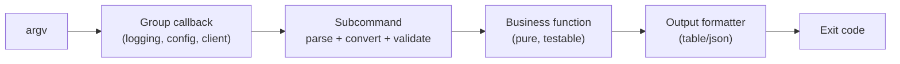

# 3.8 Building CLIs, agents and exporters

| | |
|---|---|
| Level | Intermediate |
| Priority tier | 0 |
| Lab venue | Python 3.11+, `pip install click typer rich httpx tenacity prometheus-client pyyaml`; Docker for Prometheus |
| Part | Part 3: Python for infrastructure |
| Status | Drafted, labs **untested** |

## Why this matters for AI infrastructure

Fleet operations are mostly small programs that talk to other systems: a CLI that drains a node, a script that collects `nvidia-smi` or DCGM data from 500 machines, an exporter that turns BMC sensors into Prometheus metrics, a Redfish client that sets boot order across a rack, a node agent that reports health to a control plane. These tools are run by humans at 3 a.m. and by automation every minute, so they must be predictable (clear exit codes, idempotent, dry-run), resilient (timeouts, retries, backoff, pagination), observable (structured logs, metrics) and distributable (a pinned version that works on every operator's laptop and every jump host). This chapter covers the engineering patterns behind such tools, with a bias toward GPU fleets, BMCs and Prometheus.

## Prerequisites and outcomes

Needs 3.1 to 3.6 (functions, packaging, typing, subprocess, concurrency) and 2.31 (monitoring). Complements 3.7 (services) and 3.9 (testing).

After this chapter you can:

- Design a CLI with subcommands, options, config files, environment variables, output formats and meaningful exit codes, using argparse, Click or Typer.
- Build resilient HTTP clients with timeouts, retries with exponential backoff and jitter, circuit breakers, pagination and rate-limit handling.
- Write a Prometheus exporter (custom collector) that is safe to scrape, and know the metric type and naming rules.
- Talk to a BMC with the Redfish API (sessions, service root traversal, power, boot, sensors, firmware, events) in Python.
- Fan out work across many hosts with bounded concurrency and per-host error isolation.
- Build a long-running node agent (signals, graceful shutdown, health, systemd unit).
- Package and distribute tools (wheels, `pipx`, zipapps, containers, single binaries).

## 1. Principles for operational tooling

1. **Safe by default.** Read-only commands need no confirmation; mutating commands support `--dry-run`, print what they will do, require `--yes` for destructive scope, and refuse wildcard targets without an explicit flag.
2. **Idempotent.** Running twice gives the same end state (set to desired, do not toggle). Return "already in desired state" as success.
3. **Explicit exit codes.** `0` success, `1` generic failure, `2` usage error (argparse/Click default), distinct codes for "partial failure" (some hosts failed) and "nothing to do" so wrappers and CI can react.
4. **Machine- and human-readable output.** Default to a table for humans, `--output json|yaml|tsv` for pipelines; send data to stdout and logs/progress to stderr so pipes stay clean.
5. **Timeouts everywhere.** Every network call and subprocess has a timeout; no operational tool should be able to hang forever.
6. **Per-target isolation.** One bad host must not abort the batch; collect results and errors, summarise at the end, and set the exit code accordingly.
7. **Structured logging and auditability.** Log who ran what against which targets with a run id; log mutating actions at INFO with before/after state.
8. **Config layering.** Precedence: command-line flags, then environment variables, then config file, then defaults; never put secrets on the command line (they show up in `ps` and shell history); read from env, files or a secret store.
9. **Small, testable core.** Parsing, decision logic and I/O separated: the CLI layer is a thin shell over functions you can unit test (chapter 3.9).

## 2. Command-line interfaces

### 2.1 argparse: the standard library baseline

```python
import argparse, sys

def build_parser() -> argparse.ArgumentParser:
    p = argparse.ArgumentParser(prog="gpuctl", description="GPU fleet helper")
    p.add_argument("-v", "--verbose", action="count", default=0)
    sub = p.add_subparsers(dest="cmd", required=True)

    s = sub.add_parser("status", help="show node GPU status")
    s.add_argument("hosts", nargs="+")
    s.add_argument("--output", choices=["table", "json"], default="table")

    d = sub.add_parser("drain", help="cordon and drain a node")
    d.add_argument("host")
    d.add_argument("--timeout", type=int, default=600)
    d.add_argument("--dry-run", action="store_true")
    return p

def main(argv=None) -> int:
    args = build_parser().parse_args(argv)           # argv injectable for tests
    ...
    return 0

if __name__ == "__main__":
    sys.exit(main())
```

argparse needs no dependency, handles subcommands, types, choices, mutually exclusive groups and automatic `--help`. Its weaknesses are verbosity and weaker composition for large command trees. Always take `argv` as a parameter and return an int so tests call `main([...])` directly.

### 2.2 Click

Click builds CLIs from decorated functions, with nested command groups, automatic help, type conversion, prompts, colour, shell completion and a test runner (`CliRunner`). The context object carries shared state (config, client, output format) to subcommands.

```python
import json, logging, sys
import click

@click.group()
@click.option("--config", type=click.Path(dir_okay=False), envvar="FLEET_CONFIG", help="Config file")
@click.option("-v", "--verbose", count=True)
@click.option("--output", type=click.Choice(["table", "json"]), default="table", show_default=True)
@click.pass_context
def cli(ctx, config, verbose, output):
    """Fleet management CLI."""
    logging.basicConfig(level=[logging.WARNING, logging.INFO, logging.DEBUG][min(verbose, 2)],
                        format="%(asctime)s %(levelname)s %(message)s", stream=sys.stderr)
    ctx.obj = {"config": load_config(config), "output": output}

@cli.command()
@click.argument("hosts", nargs=-1, required=True)
@click.pass_obj
def status(obj, hosts):
    """Show GPU status for HOSTS."""
    rows = [query_host(h, obj["config"]) for h in hosts]
    if obj["output"] == "json":
        click.echo(json.dumps(rows, indent=2))
    else:
        for r in rows:
            click.echo(f"{r['host']:<20} {r['gpus']:>2} GPUs  {r['state']}")

@cli.command()
@click.argument("host")
@click.option("--dry-run", is_flag=True)
@click.option("--yes", is_flag=True, help="Skip confirmation")
def drain(host, dry_run, yes):
    """Cordon and drain HOST."""
    if not (yes or dry_run):
        click.confirm(f"Drain {host}?", abort=True)
    ...

if __name__ == "__main__":
    cli()
```



Click essentials: `@click.option` with `envvar=`, `multiple=True`, `required`, `type=click.IntRange(1, 64)`; `click.Path(exists=True)`; `click.File`; `click.prompt`/`confirm`; `click.progressbar`; `click.echo(..., err=True)` for stderr; raising `click.ClickException` or `click.UsageError` for clean error messages and exit codes; `ctx.exit(code)`; `click.testing.CliRunner().invoke(cli, ["status", "h1"])` to test.

### 2.3 Typer and Rich

**Typer** (from the FastAPI author) builds on Click and uses type hints: function parameters become arguments and options, giving less boilerplate and good shell completion.

```python
import typer
from typing import Annotated
app = typer.Typer(no_args_is_help=True, add_completion=True)

@app.command()
def drain(host: str,
          timeout: Annotated[int, typer.Option(min=1, help="Seconds")] = 600,
          dry_run: Annotated[bool, typer.Option("--dry-run")] = False):
    """Drain HOST."""
    ...

if __name__ == "__main__":
    app()
```

**Rich** adds tables, progress bars, syntax-highlighted tracebacks and live displays; **textual** builds full terminal UIs. Keep rich output on a TTY only (`sys.stdout.isatty()`) and plain text when piped.

Choice guide: argparse for tiny scripts and zero dependencies; Click for large command trees and mature plug-in ecosystems; Typer for fast type-hint-driven tools; `fire`/`cyclopts` exist but are less common. In an NVIDIA/Kubernetes world you will also read many Go CLIs (kubectl, helm); borrowing their conventions (`noun verb`, `-o json`, `--dry-run=client`, `--context`) makes tools feel familiar.

### 2.4 Configuration and secrets

```python
from pydantic_settings import BaseSettings, SettingsConfigDict
class Config(BaseSettings):
    model_config = SettingsConfigDict(env_prefix="FLEET_", env_file=".env", extra="ignore")
    api_url: str = "https://fleet.example.com"
    token: str | None = None            # from env FLEET_TOKEN, never a CLI flag
    timeout: float = 10.0
```

Use YAML/TOML for files (`tomllib` is in the standard library from 3.11; `yaml.safe_load` never `yaml.load`), validate with pydantic, and merge in the documented precedence order. Support XDG paths (`~/.config/fleet/config.toml`), `--config` override, and print the effective configuration with a `config show` command (redacting secrets).

### 2.5 Interactive and long-running UX

Progress bars for long loops, spinners for waits, `--watch` modes that poll and redraw, `--follow` for streams, `--wait/--timeout` for operations that complete asynchronously (poll the status endpoint with backoff, as kubectl does with `rollout status`). Handle `KeyboardInterrupt` by cleaning up and returning exit code 130.

## 3. Resilient API clients

Network calls fail in many ways: DNS errors, connection refused, TLS problems, timeouts, 429/503 under load, partial responses, pagination that silently truncates. A client library for an internal API should implement these defences once.

### 3.1 Sessions, timeouts and connection reuse

```python
import httpx
client = httpx.Client(base_url="https://api.example.com", timeout=httpx.Timeout(connect=3, read=15, write=15, pool=5),
                      headers={"Authorization": f"Bearer {token}", "User-Agent": "fleetctl/1.4"},
                      limits=httpx.Limits(max_connections=20), verify="/etc/ssl/corp-ca.pem")
```

Reuse one client (connection pooling, keep-alive); always set all four timeouts (a bare `requests.get(url)` has none and can hang forever); pin the CA bundle for private PKI; include a User-Agent with version for server-side debugging. `requests` is ubiquitous and fine for sync scripts; `httpx` offers sync and async APIs and HTTP/2; `aiohttp` is common for high-concurrency async clients.

### 3.2 Retries, backoff and jitter

Retry only operations that are safe to repeat (GET, PUT, DELETE, or POST with an idempotency key) and only on transient failures (connection errors, timeouts, 429, 502, 503, 504). Use **exponential backoff with jitter** so many clients retrying simultaneously do not synchronise into a thundering herd, honour `Retry-After`, and cap both attempts and total time.

```python
from tenacity import retry, stop_after_attempt, stop_after_delay, wait_exponential_jitter, retry_if_exception, before_sleep_log
import httpx, logging
log = logging.getLogger(__name__)

def transient(exc: BaseException) -> bool:
    if isinstance(exc, (httpx.ConnectError, httpx.ReadTimeout, httpx.ConnectTimeout, httpx.RemoteProtocolError)):
        return True
    if isinstance(exc, httpx.HTTPStatusError):
        return exc.response.status_code in {429, 502, 503, 504}
    return False

@retry(retry=retry_if_exception(transient),
       wait=wait_exponential_jitter(initial=0.5, max=20),      # 0.5, 1, 2, 4 ... capped, with jitter
       stop=(stop_after_attempt(6) | stop_after_delay(60)),
       before_sleep=before_sleep_log(log, logging.WARNING), reraise=True)
def get_json(path: str, **params):
    r = client.get(path, params=params)
    r.raise_for_status()
    return r.json()
```

Without a library the loop is `delay = min(cap, base * 2**attempt); sleep(random.uniform(0, delay))` ("full jitter"). Retrying 4xx errors other than 429 (400, 401, 403, 404, 409) is a bug: the answer will not change.

### 3.3 Circuit breakers and bulkheads

When a dependency is down, retries amplify load. A **circuit breaker** counts consecutive failures, **opens** after a threshold (fail fast, no calls), waits a cool-down, then goes **half-open** allowing a probe call; success **closes** it. Libraries: `pybreaker`, `circuitbreaker`, or a 30-line class. A **bulkhead** limits concurrent calls per dependency (semaphore) so one slow service cannot consume all threads. Combine: timeout, then retry, then breaker, then bulkhead; and surface a clear error ("fleet API unavailable, breaker open for 30 s").

### 3.4 Pagination and completeness

Silent truncation is a classic bug: the API returns 100 items per page and the script processes only the first. Wrap pagination in a generator that hides the mechanics and fails loudly on anomalies.

```python
def paginate(path: str, page_size: int = 200):
    token = None
    seen = 0
    while True:
        params = {"limit": page_size, **({"page_token": token} if token else {})}
        body = get_json(path, **params)
        for item in body["items"]:
            seen += 1
            yield item
        token = body.get("next_page_token")
        if not token:
            break
```

Prefer cursor/token pagination for consistency over offset pagination (offsets shift when items are added). Verify totals if the API provides a count; log how many items were fetched.

### 3.5 Rate limits, concurrency and file operations

Respect `X-RateLimit-*`/`Retry-After`; use a token bucket (`aiolimiter`, `ratelimit`) for outbound limits. For file operations on shared systems avoid time-of-check/time-of-use races: write to a temporary file in the same directory and `os.replace` (atomic on POSIX), use `fcntl.flock` or lock files for mutual exclusion, open with `O_EXCL` for create-if-absent, and prefer `try: open(...)` over `if exists: open(...)`.

## 4. Prometheus exporters

An **exporter** exposes the state of something that does not speak Prometheus natively (a BMC, an InfiniBand fabric, a license server, a vendor CLI) as metrics on an HTTP endpoint that Prometheus scrapes.

### 4.1 Metric model essentials

- **Counter**: monotonically increasing total (`_total` suffix); use `rate()` in queries. **Gauge**: value that goes up and down. **Histogram**: bucketed observations plus `_sum`/`_count` for latency distributions. **Summary**: client-side quantiles (not aggregatable; prefer histograms). **Info**: constant labels about an entity.
- **Naming**: `snake_case`, a unit suffix in base units (`_seconds`, `_bytes`, `_celsius`, `_watts`), prefix with the application (`bmc_temperature_celsius`), no label names in the metric name, no timestamps in the name.
- **Labels**: low and bounded cardinality (host, gpu index, sensor name); never user ids, request ids, timestamps or free text. Each unique label combination is a separate time series, and cardinality explosions are the main way exporters hurt Prometheus.
- Expose `*_up` or `scrape_success` and `scrape_duration_seconds` so failures are visible as data rather than silent gaps.

### 4.2 The simple way: instrument and serve

```python
from prometheus_client import start_http_server, Gauge, Counter, Histogram
import time

TEMP = Gauge("gpu_temperature_celsius", "GPU temperature", ["host", "gpu"])
ERRORS = Counter("exporter_poll_errors_total", "Failed polls", ["host"])
POLL = Histogram("exporter_poll_seconds", "Poll duration")

def poll_forever(hosts, interval=15):
    while True:
        for h in hosts:
            with POLL.time():
                try:
                    for gpu, t in read_temps(h).items():
                        TEMP.labels(h, gpu).set(t)
                except Exception:
                    ERRORS.labels(h).inc()
        time.sleep(interval)

start_http_server(9101)
poll_forever(["gpu01", "gpu02"])
```

This background-polling model decouples collection from scraping, but metrics can be stale if polling stalls, and series for removed hosts linger (call `.remove(...)` or use a collector).

### 4.3 The recommended way: a custom collector

A custom collector runs **at scrape time**, producing a fresh, consistent snapshot every time and avoiding stale series. This is the pattern used by most mature exporters (node_exporter style: the scrape drives the collection).

```python
from prometheus_client.core import GaugeMetricFamily, CounterMetricFamily
from prometheus_client import REGISTRY, start_http_server
import time

class FleetCollector:
    def __init__(self, hosts, timeout=5):
        self.hosts, self.timeout = hosts, timeout

    def collect(self):
        t0 = time.time()
        temp = GaugeMetricFamily("gpu_temperature_celsius", "GPU temperature", labels=["host", "gpu"])
        up = GaugeMetricFamily("fleet_host_up", "1 if the host answered", labels=["host"])
        for h in self.hosts:
            try:
                for gpu, t in read_temps(h, timeout=self.timeout).items():
                    temp.add_metric([h, str(gpu)], t)
                up.add_metric([h], 1)
            except Exception:
                up.add_metric([h], 0)               # failure is data, not an exception
        yield temp
        yield up
        dur = GaugeMetricFamily("fleet_scrape_duration_seconds", "Collection time")
        dur.add_metric([], time.time() - t0)
        yield dur

REGISTRY.register(FleetCollector(["gpu01", "gpu02"]))
start_http_server(9101)
```

Rules: collection must finish well under the scrape timeout (parallelise with a thread pool and per-host timeouts, or cache results for a few seconds); never let one failing target raise out of `collect()`; do not block on slow hardware (BMC queries can take seconds); avoid running expensive commands on every scrape (cache with a TTL); protect the endpoint (bind to an internal interface, TLS and basic auth through `--web.config`-style proxies, or a sidecar).

A **multi-target exporter** (the pattern of `blackbox_exporter` and `snmp_exporter`) takes the target as a URL parameter (`/probe?target=bmc01`), so Prometheus relabelling supplies targets from service discovery and the exporter holds no host list:

```yaml
scrape_configs:
- job_name: bmc
  metrics_path: /probe
  static_configs: [ { targets: [bmc01.mgmt, bmc02.mgmt] } ]
  relabel_configs:
  - source_labels: [__address__]
    target_label: __param_target
  - source_labels: [__param_target]
    target_label: instance
  - target_label: __address__
    replacement: bmc-exporter:9102
```

### 4.4 Real-world GPU and hardware exporters

You rarely need to write these from scratch for GPUs: **DCGM exporter** (NVIDIA Data Center GPU Manager) publishes utilisation, memory, temperature, power, clocks, XID errors, NVLink counters and ECC; **node_exporter** covers the host; the **NVIDIA GPU Operator** deploys DCGM exporter in Kubernetes with a ServiceMonitor; IPMI/Redfish exporters read BMC sensors. You write custom exporters for site-specific gaps: scheduler state (Slurm queue depth and node states from `sinfo`/`squeue --json`), fabric health (UFM or `ibdiagnet` summaries), storage tenant quotas, license counts, job-level GPU accounting joined to Kubernetes or Slurm metadata.

Test an exporter by `curl -s localhost:9101/metrics | head`, lint with `promtool check metrics`, and verify cardinality with `count({__name__=~"gpu_.*"})` in Prometheus.

## 5. Talking to hardware: a Redfish client

**Redfish** is the DMTF RESTful API for out-of-band management (the successor to IPMI): BMCs on DGX, HGX and OEM servers expose it over HTTPS with JSON. Part 7 covers Redfish and BMCs in depth; here we build the client skeleton.

### 5.1 Resource model

A tree rooted at `/redfish/v1/` (the **service root**): `Systems` (the host computer: power state, boot, BIOS, processors, memory), `Chassis` (physical enclosure: thermal, power, sensors, GPUs/PCIe devices), `Managers` (the BMC itself: network, logs, virtual media), `UpdateService` (firmware inventory and update), `AccountService`, `SessionService`, `EventService`, `TelemetryService`. Resources link to each other with `@odata.id` URIs; clients should **discover** members by following links rather than hard-coding vendor paths (`/Systems/1` vs `/Systems/System.Embedded.1` vs `/Systems/Self`). Actions are POSTs to `Actions/...` targets (for example `#ComputerSystem.Reset` with `ResetType` of `On`, `ForceOff`, `GracefulRestart`, `ForceRestart`, `PushPowerButton`).

### 5.2 A small client

```python
import httpx, time, logging
log = logging.getLogger("redfish")

class Redfish:
    def __init__(self, host, user, password, verify=False, timeout=15):
        self.base = f"https://{host}"
        self.c = httpx.Client(base_url=self.base, verify=verify, timeout=timeout)    # BMC certs are often self-signed: pin or manage the CA in production
        self.token = None
        self._login(user, password)

    def _login(self, user, password):
        r = self.c.post("/redfish/v1/SessionService/Sessions", json={"UserName": user, "Password": password})
        r.raise_for_status()
        self.token = r.headers["X-Auth-Token"]
        self.session_uri = r.headers["Location"]                 # needed to log out
        self.c.headers["X-Auth-Token"] = self.token              # session auth avoids sending the password on every call

    def close(self):
        if self.token:
            self.c.delete(self.session_uri)                      # BMCs have a tiny session limit: always log out
        self.c.close()

    def get(self, uri):
        r = self.c.get(uri)
        r.raise_for_status()
        return r.json()

    def members(self, uri):
        for m in self.get(uri).get("Members", []):
            yield self.get(m["@odata.id"])                        # follow links; do not hard-code ids

    def system(self):
        return next(self.members("/redfish/v1/Systems"))

    def power(self, reset_type):
        s = self.system()
        target = s["Actions"]["#ComputerSystem.Reset"]["target"]
        allowed = s["Actions"]["#ComputerSystem.Reset"].get("ResetType@Redfish.AllowableValues", [])
        if allowed and reset_type not in allowed:
            raise ValueError(f"{reset_type} not allowed: {allowed}")
        r = self.c.post(target, json={"ResetType": reset_type})
        r.raise_for_status()
        return r

    def temperatures(self):
        for ch in self.members("/redfish/v1/Chassis"):
            thermal = ch.get("Thermal", {}).get("@odata.id")      # newer schemas use ThermalSubsystem/Sensors
            if thermal:
                for t in self.get(thermal).get("Temperatures", []):
                    yield ch["Id"], t["Name"], t.get("ReadingCelsius")

    def __enter__(self): return self
    def __exit__(self, *exc): self.close()
```

Practical notes:

- **Sessions over basic auth**: create a session, send `X-Auth-Token`, delete the session when done; BMCs allow few concurrent sessions, so leaked sessions lock you out until they time out. Wrap in context managers and `finally`.
- **Long-running actions return a Task**: a `202 Accepted` with a `Location` to a Task monitor; poll until `TaskState` is `Completed`/`Exception`, with a timeout (firmware updates take many minutes and reboot the BMC; expect connection errors in the middle).
- **Vendor variation is the rule**: schemas evolve (Thermal/Power deprecated in favour of ThermalSubsystem/PowerSubsystem/EnvironmentMetrics), OEM extensions live under `Oem`, and some BMCs are slow, rate-sensitive or return 500s under concurrent load. Serialise requests per BMC, retry carefully, cap concurrency across the fleet (BMC management networks are modest), and test against each platform. The DMTF publishes a mockup server and `redfish` Python library (`python-redfish-library`) that handles sessions and OData; NVIDIA tooling (`nvfwupd`, DGX BMC) builds on the same.
- **Security**: BMC credentials are root-equivalent over the machine; keep BMC networks isolated, rotate secrets, use per-user accounts with roles, enable TLS validation with an internal CA, and audit actions. Never log passwords or tokens.
- **Dry-run first**: for power and boot actions, print the target and action without sending; require `--yes`.

### 5.3 Fleet fan-out

```python
from concurrent.futures import ThreadPoolExecutor, as_completed

def check(host):
    try:
        with Redfish(host, USER, PASS) as rf:
            s = rf.system()
            return host, {"power": s["PowerState"], "health": s["Status"].get("Health"), "model": s.get("Model")}, None
    except Exception as e:                                         # isolate per host
        return host, None, f"{type(e).__name__}: {e}"

def run(hosts, workers=16):
    ok, bad = {}, {}
    with ThreadPoolExecutor(max_workers=workers) as ex:            # bounded concurrency protects the management network
        for fut in as_completed(ex.submit(check, h) for h in hosts):
            h, res, err = fut.result()
            (bad if err else ok)[h] = err or res
    return ok, bad                                                  # CLI exits non-zero if bad is non-empty
```

For thousands of hosts use asyncio with a semaphore (chapter 3.6), report progress, write results incrementally (so an interrupted run is resumable), and emit a final summary: `412 ok, 3 failed (bmc17: timeout, ...)`.

## 6. Collecting from GPU hosts

Common non-API data sources and how to parse them robustly:

- **`nvidia-smi`**: prefer machine-readable queries over scraping the default table: `nvidia-smi --query-gpu=index,name,temperature.gpu,utilization.gpu,memory.used,memory.total,power.draw,ecc.errors.uncorrected.volatile.total --format=csv,noheader,nounits`. Parse with `csv`; treat `[N/A]` and `[Not Supported]` as missing; use `nvidia-smi -q -x` for XML. Avoid hammering it (each call initialises NVML and can take a second on busy hosts); for continuous monitoring use DCGM or NVML bindings (`pynvml`/`nvidia-ml-py`).
- **NVML/DCGM bindings**: `pynvml.nvmlDeviceGetTemperature`, `nvmlDeviceGetUtilizationRates`, `nvmlDeviceGetMemoryInfo`, `nvmlDeviceGetPowerUsage`, throttling reasons, XID events; DCGM Python bindings for health checks and diagnostics (`dcgmi diag -r 1|2|3` as subprocess).
- **Subprocess hygiene** (chapter 3.5): list arguments, `timeout=`, `check=False` with explicit returncode handling, capture stderr, never `shell=True` with interpolated input, and kill the process group on timeout so no zombie children remain (`subprocess.run(..., timeout=...)` kills the child but not its descendants; use `start_new_session=True` and `os.killpg`). Reap children (`wait()`) in long-running agents.
- **`/proc` and `/sys`**: read directly for cheap, dependency-free metrics (`/proc/meminfo`, `/proc/pressure/*`, `/sys/class/infiniband/*/ports/*/counters/*`, `/sys/class/net/*/statistics/*`); handle files vanishing between listing and reading.

Wrap each source in a function returning a typed result (dataclass) so the CLI, exporter and agent share one collection layer and tests can feed canned outputs.

## 7. Node agents and daemons

A **node agent** runs on every host (as a systemd service or DaemonSet): it gathers health, applies local actions and reports to a control plane. Design points:

- **Lifecycle and signals**: handle `SIGTERM` (graceful stop: finish the current cycle, flush, exit within the grace period), `SIGHUP` (reload config), ignore `SIGPIPE` issues, and exit non-zero on fatal errors so systemd restarts it. In asyncio use `loop.add_signal_handler`; in threads set a `threading.Event` the loop checks.
- **Main loop**: `while not stop.is_set(): do_cycle(); stop.wait(interval + jitter)`. Jitter prevents fleet-wide synchronised spikes. Measure cycle time; log and metric when a cycle overruns.
- **Failure containment**: each check in its own try/except with a timeout; a broken GPU query must not stop network checks. Export per-check success metrics.
- **State and idempotency**: store small state under `/var/lib/<agent>` (atomic writes); on start, reconcile desired vs actual instead of assuming a clean slate (the broker/hardware is the source of truth).
- **Self-observability**: expose `/metrics` and `/healthz` (use `http.server` in a thread or `prometheus_client`), version/build info, last successful cycle timestamp, and queue depths. Alert on staleness of the last-success metric.
- **Resource discipline**: bounded memory (no unbounded caches or retained tracebacks), bounded file descriptors, CPU limits in systemd (`CPUQuota`, `MemoryMax`, `Nice`), low priority so it never competes with training jobs (and pin or limit threads to avoid jitter on GPU hosts).
- **Security**: run as a dedicated unprivileged user; grant only needed capabilities; for privileged actions use narrow sudo rules or a small helper; authenticate to the control plane with per-node credentials (mTLS or short-lived tokens), and validate any command received (an agent that executes arbitrary remote commands is a fleet-wide compromise vector).

Minimal systemd unit:

```ini
[Unit]
Description=Node health agent
After=network-online.target
Wants=network-online.target

[Service]
User=nodeagent
ExecStart=/opt/nodeagent/venv/bin/nodeagent --config /etc/nodeagent.toml
Restart=on-failure
RestartSec=5
TimeoutStopSec=30
MemoryMax=300M
CPUQuota=20%
NoNewPrivileges=yes
ProtectSystem=strict
ReadWritePaths=/var/lib/nodeagent
Environment=PYTHONUNBUFFERED=1

[Install]
WantedBy=multi-user.target
```

Kubernetes alternative: a DaemonSet with `hostPID`/`hostNetwork` only if truly required, tolerations for all nodes (including tainted GPU nodes), `/sys` and `/dev` mounts read-only where possible, and the Downward API for node name.

## 8. Packaging and distribution of tools

How operators get your tool matters as much as the code.

| Approach | Good for | Notes |
|---|---|---|
| Wheel on an internal index + `pipx install fleetctl` | Developer/operator laptops, jump hosts | Isolated env per tool, easy upgrades; pin Python version |
| `uv tool install` / `uvx` | Fast installs, reproducible | Lockfile support |
| Zipapp (`shiv`, `pex`, `python -m zipapp`) | Single-file deployment to hosts with matching Python | Needs compatible interpreter and wheels for the platform |
| Container image | CI, Kubernetes jobs, consistent runtime | Larger; mount kubeconfig/credentials explicitly |
| PyInstaller / Nuitka single binary | Hosts without Python, air-gapped | Platform-specific builds; larger; slower startup |
| OS packages (deb/rpm via `fpm`) | Fleet-wide config-managed rollout | Fits Ansible/Foreman; versioned and auditable |

Project layout with `pyproject.toml`:

```toml
[project]
name = "fleetctl"
version = "1.4.0"
requires-python = ">=3.10"
dependencies = ["click>=8.1", "httpx>=0.27", "tenacity>=8", "rich>=13"]

[project.scripts]
fleetctl = "fleetctl.cli:cli"          # creates the `fleetctl` executable on install

[build-system]
requires = ["hatchling"]
build-backend = "hatchling.build"
```

Release practices: semantic versioning and a changelog; `--version` output including git SHA; pinned, hashed lock files for reproducibility (`uv lock`, `pip-compile --generate-hashes`); supply-chain hygiene (scan dependencies with `pip-audit`, generate an SBOM, sign artefacts, publish from CI with trusted publishing); shell completions; man pages or `--help` that documents exit codes; an upgrade check that warns when the tool is older than the server's minimum supported version.

## 9. Profiling and performance of tools

- **CPU**: `python -m cProfile -o out.prof script.py` then `python -m pstats out.prof` (sort by cumulative time) or `snakeviz`; `py-spy top -p PID` / `py-spy record -o flame.svg -p PID` profile a running process without modifying it (needs ptrace permission); `scalene` and `pyinstrument` give line-level and wall-clock views.
- **Memory**: `tracemalloc` (take snapshots, compare, print top allocation sites), `memray`, `objgraph` for reference chains; typical leaks in agents are unbounded dicts/lists, caches without eviction, retained exceptions/tracebacks, and growing label sets in metrics.
- **I/O-bound slowness** is usually serial network calls: add bounded concurrency, connection reuse, and batching; measure first (log timings per phase).
- **Startup time** matters for CLIs invoked in loops: lazy-import heavy modules (`import pandas` inside the function), avoid work at import time, check with `python -X importtime`.

A production latency investigation pattern: confirm the symptom with timings, check dependencies (is the API slow or are we?), profile where time goes (py-spy on the live process), look at resource limits (CPU throttling in containers shows as latency), then fix the specific bottleneck and verify with the same measurement.

## 10. Worked capstone: a GPU fleet diagnostics CLI

Architecture: `cli.py` (Click group, output formatting, exit codes) calls `collect.py` (per-host executor: SSH/agent/Redfish with timeout, bounded concurrency), which calls `parsers.py` (pure functions turning `nvidia-smi` CSV / `dcgmi` output into dataclasses), with `models.py` (dataclasses/pydantic) and `rules.py` (health rules: temperature above threshold, uncorrected ECC non-zero, XID in a set, missing GPUs versus expected count). Output is a table or JSON; exit code 0 when all healthy, 1 on usage/runtime failure, 3 when any GPU is unhealthy, 4 on partial collection failure.

```python
# parsers.py: pure, trivially testable
from dataclasses import dataclass
@dataclass(frozen=True)
class Gpu:
    index: int; name: str; temp_c: int | None; util_pct: int | None; mem_used_mib: int | None
    mem_total_mib: int | None; ecc_uncorrected: int | None

def _int(s):
    s = s.strip()
    return None if s in ("", "[N/A]", "[Not Supported]") else int(float(s))

def parse_smi_csv(text: str) -> list[Gpu]:
    gpus = []
    for line in text.splitlines():
        if not line.strip(): continue
        f = [x.strip() for x in line.split(",")]
        if len(f) != 7: raise ValueError(f"unexpected nvidia-smi columns: {line!r}")
        gpus.append(Gpu(int(f[0]), f[1], _int(f[2]), _int(f[3]), _int(f[4]), _int(f[5]), _int(f[6])))
    return gpus
```

```python
# rules.py
def evaluate(gpus, expected=8, max_temp=85):
    problems = []
    if len(gpus) != expected: problems.append(f"expected {expected} GPUs, found {len(gpus)}")
    for g in gpus:
        if g.temp_c and g.temp_c > max_temp: problems.append(f"gpu{g.index} temp {g.temp_c}C")
        if g.ecc_uncorrected: problems.append(f"gpu{g.index} uncorrected ECC {g.ecc_uncorrected}")
    return problems
```

The test strategy (chapter 3.9) feeds canned CSV (including `[N/A]`, wrong column counts, empty output, and a missing GPU) into `parse_smi_csv` and `evaluate`, runs the Click command with `CliRunner` and a stubbed executor, and asserts exit codes and JSON shape. This separation (parser, rules, executor, CLI) is the pattern to reuse.

## 11. Lab (untested)

1. **argparse to Click**: implement `gpuctl status|drain` with argparse, then port to Click and Typer; compare help output, tests, completion; add `--output json` and verify piping to `jq` works with logs on stderr.
2. **Exit codes and dry-run**: add partial-failure and unhealthy exit codes; write a shell wrapper that reacts to each; verify `--dry-run` never mutates.
3. **Resilient client**: build a client against a flaky local server (FastAPI endpoint that randomly returns 503/429/hangs); implement timeouts, retries with jitter, `Retry-After`, a circuit breaker; log attempts; graph failures vs attempts; prove POST without idempotency key is not retried.
4. **Pagination bug hunt**: write a server returning 150 items at 100 per page; show the naive client misses 50; fix with the generator and a completeness check.
5. **Exporter**: write the collector exporter around `nvidia-smi` (or a fake) with `up`, duration and per-GPU metrics; scrape with Prometheus in Docker; lint with `promtool check metrics`; kill the data source and verify `up` goes to 0 (not a stale value); cause a label-cardinality mistake deliberately and observe series growth.
6. **Multi-target exporter**: implement `/probe?target=` with relabel config; add concurrency and caching with TTL; measure scrape duration with 50 fake targets.
7. **Redfish**: run the DMTF Redfish mockup (or a vendor simulator/BMC if available); implement the client with session login/logout, discovery, power state, temperatures; add task polling for a simulated long action; list sessions and prove a leaked session consumes a slot.
8. **Fan-out**: query 200 simulated BMCs with a thread pool of 16 and then asyncio with a semaphore; inject failures and slow hosts; compare wall time and verify per-host isolation and the summary line.
9. **Agent**: write a node agent with SIGTERM/SIGHUP handling, jittered loop, `/metrics`, a systemd unit with resource limits; kill -TERM mid-cycle and confirm clean exit; run under `systemd-run` to test limits.
10. **Packaging**: build a wheel, install with `pipx`, build a zipapp with `shiv`, build a container; compare size and startup time; add `--version` with git SHA.
11. **Profiling**: introduce a deliberate O(n^2) loop and a memory leak into the tool; find them with py-spy and tracemalloc.
12. **Clean up.**

Mark tested only after execution.

## 12. Common mistakes

- No timeouts on HTTP calls or subprocesses; hanging scripts in cron and CI.
- Retrying non-idempotent calls or permanent errors; retries without jitter causing thundering herds; unbounded retry loops.
- Secrets in command-line arguments, logs, or exception messages.
- Printing logs and data to the same stream, breaking pipelines.
- Silent pagination truncation; offset pagination over changing data.
- One host's exception aborting the whole fleet run; or the opposite, swallowing all errors and exiting 0.
- Exporters that do slow work in the scrape path without timeouts, emit unbounded label values, expose stale values forever, or raise from `collect()`.
- Leaking BMC sessions; hard-coding Redfish paths; assuming schemas are identical across vendors; ignoring self-signed TLS without a plan (disable verification only in labs).
- Zombie subprocesses and orphaned children after timeouts.
- Agents that execute remote commands without authentication and validation; agents without memory or CPU limits that disturb training jobs.
- Shipping scripts by copying files to hosts with no versioning or dependency control.

## 13. Interview angles

- "Design a CLI to drain GPU nodes safely at scale." (dry-run, idempotency, concurrency limits, health gating, exit codes, audit log.)
- "How do you make an API client resilient?" (timeouts, retry classification, backoff with jitter, breaker, pagination, idempotency keys.)
- "Write or describe a Prometheus exporter. What are the pitfalls?" (collector at scrape time, `up` metrics, cardinality, naming, timeouts.)
- "How do you query hardware health out of band?" (Redfish: sessions, discovery, tasks, vendor differences, security.)
- "Your script hangs on one host. How do you prevent that?" (timeouts, process groups, isolation, bounded pools.)
- "How would you distribute a Python tool to 1,000 hosts?" (wheel + pipx, zipapp, packages via config management, containers; version pinning.)
- "A Python service's memory grows steadily. How do you find the leak?" (tracemalloc/memray, retained references, caches, label growth.)

## 14. Checkpoint questions (35)

1. Why send logs to stderr and data to stdout? **A:** Keeps pipelines parseable.
2. What are the three conventional exit code classes? **A:** Success, failure, usage error (plus custom partial-failure codes).
3. Why take `argv` as a parameter in `main`? **A:** Tests can call it directly.
4. What does Click's `CliRunner` do? **A:** Invokes the CLI in-process for tests.
5. Why not pass secrets as CLI flags? **A:** Visible in `ps` and shell history.
6. Config precedence order? **A:** Flags, env, config file, defaults.
7. Which `yaml` loader is safe? **A:** `safe_load`.
8. What defaults does `requests.get` have for timeouts? **A:** None; it can hang forever.
9. Which HTTP errors are worth retrying? **A:** Connection errors, timeouts, 429, 502, 503, 504.
10. Why jitter? **A:** Avoid synchronised retry storms.
11. What does a circuit breaker's half-open state do? **A:** Allows a probe call to test recovery.
12. What is a bulkhead? **A:** A concurrency limit isolating a dependency.
13. Why is offset pagination fragile? **A:** Results shift when data changes.
14. How do you write a file atomically? **A:** Temp file in same dir then `os.replace`.
15. What is a TOCTOU race? **A:** State changes between check and use.
16. Name the Prometheus metric types. **A:** Counter, gauge, histogram, summary.
17. Why should counters end in `_total`? **A:** Convention enabling tooling and clear semantics.
18. What causes cardinality explosions? **A:** Unbounded label values.
19. Advantage of custom collectors over background polling? **A:** Fresh data at scrape time, no stale series.
20. What should an exporter do when the target is down? **A:** Report `up 0`, not raise.
21. What is a multi-target exporter? **A:** Target passed as scrape parameter (`/probe?target=`).
22. Which tool lints metrics? **A:** `promtool check metrics`.
23. What exports GPU metrics in Kubernetes? **A:** DCGM exporter.
24. What does Redfish replace? **A:** IPMI as the out-of-band management API.
25. What is `@odata.id`? **A:** A link to another resource.
26. Why use Redfish sessions? **A:** Avoid per-request credentials; token auth.
27. Why log out of a BMC session? **A:** BMCs allow very few sessions.
28. How are long Redfish actions tracked? **A:** 202 plus a Task monitor to poll.
29. Why discover Redfish members instead of hard-coding paths? **A:** IDs vary by vendor.
30. Which `nvidia-smi` flag gives parseable output? **A:** `--query-gpu=... --format=csv,noheader,nounits`.
31. Why `start_new_session=True` with subprocess timeouts? **A:** Kill the whole process group, avoiding orphans.
32. Why jitter an agent's loop? **A:** Prevent fleet-wide synchronised load.
33. What signal should agents handle for graceful stop? **A:** SIGTERM.
34. Which systemd settings bound an agent's resources? **A:** `MemoryMax`, `CPUQuota`.
35. What does `[project.scripts]` do? **A:** Creates console entry points on install.

## 15. Sources and review notes

**Written in original words.** Principal sources:

- The author's `nvidia-devops` repository, volume 02 (Python tooling and operations masterclass): CLI design with argparse and Click, testing infrastructure code, resilient clients with retries and backoff, packaging and CI distribution, profiling with cProfile and tracemalloc, the GPU fleet diagnostics CLI capstone, pagination, subprocess and file-race scenarios, circuit breakers.
- Prometheus client library, Prometheus naming and exporter-writing guidance, DMTF Redfish specification and schemas, NVIDIA `nvidia-smi`, NVML and DCGM documentation, Click, Typer, tenacity and httpx documentation.
- Examples are the author's constructions.

**Flagged for verification before publishing:** library APIs and versions (Click, Typer, tenacity, httpx, prometheus-client), the Redfish schema details per vendor (Thermal versus ThermalSubsystem, action targets, allowable values), `nvidia-smi` query field names, `dcgmi` options, systemd directive names, `promtool` usage, and all code listings; all labs are **untested**.
