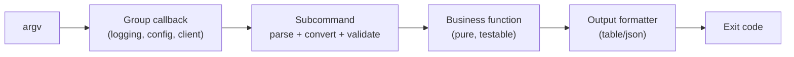

# 3.8 Building CLIs, agents and exporters

| | |
|---|---|
| Level | Intermediate |
| Priority tier | 0 |
| Lab venue | Python 3.11+, `pip install click typer rich httpx tenacity prometheus-client pyyaml`; Docker for Prometheus |
| Part | Part 3: Python for infrastructure |
| Status | Drafted, labs **untested** |

## Why this matters for AI infrastructure

Picture a GPU node that you must drain before maintenance. An operator runs a small script, and the script either does the job cleanly or leaves the node half-done. Most fleet operations work this way. A CLI drains a node. A script collects `nvidia-smi` or DCGM data from 500 machines. An exporter turns BMC sensors into Prometheus metrics, and a Redfish client sets boot order across a rack. A node agent reports health to a control plane. Humans run these tools at 3 a.m., and automation runs them every minute. That means the tools must be predictable, resilient, observable and easy to distribute. Predictable means clear exit codes, idempotent runs and a dry-run mode. Resilient means timeouts, retries, backoff and pagination. Observable means structured logs and metrics. Distributable means a pinned version that works on every operator's laptop and every jump host. This chapter covers the engineering patterns behind such tools, with a bias toward GPU fleets, BMCs and Prometheus.

## Prerequisites and outcomes

This chapter assumes you have covered 3.1 to 3.6 (functions, packaging, typing, subprocess and concurrency) and 2.31 (monitoring). It pairs with 3.7 on services and 3.9 on testing. By the end, you should be able to:

- Design a CLI with subcommands, options, config files, environment variables, output formats and meaningful exit codes, using argparse, Click or Typer.
- Build resilient HTTP clients that handle timeouts, retries with exponential backoff and jitter, circuit breakers, pagination and rate limits.
- Write a Prometheus exporter as a custom collector that is safe to scrape, and know the metric type and naming rules.
- Talk to a BMC over the Redfish API in Python, covering sessions, service root traversal, power, boot, sensors, firmware and events.
- Fan out work across many hosts with bounded concurrency and per-host error isolation.
- Build a long-running node agent that handles signals, shuts down gracefully, reports health and runs under a systemd unit.
- Package and distribute tools as wheels, `pipx` installs, zipapps, containers or single binaries.

## 1. Principles for operational tooling

A script that works on your laptop can still do damage when it runs against a fleet at 3 a.m. The nine principles below are the habits that keep such a tool safe.

1. Be safe by default. Read-only commands need no confirmation. Mutating commands support `--dry-run`, print what they will do, and require `--yes` for destructive scope. They also refuse wildcard targets unless you pass an explicit flag.
2. Make every operation idempotent. Running a command twice should give the same end state, so set the resource to the desired value instead of toggling it. Return "already in desired state" as success.
3. Use explicit exit codes. `0` means success and `1` means a generic failure. `2` is a usage error, the argparse and Click default. Give "partial failure" (some hosts failed) and "nothing to do" their own codes, so wrappers and CI jobs can react to each one.
4. Keep output readable for humans and parseable for pipelines. Default to a table, and offer `--output json|yaml|tsv` for scripts. Send data to stdout and send logs and progress to stderr, so a pipe never picks up a log line.
5. Put a timeout on everything. Every network call and every subprocess needs one, because no operational tool should be able to hang forever.
6. Isolate each target. One bad host must not abort the batch. Collect results and errors, summarise them at the end, and set the exit code to match.
7. Log who ran what, against which targets, under which run id. Record mutating actions at INFO level, with the state before and after.
8. Layer your configuration. Command-line flags win over environment variables, which win over the config file, which wins over the defaults. Never put a secret on the command line, because it appears in `ps` output and in shell history. Read secrets from the environment, from files or from a secret store.
9. Keep the core small and testable. Separate parsing, decision logic and I/O. The CLI layer should be a thin shell over functions you can unit test, as chapter 3.9 shows.

## 2. Command-line interfaces

Your first fleet tool usually starts as a script with a few flags. It grows into a command with a `status` subcommand, a `drain` subcommand and a dozen options, and then the question is which framework to build it on. Start with the standard library, and move to Click or Typer when the command tree grows.

### 2.1 argparse: the standard library baseline

Here is a small `gpuctl` tool with two subcommands. It needs no extra install.

```python
import argparse, sys

def build_parser() -> argparse.ArgumentParser:
    p = argparse.ArgumentParser(prog="gpuctl", description="GPU fleet helper")
    p.add_argument("-v", "--verbose", action="count", default=0)
    sub = p.add_subparsers(dest="cmd", required=True)

    s = sub.add_parser("status", help="show node GPU status")
    s.add_argument("hosts", nargs="+")
    s.add_argument("--output", choices=["table", "json"], default="table")

    d = sub.add_parser("drain", help="cordon and drain a node")
    d.add_argument("host")
    d.add_argument("--timeout", type=int, default=600)
    d.add_argument("--dry-run", action="store_true")
    return p

def main(argv=None) -> int:
    args = build_parser().parse_args(argv)           # argv injectable for tests
    ...
    return 0

if __name__ == "__main__":
    sys.exit(main())
```

argparse handles subcommands, types, choices, mutually exclusive groups and an automatic `--help`. Its cost is verbosity, and it composes less cleanly once the command tree gets large. Take `argv` as a parameter and return an int from `main`. That way a test can call `main([...])` directly, without starting a new process.

### 2.2 Click

Click builds a CLI from decorated functions. You get nested command groups, automatic help, type conversion, prompts, colour, shell completion and a test runner, `CliRunner`. The context object carries shared state, such as the config, the client and the output format, down to every subcommand.

```python
import json, logging, sys
import click

@click.group()
@click.option("--config", type=click.Path(dir_okay=False), envvar="FLEET_CONFIG", help="Config file")
@click.option("-v", "--verbose", count=True)
@click.option("--output", type=click.Choice(["table", "json"]), default="table", show_default=True)
@click.pass_context
def cli(ctx, config, verbose, output):
    """Fleet management CLI."""
    logging.basicConfig(level=[logging.WARNING, logging.INFO, logging.DEBUG][min(verbose, 2)],
                        format="%(asctime)s %(levelname)s %(message)s", stream=sys.stderr)
    ctx.obj = {"config": load_config(config), "output": output}

@cli.command()
@click.argument("hosts", nargs=-1, required=True)
@click.pass_obj
def status(obj, hosts):
    """Show GPU status for HOSTS."""
    rows = [query_host(h, obj["config"]) for h in hosts]
    if obj["output"] == "json":
        click.echo(json.dumps(rows, indent=2))
    else:
        for r in rows:
            click.echo(f"{r['host']:<20} {r['gpus']:>2} GPUs  {r['state']}")

@cli.command()
@click.argument("host")
@click.option("--dry-run", is_flag=True)
@click.option("--yes", is_flag=True, help="Skip confirmation")
def drain(host, dry_run, yes):
    """Cordon and drain HOST."""
    if not (yes or dry_run):
        click.confirm(f"Drain {host}?", abort=True)
    ...

if __name__ == "__main__":
    cli()
```

Read the code from the top. The group callback runs first, sets up logging to stderr, loads the config and stores it on `ctx.obj`. Each subcommand then reads that shared state through `@click.pass_obj`. The diagram below shows the same path from the command line to the exit code.



Click also covers the options you will reach for next: `envvar=`, `multiple=True`, `required`, `type=click.IntRange(1, 64)`, `click.Path(exists=True)`, `click.File`, `click.prompt` and `confirm`, `click.progressbar`, and `click.echo(..., err=True)` for stderr. Raise `click.ClickException` or `click.UsageError` for clean error messages and exit codes. Call `ctx.exit(code)` to stop with a specific code. To test a command, invoke it with `click.testing.CliRunner().invoke(cli, ["status", "h1"])`.

### Case study from *Practical MLOps* Chapter 11: `csv-linter` and `cloud-translate` CLIs

Chapter 11 of *Practical MLOps*, by Alfredo Deza, is a good picture of why a packaged single-purpose CLI beats a notebook or a shell snippet. The chapter builds two Click tools end to end. This handbook models the chapter's code in `code/part03/python_clis_agents_exporters.py`.

The first tool is `csv-linter`, which the chapter packages as a `console_scripts` entry point. It started from a simple inspection of a 32,770-row `wine.csv` dataset in pandas, using `df.describe()`. That inspection turned up three silent data-quality bugs. The `'grape'` column had a count of `0.0`, which means 100% `NaN` values. Saving with `df.to_csv("wine.csv")` and no `index=False` added a spurious `'Unnamed: 0'` column on every round-trip. Windows carriage returns (`\r\n`, which show up as `^M` in `vim`) inside `'notes'` fields broke downstream parsers, as the sample file `carriage.csv` shows.

Deza moves the three checks into `csv_linter/checks.py`. `zero_count_columns(df)` returns the columns where `df[key].count() == 0`. `unnamed_columns(df)` counts keys that contain `"Unnamed"`. `carriage_returns(df)` returns the first `(index, column, field)` that contains `"\r\n"`, and it truncates the field to `field[:50]` when it displays the result. A Click command wraps the checks with `@click.command() @click.argument('filename', type=click.Path(exists=True)) def main(filename):`. The tool is exposed as `csv-linter=csv_linter.main:main` under `entry_points`, which is `[project.scripts]` in `pyproject.toml`, and it is installed with `pip install -e .`. Renaming or moving `csv_linter.py` to `csv_linter/main.py` means you must run `pip install -e .` again, because that regenerates the entry-point wrapper script.

The second tool is `cloud-translate`, and it shows the other side of the same idea. Heavy ML weights do not belong inside every CLI. Instead, `cloud-translate=trigger:main` calls a serverless HTTP Cloud Function that uses `google-cloud-translate==3.0.2`. The function creates a `translate.TranslationServiceClient()` in `us-central1` and translates text to French with `target_language_code="fr"`. The client fetches a short-lived OIDC token with `subprocess.Popen(["gcloud", "auth", "print-identity-token"], stdout=subprocess.PIPE)`, decodes it with `out.decode("utf-8").strip()`, and posts the text with `requests.post(url, json={"message": text}, headers={"Authorization": f"bearer {token()}"})`. The result is a 20-line Click CLI that acts as a secure client for a cloud microservice.

### 2.3 Typer and Rich

Typer, from the author of FastAPI, builds on Click and uses type hints. Each function parameter becomes an argument or an option, so you write less boilerplate and get good shell completion for free.

```python
import typer
from typing import Annotated
app = typer.Typer(no_args_is_help=True, add_completion=True)

@app.command()
def drain(host: str,
          timeout: Annotated[int, typer.Option(min=1, help="Seconds")] = 600,
          dry_run: Annotated[bool, typer.Option("--dry-run")] = False):
    """Drain HOST."""
    ...

if __name__ == "__main__":
    app()
```

Rich adds tables, progress bars, syntax-highlighted tracebacks and live displays, and textual builds full terminal UIs. Rich output belongs on a terminal, so check `sys.stdout.isatty()` and fall back to plain text when output is piped.

Choose argparse for tiny scripts that must have zero dependencies. Choose Click for large command trees and a mature plug-in ecosystem, and Typer when you want a fast tool driven by type hints. The fire and cyclopts libraries exist, but they are less common. In an NVIDIA and Kubernetes environment you will also read many Go CLIs, such as kubectl and helm. Borrowing their conventions (`noun verb`, `-o json`, `--dry-run=client`, `--context`) makes your tool feel familiar to the people who use it.

### 2.4 Configuration and secrets

Settings should come from one place that validates them. This example uses pydantic-settings to read values from the environment, with the `FLEET_` prefix.

```python
from pydantic_settings import BaseSettings, SettingsConfigDict
class Config(BaseSettings):
    model_config = SettingsConfigDict(env_prefix="FLEET_", env_file=".env", extra="ignore")
    api_url: str = "https://fleet.example.com"
    token: str | None = None            # from env FLEET_TOKEN, never a CLI flag
    timeout: float = 10.0
```

Store files as YAML or TOML. The `tomllib` module is in the standard library from 3.11 onward. Load YAML with `yaml.safe_load`, and never with `yaml.load`. Validate what you load with pydantic, and merge the sources in the precedence order from principle 8 above. Support XDG paths such as `~/.config/fleet/config.toml`, add a `--config` override, and give users a `config show` command that prints the effective configuration with secrets redacted.

### 2.5 Interactive and long-running UX

Long loops need a progress bar, and waits need a spinner. A `--watch` mode polls and redraws the screen, while `--follow` streams new output. Operations that finish asynchronously need `--wait/--timeout` flags. Poll the status endpoint with backoff, the way kubectl does with `rollout status`. When the user presses Ctrl+C, handle `KeyboardInterrupt` by cleaning up, then return exit code 130.

## 3. Resilient API clients

Network calls fail in many ways. DNS can break, a connection can be refused, a TLS handshake can fail, and a server can time out or answer 429 and 503 under load. A response can arrive only partly, and pagination can quietly stop early. A client library for an internal API should handle these cases once, so every tool that uses it inherits the protection.

### 3.1 Sessions, timeouts and connection reuse

```python
import httpx
client = httpx.Client(base_url="https://api.example.com", timeout=httpx.Timeout(connect=3, read=15, write=15, pool=5),
                      headers={"Authorization": f"Bearer {token}", "User-Agent": "fleetctl/1.4"},
                      limits=httpx.Limits(max_connections=20), verify="/etc/ssl/corp-ca.pem")
```

Create one client and reuse it, so connections are pooled and kept alive. Always set all four timeouts. A bare `requests.get(url)` has none, and it can hang forever. Pin the CA bundle when your organisation runs private PKI, and put a version in the User-Agent so the server team can debug requests. requests is everywhere and works fine for synchronous scripts. httpx offers both sync and async APIs and supports HTTP/2. aiohttp is a common choice for high-concurrency async clients.

### 3.2 Retries, backoff and jitter

Retry only what is safe to repeat. That means GET, PUT and DELETE, or a POST that carries an idempotency key. Retry only transient failures, such as connection errors, timeouts, 429, 502, 503 and 504. Use exponential backoff with jitter, so many clients that fail at the same moment do not all retry in lockstep and flood the server again. Honour `Retry-After`, and cap both the number of attempts and the total time.

```python
from tenacity import retry, stop_after_attempt, stop_after_delay, wait_exponential_jitter, retry_if_exception, before_sleep_log
import httpx, logging
log = logging.getLogger(__name__)

def transient(exc: BaseException) -> bool:
    if isinstance(exc, (httpx.ConnectError, httpx.ReadTimeout, httpx.ConnectTimeout, httpx.RemoteProtocolError)):
        return True
    if isinstance(exc, httpx.HTTPStatusError):
        return exc.response.status_code in {429, 502, 503, 504}
    return False

@retry(retry=retry_if_exception(transient),
       wait=wait_exponential_jitter(initial=0.5, max=20),      # 0.5, 1, 2, 4 ... capped, with jitter
       stop=(stop_after_attempt(6) | stop_after_delay(60)),
       before_sleep=before_sleep_log(log, logging.WARNING), reraise=True)
def get_json(path: str, **params):
    r = client.get(path, params=params)
    r.raise_for_status()
    return r.json()
```

Without a library, the loop looks like `delay = min(cap, base * 2**attempt); sleep(random.uniform(0, delay))`, which is called "full jitter." Be careful with 4xx errors. Retrying 400, 401, 403, 404 or 409 is a bug, because the answer will not change between attempts. The only 4xx code worth retrying is 429.

### 3.3 Circuit breakers and bulkheads

When a dependency is down, retries make the problem worse, because every caller keeps adding load. A circuit breaker stops that. It counts consecutive failures and opens after a threshold, so calls fail fast without reaching the dependency. After a cool-down it goes half-open and lets one probe call through. If the probe succeeds, the breaker closes again. You can use pybreaker, the circuitbreaker library, or a class of about 30 lines.

A bulkhead works differently. It limits how many calls can run at once against one dependency, using a semaphore. That way one slow service cannot consume every thread. Combine the layers in this order: timeout, then retry, then breaker, then bulkhead. When the breaker is open, return a clear error, such as "fleet API unavailable, breaker open for 30 s", so the operator knows what happened.

### 3.4 Pagination and completeness

Silent truncation is one of the most common bugs in fleet scripts. Say the API returns 100 items per page. A script that reads only the first page handles those 100 items and never sees the rest. Hide the paging inside a generator, and make the generator fail loudly when something looks wrong.

```python
def paginate(path: str, page_size: int = 200):
    token = None
    seen = 0
    while True:
        params = {"limit": page_size, **({"page_token": token} if token else {})}
        body = get_json(path, **params)
        for item in body["items"]:
            seen += 1
            yield item
        token = body.get("next_page_token")
        if not token:
            break
```

Prefer cursor or token pagination over offset pagination. Offsets shift when items are added to the list, and that can make a page skip or repeat items. If the API reports a total count, check it against what you fetched, and log how many items you received.

### 3.5 Rate limits, concurrency and file operations

Respect the `X-RateLimit-*` and `Retry-After` headers. For outbound limits, use a token bucket from a library such as aiolimiter or ratelimit. File operations on shared systems raise a different problem, a race between checking a file and using it. Write to a temporary file in the same directory, then call `os.replace`, which is atomic on POSIX. Use `fcntl.flock` or a lock file for mutual exclusion. Open with `O_EXCL` when a file must be created only if it does not exist. Prefer `try: open(...)` over `if exists: open(...)`, because the file can disappear between the two checks.

## 4. Prometheus exporters

Suppose a BMC shows the temperature of a GPU server, but Prometheus cannot read BMCs. An exporter fills that gap. It reads the state of something that does not speak Prometheus, such as a BMC, an InfiniBand fabric, a license server or a vendor CLI, and publishes it as metrics on an HTTP endpoint. Prometheus then scrapes that endpoint on its own schedule.

### 4.1 Metric model essentials

Pick the metric type first, because each one answers a different question. A counter only goes up, so you query it with `rate()`. A gauge can move up and down, which suits temperature or queue depth. A histogram stores bucketed observations along with `_sum` and `_count`, and it is the right choice for latency distributions. A summary computes quantiles on the client side, so it cannot be aggregated across instances. Prefer a histogram when you need to combine data from several exporters. An info metric carries constant labels that describe an entity.

Names follow a few rules. Use `snake_case`, add a unit suffix in base units such as `_seconds`, `_bytes`, `_celsius` or `_watts`, and prefix the name with the application, as in `bmc_temperature_celsius`. Keep label names out of the metric name, and keep timestamps out of it too.

Labels need a bounded set of values, such as a host, a GPU index or a sensor name. Never use user ids, request ids, timestamps or free text. Each unique label combination becomes its own time series. A cardinality explosion, where the series count keeps growing, is the most common way an exporter harms Prometheus. Finally, expose a `*_up` or `scrape_success` metric and a `scrape_duration_seconds` metric. A failed scrape then shows up as data, not as a silent gap.

### 4.2 The simple way: instrument and serve

```python
from prometheus_client import start_http_server, Gauge, Counter, Histogram
import time

TEMP = Gauge("gpu_temperature_celsius", "GPU temperature", ["host", "gpu"])
ERRORS = Counter("exporter_poll_errors_total", "Failed polls", ["host"])
POLL = Histogram("exporter_poll_seconds", "Poll duration")

def poll_forever(hosts, interval=15):
    while True:
        for h in hosts:
            with POLL.time():
                try:
                    for gpu, t in read_temps(h).items():
                        TEMP.labels(h, gpu).set(t)
                except Exception:
                    ERRORS.labels(h).inc()
        time.sleep(interval)

start_http_server(9101)
poll_forever(["gpu01", "gpu02"])
```

This background-polling model separates collection from scraping, which is its appeal. Its weakness is staleness. If polling stalls, the metrics keep showing the last values, and series for removed hosts linger until you call `.remove(...)` or switch to a collector.

### 4.3 The recommended way: a custom collector

A custom collector runs at scrape time. Each scrape produces a fresh, consistent snapshot, so no stale series survive. Most mature exporters work this way. The node_exporter pattern is the model: the scrape drives the collection.

```python
from prometheus_client.core import GaugeMetricFamily, CounterMetricFamily
from prometheus_client import REGISTRY, start_http_server
import time

class FleetCollector:
    def __init__(self, hosts, timeout=5):
        self.hosts, self.timeout = hosts, timeout

    def collect(self):
        t0 = time.time()
        temp = GaugeMetricFamily("gpu_temperature_celsius", "GPU temperature", labels=["host", "gpu"])
        up = GaugeMetricFamily("fleet_host_up", "1 if the host answered", labels=["host"])
        for h in self.hosts:
            try:
                for gpu, t in read_temps(h, timeout=self.timeout).items():
                    temp.add_metric([h, str(gpu)], t)
                up.add_metric([h], 1)
            except Exception:
                up.add_metric([h], 0)               # failure is data, not an exception
        yield temp
        yield up
        dur = GaugeMetricFamily("fleet_scrape_duration_seconds", "Collection time")
        dur.add_metric([], time.time() - t0)
        yield dur

REGISTRY.register(FleetCollector(["gpu01", "gpu02"]))
start_http_server(9101)
```

Collection has to finish well inside the scrape timeout. You can parallelise it with a thread pool and a per-host timeout, or cache the results for a few seconds. Never let one failing target raise out of `collect()`, and do not block on slow hardware, since BMC queries can take seconds. Avoid running expensive commands on every scrape, and cache them with a TTL instead. Protect the endpoint as well. Bind it to an internal interface, use TLS and basic auth through `--web.config`-style proxies, or run it as a sidecar.

A multi-target exporter, such as `blackbox_exporter` or `snmp_exporter`, works differently. It takes the target as a URL parameter, `/probe?target=bmc01`. Prometheus relabelling then supplies the targets from service discovery, so the exporter keeps no host list of its own.

```yaml
scrape_configs:
- job_name: bmc
  metrics_path: /probe
  static_configs: [ { targets: [bmc01.mgmt, bmc02.mgmt] } ]
  relabel_configs:
  - source_labels: [__address__]
    target_label: __param_target
  - source_labels: [__param_target]
    target_label: instance
  - target_label: __address__
    replacement: bmc-exporter:9102
```

### 4.4 Real-world GPU and hardware exporters

You rarely need to write a GPU exporter from scratch. DCGM exporter publishes utilisation, memory, temperature, power, clocks, XID errors, NVLink counters and ECC data. node_exporter covers the host itself. The NVIDIA GPU Operator deploys DCGM exporter in Kubernetes with a ServiceMonitor, and IPMI or Redfish exporters read BMC sensors. You write custom exporters only for the gaps that are specific to your site. Examples include scheduler state, such as Slurm queue depth and node states from `sinfo` and `squeue --json`, fabric health from UFM or `ibdiagnet` summaries, storage tenant quotas, license counts, and job-level GPU accounting joined to Kubernetes or Slurm metadata.

To test an exporter, run `curl -s localhost:9101/metrics | head` and check that the output looks right. Then lint it with `promtool check metrics`, and check the series count in Prometheus with `count({__name__=~"gpu_.*"})`.

## 5. Talking to hardware: a Redfish client

A DGX or HGX host that will not power on can leave you with no shell to work from. Redfish gives you a second route, through the BMC on the management network. Redfish is the DMTF RESTful API for that out-of-band management, and it replaces IPMI. BMCs on DGX, HGX and OEM servers expose it over HTTPS with JSON. Part 7 covers Redfish and BMCs in depth. Here we build a client skeleton.

### 5.1 Resource model

Everything in Redfish hangs off a tree rooted at `/redfish/v1/`, called the service root. The `Systems` collection describes the host computer, including power state, boot settings, BIOS, processors and memory. `Chassis` describes the physical enclosure, with its thermal, power and sensor data and its GPU or PCIe devices. `Managers` describes the BMC itself, including its network settings, logs and virtual media. `UpdateService` holds the firmware inventory and handles updates. `AccountService`, `SessionService`, `EventService` and `TelemetryService` cover the rest.

Resources link to each other with `@odata.id` URIs. Follow those links to discover members, and do not hard-code vendor paths. The same host may appear as `/Systems/1`, `/Systems/System.Embedded.1` or `/Systems/Self`, depending on the vendor. Actions are POST requests sent to `Actions/...` targets. For example, `#ComputerSystem.Reset` accepts a `ResetType` of `On`, `ForceOff`, `GracefulRestart`, `ForceRestart` or `PushPowerButton`.

### 5.2 A small client

The class below wraps a session, the power action and the temperature read. Read it as a worked skeleton, not a finished library.

```python
import httpx, time, logging
log = logging.getLogger("redfish")

class Redfish:
    def __init__(self, host, user, password, verify=False, timeout=15):
        self.base = f"https://{host}"
        self.c = httpx.Client(base_url=self.base, verify=verify, timeout=timeout)    # BMC certs are often self-signed: pin or manage the CA in production
        self.token = None
        self._login(user, password)

    def _login(self, user, password):
        r = self.c.post("/redfish/v1/SessionService/Sessions", json={"UserName": user, "Password": password})
        r.raise_for_status()
        self.token = r.headers["X-Auth-Token"]
        self.session_uri = r.headers["Location"]                 # needed to log out
        self.c.headers["X-Auth-Token"] = self.token              # session auth avoids sending the password on every call

    def close(self):
        if self.token:
            self.c.delete(self.session_uri)                      # BMCs have a tiny session limit: always log out
        self.c.close()

    def get(self, uri):
        r = self.c.get(uri)
        r.raise_for_status()
        return r.json()

    def members(self, uri):
        for m in self.get(uri).get("Members", []):
            yield self.get(m["@odata.id"])                        # follow links; do not hard-code ids

    def system(self):
        return next(self.members("/redfish/v1/Systems"))

    def power(self, reset_type):
        s = self.system()
        target = s["Actions"]["#ComputerSystem.Reset"]["target"]
        allowed = s["Actions"]["#ComputerSystem.Reset"].get("ResetType@Redfish.AllowableValues", [])
        if allowed and reset_type not in allowed:
            raise ValueError(f"{reset_type} not allowed: {allowed}")
        r = self.c.post(target, json={"ResetType": reset_type})
        r.raise_for_status()
        return r

    def temperatures(self):
        for ch in self.members("/redfish/v1/Chassis"):
            thermal = ch.get("Thermal", {}).get("@odata.id")      # newer schemas use ThermalSubsystem/Sensors
            if thermal:
                for t in self.get(thermal).get("Temperatures", []):
                    yield ch["Id"], t["Name"], t.get("ReadingCelsius")

    def __enter__(self): return self
    def __exit__(self, *exc): self.close()
```

Session login is the first thing the code does. The client posts credentials once, receives an `X-Auth-Token` and a `Location` for the session, and sends the token on every later call. The password does not travel with each request. The `power` method reads the allowed reset types from the system first, so an invalid value fails locally with a clear message before anything reaches the BMC.

Several practical habits follow from the code. Use sessions instead of basic auth. Create the session, send `X-Auth-Token`, and delete the session when you finish. BMCs allow only a few concurrent sessions, so a leaked session can lock you out until it times out. Wrap the client in a context manager, and put the cleanup in `finally` where you cannot use one.

Long-running actions return a task. The BMC answers with `202 Accepted` and a `Location` that points to a task monitor. Poll that monitor until `TaskState` becomes `Completed` or `Exception`, and set a timeout. A firmware update can take many minutes and reboot the BMC, so expect connection errors partway through.

Vendors differ, and you should plan for it. Schemas change over time. Thermal and Power are deprecated in favour of ThermalSubsystem, PowerSubsystem and EnvironmentMetrics. OEM extensions sit under `Oem`. Some BMCs are slow, rate-sensitive or return 500 errors under concurrent load. Serialise requests to each BMC, retry carefully, cap concurrency across the fleet, and test against every platform you run. The DMTF publishes a mockup server and the `redfish` Python library (`python-redfish-library`), which handles sessions and OData. NVIDIA tooling, such as `nvfwupd` on the DGX BMC, builds on the same standard.

BMC credentials are effectively root over the machine. Keep BMC networks isolated, rotate secrets, give each user an account with a suitable role, validate TLS against an internal CA, and audit every action. Never log passwords or tokens. For power and boot actions, dry-run first: print the target and the action without sending anything, and require `--yes` to proceed.

### 5.3 Fleet fan-out

```python
from concurrent.futures import ThreadPoolExecutor, as_completed

def check(host):
    try:
        with Redfish(host, USER, PASS) as rf:
            s = rf.system()
            return host, {"power": s["PowerState"], "health": s["Status"].get("Health"), "model": s.get("Model")}, None
    except Exception as e:                                         # isolate per host
        return host, None, f"{type(e).__name__}: {e}"

def run(hosts, workers=16):
    ok, bad = {}, {}
    with ThreadPoolExecutor(max_workers=workers) as ex:            # bounded concurrency protects the management network
        for fut in as_completed(ex.submit(check, h) for h in hosts):
            h, res, err = fut.result()
            (bad if err else ok)[h] = err or res
    return ok, bad                                                  # CLI exits non-zero if bad is non-empty
```

Checking a whole fleet means running the single-host check many times. The `run` function gives every host its own try block through `check`, so one failing BMC lands in `bad` and does not stop the others. The thread pool caps the number of workers at 16, which keeps concurrency bounded for the management network. For thousands of hosts, move to asyncio with a semaphore, as chapter 3.6 describes. Report progress as you go, and write results incrementally, so an interrupted run can resume. End the run with a summary line, such as `412 ok, 3 failed (bmc17: timeout, ...)`.

## 6. Collecting from GPU hosts

Many facts about a GPU host sit behind command-line tools and kernel files, not behind an API. Read them in a way that survives odd output, slow tools and vanishing files.

`nvidia-smi` is the usual starting point, and you should ask it for machine-readable output rather than scraping the default table. Run `nvidia-smi --query-gpu=index,name,temperature.gpu,utilization.gpu,memory.used,memory.total,power.draw,ecc.errors.uncorrected.volatile.total --format=csv,noheader,nounits`, which returns one CSV line per GPU. Parse it with the `csv` module, and treat `[N/A]` and `[Not Supported]` as missing values. Use `nvidia-smi -q -x` if you need XML. Avoid hammering it. Each call initialises NVML, and on a busy host one call can take a second. For continuous monitoring, use DCGM or the NVML bindings, `pynvml` and `nvidia-ml-py`.

The NVML and DCGM bindings give you direct calls, such as `pynvml.nvmlDeviceGetTemperature`, `nvmlDeviceGetUtilizationRates`, `nvmlDeviceGetMemoryInfo` and `nvmlDeviceGetPowerUsage`. They also report throttling reasons and XID events. The DCGM Python bindings cover health checks and diagnostics. You can also run `dcgmi diag -r 1|2|3` as a subprocess when you want the command-line report instead.

Follow the subprocess rules from chapter 3.5. Pass arguments as a list, set `timeout=`, and use `check=False` so you handle the return code yourself. Capture stderr, and never use `shell=True` with input you have not controlled. Timeouts need care. `subprocess.run(..., timeout=...)` kills the child but not its descendants. Start the process with `start_new_session=True`, then kill the whole group with `os.killpg`. In a long-running agent, also call `wait()` on children so no zombies build up.

For cheap, dependency-free metrics, read `/proc` and `/sys` directly. Useful files include `/proc/meminfo`, `/proc/pressure/*`, `/sys/class/infiniband/*/ports/*/counters/*` and `/sys/class/net/*/statistics/*`. Handle files that vanish between listing and reading.

Wrap each source in a function that returns a typed result, such as a dataclass. The CLI, the exporter and the agent can then share one collection layer, and tests can feed the functions canned output.

## 7. Node agents and daemons

A node agent runs on every host, as a systemd service or as a DaemonSet. It gathers health data, applies local actions and reports to a control plane. Because it runs everywhere, a small mistake in the agent multiplies across the fleet. The design points below keep it safe to run next to training jobs.

Start with the lifecycle. The agent should handle `SIGTERM` as a request to stop gracefully. It finishes the current cycle, flushes its state and exits within the grace period. `SIGHUP` should reload the config, and you should ignore `SIGPIPE` issues. Exit with a non-zero code on fatal errors, so systemd restarts the agent. In asyncio, register handlers with `loop.add_signal_handler`. In threaded code, set a `threading.Event` that the loop checks.

The main loop is simple: `while not stop.is_set(): do_cycle(); stop.wait(interval + jitter)`. The jitter stops every agent from firing at the same instant, which would cause spikes across the fleet. Measure how long each cycle takes, and log and emit a metric when a cycle overruns.

Failures should stay contained. Give each check its own try block and its own timeout, so a broken GPU query never stops the network checks. Export a success metric for each check.

Keep state small, and write it under `/var/lib/<agent>` using atomic writes. On startup, reconcile the desired state against the actual state rather than assuming a clean slate. The broker or the hardware is the source of truth, so the agent should read it.

The agent should describe itself too. Expose `/metrics` and `/healthz`, using `http.server` in a thread or `prometheus_client`. Report the version, the build info, the timestamp of the last successful cycle and queue depths. Alert when the last-success metric goes stale.

Resource discipline matters on GPU hosts. Keep memory bounded, with no unbounded caches and no retained tracebacks. Keep file descriptors bounded too. Set CPU limits in systemd with `CPUQuota`, `MemoryMax` and `Nice`, and pin or limit threads to avoid jitter on GPU hosts. The goal is that the agent never competes with a training job for CPU or memory.

Run the agent as a dedicated unprivileged user, and grant only the capabilities it needs. For privileged actions, use a narrow sudo rule or a small helper. Authenticate to the control plane with per-node credentials, such as mTLS or short-lived tokens. Validate every command the agent receives. An agent that runs arbitrary remote commands is a route for fleet-wide compromise.

Here is a minimal systemd unit that applies those limits.

```ini
[Unit]
Description=Node health agent
After=network-online.target
Wants=network-online.target

[Service]
User=nodeagent
ExecStart=/opt/nodeagent/venv/bin/nodeagent --config /etc/nodeagent.toml
Restart=on-failure
RestartSec=5
TimeoutStopSec=30
MemoryMax=300M
CPUQuota=20%
NoNewPrivileges=yes
ProtectSystem=strict
ReadWritePaths=/var/lib/nodeagent
Environment=PYTHONUNBUFFERED=1

[Install]
WantedBy=multi-user.target
```

On Kubernetes, use a DaemonSet instead. Add `hostPID` or `hostNetwork` only when you truly need them. Add tolerations for every node, including the tainted GPU nodes. Mount `/sys` and `/dev` read-only where you can, and use the Downward API to get the node name.

## 8. Packaging and distribution of tools

How operators receive your tool matters as much as the code inside it. The right channel depends on where the tool will run, so compare the options in the table before you choose.

| Approach | Good for | Notes |
|---|---|---|
| Wheel on an internal index + `pipx install fleetctl` | Developer/operator laptops, jump hosts | Isolated env per tool, easy upgrades; pin Python version |
| `uv tool install` / `uvx` | Fast installs, reproducible | Lockfile support |
| Zipapp (`shiv`, `pex`, `python -m zipapp`) | Single-file deployment to hosts with matching Python | Needs compatible interpreter and wheels for the platform |
| Container image | CI, Kubernetes jobs, consistent runtime | Larger; mount kubeconfig/credentials explicitly |
| PyInstaller / Nuitka single binary | Hosts without Python, air-gapped | Platform-specific builds; larger; slower startup |
| OS packages (deb/rpm via `fpm`) | Fleet-wide config-managed rollout | Fits Ansible/Foreman; versioned and auditable |

The table is a lookup, and it shows the trade-offs at a glance. A wheel with `pipx` gives each tool its own environment, which is easy to upgrade. A zipapp is one file, but it works only on hosts with a matching Python and the right wheels. A container is consistent, but it is larger and needs your kubeconfig or credentials mounted explicitly. A single binary runs without Python, but each platform needs its own build.

A `pyproject.toml` describes the package, its dependencies and its entry points. This example does that for `fleetctl`.

```toml
[project]
name = "fleetctl"
version = "1.4.0"
requires-python = ">=3.10"
dependencies = ["click>=8.1", "httpx>=0.27", "tenacity>=8", "rich>=13"]

[project.scripts]
fleetctl = "fleetctl.cli:cli"          # creates the `fleetctl` executable on install

[build-system]
requires = ["hatchling"]
build-backend = "hatchling.build"
```

Releases need the same discipline as the code. Use semantic versioning and keep a changelog. Make `--version` print the git SHA, so you know exactly what is running. Pin the dependencies with hashed lock files, using `uv lock` or `pip-compile --generate-hashes`, so every install is reproducible. Watch the supply chain too. Scan dependencies with `pip-audit`, generate an SBOM, sign the artefacts, and publish from CI with trusted publishing. Ship shell completions, and write man pages or `--help` text that documents the exit codes. Finally, add an upgrade check that warns when the tool is older than the server's minimum supported version.

## 9. Profiling and performance of tools

A slow tool usually has a busy CPU, memory that keeps growing, serial I/O, or heavy startup. Each one has a different tool.

For CPU, run `python -m cProfile -o out.prof script.py`, then open the result with `python -m pstats out.prof` and sort by cumulative time. `snakeviz` gives a graphical view of the same data. To profile a running process, attach `py-spy top -p PID`, or record a flame graph with `py-spy record -o flame.svg -p PID`. `py-spy` needs no change to the code, but it needs ptrace permission. `scalene` and `pyinstrument` show line-level and wall-clock time.

For memory, `tracemalloc` is the first tool to try. Take snapshots, compare them, and print the top allocation sites. `memray` and `objgraph` help when you need reference chains. In agents, the usual leaks are unbounded dicts and lists, caches without eviction, retained exceptions and tracebacks, and label sets in metrics that keep growing.

When I/O is slow, the cause is usually a chain of serial network calls. Add bounded concurrency, reuse connections and batch where you can. Measure first, by logging the time each phase takes.

Startup time matters for any CLI that runs inside a loop. Lazy-import heavy modules such as pandas by importing them inside the function that needs them. Avoid work at import time, and check the cost with `python -X importtime`.

A production latency investigation follows a simple pattern. Confirm the symptom with timings, and check whether the API is slow or your tool is. Profile where the time goes, using py-spy on the live process. Check resource limits next, because CPU throttling in a container shows up as latency. Then fix the specific bottleneck and verify it with the same measurement you used to find it.

## 10. Worked capstone: a GPU fleet diagnostics CLI

Picture an operator who needs one command that checks every GPU in a fleet and returns a clear verdict. The capstone builds that command from four layers. `cli.py` is the Click group that handles output formatting and exit codes. `collect.py` is the per-host executor, which talks to each host over SSH, an agent or Redfish. It applies a timeout and bounded concurrency. `parsers.py` turns `nvidia-smi` CSV and `dcgmi` output into dataclasses, using pure functions. Health rules live in `rules.py`. They check for a temperature above a threshold, a non-zero count of uncorrected ECC errors, an XID in a set of known codes, and missing GPUs compared with the expected count. Models are defined in `models.py` as dataclasses or pydantic models.

The output is a table or JSON. The exit code tells the caller the outcome: 0 when all GPUs are healthy, 1 for a usage or runtime failure, 3 when any GPU is unhealthy, and 4 for a partial collection failure.

Start with the parser. It is pure, so it is easy to test.

```python
# parsers.py: pure, trivially testable
from dataclasses import dataclass
@dataclass(frozen=True)
class Gpu:
    index: int; name: str; temp_c: int | None; util_pct: int | None; mem_used_mib: int | None
    mem_total_mib: int | None; ecc_uncorrected: int | None

def _int(s):
    s = s.strip()
    return None if s in ("", "[N/A]", "[Not Supported]") else int(float(s))

def parse_smi_csv(text: str) -> list[Gpu]:
    gpus = []
    for line in text.splitlines():
        if not line.strip(): continue
        f = [x.strip() for x in line.split(",")]
        if len(f) != 7: raise ValueError(f"unexpected nvidia-smi columns: {line!r}")
        gpus.append(Gpu(int(f[0]), f[1], _int(f[2]), _int(f[3]), _int(f[4]), _int(f[5]), _int(f[6])))
    return gpus
```

The parser turns a `[N/A]` or `[Not Supported]` field into `None`, and it rejects a line with the wrong number of columns. Next come the rules. They are also pure functions, so they can run on any list of `Gpu` objects.

```python
# rules.py
def evaluate(gpus, expected=8, max_temp=85):
    problems = []
    if len(gpus) != expected: problems.append(f"expected {expected} GPUs, found {len(gpus)}")
    for g in gpus:
        if g.temp_c and g.temp_c > max_temp: problems.append(f"gpu{g.index} temp {g.temp_c}C")
        if g.ecc_uncorrected: problems.append(f"gpu{g.index} uncorrected ECC {g.ecc_uncorrected}")
    return problems
```

The test strategy in chapter 3.9 feeds canned CSV into `parse_smi_csv` and `evaluate`. The canned input includes `[N/A]` values, lines with the wrong column count, empty output and a missing GPU. The tests then run the Click command with `CliRunner` and a stubbed executor, and assert on exit codes and the JSON shape. The separation between parser, rules, executor and CLI is the pattern to reuse in your own tools.

## 11. Lab

Start with the self-checking Python lab. Run it on your machine, and it will verify the pieces this chapter has built. It checks the `csv-linter` checks from *Practical MLOps* Chapter 11, which are `zero_count_columns`, `unnamed_columns` and `carriage_returns`. It also checks the `gpuctl` argparse subcommand parsing, the `CircuitBreaker` state transitions (`CLOSED -> OPEN -> HALF_OPEN -> CLOSED`) and the cursor pagination in `paginate_cursor`. Two more checks cover the Prometheus custom collector output, with `gpu_temperature_celsius` and `fleet_host_up`, and the `RedfishSessionClient` login, discovery and logout. The last check covers the `parse_smi_csv` and `evaluate_gpus` health rules.

```bash
python3 code/part03/python_clis_agents_exporters_lab.py
```

After the lab passes, you can move to a machine with Python 3.11 or later. The interactive shell steps below are `untested here`, so you are the one to run and confirm them.

1. Build `gpuctl status|drain` with argparse, then port it to Click and to Typer. Compare the help output, the tests and the shell completion. Add `--output json`, then check that piping the output to `jq` works while the logs stay on stderr.
2. Add exit codes for partial failure and for an unhealthy result. Write a shell wrapper that reacts to each code. Then confirm that `--dry-run` never changes anything.
3. Build a client against a flaky local server. A FastAPI endpoint that randomly returns 503 or 429, or hangs, works well. Add timeouts, retries with jitter, `Retry-After` handling and a circuit breaker, and log each attempt. Graph the failures against the attempts. Finally, prove that a POST without an idempotency key is not retried.
4. Write a server that returns 150 items at 100 items per page. Show that a naive client misses 50 of them. Then fix the client with the generator and add a completeness check.
5. Write a collector exporter around `nvidia-smi`, or around a fake. Give it `up`, a duration metric and per-GPU metrics. Scrape it with Prometheus running in Docker, and lint it with `promtool check metrics`. Kill the data source and confirm that `up` drops to 0 rather than showing a stale value. Then add a label-cardinality mistake on purpose, and watch the series count grow.
6. Implement `/probe?target=` with a relabel config. Add concurrency and a TTL cache, then measure the scrape duration across 50 fake targets.
7. Run the DMTF Redfish mockup, or a vendor simulator or BMC if you have one. Implement the client with session login and logout, discovery, power state and temperatures. Add task polling for a simulated long action. List the sessions, and prove that a leaked session takes up a slot.
8. Query 200 simulated BMCs first with a thread pool of 16, then with asyncio and a semaphore. Inject failures and slow hosts. Compare the wall-clock time, and check that each host stays isolated and that the summary line is correct.
9. Write a node agent with `SIGTERM` and `SIGHUP` handling, a jittered loop and a `/metrics` endpoint. Add a systemd unit with resource limits. Send `kill -TERM` in the middle of a cycle and confirm the agent exits cleanly. Run it under `systemd-run` to test the limits.
10. Build a wheel and install it with `pipx`. Build a zipapp with `shiv`, and build a container. Compare their sizes and startup times, and add a `--version` flag that prints the git SHA.
11. Add a deliberate O(n^2) loop and a memory leak to the tool. Then find both, using py-spy and tracemalloc.
12. Clean up.

## 12. Common mistakes

- An HTTP call or a subprocess with no timeout will eventually hang a script in cron or in CI.
- If you retry a non-idempotent call, or retry a permanent error, you repeat the damage. Retries without jitter cause thundering herds, and unbounded retry loops never end.
- Secrets in command-line arguments, logs or exception messages are a leak waiting to happen.
- Printing logs and data to the same stream breaks every pipeline that reads the data.
- Silent pagination truncation hides part of the fleet. Offset pagination over changing data makes it worse.
- One host's exception should not abort the whole fleet run. The opposite mistake is just as bad: swallowing every error and exiting with 0.
- An exporter that does slow work in the scrape path, has no timeouts, emits unbounded label values, exposes stale values forever or raises from `collect()` will cause trouble in Prometheus.
- Leaking BMC sessions, hard-coding Redfish paths and assuming schemas are identical across vendors all cause failures. Ignoring self-signed TLS without a plan is risky too. Disable verification only in labs.
- Zombie subprocesses and orphaned children are left behind after timeouts.
- An agent that executes remote commands without authentication and validation is a serious hole. An agent with no memory or CPU limits can disturb training jobs.
- Shipping scripts by copying files to hosts, with no versioning or dependency control.

## 13. Interview angles

The prompts below are the kind interviewers use. Each one lists the points a good answer covers.

- "Design a CLI to drain GPU nodes safely at scale." Cover dry-run, idempotency, concurrency limits, health gating, exit codes and an audit log.
- "How do you make an API client resilient?" Cover timeouts, retry classification, backoff with jitter, a breaker, pagination and idempotency keys.
- "Write or describe a Prometheus exporter. What are the pitfalls?" Cover the collector at scrape time, `up` metrics, cardinality, naming and timeouts.
- "How do you query hardware health out of band?" Cover Redfish sessions, discovery, tasks, vendor differences and security.
- "Your script hangs on one host. How do you prevent that?" Cover timeouts, process groups, isolation and bounded pools.
- "How would you distribute a Python tool to 1,000 hosts?" Cover a wheel with `pipx`, zipapps, packages from config management, containers and version pinning.
- "A Python service's memory grows steadily. How do you find the leak?" Cover tracemalloc or memray, retained references, caches and label growth.

## Exercises

Answer each prompt in your own words, then check your answer against the code.

1. Start with the CLI design. Using `build_gpuctl_parser()`, `zero_count_columns()`, `unnamed_columns()` and `carriage_returns()` from `code/part03/python_clis_agents_exporters.py`, explain why `main(argv=None) -> int` accepts an injectable `argv` list. Explain why logs go to `stderr` while `--output json|table` goes to `stdout`. Then explain how `csv-linter` detects empty columns, `Unnamed: 0` index columns and `\r\n` carriage returns. Finally, state the configuration precedence order (CLI flags, then env vars, then the config file, then defaults), and explain why secrets must never be passed as CLI flags. The `csv-linter` checks come from *Practical MLOps* Chapter 11.
2. Next, cover the resilient HTTP client. Using `CircuitBreaker` and `paginate_cursor()` in the same file, explain which HTTP methods and status codes are safe to retry with exponential backoff and full jitter. Use `429, 502, 503, 504` and `400, 401, 403, 404, 409` as your examples. Then describe how a circuit breaker moves through `CLOSED -> OPEN -> HALF_OPEN -> CLOSED`. Finally, explain why cursor or token pagination beats offset pagination over a dataset that keeps changing.
3. Compare the two exporter styles. Using `collect_fleet_prometheus_metrics()`, contrast background polling with `Gauge.set` against scrape-time collection in `FleetCollector.collect()`. Explain why `collect()` must emit `fleet_host_up 0` when a target fails, instead of raising an exception. Then explain how `/probe?target=bmc01` multi-target relabelling works.
4. Work through the Redfish client using `RedfishSessionClient` and `MockRedfishTransport`. Explain how the `X-Auth-Token` session works, and why a Redfish client must authenticate through `/redfish/v1/SessionService/Sessions` and `DELETE` its session on `__exit__`. Explain why it must discover system URIs through `Members[@odata.id]` rather than hard-coding `/Systems/1`. Finally, explain how it validates `ResetType@Redfish.AllowableValues` and tracks `202 Accepted` Task monitors.
5. Use `parse_smi_csv()` and `evaluate_gpus()` to show why separating the work pays off. Parse the `nvidia-smi` CSV, including `[N/A]` and `[Not Supported]` values, and evaluate the health rules: `expected=8`, `max_temp=85` and `ecc_uncorrected > 0`. Then explain why keeping these pure, apart from the SSH and subprocess calls, makes fleet diagnostics easy to unit test.
6. Finish with node agents, packaging and profiling. First, explain how a systemd node agent that handles `SIGTERM` limits its impact on GPU training jobs, using `MemoryMax=300M`, `CPUQuota=20%`, `NoNewPrivileges=yes`, `ProtectSystem=strict` and `stop.wait(interval + jitter)`. Then compare `pipx` and `uv tool`, `zipapp`, `shiv` and `pex`, and containers as ways to distribute CLI tools. Last, explain how `python -X importtime`, `py-spy` and `tracemalloc` help you diagnose a slow startup and a memory leak.

## Checkpoint questions (20)

<details>
<summary>1. Why must operational CLIs send data to `stdout` and logs/progress bars to `stderr`, and why should `main(argv=None) -> int` accept `argv`?</summary>

Structured output such as `--output json` goes to `stdout`. Human diagnostics and progress bars go to `stderr`, through `sys.stderr` or `click.echo(..., err=True)`. That way you can pipe `gpuctl status gpu01 --output json | jq .` without a log line breaking the pipeline. Because `main` takes `argv` and passes it to `parse_args(argv)`, `pytest` can call `main(["status", "gpu01"])` in the same process. The test then checks the returned integer exit code without starting a subprocess.
</details>

<details>
<summary>2. Compare `argparse`, `Click`, and `Typer`, and explain how `Click`'s `@click.pass_context` and `CliRunner` work.</summary>

- **`argparse`**: the standard library option. It needs no third-party dependency, and you declare subcommands with `add_subparsers(dest="cmd", required=True)`.
- **`Click`**: a decorator-based framework, with `@click.group()`, `@click.command()` and `@click.option(..., envvar="...")`. `@click.pass_context` puts shared state, such as the config and the output mode, into `ctx.obj`, and `@click.pass_obj` hands it to each subcommand. `CliRunner().invoke(cli, [...])` runs the command in process for tests.
- **`Typer`**: builds on Click and uses Python type annotations, such as `Annotated[int, typer.Option(min=1)]`. That means less boilerplate and generated shell completions.
</details>

<details>
<summary>3. In *Practical MLOps* Chapter 11, what three CSV dataset bugs does `csv-linter` catch, and why did moving `csv_linter.py` break the entry point?</summary>

The three bugs are these. First, `zero_count_columns(df)` finds columns where `df[key].count() == 0`, such as `'grape'` in `wine.csv`, which holds 100% `NaN` values. Second, `unnamed_columns(df)` finds the spurious `'Unnamed: 0'` columns that appear when pandas writes `df.to_csv("wine.csv")` without `index=False`. Third, `carriage_returns(df)` finds Windows `\r\n` (`^M`) line endings inside text fields, as in `carriage.csv`. The field preview is cut to 50 characters with `field[:50]`.

Moving `csv_linter.py` into `csv_linter/main.py` broke the command because the `console_scripts` wrapper in `venv/bin/csv-linter` still pointed at the old `module:function` path. Updating `entry_points` to `csv-linter=csv_linter.main:main` and running `pip install -e .` again fixed it.
</details>

<details>
<summary>4. What is the configuration precedence order for operational tools, and why must secrets never be passed on the command line?</summary>

The order runs from highest to lowest. First come explicit command-line flags, such as `--timeout 30`. Next come environment variables, such as `FLEET_TIMEOUT`. Then comes the config file, such as `~/.config/fleet/config.toml` or the path given with `--config`. The code defaults come last. Secrets, such as API tokens and BMC passwords, must never be passed as command-line arguments. Every user on the host can read `/proc/<pid>/cmdline` and `ps aux`, and shell history files keep the command too. Suppose an operator types a BMC password as a flag. Load secrets instead from environment variables such as `FLEET_TOKEN`, from `0600` credential files, or from an OS or cloud secret store. Short-lived OIDC tokens from `gcloud auth print-identity-token` also work, as in *Practical MLOps* Chapter 11.
</details>

<details>
<summary>5. Why is a bare `requests.get(url)` dangerous in automation, and what four timeouts does `httpx.Timeout` configure?</summary>

If you call a bare `requests.get(url)`, it has `timeout=None` by default. If a packet is dropped or a server stops responding, the script or cron job hangs forever. `httpx.Timeout(connect=3, read=15, write=15, pool=5)` sets four limits. `connect` covers the TCP and TLS handshake. `read` is the longest wait between response chunks. `write` covers sending the request payload. `pool` is the wait for a free connection from the connection pool.
</details>

<details>
<summary>6. Which HTTP methods and status codes should an API client retry, and how does `tenacity`'s `wait_exponential_jitter` work?</summary>

- **Safe methods to retry:** Idempotent methods, namely `GET`, `HEAD`, `PUT`, `DELETE` and `OPTIONS`, are safe to repeat. So is a `POST` that carries an `Idempotency-Key` header.
- **Transient failures to retry:** Connection errors and timeouts (`ConnectError`, `ReadTimeout`) qualify. So do HTTP `429 Too Many Requests`, which should honour `Retry-After`, `502 Bad Gateway`, `503 Service Unavailable` and `504 Gateway Timeout`. You should never retry a deterministic client error such as `400`, `401`, `403`, `404`, `409` or `422`.
- **How the backoff works:** `wait_exponential_jitter(initial=0.5, max=20)`, combined with `stop_after_attempt(6) | stop_after_delay(60)`, backs off exponentially and adds random jitter. Concurrent clients therefore do not fall into step and retry together.
</details>

<details>
<summary>7. How do a Circuit Breaker (`CLOSED`, `OPEN`, `HALF_OPEN`) and a Bulkhead protect infrastructure services?</summary>

- **Circuit breaker:** It tracks consecutive failures to a dependency. In `CLOSED`, requests pass through normally. Once consecutive failures reach `failure_threshold`, the breaker trips to `OPEN` and fails fast, making no network calls, for a cool-down window. After the cool-down it enters `HALF_OPEN` and lets a single probe request through. If the probe succeeds, the breaker returns to `CLOSED`. If the probe fails, it opens again.
- **Bulkhead:** It isolates concurrency per target or per dependency, using a separate `Semaphore` or thread pool for each rack or service. A slow BMC or API therefore cannot use up every worker thread in the tool.
</details>

<details>
<summary>8. Why is silent pagination truncation a common fleet bug, and why is cursor/token pagination preferred over offset pagination?</summary>

Many APIs return at most 100 or 200 items per call. A script that reads `body["items"]` and ignores `next_page_token` silently skips the rest of the fleet. A generator such as `def paginate(path): while True: ... yield item; token = body.get("next_page_token"); if not token: break` guarantees that you see every item. Cursor or token pagination is preferred over `offset`/`limit`, because inserts and deletes during a walk shift the offset. That shift makes an offset-based walk either duplicate records or skip them.
</details>

<details>
<summary>9. Name the four core Prometheus metric types, state the metric naming rules, and explain what causes a cardinality explosion.</summary>

- **Types:** `Counter` is a cumulative total that only increases. Its name ends in `_total`, and you query it with `rate()`. `Gauge` can go up or down, as temperature or queue depth does. `Histogram` stores bucketed observations as `_bucket{le="..."}`, plus `_sum` and `_count`, and it can be aggregated across instances for p99 latency. `Summary` stores client-side quantiles, and it cannot be aggregated.
- **Naming:** When you name a metric, use `snake_case`, an application prefix, and a base-unit suffix, as in `gpu_temperature_celsius`, `fleet_scrape_duration_seconds` and `http_requests_total`.
- **Cardinality explosion:** Each unique combination of label values creates a separate time series in the Prometheus TSDB. Unbounded values in labels, such as UUIDs, request IDs, user emails, timestamps or raw error strings, can use up all of Prometheus's RAM.
</details>

<details>
<summary>10. Why is a scrape-time Custom Collector (`FleetCollector.collect()`) preferred over a background polling loop (`Gauge.set`), and how should `collect()` handle a dead host?</summary>

In a background polling loop, a stalled thread or a decommissioned host leaves the `Gauge` serving stale numbers to Prometheus indefinitely. A custom collector's `collect()` runs fresh on every scrape. It yields `GaugeMetricFamily` or `CounterMetricFamily` snapshots, and no series linger. When a target times out or fails inside `collect()`, the collector must catch the exception and emit `fleet_host_up{host="..."} 0`, along with `fleet_scrape_duration_seconds`. It must not raise out of `collect()`, because that fails the entire scrape.
</details>

<details>
<summary>11. How does the Multi-Target Exporter pattern (`/probe?target=bmc01`) with Prometheus `relabel_configs` work?</summary>

You do not hard-code a list of 500 BMCs in the exporter's config. Instead, the exporter exposes `/probe?target=<host>`. In Prometheus's `scrape_configs`, `relabel_configs` copies each target's `__address__`, such as `bmc01.mgmt`, into the query parameter `__param_target`. It then copies `__param_target` into the `instance` label, and it rewrites `__address__` to the exporter's address, `bmc-exporter:9102`. Service discovery and the scrape interval therefore drive the probing of each target.
</details>

<details>
<summary>12. What is DMTF Redfish, what are its main `/redfish/v1/` top-level collections, and why must clients follow `@odata.id` links instead of hardcoding paths?</summary>

Redfish is the DMTF standard: a RESTful, JSON-over-HTTPS API for out-of-band server management, and it replaces IPMI. The service root at `/redfish/v1/` links to these collections:

- **`Systems`**: the host computer's state, including power, boot order, BIOS, CPUs and RAM.
- **`Chassis`**: the physical enclosure, its power supplies, its thermal sensors and its PCIe or GPU devices.
- **`Managers`**: the BMC itself, including its network configuration, event logs and virtual media.
- **`SessionService`, `AccountService`, `UpdateService`, `TaskService` and `TelemetryService`**: the services that handle sessions, accounts, updates, tasks and telemetry.

Vendors use different member IDs. Dell and Supermicro use `/redfish/v1/Systems/1`, while others use `/redfish/v1/Systems/System.Embedded.1` or `/Systems/Self`. You have to make the client iterate `Members` and follow each `@odata.id` URI at run time.
</details>

<details>
<summary>13. Why should a Redfish client use Session Authentication (`X-Auth-Token`) inside a context manager instead of HTTP Basic Auth, and how are long-running Redfish actions tracked?</summary>

- **Session lifecycle:** Posting credentials to `/redfish/v1/SessionService/Sessions` returns an `X-Auth-Token` header and a session `Location` URI. The token avoids slow password hashing on every request. BMCs enforce a strict limit on concurrent sessions, often between 8 and 64. A session that is never removed with `DELETE` on its session URI keeps using a slot, and the operator can then be locked out of the BMC. Wrapping the client in `__enter__` and `__exit__` makes sure the session is always logged out.
- **Long-running actions:** Operations such as firmware updates in `UpdateService` return `HTTP 202 Accepted` with a `Location` header. That header points to a Task monitor URI. The client polls the monitor until `TaskState` becomes `Completed` or `Exception`.
</details>

<details>
<summary>14. How should Python tools query `nvidia-smi` or GPU telemetry, and how does the worked capstone separate parsing, rules, and execution?</summary>

Call `nvidia-smi --query-gpu=index,name,temperature.gpu,utilization.gpu,memory.used,memory.total,ecc.errors.uncorrected.volatile.total --format=csv,noheader,nounits`. For frequent polling, use the `pynvml` or DCGM bindings instead, so NVML is not initialised again on every subprocess call. The capstone splits the work into three parts.

1. `parsers.py` (`parse_smi_csv`) is a pure function. It turns CSV lines into frozen `Gpu` dataclasses, and it maps `""`, `"[N/A]"` and `"[Not Supported]"` to `None`.
2. `rules.py` (`evaluate_gpus`) is also a pure function. It checks the GPU count against `expected`, flags any `temp_c` above `max_temp`, and flags any `ecc_uncorrected` above 0.
3. `collect.py` and `cli.py` handle bounded fan-out, output formatting and the distinct exit codes: `0` for healthy, `1` for a runtime error, `3` for an unhealthy GPU and `4` for a partial collection failure.
</details>

<details>
<summary>15. How should a long-running node agent structure its main loop, signal handlers, and `systemd` unit to never disturb GPU training jobs?</summary>

- **Jittered, interruptible loop:** On `SIGTERM`, the handler calls `stop.set()` on a `threading.Event`. The agent then sleeps with `stop.wait(interval + random.uniform(0, jitter))`. That way 1,000 node agents do not all hit the control plane in the same second.
- **Per-check isolation:** You give each hardware check its own `try` and `except`, with a timeout. The agent exports a success metric for each check, plus a `last_success_timestamp_seconds` gauge.
- **systemd hardening:** Set `MemoryMax=300M`, `CPUQuota=20%`, `User=nodeagent`, `NoNewPrivileges=yes`, `ProtectSystem=strict` and `ReadWritePaths=/var/lib/nodeagent`. A runaway agent then cannot take too much RAM or CPU from training jobs.
</details>

<details>
<summary>16. Compare the six ways to package and distribute operational Python tools across laptops, jump hosts, and air-gapped clusters.</summary>

1. **Wheel on a private index, with `pipx install fleetctl` or `uv tool install`:** Each CLI tool gets its own isolated virtualenv on operator laptops and jump hosts.
2. **Zipapp (`python -m zipapp`, `shiv`, `pex`):** The application and its dependencies go into one executable `.pyz` or `.pex` file. The target host needs a compatible Python interpreter.
3. **Container image:** The standard choice for Kubernetes CronJobs, DaemonSets and CI runners.
4. **PyInstaller or Nuitka standalone binary:** The interpreter and extensions are bundled, so hosts without Python can run it.
5. **OS packages (`.deb` or `.rpm` via `fpm`):** These fit directly with Ansible, apt and dnf mirrors, and BCM image layers.
</details>

<details>
<summary>17. How do you profile CPU bottlenecks, memory leaks, and slow CLI startup times in Python?</summary>

- **CPU profiling:** In development, use `python -m cProfile -o out.prof` with `pstats` or `snakeviz`. For a live production process, attach `py-spy top -p <PID>` or `py-spy record -o flame.svg -p <PID>`, which needs no code changes.
- **Memory leaks:** Use `tracemalloc` to compare snapshots and find the file and line where allocations keep growing, or use `memray`. Look for unbounded caches, retained exception tracebacks and unbounded Prometheus label sets.
- **CLI startup time:** Run `python3 -X importtime -c "import fleetctl.cli"`, then move heavy imports such as `pandas`, `torch` and Click plugins into the subcommand function that needs them.
</details>

<details>
<summary>18. Why must mutating CLI subcommands (`drain`, `power`) support `--dry-run`, require `--yes` (or interactive confirmation), and refuse unguarded wildcards?</summary>

At 3 a.m., a typo in a host list or a glob pattern can power off a whole rack of 64-GPU training nodes. `--dry-run` prints the exact target URIs and payloads without sending anything. Unless `--yes` is passed, the command asks for confirmation with `click.confirm("Drain host?", abort=True)`. It also rejects wildcard targets unless `--all-matching` is set. Together, these guard against catastrophic operator mistakes.
</details>

<details>
<summary>19. How do you prevent orphaned child processes when a CLI or agent wraps external commands like `dcgmi diag` or `ipmitool` with a timeout?</summary>

Suppose `subprocess.run(cmd, timeout=30)` times out. Python then kills only the direct child. Any grandchildren started by a wrapper script keep running as orphans, and they may still hold GPU device files open. Start the external tool in its own process group with `subprocess.Popen(cmd, start_new_session=True)`. On timeout, send `SIGTERM` or `SIGKILL` to the whole group with `os.killpg(os.getpgid(p.pid), signal.SIGKILL)`, then call `p.wait()`.
</details>

<details>
<summary>20. How do you test a Prometheus exporter and a Redfish CLI before deploying them to a 500-node GPU cluster?</summary>

1. **Unit-test the parsers and collectors:** Feed canned `nvidia-smi` CSV strings into the collector and client. Include `[N/A]`, missing GPUs, high temperatures and ECC errors. Mock the Redfish responses with `MockRedfishTransport` or the DMTF Redfish Mockup Server. Then assert on the metric families, on session logout (`active_sessions == 0`) and on the CLI exit codes from `CliRunner`.
2. **Validate metric syntax and cardinality:** Scrape `/metrics` locally and pipe the output into `promtool check metrics`. That catches naming, type and syntax errors before Prometheus scrapes the exporter in production.
</details>

## Sources and review notes

- **Sources read in full:**
  - `practical-mlops` — Noah Gift & Alfredo Deza, *Practical MLOps*, **Chapter 11: Building MLOps Command Line Tools and Microservices** (read in full: packaging Click CLIs with `setup.py` / `requirements.txt` / `console_scripts` entry points and `pip install -e .`, building `csv-linter` with `zero_count_columns`, `unnamed_columns`, and `carriage_returns` on `wine.csv` and `carriage.csv`, and building `cloud-translate` wrapping a serverless Google Cloud Function authenticated via `gcloud auth print-identity-token` and `Authorization: bearer <token>`).
  - `nvidia-devops` (`volume-02/03-python-tooling-operations-masterclass.md`): CLI design with `argparse` and `Click`, testing infrastructure code, resilient clients with retries and backoff, packaging and CI distribution, profiling with `cProfile` and `tracemalloc`, the GPU fleet diagnostics CLI capstone (`parse_smi_csv`, `evaluate`), pagination, subprocess and file-race scenarios, and circuit breakers.
  - `redfish-spec` — DMTF Redfish Specification (`SessionService`, `@odata.id` resource traversal, `Systems`/`Chassis`/`Managers`, `#ComputerSystem.Reset` and `ResetType@Redfish.AllowableValues`, and `202 Accepted` Task monitors), plus Prometheus client library custom collector and multi-target exporter documentation.
- **Run here:** `python3 code/part03/python_clis_agents_exporters_lab.py` (6 passed, 0 failed).
- **Explicitly labelled inferences:** The `gpuctl` `argparse`/`Click`/`Typer` examples, `FleetCollector`, `Redfish` client class, `nodeagent.service` systemd unit, and Section 10 GPU diagnostics capstone are the author's constructions applying *Practical MLOps* Chapter 11, `volume-02`, and the DMTF Redfish specification to GPU cluster operations (plus original study items 21, 22, 23, 24, 25, 26, 27, 28, 29, 30, 31, 32, 33, 34, and 35).
- **Not verified on live hardware:** Live BMC Redfish calls, `nvidia-smi`, `dcgmi diag`, `prometheus_client.start_http_server(9101)`, `promtool check metrics`, and `systemd` service execution (`500` machines, `9101`, `9102`, `600`s, `412 ok, 3 failed`, `300M`, `20%`, `1.4.0`, `85`C) are marked (`untested here`) where not executed by `python_clis_agents_exporters_lab.py`.
