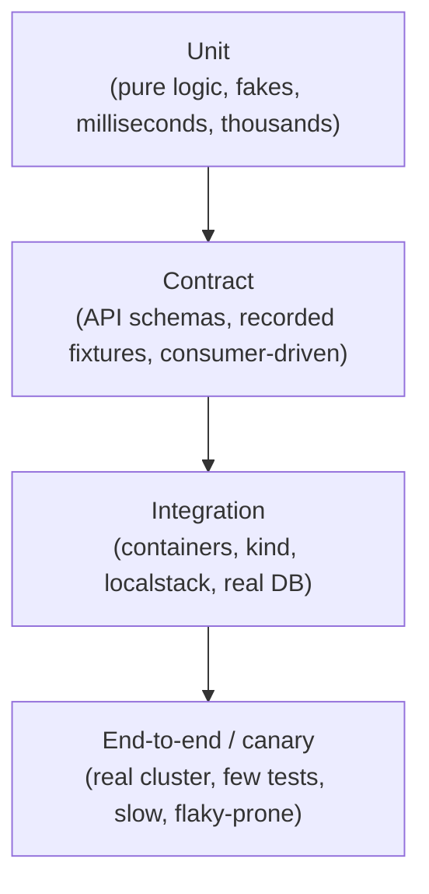
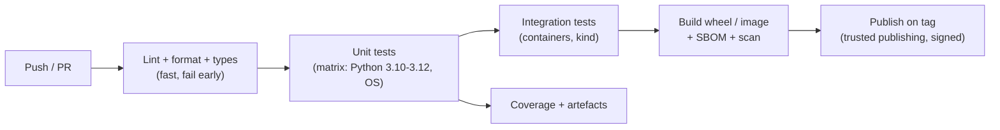

# 3.9 Testing, quality and CI for Python tooling

| | |
|---|---|
| Level | Intermediate |
| Priority tier | 0 |
| Lab venue | Python 3.11+, `pip install pytest pytest-cov pytest-mock hypothesis responses respx ruff mypy pre-commit` |
| Part | Part 3: Python for infrastructure |
| Status | Drafted, labs **untested** |

## Why this matters for AI infrastructure

Infrastructure code changes real machines. A bug in a drain script, an exporter or a provisioning helper can take down a GPU cluster worth millions, and these tools often cannot be tested against production. Good engineering turns that risk into a fast feedback loop: unit tests with fakes for the logic, contract tests for the integration surfaces, linters and type checkers that catch whole bug classes before runtime, and CI that refuses to merge anything that regresses. Interviewers for platform roles probe exactly this: "how do you test code that talks to hardware, Kubernetes or a cloud API?"

## Prerequisites and outcomes

Builds on 3.1 to 3.8. After this chapter you can:

- Structure a test suite with pytest (discovery, fixtures, parametrisation, markers, configuration) and apply the test pyramid to infrastructure code.
- Isolate external dependencies with fakes, stubs, mocks, HTTP recorders and dependency injection, and avoid leaking state between tests.
- Apply property-based testing, golden/snapshot tests, contract and integration tests with containers, and tests for CLIs, async code and subprocess wrappers.
- Enforce quality with ruff, formatters, mypy/pyright, coverage thresholds and security scanners.
- Build CI pipelines (GitHub Actions/GitLab CI) with matrices, caching, artefacts, and release automation; use pre-commit hooks.
- Test infrastructure itself: Ansible/Terraform/Kubernetes manifests, Helm charts, and GPU-dependent code without GPUs.

## 1. Test strategy for infrastructure code



- **Many fast unit tests, fewer integration tests, very few end-to-end tests.** Push logic into pure functions (parsers, rules, planners) so most behaviour is testable with plain inputs and outputs. Keep I/O at the edges (the "functional core, imperative shell" shape from 3.8).
- **Test the failure paths.** Infrastructure code mostly runs in degraded conditions: timeouts, partial outputs, `[N/A]` fields, empty lists, 500s, permission errors. Each error handler deserves a test that triggers it.
- **Deterministic and hermetic.** No dependency on wall-clock time, random numbers, network, or the order of tests. Inject clocks and random seeds.
- **Fast feedback.** The unit suite should run in seconds so developers run it constantly; slower tiers run in CI or nightly.
- **What to test on a GPU tool without a GPU:** parse recorded `nvidia-smi`/`dcgmi` outputs, simulate NVML with a fake module, and keep a small set of hardware-in-the-loop tests (marked `gpu`) that run only on labelled runners.

## 2. pytest essentials

```python
# tests/test_rules.py
import pytest
from fleetctl.rules import evaluate
from fleetctl.parsers import Gpu

def gpu(i=0, temp=60, ecc=0): return Gpu(i, "H100", temp, 10, 100, 80000, ecc)

def test_healthy_node():
    assert evaluate([gpu(i) for i in range(8)]) == []

def test_missing_gpu_reported():
    problems = evaluate([gpu(i) for i in range(7)])
    assert problems == ["expected 8 GPUs, found 7"]

@pytest.mark.parametrize("temp,bad", [(84, False), (85, False), (86, True), (None, False)])
def test_temperature_threshold(temp, bad):
    problems = evaluate([gpu(i, temp=temp) for i in range(8)])
    assert bool(problems) is bad

def test_raises_on_bad_input():
    with pytest.raises(ValueError, match="unexpected nvidia-smi columns"):
        parse_smi_csv("0,H100,60")
```

Key mechanics:

- **Discovery**: files `test_*.py` or `*_test.py`, functions `test_*`, classes `Test*` without `__init__`. Plain `assert` statements: pytest rewrites them to show detailed diffs.
- **Parametrisation** (`@pytest.mark.parametrize`) replaces copy-pasted tests; use `ids=` for readable names.
- **Fixtures** provide setup/teardown and dependency injection by parameter name. Scopes: `function` (default), `class`, `module`, `session`; use the narrowest that is affordable. `yield` fixtures run teardown after the test even on failure. `conftest.py` shares fixtures across a directory without imports. Built-ins: `tmp_path`, `monkeypatch`, `capsys`/`capfd`, `caplog`, `request`, `tmp_path_factory`.
- **Markers**: `@pytest.mark.slow`, `@pytest.mark.gpu`, `skip`, `skipif`, `xfail(strict=True)`; register markers in config and select with `-m "not slow"`.
- **Configuration** in `pyproject.toml`:

```toml
[tool.pytest.ini_options]
minversion = "8.0"
addopts = "-ra --strict-markers --strict-config -q"
testpaths = ["tests"]
markers = ["slow: slow tests", "gpu: needs a real GPU", "integration: needs containers"]
filterwarnings = ["error"]            # warnings become failures: catches deprecations early
asyncio_mode = "auto"                 # with pytest-asyncio
```

- **Useful flags**: `-k expr` select by name, `-x` stop at first failure, `--lf`/`--ff` rerun failures first, `--pdb` debugger on failure, `-n auto` (pytest-xdist) parallel runs, `--durations=10` slowest tests, `--maxfail`, `-p no:randomly` or `pytest-randomly` to randomise order and expose hidden coupling.

### Fixtures that clean up and avoid leaked state

```python
# conftest.py
import pytest, os

@pytest.fixture
def env(monkeypatch):
    monkeypatch.setenv("FLEET_TOKEN", "test-token")          # undone automatically after the test
    monkeypatch.delenv("FLEET_CONFIG", raising=False)

@pytest.fixture
def workdir(tmp_path, monkeypatch):
    monkeypatch.chdir(tmp_path)
    return tmp_path

@pytest.fixture(scope="session")
def kind_cluster():
    name = create_kind_cluster()          # expensive, shared
    yield name
    delete_kind_cluster(name)             # teardown always runs
```

A classic bug: mutating a module-level dict or default argument in one test and failing another test later. Avoid with fixtures that build fresh objects, `monkeypatch` instead of assigning globals, and `pytest-randomly` in CI to surface order dependence. Never share mutable state through session-scoped fixtures unless it is reset per test.

## 3. Isolating dependencies: fakes, stubs and mocks

Vocabulary: a **stub** returns canned answers; a **fake** is a working lightweight implementation (in-memory repository); a **mock** records calls so you can assert on interactions; a **spy** wraps the real thing. Prefer fakes and stubs (tests assert on outcomes) over heavy mocking (tests assert on implementation and break on refactors).

### Dependency injection beats patching

```python
class Drainer:
    def __init__(self, kube, clock=time.monotonic, sleep=time.sleep):
        self.kube, self.clock, self.sleep = kube, clock, sleep

    def drain(self, node, timeout=600):
        self.kube.cordon(node)
        deadline = self.clock() + timeout
        while self.kube.pods_on(node):
            if self.clock() > deadline: raise TimeoutError(node)
            self.sleep(5)

class FakeKube:
    def __init__(self, pods_sequence): self.seq, self.cordoned = list(pods_sequence), []
    def cordon(self, n): self.cordoned.append(n)
    def pods_on(self, n): return self.seq.pop(0) if self.seq else []

def test_drain_waits_until_empty():
    t = iter(range(0, 1000, 5))
    d = Drainer(FakeKube([["a", "b"], ["b"], []]), clock=lambda: next(t), sleep=lambda s: None)
    d.drain("n1")                                    # runs instantly, no real sleeping
```

Injecting the clock and sleep makes time-dependent logic testable without waiting.

### unittest.mock and pytest-mock

```python
def test_get_retries(mocker):
    m = mocker.patch("fleetctl.client.httpx.Client.get")
    m.side_effect = [httpx.ConnectError("boom"), make_response(200, {"ok": True})]
    assert get_json("/x") == {"ok": True}
    assert m.call_count == 2
```

Rules: patch where the name is **looked up** (`fleetctl.client.httpx`, not `httpx`), use `autospec=True` (or `create_autospec`) so the mock has the real signature and cannot silently accept wrong calls, set `side_effect` to a list for sequences or to an exception class to simulate failure, and keep mocks local to the test. Over-mocking is a smell: if a test needs ten patches, the code under test has too many collaborators.

### HTTP-level fakes

Rather than mocking `get`, intercept at the transport boundary so the real client code runs: `responses` (for `requests`), `respx` (for `httpx`), `aioresponses`/`pytest-aiohttp`, or `vcrpy`/`pytest-recording` to record real traffic once and replay it (scrub secrets from cassettes; re-record periodically to detect drift).

```python
import respx, httpx
@respx.mock
def test_pagination_collects_all_pages():
    respx.get("https://api/x", params={"limit": 2}).respond(json={"items": [1, 2], "next_page_token": "t"})
    respx.get("https://api/x", params={"limit": 2, "page_token": "t"}).respond(json={"items": [3]})
    assert list(paginate("https://api/x", page_size=2)) == [1, 2, 3]
```

### Subprocess, filesystem and environment

- **Subprocess**: test the parser with recorded output; test the wrapper by patching `subprocess.run` to return `CompletedProcess(args, 0, stdout=..., stderr=...)`; include timeout (`subprocess.TimeoutExpired`) and non-zero exit cases. A tiny fake executable placed first in `PATH` (written to `tmp_path` by the test) exercises the real `subprocess` path end to end.
- **Filesystem**: use `tmp_path`; for `/proc` and `/sys` readers take the root as a parameter (`root=Path("/")`) and point it at a fixture tree; `pyfakefs` can fake the whole filesystem when necessary.
- **Environment and config**: `monkeypatch.setenv`; never read real home directories in tests.
- **Time**: inject clocks, or use `freezegun`/`time-machine`.
- **Randomness**: seed explicitly or inject `random.Random(1)`.

### Async code

With `pytest-asyncio` (or `anyio`'s pytest plugin) mark tests `async def`; use `asyncio.wait_for` to bound tests; fake awaitables with `AsyncMock`; test cancellation (`task.cancel()`) and timeout behaviours explicitly; control time with fake event loop clocks or by injecting sleep.

## 4. Beyond example-based tests

### Property-based testing with Hypothesis

State a property that must hold for all inputs and let the library search for counterexamples and **shrink** them to a minimal case. Excellent for parsers, serialisers, validators and arithmetic on units.

```python
from hypothesis import given, strategies as st

@given(st.lists(st.tuples(st.integers(0, 15), st.integers(0, 120)), max_size=16))
def test_render_then_parse_roundtrip(pairs):
    gpus = [Gpu(i, "H100", t, None, None, None, None) for i, t in pairs]
    assert parse_smi_csv(render_csv(gpus)) == gpus

@given(st.text())
def test_parser_never_crashes_with_unexpected_exception(s):
    try: parse_smi_csv(s)
    except ValueError: pass                     # only the documented exception is allowed
```

Typical properties: round-trip (encode then decode), idempotence (`normalize(normalize(x)) == normalize(x)`), invariants (sum preserved, order irrelevant), oracle comparison against a slow reference, "never raises anything but X". Hypothesis stores failing examples in a database so regressions are replayed.

### Golden files and snapshot tests

For tools that render text (config generators, Jinja templates, tabular output, Kubernetes manifests), compare output against a reviewed expected file (`syrupy`, `pytest-regressions`, or hand-rolled). Updating the snapshot is a deliberate, reviewed act (`--snapshot-update`). Keep snapshots small and meaningful, otherwise reviewers rubber-stamp diffs.

### Contract tests

Services and clients drift apart. Defences: validate payloads against the provider's **OpenAPI/JSON Schema** in tests (`schemathesis`, `jsonschema`, `openapi-core`), consumer-driven contract tools (`pact`), recorded real responses refreshed on a schedule, and pydantic models shared between producer and consumer. For Redfish or vendor APIs, keep sanitized real payloads from each platform as fixtures: the vendor differences (3.8) become regression tests.

### Integration tests with real dependencies

Run real PostgreSQL, Redis, Prometheus, Kafka or an S3 stand-in in containers using `testcontainers-python` or docker-compose, mark them `integration`, and run them in CI. For Kubernetes use `kind`/`k3d` clusters (pytest fixture creating and deleting the cluster, as above) or envtest-style API servers; `pytest-kind` and `kubernetes` client wrappers exist. Keep each test independent: unique namespaces or names, cleanup in teardown, and generous but bounded waits (poll with `tenacity`, never `sleep(30)`).

### Testing CLIs

```python
from click.testing import CliRunner
def test_status_json(monkeypatch):
    monkeypatch.setattr("fleetctl.cli.query_host", lambda h, c: {"host": h, "gpus": 8, "state": "ok"})
    r = CliRunner().invoke(cli, ["--output", "json", "status", "h1", "h2"])
    assert r.exit_code == 0
    assert json.loads(r.output)[0]["host"] == "h1"

def test_usage_error_exit_code():
    assert CliRunner().invoke(cli, ["drain"]).exit_code == 2
```

For argparse tools call `main([...])` and use `capsys`; for end-to-end behaviour run `subprocess.run([sys.executable, "-m", "fleetctl", ...])` in a few smoke tests.

### Mutation testing and test quality

Coverage tells you which lines ran, not whether the assertions are meaningful. **Mutation testing** (`mutmut`, `cosmic-ray`) changes the code (flip `>` to `>=`, remove a branch) and checks that tests fail; surviving mutants reveal weak tests. Use it on the critical core (parsers, rules, planners), not the whole repository.

### Flaky tests

Flakiness is a defect, not a nuisance: causes are shared state, ordering, real time, real network, resource contention and race conditions. Policy: quarantine with a marker and an issue (do not silently retry everything with `pytest-rerunfailures`), reproduce with `-p randomly` seeds, `pytest --count` loops, `pytest-xdist` stress, and fix the root cause; fail the build on new flakes.

## 5. Static quality gates

| Tool | Purpose | Notes |
|---|---|---|
| **ruff** | Linter and import sorter (replaces flake8, isort, pyupgrade, many plugins); `ruff format` is a Black-compatible formatter | Very fast; configure rule sets in `pyproject.toml` |
| **black** / `ruff format` | Uniform formatting; ends style debates | One tool, not both |
| **mypy** / **pyright** | Static type checking | Start lenient on legacy code, strict on new modules; gradual typing (3.4) |
| **bandit**, `ruff -S` rules | Security smells (`shell=True`, `yaml.load`, hard-coded passwords, `assert` in prod) | Review findings; tune false positives |
| **pip-audit**, `safety`, Dependabot/Renovate | Vulnerable dependencies | Run in CI and on a schedule |
| **vulture**, `ruff` unused rules | Dead code | |
| **radon**, `ruff C901` | Complexity limits | |
| **coverage.py** / `pytest-cov` | Line and branch coverage | Gate on branch coverage for the core and on diff coverage for PRs rather than one global magic number |
| **pre-commit** | Runs hooks on staged files before commit | Same hooks in CI to prevent bypass |
| **codespell**, `yamllint`, `shellcheck`, `hadolint`, `actionlint` | Prose, YAML, shell, Dockerfile, workflow linting | Infrastructure repos are mixed-language |

```toml
[tool.ruff]
line-length = 100
target-version = "py311"
[tool.ruff.lint]
select = ["E", "F", "I", "B", "UP", "S", "C4", "SIM", "PT", "RUF", "ASYNC", "T20"]   # pycodestyle, pyflakes, isort, bugbear, upgrade, bandit, ...
ignore = ["S101"]                      # asserts allowed in tests (use per-file-ignores for tests)
[tool.ruff.lint.per-file-ignores]
"tests/**" = ["S", "T20"]

[tool.mypy]
python_version = "3.11"
strict = true
warn_unused_ignores = true
exclude = ["build/"]

[tool.coverage.run]
branch = true
source = ["fleetctl"]
[tool.coverage.report]
fail_under = 85
show_missing = true
exclude_also = ["if TYPE_CHECKING:", "raise NotImplementedError", "if __name__ == .__main__.:"]
```

```yaml
# .pre-commit-config.yaml
repos:
- repo: https://github.com/astral-sh/ruff-pre-commit
  rev: v0.6.9              # pin a reviewed version
  hooks:
  - id: ruff
    args: [--fix]
  - id: ruff-format
- repo: https://github.com/pre-commit/mirrors-mypy
  rev: v1.11.2
  hooks: [ { id: mypy, additional_dependencies: [types-PyYAML] } ]
- repo: https://github.com/pre-commit/pre-commit-hooks
  rev: v4.6.0
  hooks: [ { id: check-yaml }, { id: end-of-file-fixer }, { id: trailing-whitespace }, { id: detect-private-key } ]
```

(Tool versions above are examples; pin the versions you have reviewed.)

Typing practice: annotate public functions, use `Protocol` for injected collaborators (so fakes type-check), `TypedDict`/dataclasses/pydantic for payloads, avoid `Any` creep, and run the type checker in CI as a required check.

## 6. Continuous integration

### Pipeline architecture



Order jobs cheap-to-expensive, run independent jobs in parallel, cache dependencies, and make required checks branch-protected so nothing merges red.

### GitHub Actions example

```yaml
name: ci
on:
  pull_request:
  push: { branches: [main], tags: ["v*"] }
permissions: { contents: read }
concurrency: { group: ci-${{ github.ref }}, cancel-in-progress: true }

jobs:
  lint:
    runs-on: ubuntu-latest
    steps:
    - uses: actions/checkout@v4
    - uses: actions/setup-python@v5
      with: { python-version: "3.12", cache: pip }
    - run: pip install ruff mypy -e .[dev]
    - run: ruff check . && ruff format --check .
    - run: mypy src

  test:
    needs: lint
    strategy:
      fail-fast: false
      matrix: { python: ["3.10", "3.11", "3.12"], os: [ubuntu-latest, macos-latest] }
    runs-on: ${{ matrix.os }}
    steps:
    - uses: actions/checkout@v4
    - uses: actions/setup-python@v5
      with: { python-version: "${{ matrix.python }}", cache: pip }
    - run: pip install -e .[dev]
    - run: pytest -m "not integration and not gpu" --cov --cov-report=xml
    - uses: actions/upload-artifact@v4
      if: always()
      with: { name: "coverage-${{ matrix.os }}-${{ matrix.python }}", path: coverage.xml }

  integration:
    needs: test
    runs-on: ubuntu-latest
    steps:
    - uses: actions/checkout@v4
    - uses: actions/setup-python@v5
      with: { python-version: "3.12", cache: pip }
    - run: pip install -e .[dev]
    - run: pytest -m integration

  build:
    needs: [test]
    runs-on: ubuntu-latest
    steps:
    - uses: actions/checkout@v4
    - run: pipx run build
    - uses: actions/upload-artifact@v4
      with: { name: dist, path: dist/ }

  publish:
    if: startsWith(github.ref, 'refs/tags/v')
    needs: [build, integration]
    runs-on: ubuntu-latest
    environment: release
    permissions: { id-token: write }          # trusted publishing: no long-lived tokens
    steps:
    - uses: actions/download-artifact@v4
      with: { name: dist, path: dist/ }
    - uses: pypa/gh-action-pypi-publish@release/v1
```

(Action versions are examples; pin to reviewed versions or commit SHAs.)

CI hardening and hygiene:

- **Least privilege** `permissions:`; pin third-party actions by SHA; never echo secrets; treat PRs from forks as untrusted (no secrets, `pull_request_target` only with great care).
- **Reproducibility**: lock files, pinned base images, `--require-hashes`, hermetic builds; record tool versions in logs.
- **Self-hosted runners for GPU tests**: label runners (`gpu`), use ephemeral/containerised jobs, limit who can trigger, clean state between jobs; NVIDIA publishes GPU-enabled container images and the container toolkit for this.
- **Caching** dependencies and test data keyed on lock file hashes; **artefacts** for coverage, test reports (JUnit XML), logs on failure.
- **Matrix** over Python versions you support and operating systems you deploy on; include a minimum-dependency run (`uv pip install --resolution lowest-direct`) to validate lower bounds.
- **Test the packaging**: install the built wheel into a clean venv and run a smoke test (catches missing package data and wrong entry points).
- **Release**: tag-driven, changelog from conventional commits, version from git tag (`hatch-vcs`, `setuptools-scm`), signed artefacts and provenance attestations, SBOM; protected `environment` requiring approval for publishing.
- **Scheduled jobs**: nightly full suite with random seeds, dependency audit, and slow/integration tiers; notify on failure and track flakiness.

GitLab CI equivalent: stages, `needs`, `cache`, `artifacts:reports:junit`, `rules:` and runner tags; Jenkins pipelines for legacy shops.

## 7. Testing the infrastructure code around Python

Many repositories mix Python with declarative infrastructure; test those layers too:

- **Ansible**: `ansible-lint`, `yamllint`, `ansible-playbook --syntax-check`, `--check --diff` against a staging host, **Molecule** with containers/VMs and **testinfra** (pytest-based assertions on the resulting host) for role tests.
- **Terraform/OpenTofu**: `fmt -check`, `validate`, `tflint`, policy checks (OPA/Conftest, Checkov, tfsec), `plan` in CI with reviewed output, **Terratest** (Go) or `terraform test` for module tests against ephemeral environments.
- **Kubernetes manifests and Helm**: `kubeconform`/`kubeval` against schemas, `helm lint` and `helm template | kubeconform`, `kube-linter`, `conftest` policies, `kind` smoke deploys, `chainsaw`/`kuttl` declarative tests for operators.
- **Dockerfiles**: `hadolint`; image scanning (`trivy`, `grype`); `container-structure-test`.
- **Shell**: `shellcheck`, `shfmt`, `bats`.
- **Jinja templates** (network configs): render with representative variables and diff against golden files; validate the output with the target's parser (for example `nft -c -f` for nftables, FRR `vtysh --dryrun` style checks).
- **Pydantic/JSON schema validation of configs** in CI so malformed YAML never reaches production.

## 8. Observability of the tests themselves

Track test duration trends, flake rate, coverage of changed lines (diff-cover), and time-to-green; fail slow tests loudly (`--durations`), parallelise with xdist when isolation permits, and keep the pipeline under about ten minutes for PR feedback (split or shard otherwise). Keep logs and JUnit reports as artefacts and attach failing-test reproduction commands to the output (seed values, `pytest -k` hints).

## 9. Lab (untested)

1. **Unit test suite**: take the parser/rules module from 3.8; write parametrised tests including `[N/A]`, wrong column counts, empty output; achieve 100% branch coverage on the core; run with `pytest -q --cov --cov-branch`.
2. **Dependency injection**: implement the `Drainer` with injected clock/sleep and a `FakeKube`; test timeout and success paths with no real sleeping; then rewrite using `mocker.patch` and compare readability and fragility.
3. **HTTP fakes**: test the resilient client with `respx`/`responses`: retry on 503, no retry on 404, honour `Retry-After`, pagination completeness, timeouts; add a recorded-cassette test and scrub secrets.
4. **Hypothesis**: write round-trip and "only documented exceptions" properties for the parser; introduce a bug and watch shrinking produce a minimal counterexample.
5. **State leakage**: reproduce a test-order bug (module-level dict mutation), find it with `pytest-randomly`, fix with fixtures/`monkeypatch`.
6. **CLI tests**: `CliRunner` tests for exit codes (0/1/2/3/4), JSON output purity (stdout only), `--dry-run` not mutating, and a subprocess smoke test of the installed entry point.
7. **Async**: test an asyncio fan-out with a semaphore and injected failures; test cancellation and timeout behaviour.
8. **Static gates**: configure ruff, mypy strict on new code, coverage `fail_under`, bandit rules; fix the findings; add pre-commit and verify it blocks a commit containing `yaml.load` or `shell=True`.
9. **CI**: create the GitHub Actions workflow above in a throwaway repo; add the matrix, caching, artefact upload; make lint a required check; break a test and see the merge blocked; add a wheel smoke-install job.
10. **Integration**: use `testcontainers` to run Prometheus or PostgreSQL; test the exporter end to end by scraping it; use `kind` for a Kubernetes client test with unique namespaces.
11. **Mutation test**: run `mutmut` on the rules module; strengthen tests until important mutants die.
12. **Infra linting**: add `ansible-lint`, `kubeconform`, `hadolint`, `shellcheck` jobs for a sample repo.
13. **Clean up.**

Mark tested only after execution.

## 10. Common mistakes

- Tests that call real networks, clocks or hardware; tests depending on execution order or leaking global state.
- Over-mocking and asserting on call internals, so refactors break tests without behavioural change.
- Patching the wrong import path; mocks without `autospec` that silently accept bad calls.
- Chasing a global coverage percentage while asserting nothing; ignoring branch coverage and error paths.
- `sleep(10)` in tests instead of polling with a timeout or injected clock.
- Retrying flaky tests blindly instead of fixing root causes.
- Treating warnings as noise; letting deprecations accumulate until an upgrade breaks everything.
- CI that runs only on the main branch, or checks that are not required; unpinned actions and dependencies; secrets exposed to fork PRs.
- No tests for the CLI contract (exit codes, stdout/stderr separation), then breaking automation that depends on them.
- Mixing formatters (black and ruff format) producing churn; type checking only in editors.
- Recorded fixtures that are never refreshed, so tests pass against an API that no longer exists.

## 11. Interview angles

- "How do you test code that talks to GPUs, Kubernetes or a BMC?" (pure core, recorded payloads, fakes at boundaries, containers/kind for integration, a small hardware tier on labelled runners.)
- "What makes a test flaky and how do you handle it?"
- "Mock versus fake versus stub?"
- "How do you test a retry/backoff client without waiting?" (inject clock/sleep or fake transport; assert call counts and delays.)
- "Design a CI pipeline for an internal CLI." (lint, type, test matrix, build, wheel smoke test, tag-driven publish with trusted publishing.)
- "What is property-based testing and where did it help?"
- "How do you keep a CI pipeline fast and trustworthy?" (cheap-first ordering, caching, parallelism, sharding, no flakes, required checks.)
- "How would you gate a Terraform or Ansible change?" (lint, plan/check-mode output review, policy checks, ephemeral environment tests.)

## 12. Checkpoint questions (35)

1. Test pyramid shape? **A:** Many unit, fewer integration, few end-to-end.
2. Why prefer pure functions? **A:** Testable without I/O.
3. What is a fixture? **A:** Setup/teardown and injection by parameter name.
4. Where do shared fixtures live? **A:** `conftest.py`.
5. What does a `yield` fixture do after the test? **A:** Runs teardown code.
6. What does `monkeypatch` guarantee? **A:** Changes are undone after the test.
7. Why parametrise? **A:** Cover cases without duplicate tests.
8. Stub vs fake vs mock? **A:** Canned answers; working lightweight implementation; call-recording.
9. Where must you patch? **A:** Where the name is looked up.
10. Why `autospec`? **A:** The mock enforces the real signature.
11. How to test sleeping logic fast? **A:** Inject clock and sleep.
12. Which tool intercepts `httpx` calls? **A:** `respx`.
13. Why scrub cassettes? **A:** They may contain secrets.
14. How do you test subprocess wrappers? **A:** Patch `subprocess.run` or use fake executables on `PATH`.
15. What is Hypothesis shrinking? **A:** Reducing a failing input to a minimal case.
16. Three useful properties? **A:** Round-trip, idempotence, invariants.
17. What are golden files? **A:** Reviewed expected outputs compared with actual.
18. What is a contract test? **A:** Verifies that provider and consumer agree on a schema.
19. What does testcontainers do? **A:** Starts disposable containers for tests.
20. What does `CliRunner` return? **A:** Result with exit code and output.
21. Why test exit codes? **A:** Automation relies on them.
22. What does mutation testing reveal? **A:** Weak assertions.
23. Main cause categories of flaky tests? **A:** Shared state, time, network, ordering, races.
24. What does ruff replace? **A:** flake8, isort, pyupgrade and more.
25. Why mypy in CI? **A:** Catches type bugs before runtime.
26. What does `branch = true` add? **A:** Branch coverage, not just lines.
27. Why diff coverage? **A:** Focuses on changed lines.
28. What is pre-commit for? **A:** Local hooks before commit, mirrored in CI.
29. Why pin actions by SHA? **A:** Supply-chain safety.
30. What does `permissions:` do in Actions? **A:** Restricts the workflow token.
31. Why trusted publishing? **A:** No long-lived tokens.
32. Why smoke-test the built wheel? **A:** Catches packaging and entry-point errors.
33. How do you run GPU tests in CI? **A:** Labelled self-hosted runners with marked tests.
34. Which tool tests Ansible roles? **A:** Molecule with testinfra.
35. Which tools validate Kubernetes manifests? **A:** kubeconform, helm lint, kube-linter, conftest.

## 13. Sources and review notes

**Written in original words.** Principal sources:

- The author's `nvidia-devops` repository, volume 02 (Python tooling and operations masterclass, sections on testing infrastructure code with pytest, fixtures and teardown, mocking external APIs, leaked test state, and CI/CD for distributing CLIs with GitHub Actions).
- pytest, Hypothesis, coverage.py, ruff, mypy, pre-commit, respx, responses, testcontainers, Molecule and GitHub Actions documentation.
- Examples are the author's constructions.

**Flagged for verification before publishing:** tool and action version numbers in configuration snippets, ruff rule-set codes, pytest plugin option names, the GitHub Actions syntax and the PyPI trusted publishing flow, and every code listing; all labs are **untested**.
