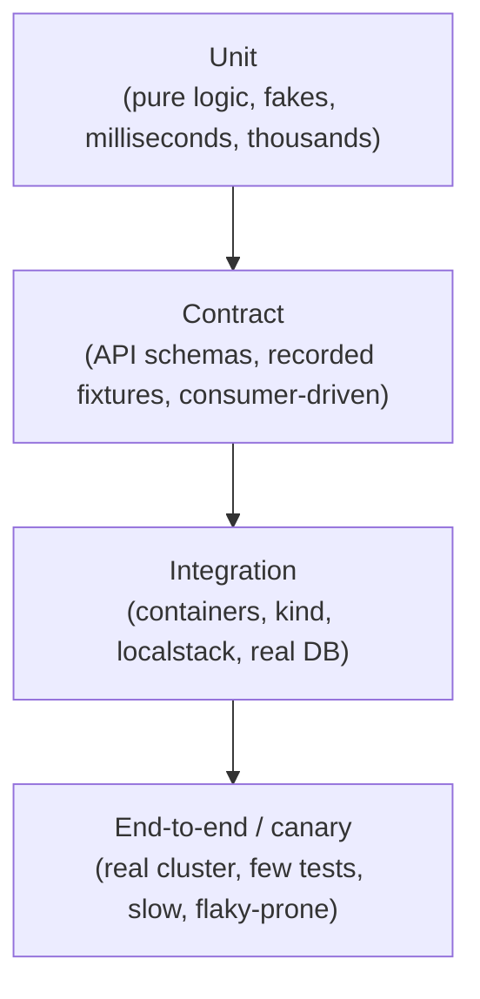
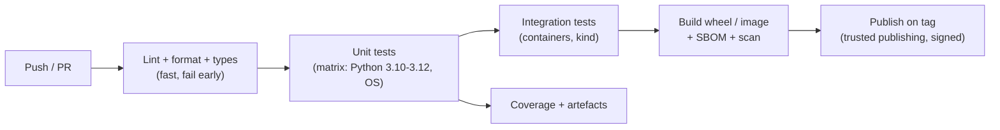

# 3.9 Testing, quality and CI for Python tooling

| | |
|---|---|
| Level | Intermediate |
| Priority tier | 0 |
| Lab venue | Python 3.11+, `pip install pytest pytest-cov pytest-mock hypothesis responses respx ruff mypy pre-commit` |
| Part | Part 3: Python for infrastructure |
| Status | Drafted, labs **untested** |

## Why this matters for AI infrastructure

Infrastructure code changes real machines. A bug in a drain script, an exporter or a provisioning helper can take down a GPU cluster worth millions, and these tools often cannot be tested against production. Good engineering turns that risk into a fast feedback loop: unit tests with fakes for the logic, contract tests for the integration surfaces, linters and type checkers that catch whole bug classes before runtime, and CI that refuses to merge anything that regresses. Interviewers for platform roles probe exactly this: "how do you test code that talks to hardware, Kubernetes or a cloud API?"

## Prerequisites and outcomes

Builds on 3.1 to 3.8. After this chapter you can:

- Structure a test suite with pytest (discovery, fixtures, parametrisation, markers, configuration) and apply the test pyramid to infrastructure code.
- Isolate external dependencies with fakes, stubs, mocks, HTTP recorders and dependency injection, and avoid leaking state between tests.
- Apply property-based testing, golden/snapshot tests, contract and integration tests with containers, and tests for CLIs, async code and subprocess wrappers.
- Enforce quality with ruff, formatters, mypy/pyright, coverage thresholds and security scanners.
- Build CI pipelines (GitHub Actions/GitLab CI) with matrices, caching, artefacts, and release automation; use pre-commit hooks.
- Test infrastructure itself: Ansible/Terraform/Kubernetes manifests, Helm charts, and GPU-dependent code without GPUs.

## 1. Test strategy for infrastructure code



- **Many fast unit tests, fewer integration tests, very few end-to-end tests.** Push logic into pure functions (parsers, rules, planners) so most behaviour is testable with plain inputs and outputs. Keep I/O at the edges (the "functional core, imperative shell" shape from 3.8).
- **Test the failure paths.** Infrastructure code mostly runs in degraded conditions: timeouts, partial outputs, `[N/A]` fields, empty lists, 500s, permission errors. Each error handler deserves a test that triggers it.
- **Deterministic and hermetic.** No dependency on wall-clock time, random numbers, network, or the order of tests. Inject clocks and random seeds.
- **Fast feedback.** The unit suite should run in seconds so developers run it constantly; slower tiers run in CI or nightly.
- **What to test on a GPU tool without a GPU:** parse recorded `nvidia-smi`/`dcgmi` outputs, simulate NVML with a fake module, and keep a small set of hardware-in-the-loop tests (marked `gpu`) that run only on labelled runners.

## 2. pytest essentials

```python
# tests/test_rules.py
import pytest
from fleetctl.rules import evaluate
from fleetctl.parsers import Gpu

def gpu(i=0, temp=60, ecc=0): return Gpu(i, "H100", temp, 10, 100, 80000, ecc)

def test_healthy_node():
    assert evaluate([gpu(i) for i in range(8)]) == []

def test_missing_gpu_reported():
    problems = evaluate([gpu(i) for i in range(7)])
    assert problems == ["expected 8 GPUs, found 7"]

@pytest.mark.parametrize("temp,bad", [(84, False), (85, False), (86, True), (None, False)])
def test_temperature_threshold(temp, bad):
    problems = evaluate([gpu(i, temp=temp) for i in range(8)])
    assert bool(problems) is bad

def test_raises_on_bad_input():
    with pytest.raises(ValueError, match="unexpected nvidia-smi columns"):
        parse_smi_csv("0,H100,60")
```

Key mechanics:

- **Discovery**: files `test_*.py` or `*_test.py`, functions `test_*`, classes `Test*` without `__init__`. Plain `assert` statements: pytest rewrites them to show detailed diffs.
- **Parametrisation** (`@pytest.mark.parametrize`) replaces copy-pasted tests; use `ids=` for readable names.
- **Fixtures** provide setup/teardown and dependency injection by parameter name. Scopes: `function` (default), `class`, `module`, `session`; use the narrowest that is affordable. `yield` fixtures run teardown after the test even on failure. `conftest.py` shares fixtures across a directory without imports. Built-ins: `tmp_path`, `monkeypatch`, `capsys`/`capfd`, `caplog`, `request`, `tmp_path_factory`.
- **Markers**: `@pytest.mark.slow`, `@pytest.mark.gpu`, `skip`, `skipif`, `xfail(strict=True)`; register markers in config and select with `-m "not slow"`.
- **Configuration** in `pyproject.toml`:

```toml
[tool.pytest.ini_options]
minversion = "8.0"
addopts = "-ra --strict-markers --strict-config -q"
testpaths = ["tests"]
markers = ["slow: slow tests", "gpu: needs a real GPU", "integration: needs containers"]
filterwarnings = ["error"]            # warnings become failures: catches deprecations early
asyncio_mode = "auto"                 # with pytest-asyncio
```

- **Useful flags**: `-k expr` select by name, `-x` stop at first failure, `--lf`/`--ff` rerun failures first, `--pdb` debugger on failure, `-n auto` (pytest-xdist) parallel runs, `--durations=10` slowest tests, `--maxfail`, `-p no:randomly` or `pytest-randomly` to randomise order and expose hidden coupling.

### Fixtures that clean up and avoid leaked state

```python
# conftest.py
import pytest, os

@pytest.fixture
def env(monkeypatch):
    monkeypatch.setenv("FLEET_TOKEN", "test-token")          # undone automatically after the test
    monkeypatch.delenv("FLEET_CONFIG", raising=False)

@pytest.fixture
def workdir(tmp_path, monkeypatch):
    monkeypatch.chdir(tmp_path)
    return tmp_path

@pytest.fixture(scope="session")
def kind_cluster():
    name = create_kind_cluster()          # expensive, shared
    yield name
    delete_kind_cluster(name)             # teardown always runs
```

A classic bug: mutating a module-level dict or default argument in one test and failing another test later. Avoid with fixtures that build fresh objects, `monkeypatch` instead of assigning globals, and `pytest-randomly` in CI to surface order dependence. Never share mutable state through session-scoped fixtures unless it is reset per test.

## 3. Isolating dependencies: fakes, stubs and mocks

Vocabulary: a **stub** returns canned answers; a **fake** is a working lightweight implementation (in-memory repository); a **mock** records calls so you can assert on interactions; a **spy** wraps the real thing. Prefer fakes and stubs (tests assert on outcomes) over heavy mocking (tests assert on implementation and break on refactors).

### Dependency injection beats patching

```python
class Drainer:
    def __init__(self, kube, clock=time.monotonic, sleep=time.sleep):
        self.kube, self.clock, self.sleep = kube, clock, sleep

    def drain(self, node, timeout=600):
        self.kube.cordon(node)
        deadline = self.clock() + timeout
        while self.kube.pods_on(node):
            if self.clock() > deadline: raise TimeoutError(node)
            self.sleep(5)

class FakeKube:
    def __init__(self, pods_sequence): self.seq, self.cordoned = list(pods_sequence), []
    def cordon(self, n): self.cordoned.append(n)
    def pods_on(self, n): return self.seq.pop(0) if self.seq else []

def test_drain_waits_until_empty():
    t = iter(range(0, 1000, 5))
    d = Drainer(FakeKube([["a", "b"], ["b"], []]), clock=lambda: next(t), sleep=lambda s: None)
    d.drain("n1")                                    # runs instantly, no real sleeping
```

Injecting the clock and sleep makes time-dependent logic testable without waiting.

### unittest.mock and pytest-mock

```python
def test_get_retries(mocker):
    m = mocker.patch("fleetctl.client.httpx.Client.get")
    m.side_effect = [httpx.ConnectError("boom"), make_response(200, {"ok": True})]
    assert get_json("/x") == {"ok": True}
    assert m.call_count == 2
```

Rules: patch where the name is **looked up** (`fleetctl.client.httpx`, not `httpx`), use `autospec=True` (or `create_autospec`) so the mock has the real signature and cannot silently accept wrong calls, set `side_effect` to a list for sequences or to an exception class to simulate failure, and keep mocks local to the test. Over-mocking is a smell: if a test needs ten patches, the code under test has too many collaborators.

### HTTP-level fakes

Rather than mocking `get`, intercept at the transport boundary so the real client code runs: `responses` (for `requests`), `respx` (for `httpx`), `aioresponses`/`pytest-aiohttp`, or `vcrpy`/`pytest-recording` to record real traffic once and replay it (scrub secrets from cassettes; re-record periodically to detect drift).

```python
import respx, httpx
@respx.mock
def test_pagination_collects_all_pages():
    respx.get("https://api/x", params={"limit": 2}).respond(json={"items": [1, 2], "next_page_token": "t"})
    respx.get("https://api/x", params={"limit": 2, "page_token": "t"}).respond(json={"items": [3]})
    assert list(paginate("https://api/x", page_size=2)) == [1, 2, 3]
```

### Subprocess, filesystem and environment

- **Subprocess**: test the parser with recorded output; test the wrapper by patching `subprocess.run` to return `CompletedProcess(args, 0, stdout=..., stderr=...)`; include timeout (`subprocess.TimeoutExpired`) and non-zero exit cases. A tiny fake executable placed first in `PATH` (written to `tmp_path` by the test) exercises the real `subprocess` path end to end.
- **Filesystem**: use `tmp_path`; for `/proc` and `/sys` readers take the root as a parameter (`root=Path("/")`) and point it at a fixture tree; `pyfakefs` can fake the whole filesystem when necessary.
- **Environment and config**: `monkeypatch.setenv`; never read real home directories in tests.
- **Time**: inject clocks, or use `freezegun`/`time-machine`.
- **Randomness**: seed explicitly or inject `random.Random(1)`.

### Async code

With `pytest-asyncio` (or `anyio`'s pytest plugin) mark tests `async def`; use `asyncio.wait_for` to bound tests; fake awaitables with `AsyncMock`; test cancellation (`task.cancel()`) and timeout behaviours explicitly; control time with fake event loop clocks or by injecting sleep.

## 4. Beyond example-based tests

### Property-based testing with Hypothesis

State a property that must hold for all inputs and let the library search for counterexamples and **shrink** them to a minimal case. Excellent for parsers, serialisers, validators and arithmetic on units.

```python
from hypothesis import given, strategies as st

@given(st.lists(st.tuples(st.integers(0, 15), st.integers(0, 120)), max_size=16))
def test_render_then_parse_roundtrip(pairs):
    gpus = [Gpu(i, "H100", t, None, None, None, None) for i, t in pairs]
    assert parse_smi_csv(render_csv(gpus)) == gpus

@given(st.text())
def test_parser_never_crashes_with_unexpected_exception(s):
    try: parse_smi_csv(s)
    except ValueError: pass                     # only the documented exception is allowed
```

Typical properties: round-trip (encode then decode), idempotence (`normalize(normalize(x)) == normalize(x)`), invariants (sum preserved, order irrelevant), oracle comparison against a slow reference, "never raises anything but X". Hypothesis stores failing examples in a database so regressions are replayed.

### Golden files and snapshot tests

For tools that render text (config generators, Jinja templates, tabular output, Kubernetes manifests), compare output against a reviewed expected file (`syrupy`, `pytest-regressions`, or hand-rolled). Updating the snapshot is a deliberate, reviewed act (`--snapshot-update`). Keep snapshots small and meaningful, otherwise reviewers rubber-stamp diffs.

### Contract tests

Services and clients drift apart. Defences: validate payloads against the provider's **OpenAPI/JSON Schema** in tests (`schemathesis`, `jsonschema`, `openapi-core`), consumer-driven contract tools (`pact`), recorded real responses refreshed on a schedule, and pydantic models shared between producer and consumer. For Redfish or vendor APIs, keep sanitized real payloads from each platform as fixtures: the vendor differences (3.8) become regression tests.

### Integration tests with real dependencies

Run real PostgreSQL, Redis, Prometheus, Kafka or an S3 stand-in in containers using `testcontainers-python` or docker-compose, mark them `integration`, and run them in CI. For Kubernetes use `kind`/`k3d` clusters (pytest fixture creating and deleting the cluster, as above) or envtest-style API servers; `pytest-kind` and `kubernetes` client wrappers exist. Keep each test independent: unique namespaces or names, cleanup in teardown, and generous but bounded waits (poll with `tenacity`, never `sleep(30)`).

### Testing CLIs

```python
from click.testing import CliRunner
def test_status_json(monkeypatch):
    monkeypatch.setattr("fleetctl.cli.query_host", lambda h, c: {"host": h, "gpus": 8, "state": "ok"})
    r = CliRunner().invoke(cli, ["--output", "json", "status", "h1", "h2"])
    assert r.exit_code == 0
    assert json.loads(r.output)[0]["host"] == "h1"

def test_usage_error_exit_code():
    assert CliRunner().invoke(cli, ["drain"]).exit_code == 2
```

For argparse tools call `main([...])` and use `capsys`; for end-to-end behaviour run `subprocess.run([sys.executable, "-m", "fleetctl", ...])` in a few smoke tests.

### Mutation testing and test quality

Coverage tells you which lines ran, not whether the assertions are meaningful. **Mutation testing** (`mutmut`, `cosmic-ray`) changes the code (flip `>` to `>=`, remove a branch) and checks that tests fail; surviving mutants reveal weak tests. Use it on the critical core (parsers, rules, planners), not the whole repository.

### Flaky tests

Flakiness is a defect, not a nuisance: causes are shared state, ordering, real time, real network, resource contention and race conditions. Policy: quarantine with a marker and an issue (do not silently retry everything with `pytest-rerunfailures`), reproduce with `-p randomly` seeds, `pytest --count` loops, `pytest-xdist` stress, and fix the root cause; fail the build on new flakes.

## 5. Static quality gates

| Tool | Purpose | Notes |
|---|---|---|
| **ruff** | Linter and import sorter (replaces flake8, isort, pyupgrade, many plugins); `ruff format` is a Black-compatible formatter | Very fast; configure rule sets in `pyproject.toml` |
| **black** / `ruff format` | Uniform formatting; ends style debates | One tool, not both |
| **mypy** / **pyright** | Static type checking | Start lenient on legacy code, strict on new modules; gradual typing (3.4) |
| **bandit**, `ruff -S` rules | Security smells (`shell=True`, `yaml.load`, hard-coded passwords, `assert` in prod) | Review findings; tune false positives |
| **pip-audit**, `safety`, Dependabot/Renovate | Vulnerable dependencies | Run in CI and on a schedule |
| **vulture**, `ruff` unused rules | Dead code | |
| **radon**, `ruff C901` | Complexity limits | |
| **coverage.py** / `pytest-cov` | Line and branch coverage | Gate on branch coverage for the core and on diff coverage for PRs rather than one global magic number |
| **pre-commit** | Runs hooks on staged files before commit | Same hooks in CI to prevent bypass |
| **codespell**, `yamllint`, `shellcheck`, `hadolint`, `actionlint` | Prose, YAML, shell, Dockerfile, workflow linting | Infrastructure repos are mixed-language |

```toml
[tool.ruff]
line-length = 100
target-version = "py311"
[tool.ruff.lint]
select = ["E", "F", "I", "B", "UP", "S", "C4", "SIM", "PT", "RUF", "ASYNC", "T20"]   # pycodestyle, pyflakes, isort, bugbear, upgrade, bandit, ...
ignore = ["S101"]                      # asserts allowed in tests (use per-file-ignores for tests)
[tool.ruff.lint.per-file-ignores]
"tests/**" = ["S", "T20"]

[tool.mypy]
python_version = "3.11"
strict = true
warn_unused_ignores = true
exclude = ["build/"]

[tool.coverage.run]
branch = true
source = ["fleetctl"]
[tool.coverage.report]
fail_under = 85
show_missing = true
exclude_also = ["if TYPE_CHECKING:", "raise NotImplementedError", "if __name__ == .__main__.:"]
```

```yaml
# .pre-commit-config.yaml
repos:
- repo: https://github.com/astral-sh/ruff-pre-commit
  rev: v0.6.9              # pin a reviewed version
  hooks:
  - id: ruff
    args: [--fix]
  - id: ruff-format
- repo: https://github.com/pre-commit/mirrors-mypy
  rev: v1.11.2
  hooks: [ { id: mypy, additional_dependencies: [types-PyYAML] } ]
- repo: https://github.com/pre-commit/pre-commit-hooks
  rev: v4.6.0
  hooks: [ { id: check-yaml }, { id: end-of-file-fixer }, { id: trailing-whitespace }, { id: detect-private-key } ]
```

(Tool versions above are examples; pin the versions you have reviewed.)

Typing practice: annotate public functions, use `Protocol` for injected collaborators (so fakes type-check), `TypedDict`/dataclasses/pydantic for payloads, avoid `Any` creep, and run the type checker in CI as a required check.

## 6. Continuous integration

### Pipeline architecture



Order jobs cheap-to-expensive, run independent jobs in parallel, cache dependencies, and make required checks branch-protected so nothing merges red.

### GitHub Actions example

```yaml
name: ci
on:
  pull_request:
  push: { branches: [main], tags: ["v*"] }
permissions: { contents: read }
concurrency: { group: ci-${{ github.ref }}, cancel-in-progress: true }

jobs:
  lint:
    runs-on: ubuntu-latest
    steps:
    - uses: actions/checkout@v4
    - uses: actions/setup-python@v5
      with: { python-version: "3.12", cache: pip }
    - run: pip install ruff mypy -e .[dev]
    - run: ruff check . && ruff format --check .
    - run: mypy src

  test:
    needs: lint
    strategy:
      fail-fast: false
      matrix: { python: ["3.10", "3.11", "3.12"], os: [ubuntu-latest, macos-latest] }
    runs-on: ${{ matrix.os }}
    steps:
    - uses: actions/checkout@v4
    - uses: actions/setup-python@v5
      with: { python-version: "${{ matrix.python }}", cache: pip }
    - run: pip install -e .[dev]
    - run: pytest -m "not integration and not gpu" --cov --cov-report=xml
    - uses: actions/upload-artifact@v4
      if: always()
      with: { name: "coverage-${{ matrix.os }}-${{ matrix.python }}", path: coverage.xml }

  integration:
    needs: test
    runs-on: ubuntu-latest
    steps:
    - uses: actions/checkout@v4
    - uses: actions/setup-python@v5
      with: { python-version: "3.12", cache: pip }
    - run: pip install -e .[dev]
    - run: pytest -m integration

  build:
    needs: [test]
    runs-on: ubuntu-latest
    steps:
    - uses: actions/checkout@v4
    - run: pipx run build
    - uses: actions/upload-artifact@v4
      with: { name: dist, path: dist/ }

  publish:
    if: startsWith(github.ref, 'refs/tags/v')
    needs: [build, integration]
    runs-on: ubuntu-latest
    environment: release
    permissions: { id-token: write }          # trusted publishing: no long-lived tokens
    steps:
    - uses: actions/download-artifact@v4
      with: { name: dist, path: dist/ }
    - uses: pypa/gh-action-pypi-publish@release/v1
```

(Action versions are examples; pin to reviewed versions or commit SHAs.)

CI hardening and hygiene:

- **Least privilege** `permissions:`; pin third-party actions by SHA; never echo secrets; treat PRs from forks as untrusted (no secrets, `pull_request_target` only with great care).
- **Reproducibility**: lock files, pinned base images, `--require-hashes`, hermetic builds; record tool versions in logs.
- **Self-hosted runners for GPU tests**: label runners (`gpu`), use ephemeral/containerised jobs, limit who can trigger, clean state between jobs; NVIDIA publishes GPU-enabled container images and the container toolkit for this.
- **Caching** dependencies and test data keyed on lock file hashes; **artefacts** for coverage, test reports (JUnit XML), logs on failure.
- **Matrix** over Python versions you support and operating systems you deploy on; include a minimum-dependency run (`uv pip install --resolution lowest-direct`) to validate lower bounds.
- **Test the packaging**: install the built wheel into a clean venv and run a smoke test (catches missing package data and wrong entry points).
- **Release**: tag-driven, changelog from conventional commits, version from git tag (`hatch-vcs`, `setuptools-scm`), signed artefacts and provenance attestations, SBOM; protected `environment` requiring approval for publishing.
- **Scheduled jobs**: nightly full suite with random seeds, dependency audit, and slow/integration tiers; notify on failure and track flakiness.

GitLab CI equivalent: stages, `needs`, `cache`, `artifacts:reports:junit`, `rules:` and runner tags; Jenkins pipelines for legacy shops.

## 7. Testing the infrastructure code around Python

Many repositories mix Python with declarative infrastructure; test those layers too:

- **Ansible (`AUR` Chapter 14 *Quality Assurance with Molecule*):** Run `yamllint .` and `ansible-lint` (plus `ansible-later` configured via `.later.yml`), `ansible-playbook --syntax-check`, and `--check --diff` against a staging host. For full role lifecycle testing, use **Molecule** (`molecule init scenario -r ssh --driver-name docker`, `molecule create`, `molecule converge`, `molecule idempotence`, `molecule verify`, `molecule destroy` across Docker, Podman, Vagrant/VirtualBox, or cloud drivers) paired with **Testinfra** (`testinfra.utils.ansible_runner.AnsibleRunner(os.environ['MOLECULE_INVENTORY_FILE']).get_hosts('all')`, asserting `host.package("openssh-server").is_installed`, `host.service("sshd").is_running`, `host.file("/etc/ssh/ssh_host_ed25519_key.pub").mode == 0o644`, and `host.user("sshd").exists`, modeled in `code/part03/python_testing_quality_ci.py`) or **Goss** (`goss -g test_sshd.yml validate`).
- **Distributed software architectures, DevOps, and MLOps quality loops (`EAS` Chapter 2 *Software Engineering Background*):** In *Engineering AI Systems* Chapter 2, Len Bass et al. trace how modern AI platforms combine **virtual machines and containers** (using dynamic service discovery rather than static DNS), **distributed software architectures** (evolving from Client-Server and Service-Oriented Architecture `SOA` to **Microservices** governed by Amazon's 2002 API mandate—where teams communicate exclusively through networked service interfaces with zero shared-memory backdoors or direct cross-team database reads), and **interface styles** (**REST** over HTTP/1.1 for general resource CRUD and ad-hoc dataset retrieval vs **GraphQL** for bandwidth-constrained edge clients that query only specific fields). In **DevOps and Infrastructure as Code (IaC)**, provisioning scripts and playbooks must be tested for **idempotence** (running a script twice produces the exact same target state without errors), while **MLOps** extends the DevOps continuous integration/deployment loop (design -> code -> build -> test -> deploy -> monitor) with **data pipelines, model training/retraining, and continuous model evaluation** to guard against data drift and non-deterministic training regressions.
- **Empirical Python benchmarking (`timer.py`, `pybench.py`, and `timeit`, `LP` Chapter 21 *The Benchmarking Interlude*):** When optimizing parsers or data pipelines, never guess about performance—measure empirically across your target Python versions (`CPython` vs `PyPy`):
  1. **Custom timer functions (`timer.py` and `timer2.py`, modeled in `code/part03/python_testing_quality_ci.py`):** Using `time.perf_counter()`, `once(func, *pargs, **kargs)` times a single call; `total(func, *pargs, _reps=1000, **kargs)` sums `_reps` calls; `bestof(func, *pargs, _reps=5, **kargs)` takes `min(once(...) for i in range(_reps))` (relying on Python's left-to-right tuple comparison of `(elapsed, result)` to pick the lowest time); and `bestoftotal(func, *pargs, _reps1=50, _reps=1000, **kargs)` computes the **minimum across `_reps1` totals of `_reps` calls**. We take the **`min` (best-of)** rather than the average because OS background interrupts and context switches can only artificially *inflate* a run's elapsed time; the minimum time represents the code's true speed unimpeded by system noise.
  2. **Comparing the 5 iteration alternatives (`timer_tests.py` on `range(10_000)`):** When applying a built-in C function like `abs(x)`, `list(map(abs, repslist))` (`0.144s`) beats `[abs(x) for x in repslist]` (`0.208s`), which beats a `for` loop with `res.append(abs(x))` (`0.260s`), while `list(abs(x) for x in repslist)` (`0.411s`) and `list(gen())` (`0.412s`) pay extra per-item generator suspension/resumption overhead when forced into a list all at once. However, when the operation requires a user-defined expression like `x + 10` (`timer_tests2.py`), `[x + 10 for x in repslist]` (`0.244s`) and the `for` loop (`0.287s`) easily beat `list(map(lambda x: x + 10, repslist))` (`0.496s`) because calling a Python `lambda` function 10,000 times adds function-call frame overhead.
  3. **Standard-library `timeit` and `pybench.py`:** `python3 -m timeit -n 1000 -r 5 -s "L = list(range(1000))" "[x ** 2 for x in L]"` (or `min(timeit.repeat(stmt=..., setup=..., number=1000, repeat=5))`) isolates one-time setup code (`-s`) from the timed loop body and disables garbage collection during timing by default (`gc.enable()` inside `setup` re-enables it).
- **Terraform/OpenTofu**: `fmt -check`, `validate`, `tflint`, policy checks (OPA/Conftest, Checkov, tfsec), `plan` in CI with reviewed output, **Terratest** (Go) or `terraform test` for module tests against ephemeral environments.
- **Kubernetes manifests and Helm**: `kubeconform`/`kubeval` against schemas, `helm lint` and `helm template | kubeconform`, `kube-linter`, `conftest` policies, `kind` smoke deploys, `chainsaw`/`kuttl` declarative tests for operators.
- **Dockerfiles**: `hadolint`; image scanning (`trivy`, `grype`); `container-structure-test`.
- **Shell**: `shellcheck`, `shfmt`, `bats`.
- **Jinja templates** (network configs): render with representative variables and diff against golden files; validate the output with the target's parser (for example `nft -c -f` for nftables, FRR `vtysh --dryrun` style checks).
- **Pydantic/JSON schema validation of configs** in CI so malformed YAML never reaches production.

## 8. Observability of the tests themselves

Track test duration trends, flake rate, coverage of changed lines (diff-cover), and time-to-green; fail slow tests loudly (`--durations`), parallelise with xdist when isolation permits, and keep the pipeline under about ten minutes for PR feedback (split or shard otherwise). Keep logs and JUnit reports as artefacts and attach failing-test reproduction commands to the output (seed values, `pytest -k` hints).

## 9. Lab

First, run the self-checking Python lab (`code/part03/python_testing_quality_ci_lab.py`) locally. It verifies *Learning Python* Chapter 21's `timer_once`, `timer_total`, `timer_bestof`, `timer_bestoftotal`, and the 5 iteration alternatives (`forLoop`, `listComp`, `mapCall`, `genExpr`, `genFunc`), dependency-injected `Drainer` + `FakeKube` testing both pod-evacuation success and `TimeoutError` in milliseconds without real `time.sleep`, and *Ansible: Up and Running* Chapter 14's `Testinfra` host verification assertions (`verify_sshd_host`).

```bash
python3 code/part03/python_testing_quality_ci_lab.py
```

Next, on any machine with Python 3.11+ (all interactive shell steps below are `untested here`), work through these exercises:

1. **Unit test suite**: take the parser/rules module from 3.8; write parametrised tests including `[N/A]`, wrong column counts, empty output; achieve 100% branch coverage on the core; run with `pytest -q --cov --cov-branch`.
2. **Dependency injection**: implement the `Drainer` with injected clock/sleep and a `FakeKube`; test timeout and success paths with no real sleeping; then rewrite using `mocker.patch` and compare readability and fragility.
3. **HTTP fakes**: test the resilient client with `respx`/`responses`: retry on 503, no retry on 404, honour `Retry-After`, pagination completeness, timeouts; add a recorded-cassette test and scrub secrets.
4. **Hypothesis**: write round-trip and "only documented exceptions" properties for the parser; introduce a bug and watch shrinking produce a minimal counterexample.
5. **State leakage**: reproduce a test-order bug (module-level dict mutation), find it with `pytest-randomly`, fix with fixtures/`monkeypatch`.
6. **CLI tests**: `CliRunner` tests for exit codes (0/1/2/3/4), JSON output purity (stdout only), `--dry-run` not mutating, and a subprocess smoke test of the installed entry point.
7. **Async**: test an asyncio fan-out with a semaphore and injected failures; test cancellation and timeout behaviour.
8. **Static gates**: configure ruff, mypy strict on new code, coverage `fail_under`, bandit rules; fix the findings; add pre-commit and verify it blocks a commit containing `yaml.load` or `shell=True`.
9. **CI**: create the GitHub Actions workflow above in a throwaway repo; add the matrix, caching, artefact upload; make lint a required check; break a test and see the merge blocked; add a wheel smoke-install job.
10. **Integration**: use `testcontainers` to run Prometheus or PostgreSQL; test the exporter end to end by scraping it; use `kind` for a Kubernetes client test with unique namespaces.
11. **Mutation test**: run `mutmut` on the rules module; strengthen tests until important mutants die.
12. **Infra linting**: add `ansible-lint`, `kubeconform`, `hadolint`, `shellcheck` jobs for a sample repo.
13. **Clean up.**

## 10. Common mistakes

- Tests that call real networks, clocks or hardware; tests depending on execution order or leaking global state.
- Over-mocking and asserting on call internals, so refactors break tests without behavioural change.
- Patching the wrong import path; mocks without `autospec` that silently accept bad calls.
- Chasing a global coverage percentage while asserting nothing; ignoring branch coverage and error paths.
- `sleep(10)` in tests instead of polling with a timeout or injected clock.
- Retrying flaky tests blindly instead of fixing root causes.
- Treating warnings as noise; letting deprecations accumulate until an upgrade breaks everything.
- CI that runs only on the main branch, or checks that are not required; unpinned actions and dependencies; secrets exposed to fork PRs.
- No tests for the CLI contract (exit codes, stdout/stderr separation), then breaking automation that depends on them.
- Mixing formatters (black and ruff format) producing churn; type checking only in editors.
- Recorded fixtures that are never refreshed, so tests pass against an API that no longer exists.

## 11. Interview angles

- "How do you test code that talks to GPUs, Kubernetes or a BMC?" (pure core, recorded payloads, fakes at boundaries, containers/kind for integration, a small hardware tier on labelled runners.)
- "What makes a test flaky and how do you handle it?"
- "Mock versus fake versus stub?"
- "How do you test a retry/backoff client without waiting?" (inject clock/sleep or fake transport; assert call counts and delays.)
- "Design a CI pipeline for an internal CLI." (lint, type, test matrix, build, wheel smoke test, tag-driven publish with trusted publishing.)
- "What is property-based testing and where did it help?"
- "How do you keep a CI pipeline fast and trustworthy?" (cheap-first ordering, caching, parallelism, sharding, no flakes, required checks.)
- "How would you gate a Terraform or Ansible change?" (lint, plan/check-mode output review, policy checks, ephemeral environment tests.)

## Exercises

1. **The Test Pyramid, `pytest` Fixtures (`yield`, `monkeypatch`, `tmp_path`), Parametrization, and State Leakage (`FA` Chapter 8 & `volume-02`):** (a) Explain how the test pyramid (Unit -> Contract -> Integration -> End-to-End) applies to GPU fleet tooling when no physical GPU is attached to the CI runner; (b) write a `@pytest.mark.parametrize` test and a `yield` fixture in `conftest.py`, and explain how `monkeypatch.setenv` and `pytest-randomly` prevent cross-test state leakage.
2. **Fakes vs. Stubs vs. Mocks, Dependency-Injected Clocks (`Drainer` + `FakeKube`), and HTTP Transport Interception (`respx`):** Using `Drainer` and `FakeKube` in `code/part03/python_testing_quality_ci.py`, explain: (a) why injecting `kube`, `clock`, and `sleep` lets `test_drain_waits_until_empty` test a 600-second timeout loop in 1 millisecond with zero `unittest.mock.patch` fragility; and (b) when you must use `mocker.patch`, why you must patch where the symbol is **looked up** (`fleetctl.client.httpx`) and pass `autospec=True`, or intercept at the HTTP transport layer with `respx`.
3. **Property-Based Testing (`Hypothesis`), Golden Snapshots, Contract Testing (`schemathesis`), and Mutation Testing (`mutmut`):** (a) Explain how `@given(...)` property-based testing with input shrinking finds edge cases in `parse_smi_csv` that example-based tests miss; (b) contrast line coverage, branch coverage (`branch = true`), and mutation testing (`mutmut`) when evaluating whether a test suite actually catches regressions.
4. **Static Quality Gates (`ruff`, `mypy --strict`, `bandit`, `pip-audit`, `pre-commit`) and GitHub Actions CI Hardening:** (a) Explain what `ruff` (`E`, `F`, `I`, `B`, `UP`, `S`, `ASYNC`), `mypy --strict`, and `coverage` (`fail_under = 85`, `branch = true`) enforce in `pyproject.toml`; (b) trace the 5-stage GitHub Actions pipeline (`lint -> test matrix -> integration -> build wheel -> OIDC trusted publish`), explaining `permissions: { contents: read }`, `id-token: write`, and why fork PRs must never receive repository secrets.
5. **Empirical Python Benchmarking (`timer.py`, `timeit`, and the 5 Iteration Alternatives, `LP` Chapter 21):** Using `timer_once()`, `timer_total()`, `timer_bestof()`, `timer_bestoftotal()`, and `run_five_iteration_alternatives()` in `code/part03/python_testing_quality_ci.py`, explain: (a) why `bestoftotal` takes the **`min()`** across repeated runs rather than the mean; and (b) why `map(abs, repslist)` beats `[abs(x) for x in repslist]` on a built-in C function, whereas `[x + 10 for x in repslist]` beats `map(lambda x: x + 10, repslist)` when a `lambda` is required.
6. **Testing Infrastructure-as-Code (`Molecule` + `Testinfra`) and DevOps vs. MLOps Architecture (`AUR` Ch. 14 & `EAS` Ch. 2):** Using `verify_sshd_host()` and `FakeTestinfraHost` in `code/part03/python_testing_quality_ci.py`, explain: (a) the Molecule test sequence (`create -> converge -> idempotence -> verify -> destroy`) and how `Testinfra` verifies package, service, file mode, and user state on provisioned instances; and (b) how microservices (Amazon's API mandate, REST vs GraphQL) and MLOps extend traditional DevOps continuous testing loops (`EAS` Chapter 2).

## Checkpoint questions (20)

<details>
<summary>1. How does the Test Pyramid apply to GPU and cluster infrastructure code, and how do you test GPU tooling on CI runners that have no physical GPUs?</summary>

- **Test pyramid:** Write **thousands of millisecond unit tests** against the pure functional core (`parsers.py`, `rules.py`, planners using injected fakes), **dozens of contract and integration tests** (`schemathesis`, `respx`, `testcontainers`, `kind`), and **a handful of end-to-end canary tests** on real hardware.
- **Testing without GPUs:** Feed recorded `nvidia-smi --query-gpu=... --format=csv` and `dcgmi` payloads (including `[N/A]`, thermal throttling, XID errors, and missing GPUs) into pure parsers, mock `pynvml` at the adapter boundary, and gate hardware-in-the-loop tests with `@pytest.mark.gpu` (`pytest -m "not gpu"` on standard cloud runners, running `-m gpu` only on labelled self-hosted GPU runners).
</details>

<details>
<summary>2. How do `pytest` fixtures (`conftest.py`, `yield`, scopes) and built-in fixtures (`tmp_path`, `monkeypatch`, `capsys`, `caplog`) prevent leaked test state (`FA` Chapter 8)?</summary>

`pytest` injects fixtures by matching function parameter names to `@pytest.fixture` definitions in the test module or `conftest.py` (with scopes `function`, `class`, `module`, or `session`). In a `yield` fixture, code before `yield val` sets up the resource and code after `yield` runs teardown **even if the test fails**.
- **`monkeypatch`** (`setenv`, `delenv`, `setattr`, `chdir`) automatically restores modified environment variables, attributes, and working directories after every test.
- **`tmp_path`** provides an isolated temporary `pathlib.Path` directory per test.
Running CI with **`pytest-randomly`** randomizes test order to immediately expose any test that mutates shared module-level state.
</details>

<details>
<summary>3. Distinguish a Stub, a Fake, a Spy, and a Mock, and explain why Dependency Injection (`Drainer` + `FakeKube`) beats heavy `unittest.mock.patch` usage.</summary>

- **Stub:** Returns canned responses to calls (`lambda: 200`).
- **Fake:** A working, lightweight in-memory implementation (`FakeKube`, SQLite `:memory:`, `MockRedfishTransport`).
- **Spy:** Wraps a real object while recording calls.
- **Mock:** A pre-programmed object that records call arguments/counts and asserts on interaction choreography.
Injecting collaborators (`Drainer(kube, clock=..., sleep=...)`) and testing with `FakeKube` + an iterator clock tests **observable behavior and state outcomes** in microseconds, whereas patching ten internal functions couples tests to implementation details that break on every refactor.
</details>

<details>
<summary>4. When you do use `unittest.mock.patch` / `mocker.patch`, why must you patch where a name is looked up and enable `autospec=True`?</summary>

- **Patch where looked up:** If `fleetctl/client.py` executes `from httpx import Client`, patching `"httpx.Client"` modifies the `httpx` module attribute after `client.py` already bound its own reference; you must patch **`"fleetctl.client.Client"`** (where the module under test looks up the name).
- **`autospec=True` (`create_autospec`):** A default `MagicMock` accepts **any** method name and **any** argument signature—so if you rename a parameter on the real function or misspell `mock.assret_called_once()`, the test silently passes. `autospec=True` enforces the target object's exact function signature.
</details>

<details>
<summary>5. Why is intercepting HTTP calls at the transport layer (`respx`, `responses`, `vcrpy`) better than mocking `client.get`?</summary>

When you mock `client.get`, your test bypasses URL construction, query-parameter serialization, header injection, timeout configuration, and `raise_for_status()` handling inside your client method. Transport-level interceptors (`@respx.mock` for `httpx`, `responses` for `requests`) let your real `httpx.Client` code serialize the request and parse the response while intercepting the network socket at the bottom.
</details>

<details>
<summary>6. How does Property-Based Testing (`Hypothesis`) with shrinking work, and what are four classic properties to test?</summary>

Instead of testing 3 hardcoded examples, `@given(st.lists(...))` generates hundreds of randomized, edge-case inputs (empty strings, negative integers, Unicode, boundary values) and checks that a general invariant holds. When Hypothesis finds a failing input, it automatically **shrinks** the input down to the **smallest, simplest counterexample** that still triggers the bug (and saves it in `.hypothesis/` for regression replay). Four classic properties are:
1. **Round-trip:** `parse_smi_csv(render_csv(gpus)) == gpus`.
2. **Idempotence:** `normalize(normalize(x)) == normalize(x)`.
3. **Structural invariants:** output length, sorting, or sum conservation.
4. **Total parser safety:** arbitrary `st.text()` raises only documented `ValueError`, never an unhandled `IndexError` or `KeyError`.
</details>

<details>
<summary>7. Contrast Line Coverage, Branch Coverage (`branch = true`), Diff Coverage, and Mutation Testing (`mutmut`).</summary>

- **Line coverage** only measures whether a line of code executed during tests (a test with zero assertions achieves 100% line coverage).
- **Branch coverage (`branch = true`)** verifies that every `if`/`else` condition evaluated to both `True` and `False`.
- **Diff coverage (`diff-cover`)** enforces high coverage (e.g., 90%+) specifically on lines added or modified in a pull request.
- **Mutation testing (`mutmut`)** systematically mutates the source code AST (changing `>` to `>=`, `+` to `-`, or deleting statements) and runs the test suite; if the tests still pass (a **surviving mutant**), your assertions are too weak to detect real bugs in that line.
</details>

<details>
<summary>8. How do you test Click and `argparse` CLIs for exit codes, `stdout`/`stderr` separation, and packaging integrity?</summary>

1. **In-process unit tests:** Call `CliRunner().invoke(cli, ["--output", "json", "status", "h1"])` (or `main(["status", "h1"])` with `capsys`) and assert that `r.exit_code == 0`, `json.loads(r.stdout)` parses cleanly, and diagnostic logs appeared only on `r.stderr`.
2. **Subprocess & wheel smoke test:** In CI, build the wheel (`python -m build`), install it into a fresh virtualenv, and invoke the console-script binary (`fleetctl --version` and `fleetctl --help`) via `subprocess.run` to prove that `pyproject.toml` `[project.scripts]` entry points and package data files are not missing.
</details>

<details>
<summary>9. What causes flaky tests in infrastructure repositories, and what is the right engineering policy for handling them?</summary>

Flaky tests are caused by: (1) leaked global/module state between tests, (2) reliance on wall-clock sleeps (`time.sleep(5)`) instead of deterministic clock injection or bounded polling, (3) live network calls, (4) port/namespace collisions in parallel runs, and (5) concurrency data races. Never mask flakes by slapping blind retries (`pytest-rerunfailures`) onto the whole suite: reproduce them with `pytest-randomly --randomly-seed=<seed>` and `pytest --count=100 -n auto`, quarantine only with a tracked issue, and fix the underlying determinism bug.
</details>

<details>
<summary>10. What roles do `ruff`, `mypy`, `bandit`, `pip-audit`, and `pre-commit` play in a Python quality gate?</summary>

- **`ruff`**: ultra-fast Rust-based linter (`ruff check`, replacing `flake8`, `isort`, `pyupgrade`, `flake8-bugbear` `B`, `flake8-bandit` `S`, `pytest-style` `PT`, `ASYNC`) and Black-compatible formatter (`ruff format --check`).
- **`mypy --strict` / `pyright`**: static type checker catching `None` dereferences, wrong argument types, and missing `await`s before execution.
- **`bandit` (`ruff -S`)**: flags unsafe calls (`subprocess(..., shell=True)`, `yaml.load()`, hardcoded secrets, `mktemp`).
- **`pip-audit`**: scans locked dependencies against the PyPA Advisory Database for known CVEs.
- **`pre-commit`**: runs these hooks locally on staged files before `git commit` and identically in CI so broken commits never enter the branch.
</details>

<details>
<summary>11. How should a GitHub Actions CI pipeline be structured and hardened for a Python infrastructure project?</summary>

- **Fast-feedback staging:** Run `lint` (`ruff check`, `ruff format --check`, `mypy`) first in seconds; fan out `test` across a Python version/OS `matrix` (`3.10`, `3.11`, `3.12`) with `fail-fast: false`; run container-backed `integration` tests and wheel `build` smoke tests; and gate `publish` on version tags (`refs/tags/v*`).
- **Security hardening:** Set minimal **`permissions: { contents: read }`**, pin third-party actions to reviewed versions/commit SHAs, use `concurrency: { cancel-in-progress: true }`, never expose secrets to untrusted fork PRs, and publish wheels to PyPI using **OIDC Trusted Publishing (`permissions: { id-token: write }`)** instead of long-lived API tokens.
</details>

<details>
<summary>12. In *Learning Python* Chapter 21 (`timer.py` and `timeit`), why do we take the `min()` of repeated benchmark runs rather than the average, and why use `time.perf_counter()`?</summary>

- **`min()` vs average:** A program on a multitasking OS can never run *faster* than its pure instruction cost, but OS scheduler interrupts, page faults, and background daemons can arbitrarily *slow down* individual runs. Therefore, variance is one-sided noise, and the **minimum (`min`) elapsed time across `repeat` runs** (`bestof` / `bestoftotal` / `min(timeit.repeat(...))`) is the most accurate measure of the code's actual execution cost.
- **`time.perf_counter()`:** Provides the highest-resolution monotonic performance timer available on the platform.
</details>

<details>
<summary>13. In *Learning Python* Chapter 21's 5 iteration benchmarks (`forLoop`, `listComp`, `mapCall`, `genExpr`, `genFunc`), when does `map` beat a list comprehension, and when does a list comprehension beat `map`?</summary>

- **When applying an existing built-in C function (`abs(x)` or `ord(x)` in `timer_tests.py`):** `list(map(abs, repslist))` (`0.144s`) is fastest because `map` invokes the C function pointer directly inside CPython's C loop, beating `[abs(x) for x in repslist]` (`0.208s`) and `forLoop` (`0.260s`).
- **When applying an inline expression that requires a `lambda` in `map` (`x + 10` in `timer_tests2.py`):** `[x + 10 for x in repslist]` (`0.244s`) and even a plain `forLoop` (`0.287s`) are roughly **2x faster** than `list(map(lambda x: x + 10, repslist))` (`0.496s`), because creating and calling a Python `lambda` stack frame on every iteration dwarfs the loop savings. Also note that `list(genExpr)` and `list(genFunc)` are slower when materializing a full list because they allocate a generator frame and suspend/resume on every item—their advantage is **$O(1)$ streaming memory**, not full-list materialization speed.
</details>

<details>
<summary>14. How do `Molecule`, `ansible-lint`, `Testinfra`, and `Goss` test Ansible roles in CI (`AUR` Chapter 14)?</summary>

**Molecule** orchestrates a complete ephemeral test lifecycle for an Ansible role:
1. **`lint`:** Runs `yamllint`, `ansible-lint`, and `ansible-later`.
2. **`create`:** Spins up ephemeral Docker/Podman systemd containers, Vagrant VMs, or cloud instances (`molecule.yml`).
3. **`converge`:** Applies the Ansible role to the test instance(s).
4. **`idempotence`:** Re-runs the role a second time and **fails the build if any task reports `changed > 0`**.
5. **`verify`:** Runs **Testinfra** (`pytest` assertions via `host.package`, `host.service`, `host.file`, `host.user`) or **Goss** (`test_sshd.yml`) inside the target host to verify actual system state.
6. **`destroy`:** Tears down the test instances.
</details>

<details>
<summary>15. How do you validate Terraform modules, Kubernetes manifests, Helm charts, Dockerfiles, and Shell scripts in CI?</summary>

- **Terraform / OpenTofu:** `terraform fmt -check`, `terraform validate`, `tflint`, security/policy scanners (`checkov`, `tfsec`, `conftest` OPA), and `terraform test` / `Terratest`.
- **Kubernetes & Helm:** `helm lint`, `helm template ... | kubeconform -strict` (validating against Kubernetes OpenAPI JSON schemas), `kube-linter`, and declarative operator tests (`chainsaw` / `kuttl`) on `kind`.
- **Dockerfiles & Images:** `hadolint` for Dockerfile best practices and `trivy` / `grype` for container CVE scanning.
- **Shell scripts:** `shellcheck` and `shfmt -d`, plus `bats` unit tests.
</details>

<details>
<summary>16. In *Engineering AI Systems* Chapter 2 (`EAS` Chapter 2), how do Microservices (Amazon's API mandate) and REST vs. GraphQL shape system testing?</summary>

Under Amazon's microservice rules, services communicate **exclusively through published network APIs** with no shared databases or memory backdoors. This architectural boundary makes **contract testing** (OpenAPI schemas for **REST** services over HTTP/1.1, or typed query schemas for **GraphQL** edge services) the primary integration seam: each microservice can be unit- and integration-tested independently as long as its API contract is verified.
</details>

<details>
<summary>17. How does MLOps extend traditional DevOps continuous testing loops (`EAS` Chapter 2)?</summary>

Traditional **DevOps** tests deterministic source code and Infrastructure-as-Code (`Design -> Code -> Build -> Test -> Deploy -> Operate/Monitor`). **MLOps** adds two coupled loops—**Data Management** and **Model Development/Training**—requiring CI/CD pipelines to test not only code and infrastructure idempotence, but also **data schema/quality invariants** (like `csv-linter`), training reproducibility, model evaluation metrics against golden holdout sets, and runtime drift monitoring.
</details>

<details>
<summary>18. Why should `pyproject.toml` set `filterwarnings = ["error"]` and `--strict-markers --strict-config` in `[tool.pytest.ini_options]`?</summary>

- **`filterwarnings = ["error"]`**: turns `DeprecationWarning` and `RuntimeWarning` (such as un-awaited coroutines or upcoming library removals in Pydantic/SQLAlchemy/PyTorch) into immediate test failures when introduced, preventing hundreds of ignored warnings from breaking the service during a minor dependency upgrade.
- **`--strict-markers` and `--strict-config`**: fail immediately if a developer misspells `@pytest.mark.slwo` or a config key in `pyproject.toml`, preventing slow/GPU tests from running accidentally due to a typo.
</details>

<details>
<summary>19. How do you test subprocess wrappers and `/proc` or `/sys` hardware readers hermetically on a developer laptop (macOS) when target files only exist on Linux GPU nodes?</summary>

- **For `/proc` and `/sys` readers:** Parameterize the root directory (`def read_ib_counters(root: Path = Path("/sys/class/infiniband")):`) so `pytest` can create a realistic directory tree inside **`tmp_path`** (`(tmp_path / "mlx5_0/ports/1/counters/port_xmit_data").write_text("1024\n")`) and test the exact file-reading and error-handling logic on any OS.
- **For `subprocess.run` wrappers:** Either patch `subprocess.run` (`autospec=True`) to return `CompletedProcess` / raise `TimeoutExpired`, or write a small executable mock script into `tmp_path`, prepend `str(tmp_path)` to `PATH` with `monkeypatch.setenv("PATH", ...)`, and exercise the real `subprocess` pipeline end to end.
</details>

<details>
<summary>20. What metrics should a platform team track to maintain the health of its CI test suite over time?</summary>

1. **PR time-to-green (p50 and p95):** Keep under ~10 minutes by running cheap linters/typecheckers first, caching virtualenvs by lockfile hash, and parallelizing with `pytest-xdist` (`-n auto`).
2. **Slowest test durations (`pytest --durations=10`):** Identify tests creeping from milliseconds to seconds.
3. **Flake rate per test:** Track any test that fails and passes on the same commit SHA, and quarantine/fix immediately.
4. **Branch and diff coverage (`--cov-branch`, `diff-cover`):** Ensure new code and error branches are tested on every PR.
</details>

## Sources and review notes

- **Sources read in full:**
  - `learning-python-6th-edition` — Mark Lutz, *Learning Python*, 6th ed., **Chapter 21: The Benchmarking Interlude** (read in full: `timer0.py`, `timer.py`, and `timer2.py` with `once`, `total`, `bestof`, and `bestoftotal` using `time.perf_counter()`, `timer_runner.py`, `timer_tests.py` / `timer_tests2.py` / `timer_tests3.py` comparing `forLoop`, `listComp`, `mapCall`, `genExpr`, and `genFunc` across CPython 3.12 and PyPy 3.10, `timeit` CLI and API modes with `-n`, `-r`, `-s`, and `pybench.py` cross-Python benchmark runner).
  - `building-python-web-apis-with-fastapi` — Abdulazeez Abdulazeez Adeshina, *Building Python Web APIs with FastAPI*, **Chapter 8: Testing FastAPI Applications** (`pytest`, `conftest.py` session/module fixtures, `httpx.AsyncClient` CRUD and auth tests, and `coverage run -m pytest` / `coverage report` / `coverage html`).
  - `ansible-up-and-running-3rd-edition` — Bas Meijer, Lorin Hochstein & René Moser, *Ansible: Up and Running*, 3rd ed., **Chapter 14: Quality Assurance with Molecule** (`yamllint`, `ansible-lint`, `ansible-later`, Molecule drivers and lifecycle `create`/`converge`/`idempotence`/`verify`/`destroy`, `Testinfra` `host.package`/`host.service`/`host.file`/`host.user`, and `Goss`).
  - `engineering-ai-systems-architecture-and-devops-essentials` — Len Bass, Qinghua Lu, Ingo Weber & Liming Zhu, *Engineering AI Systems: Architecture and DevOps Essentials*, **Chapter 2: Software Engineering Background** (read in full: virtual machines vs containers, client-server vs SOA vs microservices and Amazon's 2002 API mandate, REST vs GraphQL interface styles, Infrastructure as Code idempotency testing, and DevOps vs MLOps continuous testing processes).
  - `nvidia-devops` (`volume-02/03-python-tooling-operations-masterclass.md`): testing infrastructure code with `pytest`, fixtures and teardown, mocking external APIs, preventing leaked test state, and CI/CD pipelines with GitHub Actions.
- **Run here:** `python3 code/part03/python_testing_quality_ci_lab.py` (3 passed, 0 failed).
- **Explicitly labelled inferences:** The `Drainer` + `FakeKube` clock-injection test, `Hypothesis` round-trip property on `parse_smi_csv`, `pyproject.toml` (`ruff`, `mypy`, `coverage`), `.pre-commit-config.yaml`, and GitHub Actions `ci` workflow are the author's constructions applying the cited testing and benchmarking principles to GPU fleet tooling (plus original study items 21, 22, 23, 24, 25, 26, 27, 28, 29, 30, 31, 32, 33, 34, and 35).
- **Not verified on live hardware:** Live `pytest`, `hypothesis`, `respx`, `ruff`, `mypy`, `pre-commit`, `mutmut`, `molecule`, and GitHub Actions runner invocations (`v0.6.9`, `v1.11.2`, `v4.6.0`, `fail_under = 85`, `8.0`, `10.16.0.0/24`) are marked (`untested here`) where not executed by `python_testing_quality_ci_lab.py`.
