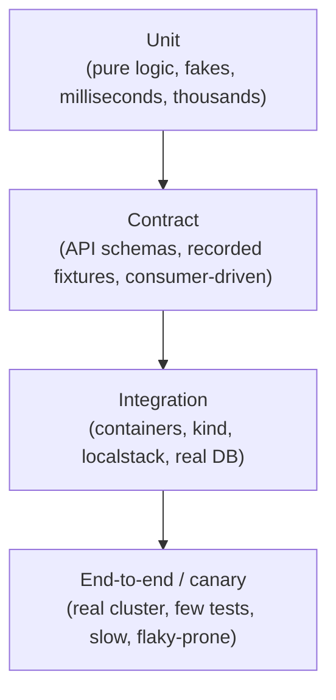
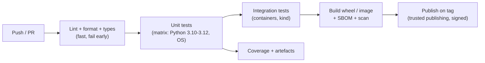

# 3.9 Testing, quality and CI for Python tooling

| | |
|---|---|
| Level | Intermediate |
| Priority tier | 0 |
| Lab venue | Python 3.11+, `pip install pytest pytest-cov pytest-mock hypothesis responses respx ruff mypy pre-commit` |
| Part | Part 3: Python for infrastructure |
| Status | Drafted, labs **untested** |

## Why this matters for AI infrastructure

A bug is hiding in the drain script that moves work off a GPU node. The same is true of an exporter, or of a provisioning helper. Tools like these change real machines, and one bad change can take down a GPU cluster worth millions. They often cannot be tested against production, so the bug has to be caught somewhere safer. Good engineering turns that risk into a fast feedback loop. Unit tests with fakes check the logic. Contract tests check the integration surfaces. Linters and type checkers catch whole bug classes before runtime, and CI refuses to merge anything that regresses. Interviewers for platform roles probe exactly this: "how do you test code that talks to hardware, Kubernetes or a cloud API?"

## Prerequisites and outcomes

This chapter builds on 3.1 to 3.8. By the end, you should be able to do the following:

- Structure a test suite with pytest. That covers discovery, fixtures, parametrisation, markers and configuration, and it lets you apply the test pyramid to infrastructure code.
- Isolate external dependencies with fakes, stubs, mocks, HTTP recorders and dependency injection, without letting state leak from one test into the next.
- Apply property-based testing, golden and snapshot tests, contract and integration tests with containers, and tests for CLIs, async code and subprocess wrappers.
- Enforce quality with ruff, formatters, mypy or pyright, coverage thresholds and security scanners.
- Build CI pipelines on GitHub Actions or GitLab CI, with matrices, caching, artefacts and release automation, and use pre-commit hooks along the way.
- Test the infrastructure itself: Ansible, Terraform and Kubernetes manifests, Helm charts, and GPU-dependent code that has to run without GPUs.

Treat this list as your checklist for the rest of the chapter.

## 1. Test strategy for infrastructure code

Start your test strategy with a question: what does this code meet in the wild? Infrastructure code mostly runs in degraded conditions. A node answers slowly, or answers halfway. The cases you will meet most often are timeouts, partial outputs, `[N/A]` fields, empty lists, 500s and permission errors. Your test strategy has to cover them, not only the happy path. The diagram shows the layers, from fast unit tests at the base to a few end-to-end tests at the top.



Read the diagram from the bottom up. Unit tests are the cheapest, so you will write thousands of them, and each one runs in milliseconds. End-to-end tests run against a real cluster, and there are only a few, because they are slow and prone to flakiness.

Push logic into pure functions such as parsers, rules and planners. A pure function turns its input into its output without touching the network, the clock or the filesystem. Then you can test most behaviour with plain inputs and outputs, and keep I/O at the edges. This is the "functional core, imperative shell" shape from 3.8.

Test the failure paths as carefully as the success paths. Every error handler deserves a test that triggers it. Keep tests deterministic and hermetic as well. Deterministic means the same run always gives the same result. Hermetic means the test does not depend on wall-clock time, random numbers, the network or test order. Inject clocks and random seeds, so you control those values yourself.

A GPU tool still needs tests on a machine with no GPU. Parse recorded `nvidia-smi` and `dcgmi` outputs, and simulate NVML with a fake module. Keep a small set of hardware-in-the-loop tests, marked `gpu`, that run only on labelled runners. Decide which tier a new test belongs to before you write it.

## 2. pytest essentials

Suppose you paste the same test four times, changing only the temperature in each copy. The example below shows the fix, and the notes after it explain each mechanism it uses.

```python
# tests/test_rules.py
import pytest
from fleetctl.rules import evaluate
from fleetctl.parsers import Gpu

def gpu(i=0, temp=60, ecc=0): return Gpu(i, "H100", temp, 10, 100, 80000, ecc)

def test_healthy_node():
    assert evaluate([gpu(i) for i in range(8)]) == []

def test_missing_gpu_reported():
    problems = evaluate([gpu(i) for i in range(7)])
    assert problems == ["expected 8 GPUs, found 7"]

@pytest.mark.parametrize("temp,bad", [(84, False), (85, False), (86, True), (None, False)])
def test_temperature_threshold(temp, bad):
    problems = evaluate([gpu(i, temp=temp) for i in range(8)])
    assert bool(problems) is bad

def test_raises_on_bad_input():
    with pytest.raises(ValueError, match="unexpected nvidia-smi columns"):
        parse_smi_csv("0,H100,60")
```

pytest finds tests by name. It picks up files named `test_*.py` or `*_test.py`, functions named `test_*`, and classes named `Test*` that have no `__init__`. You write plain `assert` statements, and pytest rewrites them so a failure shows a detailed diff. There is nothing to memorise here. The framework does the looking for you.

Parametrisation with `@pytest.mark.parametrize` replaces copy-pasted tests. The temperature check in the example above is one function covering four cases. Each row in the list becomes its own test case. Add `ids=` when you want readable names for the cases.

Fixtures provide setup, teardown and dependency injection. In plain words, a fixture is a named piece of preparation that pytest hands to your test. pytest matches a fixture to a test by parameter name: name an argument `env`, and a fixture called `env` arrives. The scopes are `function`, which is the default, then `class`, `module` and `session`. Use the narrowest scope you can afford. A `yield` fixture runs its teardown after the test, even when the test fails. A `conftest.py` file shares fixtures across a directory without imports. pytest also ships built-in fixtures such as `tmp_path`, `monkeypatch`, `capsys`, `capfd`, `caplog`, `request` and `tmp_path_factory`.

Markers label tests, for example `@pytest.mark.slow` and `@pytest.mark.gpu`. The built-in `skip`, `skipif` and `xfail(strict=True)` markers control what runs. Register your own markers in the configuration, then select tests with `-m "not slow"`. Put the configuration in `pyproject.toml`, as shown below.

```toml
[tool.pytest.ini_options]
minversion = "8.0"
addopts = "-ra --strict-markers --strict-config -q"
testpaths = ["tests"]
markers = ["slow: slow tests", "gpu: needs a real GPU", "integration: needs containers"]
filterwarnings = ["error"]            # warnings become failures: catches deprecations early
asyncio_mode = "auto"                 # with pytest-asyncio
```

Notice that `filterwarnings = ["error"]` turns warnings into failures, so deprecations surface early. The `asyncio_mode = "auto"` setting is for pytest-asyncio.

A few flags do most of the work when you run the suite. `-k expr` selects tests by name, and `-x` stops at the first failure. `--lf` and `--ff` rerun failures first. `--pdb` opens the debugger on failure. `-n auto` runs tests in parallel with pytest-xdist, and `--durations=10` lists the slowest tests. The list also includes `--maxfail`. Finally, pytest-randomly randomises test order to expose hidden coupling, and `-p no:randomly` turns that off.

### Fixtures that clean up and avoid leaked state

Fixtures are the usual way to keep one test from leaking state into the next. The example below shows three of them, each cleaning up after itself.

```python
# conftest.py
import pytest, os

@pytest.fixture
def env(monkeypatch):
    monkeypatch.setenv("FLEET_TOKEN", "test-token")          # undone automatically after the test
    monkeypatch.delenv("FLEET_CONFIG", raising=False)

@pytest.fixture
def workdir(tmp_path, monkeypatch):
    monkeypatch.chdir(tmp_path)
    return tmp_path

@pytest.fixture(scope="session")
def kind_cluster():
    name = create_kind_cluster()          # expensive, shared
    yield name
    delete_kind_cluster(name)             # teardown always runs
```

Each fixture undoes its own changes. `monkeypatch` reverts the environment variable and the working directory after the test. The `kind_cluster` fixture is expensive, so it is shared at session scope, and its teardown always runs.

The classic leak is quieter than a crash. A test mutates a module-level dict or a default argument, and a later test fails for a reason that looks unrelated. Avoid it with fixtures that build fresh objects, and use `monkeypatch` instead of assigning globals. Run pytest-randomly in CI to surface order dependence. Never share mutable state through a session-scoped fixture unless it is reset for each test.

## 3. Isolating dependencies: fakes, stubs and mocks

Suppose a test calls a real API. The test is slow, it depends on the network, and it can fail for reasons that have nothing to do with your code. Isolating the dependency fixes all three problems: the test talks to a stand-in instead. The words for the stand-ins are easy to mix up, so here they are in plain terms. A **stub** returns canned answers. A **fake** is a working, lightweight implementation, such as an in-memory repository. A **mock** records calls so you can assert on the interactions. A **spy** wraps the real thing. Prefer fakes and stubs over heavy mocking. Fakes and stubs let tests assert on outcomes, while mocks tend to assert on implementation, and those tests break whenever you refactor.

### Dependency injection beats patching

Give the code its collaborators as arguments, and the tests can swap them out. This habit is called dependency injection, and it is the gentlest way to test code with dependencies. The `Drainer` below takes its Kubernetes client, its clock and its sleep function from the caller.

```python
class Drainer:
    def __init__(self, kube, clock=time.monotonic, sleep=time.sleep):
        self.kube, self.clock, self.sleep = kube, clock, sleep

    def drain(self, node, timeout=600):
        self.kube.cordon(node)
        deadline = self.clock() + timeout
        while self.kube.pods_on(node):
            if self.clock() > deadline: raise TimeoutError(node)
            self.sleep(5)

class FakeKube:
    def __init__(self, pods_sequence): self.seq, self.cordoned = list(pods_sequence), []
    def cordon(self, n): self.cordoned.append(n)
    def pods_on(self, n): return self.seq.pop(0) if self.seq else []

def test_drain_waits_until_empty():
    t = iter(range(0, 1000, 5))
    d = Drainer(FakeKube([["a", "b"], ["b"], []]), clock=lambda: next(t), sleep=lambda s: None)
    d.drain("n1")                                    # runs instantly, no real sleeping
```

In the test, `FakeKube` returns pod lists from a fixed sequence, and the fake clock moves forward in steps of 5. The test runs instantly, because the injected sleep does nothing. Injecting the clock and sleep makes time-dependent logic testable without waiting.

### unittest.mock and pytest-mock

Sometimes you do need `mocker.patch`. The test below replaces `httpx` with a mock that fails once and then succeeds.

```python
def test_get_retries(mocker):
    m = mocker.patch("fleetctl.client.httpx.Client.get")
    m.side_effect = [httpx.ConnectError("boom"), make_response(200, {"ok": True})]
    assert get_json("/x") == {"ok": True}
    assert m.call_count == 2
```

Follow a few rules when you patch. Patch where the name is looked up, for example `fleetctl.client.httpx` rather than `httpx`. Use `autospec=True`, or `create_autospec`, so the mock carries the real signature and cannot silently accept wrong calls. Set `side_effect` to a list for a sequence of results, or to an exception class to simulate a failure. Keep mocks local to the test. Over-mocking is a smell: if a test needs ten patches, the code under test has too many collaborators.

### HTTP-level fakes

Rather than mocking `get`, intercept the traffic at the transport boundary, so the real client code still runs. The options include responses for `requests`, respx for `httpx`, aioresponses and pytest-aiohttp, and vcrpy or pytest-recording. The last two record real traffic once and replay it later. Scrub secrets from the cassettes, and re-record them periodically to detect drift.

```python
import respx, httpx
@respx.mock
def test_pagination_collects_all_pages():
    respx.get("https://api/x", params={"limit": 2}).respond(json={"items": [1, 2], "next_page_token": "t"})
    respx.get("https://api/x", params={"limit": 2, "page_token": "t"}).respond(json={"items": [3]})
    assert list(paginate("https://api/x", page_size=2)) == [1, 2, 3]
```

In this test, respx serves two pages. The client must follow the `next_page_token` to collect all three items.

### Subprocess, filesystem and environment

For subprocess code, test the parser with recorded output. Test the wrapper by patching `subprocess.run` so it returns `CompletedProcess(args, 0, stdout=..., stderr=...)`. Include `subprocess.TimeoutExpired` and non-zero exit cases. A tiny fake executable, written to `tmp_path` by the test and placed first in `PATH`, exercises the real `subprocess` path from start to finish.

For filesystem code, use `tmp_path`. For `/proc` and `/sys` readers, take the root as a parameter, such as `root=Path("/")`, and point it at a fixture tree. When necessary, pyfakefs can fake the whole filesystem. Never let a test read a real home directory. Set environment variables with `monkeypatch.setenv`. For time, inject clocks or use freezegun or time-machine. For randomness, seed explicitly or inject `random.Random(1)`.

### Async code

With pytest-asyncio, or the pytest plugin from anyio, mark tests as `async def`. Bound each test with `asyncio.wait_for`, and fake awaitables with `AsyncMock`. Test cancellation with `task.cancel()` and timeout behaviour explicitly. You can control time with a fake event loop clock, or by injecting sleep. Whenever a test would wait, inject the clock or sleep so it does not.

## 4. Beyond example-based tests

A parser you trust passes every example in its test file. Then someone feeds it an input with an empty field, and it dies. Example-based tests check the inputs you thought of. The tests in this section check more than that: they go looking for the inputs you missed.

### Property-based testing with Hypothesis

You state a property that must hold for all inputs, and Hypothesis searches for counterexamples. A property is a rule about behaviour, not one hand-picked example. When Hypothesis finds a counterexample, it shrinks the input to a minimal case, which is much easier to debug. This works well for parsers, serialisers, validators and arithmetic on units.

```python
from hypothesis import given, strategies as st

@given(st.lists(st.tuples(st.integers(0, 15), st.integers(0, 120)), max_size=16))
def test_render_then_parse_roundtrip(pairs):
    gpus = [Gpu(i, "H100", t, None, None, None, None) for i, t in pairs]
    assert parse_smi_csv(render_csv(gpus)) == gpus

@given(st.text())
def test_parser_never_crashes_with_unexpected_exception(s):
    try: parse_smi_csv(s)
    except ValueError: pass                     # only the documented exception is allowed
```

Common properties include round-trip, which encodes and then decodes, and idempotence, written `normalize(normalize(x)) == normalize(x)`. Invariants are a third kind: a preserved sum, or an order that does not matter. You can also compare against a slow reference, or check that the code never raises anything except a specific exception. Hypothesis stores failing examples in a database, so the regressions are replayed on later runs.

### Golden files and snapshot tests

Tools that render text need a different kind of test. Config generators, Jinja templates, tabular output and Kubernetes manifests all produce text, and there is no single input to argue about. Compare that output with a reviewed expected file, using syrupy, pytest-regressions or your own helper. Updating the snapshot is a deliberate, reviewed act, run with `--snapshot-update`. Keep snapshots small and meaningful, because large ones invite reviewers to approve diffs without reading them.

### Contract tests

Services and their clients drift apart over time, quietly. A contract test pins that drift in place. Validate payloads against the provider's OpenAPI or JSON Schema in your tests, using schemathesis, jsonschema or openapi-core. Consumer-driven contract tools such as pact help as well. You can also refresh recorded real responses on a schedule, or share pydantic models between producer and consumer. For Redfish or vendor APIs, keep sanitised real payloads from each platform as fixtures. The vendor differences from 3.8 then become regression tests.

### Integration tests with real dependencies

Run real PostgreSQL, Redis, Prometheus, Kafka or an S3 stand-in in containers. You can use testcontainers-python or docker-compose for this. Mark these tests `integration`, and run them in CI. For Kubernetes, use kind or k3d clusters, created and deleted by a pytest fixture as shown earlier. You can also use envtest-style API servers. pytest-kind and the Kubernetes client wrappers exist for this job. Keep each test independent, with unique namespaces or names and cleanup in teardown. Use generous but bounded waits. Poll with tenacity, and never `sleep(30)`.

### Testing CLIs

The `CliRunner` from Click runs a command in-process and returns its exit code and output, so one test can check both.

```python
from click.testing import CliRunner
def test_status_json(monkeypatch):
    monkeypatch.setattr("fleetctl.cli.query_host", lambda h, c: {"host": h, "gpus": 8, "state": "ok"})
    r = CliRunner().invoke(cli, ["--output", "json", "status", "h1", "h2"])
    assert r.exit_code == 0
    assert json.loads(r.output)[0]["host"] == "h1"

def test_usage_error_exit_code():
    assert CliRunner().invoke(cli, ["drain"]).exit_code == 2
```

For argparse tools, call `main([...])` and use `capsys`. For end-to-end behaviour, run `subprocess.run([sys.executable, "-m", "fleetctl", ...])` in a few smoke tests.

### Mutation testing and test quality

Coverage tells you which lines ran, not whether your assertions are meaningful. Mutation testing with mutmut or cosmic-ray changes the code, for example by flipping `>` to `>=` or by removing a branch, and then checks that the tests fail. Each changed copy is called a mutant. A mutant that survives points to a weak test. Use mutation testing on the critical core, such as parsers, rules and planners, rather than the whole repository.

### Flaky tests

A flaky test is a defect, not a nuisance. Treat it that way. The usual causes are shared state, test ordering, real time, real network, resource contention and race conditions. Quarantine a flaky test with a marker and an issue. Do not silently retry everything with pytest-rerunfailures. To reproduce a flake, use `-p randomly` seeds, `pytest --count` loops or pytest-xdist stress runs. Then fix the root cause, and fail the build on any new flake.

## 5. Static quality gates

Picture the review comment that keeps repeating itself: a security smell on one pull request, a formatting argument on the next. Static gates catch problems before any test runs. Each tool reads the code and reports what it finds, so whole classes of bugs die before the tests even start. The table below lists the tools, what each one checks and what to remember about it.

| Tool | Purpose | Notes |
|---|---|---|
| **ruff** | Linter and import sorter (replaces flake8, isort, pyupgrade, many plugins); `ruff format` is a Black-compatible formatter | Very fast; configure rule sets in `pyproject.toml` |
| **black** / `ruff format` | Uniform formatting; ends style debates | One tool, not both |
| **mypy** / **pyright** | Static type checking | Start lenient on legacy code, strict on new modules; gradual typing (3.4) |
| **bandit**, `ruff -S` rules | Security smells (`shell=True`, `yaml.load`, hard-coded passwords, `assert` in prod) | Review findings; tune false positives |
| **pip-audit**, `safety`, Dependabot/Renovate | Vulnerable dependencies | Run in CI and on a schedule |
| **vulture**, `ruff` unused rules | Dead code | |
| **radon**, `ruff C901` | Complexity limits | |
| **coverage.py** / `pytest-cov` | Line and branch coverage | Gate on branch coverage for the core and on diff coverage for PRs rather than one global magic number |
| **pre-commit** | Runs hooks on staged files before commit | Same hooks in CI to prevent bypass |
| **codespell**, `yamllint`, `shellcheck`, `hadolint`, `actionlint` | Prose, YAML, shell, Dockerfile, workflow linting | Infrastructure repos are mixed-language |

Notice that black and `ruff format` do the same job, so use only one of them. Before you add another tool, check whether an existing one already covers the new check. Configure ruff, mypy and coverage in `pyproject.toml`, as shown below.

```toml
[tool.ruff]
line-length = 100
target-version = "py311"
[tool.ruff.lint]
select = ["E", "F", "I", "B", "UP", "S", "C4", "SIM", "PT", "RUF", "ASYNC", "T20"]   # pycodestyle, pyflakes, isort, bugbear, upgrade, bandit, ...
ignore = ["S101"]                      # asserts allowed in tests (use per-file-ignores for tests)
[tool.ruff.lint.per-file-ignores]
"tests/**" = ["S", "T20"]

[tool.mypy]
python_version = "3.11"
strict = true
warn_unused_ignores = true
exclude = ["build/"]

[tool.coverage.run]
branch = true
source = ["fleetctl"]
[tool.coverage.report]
fail_under = 85
show_missing = true
exclude_also = ["if TYPE_CHECKING:", "raise NotImplementedError", "if __name__ == .__main__.:"]
```

The pre-commit configuration runs these checks on staged files before each commit. Run the same hooks in CI, so nobody can bypass them.

```yaml
# .pre-commit-config.yaml
repos:
- repo: https://github.com/astral-sh/ruff-pre-commit
  rev: v0.6.9              # pin a reviewed version
  hooks:
  - id: ruff
    args: [--fix]
  - id: ruff-format
- repo: https://github.com/pre-commit/mirrors-mypy
  rev: v1.11.2
  hooks: [ { id: mypy, additional_dependencies: [types-PyYAML] } ]
- repo: https://github.com/pre-commit/pre-commit-hooks
  rev: v4.6.0
  hooks: [ { id: check-yaml }, { id: end-of-file-fixer }, { id: trailing-whitespace }, { id: detect-private-key } ]
```

The tool versions above are examples. Pin the versions you have reviewed.

For typing, annotate public functions. Use `Protocol` for injected collaborators, so that your fakes type-check. Use `TypedDict`, dataclasses or pydantic for payloads, and avoid `Any` creep. Run the type checker in CI as a required check, so it is not only an editor feature.

## 6. Continuous integration

Here is how a weak pipeline hurts. A broken commit merges on Friday, and Monday's release pays for it. The bug was ordinary, and a five-minute test would have caught it. A pipeline that is slow, or that lets a broken commit merge, wastes everyone's time. The aim is to fail fast and let only good code through. The diagram shows the stages of a typical pipeline, from a push to a published package.

### Pipeline architecture



Order the jobs from cheap to expensive. Run independent jobs in parallel, and cache dependencies. Make the required checks branch-protected, so nothing merges while it is red.

### GitHub Actions example

The workflow below follows that shape, from lint through to publish.

```yaml
name: ci
on:
  pull_request:
  push: { branches: [main], tags: ["v*"] }
permissions: { contents: read }
concurrency: { group: ci-${{ github.ref }}, cancel-in-progress: true }

jobs:
  lint:
    runs-on: ubuntu-latest
    steps:
    - uses: actions/checkout@v4
    - uses: actions/setup-python@v5
      with: { python-version: "3.12", cache: pip }
    - run: pip install ruff mypy -e .[dev]
    - run: ruff check . && ruff format --check .
    - run: mypy src

  test:
    needs: lint
    strategy:
      fail-fast: false
      matrix: { python: ["3.10", "3.11", "3.12"], os: [ubuntu-latest, macos-latest] }
    runs-on: ${{ matrix.os }}
    steps:
    - uses: actions/checkout@v4
    - uses: actions/setup-python@v5
      with: { python-version: "${{ matrix.python }}", cache: pip }
    - run: pip install -e .[dev]
    - run: pytest -m "not integration and not gpu" --cov --cov-report=xml
    - uses: actions/upload-artifact@v4
      if: always()
      with: { name: "coverage-${{ matrix.os }}-${{ matrix.python }}", path: coverage.xml }

  integration:
    needs: test
    runs-on: ubuntu-latest
    steps:
    - uses: actions/checkout@v4
    - uses: actions/setup-python@v5
      with: { python-version: "3.12", cache: pip }
    - run: pip install -e .[dev]
    - run: pytest -m integration

  build:
    needs: [test]
    runs-on: ubuntu-latest
    steps:
    - uses: actions/checkout@v4
    - run: pipx run build
    - uses: actions/upload-artifact@v4
      with: { name: dist, path: dist/ }

  publish:
    if: startsWith(github.ref, 'refs/tags/v')
    needs: [build, integration]
    runs-on: ubuntu-latest
    environment: release
    permissions: { id-token: write }          # trusted publishing: no long-lived tokens
    steps:
    - uses: actions/download-artifact@v4
      with: { name: dist, path: dist/ }
    - uses: pypa/gh-action-pypi-publish@release/v1
```

The action versions above are examples. Pin them to reviewed versions or commit SHAs.

Start with least privilege. That phrase means the workflow gets only the permissions it needs, and nothing more. Set `permissions:` to the minimum the workflow needs, and pin third-party actions by SHA. Never echo secrets. Treat pull requests from forks as untrusted, so they receive no secrets. Use `pull_request_target` only with great care.

Reproducibility matters just as much. Use lock files, pinned base images, `--require-hashes` and hermetic builds, and record tool versions in the logs. GPU tests need self-hosted runners. Label those runners `gpu`, use ephemeral or containerised jobs, limit who can trigger them, and clean up state between jobs. NVIDIA publishes GPU-enabled container images and the container toolkit for this purpose.

Cache dependencies and test data, keyed on lock file hashes. Upload artefacts such as coverage files, JUnit XML test reports and logs from failures. Use a matrix over the Python versions you support and the operating systems you deploy on. Add a minimum-dependency run with `uv pip install --resolution lowest-direct`, which validates the lower bounds.

Test the packaging as well. Install the built wheel into a clean venv and run a smoke test. That catches missing package data and wrong entry points. For releases, cut a tag, and build the changelog from conventional commits. Take the version from the git tag with `hatch-vcs` or `setuptools-scm`. Sign the artefacts, add provenance attestations and an SBOM, and protect the `environment` so that publishing needs approval.

Finally, schedule nightly runs. A nightly job can cover the full suite with random seeds, a dependency audit, and the slow and integration tiers. Notify people on failure, and track flakiness over time.

GitLab CI has the same ideas under different keywords: stages, `needs`, `cache`, `artifacts:reports:junit`, `rules:` and runner tags. Jenkins pipelines serve legacy shops. If your repository is on GitLab, map each job above onto those keywords before you port the pipeline.

## 7. Testing the infrastructure code around Python

Many repositories mix Python with declarative infrastructure, and those layers need tests too. A green Python suite says nothing about the playbooks, the manifests or the templates beside it. When you work in such a repository, you test those layers with their own tools. Start with Ansible. This material comes from *Ansible: Up and Running*, chapter 14, *Quality Assurance with Molecule*. Run `yamllint .` and `ansible-lint`, plus `ansible-later` configured through `.later.yml`. Then run `ansible-playbook --syntax-check`, and `--check --diff` against a staging host.

For full role lifecycle testing, use Molecule. Create a scenario with `molecule init scenario -r ssh --driver-name docker`. Then run `molecule create`, `molecule converge`, `molecule idempotence`, `molecule verify` and `molecule destroy`. Molecule works across Docker, Podman, Vagrant or VirtualBox, and cloud drivers. Pair it with Testinfra, which checks the real state of the host. A Testinfra check starts with `testinfra.utils.ansible_runner.AnsibleRunner(os.environ['MOLECULE_INVENTORY_FILE']).get_hosts('all')`. It then asserts on `host.package("openssh-server").is_installed`, `host.service("sshd").is_running`, `host.file("/etc/ssh/ssh_host_ed25519_key.pub").mode == 0o644` and `host.user("sshd").exists`. The file `code/part03/python_testing_quality_ci.py` models these checks. You can also use Goss, with `goss -g test_sshd.yml validate`.

The architecture side comes from *Engineering AI Systems*, chapter 2. Len Bass and his co-authors trace how modern AI platforms combine virtual machines and containers. They use dynamic service discovery rather than static DNS. They also trace the move from Client-Server and Service-Oriented Architecture (SOA) to Microservices. Amazon's 2002 API mandate required teams to communicate exclusively through networked service interfaces. There were no shared-memory backdoors and no direct cross-team database reads. The book also compares interface styles. REST over HTTP/1.1 suits general resource CRUD and ad-hoc dataset retrieval. GraphQL suits bandwidth-constrained edge clients that query only the specific fields they need.

For DevOps and Infrastructure as Code, provisioning scripts and playbooks must be idempotent. Running a script twice should produce exactly the same target state, with no errors. MLOps extends the DevOps loop of design, code, build, test, deploy and monitor. It adds data pipelines, model training and retraining, and continuous model evaluation. The additions guard against data drift and against non-deterministic training regressions.

Benchmarking comes from *Learning Python*, chapter 21, *The Benchmarking Interlude*. When you optimise a parser or a data pipeline, measure instead of guessing. Measure across the Python versions you target, such as CPython and PyPy. The timing helpers in `timer.py` and `timer2.py` are modeled in `code/part03/python_testing_quality_ci.py`. Using `time.perf_counter()`, `once(func, *pargs, **kargs)` times a single call. `total(func, *pargs, _reps=1000, **kargs)` sums `_reps` calls. `bestof(func, *pargs, _reps=5, **kargs)` takes `min(once(...) for i in range(_reps))`. Python compares tuples from left to right, so comparing `(elapsed, result)` pairs picks the lowest time. Finally, `bestoftotal(func, *pargs, _reps1=50, _reps=1000, **kargs)` computes the minimum across `_reps1` totals of `_reps` calls each.

Take the minimum rather than the average. Background interrupts and context switches can only inflate a run's elapsed time. The minimum therefore shows the code's true speed, free of system noise.

Next, compare the five iteration alternatives. `timer_tests.py` runs them on `range(10_000)`. When you apply a built-in C function such as `abs(x)`, `list(map(abs, repslist))` takes `0.144s`. It beats `[abs(x) for x in repslist]`, which takes `0.208s`. A `for` loop that calls `res.append(abs(x))` takes `0.260s`. The generator forms are slower. `list(abs(x) for x in repslist)` takes `0.411s`, and `list(gen())` takes `0.412s`. Forcing a generator into a list all at once adds overhead on every item.

The order changes once the operation needs a user-defined expression. In `timer_tests2.py`, the expression `x + 10` runs as `[x + 10 for x in repslist]` in `0.244s`. A `for` loop takes `0.287s`. Both beat `list(map(lambda x: x + 10, repslist))`, which takes `0.496s`. Calling a Python `lambda` 10,000 times adds function-call frame overhead.

The standard-library `timeit` module and `pybench.py` also help you. You can use `timeit` from the shell, or call it from your own code. Run `python3 -m timeit -n 1000 -r 5 -s "L = list(range(1000))" "[x ** 2 for x in L]"`, or call `min(timeit.repeat(stmt=..., setup=..., number=1000, repeat=5))`. The `-s` option keeps one-time setup code out of the timed loop. By default, `timeit` disables garbage collection while it times. Calling `gc.enable()` inside `setup` turns it back on.

Terraform and OpenTofu need `fmt -check`, `validate` and `tflint`. Add policy checks with OPA and Conftest, Checkov or tfsec. Run `plan` in CI, with its output reviewed. For module tests against ephemeral environments, use Terratest in Go, or `terraform test`.

For Kubernetes manifests and Helm, validate the manifests against schemas with `kubeconform` or `kubeval`. Run `helm lint`, and pipe `helm template` into `kubeconform`. Add `kube-linter` and `conftest` policies, plus `kind` smoke deploys. For declarative operator tests, use `chainsaw` or `kuttl`.

Lint Dockerfiles with `hadolint`. Scan images with `trivy` or `grype`, and use `container-structure-test` to check their structure. For shell scripts, use `shellcheck`, `shfmt` and `bats`.

Jinja templates for network configs need a check of their own. Render them with representative variables, and diff the result against golden files. Then validate the output with the target's parser, such as `nft -c -f` for nftables, or FRR `vtysh --dryrun` style checks. Finally, validate configs with pydantic or JSON Schema in CI, so malformed YAML never reaches production. Pick the checker for each file type, and make it a required CI step.

## 8. Observability of the tests themselves

Test suites need monitoring too, and you should keep an eye on them. A suite that nobody watches creeps. Track how long the tests take over time, how often they flake, and how much of the changed code they cover, using diff-cover. Track time-to-green as well. Fail slow tests loudly with `--durations`, and parallelise with xdist when isolation allows it. Keep the pipeline under about ten minutes for PR feedback, or split and shard it. Keep logs and JUnit reports as artefacts, and print reproduction commands for failing tests, including seed values and `pytest -k` hints.

## 9. Lab

Start with the self-checking Python lab, which runs on your own machine, no cluster needed. It verifies `timer_once`, `timer_total`, `timer_bestof` and `timer_bestoftotal`, as well as the 5 iteration alternatives (`forLoop`, `listComp`, `mapCall`, `genExpr` and `genFunc`) from *Learning Python*, chapter 21. It also checks the dependency-injected `Drainer` and `FakeKube`. Those tests cover pod evacuation success and `TimeoutError`, and they run in milliseconds without a real `time.sleep`. Last, the lab checks the Testinfra host assertions from *Ansible: Up and Running*, chapter 14, in `verify_sshd_host`.

```bash
python3 code/part03/python_testing_quality_ci_lab.py
```

Next, move to any machine with Python 3.11 or later. You can work through these on your own machine. All the interactive shell steps below have not been run on live hardware. Work through these exercises in order, since later ones reuse code from earlier ones.

1. Take the parser and rules module from 3.8, and write parametrised tests for it. Include `[N/A]` fields, wrong column counts and empty output. Aim for 100% branch coverage on the core, and run `pytest -q --cov --cov-branch`.
2. Implement the `Drainer` with an injected clock and sleep, and add a `FakeKube`. Test the timeout and success paths without any real sleeping. Then rewrite the tests with `mocker.patch`, and compare how readable and how fragile each version is.
3. Test the resilient client with respx or responses. Check that it retries on 503 and does not retry on 404. Check that it honours `Retry-After`, collects every page of results, and handles timeouts. Add a recorded-cassette test, and scrub the secrets from it.
4. Write round-trip and "only documented exceptions" properties for the parser. Then introduce a bug, and watch shrinking produce a minimal counterexample.
5. Reproduce a test-order bug caused by mutating a module-level dict. Find it with pytest-randomly, then fix it with fixtures and `monkeypatch`.
6. Write `CliRunner` tests for exit codes 0, 1, 2, 3 and 4. Check that JSON output on stdout is pure, and that `--dry-run` does not mutate anything. Add a subprocess smoke test of the installed entry point.
7. Test an asyncio fan-out that uses a semaphore and injected failures. Then test cancellation and timeout behaviour.
8. Configure ruff, mypy in strict mode for new code, the coverage `fail_under` threshold, and bandit rules. Fix the findings they report. Add pre-commit, then check that it blocks a commit containing `yaml.load` or `shell=True`.
9. Create the GitHub Actions workflow from above in a throwaway repo. Add the matrix, caching and artefact upload, and make lint a required check. Break a test, and watch the merge get blocked. Add a wheel smoke-install job.
10. Use testcontainers to run Prometheus or PostgreSQL. Test the exporter end to end by scraping it. Use kind for a Kubernetes client test with unique namespaces.
11. Run mutmut on the rules module. Strengthen the tests until the important mutants die.
12. Add `ansible-lint`, `kubeconform`, `hadolint` and `shellcheck` jobs for a sample repo.
13. Clean up.

## 10. Common mistakes

Read this list before your next pull request, because these traps catch everyone. Many of these mistakes come from tests that reach into the outside world. Tests that call real networks, clocks or hardware are slow and unreliable, and so are tests that depend on execution order or leak global state. A `sleep(10)` has the same problem, so poll with a timeout or use an injected clock instead. If you see a test that behaves differently on one machine than on another, check this group first.

Mocking goes wrong in two ways. Over-mocking asserts on call internals, so a refactor breaks tests even though nothing changed in behaviour. Patching the wrong import path, or leaving out `autospec`, lets a mock silently accept bad calls.

Coverage and flakiness need care too. Chasing a global coverage percentage while asserting nothing is a trap, and so is ignoring branch coverage and error paths. Retrying flaky tests blindly hides the root cause, so fix the cause. Treat warnings as signal, or deprecations pile up until an upgrade breaks everything.

CI has traps of its own. A pipeline that runs only on the main branch, or whose checks are not required, lets problems through. Unpinned actions and dependencies are a risk, and so are secrets exposed to fork PRs. Mixing black and ruff format creates churn, and type checking only in your editor misses what CI would catch.

Two more mistakes break the contracts that other tools rely on. A CLI with no tests for exit codes, or for the split between stdout and stderr, can break automation without anyone noticing. Recorded fixtures that are never refreshed let tests pass against an API that no longer exists.

## 11. Interview angles

Interviewers often ask how you would test code that depends on hardware or a platform. A good answer starts with a pure core. It then uses recorded payloads and fakes at the boundaries, adds containers or kind for integration, and keeps a small hardware tier on labelled runners.

"How do you test code that talks to GPUs, Kubernetes or a BMC?" Answer with the layered approach above.

"What makes a test flaky and how do you handle it?"

"Mock versus fake versus stub?"

"How do you test a retry/backoff client without waiting?" Inject the clock and sleep, or fake the transport. Then assert on call counts and delays.

"Design a CI pipeline for an internal CLI." Start with lint, types and a test matrix, then build, run a wheel smoke test, and finish with a tag-driven publish using trusted publishing.

"What is property-based testing and where did it help?"

"How do you keep a CI pipeline fast and trustworthy?" Order the jobs cheap-first, cache, run in parallel, shard, eliminate flakes and make the checks required.

"How would you gate a Terraform or Ansible change?" Combine lint, a review of the plan or check-mode output, policy checks and tests in an ephemeral environment.

## Exercises

1. Apply the test pyramid to GPU fleet tooling, from unit, to contract, to integration, to end-to-end. Assume no physical GPU is attached to the CI runner, and explain how each layer still works. The sources for this exercise are *Building Python Web APIs with FastAPI*, chapter 8, and `volume-02`. Then write a `@pytest.mark.parametrize` test and a `yield` fixture in `conftest.py`, using the built-in `tmp_path` where you need a directory. Explain how `monkeypatch.setenv` and pytest-randomly prevent state from leaking between tests.
2. Use `Drainer` and `FakeKube` from `code/part03/python_testing_quality_ci.py`. First, explain why injecting `kube`, `clock` and `sleep` lets `test_drain_waits_until_empty` cover a 600-second timeout loop in 1 millisecond, with no fragility from `unittest.mock.patch`. Second, explain when you must use `mocker.patch`. You must patch where the symbol is looked up, such as `fleetctl.client.httpx`, and pass `autospec=True`. The other option is to intercept at the HTTP transport layer with respx.
3. Cover golden snapshots and contract testing with schemathesis, then mutation testing with mutmut. First, explain how `@given(...)` property-based testing, with input shrinking, finds edge cases in `parse_smi_csv` that example-based tests miss. Second, contrast line coverage, branch coverage (`branch = true`) and mutation testing (`mutmut`). Explain which of these tells you whether a suite actually catches regressions.
4. Cover static quality gates (ruff, mypy --strict, bandit, pip-audit, pre-commit) and GitHub Actions hardening. First, explain what ruff enforces with the rule sets `E`, `F`, `I`, `B`, `UP`, `S` and `ASYNC`. Explain what mypy --strict enforces, and what coverage enforces with `fail_under = 85` and `branch = true`, all in `pyproject.toml`. Second, trace the 5-stage GitHub Actions pipeline: lint, then the test matrix, then integration, then build wheel, then OIDC trusted publish. Explain `permissions: { contents: read }` and `id-token: write`, and why fork PRs must never receive repository secrets.
5. Use `timer.py` and `timeit` to compare the code. Work with `timer_once()`, `timer_total()`, `timer_bestof()`, `timer_bestoftotal()` and `run_five_iteration_alternatives()` in `code/part03/python_testing_quality_ci.py`. First, explain why `bestoftotal` takes the `min()` across repeated runs rather than the mean. Second, explain why `map(abs, repslist)` beats `[abs(x) for x in repslist]` on a built-in C function. Then explain why `[x + 10 for x in repslist]` beats `map(lambda x: x + 10, repslist)` when a `lambda` is required.
6. Use `verify_sshd_host()` and `FakeTestinfraHost` in `code/part03/python_testing_quality_ci.py`. First, explain the Molecule test sequence, `create -> converge -> idempotence -> verify -> destroy`, and how Testinfra checks package, service, file mode and user state on provisioned instances. The sources are *Ansible: Up and Running*, chapter 14, and *Engineering AI Systems*, chapter 2. Second, explain how microservices, with Amazon's API mandate and REST versus GraphQL, and MLOps extend the traditional DevOps continuous testing loops.

## Checkpoint questions (20)

<details>
<summary>1. How does the Test Pyramid apply to GPU and cluster infrastructure code, and how do you test GPU tooling on CI runners that have no physical GPUs?</summary>

Think of the pyramid as three bands. The base holds thousands of millisecond unit tests against the pure functional core, such as `parsers.py`, `rules.py`, and planners that use injected fakes. The middle holds dozens of contract and integration tests, using `schemathesis`, `respx`, `testcontainers` and `kind`. The top holds a handful of end-to-end canary tests on real hardware.

Without GPUs, feed recorded `nvidia-smi --query-gpu=... --format=csv` and `dcgmi` payloads into the pure parsers. Those payloads should include `[N/A]` fields, thermal throttling, XID errors and missing GPUs. Mock `pynvml` at the adapter boundary. Mark the hardware-in-the-loop tests with `@pytest.mark.gpu`. Standard cloud runners run `pytest -m "not gpu"`, and only labelled self-hosted GPU runners run `-m gpu`.
</details>

<details>
<summary>2. How do `pytest` fixtures (`conftest.py`, `yield`, scopes) and built-in fixtures (`tmp_path`, `monkeypatch`, `capsys`, `caplog`) prevent leaked test state (*Building Python Web APIs with FastAPI*, chapter 8)?</summary>

pytest injects a fixture into a test by matching the test's parameter name to a `@pytest.fixture` definition. Those definitions can live in the test module or in `conftest.py`, and each has a scope: `function`, `class`, `module` or `session`. In a `yield` fixture, the code before `yield val` sets up the resource. The code after `yield` runs as teardown, even if the test fails.

`monkeypatch` provides `setenv`, `delenv`, `setattr` and `chdir`. It restores every environment variable, attribute and working directory after each test. `tmp_path` gives each test its own isolated temporary `pathlib.Path` directory. To expose any test that changes shared module-level state, run CI with `pytest-randomly`, which randomises the test order.
</details>

<details>
<summary>3. Distinguish a Stub, a Fake, a Spy, and a Mock, and explain why Dependency Injection (`Drainer` + `FakeKube`) beats heavy `unittest.mock.patch` usage.</summary>

A stub returns canned responses, such as a lambda that always returns 200. A fake is a working, lightweight in-memory implementation, such as `FakeKube`, an SQLite `:memory:` database, or `MockRedfishTransport`. A spy wraps a real object and records its calls. A mock is pre-programmed. It records call arguments and counts, and it asserts on the choreography of interactions.

Injecting collaborators, as in `Drainer(kube, clock=..., sleep=...)`, lets you test observable behaviour and state. Pair it with `FakeKube` and an iterator clock, and the test runs in microseconds. Patching ten internal functions instead couples the tests to implementation details, and they break on every refactor.
</details>

<details>
<summary>4. When you do use `unittest.mock.patch` / `mocker.patch`, why must you patch where a name is looked up and enable `autospec=True`?</summary>

Patch where the name is looked up. If `fleetctl/client.py` runs `from httpx import Client`, then patching `"httpx.Client"` changes the `httpx` module attribute after `client.py` has already bound its own reference. You must patch `"fleetctl.client.Client"` instead, because that is where the module under test looks the name up.

Enable `autospec=True` as well. A default `MagicMock` accepts any method name and any argument signature. If you rename a parameter on the real function, or misspell `mock.assret_called_once()`, the test still passes silently. `autospec=True`, or `create_autospec`, enforces the exact signature of the target.
</details>

<details>
<summary>5. Why is intercepting HTTP calls at the transport layer (`respx`, `responses`, `vcrpy`) better than mocking `client.get`?</summary>

When you mock `client.get`, the test skips URL construction, query-parameter serialisation, header injection, timeout configuration and `raise_for_status()` handling inside your client method. Transport-level interceptors close that gap. `@respx.mock` works for `httpx`, and `responses` works for `requests`. Your real `httpx.Client` code still serialises the request and parses the response. The interceptor sits at the bottom, where the network socket would be.
</details>

<details>
<summary>6. How does Property-Based Testing (`Hypothesis`) with shrinking work, and what are four classic properties to test?</summary>

Instead of testing 3 hardcoded examples, `@given(st.lists(...))` generates hundreds of randomised inputs. These include edge cases such as empty strings, negative integers, Unicode and boundary values. It checks that a general invariant holds for all of them. When Hypothesis finds a failing input, it shrinks that input to the smallest, simplest counterexample that still triggers the bug. It saves that example in `.hypothesis/`, so the regression is replayed later. The four classic properties are these.

1. Round-trip: `parse_smi_csv(render_csv(gpus)) == gpus`.
2. Idempotence: `normalize(normalize(x)) == normalize(x)`.
3. Structural invariants, such as output length, sorting or sum conservation.
4. Total parser safety: arbitrary `st.text()` raises only the documented `ValueError`, never an unhandled `IndexError` or `KeyError`.
</details>

<details>
<summary>7. Contrast Line Coverage, Branch Coverage (`branch = true`), Diff Coverage, and Mutation Testing (`mutmut`).</summary>

Line coverage only measures whether each line ran during the tests. A test with zero assertions can still reach 100% line coverage. Branch coverage, set with `branch = true`, checks that every `if` and `else` condition evaluated to both `True` and `False`. Diff coverage, from `diff-cover`, enforces high coverage, such as 90% or more, only on the lines a pull request adds or changes.

Mutation testing with `mutmut` rewrites the source code's AST. It might change `>` to `>=`, change `+` to `-`, or delete a statement, and then it runs the tests. If the tests still pass, the surviving mutant shows that your assertions are too weak to catch a real bug on that line.
</details>

<details>
<summary>8. How do you test Click and `argparse` CLIs for exit codes, `stdout`/`stderr` separation, and packaging integrity?</summary>

First, write in-process unit tests. Call `CliRunner().invoke(cli, ["--output", "json", "status", "h1"])`, or call `main(["status", "h1"])` with `capsys` for argparse. Assert that `r.exit_code == 0`, that `json.loads(r.stdout)` parses cleanly, and that diagnostic logs appeared only on `r.stderr`.

Second, add a subprocess and wheel smoke test. In CI, build the wheel with `python -m build`, install it into a fresh virtualenv, and run the console script with `fleetctl --version` and `fleetctl --help` through `subprocess.run`. That proves the `[project.scripts]` entry points and package data in `pyproject.toml` are not missing.
</details>

<details>
<summary>9. What causes flaky tests in infrastructure repositories, and what is the right engineering policy for handling them?</summary>

Flaky tests usually come from one of five causes. Leaked global or module state between tests is the first. Reliance on wall-clock sleeps, such as `time.sleep(5)`, instead of deterministic clock injection or bounded polling is the second. Live network calls are the third. Port or namespace collisions in parallel runs are the fourth, and concurrency data races are the fifth.

Do not mask flakes with blind retries from `pytest-rerunfailures` across the whole suite. Reproduce them with `pytest-randomly --randomly-seed=<seed>` and `pytest --count=100 -n auto`. Quarantine a flaky test only with a tracked issue, and then fix the underlying determinism bug.
</details>

<details>
<summary>10. What roles do `ruff`, `mypy`, `bandit`, `pip-audit`, and `pre-commit` play in a Python quality gate?</summary>

`ruff` is a fast, Rust-based linter. It replaces flake8, isort, pyupgrade and plugins such as flake8-bugbear (`B`), flake8-bandit (`S`) and pytest-style (`PT`). It also covers `ASYNC`, and `ruff format --check` gives you Black-compatible formatting. `mypy --strict`, or `pyright`, is the static type checker. It catches `None` dereferences, wrong argument types and missing `await`s before the code runs.

`bandit`, or `ruff -S`, flags unsafe calls such as `subprocess(..., shell=True)`, `yaml.load()`, hardcoded secrets and `mktemp`. `pip-audit` checks your locked dependencies against the PyPA Advisory Database for known CVEs. `pre-commit` runs these hooks on staged files before `git commit`. It runs the same hooks in CI, so broken commits never reach the branch.
</details>

<details>
<summary>11. How should a GitHub Actions CI pipeline be structured and hardened for a Python infrastructure project?</summary>

Start with fast feedback. Run `lint` first, with `ruff check`, `ruff format --check` and `mypy`, because it finishes in seconds. Fan `test` out across a Python version and OS `matrix`, such as `3.10`, `3.11` and `3.12`, with `fail-fast: false`. Then run the container-backed `integration` tests and the wheel `build` smoke tests. Gate `publish` on version tags, `refs/tags/v*`.

For hardening, set the minimal `permissions: { contents: read }`. Pin third-party actions to reviewed versions or commit SHAs, and use `concurrency: { cancel-in-progress: true }`. Never expose secrets to untrusted fork PRs. Publish wheels to PyPI with OIDC Trusted Publishing, using `permissions: { id-token: write }`, instead of long-lived API tokens.
</details>

<details>
<summary>12. In *Learning Python* Chapter 21 (`timer.py` and `timeit`), why do we take the `min()` of repeated benchmark runs rather than the average, and why use `time.perf_counter()`?</summary>

On a multitasking OS, a program never runs faster than its pure instruction cost. Scheduler interrupts, page faults and background daemons can only slow individual runs down. So the variation is one-sided noise. The minimum elapsed time across repeated runs, from `bestof`, `bestoftotal` or `min(timeit.repeat(...))`, is the most accurate measure of the code's real cost.

Use `time.perf_counter()` because it is the highest-resolution monotonic timer the platform provides.
</details>

<details>
<summary>13. In *Learning Python* Chapter 21's 5 iteration benchmarks (`forLoop`, `listComp`, `mapCall`, `genExpr`, `genFunc`), when does `map` beat a list comprehension, and when does a list comprehension beat `map`?</summary>

When you apply an existing built-in C function, such as `abs(x)` or `ord(x)` in `timer_tests.py`, `list(map(abs, repslist))` is fastest at `0.144s`. `map` calls the C function directly inside CPython's C loop. The list comprehension, `[abs(x) for x in repslist]`, takes `0.208s`, and the `forLoop` takes `0.260s`.

When the operation needs an inline expression such as `x + 10` in `timer_tests2.py`, the result flips. The list comprehension, `[x + 10 for x in repslist]`, takes `0.244s`, and even a plain `forLoop` takes `0.287s`. Both run roughly 2x faster than `list(map(lambda x: x + 10, repslist))`, which takes `0.496s`. Creating and calling a Python `lambda` frame on every item costs more than the loop saves.

The generator forms, `list(genExpr)` and `list(genFunc)`, are slower when you build a full list. Each one allocates a generator frame and suspends and resumes on every item. Their advantage is $O(1)$ streaming memory, not speed.
</details>

<details>
<summary>14. How do `Molecule`, `ansible-lint`, `Testinfra`, and `Goss` test Ansible roles in CI (*Ansible: Up and Running*, chapter 14)?</summary>

Molecule runs a full, ephemeral test lifecycle for an Ansible role. First, `lint` runs `yamllint`, `ansible-lint` and `ansible-later`. Then `create` starts ephemeral Docker or Podman systemd containers, Vagrant VMs or cloud instances, as defined in `molecule.yml`. `converge` applies the role to those instances. `idempotence` runs the role a second time, and it fails the build if any task reports `changed > 0`.

`verify` checks the real system state. It runs Testinfra, which uses `pytest` assertions such as `host.package`, `host.service`, `host.file` and `host.user`. It can also run Goss, using `test_sshd.yml`. Finally, `destroy` tears the instances down.
</details>

<details>
<summary>15. How do you validate Terraform modules, Kubernetes manifests, Helm charts, Dockerfiles, and Shell scripts in CI?</summary>

For Terraform and OpenTofu, run `terraform fmt -check`, `terraform validate` and `tflint`. Add security and policy scanners such as `checkov`, `tfsec` and `conftest` with OPA. Then run `terraform test` or Terratest for module tests.

For Kubernetes and Helm, run `helm lint`, then `helm template ... | kubeconform -strict`, which validates the output against the Kubernetes OpenAPI JSON schemas. Add `kube-linter`, and run declarative operator tests with `chainsaw` or `kuttl` on `kind`. For Dockerfiles and images, run `hadolint` on the Dockerfile, and use `trivy` or `grype` to scan for container CVEs. For shell scripts, run `shellcheck`, `shfmt -d` and `bats` unit tests.
</details>

<details>
<summary>16. In *Engineering AI Systems*, chapter 2, how do Microservices (Amazon's API mandate) and REST vs. GraphQL shape system testing?</summary>

Under Amazon's microservice rules, services talk only through published network APIs. They share no databases and no memory backdoors. That boundary makes contract testing the main integration seam. For REST services over HTTP/1.1, the contract is an OpenAPI schema. For GraphQL edge services, it is a typed query schema. Each microservice can then be unit and integration tested on its own, as long as its API contract is verified.
</details>

<details>
<summary>17. How does MLOps extend traditional DevOps continuous testing loops (*Engineering AI Systems*, chapter 2)?</summary>

Consider a model that is retrained on fresh data. Traditional DevOps tests deterministic source code and Infrastructure as Code, through the loop of design, code, build, test, deploy and operate or monitor. MLOps adds two coupled loops, data management and model development or training. The CI/CD pipeline must then test data schema and quality invariants, with a tool such as `csv-linter`. It must also check training reproducibility, compare model evaluation metrics against golden holdout sets, and monitor drift at runtime. Code and infrastructure idempotence are still tested alongside all of that.
</details>

<details>
<summary>18. Why should `pyproject.toml` set `filterwarnings = ["error"]` and `--strict-markers --strict-config` in `[tool.pytest.ini_options]`?</summary>

`filterwarnings = ["error"]` turns warnings such as `DeprecationWarning` and `RuntimeWarning` into immediate test failures. Examples include un-awaited coroutines and upcoming removals in Pydantic, SQLAlchemy or PyTorch. That stops hundreds of ignored warnings from breaking the service during a minor dependency upgrade.

`--strict-markers` and `--strict-config` fail at once if a developer misspells a marker, such as `@pytest.mark.slwo`, or a config key in `pyproject.toml`. That stops slow or GPU tests from running by accident because of a typo.
</details>

<details>
<summary>19. How do you test subprocess wrappers and `/proc` or `/sys` hardware readers hermetically on a developer laptop (macOS) when target files only exist on Linux GPU nodes?</summary>

For `/proc` and `/sys` readers, make the root directory a parameter, such as `def read_ib_counters(root: Path = Path("/sys/class/infiniband")):`. The test can then build a realistic directory tree inside `tmp_path`. For example, `(tmp_path / "mlx5_0/ports/1/counters/port_xmit_data").write_text("1024\n")` creates one counter file. That lets you test the exact file-reading and error-handling logic on any OS.

For `subprocess.run` wrappers, either patch `subprocess.run` with `autospec=True`, so it returns a `CompletedProcess` or raises `TimeoutExpired`. Or write a small executable mock script into `tmp_path`, put that directory first in `PATH` with `monkeypatch.setenv("PATH", ...)`, and run the real `subprocess` pipeline end to end.
</details>

<details>
<summary>20. What metrics should a platform team track to maintain the health of its CI test suite over time?</summary>

1. PR time-to-green, at p50 and p95. Keep it under about 10 minutes. Run the cheap linters and type checkers first, cache virtualenvs by lockfile hash, and parallelise with `pytest-xdist` using `-n auto`.
2. Slowest test durations. Use `pytest --durations=10` to spot tests that creep from milliseconds to seconds.
3. Flake rate per test. Track any test that both fails and passes on the same commit SHA, and quarantine or fix it right away.
4. Branch and diff coverage. Use `--cov-branch` and `diff-cover` to confirm that new code and error branches are tested on every PR.
</details>

## Sources and review notes

- **Sources read in full:**
  - `learning-python-6th-edition` — Mark Lutz, *Learning Python*, 6th ed., **Chapter 21: The Benchmarking Interlude** (read in full: `timer0.py`, `timer.py`, and `timer2.py` with `once`, `total`, `bestof`, and `bestoftotal` using `time.perf_counter()`, `timer_runner.py`, `timer_tests.py` / `timer_tests2.py` / `timer_tests3.py` comparing `forLoop`, `listComp`, `mapCall`, `genExpr`, and `genFunc` across CPython 3.12 and PyPy 3.10, `timeit` CLI and API modes with `-n`, `-r`, `-s`, and `pybench.py` cross-Python benchmark runner).
  - `building-python-web-apis-with-fastapi` — Abdulazeez Abdulazeez Adeshina, *Building Python Web APIs with FastAPI*, **Chapter 8: Testing FastAPI Applications** (`pytest`, `conftest.py` session/module fixtures, `httpx.AsyncClient` CRUD and auth tests, and `coverage run -m pytest` / `coverage report` / `coverage html`).
  - `ansible-up-and-running-3rd-edition` — Bas Meijer, Lorin Hochstein & René Moser, *Ansible: Up and Running*, 3rd ed., **Chapter 14: Quality Assurance with Molecule** (`yamllint`, `ansible-lint`, `ansible-later`, Molecule drivers and lifecycle `create`/`converge`/`idempotence`/`verify`/`destroy`, `Testinfra` `host.package`/`host.service`/`host.file`/`host.user`, and `Goss`).
  - `engineering-ai-systems-architecture-and-devops-essentials` — Len Bass, Qinghua Lu, Ingo Weber & Liming Zhu, *Engineering AI Systems: Architecture and DevOps Essentials*, **Chapter 2: Software Engineering Background** (read in full: virtual machines vs containers, client-server vs SOA vs microservices and Amazon's 2002 API mandate, REST vs GraphQL interface styles, Infrastructure as Code idempotency testing, and DevOps vs MLOps continuous testing processes).
  - `nvidia-devops` (`volume-02/03-python-tooling-operations-masterclass.md`): testing infrastructure code with `pytest`, fixtures and teardown, mocking external APIs, preventing leaked test state, and CI/CD pipelines with GitHub Actions.
- **Run here:** `python3 code/part03/python_testing_quality_ci_lab.py` (3 passed, 0 failed).
- **Explicitly labelled inferences:** The `Drainer` + `FakeKube` clock-injection test, `Hypothesis` round-trip property on `parse_smi_csv`, `pyproject.toml` (`ruff`, `mypy`, `coverage`), `.pre-commit-config.yaml`, and GitHub Actions `ci` workflow are the author's constructions applying the cited testing and benchmarking principles to GPU fleet tooling (plus original study items 21, 22, 23, 24, 25, 26, 27, 28, 29, 30, 31, 32, 33, 34, and 35).
- **Not verified on live hardware:** Live `pytest`, `hypothesis`, `respx`, `ruff`, `mypy`, `pre-commit`, `mutmut`, `molecule`, and GitHub Actions runner invocations (`v0.6.9`, `v1.11.2`, `v4.6.0`, `fail_under = 85`, `8.0`, `10.16.0.0/24`) are marked where not executed by `python_testing_quality_ci_lab.py`.
