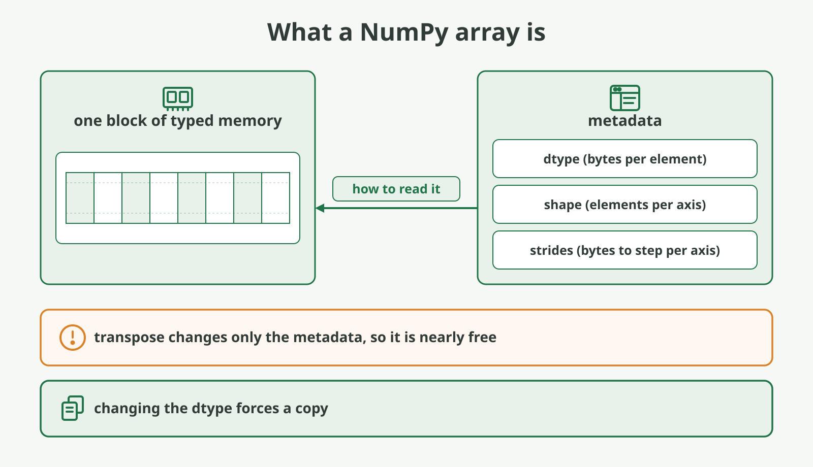
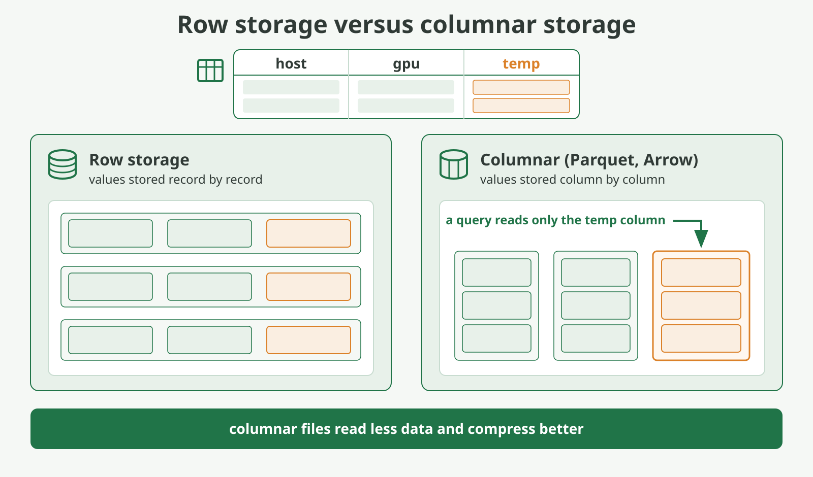
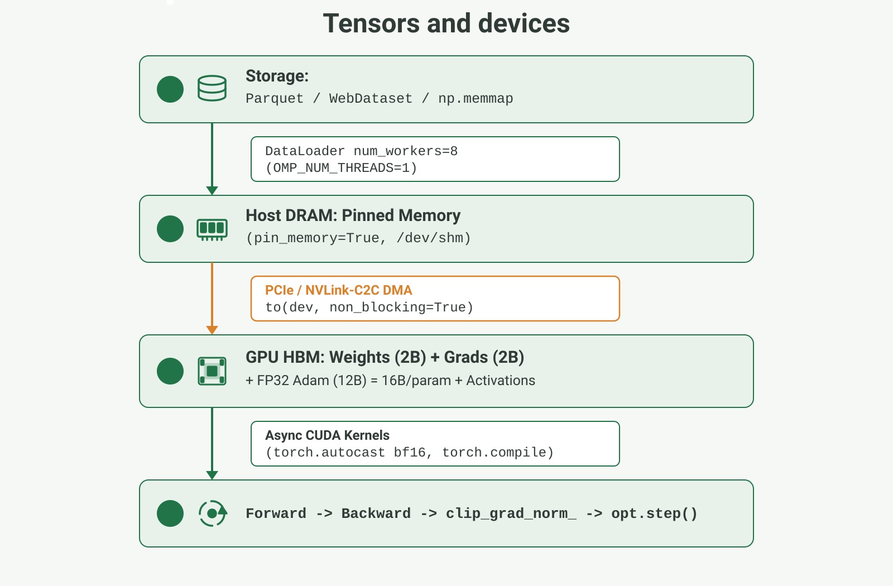
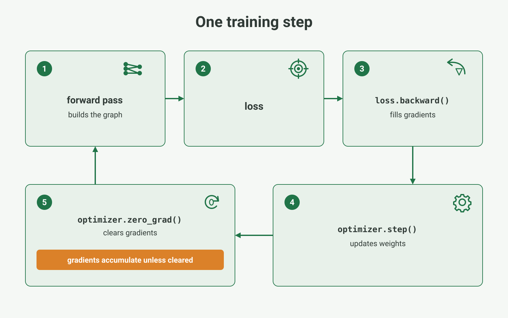
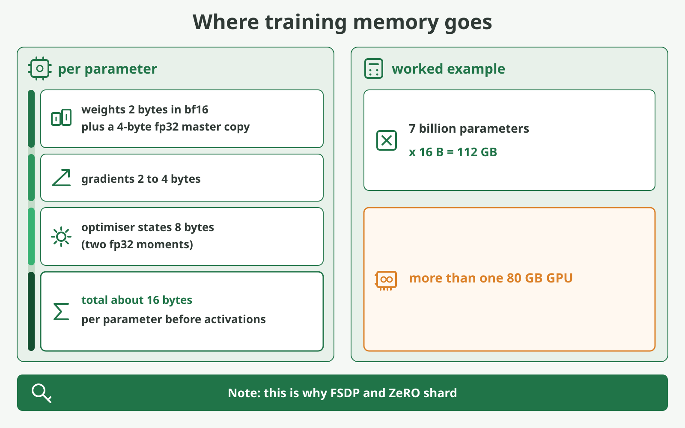
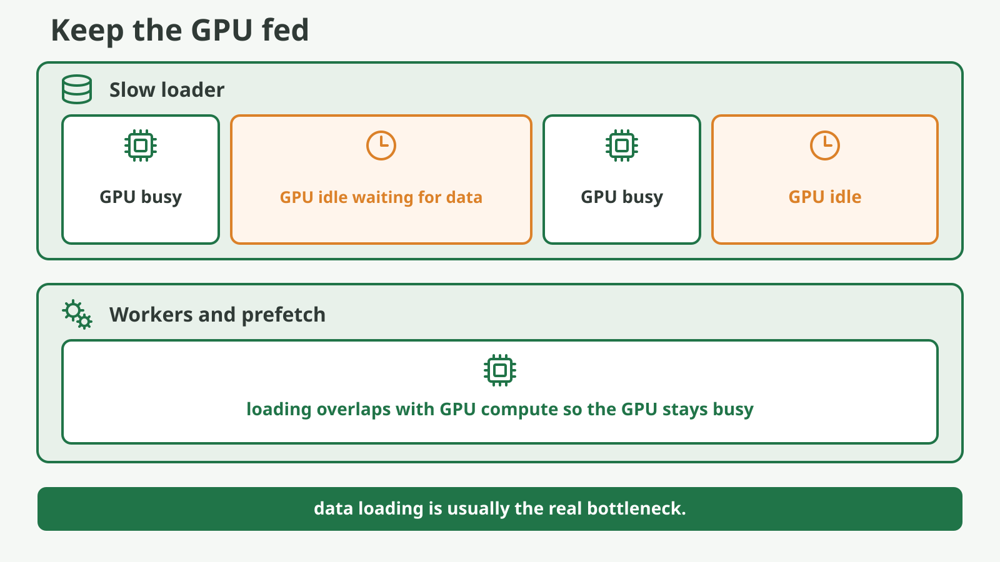

# 3.10 Python for data and ML infrastructure: NumPy, pandas, PyTorch essentials

| | |
|---|---|
| Level | Intermediate |
| Priority tier | 2 |
| Lab venue | Python 3.11+, `pip install numpy pandas pyarrow torch`; GPU optional |
| Part | Part 3: Python for infrastructure |
| Status | Drafted, labs **untested** |

## Why this matters for AI infrastructure

Nobody hires an infrastructure engineer to design neural networks. They hire you because a training job that ran all weekend is crawling on Monday morning, and somebody has to find out why. They page you when the data loader starves the GPUs. They page you at hour 40, when an out-of-memory error kills a run that was nearly finished. They page you when a notebook on a shared machine is quietly holding 200 GB of RAM.

Diagnosing any of those problems takes working fluency in the stack ML engineers use every day. Three parts of that stack matter most. **NumPy** gives you the array model underneath everything. **pandas and Arrow** give you tabular data. **PyTorch** gives you tensors, autograd, modules, devices, data loading, mixed precision and distributed hooks.

This chapter stays on the infrastructure side of that stack. It looks at memory layout and copies, at where time goes, at what runs on the CPU and what runs on the GPU, and at how to measure each of them. It is not a machine-learning course. Model theory is in Part 14.

## Prerequisites and outcomes

This chapter builds on 3.1 to 3.6, which cover the Python core, generators and concurrency. When you finish it, you should be able to:

- Explain the NumPy array model, including `dtype`, `shape`, `strides`, views versus copies and broadcasting, and write vectorised code in place of Python loops.
- Use pandas well, with dtypes, categorical data, chunking, groupby and joins. You should also know when it breaks, through memory limits or its single thread, and when to move to Arrow, Parquet, Polars, DuckDB or Dask/Spark.
- Read and write a PyTorch training loop, and explain tensors, devices, autograd, `nn.Module`, optimisers, `DataLoader`, checkpointing, AMP and gradient accumulation.
- Reason about GPU memory (weights, gradients, optimiser state, activations and fragmentation), asynchronous execution and host-device transfers, and profile with the PyTorch profiler.
- Recognise common infrastructure failures: dataloader starvation, CPU thread oversubscription, accidental synchronisation, memory leaks from retained graphs, non-determinism and OOM.

## 1. NumPy: the array model



*Figure 3.10.1. A NumPy array is a block of typed memory plus dtype, shape and strides that say how to read it.*

Why does transposing a huge array cost almost nothing, while a small change to its layout forces a full copy? Picture a machine with plenty of RAM. A transpose returns instantly. Then you change the same array's element type, and the machine grinds while it copies gigabytes. None of the numbers changed, so what made the difference? The answer sits in how a NumPy array is stored in memory.

A NumPy `ndarray` is two things wearing one name. The first is a block of typed memory, usually contiguous, holding the actual bits. The second is a small bundle of metadata that says how to read that block. The metadata has three parts. `dtype` is the element type, so it says how many bytes each number takes. `shape` says how many elements lie along each axis. `strides` says how many bytes to step to move one place along each axis.

Almost everything else in the Python data ecosystem, including pandas, scikit-learn, PyTorch interop and image libraries, is built around this idea or copies it. Learn the three parts once and the rest of the stack stops looking like magic.

```python
import numpy as np
a = np.arange(12, dtype=np.float32).reshape(3, 4)
a.shape, a.dtype, a.strides, a.flags['C_CONTIGUOUS']     # ((3, 4), float32, (16, 4), True)
b = a.T                                                    # a view: same memory, strides swapped, no copy
b.flags['C_CONTIGUOUS']                                    # False
c = np.ascontiguousarray(b)                                # now a copy in new layout
a[0, 0] = 99; b[0, 0]                                      # 99.0: views share memory
np.shares_memory(a, b)                                     # True
```

Read the output one line at a time. The shape and strides together describe the layout. `b` is a view, so it shares memory with `a`. Only `np.ascontiguousarray` makes a real copy.

A few ideas explain most of what you will meet in NumPy code. Take them slowly, because each one returns later in the chapter.

The first is the dtype, which decides how many bytes each number takes. A `float64` element takes 8 bytes and a `float32` takes 4. A `float16` or `bfloat16` takes 2, although NumPy has no native bfloat16. An `int8` takes 1. Put those together and a 1 billion element `float64` array is 8 GB, and half of that in `float32`. Here is the trap. NumPy defaults to `float64`, while deep learning defaults to `float32` or lower. Mixing the two is a frequent source of silent 2x memory use and slow GPU transfers.

Views and copies are the bug that catches most people. Keep the picture of that one memory block in mind. Basic slicing, reshape where possible, transpose and `.view()` return views, which share memory with the original. Fancy indexing with integer or boolean arrays, `.copy()` and most arithmetic return new arrays. If you change a view, you change its base as well. Check this with `np.shares_memory` or the `.base` attribute.

Memory order decides which loops run fast, and it is the strides idea seen from a different angle. C order is row-major and Fortran order is column-major, so the two lay out elements in different sequences. Iterating along the contiguous axis is therefore far faster than walking across it. A non-contiguous array often has to be copied before you pass it to a C library or to `torch.from_numpy`.

Broadcasting lets you combine arrays of different shapes without writing a loop. Think of it as lining the shapes up from the right. An axis of size 1 stretches to match the other side, and it does so without copying anything. So `(N,1) + (1,M)` gives `(N,M)`. The same rule also causes silent shape bugs, and that is the price of the convenience. Adding an `(N,)` vector to an `(N,N)` matrix broadcasts along the wrong axis, and nothing complains. Assert shapes at function boundaries to catch it early.

Vectorisation means expressing the work as whole-array operations instead of a Python loop. The usual tools are ufuncs, `np.where`, `einsum` and `matmul`. The loop still happens, but it now runs in C and in BLAS or SIMD code, which is typically 10 to 1000 times faster than a Python loop. Avoid building arrays by repeated `append` or `concatenate`, because that cost grows quadratically. Preallocate the array instead.

Temporary arrays matter when memory bandwidth is the limit rather than arithmetic. An expression like `a*b + c` creates intermediate arrays, and each one takes memory and a trip through the cache. Use in-place operations such as `np.add(a, b, out=a)`, or `numexpr`. You can also fuse the work with `numba`, `jax` or `torch.compile`.

Memory mapping, through `np.memmap` or `np.load(mmap_mode="r")`, lets several processes share one large read-only array through the OS page cache. You never load the whole array into each process. This suits datasets and token arrays well. Part 13 covers how storage behaves under this pattern.

NumPy's linear algebra runs on a BLAS library, such as OpenBLAS or MKL, and that library has its own thread pool. You control it with `OMP_NUM_THREADS`, `OPENBLAS_NUM_THREADS` or `MKL_NUM_THREADS`. Here is where a busy cluster node betrays you quietly. In a multi-process data loader, the number of workers multiplied by the BLAS threads per worker oversubscribes the cores. Set the threads to 1 per worker. `threadpoolctl` inspects and limits these pools.

Floating-point arithmetic is not associative, which surprises people the first time they meet it. Add the same numbers in a different order and you get slightly different bits. Float16 can overflow or underflow, and catastrophic cancellation and NaN propagation also cause trouble. Check for NaNs with `np.isnan(x).any()`, and use `np.errstate` to control warnings. Summing across devices gives different results from a single device. That matters when you compare runs, as section 8 explains.

Here is the vectorisation idea applied to a task you will actually meet. The code computes the distances between all 1000 rows of a 64-column matrix, and it contains no Python loop at all.

```python
# Typical vectorisation: pairwise distances without loops
X = np.random.rand(1000, 64).astype(np.float32)
d2 = (X**2).sum(1)[:, None] - 2 * X @ X.T + (X**2).sum(1)[None, :]
```

Every term is a whole-array operation, so NumPy hands the whole grid to compiled code. When your loop is slow, ask whether the same work can be one array expression.

## 2. pandas and the tabular stack

Picture the scene. Your exploration notebook reads a CSV, and its memory graph climbs and climbs until the machine runs out. The file looked modest on disk, so where did the rest go? Before you reach for a bigger machine, find out where the memory goes. Then find out which tool replaces pandas when the data outgrows it.

pandas gives you a `DataFrame`, which holds labelled two-dimensional columns, each one a NumPy array or an extension array. It also gives you the `Series`, its one-dimensional companion. pandas is the default tool for exploration and feature engineering on data that fits in memory. For infrastructure work, three questions matter: how much memory it uses, whether it runs on a single thread, and what replaces it at scale.

```python
import pandas as pd
df = pd.read_csv("events.csv", dtype={"host": "category", "gpu": "int8"}, parse_dates=["ts"], usecols=["ts","host","gpu","util"])
df.memory_usage(deep=True).sum() / 1e6      # MB
df.groupby("host", observed=True)["util"].agg(["mean", "max", "count"])
df.set_index("ts").resample("5min")["util"].mean()
```

Read the code from top to bottom. It loads only four columns, and leaves the rest on disk. It stores `host` and `gpu` in narrow types, and parses `ts` as a timestamp. Then it reports memory in MB, computes per-host statistics, and averages `util` over five-minute windows.

The practical rules below all follow from how pandas stores its data. A DataFrame often needs 2 to 5 times the file size in RAM while you load and transform it, which is the answer to the notebook mystery above. You can reduce that with narrow dtypes such as `int8/16/32` and `float32`. You can also use `category` for low-cardinality strings, `usecols`, and reading in `chunksize` pieces. Avoid object dtype, because Python strings are heavy. Pandas 2 also supports Arrow-backed dtypes, `dtype_backend="pyarrow"` and `string[pyarrow]`, which cut string memory and speed up I/O.

Row-by-row Python loops are slow, for the same reason section 1 gave. Avoid `for i, row in df.iterrows()`, and minimise `apply(axis=1)`. Use vectorised column operations, `np.where`, `merge` and `groupby` instead. Chained indexing such as `df[a][b] = x` may modify a copy, so write `.loc[mask, "col"] = x`. Copy-on-write semantics in recent pandas versions reduce this hazard.

Joins and groupbys can explode memory, especially many-to-many merges. When a key appears many times on both sides, the result holds every pairing, and it can dwarf both inputs. Check key uniqueness with `validate="one_to_one"`. Sort or index the keys to speed up joins, and drop unneeded columns first.

Time series need extra care. Use timezone-aware timestamps in UTC, along with `resample`, `rolling` and `shift`. Watch for look-ahead leakage when you build features. A feature that uses future data to compute a value for the past makes a model look great offline and fail in production.

pandas runs on a single thread by default, and that one thread sets the ceiling on everything it does. For heavy transforms, consider Polars, which is multi-threaded, lazy and Arrow-native. DuckDB runs in-process analytical SQL over Parquet or CSV. Dask partitions pandas work across cores or a cluster, and Ray Data and Spark also handle large jobs. Choose by data size and team skills. If the data fits in RAM, use pandas or Polars. If it is larger than RAM but still on one machine, use DuckDB or Polars streaming. For many TB, use Spark, Ray or Dask on a cluster.

### Columnar formats: Parquet and Arrow



*Figure 3.10.2. Columnar formats let a query read only the columns it needs.*

Here is a picture that makes the difference obvious. Imagine a report printed with one page per row, every column of that row sitting together. To answer a question about a single column, you would flip through every page. That is a CSV. A columnar file prints one page per column instead, so you pick up the column you need and ignore the rest.

Parquet is that second kind of file, compressed, columnar, and stored on disk. It stores data in row groups with per-column statistics, and it supports predicate pushdown. So reading three columns out of fifty reads only those bytes. Prefer Parquet with zstd or snappy over CSV or JSON for any dataset beyond toy size. Choose row-group sizes of roughly 128 MB to 1 GB per file, because many tiny files hurt object stores and metadata services. Partition directories by low-cardinality keys such as date, but do it with care.

Apache Arrow is the same idea held in memory. It lets pandas, Polars, Spark, DuckDB, Ray and GPU dataframes such as RAPIDS cuDF exchange data without serialisation, which is zero-copy. The two sides pass one parcel rather than photocopying its contents. The call `pyarrow.parquet.read_table(..., columns=[...], filters=[...])` reads selected columns and rows. Memory-mapped IPC files, and `pyarrow.dataset` for scanning directories lazily, round out the picture.

WebDataset, TFRecord and MDS (MosaicML Streaming) are sharded, sequential record formats for very large training sets, such as images or tokens. A shard is one large file holding many small records back to back. They turn many small random reads into large sequential reads. That matters on network file systems and object stores (Part 13).

RAPIDS cuDF offers a pandas-like API on the GPU. The `cudf.pandas` accelerator mode can run unmodified pandas code on the GPU where that is supported. It helps with large joins and groupbys, when the data already lives near the GPU. Check support and speedups for each workload.

Let the dataset size and the team's skills choose the tool. Switch away from pandas only when RAM or the single thread is the limit you have measured.

## 3. PyTorch fundamentals

### 3.1 Tensors and devices

You open someone else's training script and need to know which lines run on the GPU and which on the CPU. The answer starts with one object. A `torch.Tensor` is NumPy's array model with two additions. The first is a device, such as `cpu`, `cuda:0` or `mps`, which says where the bytes actually live. The second is autograd metadata, which records how the tensor was built. The same ideas apply to it, including dtype, shape, strides, views versus copies, and broadcasting. The code below creates a tensor on the CPU, and then moves it to a GPU when one is present.

```python
import torch
x = torch.randn(4096, 4096)                 # CPU, float32
print(x.dtype, x.device, x.element_size() * x.nelement() / 1e6, "MB")      # 67.1 MB
if torch.cuda.is_available():
    dev = torch.device("cuda:0")
    xg = x.to(dev, non_blocking=True)       # host-to-device copy (async only from pinned memory)
    y = xg @ xg                              # runs on the GPU asynchronously
    torch.cuda.synchronize()                 # wait for the GPU (needed for correct timing)
```

The print line shows what this tensor costs: 67.1 MB for a 4096 by 4096 `float32` matrix on the CPU. The diagram below traces one batch from storage to the optimiser step. Each arrow is a hand-off, and each hand-off is somewhere the pipeline can stall.



*Figure 3.10.3. Tensors and devices, as a diagram.*

Three behaviours of tensors cause most of the surprises in infrastructure work. Take them one at a time.

The first is asynchronous execution. Picture handing work to a colleague who never says out loud when it is done. CUDA kernel launches return at once, and the CPU runs ahead until something forces a synchronisation. Calls such as `.item()`, `.cpu()`, `print(tensor)`, `torch.cuda.synchronize()` and a boolean check on a GPU tensor all force one. A timer that does not synchronise measures only the launch time. Logging `loss.item()` on every step is a common accidental sync, and it stalls the pipeline.

The second is the cost of host-device transfers. They cross PCIe, or NVLink-C2C on Grace Hopper, and they are slow next to on-device memory bandwidth. Use pinned, or page-locked, host memory, through `pin_memory=True` in `DataLoader` or `tensor.pin_memory()`, together with `non_blocking=True`. Then the copies overlap with compute. Move data to the GPU once, in large batches, and keep intermediate results on the device.

The third is dtype choice. `float32` is the standard. `float16` and `bfloat16` halve memory and use Tensor Cores. `bfloat16` keeps the exponent range of `float32`, so it avoids most loss-scaling issues, and it is supported on Ampere and later. `float8` runs on Hopper and Blackwell through Transformer Engine. `int8` suits quantised inference. `torch.set_float32_matmul_precision("high")` allows TF32 on Ampere and later, for faster matmuls at slightly lower precision.

Views and in-place operations also need care. `view/reshape/transpose/permute/expand` share storage with the original, which is the view-versus-copy idea from section 1 wearing different clothes. In-place operations, marked by a trailing underscore or `+=`, save memory. But they can break autograd if they overwrite a value that the backward pass needs.

Interop is straightforward once you know the rule. `torch.from_numpy(arr)` shares memory on the CPU, and `tensor.numpy()` does the same for CPU tensors. A GPU tensor must go through `.cpu()` first. DLPack, in `torch.utils.dlpack`, exchanges GPU tensors zero-copy with CuPy, JAX and RAPIDS.

Decide where each tensor lives before you write the loop. Then keep the GPU busy with large, infrequent transfers.

### 3.2 Autograd and modules



*Figure 3.10.4. Autograd: the forward pass records a graph, backward fills gradients, and the optimizer updates the weights.*

Autograd is the part of PyTorch that remembers what you did. It records the operations on tensors that have `requires_grad=True`, in a dynamic graph built as the code runs. `loss.backward()` then computes gradients by reverse-mode differentiation, and it accumulates them into `.grad`. `nn.Module` composes layers and tracks their parameters. Optimisers such as SGD, Adam and AdamW update the parameters from those gradients.

```python
import torch, torch.nn as nn, torch.nn.functional as F

class MLP(nn.Module):
    def __init__(self, d_in, d_hidden, d_out):
        super().__init__()
        self.net = nn.Sequential(nn.Linear(d_in, d_hidden), nn.GELU(), nn.Linear(d_hidden, d_out))
    def forward(self, x): return self.net(x)

model = MLP(512, 2048, 10).to(dev)
opt = torch.optim.AdamW(model.parameters(), lr=3e-4, weight_decay=0.01)

for step, (xb, yb) in enumerate(loader):
    xb, yb = xb.to(dev, non_blocking=True), yb.to(dev, non_blocking=True)
    opt.zero_grad(set_to_none=True)                 # frees gradient memory instead of zero-filling
    loss = F.cross_entropy(model(xb), yb)
    loss.backward()                                  # builds gradients; frees the graph by default
    torch.nn.utils.clip_grad_norm_(model.parameters(), 1.0)
    opt.step()
    if step % 100 == 0: print(step, loss.item())     # .item() synchronises: log sparingly
```

Read that loop once, because it is the shape of every training loop you will ever debug. It does one optimiser step per batch. Calling `zero_grad(set_to_none=True)` frees the gradient memory rather than filling it with zeros. The `.item()` call in the logging line is a synchronisation, so it runs only every 100 steps.

Two mode switches change how the model behaves, and forgetting either one is a classic Monday-morning bug. `model.train()` and `model.eval()` change how dropout and batch norm act. `torch.no_grad()` and `torch.inference_mode()` skip graph building during evaluation and serving, which saves memory and time. Forgetting `eval()` and `no_grad()` during validation is a frequent cause of OOM and wrong metrics. Appending `loss` to a list, rather than `loss.item()`, keeps whole graphs alive, so memory leaks step after step.

### 3.3 Where the memory goes



*Figure 3.10.5. Training memory: about 16 bytes per parameter before activations, which is why large models need sharding.*

Training with Adam in mixed precision needs memory for four things per parameter, and it helps to count them like a shopping list. Weights take 2 bytes in bf16, plus a 4-byte fp32 master copy. Gradients take 2 to 4 bytes. The optimiser states hold two fp32 moments, which is 8 bytes. Together that is about 16 bytes per parameter before activations.

That number explains a familiar launch-day surprise. Suppose your model fits on paper, but the first real step runs out of memory. Take a 7-billion-parameter model as a worked example. At 16 bytes per parameter, the static state comes to 7 * 10^9 * 16 B = 112 GB. That is more than one 80 GB GPU can hold, before any activations are added. This is why sharding exists, through FSDP or ZeRO (Part 14).

Activations grow with batch size, sequence length and depth, and they are often the largest term. Activation checkpointing (`torch.utils.checkpoint`) trades about 30% extra compute for large memory savings. For inference, the weights dominate, along with the KV cache, which grows with batch size and context length. Weights take 2 bytes per parameter in fp16 or bf16, 1 in int8, and about 0.5 in 4-bit. Part 15 covers inference.

The allocator adds a twist that confuses almost everyone the first time. PyTorch uses a caching allocator, which keeps freed blocks for reuse. So `nvidia-smi` shows high usage even after you free tensors. Think of a hotel that holds a room for you instead of returning it to the front desk. Fragmentation can also cause OOM while free memory is still unusable. Inspect the state with `torch.cuda.memory_allocated()` for live tensors, `memory_reserved()` for cached memory, `torch.cuda.memory_summary()`, and `torch.cuda.memory._record_memory_history()` with the memory snapshot visualiser. Tune the allocator with `PYTORCH_CUDA_ALLOC_CONF`, for example `expandable_segments:True` or `max_split_size_mb`. `torch.cuda.empty_cache()` returns cached memory to the driver, but it is rarely a real fix.

Read allocated and reserved memory together, because they answer different questions. Allocated is the guests in their rooms. Reserved is the block the hotel has taken off the market for them.

### 3.4 Mixed precision, accumulation and compilation

Mixed precision cuts memory and time, but you have to follow a few rules. The code below combines autocast with gradient accumulation, and the two are easier to read together.

```python
scaler = torch.amp.GradScaler("cuda")                # needed for fp16; unnecessary for bf16
for xb, yb in loader:
    with torch.autocast("cuda", dtype=torch.bfloat16):          # ops run in lower precision where safe
        loss = F.cross_entropy(model(xb.to(dev)), yb.to(dev)) / accum
    loss.backward()                                  # with fp16 use scaler.scale(loss).backward()
    if (step + 1) % accum == 0:                      # gradient accumulation: effective batch = batch * accum
        opt.step(); opt.zero_grad(set_to_none=True)
```

The `GradScaler` is needed for fp16 and is unnecessary for bf16. The accumulation loop divides each loss by `accum` and steps the optimiser only every `accum` micro-batches. The effective batch is therefore the batch size times `accum`, which is how a small GPU pretends to be a large one.

`torch.compile(model)` uses TorchInductor and Triton to fuse operations. That reduces launch overhead and memory traffic. It costs compile time, it can hit graph breaks, and it recompiles when shapes change. `torch.backends.cudnn.benchmark = True` autotunes convolution algorithms for fixed shapes. Fused optimisers, set with `fused=True`, and flash attention through `F.scaled_dot_product_attention` are standard speed-ups.

### 3.5 Data loading: usually the real bottleneck



*Figure 3.10.6. Data loading: worker processes and prefetching overlap input work with GPU compute so the GPU does not idle.*

This is the bottleneck the heading names, and it is worth learning properly. Watch a training run for a minute, and the GPUs sit near idle while the CPU workers are busy. When you see that, the data loader is usually the cause. `torch.utils.data.Dataset` defines `__len__` and `__getitem__`, so it is the object that knows how to fetch one sample. `DataLoader` batches the samples, using worker processes to do the work.

```python
loader = torch.utils.data.DataLoader(
    ds, batch_size=64, shuffle=True,
    num_workers=8,                 # parallel decode/augment processes (fork or spawn; each has its own memory)
    pin_memory=True,               # page-locked buffers for fast async H2D copy
    persistent_workers=True,       # don't respawn workers every epoch
    prefetch_factor=4,             # batches prefetched per worker
    drop_last=True)
```

Each option solves a specific problem, so take them one at a time. `num_workers=8` runs decode and augment work in parallel processes, and each worker has its own memory. `pin_memory=True` gives you page-locked buffers for fast asynchronous copies. `persistent_workers=True` stops workers from respawning every epoch. `prefetch_factor=4` sets how many batches each worker prepares ahead.

Pinned memory deserves one paragraph of theory, because it changes how fast a pipeline can feed the GPU. Normal host memory is pageable, so the operating system may move its pages whenever it likes. The GPU cannot read that memory directly. Page-locked memory stays where it was put, so the transfer can go straight across the bus with no detour. That is the whole reason `pin_memory=True` earns its place in the list.

Starvation has three telltale shapes. It shows up as low `nvidia-smi` utilisation, with CPU workers at 100%, or as high I/O wait. To diagnose it, time `next(iter(loader))` against the model step, and compare the two numbers. Then check the CPU per core with `top` or `mpstat`, check I/O with `iostat` or the network file system throughput, and check the decoding cost, such as JPEG decode or tokenisation.

The fixes follow from the cause. Add workers, up to the cores you have, and remember the BLAS thread oversubscription. Switch to faster formats, such as sharded Parquet, WebDataset or pre-tokenised memory-mapped arrays. Cache or prefetch to local NVMe, or decode on the GPU with DALI or nvJPEG. Read larger sequential blocks, and avoid Python-heavy transforms on every sample.

Keep the Dataset itself lightweight. A large Python list or dict inside the Dataset is copied on access in forked workers, because reference counts touch its pages. Use NumPy arrays or Arrow tables instead. Seed the workers explicitly for reproducibility, with `worker_init_fn` and a `generator`. In distributed training, `DistributedSampler` shards the data across ranks, and `sampler.set_epoch(epoch)` must run each epoch so the data reshuffles.

Time the loader on its own, so you know whether the GPU or the loader is the real limit.

### 3.6 Checkpointing and saving

A job can die at hour 40, and everything since the last checkpoint dies with it. A resume depends on the checkpoint file being whole, which is why the save itself needs care. The code below saves one in a way that survives a crash during the save.

```python
torch.save({"model": model.state_dict(), "opt": opt.state_dict(), "step": step, "rng": torch.get_rng_state()}, tmp)
os.replace(tmp, "ckpt.pt")                  # atomic rename: never leave a half-written checkpoint
state = torch.load("ckpt.pt", map_location="cpu", weights_only=True)
```

Save to a temporary name, then rename the file. The rename is atomic, so a reader sees either the old file or the new one, and never half of each. Write to fast local storage first, then upload asynchronously. Keep the last N checkpoints, plus periodic milestones. Record the code version, the config and the data position, so a resume is exact.

Security matters here as well, and this is the part that should make you sit up. `torch.load` uses pickle, which can execute arbitrary code from an untrusted file. Pass `weights_only=True`, which is the default in recent versions. For model weights from anywhere you do not control, use the safetensors format. It is safe, zero-copy, memory-mappable and fast.

Large-model checkpoints run to tens or hundreds of GB. Sharded checkpoints, saved with `torch.distributed.checkpoint`, write per-rank shards in parallel, and they support resharding on resume (Part 14).

Test the resume path on a small run before you depend on it at scale.

## 4. Distributed and multi-GPU hooks (preview)

One GPU is no longer enough, so the script that worked yesterday now has to run across several. `torch.distributed` gives you process groups, which is the machinery for a job that spans more than one GPU. The NCCL backend runs on GPUs and uses NVLink, InfiniBand or RoCE. Gloo runs on the CPU, and MPI is also supported. `torchrun` launches the processes and sets `RANK`, `WORLD_SIZE`, `LOCAL_RANK`, `MASTER_ADDR` and `MASTER_PORT`, so every process knows who it is.

Two parallel models matter most. In DistributedDataParallel (DDP), each process holds one GPU's copy of the model. Gradients are all-reduced during the backward pass, in buckets that overlap with compute. FSDP takes a different approach, closer to one book shared by a study group. It shards parameters, gradients and optimiser states across the ranks. Tensor, pipeline and sequence parallelism live in Megatron-LM, DeepSpeed and `torch.distributed.tensor`.

Infrastructure engineers usually set a handful of environment variables. Use `NCCL_DEBUG=INFO`, `NCCL_SOCKET_IFNAME`, `NCCL_IB_HCA` and `NCCL_P2P_DISABLE` for diagnosis. `CUDA_VISIBLE_DEVICES`, `OMP_NUM_THREADS` and `TORCH_DISTRIBUTED_DEBUG=DETAIL` also matter. Parts 12 and 14 cover the details.

## 5. Profiling and observability of ML code

When a training job slows down, the first question is where the time goes. The dashboard is calm, the loss curve looks normal, and yet each step now takes far longer than it did last week. Measure where the time goes before you touch the model.

Start with wall-clock time. Log the step time, the samples or tokens per second, and the split between data wait and compute. That ratio tells you whether the loader or the GPU is the bottleneck.

`nvidia-smi dmon` and DCGM report GPU utilisation, SM activity, memory bandwidth, power, throttle reasons and NVLink. Be careful with the word utilisation. In `nvidia-smi`, it only means that a kernel was running during the sample. It does not mean the GPU ran efficiently. For a real picture, look at SM occupancy, Tensor Core activity and achieved model FLOPs utilisation (MFU).

The PyTorch profiler records a short window of steps. The code below waits one step, warms up for one step, and then records three active steps.

```python
from torch.profiler import profile, schedule, ProfilerActivity, tensorboard_trace_handler
with profile(activities=[ProfilerActivity.CPU, ProfilerActivity.CUDA],
             schedule=schedule(wait=1, warmup=1, active=3),
             on_trace_ready=tensorboard_trace_handler("./prof"),
             record_shapes=True, profile_memory=True, with_stack=True) as prof:
    for step, batch in zip(range(6), loader):
        train_step(batch); prof.step()
print(prof.key_averages().table(sort_by="cuda_time_total", row_limit=15))
```

Read the kernel timeline first. Gaps between kernels mean the CPU is the bottleneck, or that the data arrived late. Then check the top operators, the memory usage and the communication ops. NVIDIA Nsight Systems, run with `nsys profile`, shows the whole pipeline: CPU threads, the CUDA API, kernels, NCCL and NVTX ranges. Add `torch.cuda.nvtx.range_push/pop` markers to name your own stages. Nsight Compute drills into single kernels (Part 10).

On the CPU side, `py-spy` shows what each training process is doing. Is the main thread in the dataloader, in Python overhead, or waiting on a sync? Use `perf` as well, and `top -H` shows the worker threads.

Experiment tracking tools, such as Weights & Biases, MLflow and TensorBoard, record metrics, configs, code versions and artefacts. That makes runs reproducible and comparable (Part 16).

Some health signals should always be watched. These include loss NaN or Inf detection, gradient norm logging, and per-rank step-time skew, which reveals stragglers. Also watch for GPU XID errors in `dmesg`, ECC counters, and heartbeats with timeouts. A heartbeat catches a hung collective, so it does not burn GPU-hours unnoticed.

Pick one signal that tells the loader apart from the GPU, and log it from the first step.

## 6. Reproducibility and determinism

Two runs of the same code can give different losses, and finding out why can consume a week. Here are the usual suspects.

Random seeds are one, across Python, NumPy, PyTorch on the CPU and CUDA, plus data order and worker seeds. Non-deterministic GPU kernels are another, such as atomic adds in some backward ops. Changing library versions, changing the number of GPUs, the order of reductions and cuDNN autotuning all contribute too.

```python
import random, numpy as np, torch
def seed_everything(s):
    random.seed(s); np.random.seed(s); torch.manual_seed(s); torch.cuda.manual_seed_all(s)
seed_everything(1234)
torch.use_deterministic_algorithms(True, warn_only=True)     # raises/warns on non-deterministic ops
torch.backends.cudnn.deterministic = True; torch.backends.cudnn.benchmark = False
# also set CUBLAS_WORKSPACE_CONFIG=:4096:8 for deterministic cuBLAS
```

The cuDNN lines stop autotuning from changing the algorithm between runs. `torch.use_deterministic_algorithms(True, warn_only=True)` warns or raises on non-deterministic ops, and `CUBLAS_WORKSPACE_CONFIG=:4096:8` makes cuBLAS deterministic.

Determinism costs speed. Use it for debugging and regression tests, and not necessarily for production training. Record the exact versions of your stack with each run, including `pip freeze`, CUDA, the driver, NCCL and the container digest. Bitwise reproducibility across different GPU counts is generally not achievable.

Decide whether you need bitwise repeats.

## 7. Packaging and environments for ML code

A container that built fine last month now refuses to import torch, and nobody changed the code. PyTorch wheels bundle the CUDA runtime libraries, which is convenient right up to the moment the versions disagree. Pick the index URL that matches your CUDA version, such as `--index-url https://download.pytorch.org/whl/cu1xx`. The driver must be new enough for that CUDA version. A driver supports older runtimes, but the reverse does not hold. Part 10 covers the driver side. Mixed CUDA versions across PyTorch, NCCL and custom extensions cause confusing import errors.

NVIDIA NGC PyTorch containers come with curated CUDA, cuDNN, NCCL and Transformer Engine versions, which saves you the matching work. You can also build on `nvidia/cuda` base images. Run either one with the NVIDIA Container Toolkit, using `--gpus all` (Part 11).

Pin your dependencies with a lock file, using uv, pip-tools or poetry, and record the container digest. ML stacks break easily on minor-version bumps. Examples are the numpy 2 ABI changes, and compatibility between transformers and torch.

Use a virtual environment for each project, and avoid `pip install` into the system Python. conda and mamba remain common for CUDA toolkits and other native dependencies.

Datasets and checkpoints do not belong in Git. Store them with DVC, git-lfs, content-addressed object storage or a model registry (Part 16).

Pin the stack once it works, and record the container digest with it.

## 8. Common failure modes

When a run fails, the symptom usually points to a short list of causes. Think of the Monday morning after an unattended weekend run, when the loss column has gone to NaN and nobody knows which of a dozen changes did it. The table maps each symptom to its likely cause and to the first check to run.

| Symptom | Likely cause | Check |
|---|---|---|
| `CUDA out of memory` | batch/sequence too large, retained graphs, fragmentation, other processes on the GPU | `torch.cuda.memory_summary()`, `nvidia-smi`, reduce batch, checkpointing, `expandable_segments`, `torch.no_grad()` in eval |
| Low GPU utilisation, high CPU | data loading or Python overhead | profile loader time, add workers, faster format, pin memory, `torch.compile`/CUDA graphs |
| Memory grows every step | storing tensors with graph (`losses.append(loss)`), growing lists/caches | store `.item()`/`.detach()`, `tracemalloc` and `torch.cuda.memory_allocated` over time |
| Loss becomes NaN | learning rate too high, fp16 overflow, bad data, division by zero | anomaly detection `torch.autograd.set_detect_anomaly(True)` (slow), gradient clipping, bf16, data validation |
| Training slower with more workers | BLAS/OMP thread oversubscription, shared-memory limits | set `OMP_NUM_THREADS=1` per worker, check `/dev/shm` size in containers (set larger `--shm-size`) |
| `DataLoader worker killed` / bus error | `/dev/shm` too small in Docker/Kubernetes, or host RAM OOM | enlarge shm (emptyDir medium Memory), reduce workers/prefetch |
| Hangs at start of multi-GPU run | rendezvous misconfig, NCCL network interface wrong, firewall | `NCCL_DEBUG=INFO`, `NCCL_SOCKET_IFNAME`, check ports and `MASTER_ADDR` |
| Different results run to run | nondeterministic kernels, unseeded workers | section 6 |
| Slow first step, then fast | lazy init, cudnn benchmark, `torch.compile` warm-up | warm up before timing; synchronise before measuring |
| Pandas job killed | OOM from copies and object dtype | dtypes, chunking, Parquet column pruning, Polars/DuckDB |

Work down the check column for the symptom you see. Most rows name a command or a setting you can try right away.

## 9. Lab

Start with the self-checking Python lab, on your own machine. It is at `code/part03/python_data_ml_infra_lab.py`, and it checks four ideas from this chapter, so you can watch each one work before you trust it on a real job. It verifies C-contiguous against F-contiguous byte strides (`compute_ndarray_strides`) and right-aligned broadcasting (`broadcast_shapes`). It compares row-major CSV with columnar Parquet read volume (`compare_row_vs_columnar_io`, from Designing Machine Learning Systems, chapter 3). It checks the mixed-precision AdamW static memory accounting, which turns 16 B/param into 112 GB for a 7B model (from AI Engineering, chapter 7). Last, it checks DataLoader worker starvation against GPU step saturation (`diagnose_dataloader_vs_gpu_bottleneck`).

```bash
python3 code/part03/python_data_ml_infra_lab.py
```

Next, work through the steps below on any machine with Python 3.11+. Each step tests one idea from this chapter, so you can check the claim in your own measurements. All interactive shell steps have not been run on live hardware.

1. Start with the NumPy model. Create arrays and print `shape/strides/dtype`. Demonstrate a view mutation bug. Compare a Python loop, a list comprehension and a vectorised pairwise-distance version, timing each with `%timeit` or `timeit`. Show that `np.concatenate` in a loop grows quadratically, and compare it with preallocation. Map a large `.npy` file with `mmap_mode`, and read it from two processes.
2. See what oversubscription costs. Time a matrix multiply with `OMP_NUM_THREADS` set to 1, to 4 and to all cores. Spawn 8 worker processes that each use all the BLAS threads, and watch the slowdown. Then fix it with `threadpoolctl`.
3. Put the pandas diet to the test. Generate a 5 million row CSV. Load it with the defaults, then with narrow dtypes, categories and `usecols`, and compare the memory and time. Write Parquet with zstd, and compare its size and the time for a column-pruned read. Repeat the groupby in Polars and DuckDB.
4. Reproduce the async illusion. Time a GPU matmul with and without `torch.cuda.synchronize()`. Measure pageable and pinned host-to-device bandwidth. Then show an accidental `.item()` sync inside a loop.
5. Build the training loop. Implement the MLP loop on synthetic data, and toggle `train/eval` and `no_grad`. Then leak on purpose, by appending `loss` and retaining the graph, and watch memory grow. Fix it.
6. Account for memory. For a small transformer built from `torch.nn`, predict the memory for weights, gradients, Adam state and activations. Compare your prediction with `torch.cuda.max_memory_allocated()`. Enable bf16 autocast, then activation checkpointing, and record the effect of each.
7. Tune the data loader. Build a Dataset with an artificial 20 ms decode per sample. Measure samples per second for `num_workers` set to 0, 2, 4 and 8, with and without `pin_memory` and `persistent_workers`. Find where GPU utilisation saturates. Reproduce the `/dev/shm` failure in a container with a small `--shm-size`.
8. Profile the loop. Capture a PyTorch profiler trace of the loop, and open it in TensorBoard or Perfetto. Identify the largest gaps and operators. Then run `nsys profile` and add NVTX ranges.
9. Test checkpoint safety. Save with temp-and-rename, then kill the process during a save, and confirm the previous checkpoint is still valid. Load with `weights_only=True`. Convert the checkpoint to safetensors, and compare its load time with `mmap`.
10. Explore determinism. Run twice unseeded, then run twice seeded. Enable deterministic algorithms and measure the speed cost. Locate a non-deterministic op that warns.
11. Check the packaging. Build a CUDA-matched virtual environment, and a container from an NGC image. Verify `torch.cuda.is_available()`, the driver and runtime versions, and `python -c "import torch; print(torch.__config__.show())"`.
12. Clean up.

## 10. Interview angles

- "Training is slow and GPU utilisation is 40%. Walk me through diagnosis." Work through the loader, compute and sync time first, then the profiler, the storage and the threads.
- "Why does GPU memory show used after you delete tensors?" The caching allocator explains it, along with the gap between reserved and allocated memory.
- "What takes memory during training? How would you fit a bigger model?" Cover the state per parameter, activations, mixed precision, checkpointing, sharding and offload.
- "Explain views versus copies and broadcasting pitfalls."
- "How do you make a PyTorch job reproducible? What does it cost?"
- "Why is `torch.load` on an untrusted file dangerous? What do you use instead?"
- "pandas ran out of memory on a 30 GB CSV on a 32 GB machine. Options?" Think about dtypes, chunks, Parquet, Polars or DuckDB, and Dask.
- "What does `num_workers`, `pin_memory`, and `persistent_workers` do?"
- "Why can `/dev/shm` be a problem for DataLoader in Kubernetes?"

## Exercises

Each exercise gives one situation. Use the named function to check your explanation.

1. Use `compute_ndarray_strides()` in `code/part03/python_data_ml_infra.py`. Explain why `a = np.arange(12, dtype=np.float32).reshape(3, 4)` has strides `(16, 4)`, and why `b = a.T` is a zero-copy view with strides `(4, 16)` that is not C-contiguous.
2. Use `broadcast_shapes()` to show how `(1000, 1) + (1, 64)` becomes `(1000, 64)`. Then explain why adding `(N,)` to `(N, 1)` silently builds an `(N, N)` matrix.
3. A training job starts `DataLoader(num_workers=8)` and the CPUs thrash. Explain why the default `OMP_NUM_THREADS` causes this, and how you would fix it.
4. Use `compare_row_vs_columnar_io()` from *Designing Machine Learning Systems*, chapter 3. A query reads 3 of 50 columns across 1M rows. Explain why a row-major CSV scans 400 MB while compressed Parquet scans only 6 MB.
5. A time-series model scores far better offline than in production. Explain how normalising or resampling features before the time split causes look-ahead leakage.
6. You time `y = xg @ xg` on a CUDA tensor and get an absurdly small number. Explain why `torch.cuda.synchronize()` is needed. Then explain why calling `loss.item()` on every step slows training.
7. Explain why `pin_memory=True` together with `to(dev, non_blocking=True)` lets host-to-device copies overlap with compute. Then explain why appending `loss` itself to a history list, instead of `loss.item()`, runs the job out of memory.
8. Use `estimate_adam_mixed_precision_memory_gb()` for a 7B-parameter model, with the sum 14 + 14 + 84 = 112 GB. Say what each term is. Then explain why `bfloat16` does not need `GradScaler` and `float16` does. This follows *AI Engineering*, chapters 2, 7 and 9.
9. After you free tensors, `nvidia-smi` still shows high memory. Explain how the caching allocator causes this, and how `PYTORCH_CUDA_ALLOC_CONF=expandable_segments:True` relates.
10. Use `diagnose_dataloader_vs_gpu_bottleneck()` with 20 ms of CPU decoding per sample, `batch_size=64` and `gpu_compute_ms=100`. Show that GPU utilisation is 7.8% at `num_workers=0` and 100% at `num_workers=16`.
11. A DataLoader worker dies with `Bus error` inside a container. Explain why the default 64 MB `/dev/shm` is the cause. Then explain why a huge Python list of dataset metadata triggers copy-on-write page faults across forked workers.
12. Explain why a checkpoint must be written to a temporary file and then renamed with `os.replace`. Then explain why untrusted weights need `torch.load(..., weights_only=True)` or `safetensors`.
13. A rerun gives different results. List the settings a deterministic PyTorch run needs, among them `use_deterministic_algorithms` and `CUBLAS_WORKSPACE_CONFIG=:4096:8`. Then explain how `torch.profiler` with `schedule(wait=1, warmup=1, active=3)` shows gaps in the data loader.

## Checkpoint questions (20)

<details>
<summary>1. What three attributes define a NumPy `ndarray`'s memory layout, and why is `b = a.T` a view rather than a copy?</summary>

A NumPy `ndarray` has three attributes: `dtype`, `shape` and `strides`. The `dtype` sets the element type and byte size, for example `float32` at 4 bytes against the default `float64` at 8 bytes. The `shape` gives the size of each dimension, such as `(3, 4)`. The `strides` give the byte step needed to move one element along each axis, such as `(16, 4)` for a C-contiguous `float32` array of shape `(3, 4)`. Transposing with `b = a.T` swaps the shape to `(4, 3)` and the strides to `(4, 16)`. It points at the same memory buffer, so `np.shares_memory(a, b)` is `True` and `b.flags['C_CONTIGUOUS']` is `False`. Setting `a[0, 0] = 99` therefore also changes `b[0, 0]`.
</details>

<details>
<summary>2. How does NumPy/PyTorch broadcasting work, and what is the classic `(N,)` vs. `(N, 1)` broadcasting trap?</summary>

Broadcasting lines up shapes from the right. Two dimensions match if they are equal or if one of them is `1`, and a size-1 dimension stretches without copying memory. The trap comes when you add a 1-D vector of shape `(N,)` to a column of shape `(N, 1)`. The vector is padded to `(1, N)`, so the result is an `(N, N)` matrix, not an element-wise `(N, 1)` sum. That silently multiplies memory by $N$ and corrupts losses. Assert the shapes, or reshape explicitly with `x[:, None]`.
</details>

<details>
<summary>3. Why does spawning 8 `DataLoader` workers on a node using NumPy/OpenBLAS/MKL often slow training down, and how do you fix it?</summary>

NumPy, SciPy and OpenCV link against multithreaded BLAS and OpenMP libraries (`OpenBLAS`, `MKL`, `GOMP`). By default, each process starts up to `os.cpu_count()` threads. Say 8 GPU processes each run 8 `DataLoader` workers, which makes 64 processes. If each worker starts 64 BLAS threads, 4,096 threads compete for 64 CPU cores. Set **`OMP_NUM_THREADS=1`**, **`MKL_NUM_THREADS=1`** and **`OPENBLAS_NUM_THREADS=1`** inside the workers, or use `threadpoolctl`.
</details>

<details>
<summary>4. How do you reduce a `pandas` DataFrame's RAM footprint by 2x to 5x, and when should you switch to Polars, DuckDB, or Dask?</summary>

To cut pandas RAM, pass `usecols=[...]` and narrow `dtype=` settings to `pd.read_csv` or `read_parquet`. Use `int8`, `int16`, `int32`, `float32`, or **`category`** for low-cardinality strings. You can also use the Pandas 2 **`dtype_backend="pyarrow"`** setting with `string[pyarrow]`. Never loop over rows with `df.iterrows()`.

Pandas is single-threaded and needs 2x to 5x the dataset size in RAM. On one machine, with data up to hundreds of GB, use **Polars**, which is multithreaded, has a lazy query optimizer and is Arrow-native. **DuckDB** also works, running in-process vectorized SQL with out-of-core streaming. Across multiple nodes, use **Ray Data**, **Dask** or **Spark**.
</details>

<details>
<summary>5. Contrast Row-Major formats (CSV, JSON) with Columnar formats (Apache Parquet, Apache Arrow) and Sequential Shard formats (WebDataset, MDS) (`DMLS` Chapter 3).</summary>

Row-major formats such as CSV and JSON store all the columns of row 1 together, then row 2. Reading 3 features out of 50 still forces the disk to read and parse 100% of the file.

Columnar formats, Parquet on disk and Arrow in memory, store each column together in compressed row groups, with min and max statistics. That enables **column projection**, which reads only the 3 requested columns, and **predicate pushdown**, which skips row groups that fail a `WHERE` filter. Arrow also lets pandas, Polars, DuckDB, PyArrow and RAPIDS `cuDF` share memory with zero copy.

Sequential shard formats, such as WebDataset `.tar` files, MosaicML `MDS` and `np.memmap`, pack thousands of small images or token sequences into shards of 128 MB to 1 GB. Lustre, NVMe and S3 can then stream large contiguous blocks, instead of suffering a storm of small-file metadata IOPS.
</details>

<details>
<summary>6. What is time-travel (look-ahead) data leakage in feature engineering, and how do you prevent it (`DMLS` Chapter 3)?</summary>

**Look-ahead leakage** happens when information from the future leaks into training features for the past. Examples include splitting a time-series log randomly instead of by a timestamp cutoff (`train < T_split <= test`), computing global mean and standard deviation across the whole dataset before splitting, or using centered rolling windows. The result is inflated offline validation accuracy that fails in production. Split by time first, and fit scalers and aggregations only on historical windows.
</details>

<details>
<summary>7. Why is CUDA kernel execution asynchronous, which PyTorch operations force a host-device synchronization, and why does `loss.item()` inside a loop hurt throughput?</summary>

When Python runs `y = xg @ xg`, the CPU queues the kernel on the GPU's CUDA stream and **returns immediately**, so Python can prepare the next operation. Some operations copy data back to host RAM, and they block the CPU until all queued kernels finish. These include **`.item()`**, **`.cpu()`**, **`.numpy()`**, **`print(cuda_tensor)`**, **`if cuda_tensor > 0:`** and **`torch.cuda.synchronize()`**. Calling `loss.item()` on every step drains the launch queue, so the CPU and GPU stop overlapping. Log every `N` steps instead, as in `if step % 100 == 0:`. Always call `torch.cuda.synchronize()` before you start or stop a benchmark timer.
</details>

<details>
<summary>8. How do Pinned (Page-Locked) Memory (`pin_memory=True`) and `non_blocking=True` accelerate Host-to-Device (`H2D`) transfers?</summary>

Normal OS user-space memory is **pageable**, so the kernel can swap or move its physical pages at any time. The GPU's DMA engine cannot read pageable memory directly. Copying a pageable tensor forces the CUDA driver to first copy it into a temporary staging buffer in page-locked memory, and then send it over PCIe synchronously. Setting **`pin_memory=True`** on `DataLoader` allocates batches in page-locked host RAM from the start. Then **`xb.to(dev, non_blocking=True)`** runs asynchronously by DMA, while the CPU and GPU compute cores keep working.
</details>

<details>
<summary>9. Why does `losses.append(loss)` inside a training loop cause a `CUDA out of memory` crash after a few dozen steps, and why should you use `opt.zero_grad(set_to_none=True)`?</summary>

- **Retained autograd graph:** `loss` is a `Tensor` with `requires_grad=True`, and its `.grad_fn` points back to the whole forward graph and all intermediate activations. Appending `loss` to a Python list keeps every step's graph alive, so PyTorch cannot free the activations after `loss.backward()`. Append **`loss.item()`**, a plain Python `float`, or `loss.detach()` instead.
- **`opt.zero_grad(set_to_none=True)`:** Sets each parameter's `.grad` to `None`. That frees the memory block and skips a `memset` kernel, instead of writing zeros into every gradient tensor.
</details>

<details>
<summary>10. Walk through the `16 bytes per parameter` mixed-precision AdamW memory rule of thumb for a 7B model (*AI Engineering* Chapter 7).</summary>

In mixed-precision (`bf16` or `fp16`) training with Adam or AdamW, each parameter $\Psi$ needs the following:
- **Model weights (`bf16`):** `2 bytes`
- **Gradients (`bf16`):** `2 bytes`, or `4 bytes` if they are accumulated in `fp32`
- **Optimizer states (`fp32`):** `4 bytes` for the `fp32` master weight copy, `4 bytes` for the first moment $m$ (momentum) and `4 bytes` for the second moment $v$ (variance), which is **`12 bytes`** in total

The total static state is **`16 bytes per parameter`**, or `18 bytes` with `fp32` gradients. For a **7-billion-parameter model**, that is `7 * 10^9 * 16 B = 112 GB`. That exceeds a single 80 GB H100 or A100 before any forward activations are added.
</details>

<details>
<summary>11. What is the difference between `torch.cuda.memory_allocated()` and `torch.cuda.memory_reserved()`, and how do you mitigate allocator fragmentation?</summary>

PyTorch uses a **caching memory allocator** on top of CUDA `cudaMalloc`, so tensor allocations in the training loop avoid slow driver calls on every step.
- **`torch.cuda.memory_allocated()`** reports the bytes that live PyTorch tensors occupy right now.
- **`torch.cuda.memory_reserved()`** reports the total GPU memory the caching pool holds, which is what `nvidia-smi` shows. That includes freed blocks kept for reuse.

When variable sequence lengths fragment large reserved blocks into chunks that cannot be used, PyTorch can raise `CUDA out of memory` even though `reserved - allocated` shows gigabytes free. To reduce fragmentation, pad inputs to fixed bucket lengths, and set **`PYTORCH_CUDA_ALLOC_CONF=expandable_segments:True`**.
</details>

<details>
<summary>12. Compare `bfloat16` (`bf16`) and `float16` (`fp16`) in `torch.autocast`, and explain why `bf16` does not need `GradScaler`.</summary>

- **`float16` (IEEE 754 half precision):** It has 1 sign bit, **5 exponent bits** and 10 mantissa bits, with a dynamic range of about $6 \times 10^{-8}$ to $65,504$. Small gradients easily underflow to zero. That is why you need **`torch.amp.GradScaler`** to scale up the loss before `backward()`, and to unscale the gradients before `opt.step()`.
- **`bfloat16` (Brain Floating Point, Ampere and later):** It has 1 sign bit, **8 exponent bits** and 7 mantissa bits. Its exponent range is exactly that of `float32`. Gradients therefore do not underflow, and **`GradScaler` is unnecessary**.
</details>

<details>
<summary>13. How do Gradient Accumulation and Activation Checkpointing (`torch.utils.checkpoint`) let you train with large effective batch sizes on limited VRAM?</summary>

- **Gradient accumulation:** It splits a large batch of `64` into `accum` smaller micro-batches, such as `8 x 8`. Each micro-batch loss is divided by `accum`, and `loss.backward()` runs on each one. The gradients add up in `.grad`, and that micro-batch's activations are freed. Only every `accum` steps do you call `opt.step(); opt.zero_grad()`. Peak activation memory falls by a factor of `accum`.
- **Activation checkpointing (`torch.utils.checkpoint`):** It discards intermediate layer activations during the forward pass, keeping only the layer boundary inputs. It recomputes them during the backward pass. The trade is about 30% extra forward compute, for a 60% to 80% reduction in activation memory.
</details>

<details>
<summary>14. Why do `DataLoader` workers crash with `Bus error (core dumped)` inside Docker and Kubernetes containers, and how do you fix it?</summary>

`DataLoader` workers (with `num_workers > 0`) pass prefetched tensor batches back to the training process through POSIX shared memory, which lives in **`/dev/shm`**. Docker and Kubernetes default `/dev/shm` to just **64 MB**. Once prefetched batches exceed 64 MB, `mmap` on `/dev/shm` fails with **`SIGBUS`**, shown as `Bus error`. To fix it, run Docker with **`--shm-size=16g`** (or `--ipc=host`). In Kubernetes, mount a memory-backed `emptyDir` at `/dev/shm` in the Pod spec, for example `emptyDir: { medium: Memory, sizeLimit: 32Gi }`.
</details>

<details>
<summary>15. Why does storing a 10-million-item Python `list` of strings/dicts inside a PyTorch `Dataset.__init__` cause host RAM to explode across `num_workers` under `fork`?</summary>

Under Linux's default `fork` start method, worker processes start by sharing the parent's memory pages through **copy-on-write (CoW)**. But each time a worker reads an element of a Python `list` or `dict`, CPython increments the element's **reference count (`ob_refcnt`)** in the object header. That write touches the page, and the kernel's copy-on-write page fault duplicates the list for every worker. With 8 workers and a 10 GB list, that is 80 GB of RAM. Store the dataset indexes in flat **NumPy arrays, Arrow tables or `np.memmap`**. Reads from those do not change Python reference counts.
</details>

<details>
<summary>16. Why is `torch.load("model.pt")` a security vulnerability on untrusted checkpoints, and how do `weights_only=True` and `safetensors` solve it?</summary>

Standard `torch.save` and `torch.load` serialize objects with Python's **`pickle`**, which can execute arbitrary shell commands, such as `os.system`, embedded in `__reduce__` when an untrusted file is loaded. Pass **`weights_only=True`** to `torch.load`, which restricts unpickling to plain tensor storage. Or store the weights in the Hugging Face **`safetensors`** format. It has a simple JSON header followed by raw, contiguous tensor bytes, so it is immune to code execution, and it loads directly through zero-copy **`mmap`**.
</details>

<details>
<summary>17. How do you interpret a PyTorch Profiler trace (`schedule(wait=1, warmup=1, active=3)`) when diagnosing low GPU utilization?</summary>

1. Use `schedule(wait=1, warmup=1, active=3)` so that step 0 initialization, along with `torch.compile` and cuDNN warm-up, stays out of the trace.
2. In TensorBoard or Perfetto (`ui.perfetto.dev`), inspect the **GPU kernel stream**:
   - **Wide empty gaps between kernels at the start of each step**, with `aten::copy_` stalling, point to **DataLoader starvation** from a disk or CPU decode bottleneck.
   - **Thousands of tiny kernels separated by microsecond gaps** point to CPU launch overhead, or to accidental `.item()` host-device synchronizations. Fix them with `torch.compile`, fused optimizers and by removing the syncs.
   - **Long `ncclDevKernel_AllReduce` bars** point to a network fabric or straggler bottleneck across nodes.
</details>

<details>
<summary>18. What environment variables does `torchrun` set, and what is the difference between `DDP` and `FSDP`?</summary>

`torchrun` spawns one process per GPU and injects **`RANK`** (`0..WORLD_SIZE-1`), **`LOCAL_RANK`** (`0..7` on the node, used for `torch.cuda.set_device(local_rank)`), **`WORLD_SIZE`**, **`MASTER_ADDR`** and **`MASTER_PORT`**.
- **`DistributedDataParallel (DDP)`:** It replicates the full model, gradients and optimizer states on every GPU, which is `16 * Psi` bytes per GPU. It runs `AllReduce` on the gradients during backward.
- **`FullyShardedDataParallel (FSDP)` (ZeRO-3):** It shards parameters, gradients and optimizer states across $N$ GPUs, which is `16 * Psi / N` bytes per GPU. It gathers layer weights on demand with `AllGather` before the forward and backward passes, and it runs `ReduceScatter` on the gradients.
</details>

<details>
<summary>19. Why can `nvidia-smi` report `99% GPU-Util` while a training job is actually running at 15% efficiency (MFU)?</summary>

`nvidia-smi` reports `GPU-Util` as the share of time that at least one CUDA kernel was active on any single Streaming Multiprocessor (SM) during the sampling window. A tiny element-wise kernel that uses 1 of 132 SMs still reports `100% GPU-Util`, and so does a kernel stalled on HBM reads. True efficiency comes from DCGM **`SM_ACTIVE`** and **`PIPE_TENSOR_ACTIVE`**, from achieved tokens per second, and from **Model FLOPs Utilization (`MFU`)**. MFU is the achieved FLOP/s divided by the hardware's peak Tensor Core FLOP/s.
</details>

<details>
<summary>20. What six sources of non-determinism cause two PyTorch runs with the same code to produce different losses, and how do you lock them down for debugging?</summary>

1. Unseeded random number generators. Call `random.seed(s)`, `np.random.seed(s)`, `torch.manual_seed(s)` and `torch.cuda.manual_seed_all(s)`.
2. Unseeded `DataLoader` workers. Pass `worker_init_fn` and a seeded `torch.Generator()`.
3. cuDNN algorithm autotuning. Set `torch.backends.cudnn.benchmark = False` and `torch.backends.cudnn.deterministic = True`.
4. Non-deterministic GPU atomic reductions, such as `scatter_add_` and FlashAttention backward. Call `torch.use_deterministic_algorithms(True)`.
5. cuBLAS workspace non-determinism. Set `CUBLAS_WORKSPACE_CONFIG=:4096:8`.
6. Floating-point non-associativity across different GPU counts or topologies. Keep `WORLD_SIZE` and the batch size identical when you compare regression runs.
</details>

## Sources and review notes

- **Sources read in full:**
  - `designing-machine-learning-systems` — Chip Huyen, *Designing Machine Learning Systems*, **Chapter 3: Data Engineering Fundamentals** and **Chapter 7: Model Deployment and Prediction Service** (row-major CSV vs columnar Parquet/Arrow data models, pandas DataFrame vs Series layout, data leakage causes and prevention, batch vs streaming pipelines, and model serving/compression).
  - `ai-engineering` — Chip Huyen, *AI Engineering*, **Chapter 2: Understanding Foundation Models**, **Chapter 7: Finetuning**, and **Chapter 9: Inference Optimization** (parameter and activation memory math across `fp32`/`fp16`/`bf16`/`int8`/`int4`, mixed-precision Adam state breakdown, LoRA/QLoRA memory savings, prefill compute-bound vs decode memory-bandwidth-bound bottlenecks, and KV cache sizing).
  - `nvidia-devops` (`volume-02` and `volume-13`) and NumPy, pandas, Apache Arrow/Parquet, Polars, DuckDB, and PyTorch documentation (autograd, `DataLoader`, AMP, `torch.profiler`, CUDA semantics, reproducibility, and distributed hooks).
- **Run here:** `python3 code/part03/python_data_ml_infra_lab.py` (4 passed, 0 failed).
- **Explicitly labelled inferences:** The `compute_ndarray_strides`, `broadcast_shapes`, `compare_row_vs_columnar_io`, `estimate_adam_mixed_precision_memory_gb`, and `diagnose_dataloader_vs_gpu_bottleneck` models in `code/part03/python_data_ml_infra.py` and the `MLP` training loop are the author's deterministic constructions encoding the memory and throughput formulas from *AI Engineering* and *Designing Machine Learning Systems* (plus original study items 21, 22, 23, 24, 25, 26, 27, 28, 29, 30, 31, 32, 33, 34, and 35).
- **Not verified on live hardware:** Live CUDA `torch.cuda.synchronize()`, `DataLoader(num_workers=8, pin_memory=True)`, `torch.profiler`, `nsys profile`, and `torchrun` commands (`4096x4096` `67.1 MB`, `7B` `112 GB`, `80 GB`, `128 MB to 1 GB`, `:4096:8`, `1234`, `30 GB` / `32 GB`, `hour 40`, `200 GB`) are marked where not executed by `python_data_ml_infra_lab.py`.
