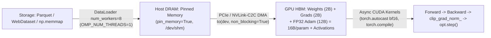

# 3.10 Python for data and ML infrastructure: NumPy, pandas, PyTorch essentials

| | |
|---|---|
| Level | Intermediate |
| Priority tier | 2 |
| Lab venue | Python 3.11+, `pip install numpy pandas pyarrow torch`; GPU optional |
| Part | Part 3: Python for infrastructure |
| Status | Drafted, labs **untested** |

## Why this matters for AI infrastructure

You will not be hired to design neural networks, but you will be paged when a training job is slow, a data loader starves the GPUs, an out-of-memory error kills a run at hour 40, or a notebook leaks 200 GB of RAM. Diagnosing those needs working fluency in the stack that ML engineers use: **NumPy** (the array model underneath everything), **pandas and Arrow** (tabular data), and **PyTorch** (tensors, autograd, modules, devices, data loading, mixed precision, distributed hooks). This chapter is deliberately infrastructure-oriented: memory layout and copies, where time goes, what runs on the CPU versus the GPU, and how to measure. It is not a machine-learning course; model theory is in Part 14.

## Prerequisites and outcomes

Needs 3.1 to 3.6 (Python core, generators, concurrency). After this chapter you can:

- Explain the NumPy array model (dtype, shape, strides, views versus copies, broadcasting) and write vectorised code instead of Python loops.
- Use pandas efficiently (dtypes, categorical data, chunking, groupby, joins), know when it breaks (memory, single thread) and when to move to Arrow, Parquet, Polars, DuckDB or Dask/Spark.
- Read and write a PyTorch training loop; explain tensors, devices, autograd, `nn.Module`, optimisers, `DataLoader`, checkpointing, AMP and gradient accumulation.
- Reason about GPU memory (weights, gradients, optimiser state, activations, fragmentation), asynchronous execution, host-device transfers, and profile with the PyTorch profiler.
- Recognise common infrastructure failure modes: dataloader starvation, CPU thread oversubscription, accidental synchronisation, memory leaks from retained graphs, non-determinism, OOM.

## 1. NumPy: the array model

A NumPy `ndarray` is a block of contiguous (usually) typed memory plus metadata: `dtype` (element type), `shape`, and `strides` (bytes to step along each axis). Almost everything else in the Python data ecosystem (pandas, scikit-learn, PyTorch interop, image libraries) is built around this idea or copies it.

```python
import numpy as np
a = np.arange(12, dtype=np.float32).reshape(3, 4)
a.shape, a.dtype, a.strides, a.flags['C_CONTIGUOUS']     # ((3, 4), float32, (16, 4), True)
b = a.T                                                    # a view: same memory, strides swapped, no copy
b.flags['C_CONTIGUOUS']                                    # False
c = np.ascontiguousarray(b)                                # now a copy in new layout
a[0, 0] = 99; b[0, 0]                                      # 99.0: views share memory
np.shares_memory(a, b)                                     # True
```

Concepts to master:

- **dtype determines bytes**: `float64` is 8 bytes, `float32` 4, `float16`/`bfloat16` 2 (NumPy lacks native bfloat16), `int8` 1. A 1 billion element `float64` array is 8 GB; half of that in `float32`. Default floats are `float64`, defaults in deep learning are `float32` or lower, a frequent source of silent 2x memory use and slow GPU transfers.
- **Views versus copies**: basic slicing, reshape (when possible), transpose and `.view()` return views; fancy (integer/boolean array) indexing, `.copy()` and most arithmetic return new arrays. Mutating a view mutates the base: a classic bug. `np.shares_memory` / `.base` check.
- **Memory order**: C order (row-major) vs Fortran order (column-major) changes which loops are cache-friendly; iterating along the contiguous axis is far faster. Non-contiguous arrays often force a copy when passed to C libraries or to `torch.from_numpy`.
- **Broadcasting**: shapes align from the right; axes of size 1 are stretched virtually without copying. `(N,1) + (1,M) -> (N,M)`. It is powerful and the source of silent shape bugs (adding a `(N,)` vector to an `(N,N)` matrix broadcasts along the wrong axis). Assert shapes at function boundaries.
- **Vectorisation**: express computation as whole-array operations (ufuncs, `np.where`, `einsum`, `matmul`) so loops run in C (and BLAS/SIMD), typically 10 to 1000 times faster than Python loops. Avoid Python-level loops over elements; avoid building arrays by repeated `append`/`concatenate` (quadratic); preallocate.
- **Temporary arrays**: `a*b + c` creates intermediates; use in-place ops (`np.add(a, b, out=a)`), `numexpr`, or fuse with `numba`/`jax`/`torch.compile` when memory bandwidth is the bottleneck.
- **Memory mapping**: `np.memmap`/`np.load(mmap_mode="r")` lets multiple processes share a large read-only array via the OS page cache without loading it all (very useful for datasets and token arrays; see Part 13 for storage behaviour).
- **Threads**: NumPy's linear algebra uses a BLAS library (OpenBLAS, MKL) with its own thread pool controlled by `OMP_NUM_THREADS`/`OPENBLAS_NUM_THREADS`/`MKL_NUM_THREADS`. In multi-process data loaders this multiplies (workers x BLAS threads) and oversubscribes cores: set threads to 1 per worker. `threadpoolctl` inspects and limits pools.
- **Numerical issues**: floating-point is not associative (reductions in different orders give different bits), overflow/underflow in `float16`, catastrophic cancellation, NaN propagation (`np.isnan(x).any()`), `np.errstate` to control warnings. Summation across devices differs from single-device results, which matters when comparing runs (determinism, section 8).

```python
# Typical vectorisation: pairwise distances without loops
X = np.random.rand(1000, 64).astype(np.float32)
d2 = (X**2).sum(1)[:, None] - 2 * X @ X.T + (X**2).sum(1)[None, :]
```

## 2. pandas and the tabular stack

**pandas** provides `DataFrame` (labelled 2-D columns, each a NumPy array or extension array) and `Series`. It is the default for exploration and feature engineering on data that fits in memory. For an infrastructure engineer the questions are: how much memory does it use, is it single-threaded, and what replaces it at scale?

```python
import pandas as pd
df = pd.read_csv("events.csv", dtype={"host": "category", "gpu": "int8"}, parse_dates=["ts"], usecols=["ts","host","gpu","util"])
df.memory_usage(deep=True).sum() / 1e6      # MB
df.groupby("host", observed=True)["util"].agg(["mean", "max", "count"])
df.set_index("ts").resample("5min")["util"].mean()
```

Practical rules:

- **Memory**: a DataFrame typically needs 2 to 5 times the file size in RAM during load and transforms. Reduce with narrow dtypes (`int8/16/32`, `float32`), `category` for low-cardinality strings, `usecols`, reading in `chunksize` pieces, and avoid object dtype (Python strings are heavy). Pandas 2 supports Arrow-backed dtypes (`dtype_backend="pyarrow"`, `string[pyarrow]`) that cut string memory and speed up I/O.
- **Avoid row-wise Python**: no `for i, row in df.iterrows()` and minimise `apply(axis=1)`; use vectorised column ops, `np.where`, `merge`, `groupby`. Chained indexing (`df[a][b] = x`) may modify a copy: use `.loc[mask, "col"] = x`; copy-on-write semantics in recent pandas versions reduce this hazard.
- **Joins and groupbys** can explode memory (many-to-many merges). Check key uniqueness (`validate="one_to_one"`), sort/index to speed joins, drop unneeded columns first.
- **Time series**: timezone-aware timestamps (UTC), `resample`, `rolling`, `shift`; be careful with look-ahead leakage when building features (using future data to compute a feature for the past makes models look great offline and fail in production).
- **Single-threaded by default**: for heavy transforms use Polars (multi-threaded, lazy, Arrow-native), DuckDB (in-process analytical SQL over Parquet/CSV), Dask (partitioned pandas across cores or a cluster), Ray Data, Spark. Choose by data size and team skills: fits RAM then pandas/Polars; larger than RAM but one machine then DuckDB/Polars streaming; many TB then Spark/Ray/Dask on a cluster.

### Columnar formats: Parquet and Arrow

- **Parquet** is a compressed, columnar on-disk format with row groups, per-column statistics and predicate pushdown: reading three columns of fifty reads only those bytes. Prefer Parquet (with zstd or snappy) over CSV/JSON for any dataset beyond toy size; choose row-group sizes (roughly 128 MB to 1 GB per file; many tiny files hurt object stores and metadata services), and partition directories by low-cardinality keys (date) with care.
- **Apache Arrow** is the in-memory columnar format that lets pandas, Polars, Spark, DuckDB, Ray and GPU dataframes (RAPIDS cuDF) exchange data without serialisation (zero-copy). `pyarrow.parquet.read_table(..., columns=[...], filters=[...])`, memory-mapped IPC files, and `pyarrow.dataset` for lazily scanning directories.
- **Webdataset / TFRecord / MDS (MosaicML Streaming)**: sharded sequential record formats for very large training sets (images, tokens) that turn many small random reads into large sequential reads, essential on network file systems and object stores (Part 13).
- **GPU dataframes**: RAPIDS **cuDF** offers a pandas-like API on GPU (`cudf.pandas` accelerator mode can run unmodified pandas code on GPU where supported); beneficial for large joins/groupbys when the data already lives near the GPU. Verify support and speedups per workload.

## 3. PyTorch fundamentals

### 3.1 Tensors and devices

A `torch.Tensor` is NumPy's array model plus a **device** (cpu, cuda:0, mps) and **autograd** metadata. Same ideas: dtype, shape, strides, views versus copies, broadcasting.

```python
import torch
x = torch.randn(4096, 4096)                 # CPU, float32
print(x.dtype, x.device, x.element_size() * x.nelement() / 1e6, "MB")      # 67.1 MB
if torch.cuda.is_available():
    dev = torch.device("cuda:0")
    xg = x.to(dev, non_blocking=True)       # host-to-device copy (async only from pinned memory)
    y = xg @ xg                              # runs on the GPU asynchronously
    torch.cuda.synchronize()                 # wait for the GPU (needed for correct timing)
```



Key facts for infrastructure:

- **Asynchronous execution**: CUDA kernel launches return immediately; the CPU runs ahead until something forces a **synchronisation** (`.item()`, `.cpu()`, `print(tensor)`, `torch.cuda.synchronize()`, boolean checks on GPU tensors). Timing without synchronising measures only launch time. Accidental syncs inside the training loop (logging `loss.item()` every step) stall the pipeline.
- **Host-device transfers** cross PCIe (or NVLink-C2C on Grace Hopper); they are slow relative to on-device memory bandwidth. Use **pinned (page-locked) host memory** (`pin_memory=True` in DataLoader, `tensor.pin_memory()`) with `non_blocking=True` to overlap copies with compute. Move data to the GPU once, in large batches; keep intermediate results on the device.
- **dtypes**: `float32` is standard; `float16` and `bfloat16` halve memory and use Tensor Cores (bfloat16 keeps float32's exponent range and avoids most loss-scaling issues; supported on Ampere and later); `float8` on Hopper/Blackwell via Transformer Engine; `int8` for quantised inference. `torch.set_float32_matmul_precision("high")` allows TF32 on Ampere+ for faster matmuls at slightly lower precision.
- **Views and in-place ops**: `view/reshape/transpose/permute/expand` share storage; in-place ops (trailing underscore, `+=`) save memory but can break autograd if they overwrite a value needed for the backward pass.
- **Interop**: `torch.from_numpy(arr)` shares memory (CPU); `tensor.numpy()` shares memory for CPU tensors; GPU tensors must be `.cpu()` first. DLPack (`torch.utils.dlpack`) exchanges GPU tensors zero-copy with CuPy, JAX, RAPIDS.

### 3.2 Autograd and modules

**Autograd** records operations on tensors with `requires_grad=True` in a dynamic graph and `loss.backward()` computes gradients by reverse-mode differentiation, accumulating into `.grad`. `nn.Module` composes layers and tracks parameters; optimisers (`SGD`, `Adam`, `AdamW`) update parameters from gradients.

```python
import torch, torch.nn as nn, torch.nn.functional as F

class MLP(nn.Module):
    def __init__(self, d_in, d_hidden, d_out):
        super().__init__()
        self.net = nn.Sequential(nn.Linear(d_in, d_hidden), nn.GELU(), nn.Linear(d_hidden, d_out))
    def forward(self, x): return self.net(x)

model = MLP(512, 2048, 10).to(dev)
opt = torch.optim.AdamW(model.parameters(), lr=3e-4, weight_decay=0.01)

for step, (xb, yb) in enumerate(loader):
    xb, yb = xb.to(dev, non_blocking=True), yb.to(dev, non_blocking=True)
    opt.zero_grad(set_to_none=True)                 # frees gradient memory instead of zero-filling
    loss = F.cross_entropy(model(xb), yb)
    loss.backward()                                  # builds gradients; frees the graph by default
    torch.nn.utils.clip_grad_norm_(model.parameters(), 1.0)
    opt.step()
    if step % 100 == 0: print(step, loss.item())     # .item() synchronises: log sparingly
```

Mode switches: `model.train()` / `model.eval()` (dropout, batch norm behave differently); `torch.no_grad()` / `torch.inference_mode()` for evaluation and serving to skip graph building (saves memory and time). Forgetting `eval()` and `no_grad()` in validation is a frequent cause of OOM and wrong metrics. Retaining tensors that still carry graph history (appending `loss` rather than `loss.item()` to a list) keeps whole graphs alive and leaks memory step after step.

### 3.3 Where the memory goes

For training with Adam in mixed precision, per-parameter memory is roughly: weights (2 bytes in bf16, plus a 4-byte fp32 master copy), gradients (2 to 4 bytes), optimiser states (two fp32 moments: 8 bytes), so about **16 bytes per parameter** before activations; a 7-billion-parameter model needs roughly 112 GB of state, more than one 80 GB GPU, which is why sharding (FSDP/ZeRO) exists (Part 14). **Activations** scale with batch size, sequence length and depth, and are often the largest term; **activation (gradient) checkpointing** (`torch.utils.checkpoint`) trades about 30% extra compute for large memory savings. For inference, weights (2 bytes per parameter in fp16/bf16, 1 in int8, ~0.5 in 4-bit) plus the **KV cache**, which grows with batch size and context length, dominate (Part 15).

Allocator behaviour: PyTorch uses a **caching allocator**: freed blocks are retained for reuse, so `nvidia-smi` shows high usage even when tensors are freed, and **fragmentation** can cause OOM with free-but-unusable memory. Inspect with `torch.cuda.memory_allocated()` (live tensors), `memory_reserved()` (cached), `torch.cuda.memory_summary()`, `torch.cuda.memory._record_memory_history()` plus the memory snapshot visualiser; tune with `PYTORCH_CUDA_ALLOC_CONF` (for example `expandable_segments:True`, `max_split_size_mb`). `torch.cuda.empty_cache()` returns cached memory to the driver (rarely a real fix).

### 3.4 Mixed precision, accumulation and compilation

```python
scaler = torch.amp.GradScaler("cuda")                # needed for fp16; unnecessary for bf16
for xb, yb in loader:
    with torch.autocast("cuda", dtype=torch.bfloat16):          # ops run in lower precision where safe
        loss = F.cross_entropy(model(xb.to(dev)), yb.to(dev)) / accum
    loss.backward()                                  # with fp16 use scaler.scale(loss).backward()
    if (step + 1) % accum == 0:                      # gradient accumulation: effective batch = batch * accum
        opt.step(); opt.zero_grad(set_to_none=True)
```

`torch.compile(model)` (TorchInductor/Triton) fuses operations and reduces launch overhead and memory traffic, with compile-time cost, graph breaks to watch for, and recompilation on shape changes. `torch.backends.cudnn.benchmark = True` autotunes convolution algorithms for fixed shapes. Fused optimisers (`fused=True`) and flash attention (`F.scaled_dot_product_attention`) are standard speed-ups.

### 3.5 Data loading: usually the real bottleneck

`torch.utils.data.Dataset` defines `__len__`/`__getitem__`; `DataLoader` batches samples using worker **processes**.

```python
loader = torch.utils.data.DataLoader(
    ds, batch_size=64, shuffle=True,
    num_workers=8,                 # parallel decode/augment processes (fork or spawn; each has its own memory)
    pin_memory=True,               # page-locked buffers for fast async H2D copy
    persistent_workers=True,       # don't respawn workers every epoch
    prefetch_factor=4,             # batches prefetched per worker
    drop_last=True)
```

GPU starvation shows as low `nvidia-smi` utilisation with CPU workers at 100% or I/O wait high. Diagnose: time `next(iter(loader))` versus the model step; check CPU per core (`top`, `mpstat`), I/O (`iostat`, network file system throughput), and decoding cost (JPEG decode, tokenisation). Fixes: more workers (up to cores available, remembering BLAS thread oversubscription), faster formats (sharded Parquet/WebDataset, pre-tokenised memory-mapped arrays), caching/prefetching to local NVMe, GPU decoding (DALI, nvJPEG), larger sequential reads, avoiding Python-heavy per-sample transforms, and keeping dataset objects lightweight (large Python lists or dicts in the Dataset are copied-on-access in forked workers because reference counts touch pages: use NumPy arrays or Arrow tables). Seed workers explicitly for reproducibility (`worker_init_fn`, `generator`). In distributed training, `DistributedSampler` shards data across ranks and `sampler.set_epoch(epoch)` (`set_epoch(epoch)`) must be called each epoch to reshuffle.

### 3.6 Checkpointing and saving

```python
torch.save({"model": model.state_dict(), "opt": opt.state_dict(), "step": step, "rng": torch.get_rng_state()}, tmp)
os.replace(tmp, "ckpt.pt")                  # atomic rename: never leave a half-written checkpoint
state = torch.load("ckpt.pt", map_location="cpu", weights_only=True)
```

- Save to a temp name and rename; write to fast local storage then upload asynchronously; keep the last N plus periodic milestones; record the code version, config and data position so a resume is exact.
- **Security**: `torch.load` uses pickle and can execute arbitrary code from an untrusted file; use `weights_only=True` (default in recent versions), or the **safetensors** format (safe, zero-copy, memory-mappable, fast) for model weights from anywhere you do not control.
- Large-model checkpoints are tens to hundreds of GB; sharded checkpoints (`torch.distributed.checkpoint`) save per-rank shards in parallel and support resharding on resume (Part 14).

## 4. Distributed and multi-GPU hooks (preview)

- `torch.distributed` provides process groups with backends NCCL (GPU, uses NVLink/InfiniBand/RoCE), Gloo (CPU), MPI; launched by `torchrun` (sets `RANK`, `WORLD_SIZE`, `LOCAL_RANK`, `MASTER_ADDR`, `MASTER_PORT`).
- **DistributedDataParallel (DDP)**: one process per GPU, model replicated, gradients all-reduced during backward (bucketed, overlapped with compute). **FSDP** shards parameters, gradients and optimiser states across ranks. Tensor/pipeline/sequence parallelism are in Megatron-LM, DeepSpeed and `torch.distributed.tensor`.
- Typical environment variables an infrastructure engineer sets: `NCCL_DEBUG=INFO`, `NCCL_SOCKET_IFNAME`, `NCCL_IB_HCA`, `NCCL_P2P_DISABLE` for diagnosis, `CUDA_VISIBLE_DEVICES`, `OMP_NUM_THREADS`, `TORCH_DISTRIBUTED_DEBUG=DETAIL`. All details are in Parts 12 and 14.

## 5. Profiling and observability of ML code

- **Wall clock first**: log step time, samples/s or tokens/s, data-wait time versus compute time. The ratio tells you whether the loader or the GPU is the bottleneck.
- **GPU metrics**: `nvidia-smi dmon`, DCGM (utilisation, SM activity, memory bandwidth, power, throttle reasons, NVLink). "Utilisation" in `nvidia-smi` only means a kernel was running during the sample, not that the GPU was efficient; use SM occupancy/Tensor Core activity and achieved model FLOPs utilisation (MFU) for a real picture.
- **PyTorch profiler**:

```python
from torch.profiler import profile, schedule, ProfilerActivity, tensorboard_trace_handler
with profile(activities=[ProfilerActivity.CPU, ProfilerActivity.CUDA],
             schedule=schedule(wait=1, warmup=1, active=3),
             on_trace_ready=tensorboard_trace_handler("./prof"),
             record_shapes=True, profile_memory=True, with_stack=True) as prof:
    for step, batch in zip(range(6), loader):
        train_step(batch); prof.step()
print(prof.key_averages().table(sort_by="cuda_time_total", row_limit=15))
```

  Inspect kernel timelines (gaps between kernels mean CPU-bound or data-starved), top operators, memory usage, and communication ops. NVIDIA **Nsight Systems** (`nsys profile`) shows the whole pipeline (CPU threads, CUDA API, kernels, NCCL, NVTX ranges; add `torch.cuda.nvtx.range_push/pop` markers) and **Nsight Compute** drills into single kernels (Part 10).
- **CPU side**: `py-spy` on training processes (is the main thread in the dataloader, in Python overhead, or waiting on a sync?), `perf`, and `top -H` to see worker threads.
- **Experiment tracking** (Weights & Biases, MLflow, TensorBoard) records metrics, configs, code versions and artefacts so runs are reproducible and comparable (Part 16).
- **Health signals**: loss NaN/Inf detection, gradient norm logging, per-rank step-time skew (stragglers), GPU XID errors in `dmesg`, ECC counters, and heartbeat/timeouts so a hung collective is detected instead of burning GPU-hours.

## 6. Reproducibility and determinism

Runs differ because of random seeds (Python, NumPy, PyTorch CPU and CUDA, data order, worker seeds), non-deterministic GPU kernels (atomic adds in some backward ops), changing library versions, different numbers of GPUs, reduction order and cuDNN autotuning.

```python
import random, numpy as np, torch
def seed_everything(s):
    random.seed(s); np.random.seed(s); torch.manual_seed(s); torch.cuda.manual_seed_all(s)
seed_everything(1234)
torch.use_deterministic_algorithms(True, warn_only=True)     # raises/warns on non-deterministic ops
torch.backends.cudnn.deterministic = True; torch.backends.cudnn.benchmark = False
# also set CUBLAS_WORKSPACE_CONFIG=:4096:8 for deterministic cuBLAS
```

Determinism costs speed; use it for debugging and regression tests, not necessarily for production training. Record exact versions (`pip freeze`, CUDA, driver, NCCL, container digest) with each run; bitwise reproducibility across different GPU counts is generally not achievable.

## 7. Packaging and environments for ML code

- **Wheels vs CUDA**: PyTorch wheels bundle CUDA runtime libraries; choose the index URL matching the CUDA version (`--index-url https://download.pytorch.org/whl/cu1xx`), and ensure the **driver** is new enough for that CUDA (driver supports older runtimes; not vice versa; see Part 10). Mixed CUDA versions between PyTorch, NCCL, and custom extensions cause confusing import errors.
- **Containers**: use NVIDIA NGC PyTorch containers (curated CUDA, cuDNN, NCCL, Transformer Engine versions) or build on `nvidia/cuda` base images; run with the NVIDIA Container Toolkit (`--gpus all`) (Part 11).
- **Dependency pinning** with lock files (uv, pip-tools, poetry) and a recorded container digest; ML stacks break easily on minor-version bumps (numpy 2 ABI changes, transformers/torch compatibility).
- **Virtual environments per project**; avoid `pip install` into system Python; conda/mamba remain common for CUDA toolkits and native deps.
- **Large files** (datasets, checkpoints) do not belong in Git: DVC, git-lfs, object storage with content addressing, model registries (Part 16).

## 8. Common failure modes

| Symptom | Likely cause | Check |
|---|---|---|
| `CUDA out of memory` | batch/sequence too large, retained graphs, fragmentation, other processes on the GPU | `torch.cuda.memory_summary()`, `nvidia-smi`, reduce batch, checkpointing, `expandable_segments`, `torch.no_grad()` in eval |
| Low GPU utilisation, high CPU | data loading or Python overhead | profile loader time, add workers, faster format, pin memory, `torch.compile`/CUDA graphs |
| Memory grows every step | storing tensors with graph (`losses.append(loss)`), growing lists/caches | store `.item()`/`.detach()`, `tracemalloc` and `torch.cuda.memory_allocated` over time |
| Loss becomes NaN | learning rate too high, fp16 overflow, bad data, division by zero | anomaly detection `torch.autograd.set_detect_anomaly(True)` (slow), gradient clipping, bf16, data validation |
| Training slower with more workers | BLAS/OMP thread oversubscription, shared-memory limits | set `OMP_NUM_THREADS=1` per worker, check `/dev/shm` size in containers (set larger `--shm-size`) |
| `DataLoader worker killed` / bus error | `/dev/shm` too small in Docker/Kubernetes, or host RAM OOM | enlarge shm (emptyDir medium Memory), reduce workers/prefetch |
| Hangs at start of multi-GPU run | rendezvous misconfig, NCCL network interface wrong, firewall | `NCCL_DEBUG=INFO`, `NCCL_SOCKET_IFNAME`, check ports and `MASTER_ADDR` |
| Different results run to run | nondeterministic kernels, unseeded workers | section 6 |
| Slow first step, then fast | lazy init, cudnn benchmark, `torch.compile` warm-up | warm up before timing; synchronise before measuring |
| Pandas job killed | OOM from copies and object dtype | dtypes, chunking, Parquet column pruning, Polars/DuckDB |

## 9. Lab

First, run the self-checking Python lab (`code/part03/python_data_ml_infra_lab.py`) locally. It verifies NumPy `ndarray` C-contiguous vs F-contiguous byte strides (`compute_ndarray_strides`) and right-aligned broadcasting (`broadcast_shapes`), row-major CSV vs columnar Parquet read volume (`compare_row_vs_columnar_io`, `DMLS` Ch. 3), mixed-precision AdamW static memory accounting (`16 B/param` -> `112 GB` for a 7B model, `AIE` Ch. 7), and `DataLoader` worker starvation vs GPU step saturation (`diagnose_dataloader_vs_gpu_bottleneck`).

```bash
python3 code/part03/python_data_ml_infra_lab.py
```

Next, on any machine with Python 3.11+ (all interactive shell steps below are `untested here`), work through these exercises:

1. **NumPy model**: create arrays and print `shape/strides/dtype`; demonstrate a view mutation bug; compare a Python loop, a list comprehension and a vectorised version of pairwise distances (time with `%timeit`/`timeit`); show quadratic `np.concatenate` in a loop versus preallocation; map a large `.npy` with `mmap_mode` and read it from two processes.
2. **Thread oversubscription**: time a matrix multiply with `OMP_NUM_THREADS` of 1, 4 and all cores; spawn 8 worker processes each using all BLAS threads and observe the slowdown; fix with `threadpoolctl`.
3. **pandas diet**: generate a 5 million row CSV; load with defaults and with narrow dtypes/categories/usecols; compare memory and time; write Parquet (zstd) and compare size and column-pruned read time; repeat the groupby in Polars and DuckDB.
4. **Tensors and devices**: reproduce the async illusion: time a GPU matmul with and without `torch.cuda.synchronize()`; measure pageable vs pinned host-to-device bandwidth; show an accidental `.item()` sync in a loop.
5. **Training loop**: implement the MLP loop on synthetic data; toggle `train/eval`, `no_grad`; deliberately leak by appending `loss`, graph-retaining, and watch memory grow; fix.
6. **Memory accounting**: for a small transformer from `torch.nn`, predict memory (weights, grads, Adam state, activations) and compare with `torch.cuda.max_memory_allocated()`; enable bf16 autocast, then activation checkpointing, and record each effect.
7. **Data loader tuning**: build a Dataset with an artificial 20 ms per-sample decode; measure samples/s for `num_workers` of 0, 2, 4, 8, `pin_memory`, `persistent_workers`; find where GPU utilisation saturates; reproduce the `/dev/shm` failure in a container with a small `--shm-size`.
8. **Profiler**: capture a PyTorch profiler trace of the loop, open it in TensorBoard/Perfetto, identify the largest gaps and operators; run `nsys profile` and add NVTX ranges.
9. **Checkpoint safety**: save with temp-and-rename; kill the process during a save and confirm the previous checkpoint remains valid; load with `weights_only=True`; convert to safetensors and compare load time with `mmap`.
10. **Determinism**: run twice unseeded then seeded; enable deterministic algorithms and measure the speed cost; locate a non-deterministic op that warns.
11. **Packaging**: build a CUDA-matched virtual environment and a container from an NGC image; verify `torch.cuda.is_available()`, driver/runtime versions, and `python -c "import torch; print(torch.__config__.show())"`.
12. **Clean up.**

## 10. Interview angles

- "Training is slow and GPU utilisation is 40%. Walk me through diagnosis." (loader vs compute vs sync; profiler; storage; threads.)
- "Why does GPU memory show used after you delete tensors?" (caching allocator; reserved vs allocated.)
- "What takes memory during training? How would you fit a bigger model?" (state per parameter, activations, mixed precision, checkpointing, sharding, offload.)
- "Explain views versus copies and broadcasting pitfalls."
- "How do you make a PyTorch job reproducible? What does it cost?"
- "Why is `torch.load` on an untrusted file dangerous? What do you use instead?"
- "pandas ran out of memory on a 30 GB CSV on a 32 GB machine. Options?" (dtypes, chunks, Parquet, Polars/DuckDB, Dask.)
- "What does `num_workers`, `pin_memory`, and `persistent_workers` do?"
- "Why can `/dev/shm` be a problem for DataLoader in Kubernetes?"

## Exercises

1. **NumPy Memory Layout (`dtype`, `shape`, `strides`), Views vs. Copies, Broadcasting, and BLAS Thread Oversubscription:** Using `compute_ndarray_strides()` and `broadcast_shapes()` in `code/part03/python_data_ml_infra.py`, explain: (a) why `a = np.arange(12, dtype=np.float32).reshape(3, 4)` has strides `(16, 4)` while `b = a.T` is a zero-copy view with strides `(4, 16)` and `C_CONTIGUOUS == False`; (b) how right-aligned broadcasting stretches `(1000, 1) + (1, 64)` to `(1000, 64)` and why adding `(N,)` to `(N, 1)` silently builds an `(N, N)` matrix; and (c) why `DataLoader(num_workers=8)` with default `OMP_NUM_THREADS` causes severe CPU oversubscription.
2. **Tabular Data at Scale: `pandas` Memory Diet, Row-Major CSV vs. Columnar Parquet/Arrow, and Data Leakage (`DMLS` Chapter 3):** Using `compare_row_vs_columnar_io()`, explain: (a) how narrow dtypes (`int8`, `float32`, `category`, `string[pyarrow]`) and `usecols` cut DataFrame RAM by 2x to 5x; (b) why reading 3 of 50 columns across 1M rows scans 400 MB in row-major CSV versus 6 MB in 4x-compressed columnar Parquet; and (c) how look-ahead time-travel leakage occurs when resampling or normalising time-series features before splitting by time.
3. **PyTorch Tensors, Asynchronous CUDA Execution, Pinned Memory (`pin_memory=True`), and Autograd Leaks:** (a) Explain why timing `y = xg @ xg` on a CUDA tensor without `torch.cuda.synchronize()` only measures host kernel-launch overhead, and why calling `loss.item()` on every step stalls the GPU pipeline; (b) explain why `pin_memory=True` + `to(dev, non_blocking=True)` is required for overlapping host-to-device DMA transfers with compute, and why appending `loss` (instead of `loss.item()` or `loss.detach()`) to a history list causes an out-of-memory crash.
4. **Training & Inference Memory Accounting (`16 B/param`), Caching Allocator (`allocated` vs. `reserved`), and AMP (`bf16` vs. `fp16`, `AIE` Ch. 2, 7, 9):** Using `estimate_adam_mixed_precision_memory_gb()`, calculate the exact weight, gradient, and FP32 Adam optimizer state memory for a 7B parameter model (`14 + 14 + 84 = 112 GB`), explain why `nvidia-smi` (`memory_reserved()`) stays high after freeing tensors (`PYTORCH_CUDA_ALLOC_CONF=expandable_segments:True`), and explain why `bfloat16` does not need `GradScaler` whereas `float16` does.
5. **DataLoader Starvation Diagnosis, `/dev/shm` Bus Errors, and Fork Copy-on-Access (`diagnose_dataloader_vs_gpu_bottleneck`):** Using `diagnose_dataloader_vs_gpu_bottleneck()`, compute the effective GPU utilization when per-sample CPU decoding takes 20 ms (`batch_size=64`, `gpu_compute_ms=100`) at `num_workers=0` (`7.8%`) versus `num_workers=16` (`100%`), explain why Docker/Kubernetes containers default to a 64 MB `/dev/shm` that kills DataLoader workers with `Bus error`, and explain why storing dataset metadata in a huge Python `list` triggers copy-on-write page faults across forked workers.
6. **Atomic Checkpointing, `weights_only=True` vs. `safetensors`, Reproducibility (`seed_everything`), and Profiling (`torch.profiler`):** (a) Explain why checkpoints must be written to a temp file and atomically renamed (`os.replace`) and why `torch.load(..., weights_only=True)` or `safetensors` (`mmap`) is mandatory for untrusted weights; (b) list the settings required for deterministic PyTorch runs (`seed_everything`, `use_deterministic_algorithms`, `cudnn.benchmark = False`, `CUBLAS_WORKSPACE_CONFIG=:4096:8`) and explain how `torch.profiler` (`schedule(wait=1, warmup=1, active=3)`) and `nsys` reveal data-loader gaps and stragglers.

## Checkpoint questions (20)

<details>
<summary>1. What three attributes define a NumPy `ndarray`'s memory layout, and why is `b = a.T` a view rather than a copy?</summary>

A NumPy `ndarray` is defined by: (1) **`dtype`** (element type and byte size, e.g., `float32` = 4 bytes vs default `float64` = 8 bytes), (2) **`shape`** (tuple of dimension sizes, e.g., `(3, 4)`), and (3) **`strides`** (tuple of byte steps to advance by 1 element along each axis, e.g., `(16, 4)` for C-contiguous row-major `(3, 4)` `float32`). Transposing (`b = a.T`) simply swaps `shape` to `(4, 3)` and `strides` to `(4, 16)` while pointing to the **exact same underlying memory buffer** (`np.shares_memory(a, b)` is `True`, `b.flags['C_CONTIGUOUS']` is `False`), so mutating `a[0, 0] = 99` also changes `b[0, 0]`.
</details>

<details>
<summary>2. How does NumPy/PyTorch broadcasting work, and what is the classic `(N,)` vs. `(N, 1)` broadcasting trap?</summary>

Broadcasting aligns array shapes **from the rightmost (trailing) dimension to the left**: two dimensions are compatible if they are equal or one of them is `1` (which is virtually stretched without copying memory). If you add a 1-D vector of shape `(N,)` to a column vector of shape `(N, 1)`, right-alignment pads `(N,)` to `(1, N)` and broadcasts `(N, 1) + (1, N)` into an **`(N, N)` matrix** instead of an `(N, 1)` element-wise sum—silently multiplying memory by $N$ and corrupting losses. Always assert shapes or explicitly reshape (`x[:, None]`).
</details>

<details>
<summary>3. Why does spawning 8 `DataLoader` workers on a node using NumPy/OpenBLAS/MKL often slow training down, and how do you fix it?</summary>

NumPy, SciPy, and OpenCV link against multithreaded BLAS/OpenMP libraries (`OpenBLAS`, `MKL`, `GOMP`) that spawn up to `os.cpu_count()` threads per process by default. If 8 GPU processes each spawn 8 `DataLoader` workers (64 processes) and each worker spawns 64 BLAS threads, 4,096 threads thrash on 64 CPU cores. Fix it by setting **`OMP_NUM_THREADS=1`**, **`MKL_NUM_THREADS=1`**, and **`OPENBLAS_NUM_THREADS=1`** (or using `threadpoolctl`) inside workers.
</details>

<details>
<summary>4. How do you reduce a `pandas` DataFrame's RAM footprint by 2x to 5x, and when should you switch to Polars, DuckDB, or Dask?</summary>

- **Cut pandas RAM:** Pass explicit `usecols=[...]` and narrow `dtype=` (`int8`/`int16`/`int32`, `float32`, **`category`** for low-cardinality strings, or Pandas 2 **`dtype_backend="pyarrow"`** `string[pyarrow]`) to `pd.read_csv` / `read_parquet`, and never iterate rows with `df.iterrows()`.
- **When to switch:** Pandas is single-threaded and requires 2x to 5x the dataset size in RAM. Use **Polars** (multithreaded, lazy query optimizer, Arrow-native) or **DuckDB** (in-process vectorized SQL with out-of-core streaming over Parquet) on a single machine up to hundreds of GB; use **Ray Data**, **Dask**, or **Spark** across multi-node clusters.
</details>

<details>
<summary>5. Contrast Row-Major formats (CSV, JSON) with Columnar formats (Apache Parquet, Apache Arrow) and Sequential Shard formats (WebDataset, MDS) (`DMLS` Chapter 3).</summary>

- **Row-major (CSV/JSON):** Stores all columns of row 1 contiguously, then row 2; reading 3 features out of 50 forces the disk to read and parse 100% of the file.
- **Columnar on disk (Parquet) and in memory (Apache Arrow):** Stores each column contiguously in compressed row groups with min/max statistics, enabling **column projection** (reading only the 3 requested columns) and **predicate pushdown** (skipping row groups that don't match a `WHERE` filter), while Arrow allows zero-copy memory sharing across pandas, Polars, DuckDB, PyArrow, and RAPIDS `cuDF`.
- **Sequential shards (WebDataset `.tar`, MosaicML `MDS`, `np.memmap`):** Pack thousands of small images/token sequences into 128 MB–1 GB sequential shards so Lustre/NVMe/S3 streams large contiguous blocks instead of suffering small-file metadata IOPS storms.
</details>

<details>
<summary>6. What is time-travel (look-ahead) data leakage in feature engineering, and how do you prevent it (`DMLS` Chapter 3)?</summary>

**Look-ahead leakage** occurs when information from the future leaks into training features for the past—for example, splitting a time-series log dataset randomly instead of by a timestamp cutoff (`train < T_split <= test`), computing global mean/std normalization across the entire dataset before splitting, or using centered rolling windows. It produces artificially high offline validation accuracy and fails in production. Always split by time **first** and fit scalers/aggregations strictly on historical windows.
</details>

<details>
<summary>7. Why is CUDA kernel execution asynchronous, which PyTorch operations force a host-device synchronization, and why does `loss.item()` inside a loop hurt throughput?</summary>

When Python calls `y = xg @ xg`, the CPU enqueues the kernel onto the GPU's CUDA stream and **returns immediately** so Python can prepare the next op while the GPU executes. Operations that copy data back to host RAM—**`.item()`**, **`.cpu()`**, **`.numpy()`**, **`print(cuda_tensor)`**, **`if cuda_tensor > 0:`**, and **`torch.cuda.synchronize()`**—block the CPU until all queued GPU kernels finish. Calling `loss.item()` on every single step drains the CUDA launch queue, preventing CPU-GPU overlap; log every `N` steps (`if step % 100 == 0:`) and always call `torch.cuda.synchronize()` before starting/stopping benchmark timers.
</details>

<details>
<summary>8. How do Pinned (Page-Locked) Memory (`pin_memory=True`) and `non_blocking=True` accelerate Host-to-Device (`H2D`) transfers?</summary>

Normal OS user-space memory is **pageable** (the kernel can swap or move physical pages at any time). The GPU's DMA engine cannot read pageable memory directly—so copying a pageable tensor to the GPU forces the CUDA driver to first copy the tensor on the CPU into a temporary staging buffer in page-locked memory and then DMA it over PCIe synchronously. Setting **`pin_memory=True`** on `DataLoader` allocates batches directly in page-locked host RAM, allowing **`xb.to(dev, non_blocking=True)`** to run asynchronously via DMA while the CPU and GPU compute cores continue working.
</details>

<details>
<summary>9. Why does `losses.append(loss)` inside a training loop cause a `CUDA out of memory` crash after a few dozen steps, and why should you use `opt.zero_grad(set_to_none=True)`?</summary>

- **Retained autograd graph:** `loss` is a `Tensor` with `requires_grad=True` whose `.grad_fn` points back to the entire forward-pass computational graph and all intermediate activation tensors. Appending `loss` to a Python list keeps a live reference to the graph from every step, preventing PyTorch from freeing activations after `loss.backward()`. Always append **`loss.item()`** (a plain Python `float`) or `loss.detach()`.
- **`opt.zero_grad(set_to_none=True)`:** Resets each parameter's `.grad` reference to `None` (freeing the memory block and skipping a `memset` kernel) instead of writing zeros into every gradient tensor.
</details>

<details>
<summary>10. Walk through the `16 bytes per parameter` mixed-precision AdamW memory rule of thumb for a 7B model (`AIE` Chapter 7).</summary>

In mixed-precision (`bf16` or `fp16`) training with Adam/AdamW, each parameter $\Psi$ requires:
- **Model weights (`bf16`):** `2 bytes`
- **Gradients (`bf16`):** `2 bytes` (or `4 bytes` if accumulated in `fp32`)
- **Optimizer states (`fp32`):** `4 bytes` (`fp32` master weight copy) + `4 bytes` (first moment $m$, momentum) + `4 bytes` (second moment $v$, variance) = **`12 bytes`**
Total static state = **`16 bytes per parameter`** (`18 bytes` with `fp32` gradients). For a **7-billion-parameter model**, static state alone is `7 * 10^9 * 16 B = 112 GB`—exceeding a single 80 GB H100/A100 before adding a single byte of forward activations.
</details>

<details>
<summary>11. What is the difference between `torch.cuda.memory_allocated()` and `torch.cuda.memory_reserved()`, and how do you mitigate allocator fragmentation?</summary>

PyTorch uses a **caching memory allocator** over CUDA `cudaMalloc` so tensor allocations in the training loop do not hit slow driver calls on every step:
- **`torch.cuda.memory_allocated()`**: bytes currently occupied by **live PyTorch tensors**.
- **`torch.cuda.memory_reserved()`**: total GPU memory held by PyTorch's caching pool (what `nvidia-smi` reports), which includes freed blocks cached for future reuse.
When variable sequence lengths cause large reserved blocks to fragment into non-contiguous chunks, PyTorch can raise `CUDA out of memory` even when `reserved - allocated` shows gigabytes "free". Mitigate fragmentation by padding inputs to fixed bucket lengths and setting **`PYTORCH_CUDA_ALLOC_CONF=expandable_segments:True`**.
</details>

<details>
<summary>12. Compare `bfloat16` (`bf16`) and `float16` (`fp16`) in `torch.autocast`, and explain why `bf16` does not need `GradScaler`.</summary>

- **`float16` (IEEE 754 half precision):** 1 sign bit, **5 exponent bits**, 10 mantissa bits (dynamic range $\approx 6 \times 10^{-8}$ to $65,504$). Small gradients easily underflow to zero, requiring **`torch.amp.GradScaler`** to scale up the loss before `backward()` and unscale gradients before `opt.step()`.
- **`bfloat16` (Brain Floating Point, Ampere+):** 1 sign bit, **8 exponent bits** (the **exact same exponent range as `float32`**), 7 mantissa bits. Because `bf16` has `fp32`'s dynamic range, gradients do not underflow and **`GradScaler` is unnecessary**.
</details>

<details>
<summary>13. How do Gradient Accumulation and Activation Checkpointing (`torch.utils.checkpoint`) let you train with large effective batch sizes on limited VRAM?</summary>

- **Gradient accumulation:** Splits a large desired batch (`64`) into `accum` smaller micro-batches (`8 x 8`), dividing each micro-batch loss by `accum`, calling `loss.backward()` on each micro-batch (which sums gradients into `.grad` while freeing that micro-batch's activations), and calling `opt.step(); opt.zero_grad()` only every `accum` steps—cutting peak activation memory by `accum`x.
- **Activation checkpointing (`torch.utils.checkpoint`):** Discards intermediate layer activations during the forward pass (keeping only layer boundary inputs) and recomputes them on the fly during the backward pass, trading ~30% extra forward compute for a 60%–80% reduction in activation memory.
</details>

<details>
<summary>14. Why do `DataLoader` workers crash with `Bus error (core dumped)` inside Docker and Kubernetes containers, and how do you fix it?</summary>

PyTorch `DataLoader` workers (`num_workers > 0`) pass prefetched tensor batches back to the main training process using POSIX shared memory (**`/dev/shm`**). Docker and Kubernetes default `/dev/shm` to just **64 MB**—as soon as prefetched batches exceed 64 MB, `mmap` on `/dev/shm` fails with **`SIGBUS` (`Bus error`)**. Fix it by running Docker with **`--shm-size=16g`** (or `--ipc=host`) and mounting a memory-backed `emptyDir` (`emptyDir: { medium: Memory, sizeLimit: 32Gi }`) at `/dev/shm` in Kubernetes Pod specs.
</details>

<details>
<summary>15. Why does storing a 10-million-item Python `list` of strings/dicts inside a PyTorch `Dataset.__init__` cause host RAM to explode across `num_workers` under `fork`?</summary>

Under Linux's default `fork` start method, worker processes initially share the parent's memory pages via **copy-on-write (CoW)**. However, every time a worker reads an element from a Python `list` or `dict`, CPython increments the element's **reference count (`ob_refcnt`)** inside the object header—writing to the memory page and triggering a kernel CoW page fault that duplicates the entire list across every worker (`8 workers x 10 GB = 80 GB RAM`). Store dataset indexes in flat **NumPy arrays, Arrow tables, or `np.memmap`** whose element reads do not mutate Python reference counts.
</details>

<details>
<summary>16. Why is `torch.load("model.pt")` a security vulnerability on untrusted checkpoints, and how do `weights_only=True` and `safetensors` solve it?</summary>

Standard `torch.save` / `torch.load` serializes objects using Python's **`pickle`**, which can execute arbitrary shell commands (`os.system`) embedded in `__reduce__` when loading an untrusted file. Always pass **`weights_only=True`** to `torch.load` (which restricts unpickling to primitive tensor storage), or store weights in Hugging Face **`safetensors`** format—which has a simple JSON header + raw contiguous tensor bytes, is 100% immune to code execution, and loads directly via zero-copy **`mmap`**.
</details>

<details>
<summary>17. How do you interpret a PyTorch Profiler trace (`schedule(wait=1, warmup=1, active=3)`) when diagnosing low GPU utilization?</summary>

1. Use `schedule(wait=1, warmup=1, active=3)` so step 0 initialization and `torch.compile` / cuDNN warmup are excluded from the trace.
2. In TensorBoard / Perfetto (`ui.perfetto.dev`), inspect the **GPU Kernel stream**:
   - **Wide empty gaps between kernels at the start of each step** with `aten::copy_` stalling indicate **DataLoader starvation** (disk/CPU decode bottleneck).
   - **Thousands of tiny kernels separated by microsecond gaps** indicate **CPU launch overhead** or accidental `.item()` host-device synchronizations (fix with `torch.compile`, fused optimizers, and removing syncs).
   - **Long `ncclDevKernel_AllReduce` bars** indicate **network fabric or straggler bottlenecks** across nodes.
</details>

<details>
<summary>18. What environment variables does `torchrun` set, and what is the difference between `DDP` and `FSDP`?</summary>

`torchrun` spawns one process per GPU and injects **`RANK`** (`0..WORLD_SIZE-1`), **`LOCAL_RANK`** (`0..7` on the node, used for `torch.cuda.set_device(local_rank)`), **`WORLD_SIZE`**, **`MASTER_ADDR`**, and **`MASTER_PORT`**.
- **`DistributedDataParallel (DDP)`:** Replicates the full model, gradients, and optimizer states on every GPU (`16 * Psi` bytes per GPU) and `AllReduce`s gradients during backward.
- **`FullyShardedDataParallel (FSDP)` (ZeRO-3):** Shards parameters, gradients, and optimizer states across $N$ GPUs (`16 * Psi / N` bytes per GPU), gathering layer weights on demand via `AllGather` before forward/backward and `ReduceScatter`ing gradients.
</details>

<details>
<summary>19. Why can `nvidia-smi` report `99% GPU-Util` while a training job is actually running at 15% efficiency (MFU)?</summary>

In `nvidia-smi`, `GPU-Util` only measures the **percentage of time at least one CUDA kernel was active on any single Streaming Multiprocessor (SM)** during the sampling window—a tiny element-wise kernel using 1 of 132 SMs or a memory-stalled kernel waiting on HBM reads still reports `100% GPU-Util`. True efficiency is measured by **DCGM `SM_ACTIVE` / `PIPE_TENSOR_ACTIVE`**, achieved tokens/sec, and **Model FLOPs Utilization (`MFU`)** (achieved FLOP/s divided by hardware peak Tensor Core FLOP/s).
</details>

<details>
<summary>20. What six sources of non-determinism cause two PyTorch runs with the same code to produce different losses, and how do you lock them down for debugging?</summary>

1. Unseeded RNGs -> call `random.seed(s)`, `np.random.seed(s)`, `torch.manual_seed(s)`, `torch.cuda.manual_seed_all(s)`.
2. Unseeded `DataLoader` workers -> pass `worker_init_fn` and a seeded `torch.Generator()`.
3. cuDNN algorithm autotuning -> set `torch.backends.cudnn.benchmark = False` and `torch.backends.cudnn.deterministic = True`.
4. Non-deterministic GPU atomic reductions (`scatter_add_`, FlashAttention backward) -> call `torch.use_deterministic_algorithms(True)`.
5. cuBLAS workspace non-determinism -> set `CUBLAS_WORKSPACE_CONFIG=:4096:8`.
6. Floating-point non-associativity across different GPU counts/topologies -> keep `WORLD_SIZE` and batch size identical when comparing regression runs.
</details>

## Sources and review notes

- **Sources read in full:**
  - `designing-machine-learning-systems` — Chip Huyen, *Designing Machine Learning Systems*, **Chapter 3: Data Engineering Fundamentals** and **Chapter 7: Model Deployment and Prediction Service** (row-major CSV vs columnar Parquet/Arrow data models, pandas DataFrame vs Series layout, data leakage causes and prevention, batch vs streaming pipelines, and model serving/compression).
  - `ai-engineering` — Chip Huyen, *AI Engineering*, **Chapter 2: Understanding Foundation Models**, **Chapter 7: Finetuning**, and **Chapter 9: Inference Optimization** (parameter and activation memory math across `fp32`/`fp16`/`bf16`/`int8`/`int4`, mixed-precision Adam state breakdown, LoRA/QLoRA memory savings, prefill compute-bound vs decode memory-bandwidth-bound bottlenecks, and KV cache sizing).
  - `nvidia-devops` (`volume-02` and `volume-13`) and NumPy, pandas, Apache Arrow/Parquet, Polars, DuckDB, and PyTorch documentation (autograd, `DataLoader`, AMP, `torch.profiler`, CUDA semantics, reproducibility, and distributed hooks).
- **Run here:** `python3 code/part03/python_data_ml_infra_lab.py` (4 passed, 0 failed).
- **Explicitly labelled inferences:** The `compute_ndarray_strides`, `broadcast_shapes`, `compare_row_vs_columnar_io`, `estimate_adam_mixed_precision_memory_gb`, and `diagnose_dataloader_vs_gpu_bottleneck` models in `code/part03/python_data_ml_infra.py` and the `MLP` training loop are the author's deterministic constructions encoding the memory and throughput formulas from *AI Engineering* and *Designing Machine Learning Systems* (plus original study items 21, 22, 23, 24, 25, 26, 27, 28, 29, 30, 31, 32, 33, 34, and 35).
- **Not verified on live hardware:** Live CUDA `torch.cuda.synchronize()`, `DataLoader(num_workers=8, pin_memory=True)`, `torch.profiler`, `nsys profile`, and `torchrun` commands (`4096x4096` `67.1 MB`, `7B` `112 GB`, `80 GB`, `128 MB to 1 GB`, `:4096:8`, `1234`, `30 GB` / `32 GB`, `hour 40`, `200 GB`) are marked (`untested here`) where not executed by `python_data_ml_infra_lab.py`.
