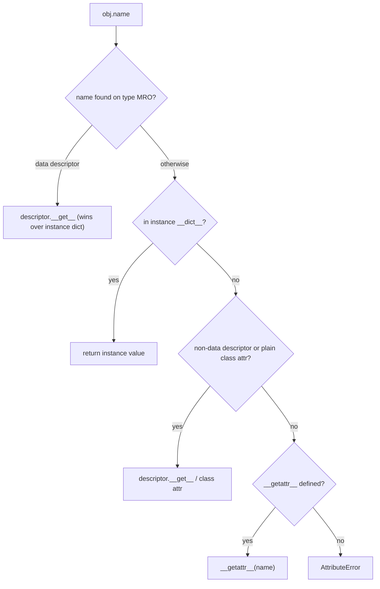

# 3.11 Python under the hood: decorators, descriptors and metaprogramming (how frameworks work)

| | |
|---|---|
| Level | Advanced |
| Priority tier | 2 |
| Lab venue | Python 3.11+ (standard library only) |
| Part | Part 3: Python for infrastructure |
| Status | Drafted, labs **untested** |

## Why this matters for AI infrastructure

Your pager goes off at 3 a.m., and the stack trace leads into a FastAPI route, a pydantic model or a pytest fixture you did not write. Nothing in that trail is magic, but it reads that way until you have seen the few language mechanisms underneath it. The same ideas sit under SQLAlchemy columns, dataclasses, Click commands, Airflow DAGs, PyTorch `nn.Module` parameters, `torch.compile` and Ray's `@ray.remote`.

The mechanisms repeat, and that is the good news. Functions are objects, closures capture variables, and decorators rewrite callables. Descriptors control attribute access. `__init_subclass__` and metaclasses run code when a class is created, and the import system can be hooked as well.

Knowing these mechanisms changes what you can do on a bad day. You can read framework source when a bug lands in your lap. You can also write your own small frameworks, such as plugin registries, config schemas and operator wrappers. Senior interviews often ask "how does this actually work?" to separate users from engineers, and these mechanisms are the answer.

The chapter also teaches restraint, and it says so more than once. Most metaprogramming should not exist in application code.

## Prerequisites and outcomes

Before you start, one practical note. You need 3.1 to 3.4 first, because they cover functions, classes, the data model and typing. This chapter assumes all of it. When you finish, you should be able to do the following.

- Explain closures, `nonlocal`, late binding and how decorators are applied, including decorators with arguments, class-based decorators, stacking and `functools.wraps`.
- Write decorators for timing, retry, caching, authorisation, registration and instrumentation, handling both sync and async functions.
- Explain the attribute lookup algorithm, `property`, descriptors (data versus non-data), `__getattr__`, `__getattribute__`, `__slots__`, and how methods are bound.
- Explain what `dataclass`, pydantic and ORMs do at class-creation time, use `__init_subclass__`, class decorators and metaclasses where they are justified, and know the cheaper alternative first.
- Inspect and generate code with `inspect`, `typing.get_type_hints`, `ast`, `dis`, and understand import hooks and `sys.modules`.
- Decide when metaprogramming is appropriate, test it, and keep it debuggable.

Treat the list as a checklist. Each later section maps to one or more of these outcomes, so you can always see where you are.

## 1. Functions are objects; closures

Suppose you want a counter that remembers its count between calls, and you do not want a whole class for one number. Functions are first-class objects, so you can assign them, pass them, return them and attach attributes. A **closure** is a function that remembers variables from its enclosing scope, even after that scope has returned.

```python
def make_counter():
    count = 0
    def inc():
        nonlocal count            # rebind the enclosing variable (otherwise assignment makes `count` local)
        count += 1
        return count
    return inc

c = make_counter(); c(); c()      # 2
c.__closure__[0].cell_contents    # 2: the captured cell
```

The `nonlocal` line does the quiet work. It lets the inner function change the captured name. Without it, the assignment would make the name local to the inner function.

Python looks up names in a fixed order: Local, Enclosing, Global, Built-in. Keep the middle two words in mind. A closure captures variables, not values, and that small distinction leads to the classic late-binding trap.

```python
fs = [lambda: i for i in range(3)]
[f() for f in fs]                 # [2, 2, 2]: all see the final i
fs = [lambda i=i: i for i in range(3)]      # bind at definition via default argument
from functools import partial; fs = [partial(lambda i: i, i) for i in range(3)]    # or partial
```

All three lambdas in the first line look up the same name. By the time you call them, the loop has finished, so that name holds 2. The default argument and the `partial` call each copy the value when the lambda is defined, which is why both fixes work.

Closures are also a lightweight alternative to a class with a single method. A configured callable, such as `make_rate_limiter(100)`, keeps its state in cells instead of attributes. Watch the memory, though. A closure keeps the entire captured object alive, so a captured large tensor is not freed while the closure exists. That matters for long-lived callbacks.

## 2. Decorators

Suppose every service in your team needs the same timing code, and the function bodies keep changing underneath it. You do not want to edit each function, and you do not want to forget one. A decorator wraps the function once, when Python defines it.

`@decorator` above a `def` is exactly `f = decorator(f)`, executed at definition time. In plain words, a decorator is any callable that takes a callable and returns a replacement, often a wrapper. Every later call goes through that replacement.

```python
import functools, time, logging
log = logging.getLogger(__name__)

def timed(fn):
    @functools.wraps(fn)                       # preserves __name__, __doc__, __wrapped__, signature introspection
    def wrapper(*args, **kwargs):
        t0 = time.perf_counter()
        try:
            return fn(*args, **kwargs)
        finally:
            log.info("%s took %.3fs", fn.__qualname__, time.perf_counter() - t0)
    return wrapper

@timed
def drain(node): ...
```

Look at the `@functools.wraps(fn)` line, because it prevents a specific and common bug. Without it, introspection, documentation generators, FastAPI and pydantic signature inspection, and pytest fixtures see the wrapper's name and signature instead of the original. The function still runs, but it has quietly lost its name. That is why the `wraps` line matters in this example.

### Decorators with arguments

Sometimes the decorator needs settings of its own, such as how many times to retry. Then one level of nesting is not enough. The code below has three levels: a factory that takes the arguments, a decorator that takes the function, and a wrapper that does the work.

```python
def retry(times=3, exceptions=(Exception,), delay=0.5):
    def deco(fn):
        @functools.wraps(fn)
        def wrapper(*a, **kw):
            for attempt in range(1, times + 1):
                try:
                    return fn(*a, **kw)
                except exceptions as e:
                    if attempt == times: raise
                    time.sleep(delay * 2 ** (attempt - 1))
        return wrapper
    return deco

@retry(times=5, exceptions=(ConnectionError, TimeoutError))
def fetch(): ...
```

Read it from the outside in. The outer `retry` receives the settings, `deco` receives the function, and `wrapper` retries the call with a growing delay between attempts.

### Sync and async

Here is a mistake that hides well. A wrapper around an `async def` function must itself be `async def`, and it must `await` the call. Otherwise you get one of two quiet failures: you either return a coroutine that nobody awaits, or you time only the creation of the coroutine. The version below supports both kinds of function, and it picks the right wrapper when the decorator runs.

```python
import inspect
def timed(fn):
    if inspect.iscoroutinefunction(fn):
        @functools.wraps(fn)
        async def aw(*a, **kw):
            t0 = time.perf_counter()
            try: return await fn(*a, **kw)
            finally: log.info("%s %.3fs", fn.__name__, time.perf_counter() - t0)
        return aw
    @functools.wraps(fn)
    def w(*a, **kw):
        t0 = time.perf_counter()
        try: return fn(*a, **kw)
        finally: log.info("%s %.3fs", fn.__name__, time.perf_counter() - t0)
    return w
```

### Class-based decorators, stacking and registries

A class with `__call__` keeps state cleanly, for example a call counter or a cache, and many people reach for one first. It has a trap, though, and the trap only shows up on methods.

Suppose you write `class tracer` with an `__init__` that stores `self.calls = 0` and `self.func = func`, plus a `__call__` method. If you apply `@tracer` to a method, such as `@tracer def restart(self, service):` inside a `Host` class, then calling `host.restart("nginx")` fails. The reason is that `tracer` is not a descriptor, so Python passes the `tracer` instance as `self` instead of the `Host` instance.

You have two fixes, and both are small. You can write the decorator as a nested function with `nonlocal calls`, as in `def tracer(func): calls = 0; def onCall(*args, **kwargs): nonlocal calls; calls += 1; return func(*args, **kwargs); return onCall`. Or you can implement `__get__` on the decorator class.

Three decorator patterns are worth knowing, because they keep turning up in framework code. `code/part03/python_metaprogramming_internals.py` models them.

1. A parameterised timing decorator, such as `@timer(label='restart', trace=True)`, uses three levels of nesting: `timer(label, trace)` returns `onDecorator(func)`, which returns `onCall(*args, **kargs)`. The wrapper can accumulate elapsed time across calls.
2. A class decorator can handle singletons and access control. A `@Private('data', 'size')` decorator wraps a class in a proxy that intercepts `__getattr__` and `__setattr__`, so outside reads and writes to private attributes are rejected. Built-in operations such as `+` and `str()` do not go through `__getattr__`, so a proxy needs extra methods to cover them.
3. A generalised range validator, such as `@rangetest(retries=(0, 10), port=(1, 65535))`, reads `code = func.__code__` and `allargs = code.co_varnames[:code.co_argcount]`. Using those names, it maps positional and keyword arguments to their parameter names. Defaulted arguments are skipped. Under `python -O`, the check short-circuits with `if not __debug__: return func`.

Stacking applies bottom-up, which surprises people the first time. `@a @b def f` means `f = a(b(f))`, so the order matters. Put auth before caching, not the reverse.

A registry decorator returns the function unchanged, but it records the function first. This pattern sits behind Flask and FastAPI routes, Click commands, pytest fixtures and markers, Airflow tasks and plugin systems.

```python
HANDLERS: dict[str, callable] = {}
def handler(event_type):
    def deco(fn):
        HANDLERS[event_type] = fn
        return fn                      # unchanged
    return deco

@handler("node.down")
def on_node_down(evt): ...
def dispatch(evt): return HANDLERS[evt["type"]](evt)
```

The decorator stores the handler at import time, and `dispatch` looks it up later by event type. FastAPI's `@app.get("/x")` follows the same pattern. The router stores the path, the method, the function and models derived from the signature, then returns the function. You never write a separate registration line, which is the whole point.

### Standard-library decorators worth knowing

Several decorators ship with the standard library, and you will meet them often. `functools.lru_cache` and `cache` memoise results for hashable arguments. An unbounded `cache` leaks memory, and it is not safe on methods that hold `self` forever. `cached_property` caches a property on the instance, and `singledispatch` overloads a function on the type of its first argument. `total_ordering` fills in the missing comparison methods, while `partial` and `wraps` help with wrapping. `contextlib.contextmanager` turns a generator into a context manager. `dataclasses.dataclass`, `typing.overload` and `typing.final` shape classes and type hints. `abc.abstractmethod` marks methods that subclasses must implement. `property`, `classmethod` and `staticmethod` cover the common method kinds, and `atexit.register` runs a function when the interpreter exits.

Decorators fail in a few predictable ways. They run at import time, so side effects and circular imports can appear there. Wrapping can hide tracebacks unless you are careful. Decorating a method differs from decorating a plain function, because `self` must be handled. An `lru_cache` on an instance method keeps instances alive. A module-level decorator that mutates shared state breaks test isolation.

Stacking many decorators obscures the control flow and the signature. `typing.ParamSpec` and `Callable[P, R]` keep type checkers informed.

```python
from typing import Callable, ParamSpec, TypeVar
P = ParamSpec("P"); R = TypeVar("R")
def logged(fn: Callable[P, R]) -> Callable[P, R]:       # preserves the wrapped signature for type checkers
    @functools.wraps(fn)
    def w(*a: P.args, **kw: P.kwargs) -> R:
        log.info("call %s", fn.__name__); return fn(*a, **kw)
    return w
```

When you write a decorator, add `functools.wraps` and a precise type hint from the start. Adding them later, after a framework has already tripped over the missing signature, is much more work.

## 3. Attribute access and the descriptor protocol

### Lookup order

Here is a scene that costs people an afternoon. You set an attribute on an object, read it back, and get the class's value instead of yours. Nothing is corrupted. The reason is that `obj.name` checks several places in a fixed order, and the order decides which value you get when two places hold the same name.

Roughly, Python does the following inside `object.__getattribute__`:

1. Find `name` on the **type** (walking the MRO). If it is a **data descriptor** (defines `__set__` or `__delete__`), call its `__get__` and stop.
2. Else look in the instance `__dict__` (or slots).
3. Else if the type attribute is a **non-data descriptor** (only `__get__`, like functions), call it; or return the plain class attribute.
4. Else call `type(obj).__getattr__(obj, name)` if defined, otherwise `AttributeError`.

The flowchart below shows the same four steps as a picture.



`__getattribute__` runs on every access, so override it with extreme care. If you must, call `super().__getattribute__` to avoid infinite recursion.

`__getattr__` is the gentler hook. It runs only when normal lookup fails, which makes it a good fit for proxies, lazy attributes and forwarding. Setting an attribute uses `__setattr__`, which checks data descriptors on the type first.

### Methods are descriptors

Why does `obj.method` give you a bound method, while `Class.method` gives you a plain function? The answer is one of the neatest pieces of the language. Functions are descriptors.

Functions on a class are non-data descriptors whose `__get__` returns a bound method, which is the function with `self` pre-filled. That is why `obj.method` is a bound method object and `Class.method` is the plain function. `staticmethod` and `classmethod` are also descriptors, each with a different `__get__`. `functools.partialmethod`, `property`, `cached_property` and ORM columns are descriptors too.

### Writing a descriptor

Suppose a GPU job must always request a positive number of GPUs, and the check has to hold no matter who sets the field. You could check the value in every method. Or you could let a descriptor check it on every assignment, as the code below does.

```python
class Positive:
    """Reusable validated attribute."""
    def __set_name__(self, owner, name):          # called when the owner class is created
        self.name = name
        self.private = "_" + name
    def __get__(self, obj, objtype=None):
        if obj is None: return self               # accessed on the class
        return getattr(obj, self.private)
    def __set__(self, obj, value):
        if value <= 0: raise ValueError(f"{self.name} must be positive, got {value!r}")
        setattr(obj, self.private, value)

class GpuJob:
    gpus = Positive()
    memory_gb = Positive()
    def __init__(self, gpus, memory_gb):
        self.gpus = gpus              # goes through Positive.__set__
        self.memory_gb = memory_gb
```

Read the next paragraph twice, because it is the whole trick. One descriptor instance lives on the class and is shared by all instances. So per-instance data must be stored on the instance, here as `_gpus`, or directly in `instance.__dict__[self.storage_name]`. You can also use a `WeakKeyDictionary`. Never store it on the descriptor itself. `__set_name__` (PEP 487) lets the descriptor learn its attribute name automatically.

Two worked examples go further. The first is an abstract `Validated(ABC)` descriptor base class. Its `__set_name__(self, owner, name)` sets `self.storage_name = name`. Its `__set__(self, instance, value)` calls `value = self.validate(self.storage_name, value)` and writes `instance.__dict__[self.storage_name] = value`. Two subclasses build on it. `Quantity(Validated)` enforces `value > 0`, and `NonBlank(Validated)` strips whitespace and rejects empty strings. Together they validate `LineItem(description, weight, price)` declaratively. The code is modeled in `code/part03/python_metaprogramming_internals.py`.

The second example contrasts three descriptor flavors on a `Managed` class:

1. **Overriding (data) descriptor with `__get__` and `__set__` (`Overriding`):** Always intercepts both reads (`obj.over`) and writes (`obj.over = 7`), even if you manually stuff `obj.__dict__['over'] = 8`.
2. **Overriding descriptor without `__get__` (`OverridingNoGet`, only `__set__`):** Intercepts writes (`obj.over_no_get = 7`). Reads (`obj.over_no_get`) return the descriptor object itself, unless `'over_no_get'` is present in `obj.__dict__`.
3. **Non-overriding (non-data) descriptor (`NonOverriding`, only `__get__`, like functions and `@functools.cached_property`):** `obj.non_over` calls `__get__` only when `'non_over'` is not in `obj.__dict__`. Assigning `obj.non_over = 7` writes `'non_over'` into `obj.__dict__`, and from then on that value shadows the descriptor.

Now the mistake this chapter keeps warning about, told as a story. Storing state on the descriptor (`self.value`) is a classic bug. Take a `CardHolder(acct, name, age, addr)` record class with an account number masked as `'12345***'`, a name normalised to lowercase with underscores, and the check `0 <= age <= 150`. It can be built four ways: with `@property`, with descriptors, with `__getattr__` and `__setattr__`, and with `__getattribute__` and `__setattr__`.

In the first descriptor version, storing `self.name = value` on the descriptor means that creating `bob`, then `sue`, overwrites the one shared `name` descriptor on `CardHolder`, so `bob.name` morphs into `'sue_jones'`. Storing the state on the instance fixes it, because each object then keeps its own value.

When you write a descriptor, keep every piece of per-instance state on the instance. The shared descriptor object is the trap.

### property, cached_property and slots

Suppose an attribute starts as a plain value today, and next year it needs validation. A `property` lets you add that check without changing any caller. That is the promise, and it holds.

A `property` is a data descriptor built from getter, setter and deleter functions. Use it to start with a plain attribute and add validation or computation later. Bertrand Meyer calls this idea the **Uniform Access Principle**.

`functools.cached_property` computes its value once and stores the result in the instance `__dict__`. It is a non-data descriptor, so the instance value wins from then on. It needs a `__dict__`, so it does not work with `__slots__` unless a `__dict__` slot exists.

`__slots__` replaces the per-instance dict with fixed slots, which are implemented as descriptors on the class. For millions of small objects, this often brings a noticeable memory saving per instance and slightly faster access. Measure it on your own objects. The cost is that you lose dynamic attributes. Multiple inheritance gets awkward, and you get no weakrefs unless `__weakref__` is listed. `@dataclass(slots=True)` sets this up for you.

Choose `__slots__` when you have millions of small objects and can live without dynamic attributes.

### Dynamic attributes and proxies (`FrozenJSON`)

A JSON feed arrives as nested dictionaries and lists. You would rather write `feed.Schedule.events[40].name` than a chain of brackets, and there is no good reason you should not.

The class `FrozenJSON` in `code/part03/python_metaprogramming_internals.py` wraps nested JSON documents, so `feed.Schedule.events[40].name` returns the name of the 41st event, and dict methods such as `.keys()` still work side by side. The wrapper relies on two mechanisms:

- **`__new__(cls, arg)` for flexible object construction:** `__new__` builds the right kind of object for each input. If `arg` is a mapping, it checks `if isinstance(arg, abc.Mapping): return super().__new__(cls)`. If `arg` is a mutable sequence, it returns `[cls(item) for item in arg]`. Otherwise it returns `arg` unchanged.
- **Handling Python reserved keywords (`class` -> `class_`) and invalid identifiers:** In `__init__`, the line `if keyword.iskeyword(key): key += '_'` renames a JSON key such as `'class'` to `'class_'`, so you can write `student.class_`. A key such as `'2be'` cannot be read with dot syntax, and `key.isidentifier()` detects that case.

```python
class Config:
    """Attribute-style access to a nested mapping, with lazy loading."""
    def __init__(self, data): self._data = data
    def __getattr__(self, name):                      # only called when normal lookup fails
        try: value = self._data[name]
        except KeyError: raise AttributeError(name) from None
        return Config(value) if isinstance(value, dict) else value
    def __dir__(self): return list(self._data)        # tab-completion and introspection
```

A few rules keep a proxy like this from misbehaving. Always raise `AttributeError`, not `KeyError`, from `__getattr__`. If you raise the wrong type, the defaults in `hasattr` and `getattr` break, and so do copying and pickling. Guard against recursion when `__getattr__` reads your own attributes, and access `self.__dict__` carefully.

`__getattr__` on a module (PEP 562) enables lazy imports and deprecation shims. Many ML libraries expose attributes generated at run time, such as config objects and `torch.ops` namespaces. Tooling support for those attributes requires type stubs.

Test the missing-key path of any proxy first, because that is where it usually breaks.

### How some frameworks use descriptors

You do not need these internals to use Django or pydantic, and that is worth saying plainly. You do need them to understand what happens when a field is assigned.

Django and SQLAlchemy columns and relationships are descriptors, and they turn `obj.field` into tracked state. Pydantic v1 used metaclass magic and fields, while v2 builds a compiled validation core from annotations. `dataclasses` generate `__init__`, `__repr__` and `__eq__` from annotations.

`torch.nn.Module.__setattr__` intercepts assignment and registers `nn.Parameter` and submodules in internal dictionaries. That is why assigning layers in `__init__` makes `.parameters()` work. It is also why putting layers in a plain Python list does not register them, so use `nn.ModuleList` instead.

When a framework field behaves strangely, check whether it is a descriptor before you blame the framework.

## 4. Class creation and customisation

### What class does

Every class statement is a small program that builds an object. Once you see the steps, a framework that seems to change your class after you define it makes more sense.

A class statement executes its body in a new namespace. Then it calls `type(name, bases, namespace)`, or the metaclass you name, to build the class object. Classes are objects created at run time, so you can call `type(...)` yourself to make one:

```python
Node = type("Node", (object,), {"gpus": 8, "describe": lambda self: f"{self.gpus} GPUs"})
```

When Python runs `class C(Base, metaclass=M, **kw)`, it first resolves the bases through `__mro_entries__` and chooses the metaclass. Then it works through these steps in order:

1. `M.__prepare__` returns the mapping that serves as the namespace.
2. The class body runs inside that namespace.
3. `M.__new__(M, name, bases, ns, **kw)` allocates the class object.
4. `__set_name__(cls, attr_name)` is called on every attribute in `ns` that defines it.
5. `Base.__init_subclass__(cls, **kw)` runs on the parent.
6. `M.__init__(cls, name, bases, ns, **kw)` finishes initializing the class object before Python binds the class name.

You can verify this order with `trace_class_creation_order()` in `code/part03/python_metaprogramming_internals.py`. Calling `type(cls_name, (object,), cls_attrs)` directly also powers dynamic class factories. `collections.namedtuple` is one example. The function `record_factory("Host", "name gpus rack")` in the code file builds a class the same way.

### `__init_subclass__` and class decorators: the first tools to reach for

Suppose you write a plugin base class, and every plugin must register itself the moment someone subclasses it. The obvious answer is a metaclass. The calmer answer is `__init_subclass__`, which handles the job without one.

`__init_subclass__` runs whenever a subclass is defined. A `Checked` base class is one example. Its `__init_subclass__` iterates `cls.__annotations__` and attaches a `Field` descriptor for each annotated attribute. A `@checked` class decorator can do the same job.

```python
class Plugin:
    registry: dict[str, type["Plugin"]] = {}
    def __init_subclass__(cls, /, name=None, **kw):
        super().__init_subclass__(**kw)
        Plugin.registry[name or cls.__name__.lower()] = cls

class GpuCheck(Plugin, name="gpu"): ...
class NetCheck(Plugin): ...
Plugin.registry          # {'gpu': GpuCheck, 'netcheck': NetCheck}
```

This is how plugin systems self-register. Model and operator registries use the same trick, for example for custom ops or Airflow-like operators. ORM-like base classes do too.

A **class decorator** is the other light option. A decorator such as `@register` or `@dataclass` receives the finished class and returns it, possibly modified.

### Helper functions, decorators and metaclasses

Sometimes every class in a set needs the same extra behaviour, but you only learn which classes at run time. When the behaviour is known while the classes are written, a shared superclass does the job. When it is not, you need a tool that changes a class after it is written. There are three such tools, and they differ in how much they automate.

A **helper function** takes a class and augments it, and you call it by hand after each class statement. That works, but a client class can forget the call.

A **class decorator** automates the call and the rebinding, so `@register` above a class means `Cls = register(Cls)`.

A **metaclass** automates it one level deeper. The client class only names the metaclass, and Python calls it at the end of every class statement, now and for every future subclass. A client can still forget to name the metaclass, so the declaration makes the mistake less likely and does not remove it.

Here is the part nobody says out loud. Decorators and metaclasses overlap for adding methods at class creation, and the choice is often arbitrary. Metaclasses have extra hooks that decorators lack, such as methods that the classes inherit. Decorators fit instance management better, because a metaclass is aimed at the class itself.

A good worked case is tracing every method of a class. Suppose `tracer` is a function decorator that prints a message on each call. It must be a function with `nonlocal` state, not a class with `__call__`, so it also works on methods. Adding `@tracer` above every method is tedious, and you might miss one. A class decorator and a metaclass can each apply it to all methods at once:

```python
from types import FunctionType

def decorate_all(decorator):
    """Class decorator: apply a function decorator to every method."""
    def deco(cls):
        for name, attr in list(cls.__dict__.items()):
            if type(attr) is FunctionType:
                setattr(cls, name, decorator(attr))   # setattr, not __dict__
        return cls
    return deco

def decorate_all_meta(decorator):
    """Metaclass version of the same idea."""
    class MetaDecorate(type):
        def __new__(meta, name, supers, ns):
            for attr, val in ns.items():
                if type(val) is FunctionType:
                    ns[attr] = decorator(val)
            return type.__new__(meta, name, supers, ns)
    return MetaDecorate

@decorate_all(tracer)
class Host:
    def restart(self, service): ...

class Host2(metaclass=decorate_all_meta(tracer)):
    def restart(self, service): ...
```

Both versions trace every method call, and you change the decorator by editing one line. The class decorator returns the augmented class, which is the simpler design. The metaclass version adds a trick the decorator does not have: it can also give its classes methods that they inherit. Those methods come with a limit, which the next section explains by looking at how Python searches for attributes.

### Metaclasses and the two-tree inheritance model

A **metaclass** is the class of a class. The name sounds worse than the idea. By default that class is `type`: `str.__class__ is type`, and `type.__class__ is type`.

You subclass `type` to customise class creation, for example to validate or rewrite the namespace, to inject methods, to enforce an interface, to register classes or to provide declarative syntax. Django models, SQLAlchemy declarative, `enum.Enum`, `abc.ABCMeta` and pydantic v1's `ModelMetaclass` all work this way. A metaclass is named in the class header, as in `class C(metaclass=M)`. Its `__new__` and `__init__` run at the end of the class statement, and a plain function that returns a class object can serve as a metaclass too.

Metaclasses add a second inheritance tree, and the lookup rules differ for instances and for classes.

- **Instance lookup, `I.attr`.** The search covers the instance dictionary and then the class MRO. Data descriptors on the class win first, then `I.__dict__`, then non-data descriptors and plain attributes. Normal instances never see attributes defined only on the metaclass `M`, because `M` is not in `I.__class__.__mro__`.
- **Class lookup, `C.attr`.** Because `type(C)` is the metaclass `M`, the search covers the MRO of `C` and the MRO of `M`. Data descriptors on `M` are checked first, then `C.__mro__`, then non-data descriptors on `M`.
- **Built-in operations.** Implicit operations such as `str(X)`, `len(X)`, `X[0]` and `X + Y` skip the object itself and start at `type(X)`. For an instance, `str(I)` looks up `__str__` on the class, ignoring `I.__dict__`. For a class, `str(C)` and `C[0]` look up `__str__` and `__getitem__` on the metaclass, ignoring `C.__dict__`.

```python
class FieldsMeta(type):
    @classmethod
    def __prepare__(mcs, name, bases, **kw):
        return {}                                   # could return an ordered/validating mapping
    def __new__(mcs, name, bases, ns, **kw):
        fields = {k: v for k, v in ns.items() if isinstance(v, Field)}
        ns["_fields"] = fields                      # collect declarative fields
        for k in fields: ns.pop(k)                  # or keep them as descriptors
        return super().__new__(mcs, name, bases, ns, **kw)
    def __call__(cls, *a, **kw):                    # customise instantiation (singleton, validation hook)
        return super().__call__(*a, **kw)
```

Decorators and metaclasses can both manage classes, because both run at the end of a class statement. A decorator rebinds the class name to the result of a callable, and it simply augments and returns the class. A metaclass routes class creation through a callable, so it can act before or after the class exists, and it can give its classes methods that decorators cannot provide directly. Metaclasses are also inherited implicitly, which surprises people.

Prefer the simplest tool that works, in this order: plain functions and composition, then decorators, then descriptors, then `__init_subclass__` and class decorators. Reach for a metaclass only when you must control class creation itself. Examples are custom namespaces through `__prepare__`, intercepting `__call__`, and combining with `ABCMeta`. Combining two different metaclasses raises `TypeError: metaclass conflict`, and metaclasses complicate debugging and type checking. If your reviewers cannot explain it in a minute, it is too clever.

### Abstract base classes, protocols and the data model hooks

A few more hooks deserve a line each, so that you recognise them in library code. `abc.ABC` plus `@abstractmethod` stops you from instantiating incomplete subclasses, through `ABCMeta`. `typing.Protocol` gives you structural subtyping. `__subclasshook__` and `register` customize `isinstance`. `__class_getitem__` supports generics syntax, as in `Foo[int]`.

On metaclasses, `__instancecheck__` customizes `isinstance`. `__call__` makes instances callable. `__enter__/__exit__` makes context managers, and `__iter__/__next__` handles iteration. `__get_pydantic_core_schema__` lets custom types integrate with pydantic.

## 5. Introspection and code generation

A framework often needs to know what your function expects before it calls the function. That is the source of the "it just knows" feeling. It gets that information with a handful of standard tools.

- The `inspect` module offers `inspect.signature(fn)`, which gives the parameters, defaults and annotations. FastAPI, Click, pytest and dependency-injection frameworks read it to wire arguments. The module also offers `inspect.getsource`, `inspect.iscoroutinefunction`, `inspect.getmembers`, `inspect.stack` (which is costly), and `inspect.unwrap`, which follows the `__wrapped__` attribute that `functools.wraps` sets.
- `typing.get_type_hints(obj)` resolves string and forward annotations, while `__annotations__` holds the raw values. From Python 3.14, deferred evaluation changes some details, so check the release notes. Pydantic and FastAPI rely on the resolved hints.
- The attributes API covers `getattr/setattr/hasattr/delattr`, `vars(obj)`, `dir`, `type(obj).__mro__`, `types.SimpleNamespace` and `types.MethodType`. You can also call `object.__setattr__` to bypass a custom setter, which is how frozen dataclass internals work.
- `dis.dis(fn)` shows CPython bytecode. You can inspect `fn.__code__.co_varnames` and `co_consts` as well. This helps you understand performance, such as the cost of attribute lookups and of global versus local access, and it helps you read tracebacks. Bytecode is an implementation detail, and it varies by version.
- `ast.parse(source)` yields a syntax tree that you can analyse and transform. Linters, pytest assertion rewriting, `numba` and `torch.compile` frontends, and macro-like tools all work this way. `compile(tree, filename, "exec")` followed by `exec` runs the result. Calling `exec` or `eval` on untrusted strings is a code-injection vulnerability, so never feed them user input. `ast.literal_eval` parses literals only, and it does so safely.
- The `dataclasses` module builds methods as source strings and runs them with `exec`, which is faster than writing each method by hand. Templates such as Jinja2 generate configs. `types.FunctionType`, `typing.NamedTuple` and `collections.namedtuple` create types dynamically.

### How FastAPI wires a handler (a worked example)

Here is a small example of the first step a framework takes with your handler. It reads the signature and the type hints, then prints what it finds for each parameter.

```python
import inspect, typing
def endpoint(user_id: int, verbose: bool = False, q: str | None = None): ...

sig = inspect.signature(endpoint)
hints = typing.get_type_hints(endpoint)
for name, p in sig.parameters.items():
    print(name, hints[name], "required" if p.default is p.empty else f"default={p.default!r}")
```

From this information alone, a framework learns each parameter's name, type, required status and default. It then builds a pydantic model to validate request data, decides whether each parameter comes from the path, the query or the body, and generates the OpenAPI schema. `Depends(...)` defaults are discovered the same way and resolved recursively. The route decorator stores the function. At request time, the framework builds the keyword arguments and calls it.

Keep that mechanism in mind, because it explains why changing a type hint changes API behavior, why `functools.wraps` matters, and why a decorator that hides the signature breaks FastAPI.

### How pydantic validators plug into the same machinery

The same idea, reading what the class declares, drives pydantic. A model class lists annotated fields, and the framework builds a validator from the annotations at class creation. A validator method is attached by a decorator, which records the function and the field name so the framework can call it later. The sketch below shows the shape in pydantic version 2 style. It was not run here.

```python
from pydantic import BaseModel, field_validator

class NodeSpec(BaseModel):
    name: str
    gpus: int

    @field_validator("gpus")
    @classmethod
    def gpus_in_range(cls, v: int) -> int:
        if not 0 <= v <= 8:
            raise ValueError("gpus must be between 0 and 8")
        return v
```

Constructing `NodeSpec(name="gpu01", gpus="4")` validates and converts the input, and `gpus=12` raises a validation error.

FastAPI combines the two stories. It reads the handler signature for the request parts, and it uses pydantic models for the body. A `Depends(get_db)` default is resolved by calling `get_db` first and passing its result in, which is dependency injection by signature.

### How pytest finds and injects fixtures

pytest imports test modules and rewrites `assert` statements through the AST at import time. It collects the `test_*` functions and inspects each test's parameter names with `inspect.signature`. It then looks up fixtures with those names, from the registries that the `@pytest.fixture` decorator fills in module files and `conftest.py`.

It resolves dependencies between fixtures and runs their setup. A generator fixture runs until its `yield`. Finally, pytest calls the test with those values and runs the teardown in reverse order. The same idea, inspect the signature and inject by name, underlies dependency injection frameworks.

## 6. Imports, modules and hooks

Some of the strangest production surprises begin with a single `import` line. Every `import` statement starts a chain of lookups, and each step in that chain can run code you did not expect.

- An `import x` first checks `sys.modules`. If the module is missing, **finders** in `sys.meta_path` locate a **spec**, and a **loader** creates and executes the module. The module object is then cached in `sys.modules`, so a module's top-level code runs only once. Circular imports see partially initialised modules.
- Import hooks let custom finders and loaders import from databases, encrypted archives or remote stores. They can also transform source during import, which is how pytest rewrites asserts and how some DSLs and notebook imports work. Entry points, read with `importlib.metadata.entry_points(group="myapp.plugins")`, are the standard way to discover plugins that other packages install. pytest plugins, Airflow providers, Kubeflow components and setuptools scripts all use them.
- `importlib.import_module(name)` handles dynamic imports, such as loading a plugin by name. Validate names from configuration against an allow-list before you import them. `importlib.reload` has sharp edges. `__all__` and module-level `__getattr__` control star-imports and lazy attributes. Lazy-import heavy libraries such as torch and pandas inside functions to keep CLI start-up fast.
- `sys.path`, `PYTHONPATH`, `.pth` files and `site` determine the search order. Shadowing a standard library name is a classic puzzling failure. A local `json.py`, `random.py` or `typing.py` can silently replace the module you meant to import.
- Dynamic loading carries a security cost. Importing a module executes arbitrary code, and unpickling executes code too. Plugin discovery through entry points trusts every installed package. Treat third-party plugins and model files accordingly, with `torch.load` (3.10) as one case.

## 7. Performance and memory implications of dynamism

Dynamic features cost something at run time, and the honest question is whether your service will feel it. A service that calls a wrapper millions of times per second feels that cost. A service that mostly waits on a database hardly notices it.

- Attribute access through an instance `__dict__` is fast but memory-heavy. Descriptors and `__getattr__` add overhead to each access. `__slots__` saves memory when you have millions of objects.
- Each wrapper layer adds a Python call, which costs roughly tens to hundreds of nanoseconds. In hot loops, decorators matter. In I/O paths, they usually do not. Profile before you remove an abstraction.
- Closures and bound methods keep references alive. Callbacks that capture `self` create reference cycles, and they leak in long-running agents. Use `weakref` (`WeakMethod`, `WeakValueDictionary`) for observers and caches.
- `lru_cache` holds strong references to its arguments and results. Put a size limit on it, and avoid caching methods on large objects.
- Creating a new class on every request, inside a loop, leaks memory and slows type checks. Create the class once instead.
- `torch.compile`, `numba.jit` and `jax.jit` trace Python into graphs. Python side effects, data-dependent control flow and mutations behave differently under tracing, because they run once at trace time. That is the practical consequence of metaprogramming-style compilation.

Profile first, and then decide which of these costs matters for your workload.

## 8. Good practice for framework-style code

Each practice below answers a problem this chapter has already shown. Read them as the habits you need when your own code starts to generate or wrap behaviour.

1. Prefer explicit code over implicit code. When you add a decorator, offer a plain path too, such as an explicit `register(cls)` function beside it.
2. Keep your wrappers transparent. Use `functools.wraps`, preserve signatures with `ParamSpec`, re-raise the original exceptions, and do not swallow `KeyboardInterrupt`.
3. Document the magic. Say which attributes appear and in what order things run. Show readers how to debug it, for example with the `repr` of generated classes or `__wrapped__`.
4. Make registration idempotent and test-friendly. Provide clear or reset functions, and avoid import-time global mutation that depends on test order.
5. Fail early. Validate in `__init_subclass__` or `__set_name__`, so a mistake raises a clear error at class-definition time instead of an obscure failure at run time.
6. Type it. Stubs, `Protocol` or generics help IDEs and mypy understand generated attributes, and `dataclass_transform` marks pydantic and ORM-like base classes.
7. Test the machinery directly. Write unit tests for decorators (sync and async, with arguments, preserving metadata, exception behaviour), descriptors (class versus instance access, per-instance isolation) and registries (duplicates, ordering).
8. Use `contextvars`, not globals or threading locals, for request-scoped state that must flow through async code, such as request ids, tracing context and tenant.

When you write your next decorator or descriptor, start with the practice that matches the bug you are most worried about.

## 9. Lab

Start by running the self-checking lab script on your own machine. It covers the mechanisms from this chapter, so you can see each one work before you change anything. Run it before you read the rest of this section, because the output makes the explanations concrete.

The script checks dynamic attribute navigation with `FrozenJSON` and `keyword.iskeyword` handling. It also checks `LineItem` with the `Validated`, `Quantity` and `NonBlank` descriptors that use `__set_name__`. Next, it tests `CardHolder` per-instance descriptor isolation and `@rangetest(**argchecks)` validation of positional and keyword arguments. Last, it checks `record_factory` dynamic class creation through `type()`, the class creation hook sequence (`__prepare__ -> body -> __new__ -> __set_name__ -> __init_subclass__ -> __init__`), and the parameter and submodule registration in `ToyModule.__setattr__` (`nn.Module` internals).

```bash
python3 code/part03/python_metaprogramming_internals_lab.py
```

Next, on any machine with Python 3.11 or later, work through these exercises. The interactive shell steps below were not run on live systems.

1. Reproduce the lambda-in-loop bug, fix it three ways, inspect `__closure__`, and build a rate limiter once as a closure and once as a class.
2. Implement `timed`, `retry(times, exceptions)` with jittered backoff, and `cache_with_ttl`. Make each one work for sync and async functions, verify the metadata with `functools.wraps`, and show the broken `inspect.signature` you get without it. Type the decorators with `ParamSpec`.
3. Build `@handler("event")` and a dispatcher. Then reimplement it with `__init_subclass__`, and add entry-point discovery in a tiny installable package (`pip install -e`) using `importlib.metadata.entry_points`.
4. Write a decorator-based router, a mini FastAPI, that uses `inspect.signature` and type hints to parse a query string into typed arguments. Make it validate required parameters and return 422-style errors, then compare it with the real FastAPI behaviour.
5. Implement `Positive`, a `Typed(type)` descriptor and a lazy `cached_attr`. Create two instances to confirm that state is per-instance, check that class access returns the descriptor, and check data versus non-data precedence by shadowing the attribute in the instance `__dict__`.
6. Build the `Config` proxy with `__getattr__`. Demonstrate the bugs that come from raising `KeyError`, from recursion in `__getattr__`, and from a missing `__dir__`. Then add a module-level `__getattr__` that imports a heavy module lazily.
7. Measure the memory of one million small objects with a dict, with `__slots__`, and with `@dataclass(slots=True)`, using `tracemalloc` or `sys.getsizeof` plus `pympler`. Then try to set an undeclared attribute and a weakref.
8. Print the class-creation sequence by defining a metaclass with prints in `__prepare__`, `__new__` and `__init__`, plus `__set_name__` and `__init_subclass__` hooks. Add a `type(...)` dynamic class as well.
9. Implement a declarative `Schema` with `Field` objects twice: once with a metaclass, and once with `__set_name__` plus `__init_subclass__`. Then provoke a metaclass conflict by combining it with `ABC`.
10. Write a toy `Module` base class whose `__setattr__` registers `Parameter` and submodule instances in dictionaries, and whose `parameters()` walks them recursively. Show why a plain list of layers gets missed.
11. Use `dis` on a function that reads a global variable, then one that reads a local variable. Use `ast` to find every `subprocess.run(..., shell=True)` call in a source tree, which makes a tiny linter.
12. Print `sys.meta_path`, trace an import with `python -X importtime` and `-v`, and write a meta-path finder that serves a module from a string. Reproduce a circular import and a shadowed stdlib module.
13. Clean up.

If you have time for only one exercise, pick the one that covers the mechanism you find hardest to predict.

## 10. Common mistakes

Each item below is a mistake this chapter warns about. You will meet most of them in real framework code.

- If you forget `functools.wraps`, you break introspection, docs and signature-based frameworks.
- Do not write a sync wrapper around an async function, or the reverse. Coroutines then never get awaited.
- Late-binding closures in loops are a trap. Mutable default arguments are a close cousin: they share state that is evaluated at definition time.
- Storing per-instance state on a descriptor object gives you state that is shared across all instances.
- A `__getattr__` that recurses infinitely or raises the wrong exception type will hurt you. So will overriding `__getattribute__` when you do not need to.
- Putting `lru_cache` or `cache` on methods, or calling them with unhashable or huge arguments, can cause leaks or errors.
- Side effects at import time, such as network calls or global registry changes made by decorators, make your tests depend on the order they run in.
- Reaching for a metaclass when `__init_subclass__` or a decorator is enough leads to metaclass conflicts.
- Do not assume `__slots__` works with `cached_property`, multiple inheritance or pickling without checking first.
- Never run `eval`, `exec` or `pickle`, or a dynamic import, on untrusted input.
- Putting `nn.Module` children in plain lists or dicts means their parameters are never registered.
- Reference cycles through bound-method callbacks can build up in long-running agents.

## 11. Interview angles

Each question below points back to a mechanism in this chapter. Read the question, then check whether you can answer it from the explanation you just read.

- "What does `@decorator` desugar to? How do you write one with arguments? Why `functools.wraps`?"
- "What is a closure? Explain the lambda-in-a-loop bug."
- "Explain attribute lookup order and data versus non-data descriptors. How do methods become bound?"
- "How does `property` work? How would you implement it yourself?"
- "What does `dataclass` do? How does pydantic validate? How does FastAPI know a parameter is a query parameter?"
- "Metaclass versus `__init_subclass__` versus class decorator: when each?"
- "Why does assigning layers to a plain list break `parameters()` in PyTorch?"
- "How does pytest inject fixtures?" The answer comes from signature inspection by name.
- "What happens when you `import` a module twice? Circular imports?"
- "What are the risks of `pickle`, `eval` and plugin auto-loading?"

## Exercises

1. Work through closures, late binding, function versus class decorators (`@tracer`), and `@rangetest`. Using `rangetest()` in `code/part03/python_metaprogramming_internals.py`, explain how `func.__code__.co_varnames[:code.co_argcount]` maps positional and keyword arguments to parameter names. Explain why `functools.wraps` and `ParamSpec` are needed. Then explain why a class-based `@tracer` that implements only `__call__` fails when it decorates a class method called as `host.restart("nginx")`. Show how a `nonlocal` function wrapper, or an implementation of `__get__`, fixes it.
2. Cover dynamic attributes with `FrozenJSON`, `@property`, `cached_property`, and `CardHolder` implemented four ways. Using `FrozenJSON` and `CardHolder` in `code/part03/python_metaprogramming_internals.py`, explain how `FrozenJSON.__new__` and `__getattr__` navigate nested mappings and lists. Explain how they handle reserved Python keywords, such as `class` -> `class_`. Then explain why storing managed state on the descriptor, with `self.name`, makes `bob` morph into `sue`. Compare that with storing state on `instance`, which isolates instances.
3. Trace the descriptor protocol: data (overriding) versus non-data (non-overriding) descriptors, `__set_name__`, and bound methods. Using `Validated`, `Quantity`, `NonBlank` and `LineItem` in `code/part03/python_metaprogramming_internals.py`, trace the exact 4-step attribute lookup order in `object.__getattribute__` for `obj.name`. Explain why `cached_property`, which defines only `__get__`, is shadowed by `obj.__dict__` after its first run. Contrast that with `Quantity`, which defines `__get__` and `__set__` and always overrides `obj.__dict__`. Finish by explaining how functions on a class become bound methods through `__get__`.
4. Study class creation mechanics: `type()`, `record_factory`, `__init_subclass__`, class decorators and metaclasses. Using `record_factory()` and `trace_class_creation_order()` in `code/part03/python_metaprogramming_internals.py`, state the exact 6-step execution order when Python evaluates `class Sub(Base, metaclass=TraceMeta):`. The order is `__prepare__` -> class body -> `__new__` -> `__set_name__` -> `__init_subclass__` -> `__init__`. Then explain the two-tree inheritance lookup difference between `I.attr` and `C.attr`, and between implicit built-ins such as `str(C)` and `C[0]`.
5. See how frameworks work under the hood: `FastAPI`, `pytest`, `@dataclass` and PyTorch `nn.Module`. Using `ToyModule` and `ToyParameter` in `code/part03/python_metaprogramming_internals.py`, explain how `ToyModule.__setattr__` registers `ToyParameter` and child `ToyModule` attributes into `_parameters` and `_modules`. Explain why layers stored inside a plain Python list, `self.layers = [Block()]`, are invisible to `.parameters()` unless you wrap them in `nn.ModuleList`. Then explain how `FastAPI` and `pytest` use `inspect.signature(fn)` and `typing.get_type_hints(fn)` to wire dependencies and fixtures by parameter name.
6. Cover introspection, `dis`, `ast.literal_eval` versus `eval`, import hooks (`sys.meta_path`), and entry points. First, explain why `eval`/`exec` and `pickle` on untrusted strings or bytes are remote code execution vulnerabilities, and when to use `ast.literal_eval()` or `ast.parse()` instead. Second, explain how `sys.meta_path` finders and loaders, and `importlib.metadata.entry_points(group="...")`, enable `pytest` assertion rewriting and third-party plugin discovery.

Answer each exercise in your own words before you run the lab code. That way you can see which parts you could already explain.

## Checkpoint questions (20)

A colleague stops by your desk and asks the questions below, one at a time. Each answer gives the mechanism behind the behaviour.

<details>
<summary>1. What is a closure, where are its captured variables stored (`__closure__`), and why does `[lambda: i for i in range(3)]` return `[2, 2, 2]`?</summary>

A closure is a function that keeps references to the free variables (`fn.__code__.co_freevars`) of the enclosing function, even after that outer function has returned. Those bindings sit in cell objects inside `fn.__closure__`, so you can read `fn.__closure__[0].cell_contents`. To rebind them inside the inner function, you need `nonlocal`. A closure captures the variable, not its value at creation time. So all three lambdas in `[lambda: i for i in range(3)]` read the same `i`, and by the time they run, the loop has finished with `i == 2`. To bind the current value when the function is defined, use a default argument: `[lambda i=i: i for i in range(3)]`.
</details>

<details>
<summary>2. What does `@a` above `@b` above `def f()` desugar to, how many function levels does a parameterized decorator `@retry(times=3)` need, and why is `@functools.wraps(fn)` essential?</summary>

Stacked decorators apply from the bottom up when Python defines the function, at import time. So `@a` above `@b` above `def f()` runs `f = a(b(f))`. A parameterized decorator needs three nested function levels. The first is the factory `def retry(times=3):`, which takes the configuration arguments. It returns the decorator `def deco(fn):`, which takes `fn` and returns the replacement wrapper `def wrapper(*a, **kw):`.

The `@functools.wraps(fn)` line copies `__name__`, `__doc__`, `__qualname__`, `__annotations__` and `__module__`, and it sets `__wrapped__ = fn`. Without it, `inspect.signature(f)` and `typing.get_type_hints(f)` inspect `*a, **kw` on the wrapper instead of the parameters of `fn`. That breaks FastAPI dependency and query resolution, Click CLI help and `pytest` fixture injection. Use `typing.ParamSpec` (`Callable[P, R]`) so that `mypy` and `pyright` also preserve the wrapped signature.
</details>

<details>
<summary>3. How do you write a single decorator (`@timed`) that works transparently on both synchronous (`def`) and asynchronous (`async def`) functions?</summary>

Branch at decoration time with `inspect.iscoroutinefunction(fn)`.
- If it returns `True`, return an `async def aw(*a, **kw):` wrapper decorated with `@functools.wraps(fn)`. That wrapper measures time around `return await fn(*a, **kw)` inside a `try ... finally:` block.
- If it returns `False`, return a regular `def w(*a, **kw):` wrapper that measures time around `return fn(*a, **kw)`. A regular sync wrapper around an `async def` function, with no `await`, measures only the microsecond cost of constructing the un-awaited coroutine object.
</details>

<details>
<summary>4. Why does a class-based `@tracer` implementing only `__call__` fail when applied to a method inside a class, and how does `@rangetest` work?</summary>

The `@tracer` class is defined with `class tracer: def __init__(self, func): ... def __call__(self, *args): ...`. When it decorates the method `def restart(self, service):` inside `class Host`, `Host.restart` becomes an instance of `tracer`. When you call `host.restart("nginx")`, Python binds `host` only if the class attribute implements `__get__`. Because `tracer` has no `__get__`, Python calls `tracer.__call__(tracer_self, "nginx")` and never passes `host`. You can fix this with a nested function closure that uses `nonlocal calls`, since functions implement `__get__` automatically. Or you can implement `def __get__(self, instance, owner):` on `tracer`.

In `@rangetest(**argchecks)`, the decorator inspects `func.__code__.co_varnames[:func.__code__.co_argcount]`. It uses that to match both positional (`pargs`) and keyword (`kargs`) arguments by parameter name, and it validates `(low, high)` bounds. It skips validation when `__debug__` is `False` under `python -O`.
</details>

<details>
<summary>5. Walk through the exact 4-step attribute lookup order in `object.__getattribute__` when evaluating `obj.name`.</summary>

When Python evaluates `obj.name`, it runs four steps.
1. Look for a data (overriding) descriptor on `type(obj).__mro__`. Search `type(obj)` and its superclasses along `__mro__`. If `name` is found on a class and that object defines `__get__` and either `__set__` or `__delete__`, Python calls `desc.__get__(obj, type(obj))` and returns immediately. Such a descriptor wins over `obj.__dict__`. Examples are `@property`, `Quantity` and `__slots__`.
2. Check the instance dictionary. If `'name'` is a key in `obj.__dict__`, return `obj.__dict__['name']`.
3. Check for a non-data descriptor or plain class attribute on `type(obj).__mro__`. If `name` is found there, call `desc.__get__(obj, type(obj))` when the object defines `__get__`. Examples are normal methods, `@classmethod`, `@staticmethod` and `@functools.cached_property`. Otherwise, return the plain class attribute.
4. Fall back to `__getattr__`. If `type(obj)` defines `__getattr__`, call `type(obj).__getattr__(obj, 'name')`. Otherwise, raise `AttributeError`.
</details>

<details>
<summary>6. How do functions on a class become bound methods, and how do `@property` and `@functools.cached_property` differ as descriptors?</summary>

- Methods are non-data descriptors. Every Python function object implements `__get__(self, instance, owner)`. When you access the function through the class, as in `Class.meth`, `instance` is `None` and `__get__` returns the plain function. When you access it through an instance, as in `obj.meth`, `__get__` returns a bound method object, `types.MethodType(func, obj)`, which holds `obj` as `__self__`.
- `property` is an overriding (data) descriptor. It always defines `__get__`, `__set__` and `__delete__`, and it raises `AttributeError` in `__set__` if no setter was registered. So it intercepts every read and write before `obj.__dict__`.
- `functools.cached_property` is a non-overriding (non-data) descriptor that implements only `__get__`. On the first read of `obj.val`, `__get__` computes the value and writes it to `obj.__dict__['val']`. On every later read, step 2 of the lookup returns the cached value straight from `obj.__dict__`, so the descriptor is not called again.
</details>

<details>
<summary>7. How does `__set_name__(self, owner, name)` (PEP 487) work in `Validated` / `Quantity`, and why must descriptor values never be stored on `self`?</summary>

When the class body `class LineItem: weight = Quantity()` finishes executing, Python calls `desc.__set_name__(LineItem, 'weight')` on its own. It does this for every attribute in the class namespace that defines `__set_name__`. The descriptor can then record `self.storage_name = name`, so you never have to type `weight = Quantity('weight')`.

Only one `Quantity` descriptor instance exists, and every `LineItem` instance shares it through the class. If `__set__` stores the value on `self.value`, each new `CardHolder` (`sue`) overwrites that single shared value, and `bob` is corrupted. Always store per-instance values on `instance.__dict__[self.storage_name]`, or on a mangled `instance._name` attribute.
</details>

<details>
<summary>8. Contrast `__getattr__` and `__getattribute__`, and explain how `FrozenJSON` handles nested lists and Python keyword keys (`class`).</summary>

- `__getattr__(self, name)` is called only as a fallback, when the normal lookup in steps 1 to 3 fails to find `name`. `__getattribute__(self, name)` is called on every single attribute access, and it easily causes infinite recursion unless every internal access delegates to `super().__getattribute__(name)`. Always raise `AttributeError`, never `KeyError`, from `__getattr__`, so that `hasattr()` and `getattr(obj, k, default)` work properly.
- In `FrozenJSON`, `__new__(cls, arg)` returns a `FrozenJSON` instance when `arg` is a `Mapping`. When `arg` is a `MutableSequence`, it returns a list comprehension, `[cls(item) for item in arg]`. For primitives, it returns `arg` itself. `__init__` appends `'_'` to any key where `keyword.iskeyword(key)` is `True`, so `'class'` -> `'class_'`.
</details>

<details>
<summary>9. What is the exact 6-step execution sequence when Python creates a class `class Sub(Base, metaclass=M):`, and how does `record_factory` use `type()`?</summary>

When Python executes `class Sub(Base, metaclass=M, **kw):`, `trace_class_creation_order()` confirms this order:
1. `M.__prepare__(name, bases, **kw)` creates and returns the mapping used as the class namespace.
2. The class body runs from top to bottom inside that namespace.
3. `M.__new__(M, name, bases, ns, **kw)` allocates the new class object `Sub` through `super().__new__`.
4. `desc.__set_name__(Sub, attr_name)` runs on every descriptor defined in `ns`.
5. `Base.__init_subclass__(Sub, **kw)` runs on the superclass.
6. `M.__init__(Sub, name, bases, ns, **kw)` initializes the class object, and Python binds the name `Sub`.

Calling `type(cls_name, (object,), cls_attrs)` with three arguments invokes `type.__new__` and `type.__init__` directly at run time, which manufactures a new class, as in `record_factory("Dog", "name weight owner")`.
</details>

<details>
<summary>10. When should you choose `__init_subclass__`, a Class Decorator, or a Metaclass?</summary>

Follow the rule of least power.
1. `__init_subclass__(cls, **kw)` is the first choice for base-class authors. It is built into `object`. It lets a base class such as `Plugin` or `Checked` register subclasses, inspect `__annotations__`, or attach descriptors automatically whenever someone subclasses it, with no metaclass conflicts.
2. A class decorator, such as `@dataclass`, `@checked` or `@register`, receives the finished class object `cls`, modifies or registers it, and returns `cls`. It suits cases that are unrelated to the inheritance hierarchy. Class decorators apply only to the decorated class itself, not automatically to its future subclasses.
3. A metaclass, `class Meta(type):`, is for three cases only. Use it when you must customize the namespace mapping before the class body runs (`__prepare__`), intercept class instantiation (`Meta.__call__`), or provide class-level operator overloading (`C[0]`).
</details>

<details>
<summary>11. Explain the Two-Tree Inheritance Model (`I.attr` vs. `C.attr`) and the Built-In Operations Special Case.</summary>

- Instance lookup, `I.attr`, searches only the normal class tree: `[I.__dict__] + [x.__dict__ for x in I.__class__.__mro__]`. Attributes defined only on a metaclass `M` are not visible on normal instances `I`.
- Class lookup, `C.attr`, searches more. Because `C` is an instance of its metaclass `M` (`C.__class__ is M`), it searches both the class tree and the metaclass tree: `[x.__dict__ for x in C.__mro__] + [x.__dict__ for x in C.__class__.__mro__]`.
- Built-in operations, such as `str(X)`, `len(X)` and `X[0]`, bypass the object's own `__dict__` and start lookup directly at `type(X)`. So `str(I)` looks up `__str__` on `C`, ignoring an instance attribute `I.__str__`. And `str(C)` or `C[0]` look up `__str__` or `__getitem__` on the metaclass `M`, ignoring `C.__str__` or `C.__getitem__`.
</details>

<details>
<summary>12. How does PyTorch's `nn.Module` know what parameters and submodules belong to a model, and why does `self.layers = [nn.Linear(10, 10)]` break training?</summary>

`torch.nn.Module` overrides `__setattr__(self, name, value)`. The `ToyModule` class in `code/part03/python_metaprogramming_internals.py` models this. Whenever you assign `self.fc = nn.Linear(...)` or `self.w = nn.Parameter(...)` inside `__init__`, `nn.Module.__setattr__` checks `isinstance(value, (Parameter, Module))` and registers the value in the internal `_parameters` or `_modules` ordered dictionaries. `.parameters()` and `.to(device)` then walk `_parameters` and `_modules` recursively.

If you assign a plain Python list, such as `self.layers = [nn.Linear(10, 10)]`, `__setattr__` sees only a `list` object. The layers inside it are never registered in `_modules`. Their weights are missing from `model.parameters()`, so the optimizer never updates them, and they stay on the CPU when you call `model.to("cuda")`. Always use `nn.ModuleList` or `nn.ModuleDict`.
</details>

<details>
<summary>13. How do `@dataclass`, `Pydantic`, `FastAPI`, and `pytest` use `inspect.signature`, `typing.get_type_hints`, and AST rewriting?</summary>

- `@dataclass` reads `cls.__annotations__`, builds Python source-code strings for `__init__`, `__repr__` and `__eq__`, compiles them with `exec()` in a local namespace, and attaches the functions to `cls`.
- `FastAPI` calls `inspect.signature(endpoint)` and `typing.get_type_hints(endpoint)` at route registration time. It uses them to classify path, query, body and `Depends(...)` parameters, then synthesizes a Pydantic validator model and the OpenAPI schema.
- `pytest` uses a custom `sys.meta_path` import hook. It parses `test_*.py` files into an Abstract Syntax Tree (`ast.parse`) and rewrites every plain `assert a == b` node into intermediate variable captures. Those captures format rich failure diffs on `AssertionError`. It then injects fixtures by matching `inspect.signature(test_fn)` parameter names against `@pytest.fixture` registries.
</details>

<details>
<summary>14. Why does `typing.get_type_hints(obj)` succeed on forward references where reading `obj.__annotations__` directly fails?</summary>

When `from __future__ import annotations` is active, or when a hint quotes a forward reference such as `-> "Node"`, `obj.__annotations__` stores raw, unevaluated strings, such as `{'return': 'Node'}`. `typing.get_type_hints(obj)` resolves those strings against the module's global and class namespaces. It returns the real runtime type objects that frameworks such as Pydantic and FastAPI need.
</details>

<details>
<summary>15. How do `dis.dis()` and `ast.parse()` / `ast.literal_eval()` help infrastructure engineers inspect and secure code?</summary>

- `dis.dis(fn)` disassembles a function's `__code__` object into CPython bytecode instructions, such as `LOAD_FAST`, `LOAD_GLOBAL` and `BINARY_SUBSCR`. The output shows why local variable lookups beat global lookups, and how in-place operations run.
- `ast.parse(src)` turns Python source into a syntax tree without running it. You can walk that tree with `ast.walk(tree)`, which lets you write custom security linters, for example one that flags any `ast.Call` to `subprocess.run` with `shell=True`.
- `ast.literal_eval(s)` evaluates strings that contain only Python literals: `str`, `int`, `float`, `list`, `dict`, `tuple`, `bool` and `None`. It rejects function calls and attribute access, so an untrusted string can never run code.
</details>

<details>
<summary>16. How does Python's import hook machinery (`sys.meta_path`, Finders, Loaders, ModuleSpecs) work?</summary>

When `import mod` misses `sys.modules`, Python walks the meta-path finders in `sys.meta_path`: the built-in finder, the frozen finder and the path finder that scans `sys.path`. It calls `finder.find_spec(fullname, path)` on each one. The first finder that recognizes the module returns a `ModuleSpec`, which holds a loader with `create_module` and `exec_module`. If you insert a custom finder into `sys.meta_path`, a framework can rewrite ASTs on import, as `pytest` does. You can also load encrypted or zipped bundles, or trace import times with `python3 -X importtime`.
</details>

<details>
<summary>17. Why is applying `@functools.lru_cache` directly to an instance method a memory leak in long-running services?</summary>

When `@lru_cache` decorates a method such as `def compute(self, x):`, the cache key tuple includes `self`, the instance itself. The cache dictionary lives on the function object at class level and holds strong references to all of its keys. So every instance on which you call `.compute(x)` stays alive until its entry is evicted, and the garbage collector cannot free its large objects. Use `@functools.cached_property` for zero-argument properties stored on `self.__dict__`, store the cache on the instance in `__init__`, or use a `WeakKeyDictionary`.
</details>

<details>
<summary>18. Why do bound-method callbacks (`registry.add(self.on_event)`) and dynamic class creation inside loops leak memory?</summary>

- Bound-method callbacks: `self.on_event` is a bound method object that holds a strong reference, `.__self__`, to `self`. If you register it in a long-lived global event bus or signal table, `self` stays alive forever, unless you unregister it on close or store `weakref.WeakMethod(self.on_event)` instead.
- Dynamic class creation in loops: calling `type(...)`, `namedtuple(...)` or `make_dataclass(...)` inside a per-request handler creates a brand-new class object on every request. Classes register in weakref and ABC caches and in type-lookup caches, which leaks memory and invalidates inline caches. Define classes once, at module or startup scope.
</details>

<details>
<summary>19. Why should request-scoped state (such as `request_id` or `tenant_id`) use `contextvars.ContextVar` instead of `threading.local()` in modern Python services?</summary>

In an `asyncio` service, such as FastAPI on uvicorn, thousands of concurrent requests interleave on the same OS thread. So `threading.local()` would mix up and overwrite `request_id` across every concurrent request on that worker. `contextvars.ContextVar` is tracked natively by `asyncio` Tasks, and it is copied across `asyncio.create_task` and `loop.run_in_executor`. That isolates the context for each logical request, in both `async def` coroutines and thread-pool calls.
</details>

<details>
<summary>20. How do `torch.compile`, `numba.jit`, and `jax.jit` interact with dynamic Python metaprogramming and side effects?</summary>

JIT compilers, `TorchDynamo`/`TorchInductor` in `torch.compile` and `jax.jit`, trace Python execution into a static computation graph.
- Pure Python print statements, logging calls or list mutations inside a traced function run only once, during compilation or tracing. They do not run on later compiled GPU runs. In TorchDynamo, they can instead force a graph break, which falls back to Python eager mode.
- Data-dependent control flow, such as `if tensor.sum() > 0:`, and dynamic attribute metaprogramming inside the forward pass trigger graph breaks or recompilations (see `torch._dynamo.explain()`). Keep metaprogramming in `__init__`, at model construction time, and keep `forward()` a clean tensor expression graph.
</details>

## Sources and review notes

- **Sources read in full:**
  - `fluent-python-2nd-edition` — Luciano Ramalho, *Fluent Python*, 2nd ed., **Chapter 22: Dynamic Attributes and Properties** (`osconfeed.json`, `FrozenJSON` with `__new__`/`__getattr__`/`keyword.iskeyword`, `schedule_v1.py`/`schedule_v2.py` `Record`/`Event` with `@cached_property`, `LineItem` with `@property` and `quantity()` property factory, `BlackKnight` `@member.deleter`), **Chapter 23: Attribute Descriptors** (`Quantity` and `NonBlank` inheriting from `Validated(ABC)` with `__set_name__`, `Managed` comparing `Overriding`, `OverridingNoGet`, and `NonOverriding` descriptors, methods as non-overriding descriptors `Text.reverse`), and **Chapter 24: Class Metaprogramming** (`record_factory` using `type()`, `Checked` with `__init_subclass__`, `@checked` class decorator, `evaldemo.py` and `evaldemo_meta.py` tracing `__prepare__`/`__new__`/`__set_name__`/`__init_subclass__`/`__init__`, `MetaBunch`, and `CheckedMeta`).
  - `learning-python-6th-edition` — Mark Lutz, *Learning Python*, 6th ed., **Part VIII: Advanced Topics** (`Chapter 38. Managed Attributes`, `Chapter 39. Decorators`, and `Chapter 40. Metaclasses and Inheritance` read in full): `@property` and descriptors (`Name`, `DescSquare`, `InstState`), `__getattr__` vs `__getattribute__` (`GetAttr`/`GetAttribute`, `Wrapper`), `CardHolder` implemented 4 ways (`validate_properties.py`, shared-descriptor-state bug `validate_descriptors1.py` vs per-instance `validate_descriptors2.py`, `validate_getattr.py`, `validate_getattribute.py`), function and class decorators (`@tracer` method binding issue vs `nonlocal`, `@timer`, `@singleton`, `@Private`/`@Public` access control with `BuiltinsMixin`, and `@rangetest` inspecting `__code__.co_varnames`), and metaclasses (`type(name, supers, dict)`, `MetaOne`/`MetaTwo`, metaclass vs class decorator method wrapping, and the two-tree inheritance algorithm for `I.attr` vs `C.attr` vs built-in operations).
  - `nvidia-devops` (`volume-02/05-advanced-oop-design-masterclass.md`): closures, decorators, descriptors, metaclasses, and framework internals.
- **Run here:** `python3 code/part03/python_metaprogramming_internals_lab.py` (6 passed, 0 failed).
- **Explicitly labelled inferences:** The sync/async `@timed` decorator, `Positive` descriptor, `Plugin.__init_subclass__`, `FieldsMeta`, `ToyModule`/`ToyParameter` (`nn.Module` model), and Section 5 `FastAPI`/`pytest` signature inspection walkthroughs are the author's constructions connecting *Fluent Python* Chapters 22–24 and *Learning Python* Chapters 38–40 to production infrastructure and ML frameworks (plus original study items 21, 22, 23, 24, 25, 26, 27, 28, 29, 30, 31, 32, 33, 34, 35, 36, 37, 38, 39, and 40).
- **Not verified on live hardware:** Interactive `tracemalloc`/`pympler` 1-million-object benchmarks and `torch.compile` tracing runs (`30 to 50%`, `3.14`, `487`, `562`) were not run on live systems unless `python_metaprogramming_internals_lab.py`.
- **Rework note.** The long metaclass catalogue and its book transcripts were reduced to one section with the lookup rules and the `FieldsMeta` sketch. The pydantic validator sketch is written from general knowledge of pydantic version 2 and was not run or checked against the current pydantic documentation. The `@tracer` method-binding example uses a `Host` class written for this handbook.
