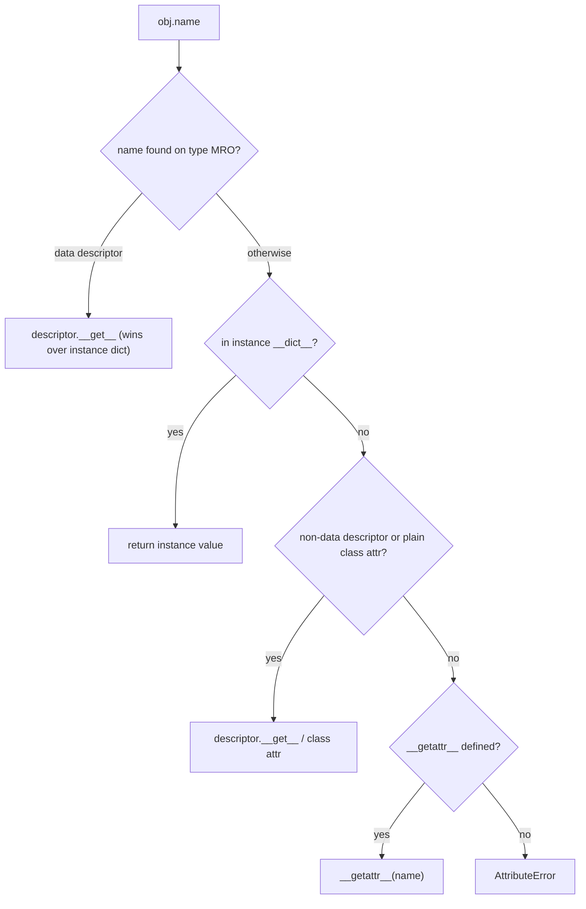

# 3.11 Python under the hood: decorators, descriptors and metaprogramming (how frameworks work)

| | |
|---|---|
| Level | Advanced |
| Priority tier | 2 |
| Lab venue | Python 3.11+ (standard library only) |
| Part | Part 3: Python for infrastructure |
| Status | Drafted, labs **untested** |

## Why this matters for AI infrastructure

FastAPI routes, pydantic models, SQLAlchemy columns, dataclasses, pytest fixtures, Click commands, Airflow DAGs, PyTorch `nn.Module` parameters, `torch.compile` and Ray's `@ray.remote` all look like magic until you see the handful of language mechanisms underneath: functions are objects, closures capture variables, decorators rewrite callables, descriptors control attribute access, `__init_subclass__` and metaclasses run code when classes are created, and the import system can be hooked. Knowing these lets you read framework source when debugging at 3 a.m., write your own small frameworks (plugin registries, config schemas, operator wrappers), and answer the "how does this actually work?" questions that senior interviews use to separate users from engineers. It also teaches restraint: most metaprogramming should not exist in application code.

## Prerequisites and outcomes

Needs 3.1 to 3.4 (functions, classes, data model, typing). After this chapter you can:

- Explain closures, `nonlocal`, late binding and how decorators are applied, including decorators with arguments, class-based decorators, stacking and `functools.wraps`.
- Write decorators for timing, retry, caching, authorisation, registration and instrumentation, handling both sync and async functions.
- Explain the attribute lookup algorithm, `property`, descriptors (data versus non-data), `__getattr__`, `__getattribute__`, `__slots__`, and how methods are bound.
- Explain what `dataclass`, pydantic and ORMs do at class-creation time; use `__init_subclass__`, class decorators and metaclasses where justified, and know the cheaper alternative first.
- Inspect and generate code with `inspect`, `typing.get_type_hints`, `ast`, `dis`, and understand import hooks and `sys.modules`.
- Decide when metaprogramming is appropriate, test it, and keep it debuggable.

## 1. Functions are objects; closures

Functions are first-class objects: they can be assigned, passed, returned, and carry attributes. A **closure** is a function that remembers variables from its enclosing scope even after that scope has returned.

```python
def make_counter():
    count = 0
    def inc():
        nonlocal count            # rebind the enclosing variable (otherwise assignment makes `count` local)
        count += 1
        return count
    return inc

c = make_counter(); c(); c()      # 2
c.__closure__[0].cell_contents    # 2: the captured cell
```

Variable resolution follows **LEGB**: Local, Enclosing, Global, Built-in. Closures capture **variables, not values**, producing the classic late-binding trap:

```python
fs = [lambda: i for i in range(3)]
[f() for f in fs]                 # [2, 2, 2]: all see the final i
fs = [lambda i=i: i for i in range(3)]      # bind at definition via default argument
from functools import partial; fs = [partial(lambda i: i, i) for i in range(3)]    # or partial
```

Closures are the lightweight alternative to single-method classes: a configured callable (`make_rate_limiter(100)`) holds its state in cells. Memory note: a closure keeps the entire captured object alive (a captured large tensor is not freed while the closure exists).

## 2. Decorators

`@decorator` above a `def` is exactly `f = decorator(f)` executed at definition time. A decorator is any callable that takes a callable and returns a replacement (often a wrapper).

```python
import functools, time, logging
log = logging.getLogger(__name__)

def timed(fn):
    @functools.wraps(fn)                       # preserves __name__, __doc__, __wrapped__, signature introspection
    def wrapper(*args, **kwargs):
        t0 = time.perf_counter()
        try:
            return fn(*args, **kwargs)
        finally:
            log.info("%s took %.3fs", fn.__qualname__, time.perf_counter() - t0)
    return wrapper

@timed
def drain(node): ...
```

Without `functools.wraps`, introspection, documentation generators, FastAPI/pydantic signature inspection and pytest fixtures see the wrapper's name and signature instead of the original.

### Decorators with arguments

Three nested levels: a factory taking arguments, returning the decorator, returning the wrapper.

```python
def retry(times=3, exceptions=(Exception,), delay=0.5):
    def deco(fn):
        @functools.wraps(fn)
        def wrapper(*a, **kw):
            for attempt in range(1, times + 1):
                try:
                    return fn(*a, **kw)
                except exceptions as e:
                    if attempt == times: raise
                    time.sleep(delay * 2 ** (attempt - 1))
        return wrapper
    return deco

@retry(times=5, exceptions=(ConnectionError, TimeoutError))
def fetch(): ...
```

### Sync and async

A wrapper around an `async def` must itself be `async def` and `await` the call; otherwise you return a coroutine un-awaited or time only its creation. Support both:

```python
import inspect
def timed(fn):
    if inspect.iscoroutinefunction(fn):
        @functools.wraps(fn)
        async def aw(*a, **kw):
            t0 = time.perf_counter()
            try: return await fn(*a, **kw)
            finally: log.info("%s %.3fs", fn.__name__, time.perf_counter() - t0)
        return aw
    @functools.wraps(fn)
    def w(*a, **kw):
        t0 = time.perf_counter()
        try: return fn(*a, **kw)
        finally: log.info("%s %.3fs", fn.__name__, time.perf_counter() - t0)
    return w
```

### Class-based decorators, stacking and registries

A class with `__call__` keeps state cleanly (a call counter, a cache). However, as Mark Lutz demonstrates in *Learning Python* Chapter 39 (`Examples 39-1` to `39-9`), if you write `class tracer: def __init__(self, func): self.calls = 0; self.func = func; def __call__(self, *args, **kwargs): ...` and apply `@tracer` to a **class method** (`@tracer def giveRaise(self, percent):`), calling `pat.giveRaise(0.10)` fails because `tracer` is not a descriptor (or passes the `tracer` instance as `self` instead of the `Person` instance `pat`). To decorate both plain functions and methods reliably, either write the decorator as a **nested function with `nonlocal calls`** (`def tracer(func): calls = 0; def onCall(*args, **kwargs): nonlocal calls; calls += 1; return func(*args, **kwargs); return onCall`) or implement `__get__` on the decorator class. In `LP` Chapter 39, Lutz also builds three complete decorator case studies (modeled in `code/part03/python_metaprogramming_internals.py`):
1. **Parameterized timing decorator (`@timer(label='[CCC]==>', trace=True)`, `timerdeco2.py`):** Uses a three-level function nesting (`timer(label='', trace=True) -> onDecorator(func) -> onCall(*args, **kargs)`) that accumulates `onCall.alltime += elapsed` across calls (`listcomp` vs `mapcall` on `50_000..1_000_000` items).
2. **Class decorators for Singleton and attribute access control (`@ singleton`, `@Private('data', 'size')`, `@Public(...)`, `access2.py`):** A class decorator `@Private('data', 'size')` wraps a class `Doubler` in an `onInstance` proxy that intercepts `__getattr__` and `__setattr__` to reject outside reads/writes to private attributes (and adds a `BuiltinsMixin` so Python 3 built-in operations like `+` and `str()` route through `__getattr__`).
3. **Generalized argument range/type validator (`@rangetest(age=(0, 120), M=(1, 12), D=(1, 31))`, `Example 39-25 rangetest.py`):** Inspects `code = func.__code__` and `allargs = code.co_varnames[:code.co_argcount]` to map both positional arguments (`pargs`) and keyword arguments (`kargs`) to their parameter names, skips defaulted arguments cleanly, and short-circuits with `if not __debug__: return func` when run under `python -O`.

**Stacking** applies bottom-up: `@a @b def f` is `f = a(b(f))`; order matters (auth before caching, not the reverse).

A **registry decorator** returns the function unchanged but records it: the pattern behind Flask/FastAPI routes, Click commands, pytest fixtures/markers, Airflow tasks and plugin systems.

```python
HANDLERS: dict[str, callable] = {}
def handler(event_type):
    def deco(fn):
        HANDLERS[event_type] = fn
        return fn                      # unchanged
    return deco

@handler("node.down")
def on_node_down(evt): ...
def dispatch(evt): return HANDLERS[evt["type"]](evt)
```

FastAPI's `@app.get("/x")` is this pattern: it stores `(path, method, function, signature-derived models)` in the router and returns the function.

### Standard-library decorators worth knowing

`functools.lru_cache` / `cache` (memoise on hashable args; unbounded `cache` leaks memory; not safe on methods holding `self` forever), `cached_property`, `singledispatch` (function overloading on first arg type), `total_ordering`, `partial`, `wraps`, `contextlib.contextmanager` (a generator becomes a context manager), `dataclasses.dataclass`, `typing.overload`/`final`, `abc.abstractmethod`, `property`/`classmethod`/`staticmethod`, `atexit.register`.

Pitfalls: decorators run at import time (side effects, circular imports); wrapping hides tracebacks unless careful; decorating methods versus plain functions (self handling); `lru_cache` on instance methods keeps instances alive; mutating shared state in module-level decorators breaks test isolation; stacking many decorators obscures control flow and signatures (use `typing.ParamSpec` and `Callable[P, R]` to keep type checkers informed).

```python
from typing import Callable, ParamSpec, TypeVar
P = ParamSpec("P"); R = TypeVar("R")
def logged(fn: Callable[P, R]) -> Callable[P, R]:       # preserves the wrapped signature for type checkers
    @functools.wraps(fn)
    def w(*a: P.args, **kw: P.kwargs) -> R:
        log.info("call %s", fn.__name__); return fn(*a, **kw)
    return w
```

## 3. Attribute access and the descriptor protocol

### Lookup order

For `obj.name` Python (in `object.__getattribute__`) does, roughly:

1. Find `name` on the **type** (walking the MRO). If it is a **data descriptor** (defines `__set__` or `__delete__`), call its `__get__` and stop.
2. Else look in the instance `__dict__` (or slots).
3. Else if the type attribute is a **non-data descriptor** (only `__get__`, like functions), call it; or return the plain class attribute.
4. Else call `type(obj).__getattr__(obj, name)` if defined, otherwise `AttributeError`.



`__getattribute__` runs on **every** access (override with extreme care; call `super().__getattribute__` to avoid recursion); `__getattr__` runs only when normal lookup fails (good for proxies, lazy attributes, forwarding). Setting uses `__setattr__`, which checks data descriptors on the type first.

### Methods are descriptors

Functions on a class are non-data descriptors whose `__get__` returns a **bound method** (the function with `self` pre-filled). That is why `obj.method` is a bound method object, `Class.method` is the plain function, and `staticmethod`/`classmethod` are just descriptors with different `__get__`. `functools.partialmethod`, `property`, `cached_property`, and ORM columns are all descriptors.

### Writing a descriptor

```python
class Positive:
    """Reusable validated attribute."""
    def __set_name__(self, owner, name):          # called when the owner class is created
        self.name = name
        self.private = "_" + name
    def __get__(self, obj, objtype=None):
        if obj is None: return self               # accessed on the class
        return getattr(obj, self.private)
    def __set__(self, obj, value):
        if value <= 0: raise ValueError(f"{self.name} must be positive, got {value!r}")
        setattr(obj, self.private, value)

class GpuJob:
    gpus = Positive()
    memory_gb = Positive()
    def __init__(self, gpus, memory_gb):
        self.gpus = gpus              # goes through Positive.__set__
        self.memory_gb = memory_gb
```

One descriptor instance lives on the class and is shared by all instances, so per-instance data must be stored on the instance (here `_gpus`, or directly in `instance.__dict__[self.storage_name]`) or in a `WeakKeyDictionary`, never on the descriptor itself. `__set_name__` (PEP 487) lets the descriptor learn its attribute name automatically.
- **Overriding (`data`) vs. non-overriding (`non-data`) descriptors and the `Validated` hierarchy (`FP` Chapter 23 `Examples 23-5` to `23-13`):** In *Fluent Python* Chapter 23, Ramalho builds an abstract `Validated(ABC)` descriptor base class whose `__set_name__(self, owner, name)` sets `self.storage_name = name`, `__set__(self, instance, value)` calls `value = self.validate(self.storage_name, value)` and writes `instance.__dict__[self.storage_name] = value`, and concrete subclasses `Quantity(Validated)` (enforcing `value > 0`) and `NonBlank(Validated)` (stripping whitespace and rejecting empty strings) validate `LineItem(description, weight, price)` declaratively (modeled in `code/part03/python_metaprogramming_internals.py`). Ramalho also contrasts the three descriptor flavors on a `Managed` class:
  1. **Overriding (data) descriptor with `__get__` and `__set__` (`Overriding`):** Always intercepts both reads (`obj.over`) and writes (`obj.over = 7`), even if you manually stuff `obj.__dict__['over'] = 8`.
  2. **Overriding descriptor without `__get__` (`OverridingNoGet`, only `__set__`):** Intercepts writes (`obj.over_no_get = 7`), but reads (`obj.over_no_get`) return the descriptor object itself unless `'over_no_get'` is present in `obj.__dict__`.
  3. **Non-overriding (non-data) descriptor (`NonOverriding`, only `__get__`, like functions and `@functools.cached_property`):** `obj.non_over` calls `__get__` **only when `'non_over'` is not in `obj.__dict__`**; assigning `obj.non_over = 7` writes `'non_over'` into `obj.__dict__`, which thereafter shadows the descriptor.
- **Why storing instance state on the descriptor (`self.value`) is a bug (`LP` Chapter 38 `CardHolder` 4 ways):** In *Learning Python* Chapter 38 (`Examples 38-19` to `38-25`), Lutz implements a `CardHolder(acct, name, age, addr)` class (`acctlen = 8`, `retireage = 62.5`, normalizing `name` to lowercase with underscores, masking `acct` as `'12345***'`, validating `0 <= age <= 150`, and computing `remain = retireage - age`) using four different mechanisms: (1) `@property` (`validate_properties.py`), (2) descriptors (`validate_descriptors1.py` vs `validate_descriptors2.py`), (3) `__getattr__` + `__setattr__` (`validate_getattr.py`), and (4) `__getattribute__` + `__setattr__` (`validate_getattribute.py`). In `validate_descriptors1.py`, storing `self.name = value` on the descriptor instance itself means creating `bob = CardHolder(...)` followed by `sue = CardHolder(...)` overwrites the single shared `Name` descriptor on `CardHolder`, causing `bob.name` to morph into `'sue_jones'`. Storing state on the client instance (`instance.__name = value` in `validate_descriptors2.py`, tested in `code/part03/python_metaprogramming_internals_lab.py`) keeps `bob` and `sue` isolated.

### property, cached_property and slots

`property` is a data descriptor built from getter/setter/deleter functions (as in `FP` Chapter 22's `quantity(storage_name)` property factory and `BlackKnight` `@member.deleter`): use it to start with a plain attribute and add validation or computation later without changing callers (Bertrand Meyer's **Uniform Access Principle**). `functools.cached_property` computes once and stores the result in the instance `__dict__` (a non-data descriptor, so the instance value then wins; it needs a `__dict__`, so it does not work with `__slots__` unless a `__dict__` slot exists). **`__slots__`** replaces the per-instance dict with fixed slots (implemented as descriptors on the class): 30 to 50% less memory per instance and slightly faster access for millions of small objects, at the cost of no dynamic attributes, awkward multiple inheritance, and no weakrefs unless `__weakref__` is listed. `@dataclass(slots=True)` automates this.

### Dynamic attributes and proxies (`FrozenJSON` and `osconfeed.json`, `FP` Chapter 22)

In *Fluent Python* Chapter 22 (`Examples 22-1` to `22-6`, modeled in `code/part03/python_metaprogramming_internals.py`), `FrozenJSON` wraps nested JSON documents (`osconfeed.json` with 1 conference, 484 events, 357 speakers, and 53 venues) so `feed.Schedule.events[40].name` (`'There *Will* Be Bugs'`) and dict methods like `.keys()` work side by side:
- **`__new__(cls, arg)` for flexible object construction:** Instead of constructing a `FrozenJSON` instance when `arg` is a `list` or a primitive scalar, `__new__` checks `if isinstance(arg, abc.Mapping): return super().__new__(cls)`, `elif isinstance(arg, abc.MutableSequence): return [cls(item) for item in arg]`, and otherwise returns `arg` unchanged.
- **Handling Python reserved keywords (`class` -> `class_`) and invalid identifiers:** In `__init__`, `if keyword.iskeyword(key): key += '_'` renames JSON keys like `'class'` to `'class_'` (`student.class_`), while `key.isidentifier()` detects keys like `'2be'` that cannot be read via dot syntax.

```python
class Config:
    """Attribute-style access to a nested mapping, with lazy loading."""
    def __init__(self, data): self._data = data
    def __getattr__(self, name):                      # only called when normal lookup fails
        try: value = self._data[name]
        except KeyError: raise AttributeError(name) from None
        return Config(value) if isinstance(value, dict) else value
    def __dir__(self): return list(self._data)        # tab-completion and introspection
```

Always raise `AttributeError` (not `KeyError`) from `__getattr__`, or `hasattr`/`getattr` defaults and copying/pickling break; guard against recursion when reading your own attributes inside `__getattr__` (access `self.__dict__` carefully). `__getattr__` on a module (PEP 562) enables lazy imports and deprecation shims. Many ML libraries expose dynamically generated attributes (config objects, `torch.ops` namespaces); tooling support requires type stubs.

### How some frameworks use descriptors

- **Django/SQLAlchemy** columns and relationships are descriptors turning `obj.field` into tracked state; **pydantic v1** used metaclass magic and fields, and v2 builds a compiled validation core from annotations; **dataclasses** generate `__init__`, `__repr__`, `__eq__` from annotations; **`torch.nn.Module.__setattr__`** intercepts assignment to register `nn.Parameter` and submodules in internal dictionaries (that is why assigning layers in `__init__` makes `.parameters()` work, and why putting layers in a plain Python list does not register them: use `nn.ModuleList`).

## 4. Class creation and customisation

### What `class` does

A `class` statement executes the body in a new namespace, then calls `type(name, bases, namespace)` (or the specified metaclass) to build the class object. Classes are objects created at runtime; `type(...)` can create them dynamically:

```python
Node = type("Node", (object,), {"gpus": 8, "describe": lambda self: f"{self.gpus} GPUs"})
```

Sequence for `class C(Base, metaclass=M, **kw)`: resolve bases (`__mro_entries__`), choose the metaclass, (1) `M.__prepare__` (returns the namespace mapping), (2) execute the class body in that mapping, (3) `M.__new__(M, name, bases, ns, **kw)` allocates the class object, (4) `__set_name__(cls, attr_name)` is called on every attribute in `ns` that defines it, (5) `Base.__init_subclass__(cls, **kw)` runs on the parent, and (6) `M.__init__(cls, name, bases, ns, **kw)` finishes initializing the class object before Python binds the class name (verified in `trace_class_creation_order()` in `code/part03/python_metaprogramming_internals.py`, matching `evaldemo.py` and `evaldemo_meta.py` in `FP` Chapter 24 `Examples 24-10` to `24-19`). Calling `type(cls_name, (object,), cls_attrs)` directly also powers dynamic class factories like `collections.namedtuple` and `FP` Chapter 24's `record_factory("Dog", "name weight owner")` (`Example 24-2`).

### `__init_subclass__` and class decorators: the first tools to reach for

Introduced to cover most metaclass use cases without a metaclass: run code whenever a subclass is defined (as in `FP` Chapter 24's `Checked` base class `Example 24-4`, whose `__init_subclass__` iterates `cls.__annotations__` and attaches a `Field` descriptor for each annotated attribute, or the `@checked` class decorator in `Example 24-7`).

```python
class Plugin:
    registry: dict[str, type["Plugin"]] = {}
    def __init_subclass__(cls, /, name=None, **kw):
        super().__init_subclass__(**kw)
        Plugin.registry[name or cls.__name__.lower()] = cls

class GpuCheck(Plugin, name="gpu"): ...
class NetCheck(Plugin): ...
Plugin.registry          # {'gpu': GpuCheck, 'netcheck': NetCheck}
```

This is how plugin systems, model/operator registries (for example registering custom ops or Airflow-like operators), and ORM-like base classes self-register. A **class decorator** is the other light option (`@register` on a class, or `@dataclass`): it receives the finished class and returns it (possibly modified).

### Metaclasses and the two-tree inheritance model (`FP` Chapter 24 & `LP` Chapter 40)

A **metaclass** is the class of a class (`type` by default: `str.__class__ is type`, and `type.__class__ is type`). Subclass `type` to customise class creation: validate or rewrite the namespace, inject methods (as in `LP` Chapter 40's `Metaclass` applying `@tracer` to every method in a class dictionary, `MetaOne`/`MetaTwo`, and `FP` Chapter 24's `MetaBunch` and `CheckedMeta`), enforce interfaces, register classes, or provide declarative syntax (Django models, SQLAlchemy declarative, `enum.Enum`, `abc.ABCMeta`, pydantic v1 `ModelMetaclass`).

In *Learning Python* Chapter 40, Lutz formalizes the **two-tree inheritance lookup algorithm** that distinguishes normal instances (`I` of class `C`) from class objects (`C` of metaclass `M`):
- **Instance lookup (`I.attr`):** Searches `[I.__dict__] + [x.__dict__ for x in I.__class__.__mro__]` (checking data descriptors on the class MRO first, then `I.__dict__`, then non-data descriptors/attributes on the class MRO). Crucially, **normal instances `I` never acquire attributes defined only on the metaclass `M`** (`M` is not in `I.__class__.__mro__`).
- **Class lookup (`C.attr`):** Because `C`'s `type(C)` is its metaclass `M`, `C.attr` searches **both** trees: `[x.__dict__ for x in C.__mro__] + [x.__dict__ for x in C.__class__.__mro__]` (with data descriptors on `M`'s MRO checked first, then `C.__mro__`, then non-data descriptors on `M`'s MRO).
- **The built-in operations special case (`str(I)` vs `I.__str__()`, `C[0]`):** Implicit built-in operations (`str(X)`, `len(X)`, `X[0]`, `X + Y`) skip the object itself and start lookup **one level higher at `type(X)`**: for a normal instance `I`, `str(I)` looks up `__str__` on `C.__mro__` (skipping `I.__dict__`), and for a class `C`, `str(C)` or `C[0]` looks up `__str__` or `__getitem__` on the **metaclass `M.__mro__`** (skipping `C.__dict__`).

```python
class FieldsMeta(type):
    @classmethod
    def __prepare__(mcs, name, bases, **kw):
        return {}                                   # could return an ordered/validating mapping
    def __new__(mcs, name, bases, ns, **kw):
        fields = {k: v for k, v in ns.items() if isinstance(v, Field)}
        ns["_fields"] = fields                      # collect declarative fields
        for k in fields: ns.pop(k)                  # or keep them as descriptors
        return super().__new__(mcs, name, bases, ns, **kw)
    def __call__(cls, *a, **kw):                    # customise instantiation (singleton, validation hook)
        return super().__call__(*a, **kw)
```

Guidance: prefer, in order, (1) plain functions/composition, (2) decorators, (3) descriptors, (4) `__init_subclass__` and class decorators, (5) metaclasses only when you must control class *creation* itself (custom namespaces via `__prepare__`, intercepting `__call__`, combining with `ABCMeta`). Metaclass conflicts arise when combining two different metaclasses (`TypeError: metaclass conflict`), they are inherited implicitly (surprising), and they complicate debugging and type checking. If your reviewers cannot explain it in a minute, it is too clever.

### Abstract base classes, protocols and the data model hooks

`abc.ABC` plus `@abstractmethod` prevents instantiating incomplete subclasses (via `ABCMeta`); `typing.Protocol` gives structural subtyping; `__subclasshook__` and `register` customise `isinstance`. `__class_getitem__` supports generics syntax (`Foo[int]`); `__instancecheck__` customise isinstance on metaclasses; `__call__` makes instances callable; `__enter__/__exit__` context managers; `__iter__/__next__` iteration; `__get_pydantic_core_schema__` lets custom types integrate with pydantic.

## 5. Introspection and code generation

- **`inspect`**: `inspect.signature(fn)` (parameters, defaults, annotations; this is what FastAPI, Click, pytest and dependency-injection frameworks read to wire arguments), `inspect.getsource`, `inspect.iscoroutinefunction`, `inspect.getmembers`, `inspect.stack` (costly), `inspect.unwrap` (follows `__wrapped__` set by `functools.wraps`).
- **Annotations**: `typing.get_type_hints(obj)` resolves string/forward annotations; `__annotations__` holds the raw values; from Python 3.14 deferred evaluation changes details (check release notes); pydantic and FastAPI rely on resolved hints.
- **Attributes API**: `getattr/setattr/hasattr/delattr`, `vars(obj)`, `dir`, `type(obj).__mro__`, `types.SimpleNamespace`, `types.MethodType`, `object.__setattr__` to bypass custom setters (frozen dataclass internals).
- **Code objects and bytecode**: `dis.dis(fn)` shows CPython bytecode; `fn.__code__.co_varnames`, `co_consts`; useful to understand performance (attribute lookups, global versus local access) and to read tracebacks. Bytecode is an implementation detail and varies by version.
- **AST**: `ast.parse(source)` yields a syntax tree you can analyse and transform (linters, `pytest` assertion rewriting, `numba`/`torch.compile` frontends, macro-like tools); `compile(tree, filename, "exec")` then `exec` runs it. `exec`/`eval` on untrusted strings is a code-injection vulnerability: never feed them user input; `ast.literal_eval` safely parses literals only.
- **Source generation**: the `dataclasses` module builds methods as source strings executed with `exec` for speed; templates (Jinja2) generate configs; `types.FunctionType` and `typing.NamedTuple` / `collections.namedtuple` create types dynamically.

### How FastAPI wires a handler (a worked example)

```python
import inspect, typing
def endpoint(user_id: int, verbose: bool = False, q: str | None = None): ...

sig = inspect.signature(endpoint)
hints = typing.get_type_hints(endpoint)
for name, p in sig.parameters.items():
    print(name, hints[name], "required" if p.default is p.empty else f"default={p.default!r}")
```

From this alone a framework learns each parameter's name, type, required-ness, and default, builds a pydantic model to validate request data, decides path/query/body sources, and generates OpenAPI schema; `Depends(...)` defaults are discovered the same way and resolved recursively. The route decorator stores the function, and at request time the framework builds kwargs and calls it. Understanding this explains why changing a type hint changes API behaviour, why `functools.wraps` matters, and why decorators that hide the signature break FastAPI.

### How pytest finds and injects fixtures

pytest imports test modules (rewriting `assert` statements through the AST at import), collects `test_*` functions, inspects each test's parameter names with `inspect.signature`, looks up fixtures of those names (registered by the `@pytest.fixture` decorator in module/`conftest.py` registries), resolves dependencies between fixtures, executes setup (generator fixtures run until `yield`), calls the test with the values and runs teardown in reverse. The same "inspect signature, inject by name" idea underlies dependency injection frameworks.

## 6. Imports, modules and hooks

- `import x` runs `sys.modules` lookup, then **finders** in `sys.meta_path` locate a **spec**, a **loader** creates and executes the module, and the module object is cached in `sys.modules` (so a module's top-level code runs once; circular imports see partially initialised modules).
- **Import hooks**: custom finders/loaders can import from databases, encrypted archives, remote stores, or transform source on import (how `pytest` rewrites asserts, how some DSLs and notebook imports work). Entry points (`importlib.metadata.entry_points(group="myapp.plugins")`) are the standard way to discover plugins installed by other packages (used by pytest plugins, Airflow providers, Kubeflow components, setuptools scripts).
- `importlib.import_module(name)` for dynamic imports (plugin loading by name; validate names from configuration against an allow-list); `importlib.reload` has sharp edges; `__all__` and `__getattr__` at module level control star-imports and lazy attributes; lazy-import heavy libraries (torch, pandas) inside functions to keep CLI start-up fast.
- `sys.path`, `PYTHONPATH`, `.pth` files and `site` determine search order; shadowing standard library names (a local `json.py`, `random.py`, `typing.py`) is a classic puzzling failure.
- **Security of dynamic loading**: importing a module executes arbitrary code; unpickling executes code; plugin discovery via entry points trusts every installed package. Treat third-party plugins and model files accordingly (3.10: `torch.load`).

## 7. Performance and memory implications of dynamism

- Attribute access via instance `__dict__` is fast but memory-heavy; descriptors and `__getattr__` add per-access overhead; `__slots__` saves memory for millions of objects.
- Each wrapper layer adds a Python call (roughly tens to hundreds of nanoseconds each); in hot loops decorators matter, in I/O paths they don't. Profile before removing abstraction.
- Closures and bound methods keep references alive: callbacks that capture `self` create cycles and leak in long-running agents; use `weakref` (`WeakMethod`, `WeakValueDictionary`) for observers and caches.
- `lru_cache` holds strong references to arguments and results: size-limit it and avoid caching methods on large objects.
- Dynamic class creation in loops (creating a new class per request) leaks memory and slows type checks; create once.
- `torch.compile`, `numba.jit`, `jax.jit` trace Python into graphs: Python side effects, data-dependent control flow and mutations behave differently under tracing (they run once at trace time) which is the practical consequence of metaprogramming-style compilation.

## 8. Good practice for framework-style code

1. Prefer explicit over implicit; offer metaprogramming-free paths (an explicit `register(cls)` function beside the decorator).
2. Keep wrappers transparent: `functools.wraps`, preserve signatures (`ParamSpec`), re-raise original exceptions, do not swallow `KeyboardInterrupt`.
3. Document the magic: what attributes appear, in which order things run, how to debug (`repr` of generated classes, `__wrapped__`).
4. Make registration idempotent and test-friendly (clear/reset functions, no import-time global mutation that depends on test order).
5. Fail early with clear errors at class-definition time (validate in `__init_subclass__`, `__set_name__`) instead of obscure failures at run time.
6. Type it: stubs or `Protocol`/generics so IDEs and mypy understand generated attributes (`dataclass_transform` marks pydantic/ORM-like base classes).
7. Test the machinery directly: unit tests for decorators (sync and async, with arguments, preserving metadata, exception behaviour), descriptors (class vs instance access, per-instance isolation), and registries (duplicates, ordering).
8. Use `contextvars` (not globals or threading locals) for request-scoped state that must flow through async code (request ids, tracing context, tenant).

## 9. Lab

First, run the self-checking Python lab (`code/part03/python_metaprogramming_internals_lab.py`) locally. It verifies `FrozenJSON` dynamic attribute navigation and `keyword.iskeyword` handling (`FP` Ch. 22), `LineItem` with `Validated`, `Quantity`, and `NonBlank` descriptors using `__set_name__` (`FP` Ch. 23), `CardHolder` per-instance descriptor isolation (`LP` Ch. 38), `@rangetest(**argchecks)` positional/keyword argument validation (`LP` Ch. 39), `record_factory` dynamic class creation via `type()` and the 6-step class creation hook sequence (`__prepare__ -> body -> __new__ -> __set_name__ -> __init_subclass__ -> __init__`, `FP` Ch. 24 & `LP` Ch. 40), and `ToyModule.__setattr__` parameter/submodule registration (`nn.Module` internals).

```bash
python3 code/part03/python_metaprogramming_internals_lab.py
```

Next, on any machine with Python 3.11+ (all interactive shell steps below are `untested here`), work through these exercises:

1. **Closures and late binding**: reproduce the lambda-in-loop bug; fix three ways; inspect `__closure__`; build a rate limiter as a closure and as a class.
2. **Decorators**: implement `timed`, `retry(times, exceptions)` with jittered backoff, and `cache_with_ttl`; make each work for sync and async functions; verify metadata with `functools.wraps`; show the broken `inspect.signature` without it; type with `ParamSpec`.
3. **Registry**: build `@handler("event")` and a dispatcher; then reimplement with `__init_subclass__`; then add entry-point discovery in a tiny installable package (`pip install -e`) with `importlib.metadata.entry_points`.
4. **Mini-FastAPI**: write a decorator-based router that uses `inspect.signature` and type hints to parse a query string into typed arguments, validate required parameters and return 422-style errors; compare with the real FastAPI behaviour.
5. **Descriptors**: implement `Positive`, a `Typed(type)` descriptor and a lazy `cached_attr`; verify that state is per-instance (create two instances), class access returns the descriptor, and data vs non-data precedence by shadowing in the instance `__dict__`.
6. **Dynamic attributes**: build the `Config` proxy with `__getattr__`; demonstrate the bugs from raising `KeyError`, from recursion in `__getattr__`, and from missing `__dir__`; add module-level `__getattr__` to lazily import a heavy module.
7. **`__slots__`**: measure memory of one million small objects with dict vs slots vs `@dataclass(slots=True)` (`tracemalloc` or `sys.getsizeof` plus `pympler`); try to set an undeclared attribute and a weakref.
8. **Class creation**: print the class-creation sequence by defining a metaclass with prints in `__prepare__`, `__new__`, `__init__`, plus `__set_name__` and `__init_subclass__` hooks; add a `type(...)` dynamic class.
9. **Metaclass vs `__init_subclass__`**: implement a declarative `Schema` with `Field` objects once with a metaclass and once with `__set_name__` plus `__init_subclass__`; provoke a metaclass conflict by combining with `ABC`.
10. **`nn.Module` internals**: write a toy `Module` base class whose `__setattr__` registers `Parameter` and submodule instances in dictionaries and provides `parameters()` recursively; show why a plain list of layers is missed.
11. **Introspection and AST**: use `dis` on a function with a global versus a local variable; use `ast` to find all `subprocess.run(..., shell=True)` calls in a source tree (a tiny linter).
12. **Import system**: print `sys.meta_path`, trace an import with `python -X importtime` and `-v`; write a meta-path finder that serves a module from a string; reproduce a circular import and a shadowed stdlib module.
13. **Clean up.**

## 10. Common mistakes

- Forgetting `functools.wraps`, breaking introspection, docs and signature-based frameworks.
- Writing sync wrappers around async functions (or vice versa) so coroutines are never awaited.
- Late-binding closures in loops; mutable default arguments (a close cousin: shared state evaluated at definition time).
- Storing per-instance state on a descriptor object (shared across all instances).
- `__getattr__` that recurses infinitely or raises the wrong exception type; overriding `__getattribute__` without need.
- `lru_cache`/`cache` on methods or with unhashable/huge arguments causing leaks or errors.
- Side effects at import time via decorators (network calls, global registry mutation) that make tests order-dependent.
- Reaching for metaclasses when `__init_subclass__` or a decorator suffices; metaclass conflicts.
- Assuming `__slots__` works with `cached_property`, multiple inheritance or pickling without checks.
- Using `eval`/`exec`/`pickle`/`dynamic import` on untrusted input.
- Putting `nn.Module` children in plain lists/dicts so parameters are not registered.
- Reference cycles through bound-method callbacks in long-running agents.

## 11. Interview angles

- "What does `@decorator` desugar to? How do you write one with arguments? Why `functools.wraps`?"
- "What is a closure? Explain the lambda-in-a-loop bug."
- "Explain attribute lookup order and data versus non-data descriptors. How do methods become bound?"
- "How does `property` work? How would you implement it yourself?"
- "What does `dataclass` do? How does pydantic validate? How does FastAPI know a parameter is a query parameter?"
- "Metaclass versus `__init_subclass__` versus class decorator: when each?"
- "Why does assigning layers to a plain list break `parameters()` in PyTorch?"
- "How does pytest inject fixtures?" (signature inspection by name.)
- "What happens when you `import` a module twice? Circular imports?"
- "What are the risks of `pickle`, `eval` and plugin auto-loading?"

## Exercises

1. **Closures, Late Binding, Function vs. Class Decorators (`@tracer`), and `@rangetest` (`LP` Chapter 39):** Using `rangetest()` in `code/part03/python_metaprogramming_internals.py`, explain: (a) how `func.__code__.co_varnames[:code.co_argcount]` maps positional and keyword arguments to parameter names and why `functools.wraps` and `ParamSpec` are needed; and (b) why a class-based `@tracer` implementing only `__call__` fails when decorating a class method (`pat.giveRaise(0.10)`), and how a `nonlocal` function wrapper or implementing `__get__` fixes it.
2. **Dynamic Attributes (`FrozenJSON`), `@property`, `cached_property`, and `CardHolder` 4 Ways (`FP` Ch. 22 & `LP` Ch. 38):** Using `FrozenJSON` and `CardHolder` in `code/part03/python_metaprogramming_internals.py`, explain: (a) how `FrozenJSON.__new__` and `__getattr__` navigate nested mappings/lists and handle reserved Python keywords (`class` -> `class_`); and (b) why storing managed state on the descriptor (`self.name` in `validate_descriptors1.py`) causes `bob` to morph into `sue`, whereas storing state on `instance` (`validate_descriptors2.py`) isolates instances.
3. **The Descriptor Protocol: Data (Overriding) vs. Non-Data (Non-Overriding) Descriptors, `__set_name__`, and Bound Methods (`FP` Chapter 23):** Using `Validated`, `Quantity`, `NonBlank`, and `LineItem` in `code/part03/python_metaprogramming_internals.py`, trace the exact 4-step attribute lookup order in `object.__getattribute__` for `obj.name`, explain why `cached_property` (only `__get__`) is shadowed by `obj.__dict__` after its first run while `Quantity` (`__get__` + `__set__`) always overrides `obj.__dict__`, and explain how functions on a class become bound methods via `__get__`.
4. **Class Creation Mechanics (`type()`, `record_factory`, `__init_subclass__`, Class Decorators, and Metaclasses, `FP` Ch. 24 & `LP` Ch. 40):** Using `record_factory()` and `trace_class_creation_order()` in `code/part03/python_metaprogramming_internals.py`, state the exact 6-step execution order when Python evaluates `class Sub(Base, metaclass=TraceMeta):` (`__prepare__` -> class body -> `__new__` -> `__set_name__` -> `__init_subclass__` -> `__init__`), and explain the two-tree inheritance lookup difference between `I.attr`, `C.attr`, and implicit built-ins like `str(C)` or `C[0]`.
5. **How Frameworks Work Under the Hood (`FastAPI`, `pytest`, `@dataclass`, and PyTorch `nn.Module`):** Using `ToyModule` and `ToyParameter` in `code/part03/python_metaprogramming_internals.py`, explain: (a) how `ToyModule.__setattr__` registers `ToyParameter` and child `ToyModule` attributes into `_parameters` and `_modules`—and why layers stored inside a plain Python `list` (`self.layers = [Block()]`) are invisible to `.parameters()` unless wrapped in `nn.ModuleList`; and (b) how `FastAPI` and `pytest` use `inspect.signature(fn)` and `typing.get_type_hints(fn)` to wire dependencies and fixtures by parameter name.
6. **Introspection, `dis`, `ast.literal_eval` vs. `eval`, Import Hooks (`sys.meta_path`), and Entry Points:** (a) Explain why `eval`/`exec` and `pickle` on untrusted strings/bytes are remote code execution vulnerabilities and when to use `ast.literal_eval()` or `ast.parse()`; (b) explain how `sys.meta_path` finders/loaders and `importlib.metadata.entry_points(group="...")` enable `pytest` assertion rewriting and third-party plugin discovery.

## Checkpoint questions (20)

<details>
<summary>1. What is a closure, where are its captured variables stored (`__closure__`), and why does `[lambda: i for i in range(3)]` return `[2, 2, 2]`?</summary>

A **closure** is a function object that retains references to **free variables** (`fn.__code__.co_freevars`) defined in an enclosing function scope even after the outer function has returned; the bindings are stored in cell objects inside **`fn.__closure__`** (`fn.__closure__[0].cell_contents`), and rebinding them inside the inner function requires **`nonlocal`**. Because closures capture **variables (names), not values at creation time**, all three lambdas in `[lambda: i for i in range(3)]` look up the same variable `i` when called—after the loop has finished with `i == 2`. Bind the current value at definition time via a default argument: **`[lambda i=i: i for i in range(3)]`**.
</details>

<details>
<summary>2. What does `@a` above `@b` above `def f()` desugar to, how many function levels does a parameterized decorator `@retry(times=3)` need, and why is `@functools.wraps(fn)` essential?</summary>

- **Desugaring & stacking:** Stacked decorators apply bottom-up at definition (import) time: `@a` above `@b` above `def f()` executes **`f = a(b(f))`**.
- **Parameterized decorator:** Requires **three nested function levels**: (1) the factory `def retry(times=3):` taking the configuration arguments and returning (2) the decorator `def deco(fn):`, which takes `fn` and returns (3) the replacement wrapper `def wrapper(*a, **kw):`.
- **`@functools.wraps(fn)`:** Copies `__name__`, `__doc__`, `__qualname__`, `__annotations__`, `__module__`, and sets **`__wrapped__ = fn`**. Without `@wraps`, `inspect.signature(f)` and `typing.get_type_hints(f)` inspect `*a, **kw` on the wrapper instead of `fn`'s parameters—breaking FastAPI dependency/query resolution, Click CLI help, and `pytest` fixture injection. Use `typing.ParamSpec` (`Callable[P, R]`) so `mypy`/`pyright` also preserve the wrapped signature.
</details>

<details>
<summary>3. How do you write a single decorator (`@timed`) that works transparently on both synchronous (`def`) and asynchronous (`async def`) functions?</summary>

Branch at decoration time using **`inspect.iscoroutinefunction(fn)`**:
- If `True`, return an **`async def aw(*a, **kw):`** wrapper decorated with `@functools.wraps(fn)` that measures time around **`return await fn(*a, **kw)`** inside a `try ... finally:` block.
- If `False`, return a regular **`def w(*a, **kw):`** wrapper that measures time around `return fn(*a, **kw)`. If a regular sync wrapper wraps an `async def` function without `await`, it measures only the microsecond cost of constructing the un-awaited coroutine object.
</details>

<details>
<summary>4. In *Learning Python* Chapter 39, why does a class-based `@tracer` implementing only `__call__` fail when applied to a method inside a class, and how does `@rangetest` work?</summary>

When `@tracer` (`class tracer: def __init__(self, func): ... def __call__(self, *args): ...`) decorates a method `def giveRaise(self, percent):` inside `class Person`, `Person.giveRaise` becomes an instance of `tracer`. When you call `pat.giveRaise(0.10)`, Python only binds `pat` if the class attribute implements `__get__`; because `tracer` has no `__get__`, Python calls `tracer.__call__(tracer_self, 0.10)` without passing `pat` at all. Fix it either by using a nested function closure (`nonlocal calls`, since functions implement `__get__` automatically) or by implementing `def __get__(self, instance, owner):` on `tracer`.
In **`@rangetest(**argchecks)`**, the decorator inspects `func.__code__.co_varnames[:func.__code__.co_argcount]` to match both positional (`pargs`) and keyword (`kargs`) arguments by parameter name and validate `(low, high)` bounds (skipping validation when `__debug__` is `False` under `python -O`).
</details>

<details>
<summary>5. Walk through the exact 4-step attribute lookup order in `object.__getattribute__` when evaluating `obj.name` (`FP` Chapter 23).</summary>

When Python evaluates `obj.name`:
1. **Data (overriding) descriptor on `type(obj).__mro__`:** Search `type(obj)` and its superclasses along `__mro__`. If `name` is found on a class and defines `__get__` **and** (`__set__` or `__delete__`—e.g., `@property`, `Quantity`, `__slots__`), call `desc.__get__(obj, type(obj))` and **return immediately** (winning over `obj.__dict__`).
2. **Instance dictionary (`obj.__dict__`):** Otherwise, if `'name'` is a key in `obj.__dict__`, return `obj.__dict__['name']`.
3. **Non-data (non-overriding) descriptor or plain class attribute on `type(obj).__mro__`:** Otherwise, if `name` is found on `type(obj).__mro__`, call `desc.__get__(obj, type(obj))` if it defines `__get__` (e.g., normal methods, `@classmethod`, `@staticmethod`, `@functools.cached_property`) or return the plain class attribute.
4. **`__getattr__` fallback:** Otherwise, if `type(obj)` defines `__getattr__`, call `type(obj).__getattr__(obj, 'name')`; else raise **`AttributeError`**.
</details>

<details>
<summary>6. How do functions on a class become bound methods, and how do `@property` and `@functools.cached_property` differ as descriptors (`FP` Chapters 22 & 23)?</summary>

- **Methods are non-data descriptors:** Every Python function object implements `__get__(self, instance, owner)`. When accessed through the class (`Class.meth`), `instance` is `None` and `__get__` returns the plain function; when accessed through an instance (`obj.meth`), `__get__` returns a **bound method object** (`types.MethodType(func, obj)`) that packages `obj` as `__self__`.
- **`@property` vs `@cached_property`:** `property` is an **overriding (data) descriptor** (it always defines `__get__`, `__set__`, and `__delete__`, raising `AttributeError` in `__set__` if no setter was registered), so it always intercepts reads/writes before `obj.__dict__`. `functools.cached_property` is a **non-overriding (non-data) descriptor** implementing **only `__get__`**: on the first read of `obj.val`, `__get__` computes the value and writes it to `obj.__dict__['val']`; on all subsequent reads, Step 2 (`obj.__dict__`) returns the cached value directly without calling the descriptor at all.
</details>

<details>
<summary>7. How does `__set_name__(self, owner, name)` (PEP 487) work in `Validated` / `Quantity` (`FP` Chapter 23), and why must descriptor values never be stored on `self` (`LP` Chapter 38 `CardHolder`)?</summary>

When a class body `class LineItem: weight = Quantity()` finishes executing, Python automatically calls **`desc.__set_name__(LineItem, 'weight')`** on every attribute in the class namespace that defines `__set_name__`, allowing the descriptor to record `self.storage_name = name` without forcing the user to type `weight = Quantity('weight')`.
Because there is **only one `Quantity` descriptor instance shared on the `LineItem` class** across all `LineItem` instances, storing the attribute value on `self.value` inside `__set__` (`LP` Chapter 38's `validate_descriptors1.py`) overwrites that single shared value whenever a new `CardHolder` (`sue`) is created—corrupting `bob`. Always store per-instance values on **`instance.__dict__[self.storage_name]`** (or a mangled `instance._name` attribute).
</details>

<details>
<summary>8. Contrast `__getattr__` and `__getattribute__`, and explain how `FrozenJSON` (`FP` Chapter 22) handles nested lists and Python keyword keys (`class`).</summary>

- **`__getattr__(self, name)`** is called **only as a fallback** when normal lookup (Steps 1–3) fails to find `name`; **`__getattribute__(self, name)`** is called on **every single attribute access** (and easily causes infinite recursion unless every internal access delegates to `super().__getattribute__(name)`). Always raise **`AttributeError`** (never `KeyError`) from `__getattr__` so `hasattr()` and `getattr(obj, k, default)` work properly.
- In **`FrozenJSON`**, `__new__(cls, arg)` returns a `FrozenJSON` instance if `arg` is a `Mapping`, a list comprehension `[cls(item) for item in arg]` if `arg` is a `MutableSequence`, and `arg` itself for primitives; `__init__` appends `'_'` to any key where **`keyword.iskeyword(key)`** is `True` (`'class'` -> `'class_'`).
</details>

<details>
<summary>9. What is the exact 6-step execution sequence when Python creates a class `class Sub(Base, metaclass=M):`, and how does `record_factory` use `type()` (`FP` Chapter 24)?</summary>

When Python executes `class Sub(Base, metaclass=M, **kw):` (verified by `trace_class_creation_order()`):
1. **`M.__prepare__(name, bases, **kw)`** creates and returns the mapping used as the class namespace.
2. **The class body executes** top-to-bottom inside that namespace.
3. **`M.__new__(M, name, bases, ns, **kw)`** allocates the new class object `Sub` (via `super().__new__`).
4. **`desc.__set_name__(Sub, attr_name)`** is called on every descriptor defined in `ns`.
5. **`Base.__init_subclass__(Sub, **kw)`** runs on the superclass.
6. **`M.__init__(Sub, name, bases, ns, **kw)`** initializes the class object, and Python binds the name `Sub`.
Calling **`type(cls_name, (object,), cls_attrs)`** with three arguments invokes `type.__new__` and `type.__init__` directly at runtime to manufacture a new class (as in `record_factory("Dog", "name weight owner")`).
</details>

<details>
<summary>10. When should you choose `__init_subclass__`, a Class Decorator, or a Metaclass?</summary>

Follow the rule of least power:
1. **`__init_subclass__(cls, **kw)` (first choice for base-class authors):** Built into `object`; lets a base class (`Plugin`, `Checked`) automatically register subclasses, inspect `__annotations__`, or attach descriptors whenever a user subclasses it, with zero metaclass conflicts.
2. **Class decorator (`@dataclass`, `@checked`, `@register`):** Receives the finished class object `cls`, modifies or registers it, and returns `cls`; ideal when orthogonal to the inheritance hierarchy (note: class decorators apply only to the decorated class itself, not automatically to its future subclasses).
3. **Metaclass (`class Meta(type):`):** Use **only** when you must customize the namespace mapping *before* the class body runs (`__prepare__`), intercept class instantiation (`Meta.__call__`), or provide class-level operator overloading (`C[0]`).
</details>

<details>
<summary>11. Explain the Two-Tree Inheritance Model (`I.attr` vs. `C.attr`) and the Built-In Operations Special Case (`LP` Chapter 40).</summary>

- **Instance lookup (`I.attr`):** Searches only the **normal class tree** (`[I.__dict__] + [x.__dict__ for x in I.__class__.__mro__]`). Attributes defined only on a metaclass `M` are **not** visible on normal instances `I`.
- **Class lookup (`C.attr`):** Because `C` is an instance of its metaclass `M` (`C.__class__ is M`), `C.attr` searches **both** the class tree and the metaclass tree (`[x.__dict__ for x in C.__mro__] + [x.__dict__ for x in C.__class__.__mro__]`).
- **Built-in operations (`str(X)`, `len(X)`, `X[0]`):** Implicit built-in operations bypass the object's own `__dict__` and start lookup directly at `type(X)`—so `str(I)` looks up `__str__` on `C` (ignoring an instance attribute `I.__str__`), and `str(C)` or `C[0]` looks up `__str__` or `__getitem__` on the **metaclass `M`** (ignoring `C.__str__` or `C.__getitem__`).
</details>

<details>
<summary>12. How does PyTorch's `nn.Module` know what parameters and submodules belong to a model, and why does `self.layers = [nn.Linear(10, 10)]` break training?</summary>

`torch.nn.Module` overrides **`__setattr__(self, name, value)`** (modeled in `ToyModule` in `code/part03/python_metaprogramming_internals.py`): whenever you assign `self.fc = nn.Linear(...)` or `self.w = nn.Parameter(...)` inside `__init__`, `nn.Module.__setattr__` checks `isinstance(value, (Parameter, Module))` and registers it in internal `_parameters` or `_modules` ordered dictionaries; `.parameters()` and `.to(device)` recursively walk `_parameters` and `_modules`. If you assign a plain Python `list` (`self.layers = [nn.Linear(10, 10)]`), `__setattr__` sees only a `list` object, so the layers inside it are **never registered** in `_modules`—their weights are missing from `model.parameters()` (never updated by the optimizer) and stay on the CPU when `model.to("cuda")` is called. Always use **`nn.ModuleList`** or **`nn.ModuleDict`**.
</details>

<details>
<summary>13. How do `@dataclass`, `Pydantic`, `FastAPI`, and `pytest` use `inspect.signature`, `typing.get_type_hints`, and AST rewriting?</summary>

- **`@dataclass`:** Reads `cls.__annotations__`, builds Python source-code strings for `__init__`, `__repr__`, and `__eq__`, compiles them with `exec()` in a local namespace, and attaches the functions to `cls`.
- **`FastAPI`:** Calls `inspect.signature(endpoint)` and `typing.get_type_hints(endpoint)` at route registration time to classify path, query, body, and `Depends(...)` parameters, synthesizing a Pydantic validator model and OpenAPI schema.
- **`pytest`:** Uses a custom **`sys.meta_path` import hook** that parses `test_*.py` files into an **Abstract Syntax Tree (`ast.parse`)** and rewrites every plain `assert a == b` node into intermediate variable captures that format rich failure diffs on `AssertionError`, then injects fixtures by matching `inspect.signature(test_fn)` parameter names against `@pytest.fixture` registries.
</details>

<details>
<summary>14. Why does `typing.get_type_hints(obj)` succeed on forward references where reading `obj.__annotations__` directly fails?</summary>

When `from __future__ import annotations` is active (or when a type hint quotes a forward reference like `-> "Node"`), `obj.__annotations__` stores raw unevaluated strings (`{'return': 'Node'}`). **`typing.get_type_hints(obj)`** resolves those strings against the module's global and class namespaces to return the actual runtime type objects required by frameworks like Pydantic and FastAPI.
</details>

<details>
<summary>15. How do `dis.dis()` and `ast.parse()` / `ast.literal_eval()` help infrastructure engineers inspect and secure code?</summary>

- **`dis.dis(fn)`** disassembles a function's `__code__` object into CPython bytecode instructions (`LOAD_FAST`, `LOAD_GLOBAL`, `BINARY_SUBSCR`), revealing why local variable lookups beat global lookups and how in-place operations execute.
- **`ast.parse(src)`** parses Python source code into a syntax tree (`ast.walk(tree)`) without executing it—letting you write custom security linters (e.g., flagging any `ast.Call` to `subprocess.run` with `shell=True`).
- **`ast.literal_eval(s)`** safely evaluates strings containing only Python literals (`str`, `int`, `float`, `list`, `dict`, `tuple`, `bool`, `None`), rejecting function calls or attribute access so untrusted strings can never execute code.
</details>

<details>
<summary>16. How does Python's import hook machinery (`sys.meta_path`, Finders, Loaders, ModuleSpecs) work?</summary>

When `import mod` misses `sys.modules`, Python iterates through the **meta-path finders** in **`sys.meta_path`** (built-in finder, frozen finder, path finder scanning `sys.path`), calling `finder.find_spec(fullname, path)`. The first finder that recognizes the module returns a **`ModuleSpec`** containing a **Loader** (`create_module` and `exec_module`). Inserting a custom finder into `sys.meta_path` lets frameworks rewrite ASTs on import (`pytest`), load encrypted/zipped bundles, or trace import times (`python3 -X importtime`).
</details>

<details>
<summary>17. Why is applying `@functools.lru_cache` directly to an instance method a memory leak in long-running services?</summary>

When `@lru_cache` decorates a method `def compute(self, x):`, the cache key tuple includes **`self`** (the instance itself). Because the cache dictionary lives on the function object at the class level and holds **strong references** to all keys, every instance on which `.compute(x)` is called is kept alive in the cache until evicted—preventing the garbage collector from freeing large objects. Use `@functools.cached_property` (for zero-arg properties stored on `self.__dict__`), store the cache on the instance in `__init__`, or use a `WeakKeyDictionary`.
</details>

<details>
<summary>18. Why do bound-method callbacks (`registry.add(self.on_event)`) and dynamic class creation inside loops leak memory?</summary>

- **Bound-method callbacks:** `self.on_event` is a bound method object holding a strong reference `.__self__` to `self`. Registering it in a long-lived global event bus or signal table keeps `self` alive forever unless you unregister it on close or store a **`weakref.WeakMethod(self.on_event)`**.
- **Dynamic class creation in loops:** Calling `type(...)`, `namedtuple(...)`, or `make_dataclass(...)` inside a per-request handler creates a brand-new class object on every request; classes register in weakref/ABC caches and type-lookup caches, leaking memory and invalidating inline caches. Always define classes once at module/startup scope.
</details>

<details>
<summary>19. Why should request-scoped state (such as `request_id` or `tenant_id`) use `contextvars.ContextVar` instead of `threading.local()` in modern Python services?</summary>

In an `asyncio` service (such as FastAPI/uvicorn), thousands of concurrent requests interleave on **the exact same OS thread**—so `threading.local()` would mix and overwrite `request_id` across every concurrent request on that worker. **`contextvars.ContextVar`** is natively tracked by `asyncio` Tasks (and copied across `asyncio.create_task` and `loop.run_in_executor`), isolating context per logical request across both `async def` coroutines and thread-pool calls.
</details>

<details>
<summary>20. How do `torch.compile`, `numba.jit`, and `jax.jit` interact with dynamic Python metaprogramming and side effects?</summary>

JIT compilers (`TorchDynamo`/`TorchInductor` in `torch.compile`, `jax.jit`) **trace** Python execution into a static computation graph:
- Pure Python print statements, logging calls, or list mutations inside a traced function execute **only once during compilation/tracing** (or force a **graph break** in TorchDynamo that falls back to Python eager mode), not on subsequent compiled GPU runs.
- Data-dependent control flow (`if tensor.sum() > 0:`) and dynamic attribute metaprogramming inside the forward pass trigger graph breaks or recompilations (`torch._dynamo.explain()`). Keep metaprogramming in `__init__` at model construction time and keep `forward()` a clean tensor expression graph.
</details>

## Sources and review notes

- **Sources read in full:**
  - `fluent-python-2nd-edition` — Luciano Ramalho, *Fluent Python*, 2nd ed., **Chapter 22: Dynamic Attributes and Properties** (`osconfeed.json`, `FrozenJSON` with `__new__`/`__getattr__`/`keyword.iskeyword`, `schedule_v1.py`/`schedule_v2.py` `Record`/`Event` with `@cached_property`, `LineItem` with `@property` and `quantity()` property factory, `BlackKnight` `@member.deleter`), **Chapter 23: Attribute Descriptors** (`Quantity` and `NonBlank` inheriting from `Validated(ABC)` with `__set_name__`, `Managed` comparing `Overriding`, `OverridingNoGet`, and `NonOverriding` descriptors, methods as non-overriding descriptors `Text.reverse`), and **Chapter 24: Class Metaprogramming** (`record_factory` using `type()`, `Checked` with `__init_subclass__`, `@checked` class decorator, `evaldemo.py` and `evaldemo_meta.py` tracing `__prepare__`/`__new__`/`__set_name__`/`__init_subclass__`/`__init__`, `MetaBunch`, and `CheckedMeta`).
  - `learning-python-6th-edition` — Mark Lutz, *Learning Python*, 6th ed., **Part VIII: Advanced Topics** (`Chapter 38. Managed Attributes`, `Chapter 39. Decorators`, and `Chapter 40. Metaclasses and Inheritance` read in full): `@property` and descriptors (`Name`, `DescSquare`, `InstState`), `__getattr__` vs `__getattribute__` (`GetAttr`/`GetAttribute`, `Wrapper`), `CardHolder` implemented 4 ways (`validate_properties.py`, shared-descriptor-state bug `validate_descriptors1.py` vs per-instance `validate_descriptors2.py`, `validate_getattr.py`, `validate_getattribute.py`), function and class decorators (`@tracer` method binding issue vs `nonlocal`, `@timer`, `@singleton`, `@Private`/`@Public` access control with `BuiltinsMixin`, and `@rangetest` inspecting `__code__.co_varnames`), and metaclasses (`type(name, supers, dict)`, `MetaOne`/`MetaTwo`, metaclass vs class decorator method wrapping, and the two-tree inheritance algorithm for `I.attr` vs `C.attr` vs built-in operations).
  - `nvidia-devops` (`volume-02/05-advanced-oop-design-masterclass.md`): closures, decorators, descriptors, metaclasses, and framework internals.
- **Run here:** `python3 code/part03/python_metaprogramming_internals_lab.py` (6 passed, 0 failed).
- **Explicitly labelled inferences:** The sync/async `@timed` decorator, `Positive` descriptor, `Plugin.__init_subclass__`, `FieldsMeta`, `ToyModule`/`ToyParameter` (`nn.Module` model), and Section 5 `FastAPI`/`pytest` signature inspection walkthroughs are the author's constructions connecting *Fluent Python* Chapters 22–24 and *Learning Python* Chapters 38–40 to production infrastructure and ML frameworks (plus original study items 21, 22, 23, 24, 25, 26, 27, 28, 29, 30, 31, 32, 33, 34, 35, 36, 37, 38, 39, and 40).
- **Not verified on live hardware:** Interactive `tracemalloc`/`pympler` 1-million-object benchmarks and `torch.compile` tracing runs (`30 to 50%`, `3.14`, `487`, `562`) are marked (`untested here`) where not executed by `python_metaprogramming_internals_lab.py`.
