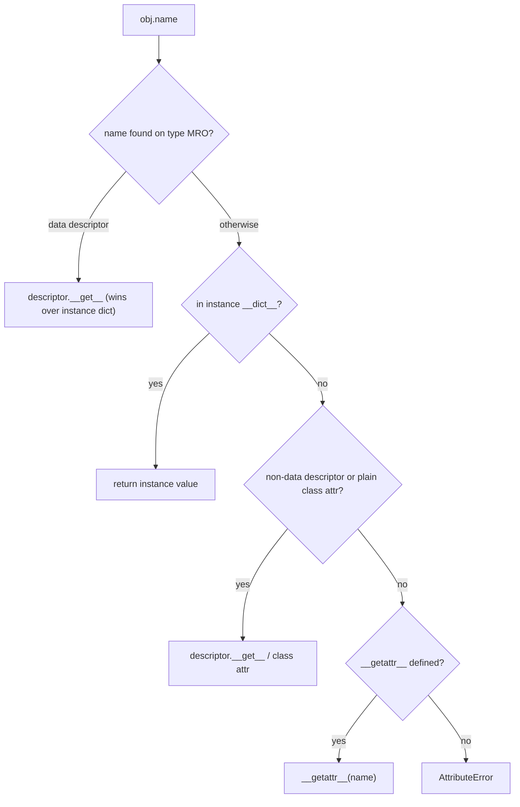

# 3.11 Python under the hood: decorators, descriptors and metaprogramming (how frameworks work)

| | |
|---|---|
| Level | Advanced |
| Priority tier | 2 |
| Lab venue | Python 3.11+ (standard library only) |
| Part | Part 3: Python for infrastructure |
| Status | Drafted, labs **untested** |

## Why this matters for AI infrastructure

FastAPI routes, pydantic models, SQLAlchemy columns, dataclasses, pytest fixtures, Click commands, Airflow DAGs, PyTorch `nn.Module` parameters, `torch.compile` and Ray's `@ray.remote` all look like magic until you see the handful of language mechanisms underneath: functions are objects, closures capture variables, decorators rewrite callables, descriptors control attribute access, `__init_subclass__` and metaclasses run code when classes are created, and the import system can be hooked. Knowing these lets you read framework source when debugging at 3 a.m., write your own small frameworks (plugin registries, config schemas, operator wrappers), and answer the "how does this actually work?" questions that senior interviews use to separate users from engineers. It also teaches restraint: most metaprogramming should not exist in application code.

## Prerequisites and outcomes

Needs 3.1 to 3.4 (functions, classes, data model, typing). After this chapter you can:

- Explain closures, `nonlocal`, late binding and how decorators are applied, including decorators with arguments, class-based decorators, stacking and `functools.wraps`.
- Write decorators for timing, retry, caching, authorisation, registration and instrumentation, handling both sync and async functions.
- Explain the attribute lookup algorithm, `property`, descriptors (data versus non-data), `__getattr__`, `__getattribute__`, `__slots__`, and how methods are bound.
- Explain what `dataclass`, pydantic and ORMs do at class-creation time; use `__init_subclass__`, class decorators and metaclasses where justified, and know the cheaper alternative first.
- Inspect and generate code with `inspect`, `typing.get_type_hints`, `ast`, `dis`, and understand import hooks and `sys.modules`.
- Decide when metaprogramming is appropriate, test it, and keep it debuggable.

## 1. Functions are objects; closures

Functions are first-class objects: they can be assigned, passed, returned, and carry attributes. A **closure** is a function that remembers variables from its enclosing scope even after that scope has returned.

```python
def make_counter():
    count = 0
    def inc():
        nonlocal count            # rebind the enclosing variable (otherwise assignment makes `count` local)
        count += 1
        return count
    return inc

c = make_counter(); c(); c()      # 2
c.__closure__[0].cell_contents    # 2: the captured cell
```

Variable resolution follows **LEGB**: Local, Enclosing, Global, Built-in. Closures capture **variables, not values**, producing the classic late-binding trap:

```python
fs = [lambda: i for i in range(3)]
[f() for f in fs]                 # [2, 2, 2]: all see the final i
fs = [lambda i=i: i for i in range(3)]      # bind at definition via default argument
from functools import partial; fs = [partial(lambda i: i, i) for i in range(3)]    # or partial
```

Closures are the lightweight alternative to single-method classes: a configured callable (`make_rate_limiter(100)`) holds its state in cells. Memory note: a closure keeps the entire captured object alive (a captured large tensor is not freed while the closure exists).

## 2. Decorators

`@decorator` above a `def` is exactly `f = decorator(f)` executed at definition time. A decorator is any callable that takes a callable and returns a replacement (often a wrapper).

```python
import functools, time, logging
log = logging.getLogger(__name__)

def timed(fn):
    @functools.wraps(fn)                       # preserves __name__, __doc__, __wrapped__, signature introspection
    def wrapper(*args, **kwargs):
        t0 = time.perf_counter()
        try:
            return fn(*args, **kwargs)
        finally:
            log.info("%s took %.3fs", fn.__qualname__, time.perf_counter() - t0)
    return wrapper

@timed
def drain(node): ...
```

Without `functools.wraps`, introspection, documentation generators, FastAPI/pydantic signature inspection and pytest fixtures see the wrapper's name and signature instead of the original.

### Decorators with arguments

Three nested levels: a factory taking arguments, returning the decorator, returning the wrapper.

```python
def retry(times=3, exceptions=(Exception,), delay=0.5):
    def deco(fn):
        @functools.wraps(fn)
        def wrapper(*a, **kw):
            for attempt in range(1, times + 1):
                try:
                    return fn(*a, **kw)
                except exceptions as e:
                    if attempt == times: raise
                    time.sleep(delay * 2 ** (attempt - 1))
        return wrapper
    return deco

@retry(times=5, exceptions=(ConnectionError, TimeoutError))
def fetch(): ...
```

### Sync and async

A wrapper around an `async def` must itself be `async def` and `await` the call; otherwise you return a coroutine un-awaited or time only its creation. Support both:

```python
import inspect
def timed(fn):
    if inspect.iscoroutinefunction(fn):
        @functools.wraps(fn)
        async def aw(*a, **kw):
            t0 = time.perf_counter()
            try: return await fn(*a, **kw)
            finally: log.info("%s %.3fs", fn.__name__, time.perf_counter() - t0)
        return aw
    @functools.wraps(fn)
    def w(*a, **kw):
        t0 = time.perf_counter()
        try: return fn(*a, **kw)
        finally: log.info("%s %.3fs", fn.__name__, time.perf_counter() - t0)
    return w
```

### Class-based decorators, stacking and registries

A class with `__call__` keeps state cleanly (a call counter, a cache). To decorate methods, implement `__get__` or use functions. **Stacking** applies bottom-up: `@a @b def f` is `f = a(b(f))`; order matters (auth before caching, not the reverse).

A **registry decorator** returns the function unchanged but records it: the pattern behind Flask/FastAPI routes, Click commands, pytest fixtures/markers, Airflow tasks and plugin systems.

```python
HANDLERS: dict[str, callable] = {}
def handler(event_type):
    def deco(fn):
        HANDLERS[event_type] = fn
        return fn                      # unchanged
    return deco

@handler("node.down")
def on_node_down(evt): ...
def dispatch(evt): return HANDLERS[evt["type"]](evt)
```

FastAPI's `@app.get("/x")` is this pattern: it stores `(path, method, function, signature-derived models)` in the router and returns the function.

### Standard-library decorators worth knowing

`functools.lru_cache` / `cache` (memoise on hashable args; unbounded `cache` leaks memory; not safe on methods holding `self` forever), `cached_property`, `singledispatch` (function overloading on first arg type), `total_ordering`, `partial`, `wraps`, `contextlib.contextmanager` (a generator becomes a context manager), `dataclasses.dataclass`, `typing.overload`/`final`, `abc.abstractmethod`, `property`/`classmethod`/`staticmethod`, `atexit.register`.

Pitfalls: decorators run at import time (side effects, circular imports); wrapping hides tracebacks unless careful; decorating methods versus plain functions (self handling); `lru_cache` on instance methods keeps instances alive; mutating shared state in module-level decorators breaks test isolation; stacking many decorators obscures control flow and signatures (use `typing.ParamSpec` and `Callable[P, R]` to keep type checkers informed).

```python
from typing import Callable, ParamSpec, TypeVar
P = ParamSpec("P"); R = TypeVar("R")
def logged(fn: Callable[P, R]) -> Callable[P, R]:       # preserves the wrapped signature for type checkers
    @functools.wraps(fn)
    def w(*a: P.args, **kw: P.kwargs) -> R:
        log.info("call %s", fn.__name__); return fn(*a, **kw)
    return w
```

## 3. Attribute access and the descriptor protocol

### Lookup order

For `obj.name` Python (in `object.__getattribute__`) does, roughly:

1. Find `name` on the **type** (walking the MRO). If it is a **data descriptor** (defines `__set__` or `__delete__`), call its `__get__` and stop.
2. Else look in the instance `__dict__` (or slots).
3. Else if the type attribute is a **non-data descriptor** (only `__get__`, like functions), call it; or return the plain class attribute.
4. Else call `type(obj).__getattr__(obj, name)` if defined, otherwise `AttributeError`.



`__getattribute__` runs on **every** access (override with extreme care; call `super().__getattribute__` to avoid recursion); `__getattr__` runs only when normal lookup fails (good for proxies, lazy attributes, forwarding). Setting uses `__setattr__`, which checks data descriptors on the type first.

### Methods are descriptors

Functions on a class are non-data descriptors whose `__get__` returns a **bound method** (the function with `self` pre-filled). That is why `obj.method` is a bound method object, `Class.method` is the plain function, and `staticmethod`/`classmethod` are just descriptors with different `__get__`. `functools.partialmethod`, `property`, `cached_property`, and ORM columns are all descriptors.

### Writing a descriptor

```python
class Positive:
    """Reusable validated attribute."""
    def __set_name__(self, owner, name):          # called when the owner class is created
        self.name = name
        self.private = "_" + name
    def __get__(self, obj, objtype=None):
        if obj is None: return self               # accessed on the class
        return getattr(obj, self.private)
    def __set__(self, obj, value):
        if value <= 0: raise ValueError(f"{self.name} must be positive, got {value!r}")
        setattr(obj, self.private, value)

class GpuJob:
    gpus = Positive()
    memory_gb = Positive()
    def __init__(self, gpus, memory_gb):
        self.gpus = gpus              # goes through Positive.__set__
        self.memory_gb = memory_gb
```

One descriptor instance lives on the class and is shared by all instances, so per-instance data must be stored on the instance (here `_gpus`) or in a `WeakKeyDictionary`, never on the descriptor itself. `__set_name__` (PEP 487) lets the descriptor learn its attribute name automatically.

### property, cached_property and slots

`property` is a data descriptor built from getter/setter/deleter functions: use it to start with a plain attribute and add validation or computation later without changing callers. `functools.cached_property` computes once and stores the result in the instance `__dict__` (a non-data descriptor, so the instance value then wins; it needs a `__dict__`, so it does not work with `__slots__` unless a `__dict__` slot exists). **`__slots__`** replaces the per-instance dict with fixed slots (implemented as descriptors on the class): 30 to 50% less memory per instance and slightly faster access for millions of small objects, at the cost of no dynamic attributes, awkward multiple inheritance, and no weakrefs unless `__weakref__` is listed. `@dataclass(slots=True)` automates this.

### Dynamic attributes and proxies

```python
class Config:
    """Attribute-style access to a nested mapping, with lazy loading."""
    def __init__(self, data): self._data = data
    def __getattr__(self, name):                      # only called when normal lookup fails
        try: value = self._data[name]
        except KeyError: raise AttributeError(name) from None
        return Config(value) if isinstance(value, dict) else value
    def __dir__(self): return list(self._data)        # tab-completion and introspection
```

Always raise `AttributeError` (not `KeyError`) from `__getattr__`, or `hasattr`/`getattr` defaults and copying/pickling break; guard against recursion when reading your own attributes inside `__getattr__` (access `self.__dict__` carefully). `__getattr__` on a module (PEP 562) enables lazy imports and deprecation shims. Many ML libraries expose dynamically generated attributes (config objects, `torch.ops` namespaces); tooling support requires type stubs.

### How some frameworks use descriptors

- **Django/SQLAlchemy** columns and relationships are descriptors turning `obj.field` into tracked state; **pydantic v1** used metaclass magic and fields, and v2 builds a compiled validation core from annotations; **dataclasses** generate `__init__`, `__repr__`, `__eq__` from annotations; **`torch.nn.Module.__setattr__`** intercepts assignment to register `nn.Parameter` and submodules in internal dictionaries (that is why assigning layers in `__init__` makes `.parameters()` work, and why putting layers in a plain Python list does not register them: use `nn.ModuleList`).

## 4. Class creation and customisation

### What `class` does

A `class` statement executes the body in a new namespace, then calls `type(name, bases, namespace)` (or the specified metaclass) to build the class object. Classes are objects created at runtime; `type(...)` can create them dynamically:

```python
Node = type("Node", (object,), {"gpus": 8, "describe": lambda self: f"{self.gpus} GPUs"})
```

Sequence for `class C(Base, metaclass=M, **kw)`: resolve bases (`__mro_entries__`), choose the metaclass, `M.__prepare__` (returns the namespace mapping), execute the body, `M(name, bases, ns, **kw)` which runs `M.__new__` then `M.__init__`, then `__set_name__` is called on attributes that define it, then `__init_subclass__` of the parent runs. Python then binds the name.

### `__init_subclass__`: the first tool to reach for

Introduced to cover most metaclass use cases without a metaclass: run code whenever a subclass is defined.

```python
class Plugin:
    registry: dict[str, type["Plugin"]] = {}
    def __init_subclass__(cls, /, name=None, **kw):
        super().__init_subclass__(**kw)
        Plugin.registry[name or cls.__name__.lower()] = cls

class GpuCheck(Plugin, name="gpu"): ...
class NetCheck(Plugin): ...
Plugin.registry          # {'gpu': GpuCheck, 'netcheck': NetCheck}
```

This is how plugin systems, model/operator registries (for example registering custom ops or Airflow-like operators), and ORM-like base classes self-register. A **class decorator** is the other light option (`@register` on a class, or `@dataclass`): it receives the finished class and returns it (possibly modified).

### Metaclasses

A **metaclass** is the class of a class (`type` by default). Subclass `type` to customise class creation: validate or rewrite the namespace, inject methods, enforce interfaces, register classes, or provide declarative syntax (Django models, SQLAlchemy declarative, `enum.Enum`, `abc.ABCMeta`, pydantic v1 `ModelMetaclass`).

```python
class FieldsMeta(type):
    @classmethod
    def __prepare__(mcs, name, bases, **kw):
        return {}                                   # could return an ordered/validating mapping
    def __new__(mcs, name, bases, ns, **kw):
        fields = {k: v for k, v in ns.items() if isinstance(v, Field)}
        ns["_fields"] = fields                      # collect declarative fields
        for k in fields: ns.pop(k)                  # or keep them as descriptors
        return super().__new__(mcs, name, bases, ns, **kw)
    def __call__(cls, *a, **kw):                    # customise instantiation (singleton, validation hook)
        return super().__call__(*a, **kw)
```

Guidance: prefer, in order, (1) plain functions/composition, (2) decorators, (3) descriptors, (4) `__init_subclass__` and class decorators, (5) metaclasses only when you must control class *creation* itself (custom namespaces via `__prepare__`, intercepting `__call__`, combining with `ABCMeta`). Metaclass conflicts arise when combining two different metaclasses (`TypeError: metaclass conflict`), they are inherited implicitly (surprising), and they complicate debugging and type checking. If your reviewers cannot explain it in a minute, it is too clever.

### Abstract base classes, protocols and the data model hooks

`abc.ABC` plus `@abstractmethod` prevents instantiating incomplete subclasses (via `ABCMeta`); `typing.Protocol` gives structural subtyping; `__subclasshook__` and `register` customise `isinstance`. `__class_getitem__` supports generics syntax (`Foo[int]`); `__instancecheck__` customise isinstance on metaclasses; `__call__` makes instances callable; `__enter__/__exit__` context managers; `__iter__/__next__` iteration; `__get_pydantic_core_schema__` lets custom types integrate with pydantic.

## 5. Introspection and code generation

- **`inspect`**: `inspect.signature(fn)` (parameters, defaults, annotations; this is what FastAPI, Click, pytest and dependency-injection frameworks read to wire arguments), `inspect.getsource`, `inspect.iscoroutinefunction`, `inspect.getmembers`, `inspect.stack` (costly), `inspect.unwrap` (follows `__wrapped__` set by `functools.wraps`).
- **Annotations**: `typing.get_type_hints(obj)` resolves string/forward annotations; `__annotations__` holds the raw values; from Python 3.14 deferred evaluation changes details (check release notes); pydantic and FastAPI rely on resolved hints.
- **Attributes API**: `getattr/setattr/hasattr/delattr`, `vars(obj)`, `dir`, `type(obj).__mro__`, `types.SimpleNamespace`, `types.MethodType`, `object.__setattr__` to bypass custom setters (frozen dataclass internals).
- **Code objects and bytecode**: `dis.dis(fn)` shows CPython bytecode; `fn.__code__.co_varnames`, `co_consts`; useful to understand performance (attribute lookups, global versus local access) and to read tracebacks. Bytecode is an implementation detail and varies by version.
- **AST**: `ast.parse(source)` yields a syntax tree you can analyse and transform (linters, `pytest` assertion rewriting, `numba`/`torch.compile` frontends, macro-like tools); `compile(tree, filename, "exec")` then `exec` runs it. `exec`/`eval` on untrusted strings is a code-injection vulnerability: never feed them user input; `ast.literal_eval` safely parses literals only.
- **Source generation**: the `dataclasses` module builds methods as source strings executed with `exec` for speed; templates (Jinja2) generate configs; `types.FunctionType` and `typing.NamedTuple` / `collections.namedtuple` create types dynamically.

### How FastAPI wires a handler (a worked example)

```python
import inspect, typing
def endpoint(user_id: int, verbose: bool = False, q: str | None = None): ...

sig = inspect.signature(endpoint)
hints = typing.get_type_hints(endpoint)
for name, p in sig.parameters.items():
    print(name, hints[name], "required" if p.default is p.empty else f"default={p.default!r}")
```

From this alone a framework learns each parameter's name, type, required-ness, and default, builds a pydantic model to validate request data, decides path/query/body sources, and generates OpenAPI schema; `Depends(...)` defaults are discovered the same way and resolved recursively. The route decorator stores the function, and at request time the framework builds kwargs and calls it. Understanding this explains why changing a type hint changes API behaviour, why `functools.wraps` matters, and why decorators that hide the signature break FastAPI.

### How pytest finds and injects fixtures

pytest imports test modules (rewriting `assert` statements through the AST at import), collects `test_*` functions, inspects each test's parameter names with `inspect.signature`, looks up fixtures of those names (registered by the `@pytest.fixture` decorator in module/`conftest.py` registries), resolves dependencies between fixtures, executes setup (generator fixtures run until `yield`), calls the test with the values and runs teardown in reverse. The same "inspect signature, inject by name" idea underlies dependency injection frameworks.

## 6. Imports, modules and hooks

- `import x` runs `sys.modules` lookup, then **finders** in `sys.meta_path` locate a **spec**, a **loader** creates and executes the module, and the module object is cached in `sys.modules` (so a module's top-level code runs once; circular imports see partially initialised modules).
- **Import hooks**: custom finders/loaders can import from databases, encrypted archives, remote stores, or transform source on import (how `pytest` rewrites asserts, how some DSLs and notebook imports work). Entry points (`importlib.metadata.entry_points(group="myapp.plugins")`) are the standard way to discover plugins installed by other packages (used by pytest plugins, Airflow providers, Kubeflow components, setuptools scripts).
- `importlib.import_module(name)` for dynamic imports (plugin loading by name; validate names from configuration against an allow-list); `importlib.reload` has sharp edges; `__all__` and `__getattr__` at module level control star-imports and lazy attributes; lazy-import heavy libraries (torch, pandas) inside functions to keep CLI start-up fast.
- `sys.path`, `PYTHONPATH`, `.pth` files and `site` determine search order; shadowing standard library names (a local `json.py`, `random.py`, `typing.py`) is a classic puzzling failure.
- **Security of dynamic loading**: importing a module executes arbitrary code; unpickling executes code; plugin discovery via entry points trusts every installed package. Treat third-party plugins and model files accordingly (3.10: `torch.load`).

## 7. Performance and memory implications of dynamism

- Attribute access via instance `__dict__` is fast but memory-heavy; descriptors and `__getattr__` add per-access overhead; `__slots__` saves memory for millions of objects.
- Each wrapper layer adds a Python call (roughly tens to hundreds of nanoseconds each); in hot loops decorators matter, in I/O paths they don't. Profile before removing abstraction.
- Closures and bound methods keep references alive: callbacks that capture `self` create cycles and leak in long-running agents; use `weakref` (`WeakMethod`, `WeakValueDictionary`) for observers and caches.
- `lru_cache` holds strong references to arguments and results: size-limit it and avoid caching methods on large objects.
- Dynamic class creation in loops (creating a new class per request) leaks memory and slows type checks; create once.
- `torch.compile`, `numba.jit`, `jax.jit` trace Python into graphs: Python side effects, data-dependent control flow and mutations behave differently under tracing (they run once at trace time) which is the practical consequence of metaprogramming-style compilation.

## 8. Good practice for framework-style code

1. Prefer explicit over implicit; offer metaprogramming-free paths (an explicit `register(cls)` function beside the decorator).
2. Keep wrappers transparent: `functools.wraps`, preserve signatures (`ParamSpec`), re-raise original exceptions, do not swallow `KeyboardInterrupt`.
3. Document the magic: what attributes appear, in which order things run, how to debug (`repr` of generated classes, `__wrapped__`).
4. Make registration idempotent and test-friendly (clear/reset functions, no import-time global mutation that depends on test order).
5. Fail early with clear errors at class-definition time (validate in `__init_subclass__`, `__set_name__`) instead of obscure failures at run time.
6. Type it: stubs or `Protocol`/generics so IDEs and mypy understand generated attributes (`dataclass_transform` marks pydantic/ORM-like base classes).
7. Test the machinery directly: unit tests for decorators (sync and async, with arguments, preserving metadata, exception behaviour), descriptors (class vs instance access, per-instance isolation), and registries (duplicates, ordering).
8. Use `contextvars` (not globals or threading locals) for request-scoped state that must flow through async code (request ids, tracing context, tenant).

## 9. Lab (untested)

1. **Closures and late binding**: reproduce the lambda-in-loop bug; fix three ways; inspect `__closure__`; build a rate limiter as a closure and as a class.
2. **Decorators**: implement `timed`, `retry(times, exceptions)` with jittered backoff, and `cache_with_ttl`; make each work for sync and async functions; verify metadata with `functools.wraps`; show the broken `inspect.signature` without it; type with `ParamSpec`.
3. **Registry**: build `@handler("event")` and a dispatcher; then reimplement with `__init_subclass__`; then add entry-point discovery in a tiny installable package (`pip install -e`) with `importlib.metadata.entry_points`.
4. **Mini-FastAPI**: write a decorator-based router that uses `inspect.signature` and type hints to parse a query string into typed arguments, validate required parameters and return 422-style errors; compare with the real FastAPI behaviour.
5. **Descriptors**: implement `Positive`, a `Typed(type)` descriptor and a lazy `cached_attr`; verify that state is per-instance (create two instances), class access returns the descriptor, and data vs non-data precedence by shadowing in the instance `__dict__`.
6. **Dynamic attributes**: build the `Config` proxy with `__getattr__`; demonstrate the bugs from raising `KeyError`, from recursion in `__getattr__`, and from missing `__dir__`; add module-level `__getattr__` to lazily import a heavy module.
7. **`__slots__`**: measure memory of one million small objects with dict vs slots vs `@dataclass(slots=True)` (`tracemalloc` or `sys.getsizeof` plus `pympler`); try to set an undeclared attribute and a weakref.
8. **Class creation**: print the class-creation sequence by defining a metaclass with prints in `__prepare__`, `__new__`, `__init__`, plus `__set_name__` and `__init_subclass__` hooks; add a `type(...)` dynamic class.
9. **Metaclass vs `__init_subclass__`**: implement a declarative `Schema` with `Field` objects once with a metaclass and once with `__set_name__` plus `__init_subclass__`; provoke a metaclass conflict by combining with `ABC`.
10. **`nn.Module` internals**: write a toy `Module` base class whose `__setattr__` registers `Parameter` and submodule instances in dictionaries and provides `parameters()` recursively; show why a plain list of layers is missed.
11. **Introspection and AST**: use `dis` on a function with a global versus a local variable; use `ast` to find all `subprocess.run(..., shell=True)` calls in a source tree (a tiny linter).
12. **Import system**: print `sys.meta_path`, trace an import with `python -X importtime` and `-v`; write a meta-path finder that serves a module from a string; reproduce a circular import and a shadowed stdlib module.
13. **Clean up.**

Mark tested only after execution.

## 10. Common mistakes

- Forgetting `functools.wraps`, breaking introspection, docs and signature-based frameworks.
- Writing sync wrappers around async functions (or vice versa) so coroutines are never awaited.
- Late-binding closures in loops; mutable default arguments (a close cousin: shared state evaluated at definition time).
- Storing per-instance state on a descriptor object (shared across all instances).
- `__getattr__` that recurses infinitely or raises the wrong exception type; overriding `__getattribute__` without need.
- `lru_cache`/`cache` on methods or with unhashable/huge arguments causing leaks or errors.
- Side effects at import time via decorators (network calls, global registry mutation) that make tests order-dependent.
- Reaching for metaclasses when `__init_subclass__` or a decorator suffices; metaclass conflicts.
- Assuming `__slots__` works with `cached_property`, multiple inheritance or pickling without checks.
- Using `eval`/`exec`/`pickle`/dynamic import on untrusted input.
- Putting `nn.Module` children in plain lists/dicts so parameters are not registered.
- Reference cycles through bound-method callbacks in long-running agents.

## 11. Interview angles

- "What does `@decorator` desugar to? How do you write one with arguments? Why `functools.wraps`?"
- "What is a closure? Explain the lambda-in-a-loop bug."
- "Explain attribute lookup order and data versus non-data descriptors. How do methods become bound?"
- "How does `property` work? How would you implement it yourself?"
- "What does `dataclass` do? How does pydantic validate? How does FastAPI know a parameter is a query parameter?"
- "Metaclass versus `__init_subclass__` versus class decorator: when each?"
- "Why does assigning layers to a plain list break `parameters()` in PyTorch?"
- "How does pytest inject fixtures?" (signature inspection by name.)
- "What happens when you `import` a module twice? Circular imports?"
- "What are the risks of `pickle`, `eval` and plugin auto-loading?"

## 12. Checkpoint questions (40)

1. What does `@d def f` desugar to? **A:** `f = d(f)`.
2. What is a closure? **A:** A function plus captured enclosing variables.
3. What does `nonlocal` do? **A:** Rebinds a variable in the enclosing function scope.
4. Why does `[lambda: i for i in range(3)]` return 2,2,2? **A:** Late binding of the variable `i`.
5. What does LEGB stand for? **A:** Local, Enclosing, Global, Built-in.
6. What does `functools.wraps` preserve? **A:** Name, docstring, `__wrapped__`, signature info.
7. How many nested functions for a decorator with arguments? **A:** Three levels.
8. Stack order of `@a @b def f`? **A:** `a(b(f))`.
9. How must a decorator wrap `async def`? **A:** With an `async` wrapper that awaits.
10. What is a registry decorator? **A:** Records the function and returns it unchanged.
11. What does `lru_cache` risk on methods? **A:** Keeps instances alive.
12. What does `ParamSpec` give? **A:** Signature-preserving typing for decorators.
13. When is a decorator applied? **A:** At definition (import) time.
14. What makes a data descriptor? **A:** Defines `__set__` or `__delete__`.
15. Data descriptor vs instance dict precedence? **A:** Data descriptor wins.
16. Are functions descriptors? **A:** Yes, non-data; `__get__` binds `self`.
17. What does `__set_name__` do? **A:** Tells a descriptor its attribute name at class creation.
18. Where should descriptor per-instance data live? **A:** On the instance (or a weak dict).
19. `__getattr__` vs `__getattribute__`? **A:** Fallback on failure vs every access.
20. What exception must `__getattr__` raise on missing? **A:** `AttributeError`.
21. What does `__slots__` save? **A:** Per-instance dict memory.
22. What breaks with `__slots__`? **A:** Dynamic attributes, `cached_property`, weakrefs unless declared.
23. What does `cached_property` store the result in? **A:** The instance `__dict__`.
24. What does `type(name, bases, ns)` do? **A:** Creates a class dynamically.
25. Order: `__prepare__`, body, `__new__`, `__init__`, `__set_name__`, `__init_subclass__`: which first? **A:** `__prepare__`.
26. What triggers `__init_subclass__`? **A:** Defining a subclass.
27. Metaclass of a normal class? **A:** `type`.
28. When prefer a metaclass? **A:** Only when controlling class creation/`__call__`/namespace is required.
29. What error combining incompatible metaclasses? **A:** Metaclass conflict `TypeError`.
30. What does `inspect.signature` give frameworks? **A:** Parameter names, defaults, annotations.
31. Why `get_type_hints` rather than `__annotations__`? **A:** Resolves forward references.
32. What is `inspect.unwrap` for? **A:** Following `__wrapped__` to the original.
33. What does `dis` show? **A:** CPython bytecode.
34. Why not `eval` on user input? **A:** Arbitrary code execution; use `ast.literal_eval` for literals.
35. How does `nn.Module` register layers? **A:** `__setattr__` intercepts Parameter/Module assignments.
36. Why `nn.ModuleList`? **A:** Plain lists are not registered.
37. What is cached after the first import? **A:** The module object in `sys.modules`.
38. How to discover plugins from other packages? **A:** Entry points via `importlib.metadata`.
39. Use for `contextvars`? **A:** Request-scoped state across async tasks.
40. Weak references help with what? **A:** Avoiding reference cycles and leaks in callbacks and caches.

## 13. Sources and review notes

**Written in original words.** Principal sources:

- Luciano Ramalho, *Fluent Python*: dynamic attributes and properties, attribute descriptors, class metaprogramming (chapters 22 to 24 of the second edition), function decorators and closures.
- Mark Lutz, *Learning Python*: managed attributes, decorators, metaclasses (part VIII).
- The author's `nvidia-devops` repository, volume 02, advanced OOP and design material.
- Python language reference (data model, import system), `functools`, `inspect`, `dataclasses`, PEP 487 and PEP 562.
- Examples are the author's constructions.

**Flagged for verification before publishing:** behaviour details that changed between Python versions (annotation evaluation in 3.14, `dataclass` options, `__set_name__` edge cases, `cached_property` locking history), library internals described at a high level (pydantic v2, FastAPI, pytest, PyTorch `nn.Module`), memory-saving percentages for `__slots__`, and every code listing; all labs are **untested**.
