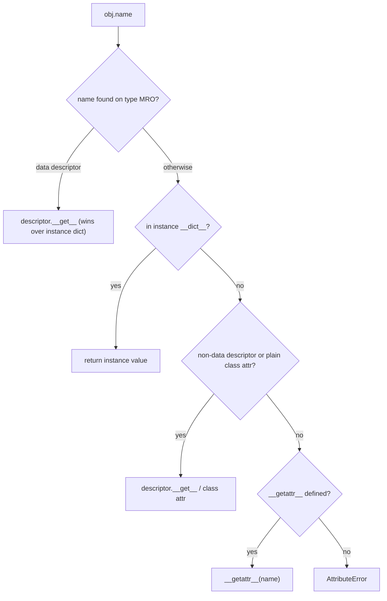

# 3.11 Python under the hood: decorators, descriptors and metaprogramming (how frameworks work)

| | |
|---|---|
| Level | Advanced |
| Priority tier | 2 |
| Lab venue | Python 3.11+ (standard library only) |
| Part | Part 3: Python for infrastructure |
| Status | Drafted, labs **untested** |

## Why this matters for AI infrastructure

Your pager goes off at 3 a.m., and the stack trace leads into a FastAPI route, a pydantic model or a pytest fixture. These look like magic until you see the few language mechanisms underneath them. You will find the same ideas under SQLAlchemy columns, dataclasses, Click commands, Airflow DAGs, PyTorch `nn.Module` parameters, `torch.compile` and Ray's `@ray.remote`.

Functions are objects, closures capture variables, and decorators rewrite callables. Descriptors control attribute access. `__init_subclass__` and metaclasses run code when a class is created, and the import system can be hooked as well.

Knowing these lets you read framework source when a bug lands in your lap. It also lets you write your own small frameworks, such as plugin registries, config schemas and operator wrappers. Senior interviews often ask "how does this actually work?" to separate users from engineers, and these mechanisms are the answer. The chapter also teaches restraint. Most metaprogramming should not exist in application code.

## Prerequisites and outcomes

Start with the prerequisites. You need 3.1 to 3.4 first, which cover functions, classes, the data model and typing. When you finish this chapter, you should be able to do the following.

- Explain closures, `nonlocal`, late binding and how decorators are applied, including decorators with arguments, class-based decorators, stacking and `functools.wraps`.
- Write decorators for timing, retry, caching, authorisation, registration and instrumentation, handling both sync and async functions.
- Explain the attribute lookup algorithm, `property`, descriptors (data versus non-data), `__getattr__`, `__getattribute__`, `__slots__`, and how methods are bound.
- Explain what `dataclass`, pydantic and ORMs do at class-creation time, use `__init_subclass__`, class decorators and metaclasses where they are justified, and know the cheaper alternative first.
- Inspect and generate code with `inspect`, `typing.get_type_hints`, `ast`, `dis`, and understand import hooks and `sys.modules`.
- Decide when metaprogramming is appropriate, test it, and keep it debuggable.

Use this list as a checklist. Each later section maps to one or more of these outcomes.

## 1. Functions are objects; closures

Suppose you want a counter that remembers its count between calls. Functions are first-class objects, so you can assign them, pass them, return them and attach attributes. A **closure** is a function that remembers variables from its enclosing scope, even after that scope has returned.

```python
def make_counter():
    count = 0
    def inc():
        nonlocal count            # rebind the enclosing variable (otherwise assignment makes `count` local)
        count += 1
        return count
    return inc

c = make_counter(); c(); c()      # 2
c.__closure__[0].cell_contents    # 2: the captured cell
```

The nonlocal line lets the inner function change the captured name. Without it, the assignment would make the name local to the inner function.

Python looks up names in the order Local, Enclosing, Global, Built-in. Closures capture variables, not values, which leads to the classic late-binding trap.

```python
fs = [lambda: i for i in range(3)]
[f() for f in fs]                 # [2, 2, 2]: all see the final i
fs = [lambda i=i: i for i in range(3)]      # bind at definition via default argument
from functools import partial; fs = [partial(lambda i: i, i) for i in range(3)]    # or partial
```

Every lambda in the first line looks up the same name, and by the time you call them, that name holds 2. The default argument and the partial call each copy the value when the lambda is defined.

Closures are also a lightweight alternative to single-method classes. A configured callable, such as `make_rate_limiter(100)`, keeps its state in cells. Watch the memory, though. A closure keeps the entire captured object alive, so a captured large tensor is not freed while the closure exists.

## 2. Decorators

Suppose every service in your team needs the same timing code. You do not want to edit each function. A decorator wraps the function once, when Python defines it. `@decorator` above a `def` is exactly `f = decorator(f)`, executed at definition time. A decorator is any callable that takes a callable and returns a replacement, often a wrapper.

```python
import functools, time, logging
log = logging.getLogger(__name__)

def timed(fn):
    @functools.wraps(fn)                       # preserves __name__, __doc__, __wrapped__, signature introspection
    def wrapper(*args, **kwargs):
        t0 = time.perf_counter()
        try:
            return fn(*args, **kwargs)
        finally:
            log.info("%s took %.3fs", fn.__qualname__, time.perf_counter() - t0)
    return wrapper

@timed
def drain(node): ...
```

Without `functools.wraps`, introspection, documentation generators, FastAPI and pydantic signature inspection, and pytest fixtures see the wrapper's name and signature instead of the original. That is why the `wraps` line matters in this example.

### Decorators with arguments

Sometimes the decorator needs settings of its own, such as how many times to retry. Then you need one more level of nesting. The code below has three levels: a factory that takes the arguments, a decorator that takes the function, and a wrapper that does the work.

```python
def retry(times=3, exceptions=(Exception,), delay=0.5):
    def deco(fn):
        @functools.wraps(fn)
        def wrapper(*a, **kw):
            for attempt in range(1, times + 1):
                try:
                    return fn(*a, **kw)
                except exceptions as e:
                    if attempt == times: raise
                    time.sleep(delay * 2 ** (attempt - 1))
        return wrapper
    return deco

@retry(times=5, exceptions=(ConnectionError, TimeoutError))
def fetch(): ...
```

The outer `retry` receives the settings, `deco` receives the function, and `wrapper` retries the call with a growing delay between attempts.

### Sync and async

A wrapper around an `async def` function must itself be `async def`, and it must `await` the call. Otherwise you either return a coroutine that nobody awaits, or you time only the creation of the coroutine. The version below supports both kinds of function, and it picks the right wrapper when the decorator runs.

```python
import inspect
def timed(fn):
    if inspect.iscoroutinefunction(fn):
        @functools.wraps(fn)
        async def aw(*a, **kw):
            t0 = time.perf_counter()
            try: return await fn(*a, **kw)
            finally: log.info("%s %.3fs", fn.__name__, time.perf_counter() - t0)
        return aw
    @functools.wraps(fn)
    def w(*a, **kw):
        t0 = time.perf_counter()
        try: return fn(*a, **kw)
        finally: log.info("%s %.3fs", fn.__name__, time.perf_counter() - t0)
    return w
```

### Class-based decorators, stacking and registries

A class with `__call__` keeps state cleanly, for example a call counter or a cache. It has a trap, though. Mark Lutz shows it in *Learning Python* Chapter 39 (`Examples 39-1` to `39-9`). Suppose you write `class tracer` with an `__init__` that stores `self.calls = 0` and `self.func = func`, plus a `__call__` method. If you apply `@tracer` to a class method, such as `@tracer def giveRaise(self, percent):`, then calling `pat.giveRaise(0.10)` fails. The reason is that `tracer` is not a descriptor, so Python passes the `tracer` instance as `self` instead of the `Person` instance `pat`.

You have two fixes. You can write the decorator as a nested function with `nonlocal calls`, as in `def tracer(func): calls = 0; def onCall(*args, **kwargs): nonlocal calls; calls += 1; return func(*args, **kwargs); return onCall`. Or you can implement `__get__` on the decorator class.

Lutz also builds three complete decorator case studies in the same chapter. They are modeled in `code/part03/python_metaprogramming_internals.py`.

1. The parameterized timing decorator, `@timer(label='[CCC]==>', trace=True)`, lives in `timerdeco2.py`. It uses three levels of nesting, `timer(label='', trace=True) -> onDecorator(func) -> onCall(*args, **kargs)`. The wrapper accumulates `onCall.alltime += elapsed` across calls, and the study compares `listcomp` with `mapcall` on `50_000..1_000_000` items.
2. Class decorators handle singletons and access control. The decorator `@Private('data', 'size')` wraps a class `Doubler` in an `onInstance` proxy, from `access2.py`. The proxy intercepts `__getattr__` and `__setattr__`, so outside reads and writes to private attributes are rejected. A `BuiltinsMixin` is added too, so built-in operations such as `+` and `str()` route through `__getattr__`. The same file also shows `@ singleton` and `@Public(...)`.
3. The third is a generalized range and type validator, `@rangetest(age=(0, 120), M=(1, 12), D=(1, 31))`, from `Example 39-25 rangetest.py`. It reads `code = func.__code__` and `allargs = code.co_varnames[:code.co_argcount]`. Using those names, it maps positional arguments (`pargs`) and keyword arguments (`kargs`) to their parameter names. Defaulted arguments are skipped cleanly. Under `python -O`, the check short-circuits with `if not __debug__: return func`.

Stacking applies bottom-up. `@a @b def f` means `f = a(b(f))`, so the order matters. Put auth before caching, not the reverse.

A registry decorator returns the function unchanged, but it records the function first. This pattern sits behind Flask and FastAPI routes, Click commands, pytest fixtures and markers, Airflow tasks and plugin systems.

```python
HANDLERS: dict[str, callable] = {}
def handler(event_type):
    def deco(fn):
        HANDLERS[event_type] = fn
        return fn                      # unchanged
    return deco

@handler("node.down")
def on_node_down(evt): ...
def dispatch(evt): return HANDLERS[evt["type"]](evt)
```

The decorator stores the handler, and `dispatch` looks it up later by event type. FastAPI's `@app.get("/x")` follows the same pattern. The router stores the path, the method, the function and models derived from the signature, then returns the function.

### Standard-library decorators worth knowing

Several decorators ship with the standard library, and you will meet them often. `functools.lru_cache` and `cache` memoise results for hashable arguments. An unbounded `cache` leaks memory, and it is not safe on methods that hold `self` forever. `cached_property` caches a property on the instance, and `singledispatch` overloads a function on the type of its first argument. `total_ordering` fills in the missing comparison methods, while `partial` and `wraps` help with wrapping. `contextlib.contextmanager` turns a generator into a context manager. `dataclasses.dataclass`, `typing.overload` and `typing.final` shape classes and type hints. `abc.abstractmethod` marks methods that subclasses must implement. `property`, `classmethod` and `staticmethod` cover the common method kinds, and `atexit.register` runs a function when the interpreter exits.

Decorators fail in a few predictable ways. They run at import time, so side effects and circular imports can appear there. Wrapping can hide tracebacks unless you are careful. Decorating a method differs from decorating a plain function, because `self` must be handled. An `lru_cache` on an instance method keeps instances alive. A module-level decorator that mutates shared state breaks test isolation. Stacking many decorators obscures the control flow and the signature. `typing.ParamSpec` and `Callable[P, R]` keep type checkers informed.

```python
from typing import Callable, ParamSpec, TypeVar
P = ParamSpec("P"); R = TypeVar("R")
def logged(fn: Callable[P, R]) -> Callable[P, R]:       # preserves the wrapped signature for type checkers
    @functools.wraps(fn)
    def w(*a: P.args, **kw: P.kwargs) -> R:
        log.info("call %s", fn.__name__); return fn(*a, **kw)
    return w
```

When you write a decorator, add `functools.wraps` and a precise type hint from the start.

## 3. Attribute access and the descriptor protocol

### Lookup order

When you write `obj.name`, Python checks several places in a fixed order. The order decides which value you get when two places hold the same name. Roughly, Python does the following inside `object.__getattribute__`:

1. Find `name` on the **type** (walking the MRO). If it is a **data descriptor** (defines `__set__` or `__delete__`), call its `__get__` and stop.
2. Else look in the instance `__dict__` (or slots).
3. Else if the type attribute is a **non-data descriptor** (only `__get__`, like functions), call it; or return the plain class attribute.
4. Else call `type(obj).__getattr__(obj, name)` if defined, otherwise `AttributeError`.

The flowchart below shows the same four steps as a picture.



`__getattribute__` runs on every access, so override it with extreme care. Call `super().__getattribute__` to avoid infinite recursion. `__getattr__` runs only when normal lookup fails, which makes it a good fit for proxies, lazy attributes and forwarding. Setting an attribute uses `__setattr__`, which checks data descriptors on the type first.

### Methods are descriptors

Why does `obj.method` give you a bound method, while `Class.method` gives you a plain function? Functions are descriptors. Functions on a class are non-data descriptors whose `__get__` returns a bound method, which is the function with `self` pre-filled. That is why `obj.method` is a bound method object and `Class.method` is the plain function. `staticmethod` and `classmethod` are also descriptors, each with a different `__get__`. `functools.partialmethod`, `property`, `cached_property` and ORM columns are descriptors too.

### Writing a descriptor

Suppose a GPU job must always request a positive number of GPUs. You could check the value in every method. Or you could let a descriptor check it on every assignment, as the code below does.

```python
class Positive:
    """Reusable validated attribute."""
    def __set_name__(self, owner, name):          # called when the owner class is created
        self.name = name
        self.private = "_" + name
    def __get__(self, obj, objtype=None):
        if obj is None: return self               # accessed on the class
        return getattr(obj, self.private)
    def __set__(self, obj, value):
        if value <= 0: raise ValueError(f"{self.name} must be positive, got {value!r}")
        setattr(obj, self.private, value)

class GpuJob:
    gpus = Positive()
    memory_gb = Positive()
    def __init__(self, gpus, memory_gb):
        self.gpus = gpus              # goes through Positive.__set__
        self.memory_gb = memory_gb
```

One descriptor instance lives on the class and is shared by all instances. So per-instance data must be stored on the instance, here as `_gpus`, or directly in `instance.__dict__[self.storage_name]`. You can also use a `WeakKeyDictionary`. Never store it on the descriptor itself. `__set_name__` (PEP 487) lets the descriptor learn its attribute name automatically.

Two worked examples in the reference books go further. In *Fluent Python* Chapter 23 (`Examples 23-5` to `23-13`), Ramalho builds an abstract `Validated(ABC)` descriptor base class. Its `__set_name__(self, owner, name)` sets `self.storage_name = name`. Its `__set__(self, instance, value)` calls `value = self.validate(self.storage_name, value)` and writes `instance.__dict__[self.storage_name] = value`. Two subclasses build on it. `Quantity(Validated)` enforces `value > 0`, and `NonBlank(Validated)` strips whitespace and rejects empty strings. Together they validate `LineItem(description, weight, price)` declaratively. The code is modeled in `code/part03/python_metaprogramming_internals.py`. Ramalho also contrasts three descriptor flavors on a `Managed` class:

1. **Overriding (data) descriptor with `__get__` and `__set__` (`Overriding`):** Always intercepts both reads (`obj.over`) and writes (`obj.over = 7`), even if you manually stuff `obj.__dict__['over'] = 8`.
2. **Overriding descriptor without `__get__` (`OverridingNoGet`, only `__set__`):** Intercepts writes (`obj.over_no_get = 7`). Reads (`obj.over_no_get`) return the descriptor object itself, unless `'over_no_get'` is present in `obj.__dict__`.
3. **Non-overriding (non-data) descriptor (`NonOverriding`, only `__get__`, like functions and `@functools.cached_property`):** `obj.non_over` calls `__get__` only when `'non_over'` is not in `obj.__dict__`. Assigning `obj.non_over = 7` writes `'non_over'` into `obj.__dict__`, and from then on that value shadows the descriptor.

Learning Python Chapter 38 (`Examples 38-19` to `38-25`) shows why storing state on the descriptor (`self.value`) is a bug. Lutz implements a `CardHolder(acct, name, age, addr)` class. It has `acctlen = 8`, `retireage = 62.5`, a name normalized to lowercase with underscores, an account number masked as `'12345***'`, the check `0 <= age <= 150`, and `remain = retireage - age`. He builds it four ways: with `@property` (`validate_properties.py`), with descriptors (`validate_descriptors1.py` versus `validate_descriptors2.py`), with `__getattr__` and `__setattr__` (`validate_getattr.py`), and with `__getattribute__` and `__setattr__` (`validate_getattribute.py`). In `validate_descriptors1.py`, storing `self.name = value` on the descriptor means that creating `bob`, then `sue`, overwrites the one shared `Name` descriptor on `CardHolder`. So `bob.name` morphs into `'sue_jones'`. Storing the state on the client instance, as `instance.__name = value` does in `validate_descriptors2.py`, keeps `bob` and `sue` isolated. The lab file `code/part03/python_metaprogramming_internals_lab.py` tests that isolation.

When you write a descriptor, keep every piece of per-instance state on the instance. The shared descriptor object is the trap.

### property, cached_property and slots

Suppose an attribute starts as a plain value today, and next year it needs validation. A `property` lets you add that check without changing any caller. `property` is a data descriptor built from getter, setter and deleter functions. Use it to start with a plain attribute and add validation or computation later. Bertrand Meyer calls this idea the **Uniform Access Principle**.

`functools.cached_property` computes its value once and stores the result in the instance `__dict__`. It is a non-data descriptor, so the instance value wins from then on. It needs a `__dict__`, so it does not work with `__slots__` unless a `__dict__` slot exists.

`__slots__` replaces the per-instance dict with fixed slots, which are implemented as descriptors on the class. For millions of small objects, this brings 30 to 50% less memory per instance and slightly faster access. The cost is that you lose dynamic attributes. Multiple inheritance gets awkward, and you get no weakrefs unless `__weakref__` is listed. `@dataclass(slots=True)` sets this up for you.

Choose `__slots__` when you have millions of small objects and can live without dynamic attributes.

### Dynamic attributes and proxies (`FrozenJSON` and `osconfeed.json`, `FP` Chapter 22)

A JSON feed arrives as nested dictionaries and lists, and you would rather write `feed.Schedule.events[40].name` than a chain of brackets. In *Fluent Python* Chapter 22 (`Examples 22-1` to `22-6`), modeled in `code/part03/python_metaprogramming_internals.py`, `FrozenJSON` wraps nested JSON documents. The sample file `osconfeed.json` holds 1 conference, 484 events, 357 speakers and 53 venues. With the wrapper, `feed.Schedule.events[40].name` returns `'There *Will* Be Bugs'`, and dict methods such as `.keys()` still work side by side.

The wrapper relies on two mechanisms:

- **`__new__(cls, arg)` for flexible object construction:** `__new__` builds the right kind of object for each input. If `arg` is a mapping, it checks `if isinstance(arg, abc.Mapping): return super().__new__(cls)`. If `arg` is a mutable sequence, it returns `[cls(item) for item in arg]`. Otherwise it returns `arg` unchanged.
- **Handling Python reserved keywords (`class` -> `class_`) and invalid identifiers:** In `__init__`, the line `if keyword.iskeyword(key): key += '_'` renames a JSON key such as `'class'` to `'class_'`, so you can write `student.class_`. A key such as `'2be'` cannot be read with dot syntax, and `key.isidentifier()` detects that case.

```python
class Config:
    """Attribute-style access to a nested mapping, with lazy loading."""
    def __init__(self, data): self._data = data
    def __getattr__(self, name):                      # only called when normal lookup fails
        try: value = self._data[name]
        except KeyError: raise AttributeError(name) from None
        return Config(value) if isinstance(value, dict) else value
    def __dir__(self): return list(self._data)        # tab-completion and introspection
```

Always raise `AttributeError`, not `KeyError`, from `__getattr__`. If you raise the wrong type, the defaults in `hasattr` and `getattr` break, and so do copying and pickling. Guard against recursion when `__getattr__` reads your own attributes, and access `self.__dict__` carefully. `__getattr__` on a module (PEP 562) enables lazy imports and deprecation shims. Many ML libraries expose attributes generated at run time, such as config objects and `torch.ops` namespaces. Tooling support for those attributes requires type stubs.

Test the missing-key path of any proxy first, because that is where it usually breaks.

### How some frameworks use descriptors

You do not need these internals to use Django or pydantic. You do need them to understand what happens when a field is assigned. Django and SQLAlchemy columns and relationships are descriptors, and they turn `obj.field` into tracked state. Pydantic v1 used metaclass magic and fields, while v2 builds a compiled validation core from annotations. `dataclasses` generate `__init__`, `__repr__` and `__eq__` from annotations. `torch.nn.Module.__setattr__` intercepts assignment and registers `nn.Parameter` and submodules in internal dictionaries. That is why assigning layers in `__init__` makes `.parameters()` work. It is also why putting layers in a plain Python list does not register them, so use `nn.ModuleList` instead.

When a framework field behaves strangely, check whether it is a descriptor before you blame the framework.

## 4. Class creation and customisation

### What class does

Every class statement is a small program that builds an object. Once you see the steps, a framework that seems to change your class after you define it makes more sense. A class statement executes its body in a new namespace. Then it calls `type(name, bases, namespace)`, or the metaclass you name, to build the class object. Classes are objects created at run time, so you can call `type(...)` yourself to make one:

```python
Node = type("Node", (object,), {"gpus": 8, "describe": lambda self: f"{self.gpus} GPUs"})
```

When Python runs `class C(Base, metaclass=M, **kw)`, it first resolves the bases through `__mro_entries__` and chooses the metaclass. Then it works through these steps in order:

1. `M.__prepare__` returns the mapping that serves as the namespace.
2. The class body runs inside that namespace.
3. `M.__new__(M, name, bases, ns, **kw)` allocates the class object.
4. `__set_name__(cls, attr_name)` is called on every attribute in `ns` that defines it.
5. `Base.__init_subclass__(cls, **kw)` runs on the parent.
6. `M.__init__(cls, name, bases, ns, **kw)` finishes initializing the class object before Python binds the class name.

You can verify this order with `trace_class_creation_order()` in `code/part03/python_metaprogramming_internals.py`. It matches `evaldemo.py` and `evaldemo_meta.py` in *Fluent Python* Chapter 24 (`Examples 24-10` to `24-19`). Calling `type(cls_name, (object,), cls_attrs)` directly also powers dynamic class factories. `collections.namedtuple` is one example. Chapter 24 builds `record_factory("Dog", "name weight owner")` (`Example 24-2`) the same way.

### `__init_subclass__` and class decorators: the first tools to reach for

Suppose you write a plugin base class, and every plugin must register itself the moment someone subclasses it. `__init_subclass__` handles that without a metaclass. It runs whenever a subclass is defined. *Fluent Python* Chapter 24 shows a `Checked` base class (`Example 24-4`). Its `__init_subclass__` iterates `cls.__annotations__` and attaches a `Field` descriptor for each annotated attribute. The same chapter shows the `@checked` class decorator in `Example 24-7`.

```python
class Plugin:
    registry: dict[str, type["Plugin"]] = {}
    def __init_subclass__(cls, /, name=None, **kw):
        super().__init_subclass__(**kw)
        Plugin.registry[name or cls.__name__.lower()] = cls

class GpuCheck(Plugin, name="gpu"): ...
class NetCheck(Plugin): ...
Plugin.registry          # {'gpu': GpuCheck, 'netcheck': NetCheck}
```

This is how plugin systems self-register. Model and operator registries use the same trick, for example for custom ops or Airflow-like operators. ORM-like base classes do too. A **class decorator** is the other light option. A decorator such as `@register` or `@dataclass` receives the finished class and returns it, possibly modified.

### Helper functions, decorators and metaclasses

Sometimes a class needs an extra method, but you do not know which classes need it until the program runs. The choice might come from a user interface or from an editable configuration file. Plain inheritance cannot help in that case. Inheritance works only when the shared method is known while the classes are written. When the method is known in advance, a superclass does the job:

```
class Extras:
def extra(self, args): # Normal inheritance: too static
…
class Client1(Extras): … # Clients inherit extra methods
class Client2(Extras): …
X = Client1() # Make an instance
X.extra() # Run the extra methods
```

When the choice happens at runtime, each class could check the condition itself. That works, but it puts the whole burden on every class author, who has to remember to do the check at all:

```
def extra(self, arg): …
class Client1: … # Client augments: too distributed
if required():
Client1.extra = extra
class Client2: …
if required():
Client2.extra = extra # Add the extra method – maybe
X = Client1()
X.extra()
```

A cleaner option is a **helper function**, also called a manager function. The helper receives a class right after it is created, and it holds all of the decision logic in one place:

```
def extra(self, arg): …
def extras(Class): # Helper function: too manual
if required():
Class.extra = extra
class Client1: …
extras(Client1)
class Client2: …
extras(Client2)
X = Client1()
X.extra()
```

The helper still depends on each class author calling it. A **metaclass** removes that step. You declare the metaclass once, and Python runs the logic at the end of every class statement that uses it:

```
def extra(self, arg): …
class Extras(type):
def __init__(Class, classname, superclasses, attributedict):
if required():
Class.extra = extra
class Client1(metaclass=Extras): … # Metaclass declaration only
class Client2(metaclass=Extras): … # Client class is instance of meta
X = Client1() # X is instance of client class
X.extra()
```

Because Python calls the metaclass automatically, it can augment, register, wrap, or otherwise manage each class. The client classes need only declare their metaclass. Every class that does so gets the augmentation, both now and later if the metaclass changes.

Like decorators, metaclasses are optional in principle. They give you a more uniform and explicit structure. They make it less likely that an application programmer forgets to augment a class the way an API requires. They also avoid repeated code, because the customization lives in one location. Be honest about the limit, though. A client can forget to name its metaclass just as easily as it could forget to call a helper. The explicit declaration only makes that mistake less likely.

### Metaclasses versus class decorators

Metaclasses and class decorators overlap in both use and benefit. Suppose the helper returns the augmented class instead of changing it in place. That gives the manager freedom to return any object that implements the class's expected interface:

```
def extra(self, arg): …
def extras(Class):
if required():
Class.extra = extra
return Class # Return the augmented class
class Client1: …
Client1 = extras(Client1) # Rebind to augmented class
class Client2: …
Client2 = extras(Client2)
X = Client1()
X.extra()
```

That looks like a class decorator, and it is one. A decorator rebinds a class name to the result of a function. So a decorator can change a class before any instance is created:

```
def extra(self, arg): …
def extras(Class): # From helper to decorator
if required():
Class.extra = extra
return Class
@extras
class Client1: … # Client1 = extras(Client1)
@extras
class Client2: … # Rebinds class independent of instances
X = Client1() # Makes instance of augmented class
X.extra() # X is instance of original Client1
```

The decorator automates the manual rebinding in the previous example. Instances are still made from the original class, so this example does not intercept instance creation at all.

For adding methods at class creation, the choice between the two is arbitrary. The two tools differ in how they work. Decorators technically correspond to the metaclass call that makes and initializes a new class. Metaclasses have extra hooks, such as the methods that classes inherit, which decorators do not have directly. Metaclasses also manage the class itself, so using them only to manage instances adds an extra step. Decorators fit instance management better, and they overlap with metaclasses most strongly when managing classes.

### Decorating every method automatically

Suppose you want every method of a class to log its calls. Adding a decorator line above each method is tedious, and you might miss one. Metaclasses and decorators can both change individual methods. Suppose we have a `tracer` function decorator that prints a message on each call:

```
import time
def tracer(func): # Use function, not class with __call__
calls = 0 # Else self is decorator instance only
def onCall(*args, **kwargs):
nonlocal calls
calls += 1
print(f'call {calls} to {func.__name__}')
return func(*args, **kwargs)
return onCall
```

Applying `@tracer` by hand means adding a decorator line above every method we want to trace, and removing those lines later. That gets tedious for a whole class. It may not even be possible in dynamic code that depends on runtime settings. A metaclass can add the decorator to every method automatically. Because the metaclass controls the decoration, it can also apply runtime checks. The decorator is passed in as an argument, so it can differ from class to class:

```
"Apply any decorator to all methods of a class, with a metaclass"
from types import FunctionType
from decorators import tracer, timer
def decorateAll(decorator):
class MetaDecorate(type):
def __new__(meta, classname, supers, classdict):
for attr, attrval in classdict.items():
if type(attrval) is FunctionType:
classdict[attr] = decorator(attrval)
return type.__new__(meta, classname, supers, classdict)
return MetaDecorate
class Person(metaclass=decorateAll(tracer)): # Use a metaclass
def __init__(self, name, pay): # Pass any function decorator
self.name = name
self.pay = pay
def giveRaise(self, percent):
self.pay *= (1.0 + percent)
def lastName(self):
return self.name.split()[-1]
def tester(aPerson):
sue = aPerson('Sue Jones', 100_000)
bob = aPerson('Bob Smith', 50_000)
print(f'{sue.name=}, {bob.name=}')
sue.giveRaise(.10)
print(f'{sue.pay=:,.2f}')
print('Last names:', sue.lastName(), bob.lastName())
if __name__ == '__main__': tester(Person)
```

Running this file traces every method, because the metaclass decorated each one at class creation:

```
$ python3 decoall_meta.py
call 1 to __init__
call 2 to __init__
sue.name='Sue Jones', bob.name='Bob Smith'
call 1 to giveRaise
sue.pay=110,000.00
call 1 to lastName
call 2 to lastName
Last names: Jones Smith
```

To apply a different decorator, change only the decorator name in the class header line. These three header lines use the tracer and the timer:

```
class Person(metaclass=decorateAll(tracer)): # Apply tracer
class Person(metaclass=decorateAll(timer())): # Apply timer, defaults
class Person(metaclass=decorateAll(timer(label='**'))): # Decorator arguments
```

Class decorators can do the same job. The next example uses a class decorator that applies a function decorator to each method of the class it decorates:

```
"Apply any decorator to all methods of a class, with a decorator"
from types import FunctionType
from decoall_meta import tester
from decorators import tracer, timer
def decorateAll(decorator):
def DecoDecorate(aClass):
for attr, attrval in aClass.__dict__.items():
if type(attrval) is FunctionType:
setattr(aClass, attr, decorator(attrval)) # Not __dict__
return aClass
return DecoDecorate
@decorateAll(tracer) # Use class deco, pass any func deco
class Person: # Applies func decorator to methods
def __init__(self, name, pay): # Person = decorateAll(..)(Person)
self.name = name # Person = DecoDecorate(Person)
self.pay = pay
def giveRaise(self, percent):
self.pay *= (1.0 + percent)
def lastName(self):
return self.name.split()[-1]
if __name__ == '__main__': tester(Person)
```

Its output matches the metaclass version. The class decorator returns the augmented class rather than a proxy wrapper, so an instance of `Person` is still an instance of `Person`. That matters when code tests types. The methods are no longer the original functions, because they are rebound to decorators. That is rarely a problem in practice, and the metaclass version behaves the same way.

Edit the `@` line to change the decorator or its arguments. These four lines show the options:

```
@decorateAll(tracer) # Apply tracer
@decorateAll(timer()) # Apply timer, defaults
@decorateAll(timer(label='**')) # Decorator arguments
@decorateAll(timer(label='**', trace=0)) # More decorator arguments
```

So far, metaclasses look almost the same as decorators. They have one more trick, though. A metaclass can add methods that its classes inherit, and decorators have no direct counterpart for that. Those methods come with a limit, and understanding the limit requires a closer look at how Python searches for attributes.

### Metaclasses and the two-tree inheritance model (`FP` Chapter 24 & `LP` Chapter 40)

A **metaclass** is the class of a class. By default that class is type: `str.__class__ is type`, and `type.__class__ is type`. Subclass type to customize class creation. You can validate or rewrite the namespace, and you can inject methods. Learning Python Chapter 40 shows a `Metaclass` that applies `@tracer` to every method in a class dictionary, using `MetaOne` and `MetaTwo`. Fluent Python Chapter 24 shows `MetaBunch` and `CheckedMeta`. Metaclasses can also enforce interfaces, register classes, or provide declarative syntax. Django models, SQLAlchemy declarative, `enum.Enum`, `abc.ABCMeta` and the pydantic v1 `ModelMetaclass` all work this way.

In *Learning Python* Chapter 40, Lutz formalizes the **two-tree inheritance lookup algorithm**. It separates normal instances, which are objects of a class, from class objects, which are objects of a metaclass.

- **Instance lookup (`I.attr`):** The search covers `[I.__dict__] + [x.__dict__ for x in I.__class__.__mro__]`. The lookup checks data descriptors on the class MRO first. Then it checks `I.__dict__`, and then non-data descriptors and attributes on the class MRO. Crucially, normal instances `I` never acquire attributes defined only on the metaclass `M`, because `M` is not in `I.__class__.__mro__`.
- **Class lookup (`C.attr`):** Because `type(C)` is the metaclass `M`, `C.attr` searches both trees: `[x.__dict__ for x in C.__mro__] + [x.__dict__ for x in C.__class__.__mro__]`. Data descriptors on the MRO of `M` are checked first, then `C.__mro__`, then non-data descriptors on the MRO of `M`.
- **Built-in operations (`str(I)` versus `I.__str__()`, and `C[0]`):** Implicit built-in operations, such as `str(X)`, `len(X)`, `X[0]` and `X + Y`, skip the object itself. They start one level higher, at `type(X)`. For a normal instance `I`, `str(I)` looks up `__str__` on `C.__mro__`, skipping `I.__dict__`. For a class `C`, `str(C)` or `C[0]` looks up `__str__` or `__getitem__` on the metaclass MRO, skipping `C.__dict__`.

```python
class FieldsMeta(type):
    @classmethod
    def __prepare__(mcs, name, bases, **kw):
        return {}                                   # could return an ordered/validating mapping
    def __new__(mcs, name, bases, ns, **kw):
        fields = {k: v for k, v in ns.items() if isinstance(v, Field)}
        ns["_fields"] = fields                      # collect declarative fields
        for k in fields: ns.pop(k)                  # or keep them as descriptors
        return super().__new__(mcs, name, bases, ns, **kw)
    def __call__(cls, *a, **kw):                    # customise instantiation (singleton, validation hook)
        return super().__call__(*a, **kw)
```

Prefer the simplest tool that works, in this order: plain functions and composition, then decorators, then descriptors, then `__init_subclass__` and class decorators. Reach for a metaclass only when you must control class creation itself. Examples are custom namespaces through `__prepare__`, intercepting `__call__`, and combining with `ABCMeta`. Metaclass conflicts arise when you combine two different metaclasses, and Python raises `TypeError: metaclass conflict`. Metaclasses are also inherited implicitly, which surprises people, and they complicate debugging and type checking. If your reviewers cannot explain it in a minute, it is too clever.

### Classes are instances of type

To understand metaclasses, you first need a clearer picture of Python's object model. Every value has a type. Built-in lists are instances of the `list` class, and that class is itself made from type:

```
>>> type([]), type(type([])) # List instance is created from list class
(<class 'list'>, <class 'type'>) # List class is created from type class
>>> type(list), type(type) # Same, but with type names
(<class 'type'>, <class 'type'>) # Type of type is type: top of hierarchy
```

User-defined classes work the same way. Their nonclass instances are made from the class, and the class is made from the built-in type:

```
>>> class Hack: pass # User-defined classes work the same
>>> I = Hack() # Made from class, which is made from type
>>> type(I), type(type(I))
(<class '__main__.Hack'>, <class 'type'>)
```

The `__class__` attribute shows what each object was made from:

```
>>> [].__class__, list.__class__ # Instances and classes are both "instances"
(<class 'list'>, <class 'type'>) # type(X) is normally same as X.__class__
>>> I.__class__, Hack.__class__
(<class '__main__.Hack'>, <class 'type'>)
```

Most programmers never think about this, because classes are created from type by default. It matters for metaclasses, though.

### Metaclasses are subclasses of type

Why does it matter that classes are instances of `type`? That relationship is the hook that lets us write metaclasses. We can create classes from a subclass of type, and we can customize that subclass with normal object-oriented techniques and class syntax. Those type subclasses are called metaclasses.

This type relationship is not the same as normal inheritance. A class can also have superclasses, and it and its instances inherit attributes from them as usual. Superclasses appear in the parentheses of the class statement and in the class's `__bases__` tuple. The type a class is created from is a different relationship. Classes can get behavior from their type that normal inheritance search never shows. Metaclasses therefore define a second, secondary inheritance tree. Only classes use that tree, and Python falls back on it when the normal superclass search fails.

### How a class statement calls type

To route a class's creation to a metaclass, we need to know what a class statement does. Python first runs the nested block to collect the class's attributes. Names assigned at the top level of that block become attributes of the class object. Most are methods made by nested `def` statements, but they can be any data shared by all instances.

At the end of the class statement, Python calls the type object to create the class:

```
class = type(classname, superclasses, attributedict)
```

The type object defines a `__call__` operator method. When type is called, it runs two other methods in turn:

```
type.__new__(typeclass, classname, superclasses, attributedict)
type.__init__(class, classname, superclasses, attributedict)
```

The `__new__` method creates and returns the new class object. Then `__init__` initializes that object. These two methods are the hooks that metaclass subclasses use to customize classes at creation time.

Take this class:

```
class Super: … # Inherited names here
class Hack(Super): # Inherits from Super
data = 1 # Class data attribute
def meth(self, arg): # Class method attribute
return self.data + arg
```

Python builds two attributes, `data` and `meth`. Then it calls type at the end of the statement. Names such as `__module__` are added from the code's context:

```
Hack = type('Hack', (Super,), {'data': 1, 'meth': meth, '__module__': '__main__'})
```

You can call type yourself to create a class on the fly. This example uses a lambda for the method and an empty superclass tuple. Python adds the object superclass automatically to topmost classes, as Chapter 32 showed:

```
>>> c = type('Hack', (), {'data': 1, 'meth': (lambda x, y: x.data + y)})
>>> i = c()
>>> c, i
(<class '__main__.Hack'>, <__main__.Hack object at 0x108077c20>)
>>> i.data, i.meth(2)
(1, 3)
```

A class built this way matches one built by a class statement:

```
>>> c.__bases__
(<class 'object'>,)
>>> i.__class__.__mro__
(<class '__main__.Hack'>, <class 'object'>)
>>> [a for a in dir(i) if not a.startswith('__')]
['data', 'meth']
>>> [(a, v) for (a, v) in c.__dict__.items() if not a.startswith('__')]
[('data', 1), ('meth', <function <lambda> at 0x1082179c0>)]
```

Because Python makes this type call automatically, it is a natural hook for augmenting classes. The trick is to replace the default type with a custom subclass that intercepts the call.

### Declaring a metaclass

Classes use type by default. To use a custom metaclass, list it as a keyword argument in the class header:

```
class Hack(metaclass=Meta): # Use Meta instead of type default
```

Without that declaration, Python calls type. With it, the call at the end of the class statement goes to `Meta`:

```
class = Meta(classname, superclasses, attributedict)
```

The metaclass keyword sets an instance relationship. That relationship gives inheritance only through the secondary metaclass tree. Normal superclasses can still be listed, and they take precedence because they sit in the primary tree. Here `Hack` inherits from `Super` normally and is also created by the metaclass `Meta`:

```
class Hack(Super, metaclass=Meta): # Normal supers OK: listed first
```

Superclasses must come before the metaclass keyword, following the rules for keyword arguments in function calls.

### Metaclass method protocol

When a metaclass is declared, the call at the end of the class statement goes to the metaclass:

```
class = Meta(classname, superclasses, attributedict)
```

A metaclass is a subclass of type, so the inherited `__call__` method hands creation and initialization to the metaclass when it defines its own versions of those methods. The metaclass call may then trigger these methods:

```
class = Meta.__new__(Meta, classname, superclasses, attributedict)
Meta.__init__(class, classname, superclasses, attributedict)
```

Here is the earlier class again, with a metaclass declared:

```
class Hack(Super, metaclass=Meta): # Inherits from Super, instance of Meta
data = 1 # Class data attribute
def meth(self, arg): # Class method attribute
return self.data + arg
```

At the end of this statement, Python runs this call internally:

```
Hack = Meta('Hack', (Super,), {'data': 1, 'meth': meth, '__module__': '__main__'})
```

If the metaclass defines `__new__` or `__init__`, the inherited `type.__call__` invokes them during this call. The metaclass can therefore run its own methods as part of building the class.

### Coding a basic metaclass

Metaclasses are written with ordinary class statements. By definition, they are classes that inherit from type, and they usually follow the interface that type expects. Python calls them automatically at the end of a class statement.

The simplest useful metaclass subclasses type and overrides `__new__`. The override calls the default `type.__new__` to create the class object:

```
class Meta(type):
def __new__(meta, classname, supers, classdict):
# Run by inherited type.__call__
return type.__new__(meta, classname, supers, classdict)
```

This metaclass does nothing useful, and we could let type build the class instead. It shows the hook, though. The metaclass runs at the end of the class statement, before any instance exists. So code in `__new__` or `__init__` can manage every class made from the metaclass.

The next example adds prints to trace the process. It is the same idea in more tangible form:

```
class MetaOne(type):
def __new__(meta, classname, supers, classdict):
print('In MetaOne.new:', meta, classname, supers, classdict, sep='\n...')
return type.__new__(meta, classname, supers, classdict)
class Super:
pass
print('Making class')
class Hack(Super, metaclass=MetaOne): # Inherits from Super, instance of MetaOne
data = 1 # Class data attribute
def meth(self, arg): # Class method attribute
return self.data + arg
print('Making instance')
X = Hack()
print('Attrs:', X.data, X.meth(2))
```

Run it, and notice that the metaclass fires before any instance is made. Metaclasses process classes, and classes process nonclass instances:

```
$ python3 metaclass1.py
Making class
In MetaOne.new:
...<class '__main__.MetaOne'>
...Hack
...(<class '__main__.Super'>,)
...{'__module__': '__main__', 'data': 1, 'meth': <function Hack.meth at 0x…>}
Making instance
Attrs: 1 3
```

Presentation note: the examples in this chapter often truncate hex addresses and leave out some built-in `__X__` names in namespace dictionaries. They do this for brevity, and because built-in attributes change over time. Run the examples yourself to see the full, if transient, detail.

### Customizing construction and initialization

A metaclass can also use the `__init__` hook that the type object's `__call__` runs. In general, `__new__` creates and returns the class object. `__init__` then initializes the class object that was passed in. Both methods work in classes that are not metaclasses, but `__new__` is rare there. A metaclass can use either or both hooks:

```
class MetaTwo(type):
def __new__(meta, classname, supers, classdict):
print()
print('In MetaTwo.new:', meta, classname, supers, classdict, sep='\n...')
return type.__new__(meta, classname, supers, classdict)
def __init__(Class, classname, supers, classdict):
print()
print('In MetaTwo.init:', Class, classname, supers, classdict, sep='\n...')
print('...init class object:', list(Class.__dict__.keys()))
class Super:
pass
print('Making class')
class Hack(Super, metaclass=MetaTwo): # Inherits from Super, instance of MetaTwo
data = 1 # Class data attribute
def meth(self, arg): # Class method attribute
return self.data + arg
print('\nMaking instance')
X = Hack()
print('Attrs:', X.data, X.meth(2))
```

Here `__init__` runs after `__new__`, and both run at the end of the class statement. An `__init__` written inside `Hack` is different. It runs later, when a nonclass instance is created, and the metaclass's `__init__` does not affect it:

```
$ python3 metaclass2.py
Making class
In MetaTwo.new:
...<class '__main__.MetaTwo'>
...Hack
...(<class '__main__.Super'>,)
...{'__module__': '__main__', 'data': 1, 'meth': <function Hack.meth at 0x…>}
In MetaTwo.init:
...<class '__main__.Hack'>
...Hack
...(<class '__main__.Super'>,)
...{'__module__': '__main__', 'data': 1, 'meth': <function Hack.meth at 0x…>}
...init class object: ['__module__', 'data', 'meth', '__doc__']
Making instance
Attrs: 1 3
```

### Other ways to code a metaclass

Overriding `__new__` and `__init__` in a type subclass is the most common route. Other schemes also work. They do not fit the metaclass-method idea as neatly, but they still support creation-time work.

A metaclass does not have to be a class at all. The class statement just calls a callable at the end of its processing. So any callable can serve as a metaclass, as long as it accepts the arguments and returns a compatible object. A simple factory function can do the job:

```
# A simple function can serve as a metaclass too
def MetaFunc(classname, supers, classdict):
print('In MetaFunc:', classname, supers, classdict, sep='\n...')
return type(classname, supers, classdict)
class Super:
pass
print('Making class')
class Hack(Super, metaclass=MetaFunc): # Run simple function at end
data = 1 # Function returns class
def meth(self, arg):
return self.data + arg
print('Making instance')
X = Hack()
print('Attrs:', X.data, X.meth(2))
```

Output:

```
$ python3 metaclass3.py
Making class
In MetaFunc:
...Hack
...(<class '__main__.Super'>,)
...{'__module__': '__main__', 'data': 1, 'meth': <function Hack.meth at 0x…>}
Making instance
Attrs: 1 3
```

Technically, such a function can return anything. Whatever it returns gets assigned to the class name, even if it is not a type instance. Other results may not support later instance creation. This blurs the line between metaclasses and class decorators, because both rebind names at the end.

A normal class instance can also serve as a metaclass. Its `__call__` method catches the metaclass call through operator overloading. The `__call__` method calls the helpers that mimic type. Give those helpers names other than `__new__` and `__init__`. Otherwise, they run when the `MetaObj` instance is created, not when it is later called as a metaclass:

```
# A normal class instance can serve as a metaclass too
class MetaObj:
def __call__(self, classname, supers, classdict):
print('In MetaObj.call:', classname, supers, classdict, sep='\n...')
Class = self.__New__(classname, supers, classdict)
self.__Init__(Class, classname, supers, classdict)
return Class
def __New__(self, classname, supers, classdict):
print('In MetaObj.new: ', classname, supers, classdict, sep='\n...')
return type(classname, supers, classdict)
def __Init__(self, Class, classname, supers, classdict):
print('In MetaObj.init:', classname, supers, classdict, sep='\n...')
print('...init class object:', list(Class.__dict__.keys()))
class Super:
pass
print('Making class')
class Hack(Super, metaclass=MetaObj()): # MetaObj() is normal class instance
data = 1 # Called at end of statement
def meth(self, arg):
return self.data + arg
print('Making instance')
X = Hack()
print('Attrs:', X.data, X.meth(2))
```

The three methods are dispatched through the instance's `__call__`. The process does not depend on type dispatch rules. Output:

```
$ python3 metaclass4.py
Making class
In MetaObj.call:
...Hack
...(<class '__main__.Super'>,)
...{'__module__': '__main__', 'data': 1, 'meth': <function Hack.meth at 0x…>}
In MetaObj.new:
...Hack
...(<class '__main__.Super'>,)
...{'__module__': '__main__', 'data': 1, 'meth': <function Hack.meth at 0x…>}
In MetaObj.init:
...Hack
...(<class '__main__.Super'>,)
...{'__module__': '__main__', 'data': 1, 'meth': <function Hack.meth at 0x…>}
...init class object: ['__module__', 'data', 'meth', '__doc__']
Making instance
Attrs: 1 3
```

Normal superclass inheritance can supply the call interceptor too. The superclass plays the role type plays in the other examples. The next variant shows that the dispatch model works the same way. It is atypical code, but it makes the mechanism visible:

```
# Instances inherit from classes and their supers normally
class SuperMetaObj:
def __call__(self, classname, supers, classdict):
print('In SuperMetaObj.call:', classname, supers, classdict, sep='\n...')
Class = self.__New__(classname, supers, classdict)
self.__Init__(Class, classname, supers, classdict)
return Class
class SubMetaObj(SuperMetaObj):
def __New__(self, classname, supers, classdict):
print('In SubMetaObj.new: ', classname, supers, classdict, sep='\n...')
return type(classname, supers, classdict)
def __Init__(self, Class, classname, supers, classdict):
print('In SubMetaObj.init:', classname, supers, classdict, sep='\n...')
print('...init class object:', list(Class.__dict__.keys()))
class Super:
pass
print('Making class')
class Hack(Super, metaclass=SubMetaObj()): # Invoke Sub instance via Super.__call__
…rest of file same as Example 40-4…
```

The output is largely the same as before. The trace now shows normal inheritance at work. Its last lines are `Making instance` and `Attrs: 1 3`.

Most metaclasses still achieve their goals by overriding `__new__` and `__init__` from type. That is usually simpler than the other schemes. Whatever the coding, the metaclass role overlaps with class decorators, as the earlier sections showed.

### Instances never get metaclass attributes

Metaclass attributes are visible to classes, but not to the nonclass instances those classes make. A metaclass declaration sets up an instance relationship, and that relationship is not the same as superclass inheritance. Behavior defined in a metaclass applies to the classes made from it. It does not apply to those classes' own instances.

This example has a metaclass with a `__new__` that prints a trace. Two classes use it, and the second inherits the metaclass link from its superclass:

```
class Meta(type):
def __new__(meta, classname, supers, classdict): # Redefine type method
print('In Meta.new:', classname)
return type.__new__(meta, classname, supers, classdict)
def meth3(self):
return 'three!'
class Super(metaclass=Meta): # Metaclass inherited by subs too
def meth2(self): # Meta run twice for two classes
return 'two!'
class Sub(Super): # Superclass: inheritance versus instance
def meth1(self): # Classes inherit from superclasses
return 'one!' # But not from metaclasses for instance access
```

Once the module loads, the metaclass has handled both classes. Instances of `Sub` get names from their class and superclasses, but not from the metaclass:

```
>>> from metainstance import * # Runs class statements: metaclass run twice!
In Meta.new: Super
In Meta.new: Sub
>>> X = Sub() # Nonclass instance of user-defined class
>>> X.meth1() # Inherited from Sub
'one!'
>>> X.meth2() # Inherited from Super
'two!'
>>> X.meth3() # Not inherited from metaclass!
AttributeError: 'Sub' object has no attribute 'meth3'. Did you mean: 'meth1'?
```

Classes behave differently. A class inherits names from its superclasses, and it also acquires names from its metaclass. In this example, the link to that metaclass comes from `Super` through `Sub`:

```
>>> Sub.meth1(X) # Own method
'one!'
>>> Sub.meth2(X) # Inherited from Super
'two!'
>>> Sub.meth3() # Acquired from metaclass
'three!'
>>> Sub.meth3(X) # Not a normal instance method!
TypeError: Meta.meth3() takes 1 positional argument but 2 were given
```

The last call fails because the name `meth3` resolves to a metaclass method. The source of a name and the object you fetch it through both matter. Methods from a metaclass are bound to the class. Methods from normal classes are plain functions when fetched through the class, and bound to the instance when fetched through the instance:

```
>>> Sub.meth3
<bound method Meta.meth3 of <class 'metainstance.Sub'>>
>>> Sub.meth2
<function Super.meth2 at 0x1085f7d80>
>>> X.meth2
<bound method Super.meth2 of <metainstance.Sub object at 0x108456420>>
```

The last two cases should look familiar from the bound-method coverage in Chapter 31. The first case resembles the class methods of Chapter 32, but it is new here.

### Classes get metaclass attributes as a fallback

Watch what happens when a class is an instance of a metaclass. The class acquires the metaclass attribute, but its own instance does not inherit it. Metaclass acquisition is separate from the normal inheritance that nonclass instances use:

```
>>> class M(type): attr = 1
>>> class C(metaclass=M): pass # C is meta instance and acquires meta attr
>>> I = C() # I inherits from class but not meta!
>>> C.attr
1
>>> I.attr
AttributeError: 'C' object has no attribute 'attr'
>>> 'attr' in C.__dict__, 'attr' in M.__dict__
(False, True)
```

Now make the attribute live in a superclass. The name is then visible to later instances, because their inheritance search covers the `__dict__` of each class in the superclass tree:

```
>>> class S: attr = 1
>>> class C(S): pass # C is type instance and inherits from supers
>>> I = C() # I inherits from class and supers
>>> C.attr
1
>>> I.attr
1
>>> 'attr' in C.__dict__, 'attr' in S.__dict__
(False, True)
```

This is why metaclasses often work by filling in a new class's namespace dictionary. Instances see names in their class, but they do not see names in its metaclass. If the same name exists in both places, the superclass version wins:

```
>>> class M(type): attr = 1
>>> class S: attr = 2
>>> class C(S, metaclass=M): pass # Supers have precedence over metas
>>> I = C() # Classes search supers before metas
>>> C.attr, I.attr # Instances search only supers
(2, 2)
>>> 'attr' in C.__dict__, 'attr' in S.__dict__, 'attr' in M.__dict__
(False, True, True)
```

Distance does not change this. A superclass always beats a metaclass, because the primary tree is searched before the secondary tree:

```
>>> class M(type): attr = 1
>>> class S2: attr = 2
>>> class S1(S2): pass
>>> class C(S1, metaclass=M): pass # Super two levels above meta: still wins
>>> I = C()
>>> C.attr, I.attr
(2, 2)
```

Classes get metaclass attributes through their `__class__` link. Nonclass instances get class attributes the same way. This makes sense, because classes are also instances of metaclasses. The difference is that instance inheritance does not follow a class's `__class__`. It stays within the `__dict__` of each class in the superclass tree, following `__bases__`:

```
>>> I.__class__ # Followed by inheritance: instance's class
<class '__main__.C'>
>>> C.__bases__ # Followed by inheritance: class's supers
(<class '__main__.S1'>,)
>>> C.__class__ # Followed by instance acquisition: metaclass
<class '__main__.M'>
```

Python checks the `__dict__` of each class on the class's MRO first. Only after that does it check the metaclass. The second step runs for fetches on classes, not on nonclass instances:

```
>>> [x.__name__ for x in C.__mro__] # See Chapter 32 for all things MRO
['C', 'S1', 'S2', 'object']
>>> [x.__name__ for x in M.__mro__] # Primary/secondary trees: class/meta
['M', 'type', 'object']
```

These two MROs are flattened versions of the primary and secondary trees. Nonclass-instance inheritance searches only the first one. Class inheritance searches both when needed.

### Metaclass declarations are inherited

A `metaclass=M` declaration is inherited by the normal subclasses of that class, much as superclass links are. So the metaclass runs when each class that inherits the declaration is constructed.

The next example ties these rules together. It shows how the two trees combine when a metaclass has its own superclass:

```
>>> class M2(type): attr4 = 4 # Metaclass inheritance tree
>>> class M1(M2): attr3 = 3 # Gets __bases__, __class__, __mro__
>>> class S: attr2 = 2 # Superclass inheritance tree
>>> class C(S, metaclass=M1): attr1 = 1 # Gets __bases__, __class__, __mro__
>>> I = C() # I gets __class__ but not others
>>> I.attr1, I.attr2 # Instance inherits from super tree
(1, 2)
>>> C.attr1, C.attr2, C.attr3, C.attr4 # Class gets names from both trees!
(1, 2, 3, 4)
>>> M1.attr3, M1.attr4 # Metaclass inherits names too!
(3, 4)
>>> I.attr3
AttributeError: 'C' object has no attribute 'attr3'. Did you mean: 'attr1'?
```

The failure at the end is the key point. Classes and metaclasses use the same links to build the MROs that inheritance scans. But instances do not inherit their class's metaclass names. They can still request them explicitly:

```
>>> I.__class__ # Links used at instance with no __bases__
<class '__main__.C'>
>>> C.__bases__
(<class '__main__.S'>,)
>>> C.__class__ # Links used at class after its __bases__
<class '__main__.M1'>
>>> M1.__bases__ # Link also used in metaclass inheritance
(<class '__main__.M2'>,)
>>> I.__class__.attr4 # Route inheritance to the class's meta tree
4
>>> I.attr4 # Though class's __class__ not followed normally
AttributeError: 'C' object has no attribute 'attr4'. Did you mean: 'attr1'?
```

Both trees have flattened MROs, and inheritance uses the instance links:

```
>>> M1.__class__ # Metaclasses are classes too
<class 'type'>
>>> [x.__name__ for x in C.__mro__] # __bases__ tree from I.__class__
['C', 'S', 'object']
>>> [x.__name__ for x in M1.__mro__] # __bases__ tree from C.__class__
['M1', 'M2', 'type', 'object']
```

In effect, a nonclass instance has no `__bases__` to search. It follows `__class__` to a class, then searches that class's bases. A class follows its bases first, then one `__class__` link to a metaclass, then that metaclass's bases.

### The attribute lookup algorithm

Metaclass acquisition is part of a larger rule. Python's attribute lookup runs two similar searches, and both use MROs built from `__bases__` links.

Here is the simple version. To look up a name on a nonclass instance `I`, Python searches:

1. The `__dict__` of `I` itself.
2. The `__dict__` of every class on the `__mro__` found at `I.__class__`, from left to right.

To look up a name on a class `C`, Python searches:

1. The `__dict__` of every class on the `__mro__` found at `C`, from left to right.
2. The `__dict__` of every metaclass on the `__mro__` found at `C.__class__`, from left to right.

The MRO pseudocode from Chapter 32 states the same rules in shorter form:

```
[I.__dict__] + [x.__dict__ for x in I.__class__.__mro__]
[x.__dict__ for x in C.__mro__] + [x.__dict__ for x in C.__class__.__mro__]
```

The first line covers a nonclass instance. The second covers a class, which searches its own tree and then the metaclass tree. Most programmers need only the first rule. The second rule adds one step for metaclasses, and that step works like the others. It is one more source in the procedure, not a new idea.

The simple version has exceptions. The most important is the descriptor special case. Data descriptors, which define `__set__` to intercept assignment, take precedence over other sources. This rule keeps special names such as `__class__` and `__dict__` from being redefined by an instance dictionary:

```
>>> class C: pass # Inheritance special case...
>>> I = C() # Class data descriptors have precedence
>>> I.__class__, I.__dict__
(<class '__main__.C'>, {})
>>> I.__dict__['book'] = 'lp6e' # Dynamic data in the instance
>>> I.__dict__['__class__'] = 'hack' # Assign keys, not attributes
>>> I.__dict__['__dict__'] = {}
>>> I.book # I.name comes from I.__dict__ as usual
'lp6e' # But I.__class__ and I.__dict__ do not!
>>> I.__class__, I.__dict__
(<class '__main__.C'>, {'book': 'lp6e', '__class__': 'hack', '__dict__': {}})
```

This rule runs before the two basic rules. Most application code can ignore it, unless you write data descriptors yourself. Those follow the same special case:

```
>>> class D:
def __get__(self, instance, owner): print('D.__get__')
def __set__(self, instance, value): print('D.__set__')
>>> class C: d = D() # Data-descriptor attribute
>>> I = C()
>>> I.d # Inherited data descriptor access
D.__get__
>>> I.d = 1
D.__set__
>>> I.__dict__['d'] = 'hack' # Define same name in instance namespace dict
>>> I.d # But doesn't hide data descriptor in class!
D.__get__
```

If the descriptor has no `__set__`, the instance's name hides the class name, as normal inheritance would predict:

```
>>> class D:
def __get__(self, instance, owner): print('D.__get__')
>>> class C: d = D()
>>> I = C()
>>> I.d # Inherited nondata descriptor access
D.__get__
>>> I.__dict__['d'] = 'hack' # Hides class names per normal inheritance rules
>>> I.d
'hack'
```

When Python finds a descriptor by inheritance, it runs the descriptor's `__get__` rather than returning the descriptor object. The special status of data descriptors changes which name wins, so the fuller procedure is needed.

The fuller version runs in steps. For a nonclass instance `I`, Python first searches the `__dict__` of every class on the `__mro__` at `I.__class__`. If it finds a data descriptor there, it calls that descriptor's `__get__` and stops. Otherwise it returns a value from the `__dict__` of `I`. If neither applies, it calls a nondata descriptor or returns the value it found in the class.

For a class `C`, Python first searches the `__dict__` of every metaclass on the `__mro__` at `C.__class__`. If it finds a data descriptor there, it calls that descriptor's `__get__` and stops. Otherwise it calls any descriptor, or returns a value from a class on `C`'s own `__mro__`. If neither applies, it calls a nondata descriptor or returns the value it found.

Two notes apply. Python runs at most one MRO search for an instance, or two for a class, for each name lookup. The first appearance of a name in a given MRO wins, whatever its kind. The implied object superclass sits at the end of every MRO. The methods `__getattr__` and `__getattribute__` add more rules, and Chapter 38 covers them.

Attribute assignment follows related rules. Assignment still invokes `__setattr__` when it is present. A data descriptor with `__set__` is also found on the class through the MRO, and it takes precedence over the normal storage model. For an instance, assignment checks the instance's superclass tree, calls `__set__` if it finds a descriptor, and otherwise stores the value in the instance. For a class, assignment runs the same check on the metaclass tree and stores the value in the class.

Two more cases are exempt from these rules. First, the super built-in does not use normal inheritance. Its proxy objects scan a limited tail of an MRO, starting just after the class that contains the super call. Full inheritance applies to the super object itself only when that scan fails. Chapter 32 covers super. It is handy in simple cases, but it complicates inheritance in others.

Second, built-in operations skip ahead. Implicit method fetches for operators do not start at the object. The next example uses `str`, the built-in, and `__str__`, the name you would call explicitly. A built-in starts one level higher than an explicit name does:

```
>>> class C: # Inheritance special case...
attr = 1 # Built-ins skip a step
def __str__(self): return('class')
>>> I = C()
>>> I.__str__(), str(I) # Both from class if not in instance
('class', 'class')
>>> I.__str__ = lambda: 'instance'
>>> I.__str__(), str(I) # Explicit=>instance, built-in=>class!
('instance', 'class')
>>> I.attr # Asymmetric with normal or explicit names
1
>>> I.attr = 2; I.attr
2
```

The same holds for classes. An explicit name starts at the class, but a built-in starts at the class's class. That is its metaclass, which defaults to type:

```
>>> class D(type):
def __str__(self): return('D class')
>>> class C(D):
pass
>>> C.__str__(C), str(C) # Explicit=>super, built-in=>metaclass!
('D class', "<class '__main__.C'>")
>>> class C(D):
def __str__(self): return('C class')
>>> C.__str__(C), str(C) # Explicit=>class, built-in=>metaclass!
('C class', "<class '__main__.C'>")
>>> class C(metaclass=D):
def __str__(self): return('C class')
>>> C.__str__(C), str(C) # Built-in=>user-defined metaclass
('C class', 'D class')
```

Tracing a name can be hard. Every class in both trees also inherits from object, including the default type metaclass. An explicit call gets `__str__` from object before the metaclass. The `str` built-in skips ahead to the metaclass:

```
>>> class C(metaclass=D):
pass
>>> C.__str__(C), str(C) # Explicit=>object, built-in=>metaclass
("<class '__main__.C'>", 'D class')
>>> C.__str__
<slot wrapper '__str__' of 'object' objects>
>>> for k in (C, C.__class__, type):
print([x.__name__ for x in k.__mro__])
['C', 'object']
['D', 'type', 'object']
['type', 'object']
```

Attribute inheritance in Python is complicated. Most code never needs every twist. Still, uncertainty is hard to fit with good engineering. Keep your own code simple, so it does not depend on these dark corners.

The full story lives in CPython's source files. `object.c` covers normal instances, and `typeobject.c` covers classes. Those files are the final source of truth. Reading them is rarely needed to use Python, but it helps when the rules get strange.

### Metaclass methods

Metaclass methods are the last piece. Inheritance has the limit we just saw, and that limit shapes how these methods behave. A method defined in a metaclass is inherited by, and processes, the classes made from that metaclass. It is not inherited by the nonclass instances those classes make.

This example defines a metaclass method `z` and a class `C` that uses it:

```
>>> class M(type):
def z(cls): print('M.z', cls) # A metaclass: instances=classes
def y(cls): print('M.y', cls) # y is overridden by instance C
>>> class C(metaclass=M):
def y(self): print('C.y', self) # A simple class: nonclass instances
def x(self): print('C.x', self) # Namespace dict holds x and y
```

Methods fetched from the class are plain functions, as usual. Methods fetched from a metaclass are bound to the class they were fetched from:

```
>>> C.x
<function C.x at 0x10eaf4b80>
>>> C.y # x and y defined in class itself
<function C.y at 0x10eaf4ae0>
>>> C.z # z acquired from metaclass
<bound method M.z of <class '__main__.C'>>
>>> C.z() # Metaclass method call: gets class
M.z <class '__main__.C'>
```

Methods fetched through a nonclass instance are bound to the instance, unless `classmethod` or `staticmethod` is used. Here the instance does not see the metaclass names at all:

```
>>> I = C()
>>> I.x() # Instance method calls: get inst
C.x <__main__.C object at 0x10e9d1400>
>>> I.y()
C.y <__main__.C object at 0x10e9d1400>
>>> I.z() # Instance doesn't see meta names
AttributeError: 'C' object has no attribute 'z'
>>> I.x
<bound method C.x of <__main__.C object at 0x10e9d1400>>
```

Metaclass methods differ from normal methods in two ways. They are inherited only by classes, and they are bound to a class automatically.

Metaclass methods also resemble class methods, though they differ in visibility. Both manage class-level data. A metaclass method is available only through the class. It does not need a `classmethod` declaration to be bound to the class. You can think of metaclass methods as implicit class methods with limited visibility:

```
>>> class M(type):
def a(cls): # Metaclass method: gets class
cls.x = cls.y + cls.z
>>> class C(metaclass=M):
y, z = 11, 22
@classmethod # Class method: gets class
def b(cls):
return cls.x
>>> C.a() # Call metaclass method; visible to class only
>>> C.x # Creates class data on C, accessible to normal instances
33
>>> I = C()
>>> I.x, I.y, I.z
(33, 11, 22)
>>> I.b() # Class method: sends class, not instance; visible to instance
33
>>> I.a() # Metaclass methods: accessible through class only
AttributeError: 'C' object has no attribute 'a'
```

These are two very different ways to create class methods. The asymmetry is worth thinking about.

Python 3.6 added another hook, `__init_subclass__`. It runs whenever the containing class is subclassed, and it receives the new subclass object as its one argument. It is less general than class decorators or metaclasses. It runs only for the class's own subclasses, and only when they are created. Like metaclass methods, it is converted to a class method implicitly.

Metaclasses can also use operator overloading. A `__getitem__` method on a metaclass processes the classes that are its instances, not the classes' own instances:

```
>>> class M(type):
def __getitem__(cls, i): # Meta method for processing classes:
return cls.data[i] # Built-ins skip class, use meta
# Explicit names search class + meta
>>> class C(metaclass=M): # Data descriptors in meta used first
data = 'hack'
>>> C[0] # Metaclass instance names: visible to class only
'h'
>>> C.__getitem__
<bound method M.__getitem__ of <class '__main__.C'>>
>>> I = C()
>>> I.data, C.data # Normal inheritance names: visible to instance and class
('hack', 'hack')
>>> I[0]
TypeError: 'C' object is not subscriptable
```

If the metaclass and the class both overload the same operator, the metaclass version applies to the class. The class version applies to its nonclass instances:

```
>>> class C(metaclass=M):
data = 'hack'
def __getitem__(self, i):
return self.data[i]
>>> I = C()
>>> I.data = 'code'
>>> C[0], I[0] # C's [] from metaclass, I's [] from class
('h', 'c')
```

Metaclass methods and instance methods are two ways to build objects in Python. The usual way uses a class and its nonclass instances. This ordinary class has shared class data, a constructor, a regular method, and operator overloading:

```
>>> class Employee: # A "normal" class
rate = 50 # With shared class data
def __init__(self, name, hours): # Plus instance data and methods
self.name = name
self.hours = hours
def pay(self):
print(f' {self.name} ${self.rate * self.hours:,.2f}')
def __iadd__(self, hours):
self.hours += hours
return self
```

Making instances works as usual, and each call to the class makes a new object:

```
>>> pat = Employee('Pat', 2_000) # A "normal" nonclass instance
>>> pat.pay() # Methods inherited from class
Pat $100,000.00
>>> pat += 1_000 # Updates instance data
>>> pat.pay()
Pat $150,000.00
>>> pat2 = Employee('Pat2', 1_000) # Another "normal" instance
>>> pat2.pay()
Pat2 $50,000.00
>>> pat2
<__main__.Employee object at 0x10cf5c680>
```

A metaclass can supply the same kinds of things: data, regular methods, and operator overloading. There is no per-instance constructor, though. Methods receive a class rather than an instance, and that behavior reaches only subclasses and classes in the secondary "type" tree:

```
>>> class MetaEmployee(type): # A metaclass class
rate = 50 # With metaclass data and methods
def pay(cls):
print(f' {cls.name} ${cls.rate * cls.hours:,.2f}')
def __iadd__(cls, hours):
cls.hours += hours
return cls
```

Each new "instance" is a new class in this style, with its own class data:

```
>>> class pat(metaclass=MetaEmployee): # A metaclass instance: class
name = 'Pat' # With class data per instance
hours = 2_000
>>> pat.pay() # Methods inherited from metaclass
Pat $100,000.00
>>> pat += 1_000 # Updates class data
>>> pat.pay()
Pat $150,000.00
```

The result is a class that holds both data and behavior, as an information record. Its nonclass instances do not get the metaclass behavior:

```
>>> pat2 = pat() # A "normal" instance of class pat
>>> pat2.pay() # Metaclass behavior not available
AttributeError: 'pat' object has no attribute 'pay'
```

Every additional "instance" needs its own class:

```
>>> class pat2(metaclass=MetaEmployee): # Metaclass instances are classes
name = 'Pat2'
hours = 1_000
>>> pat2.pay() # With all metaclass data+methods
Pat2 $50,000.00
```

Calling the metaclass with no arguments does not work, because it makes a class rather than an instance. Calling it with the full type arguments does work, since that is the same as running a class statement:

```
>>> pat2 = MetaEmployee('pat2', (), dict(name='Pat2', hours=1_000))
>>> pat2.pay()
Pat2 $50,000.00
>>> pat2
<class '__main__.pat2'>
```

In short, metaclasses let you build classes that work much like the nonclass instances used throughout this book. Many metaclass features add complexity for rare, narrow roles. That is worth remembering before you reach for one.

### Metaclass summary and review

A metaclass is a class used to create a class. Classes are instances of type by default. Metaclasses are usually subclasses of type, which customize how classes are made. They can override `__new__` and `__init__` to change the class creation call at the end of a class statement. They can also define data and methods for their instance classes. Those methods are inherited only by classes, not by nonclass instances. A metaclass can also be a simple function, as long as it returns an object for the new class.

Declare a metaclass with a keyword argument in the class header: `class C(metaclass=M)`. Normal superclasses can be listed before the metaclass keyword. Python searches those superclasses before the metaclass when a class looks up a name.

Decorators and metaclasses can both manage classes, because both run at the end of a class statement. A decorator rebinds a class name to a callable's result. A metaclass routes class creation through a callable. For managing classes, a decorator simply augments and returns the class object. A metaclass augments a class either before or after creating it. Metaclasses can also give their instance classes methods that decorators cannot provide directly.

### Abstract base classes, protocols and the data model hooks

`abc.ABC` plus `@abstractmethod` stops you from instantiating incomplete subclasses, through `ABCMeta`. `typing.Protocol` gives you structural subtyping. `__subclasshook__` and `register` customize `isinstance`. `__class_getitem__` supports generics syntax, as in `Foo[int]`. On metaclasses, `__instancecheck__` customizes `isinstance`. `__call__` makes instances callable. `__enter__/__exit__` makes context managers, and `__iter__/__next__` handles iteration. `__get_pydantic_core_schema__` lets custom types integrate with pydantic.

## 5. Introspection and code generation

A framework often needs to know what your function expects before it calls the function. It gets that information with a handful of standard tools.

- The `inspect` module offers `inspect.signature(fn)`, which gives the parameters, defaults and annotations. FastAPI, Click, pytest and dependency-injection frameworks read it to wire arguments. The module also offers `inspect.getsource`, `inspect.iscoroutinefunction`, `inspect.getmembers`, `inspect.stack` (which is costly), and `inspect.unwrap`, which follows the `__wrapped__` attribute that `functools.wraps` sets.
- `typing.get_type_hints(obj)` resolves string and forward annotations, while `__annotations__` holds the raw values. From Python 3.14, deferred evaluation changes some details, so check the release notes. Pydantic and FastAPI rely on the resolved hints.
- The attributes API covers `getattr/setattr/hasattr/delattr`, `vars(obj)`, `dir`, `type(obj).__mro__`, `types.SimpleNamespace` and `types.MethodType`. You can also call `object.__setattr__` to bypass a custom setter, which is how frozen dataclass internals work.
- `dis.dis(fn)` shows CPython bytecode. You can inspect `fn.__code__.co_varnames` and `co_consts` as well. This helps you understand performance, such as the cost of attribute lookups and of global versus local access, and it helps you read tracebacks. Bytecode is an implementation detail, and it varies by version.
- `ast.parse(source)` yields a syntax tree that you can analyse and transform. Linters, pytest assertion rewriting, `numba` and `torch.compile` frontends, and macro-like tools all work this way. `compile(tree, filename, "exec")` followed by `exec` runs the result. Calling `exec` or `eval` on untrusted strings is a code-injection vulnerability, so never feed them user input. `ast.literal_eval` parses literals only, and it does so safely.
- The `dataclasses` module builds methods as source strings and runs them with `exec`, which is faster than writing each method by hand. Templates such as Jinja2 generate configs. `types.FunctionType`, `typing.NamedTuple` and `collections.namedtuple` create types dynamically.

### How FastAPI wires a handler (a worked example)

Here is a small example of the first step a framework takes with your handler. It reads the signature and the type hints, then prints what it finds for each parameter.

```python
import inspect, typing
def endpoint(user_id: int, verbose: bool = False, q: str | None = None): ...

sig = inspect.signature(endpoint)
hints = typing.get_type_hints(endpoint)
for name, p in sig.parameters.items():
    print(name, hints[name], "required" if p.default is p.empty else f"default={p.default!r}")
```

From this information alone, a framework learns each parameter's name, type, required status and default. It then builds a pydantic model to validate request data, decides whether each parameter comes from the path, the query or the body, and generates the OpenAPI schema. `Depends(...)` defaults are discovered the same way and resolved recursively. The route decorator stores the function. At request time, the framework builds the keyword arguments and calls it. This explains why changing a type hint changes API behavior, why `functools.wraps` matters, and why a decorator that hides the signature breaks FastAPI.

### How pytest finds and injects fixtures

pytest imports test modules and rewrites `assert` statements through the AST at import time. It collects the `test_*` functions and inspects each test's parameter names with `inspect.signature`. It then looks up fixtures with those names, from the registries that the `@pytest.fixture` decorator fills in module files and `conftest.py`. It resolves dependencies between fixtures and runs their setup. A generator fixture runs until its `yield`. Finally, pytest calls the test with those values and runs the teardown in reverse order. The same idea, inspect the signature and inject by name, underlies dependency injection frameworks.

## 6. Imports, modules and hooks

Every `import` statement starts a chain of lookups, and each step in that chain can run code you did not expect.

- An `import x` first checks `sys.modules`. If the module is missing, **finders** in `sys.meta_path` locate a **spec**, and a **loader** creates and executes the module. The module object is then cached in `sys.modules`, so a module's top-level code runs only once. Circular imports see partially initialised modules.
- Import hooks let custom finders and loaders import from databases, encrypted archives or remote stores. They can also transform source during import, which is how pytest rewrites asserts and how some DSLs and notebook imports work. Entry points, read with `importlib.metadata.entry_points(group="myapp.plugins")`, are the standard way to discover plugins that other packages install. pytest plugins, Airflow providers, Kubeflow components and setuptools scripts all use them.
- `importlib.import_module(name)` handles dynamic imports, such as loading a plugin by name. Validate names from configuration against an allow-list before you import them. `importlib.reload` has sharp edges. `__all__` and module-level `__getattr__` control star-imports and lazy attributes. Lazy-import heavy libraries such as torch and pandas inside functions to keep CLI start-up fast.
- `sys.path`, `PYTHONPATH`, `.pth` files and `site` determine the search order. Shadowing a standard library name is a classic puzzling failure. A local `json.py`, `random.py` or `typing.py` can silently replace the module you meant to import.
- Dynamic loading carries a security cost. Importing a module executes arbitrary code, and unpickling executes code too. Plugin discovery through entry points trusts every installed package. Treat third-party plugins and model files accordingly, with `torch.load` (3.10) as one case.

## 7. Performance and memory implications of dynamism

Dynamic features cost something at run time. A service that calls a wrapper millions of times per second feels that cost. A service that mostly waits on a database hardly notices it.

- Attribute access through an instance `__dict__` is fast but memory-heavy. Descriptors and `__getattr__` add overhead to each access. `__slots__` saves memory when you have millions of objects.
- Each wrapper layer adds a Python call, which costs roughly tens to hundreds of nanoseconds. In hot loops, decorators matter. In I/O paths, they usually do not. Profile before you remove an abstraction.
- Closures and bound methods keep references alive. Callbacks that capture `self` create reference cycles, and they leak in long-running agents. Use `weakref` (`WeakMethod`, `WeakValueDictionary`) for observers and caches.
- `lru_cache` holds strong references to its arguments and results. Put a size limit on it, and avoid caching methods on large objects.
- Creating a new class on every request, inside a loop, leaks memory and slows type checks. Create the class once instead.
- `torch.compile`, `numba.jit` and `jax.jit` trace Python into graphs. Python side effects, data-dependent control flow and mutations behave differently under tracing, because they run once at trace time. That is the practical consequence of metaprogramming-style compilation.

Profile first, and then decide which of these costs matters for your workload.

## 8. Good practice for framework-style code

Each practice below answers a problem this chapter has already shown. Read them as the habits you need when your own code starts to generate or wrap behaviour.

1. Prefer explicit code over implicit code. When you add a decorator, offer a plain path too, such as an explicit `register(cls)` function beside it.
2. Keep your wrappers transparent. Use `functools.wraps`, preserve signatures with `ParamSpec`, re-raise the original exceptions, and do not swallow `KeyboardInterrupt`.
3. Document the magic. Say which attributes appear and in what order things run. Show readers how to debug it, for example with the `repr` of generated classes or `__wrapped__`.
4. Make registration idempotent and test-friendly. Provide clear or reset functions, and avoid import-time global mutation that depends on test order.
5. Fail early. Validate in `__init_subclass__` or `__set_name__`, so a mistake raises a clear error at class-definition time instead of an obscure failure at run time.
6. Type it. Stubs, `Protocol` or generics help IDEs and mypy understand generated attributes, and `dataclass_transform` marks pydantic and ORM-like base classes.
7. Test the machinery directly. Write unit tests for decorators (sync and async, with arguments, preserving metadata, exception behaviour), descriptors (class versus instance access, per-instance isolation) and registries (duplicates, ordering).
8. Use `contextvars`, not globals or threading locals, for request-scoped state that must flow through async code, such as request ids, tracing context and tenant.

When you write your next decorator or descriptor, start with the practice that matches the bug you are most worried about.

## 9. Lab

Start by running the self-checking lab script on your own machine. It covers the mechanisms from this chapter, so you can see each one work before you change anything.

The script checks dynamic attribute navigation with `FrozenJSON` and `keyword.iskeyword` handling, which *Fluent Python* covers in Chapter 22. It also checks `LineItem` with the `Validated`, `Quantity` and `NonBlank` descriptors that use `__set_name__` (*Fluent Python* Chapter 23). Next, it tests `CardHolder` per-instance descriptor isolation (*Learning Python* Chapter 38) and `@rangetest(**argchecks)` validation of positional and keyword arguments (*Learning Python* Chapter 39). Last, it checks `record_factory` dynamic class creation through `type()`, the class creation hook sequence (`__prepare__ -> body -> __new__ -> __set_name__ -> __init_subclass__ -> __init__`, *Fluent Python* Chapter 24 and *Learning Python* Chapter 40), and the parameter and submodule registration in `ToyModule.__setattr__` (`nn.Module` internals).

```bash
python3 code/part03/python_metaprogramming_internals_lab.py
```

Next, on any machine with Python 3.11 or later, work through these exercises. Every interactive shell step below is `untested here`.

1. Reproduce the lambda-in-loop bug, fix it three ways, inspect `__closure__`, and build a rate limiter once as a closure and once as a class.
2. Implement `timed`, `retry(times, exceptions)` with jittered backoff, and `cache_with_ttl`. Make each one work for sync and async functions, verify the metadata with `functools.wraps`, and show the broken `inspect.signature` you get without it. Type the decorators with `ParamSpec`.
3. Build `@handler("event")` and a dispatcher. Then reimplement it with `__init_subclass__`, and add entry-point discovery in a tiny installable package (`pip install -e`) using `importlib.metadata.entry_points`.
4. Write a decorator-based router, a mini FastAPI, that uses `inspect.signature` and type hints to parse a query string into typed arguments. Make it validate required parameters and return 422-style errors, then compare it with the real FastAPI behaviour.
5. Implement `Positive`, a `Typed(type)` descriptor and a lazy `cached_attr`. Create two instances to confirm that state is per-instance, check that class access returns the descriptor, and check data versus non-data precedence by shadowing the attribute in the instance `__dict__`.
6. Build the `Config` proxy with `__getattr__`. Demonstrate the bugs that come from raising `KeyError`, from recursion in `__getattr__`, and from a missing `__dir__`. Then add a module-level `__getattr__` that imports a heavy module lazily.
7. Measure the memory of one million small objects with a dict, with `__slots__`, and with `@dataclass(slots=True)`, using `tracemalloc` or `sys.getsizeof` plus `pympler`. Then try to set an undeclared attribute and a weakref.
8. Print the class-creation sequence by defining a metaclass with prints in `__prepare__`, `__new__` and `__init__`, plus `__set_name__` and `__init_subclass__` hooks. Add a `type(...)` dynamic class as well.
9. Implement a declarative `Schema` with `Field` objects twice: once with a metaclass, and once with `__set_name__` plus `__init_subclass__`. Then provoke a metaclass conflict by combining it with `ABC`.
10. Write a toy `Module` base class whose `__setattr__` registers `Parameter` and submodule instances in dictionaries, and whose `parameters()` walks them recursively. Show why a plain list of layers gets missed.
11. Use `dis` on a function that reads a global variable, then one that reads a local variable. Use `ast` to find every `subprocess.run(..., shell=True)` call in a source tree, which makes a tiny linter.
12. Print `sys.meta_path`, trace an import with `python -X importtime` and `-v`, and write a meta-path finder that serves a module from a string. Reproduce a circular import and a shadowed stdlib module.
13. Clean up.

If you have time for only one exercise, pick the one that covers the mechanism you find hardest to predict.

## 10. Common mistakes

Each item below is a mistake this chapter warns about. You will meet most of them in real framework code.

- If you forget `functools.wraps`, you break introspection, docs and signature-based frameworks.
- Do not write a sync wrapper around an async function, or the reverse. Coroutines then never get awaited.
- Late-binding closures in loops are a trap. Mutable default arguments are a close cousin: they share state that is evaluated at definition time.
- Storing per-instance state on a descriptor object gives you state that is shared across all instances.
- A `__getattr__` that recurses infinitely or raises the wrong exception type will hurt you. So will overriding `__getattribute__` when you do not need to.
- Putting `lru_cache` or `cache` on methods, or calling them with unhashable or huge arguments, can cause leaks or errors.
- Side effects at import time, such as network calls or global registry changes made by decorators, make your tests depend on the order they run in.
- Reaching for a metaclass when `__init_subclass__` or a decorator is enough leads to metaclass conflicts.
- Do not assume `__slots__` works with `cached_property`, multiple inheritance or pickling without checking first.
- Never run `eval`, `exec` or `pickle`, or a dynamic import, on untrusted input.
- Putting `nn.Module` children in plain lists or dicts means their parameters are never registered.
- Reference cycles through bound-method callbacks can build up in long-running agents.

## 11. Interview angles

Each question below points back to a mechanism in this chapter. Read the question, then check whether you can answer it from the explanation you just read.

- "What does `@decorator` desugar to? How do you write one with arguments? Why `functools.wraps`?"
- "What is a closure? Explain the lambda-in-a-loop bug."
- "Explain attribute lookup order and data versus non-data descriptors. How do methods become bound?"
- "How does `property` work? How would you implement it yourself?"
- "What does `dataclass` do? How does pydantic validate? How does FastAPI know a parameter is a query parameter?"
- "Metaclass versus `__init_subclass__` versus class decorator: when each?"
- "Why does assigning layers to a plain list break `parameters()` in PyTorch?"
- "How does pytest inject fixtures?" The answer comes from signature inspection by name.
- "What happens when you `import` a module twice? Circular imports?"
- "What are the risks of `pickle`, `eval` and plugin auto-loading?"

## Exercises

1. Work through closures, late binding, function versus class decorators (`@tracer`), and `@rangetest` from *Learning Python* Chapter 39. Using `rangetest()` in `code/part03/python_metaprogramming_internals.py`, explain how `func.__code__.co_varnames[:code.co_argcount]` maps positional and keyword arguments to parameter names. Explain why `functools.wraps` and `ParamSpec` are needed. Then explain why a class-based `@tracer` that implements only `__call__` fails when it decorates a class method called as `pat.giveRaise(0.10)`. Show how a `nonlocal` function wrapper, or an implementation of `__get__`, fixes it.
2. Cover dynamic attributes with `FrozenJSON`, `@property`, `cached_property`, and `CardHolder` implemented four ways (*Fluent Python* Chapter 22 and *Learning Python* Chapter 38). Using `FrozenJSON` and `CardHolder` in `code/part03/python_metaprogramming_internals.py`, explain how `FrozenJSON.__new__` and `__getattr__` navigate nested mappings and lists. Explain how they handle reserved Python keywords, such as `class` -> `class_`. Then explain why storing managed state on the descriptor, with `self.name` in `validate_descriptors1.py`, makes `bob` morph into `sue`. Compare that with storing state on `instance` in `validate_descriptors2.py`, which isolates instances.
3. Trace the descriptor protocol: data (overriding) versus non-data (non-overriding) descriptors, `__set_name__`, and bound methods (*Fluent Python* Chapter 23). Using `Validated`, `Quantity`, `NonBlank` and `LineItem` in `code/part03/python_metaprogramming_internals.py`, trace the exact 4-step attribute lookup order in `object.__getattribute__` for `obj.name`. Explain why `cached_property`, which defines only `__get__`, is shadowed by `obj.__dict__` after its first run. Contrast that with `Quantity`, which defines `__get__` and `__set__` and always overrides `obj.__dict__`. Finish by explaining how functions on a class become bound methods through `__get__`.
4. Study class creation mechanics: `type()`, `record_factory`, `__init_subclass__`, class decorators and metaclasses (*Fluent Python* Chapter 24 and *Learning Python* Chapter 40). Using `record_factory()` and `trace_class_creation_order()` in `code/part03/python_metaprogramming_internals.py`, state the exact 6-step execution order when Python evaluates `class Sub(Base, metaclass=TraceMeta):`. The order is `__prepare__` -> class body -> `__new__` -> `__set_name__` -> `__init_subclass__` -> `__init__`. Then explain the two-tree inheritance lookup difference between `I.attr` and `C.attr`, and between implicit built-ins such as `str(C)` and `C[0]`.
5. See how frameworks work under the hood: `FastAPI`, `pytest`, `@dataclass` and PyTorch `nn.Module`. Using `ToyModule` and `ToyParameter` in `code/part03/python_metaprogramming_internals.py`, explain how `ToyModule.__setattr__` registers `ToyParameter` and child `ToyModule` attributes into `_parameters` and `_modules`. Explain why layers stored inside a plain Python list, `self.layers = [Block()]`, are invisible to `.parameters()` unless you wrap them in `nn.ModuleList`. Then explain how `FastAPI` and `pytest` use `inspect.signature(fn)` and `typing.get_type_hints(fn)` to wire dependencies and fixtures by parameter name.
6. Cover introspection, `dis`, `ast.literal_eval` versus `eval`, import hooks (`sys.meta_path`), and entry points. First, explain why `eval`/`exec` and `pickle` on untrusted strings or bytes are remote code execution vulnerabilities, and when to use `ast.literal_eval()` or `ast.parse()` instead. Second, explain how `sys.meta_path` finders and loaders, and `importlib.metadata.entry_points(group="...")`, enable `pytest` assertion rewriting and third-party plugin discovery.

Answer each exercise in your own words before you run the lab code. That way you can see which parts you could already explain.

## Checkpoint questions (20)

Suppose a colleague asks you each question below. Each answer gives the mechanism behind the behaviour.

<details>
<summary>1. What is a closure, where are its captured variables stored (`__closure__`), and why does `[lambda: i for i in range(3)]` return `[2, 2, 2]`?</summary>

A closure is a function that keeps references to the free variables (`fn.__code__.co_freevars`) of the enclosing function, even after that outer function has returned. Those bindings sit in cell objects inside `fn.__closure__`, so you can read `fn.__closure__[0].cell_contents`. To rebind them inside the inner function, you need `nonlocal`. A closure captures the variable, not its value at creation time. So all three lambdas in `[lambda: i for i in range(3)]` read the same `i`, and by the time they run, the loop has finished with `i == 2`. To bind the current value when the function is defined, use a default argument: `[lambda i=i: i for i in range(3)]`.
</details>

<details>
<summary>2. What does `@a` above `@b` above `def f()` desugar to, how many function levels does a parameterized decorator `@retry(times=3)` need, and why is `@functools.wraps(fn)` essential?</summary>

Stacked decorators apply from the bottom up when Python defines the function, at import time. So `@a` above `@b` above `def f()` runs `f = a(b(f))`. A parameterized decorator needs three nested function levels. The first is the factory `def retry(times=3):`, which takes the configuration arguments. It returns the decorator `def deco(fn):`, which takes `fn` and returns the replacement wrapper `def wrapper(*a, **kw):`.

The `@functools.wraps(fn)` line copies `__name__`, `__doc__`, `__qualname__`, `__annotations__` and `__module__`, and it sets `__wrapped__ = fn`. Without it, `inspect.signature(f)` and `typing.get_type_hints(f)` inspect `*a, **kw` on the wrapper instead of the parameters of `fn`. That breaks FastAPI dependency and query resolution, Click CLI help and `pytest` fixture injection. Use `typing.ParamSpec` (`Callable[P, R]`) so that `mypy` and `pyright` also preserve the wrapped signature.
</details>

<details>
<summary>3. How do you write a single decorator (`@timed`) that works transparently on both synchronous (`def`) and asynchronous (`async def`) functions?</summary>

Branch at decoration time with `inspect.iscoroutinefunction(fn)`.
- If it returns `True`, return an `async def aw(*a, **kw):` wrapper decorated with `@functools.wraps(fn)`. That wrapper measures time around `return await fn(*a, **kw)` inside a `try ... finally:` block.
- If it returns `False`, return a regular `def w(*a, **kw):` wrapper that measures time around `return fn(*a, **kw)`. A regular sync wrapper around an `async def` function, with no `await`, measures only the microsecond cost of constructing the un-awaited coroutine object.
</details>

<details>
<summary>4. In *Learning Python* Chapter 39, why does a class-based `@tracer` implementing only `__call__` fail when applied to a method inside a class, and how does `@rangetest` work?</summary>

The `@tracer` class is defined with `class tracer: def __init__(self, func): ... def __call__(self, *args): ...`. When it decorates the method `def giveRaise(self, percent):` inside `class Person`, `Person.giveRaise` becomes an instance of `tracer`. When you call `pat.giveRaise(0.10)`, Python binds `pat` only if the class attribute implements `__get__`. Because `tracer` has no `__get__`, Python calls `tracer.__call__(tracer_self, 0.10)` and never passes `pat`. You can fix this with a nested function closure that uses `nonlocal calls`, since functions implement `__get__` automatically. Or you can implement `def __get__(self, instance, owner):` on `tracer`.

In `@rangetest(**argchecks)`, the decorator inspects `func.__code__.co_varnames[:func.__code__.co_argcount]`. It uses that to match both positional (`pargs`) and keyword (`kargs`) arguments by parameter name, and it validates `(low, high)` bounds. It skips validation when `__debug__` is `False` under `python -O`.
</details>

<details>
<summary>5. Walk through the exact 4-step attribute lookup order in `object.__getattribute__` when evaluating `obj.name` (*Fluent Python* Chapter 23).</summary>

When Python evaluates `obj.name`, it runs four steps.
1. Look for a data (overriding) descriptor on `type(obj).__mro__`. Search `type(obj)` and its superclasses along `__mro__`. If `name` is found on a class and that object defines `__get__` and either `__set__` or `__delete__`, Python calls `desc.__get__(obj, type(obj))` and returns immediately. Such a descriptor wins over `obj.__dict__`. Examples are `@property`, `Quantity` and `__slots__`.
2. Check the instance dictionary. If `'name'` is a key in `obj.__dict__`, return `obj.__dict__['name']`.
3. Check for a non-data descriptor or plain class attribute on `type(obj).__mro__`. If `name` is found there, call `desc.__get__(obj, type(obj))` when the object defines `__get__`. Examples are normal methods, `@classmethod`, `@staticmethod` and `@functools.cached_property`. Otherwise, return the plain class attribute.
4. Fall back to `__getattr__`. If `type(obj)` defines `__getattr__`, call `type(obj).__getattr__(obj, 'name')`. Otherwise, raise `AttributeError`.
</details>

<details>
<summary>6. How do functions on a class become bound methods, and how do `@property` and `@functools.cached_property` differ as descriptors (*Fluent Python* Chapters 22 & 23)?</summary>

- Methods are non-data descriptors. Every Python function object implements `__get__(self, instance, owner)`. When you access the function through the class, as in `Class.meth`, `instance` is `None` and `__get__` returns the plain function. When you access it through an instance, as in `obj.meth`, `__get__` returns a bound method object, `types.MethodType(func, obj)`, which holds `obj` as `__self__`.
- `property` is an overriding (data) descriptor. It always defines `__get__`, `__set__` and `__delete__`, and it raises `AttributeError` in `__set__` if no setter was registered. So it intercepts every read and write before `obj.__dict__`.
- `functools.cached_property` is a non-overriding (non-data) descriptor that implements only `__get__`. On the first read of `obj.val`, `__get__` computes the value and writes it to `obj.__dict__['val']`. On every later read, step 2 of the lookup returns the cached value straight from `obj.__dict__`, so the descriptor is not called again.
</details>

<details>
<summary>7. How does `__set_name__(self, owner, name)` (PEP 487) work in `Validated` / `Quantity` (*Fluent Python* Chapter 23), and why must descriptor values never be stored on `self` (*Learning Python* Chapter 38 `CardHolder`)?</summary>

When the class body `class LineItem: weight = Quantity()` finishes executing, Python calls `desc.__set_name__(LineItem, 'weight')` on its own. It does this for every attribute in the class namespace that defines `__set_name__`. The descriptor can then record `self.storage_name = name`, so you never have to type `weight = Quantity('weight')`.

Only one `Quantity` descriptor instance exists, and every `LineItem` instance shares it through the class. If `__set__` stores the value on `self.value`, as in `validate_descriptors1.py` from *Learning Python* Chapter 38, each new `CardHolder` (`sue`) overwrites that single shared value, and `bob` is corrupted. Always store per-instance values on `instance.__dict__[self.storage_name]`, or on a mangled `instance._name` attribute.
</details>

<details>
<summary>8. Contrast `__getattr__` and `__getattribute__`, and explain how `FrozenJSON` (*Fluent Python* Chapter 22) handles nested lists and Python keyword keys (`class`).</summary>

- `__getattr__(self, name)` is called only as a fallback, when the normal lookup in steps 1 to 3 fails to find `name`. `__getattribute__(self, name)` is called on every single attribute access, and it easily causes infinite recursion unless every internal access delegates to `super().__getattribute__(name)`. Always raise `AttributeError`, never `KeyError`, from `__getattr__`, so that `hasattr()` and `getattr(obj, k, default)` work properly.
- In `FrozenJSON`, `__new__(cls, arg)` returns a `FrozenJSON` instance when `arg` is a `Mapping`. When `arg` is a `MutableSequence`, it returns a list comprehension, `[cls(item) for item in arg]`. For primitives, it returns `arg` itself. `__init__` appends `'_'` to any key where `keyword.iskeyword(key)` is `True`, so `'class'` -> `'class_'`.
</details>

<details>
<summary>9. What is the exact 6-step execution sequence when Python creates a class `class Sub(Base, metaclass=M):`, and how does `record_factory` use `type()` (*Fluent Python* Chapter 24)?</summary>

When Python executes `class Sub(Base, metaclass=M, **kw):`, `trace_class_creation_order()` confirms this order:
1. `M.__prepare__(name, bases, **kw)` creates and returns the mapping used as the class namespace.
2. The class body runs from top to bottom inside that namespace.
3. `M.__new__(M, name, bases, ns, **kw)` allocates the new class object `Sub` through `super().__new__`.
4. `desc.__set_name__(Sub, attr_name)` runs on every descriptor defined in `ns`.
5. `Base.__init_subclass__(Sub, **kw)` runs on the superclass.
6. `M.__init__(Sub, name, bases, ns, **kw)` initializes the class object, and Python binds the name `Sub`.

Calling `type(cls_name, (object,), cls_attrs)` with three arguments invokes `type.__new__` and `type.__init__` directly at run time, which manufactures a new class, as in `record_factory("Dog", "name weight owner")`.
</details>

<details>
<summary>10. When should you choose `__init_subclass__`, a Class Decorator, or a Metaclass?</summary>

Follow the rule of least power.
1. `__init_subclass__(cls, **kw)` is the first choice for base-class authors. It is built into `object`. It lets a base class such as `Plugin` or `Checked` register subclasses, inspect `__annotations__`, or attach descriptors automatically whenever someone subclasses it, with no metaclass conflicts.
2. A class decorator, such as `@dataclass`, `@checked` or `@register`, receives the finished class object `cls`, modifies or registers it, and returns `cls`. It suits cases that are unrelated to the inheritance hierarchy. Class decorators apply only to the decorated class itself, not automatically to its future subclasses.
3. A metaclass, `class Meta(type):`, is for three cases only. Use it when you must customize the namespace mapping before the class body runs (`__prepare__`), intercept class instantiation (`Meta.__call__`), or provide class-level operator overloading (`C[0]`).
</details>

<details>
<summary>11. Explain the Two-Tree Inheritance Model (`I.attr` vs. `C.attr`) and the Built-In Operations Special Case (*Learning Python* Chapter 40).</summary>

- Instance lookup, `I.attr`, searches only the normal class tree: `[I.__dict__] + [x.__dict__ for x in I.__class__.__mro__]`. Attributes defined only on a metaclass `M` are not visible on normal instances `I`.
- Class lookup, `C.attr`, searches more. Because `C` is an instance of its metaclass `M` (`C.__class__ is M`), it searches both the class tree and the metaclass tree: `[x.__dict__ for x in C.__mro__] + [x.__dict__ for x in C.__class__.__mro__]`.
- Built-in operations, such as `str(X)`, `len(X)` and `X[0]`, bypass the object's own `__dict__` and start lookup directly at `type(X)`. So `str(I)` looks up `__str__` on `C`, ignoring an instance attribute `I.__str__`. And `str(C)` or `C[0]` look up `__str__` or `__getitem__` on the metaclass `M`, ignoring `C.__str__` or `C.__getitem__`.
</details>

<details>
<summary>12. How does PyTorch's `nn.Module` know what parameters and submodules belong to a model, and why does `self.layers = [nn.Linear(10, 10)]` break training?</summary>

`torch.nn.Module` overrides `__setattr__(self, name, value)`. The `ToyModule` class in `code/part03/python_metaprogramming_internals.py` models this. Whenever you assign `self.fc = nn.Linear(...)` or `self.w = nn.Parameter(...)` inside `__init__`, `nn.Module.__setattr__` checks `isinstance(value, (Parameter, Module))` and registers the value in the internal `_parameters` or `_modules` ordered dictionaries. `.parameters()` and `.to(device)` then walk `_parameters` and `_modules` recursively.

If you assign a plain Python list, such as `self.layers = [nn.Linear(10, 10)]`, `__setattr__` sees only a `list` object. The layers inside it are never registered in `_modules`. Their weights are missing from `model.parameters()`, so the optimizer never updates them, and they stay on the CPU when you call `model.to("cuda")`. Always use `nn.ModuleList` or `nn.ModuleDict`.
</details>

<details>
<summary>13. How do `@dataclass`, `Pydantic`, `FastAPI`, and `pytest` use `inspect.signature`, `typing.get_type_hints`, and AST rewriting?</summary>

- `@dataclass` reads `cls.__annotations__`, builds Python source-code strings for `__init__`, `__repr__` and `__eq__`, compiles them with `exec()` in a local namespace, and attaches the functions to `cls`.
- `FastAPI` calls `inspect.signature(endpoint)` and `typing.get_type_hints(endpoint)` at route registration time. It uses them to classify path, query, body and `Depends(...)` parameters, then synthesizes a Pydantic validator model and the OpenAPI schema.
- `pytest` uses a custom `sys.meta_path` import hook. It parses `test_*.py` files into an Abstract Syntax Tree (`ast.parse`) and rewrites every plain `assert a == b` node into intermediate variable captures. Those captures format rich failure diffs on `AssertionError`. It then injects fixtures by matching `inspect.signature(test_fn)` parameter names against `@pytest.fixture` registries.
</details>

<details>
<summary>14. Why does `typing.get_type_hints(obj)` succeed on forward references where reading `obj.__annotations__` directly fails?</summary>

When `from __future__ import annotations` is active, or when a hint quotes a forward reference such as `-> "Node"`, `obj.__annotations__` stores raw, unevaluated strings, such as `{'return': 'Node'}`. `typing.get_type_hints(obj)` resolves those strings against the module's global and class namespaces. It returns the real runtime type objects that frameworks such as Pydantic and FastAPI need.
</details>

<details>
<summary>15. How do `dis.dis()` and `ast.parse()` / `ast.literal_eval()` help infrastructure engineers inspect and secure code?</summary>

- `dis.dis(fn)` disassembles a function's `__code__` object into CPython bytecode instructions, such as `LOAD_FAST`, `LOAD_GLOBAL` and `BINARY_SUBSCR`. The output shows why local variable lookups beat global lookups, and how in-place operations run.
- `ast.parse(src)` turns Python source into a syntax tree without running it. You can walk that tree with `ast.walk(tree)`, which lets you write custom security linters, for example one that flags any `ast.Call` to `subprocess.run` with `shell=True`.
- `ast.literal_eval(s)` evaluates strings that contain only Python literals: `str`, `int`, `float`, `list`, `dict`, `tuple`, `bool` and `None`. It rejects function calls and attribute access, so an untrusted string can never run code.
</details>

<details>
<summary>16. How does Python's import hook machinery (`sys.meta_path`, Finders, Loaders, ModuleSpecs) work?</summary>

When `import mod` misses `sys.modules`, Python walks the meta-path finders in `sys.meta_path`: the built-in finder, the frozen finder and the path finder that scans `sys.path`. It calls `finder.find_spec(fullname, path)` on each one. The first finder that recognizes the module returns a `ModuleSpec`, which holds a loader with `create_module` and `exec_module`. If you insert a custom finder into `sys.meta_path`, a framework can rewrite ASTs on import, as `pytest` does. You can also load encrypted or zipped bundles, or trace import times with `python3 -X importtime`.
</details>

<details>
<summary>17. Why is applying `@functools.lru_cache` directly to an instance method a memory leak in long-running services?</summary>

When `@lru_cache` decorates a method such as `def compute(self, x):`, the cache key tuple includes `self`, the instance itself. The cache dictionary lives on the function object at class level and holds strong references to all of its keys. So every instance on which you call `.compute(x)` stays alive until its entry is evicted, and the garbage collector cannot free its large objects. Use `@functools.cached_property` for zero-argument properties stored on `self.__dict__`, store the cache on the instance in `__init__`, or use a `WeakKeyDictionary`.
</details>

<details>
<summary>18. Why do bound-method callbacks (`registry.add(self.on_event)`) and dynamic class creation inside loops leak memory?</summary>

- Bound-method callbacks: `self.on_event` is a bound method object that holds a strong reference, `.__self__`, to `self`. If you register it in a long-lived global event bus or signal table, `self` stays alive forever, unless you unregister it on close or store `weakref.WeakMethod(self.on_event)` instead.
- Dynamic class creation in loops: calling `type(...)`, `namedtuple(...)` or `make_dataclass(...)` inside a per-request handler creates a brand-new class object on every request. Classes register in weakref and ABC caches and in type-lookup caches, which leaks memory and invalidates inline caches. Define classes once, at module or startup scope.
</details>

<details>
<summary>19. Why should request-scoped state (such as `request_id` or `tenant_id`) use `contextvars.ContextVar` instead of `threading.local()` in modern Python services?</summary>

In an `asyncio` service, such as FastAPI on uvicorn, thousands of concurrent requests interleave on the same OS thread. So `threading.local()` would mix up and overwrite `request_id` across every concurrent request on that worker. `contextvars.ContextVar` is tracked natively by `asyncio` Tasks, and it is copied across `asyncio.create_task` and `loop.run_in_executor`. That isolates the context for each logical request, in both `async def` coroutines and thread-pool calls.
</details>

<details>
<summary>20. How do `torch.compile`, `numba.jit`, and `jax.jit` interact with dynamic Python metaprogramming and side effects?</summary>

JIT compilers, `TorchDynamo`/`TorchInductor` in `torch.compile` and `jax.jit`, trace Python execution into a static computation graph.
- Pure Python print statements, logging calls or list mutations inside a traced function run only once, during compilation or tracing. They do not run on later compiled GPU runs. In TorchDynamo, they can instead force a graph break, which falls back to Python eager mode.
- Data-dependent control flow, such as `if tensor.sum() > 0:`, and dynamic attribute metaprogramming inside the forward pass trigger graph breaks or recompilations (see `torch._dynamo.explain()`). Keep metaprogramming in `__init__`, at model construction time, and keep `forward()` a clean tensor expression graph.
</details>

## Sources and review notes

- **Sources read in full:**
  - `fluent-python-2nd-edition` — Luciano Ramalho, *Fluent Python*, 2nd ed., **Chapter 22: Dynamic Attributes and Properties** (`osconfeed.json`, `FrozenJSON` with `__new__`/`__getattr__`/`keyword.iskeyword`, `schedule_v1.py`/`schedule_v2.py` `Record`/`Event` with `@cached_property`, `LineItem` with `@property` and `quantity()` property factory, `BlackKnight` `@member.deleter`), **Chapter 23: Attribute Descriptors** (`Quantity` and `NonBlank` inheriting from `Validated(ABC)` with `__set_name__`, `Managed` comparing `Overriding`, `OverridingNoGet`, and `NonOverriding` descriptors, methods as non-overriding descriptors `Text.reverse`), and **Chapter 24: Class Metaprogramming** (`record_factory` using `type()`, `Checked` with `__init_subclass__`, `@checked` class decorator, `evaldemo.py` and `evaldemo_meta.py` tracing `__prepare__`/`__new__`/`__set_name__`/`__init_subclass__`/`__init__`, `MetaBunch`, and `CheckedMeta`).
  - `learning-python-6th-edition` — Mark Lutz, *Learning Python*, 6th ed., **Part VIII: Advanced Topics** (`Chapter 38. Managed Attributes`, `Chapter 39. Decorators`, and `Chapter 40. Metaclasses and Inheritance` read in full): `@property` and descriptors (`Name`, `DescSquare`, `InstState`), `__getattr__` vs `__getattribute__` (`GetAttr`/`GetAttribute`, `Wrapper`), `CardHolder` implemented 4 ways (`validate_properties.py`, shared-descriptor-state bug `validate_descriptors1.py` vs per-instance `validate_descriptors2.py`, `validate_getattr.py`, `validate_getattribute.py`), function and class decorators (`@tracer` method binding issue vs `nonlocal`, `@timer`, `@singleton`, `@Private`/`@Public` access control with `BuiltinsMixin`, and `@rangetest` inspecting `__code__.co_varnames`), and metaclasses (`type(name, supers, dict)`, `MetaOne`/`MetaTwo`, metaclass vs class decorator method wrapping, and the two-tree inheritance algorithm for `I.attr` vs `C.attr` vs built-in operations).
  - `nvidia-devops` (`volume-02/05-advanced-oop-design-masterclass.md`): closures, decorators, descriptors, metaclasses, and framework internals.
- **Run here:** `python3 code/part03/python_metaprogramming_internals_lab.py` (6 passed, 0 failed).
- **Explicitly labelled inferences:** The sync/async `@timed` decorator, `Positive` descriptor, `Plugin.__init_subclass__`, `FieldsMeta`, `ToyModule`/`ToyParameter` (`nn.Module` model), and Section 5 `FastAPI`/`pytest` signature inspection walkthroughs are the author's constructions connecting *Fluent Python* Chapters 22–24 and *Learning Python* Chapters 38–40 to production infrastructure and ML frameworks (plus original study items 21, 22, 23, 24, 25, 26, 27, 28, 29, 30, 31, 32, 33, 34, 35, 36, 37, 38, 39, and 40).
- **Not verified on live hardware:** Interactive `tracemalloc`/`pympler` 1-million-object benchmarks and `torch.compile` tracing runs (`30 to 50%`, `3.14`, `487`, `562`) are marked (`untested here`) where not executed by `python_metaprogramming_internals_lab.py`.
