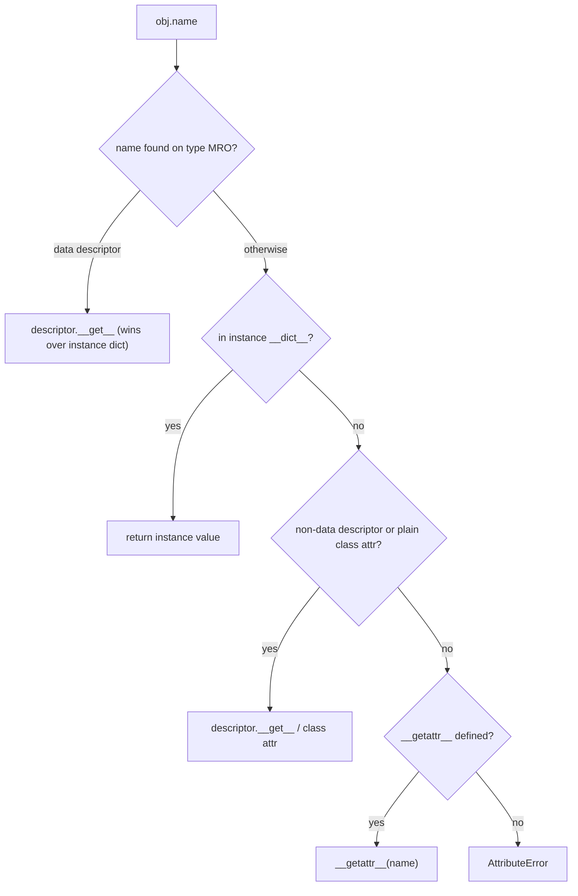

# 3.11 Python under the hood: decorators, descriptors and metaprogramming (how frameworks work)

| | |
|---|---|
| Level | Advanced |
| Priority tier | 2 |
| Lab venue | Python 3.11+ (standard library only) |
| Part | Part 3: Python for infrastructure |
| Status | Drafted, labs **untested** |

## Why this matters for AI infrastructure

FastAPI routes, pydantic models, SQLAlchemy columns, dataclasses, pytest fixtures, Click commands, Airflow DAGs, PyTorch `nn.Module` parameters, `torch.compile` and Ray's `@ray.remote` all look like magic until you see the handful of language mechanisms underneath: functions are objects, closures capture variables, decorators rewrite callables, descriptors control attribute access, `__init_subclass__` and metaclasses run code when classes are created, and the import system can be hooked. Knowing these lets you read framework source when debugging at 3 a.m., write your own small frameworks (plugin registries, config schemas, operator wrappers), and answer the "how does this actually work?" questions that senior interviews use to separate users from engineers. It also teaches restraint: most metaprogramming should not exist in application code.

## Prerequisites and outcomes

Needs 3.1 to 3.4 (functions, classes, data model, typing). After this chapter you can:

- Explain closures, `nonlocal`, late binding and how decorators are applied, including decorators with arguments, class-based decorators, stacking and `functools.wraps`.
- Write decorators for timing, retry, caching, authorisation, registration and instrumentation, handling both sync and async functions.
- Explain the attribute lookup algorithm, `property`, descriptors (data versus non-data), `__getattr__`, `__getattribute__`, `__slots__`, and how methods are bound.
- Explain what `dataclass`, pydantic and ORMs do at class-creation time; use `__init_subclass__`, class decorators and metaclasses where justified, and know the cheaper alternative first.
- Inspect and generate code with `inspect`, `typing.get_type_hints`, `ast`, `dis`, and understand import hooks and `sys.modules`.
- Decide when metaprogramming is appropriate, test it, and keep it debuggable.

## 1. Functions are objects; closures

Functions are first-class objects: they can be assigned, passed, returned, and carry attributes. A **closure** is a function that remembers variables from its enclosing scope even after that scope has returned.

```python
def make_counter():
    count = 0
    def inc():
        nonlocal count            # rebind the enclosing variable (otherwise assignment makes `count` local)
        count += 1
        return count
    return inc

c = make_counter(); c(); c()      # 2
c.__closure__[0].cell_contents    # 2: the captured cell
```

Variable resolution follows **LEGB**: Local, Enclosing, Global, Built-in. Closures capture **variables, not values**, producing the classic late-binding trap:

```python
fs = [lambda: i for i in range(3)]
[f() for f in fs]                 # [2, 2, 2]: all see the final i
fs = [lambda i=i: i for i in range(3)]      # bind at definition via default argument
from functools import partial; fs = [partial(lambda i: i, i) for i in range(3)]    # or partial
```

Closures are the lightweight alternative to single-method classes: a configured callable (`make_rate_limiter(100)`) holds its state in cells. Memory note: a closure keeps the entire captured object alive (a captured large tensor is not freed while the closure exists).

## 2. Decorators

`@decorator` above a `def` is exactly `f = decorator(f)` executed at definition time. A decorator is any callable that takes a callable and returns a replacement (often a wrapper).

```python
import functools, time, logging
log = logging.getLogger(__name__)

def timed(fn):
    @functools.wraps(fn)                       # preserves __name__, __doc__, __wrapped__, signature introspection
    def wrapper(*args, **kwargs):
        t0 = time.perf_counter()
        try:
            return fn(*args, **kwargs)
        finally:
            log.info("%s took %.3fs", fn.__qualname__, time.perf_counter() - t0)
    return wrapper

@timed
def drain(node): ...
```

Without `functools.wraps`, introspection, documentation generators, FastAPI/pydantic signature inspection and pytest fixtures see the wrapper's name and signature instead of the original.

### Decorators with arguments

Three nested levels: a factory taking arguments, returning the decorator, returning the wrapper.

```python
def retry(times=3, exceptions=(Exception,), delay=0.5):
    def deco(fn):
        @functools.wraps(fn)
        def wrapper(*a, **kw):
            for attempt in range(1, times + 1):
                try:
                    return fn(*a, **kw)
                except exceptions as e:
                    if attempt == times: raise
                    time.sleep(delay * 2 ** (attempt - 1))
        return wrapper
    return deco

@retry(times=5, exceptions=(ConnectionError, TimeoutError))
def fetch(): ...
```

### Sync and async

A wrapper around an `async def` must itself be `async def` and `await` the call; otherwise you return a coroutine un-awaited or time only its creation. Support both:

```python
import inspect
def timed(fn):
    if inspect.iscoroutinefunction(fn):
        @functools.wraps(fn)
        async def aw(*a, **kw):
            t0 = time.perf_counter()
            try: return await fn(*a, **kw)
            finally: log.info("%s %.3fs", fn.__name__, time.perf_counter() - t0)
        return aw
    @functools.wraps(fn)
    def w(*a, **kw):
        t0 = time.perf_counter()
        try: return fn(*a, **kw)
        finally: log.info("%s %.3fs", fn.__name__, time.perf_counter() - t0)
    return w
```

### Class-based decorators, stacking and registries

A class with `__call__` keeps state cleanly (a call counter, a cache). However, as Mark Lutz demonstrates in *Learning Python* Chapter 39 (`Examples 39-1` to `39-9`), if you write `class tracer: def __init__(self, func): self.calls = 0; self.func = func; def __call__(self, *args, **kwargs): ...` and apply `@tracer` to a **class method** (`@tracer def giveRaise(self, percent):`), calling `pat.giveRaise(0.10)` fails because `tracer` is not a descriptor (or passes the `tracer` instance as `self` instead of the `Person` instance `pat`). To decorate both plain functions and methods reliably, either write the decorator as a **nested function with `nonlocal calls`** (`def tracer(func): calls = 0; def onCall(*args, **kwargs): nonlocal calls; calls += 1; return func(*args, **kwargs); return onCall`) or implement `__get__` on the decorator class. In `LP` Chapter 39, Lutz also builds three complete decorator case studies (modeled in `code/part03/python_metaprogramming_internals.py`):
1. **Parameterized timing decorator (`@timer(label='[CCC]==>', trace=True)`, `timerdeco2.py`):** Uses a three-level function nesting (`timer(label='', trace=True) -> onDecorator(func) -> onCall(*args, **kargs)`) that accumulates `onCall.alltime += elapsed` across calls (`listcomp` vs `mapcall` on `50_000..1_000_000` items).
2. **Class decorators for Singleton and attribute access control (`@ singleton`, `@Private('data', 'size')`, `@Public(...)`, `access2.py`):** A class decorator `@Private('data', 'size')` wraps a class `Doubler` in an `onInstance` proxy that intercepts `__getattr__` and `__setattr__` to reject outside reads/writes to private attributes (and adds a `BuiltinsMixin` so Python 3 built-in operations like `+` and `str()` route through `__getattr__`).
3. **Generalized argument range/type validator (`@rangetest(age=(0, 120), M=(1, 12), D=(1, 31))`, `Example 39-25 rangetest.py`):** Inspects `code = func.__code__` and `allargs = code.co_varnames[:code.co_argcount]` to map both positional arguments (`pargs`) and keyword arguments (`kargs`) to their parameter names, skips defaulted arguments cleanly, and short-circuits with `if not __debug__: return func` when run under `python -O`.

**Stacking** applies bottom-up: `@a @b def f` is `f = a(b(f))`; order matters (auth before caching, not the reverse).

A **registry decorator** returns the function unchanged but records it: the pattern behind Flask/FastAPI routes, Click commands, pytest fixtures/markers, Airflow tasks and plugin systems.

```python
HANDLERS: dict[str, callable] = {}
def handler(event_type):
    def deco(fn):
        HANDLERS[event_type] = fn
        return fn                      # unchanged
    return deco

@handler("node.down")
def on_node_down(evt): ...
def dispatch(evt): return HANDLERS[evt["type"]](evt)
```

FastAPI's `@app.get("/x")` is this pattern: it stores `(path, method, function, signature-derived models)` in the router and returns the function.

### Standard-library decorators worth knowing

`functools.lru_cache` / `cache` (memoise on hashable args; unbounded `cache` leaks memory; not safe on methods holding `self` forever), `cached_property`, `singledispatch` (function overloading on first arg type), `total_ordering`, `partial`, `wraps`, `contextlib.contextmanager` (a generator becomes a context manager), `dataclasses.dataclass`, `typing.overload`/`final`, `abc.abstractmethod`, `property`/`classmethod`/`staticmethod`, `atexit.register`.

Pitfalls: decorators run at import time (side effects, circular imports); wrapping hides tracebacks unless careful; decorating methods versus plain functions (self handling); `lru_cache` on instance methods keeps instances alive; mutating shared state in module-level decorators breaks test isolation; stacking many decorators obscures control flow and signatures (use `typing.ParamSpec` and `Callable[P, R]` to keep type checkers informed).

```python
from typing import Callable, ParamSpec, TypeVar
P = ParamSpec("P"); R = TypeVar("R")
def logged(fn: Callable[P, R]) -> Callable[P, R]:       # preserves the wrapped signature for type checkers
    @functools.wraps(fn)
    def w(*a: P.args, **kw: P.kwargs) -> R:
        log.info("call %s", fn.__name__); return fn(*a, **kw)
    return w
```

## 3. Attribute access and the descriptor protocol

### Lookup order

For `obj.name` Python (in `object.__getattribute__`) does, roughly:

1. Find `name` on the **type** (walking the MRO). If it is a **data descriptor** (defines `__set__` or `__delete__`), call its `__get__` and stop.
2. Else look in the instance `__dict__` (or slots).
3. Else if the type attribute is a **non-data descriptor** (only `__get__`, like functions), call it; or return the plain class attribute.
4. Else call `type(obj).__getattr__(obj, name)` if defined, otherwise `AttributeError`.



`__getattribute__` runs on **every** access (override with extreme care; call `super().__getattribute__` to avoid recursion); `__getattr__` runs only when normal lookup fails (good for proxies, lazy attributes, forwarding). Setting uses `__setattr__`, which checks data descriptors on the type first.

### Methods are descriptors

Functions on a class are non-data descriptors whose `__get__` returns a **bound method** (the function with `self` pre-filled). That is why `obj.method` is a bound method object, `Class.method` is the plain function, and `staticmethod`/`classmethod` are just descriptors with different `__get__`. `functools.partialmethod`, `property`, `cached_property`, and ORM columns are all descriptors.

### Writing a descriptor

```python
class Positive:
    """Reusable validated attribute."""
    def __set_name__(self, owner, name):          # called when the owner class is created
        self.name = name
        self.private = "_" + name
    def __get__(self, obj, objtype=None):
        if obj is None: return self               # accessed on the class
        return getattr(obj, self.private)
    def __set__(self, obj, value):
        if value <= 0: raise ValueError(f"{self.name} must be positive, got {value!r}")
        setattr(obj, self.private, value)

class GpuJob:
    gpus = Positive()
    memory_gb = Positive()
    def __init__(self, gpus, memory_gb):
        self.gpus = gpus              # goes through Positive.__set__
        self.memory_gb = memory_gb
```

One descriptor instance lives on the class and is shared by all instances, so per-instance data must be stored on the instance (here `_gpus`, or directly in `instance.__dict__[self.storage_name]`) or in a `WeakKeyDictionary`, never on the descriptor itself. `__set_name__` (PEP 487) lets the descriptor learn its attribute name automatically.
- **Overriding (`data`) vs. non-overriding (`non-data`) descriptors and the `Validated` hierarchy (`FP` Chapter 23 `Examples 23-5` to `23-13`):** In *Fluent Python* Chapter 23, Ramalho builds an abstract `Validated(ABC)` descriptor base class whose `__set_name__(self, owner, name)` sets `self.storage_name = name`, `__set__(self, instance, value)` calls `value = self.validate(self.storage_name, value)` and writes `instance.__dict__[self.storage_name] = value`, and concrete subclasses `Quantity(Validated)` (enforcing `value > 0`) and `NonBlank(Validated)` (stripping whitespace and rejecting empty strings) validate `LineItem(description, weight, price)` declaratively (modeled in `code/part03/python_metaprogramming_internals.py`). Ramalho also contrasts the three descriptor flavors on a `Managed` class:
  1. **Overriding (data) descriptor with `__get__` and `__set__` (`Overriding`):** Always intercepts both reads (`obj.over`) and writes (`obj.over = 7`), even if you manually stuff `obj.__dict__['over'] = 8`.
  2. **Overriding descriptor without `__get__` (`OverridingNoGet`, only `__set__`):** Intercepts writes (`obj.over_no_get = 7`), but reads (`obj.over_no_get`) return the descriptor object itself unless `'over_no_get'` is present in `obj.__dict__`.
  3. **Non-overriding (non-data) descriptor (`NonOverriding`, only `__get__`, like functions and `@functools.cached_property`):** `obj.non_over` calls `__get__` **only when `'non_over'` is not in `obj.__dict__`**; assigning `obj.non_over = 7` writes `'non_over'` into `obj.__dict__`, which thereafter shadows the descriptor.
- **Why storing instance state on the descriptor (`self.value`) is a bug (`LP` Chapter 38 `CardHolder` 4 ways):** In *Learning Python* Chapter 38 (`Examples 38-19` to `38-25`), Lutz implements a `CardHolder(acct, name, age, addr)` class (`acctlen = 8`, `retireage = 62.5`, normalizing `name` to lowercase with underscores, masking `acct` as `'12345***'`, validating `0 <= age <= 150`, and computing `remain = retireage - age`) using four different mechanisms: (1) `@property` (`validate_properties.py`), (2) descriptors (`validate_descriptors1.py` vs `validate_descriptors2.py`), (3) `__getattr__` + `__setattr__` (`validate_getattr.py`), and (4) `__getattribute__` + `__setattr__` (`validate_getattribute.py`). In `validate_descriptors1.py`, storing `self.name = value` on the descriptor instance itself means creating `bob = CardHolder(...)` followed by `sue = CardHolder(...)` overwrites the single shared `Name` descriptor on `CardHolder`, causing `bob.name` to morph into `'sue_jones'`. Storing state on the client instance (`instance.__name = value` in `validate_descriptors2.py`, tested in `code/part03/python_metaprogramming_internals_lab.py`) keeps `bob` and `sue` isolated.

### property, cached_property and slots

`property` is a data descriptor built from getter/setter/deleter functions (as in `FP` Chapter 22's `quantity(storage_name)` property factory and `BlackKnight` `@member.deleter`): use it to start with a plain attribute and add validation or computation later without changing callers (Bertrand Meyer's **Uniform Access Principle**). `functools.cached_property` computes once and stores the result in the instance `__dict__` (a non-data descriptor, so the instance value then wins; it needs a `__dict__`, so it does not work with `__slots__` unless a `__dict__` slot exists). **`__slots__`** replaces the per-instance dict with fixed slots (implemented as descriptors on the class): 30 to 50% less memory per instance and slightly faster access for millions of small objects, at the cost of no dynamic attributes, awkward multiple inheritance, and no weakrefs unless `__weakref__` is listed. `@dataclass(slots=True)` automates this.

### Dynamic attributes and proxies (`FrozenJSON` and `osconfeed.json`, `FP` Chapter 22)

In *Fluent Python* Chapter 22 (`Examples 22-1` to `22-6`, modeled in `code/part03/python_metaprogramming_internals.py`), `FrozenJSON` wraps nested JSON documents (`osconfeed.json` with 1 conference, 484 events, 357 speakers, and 53 venues) so `feed.Schedule.events[40].name` (`'There *Will* Be Bugs'`) and dict methods like `.keys()` work side by side:
- **`__new__(cls, arg)` for flexible object construction:** Instead of constructing a `FrozenJSON` instance when `arg` is a `list` or a primitive scalar, `__new__` checks `if isinstance(arg, abc.Mapping): return super().__new__(cls)`, `elif isinstance(arg, abc.MutableSequence): return [cls(item) for item in arg]`, and otherwise returns `arg` unchanged.
- **Handling Python reserved keywords (`class` -> `class_`) and invalid identifiers:** In `__init__`, `if keyword.iskeyword(key): key += '_'` renames JSON keys like `'class'` to `'class_'` (`student.class_`), while `key.isidentifier()` detects keys like `'2be'` that cannot be read via dot syntax.

```python
class Config:
    """Attribute-style access to a nested mapping, with lazy loading."""
    def __init__(self, data): self._data = data
    def __getattr__(self, name):                      # only called when normal lookup fails
        try: value = self._data[name]
        except KeyError: raise AttributeError(name) from None
        return Config(value) if isinstance(value, dict) else value
    def __dir__(self): return list(self._data)        # tab-completion and introspection
```

Always raise `AttributeError` (not `KeyError`) from `__getattr__`, or `hasattr`/`getattr` defaults and copying/pickling break; guard against recursion when reading your own attributes inside `__getattr__` (access `self.__dict__` carefully). `__getattr__` on a module (PEP 562) enables lazy imports and deprecation shims. Many ML libraries expose dynamically generated attributes (config objects, `torch.ops` namespaces); tooling support requires type stubs.

### How some frameworks use descriptors

- **Django/SQLAlchemy** columns and relationships are descriptors turning `obj.field` into tracked state; **pydantic v1** used metaclass magic and fields, and v2 builds a compiled validation core from annotations; **dataclasses** generate `__init__`, `__repr__`, `__eq__` from annotations; **`torch.nn.Module.__setattr__`** intercepts assignment to register `nn.Parameter` and submodules in internal dictionaries (that is why assigning layers in `__init__` makes `.parameters()` work, and why putting layers in a plain Python list does not register them: use `nn.ModuleList`).

## 4. Class creation and customisation

### What `class` does

A `class` statement executes the body in a new namespace, then calls `type(name, bases, namespace)` (or the specified metaclass) to build the class object. Classes are objects created at runtime; `type(...)` can create them dynamically:

```python
Node = type("Node", (object,), {"gpus": 8, "describe": lambda self: f"{self.gpus} GPUs"})
```

Sequence for `class C(Base, metaclass=M, **kw)`: resolve bases (`__mro_entries__`), choose the metaclass, (1) `M.__prepare__` (returns the namespace mapping), (2) execute the class body in that mapping, (3) `M.__new__(M, name, bases, ns, **kw)` allocates the class object, (4) `__set_name__(cls, attr_name)` is called on every attribute in `ns` that defines it, (5) `Base.__init_subclass__(cls, **kw)` runs on the parent, and (6) `M.__init__(cls, name, bases, ns, **kw)` finishes initializing the class object before Python binds the class name (verified in `trace_class_creation_order()` in `code/part03/python_metaprogramming_internals.py`, matching `evaldemo.py` and `evaldemo_meta.py` in `FP` Chapter 24 `Examples 24-10` to `24-19`). Calling `type(cls_name, (object,), cls_attrs)` directly also powers dynamic class factories like `collections.namedtuple` and `FP` Chapter 24's `record_factory("Dog", "name weight owner")` (`Example 24-2`).

### `__init_subclass__` and class decorators: the first tools to reach for

Introduced to cover most metaclass use cases without a metaclass: run code whenever a subclass is defined (as in `FP` Chapter 24's `Checked` base class `Example 24-4`, whose `__init_subclass__` iterates `cls.__annotations__` and attaches a `Field` descriptor for each annotated attribute, or the `@checked` class decorator in `Example 24-7`).

```python
class Plugin:
    registry: dict[str, type["Plugin"]] = {}
    def __init_subclass__(cls, /, name=None, **kw):
        super().__init_subclass__(**kw)
        Plugin.registry[name or cls.__name__.lower()] = cls

class GpuCheck(Plugin, name="gpu"): ...
class NetCheck(Plugin): ...
Plugin.registry          # {'gpu': GpuCheck, 'netcheck': NetCheck}
```

This is how plugin systems, model/operator registries (for example registering custom ops or Airflow-like operators), and ORM-like base classes self-register. A **class decorator** is the other light option (`@register` on a class, or `@dataclass`): it receives the finished class and returns it (possibly modified).

### Helper functions, decorators and metaclasses

Sometimes a class needs an extra method, but nobody knows which classes need it until the program runs. The choice might come from a user interface or from an editable configuration file. Plain inheritance cannot help in that case, because inheritance only works when the shared method is known while the classes are written. When the method is known in advance, a superclass does the job:

```
class Extras:
def extra(self, args): # Normal inheritance: too static
…
class Client1(Extras): … # Clients inherit extra methods
class Client2(Extras): …
X = Client1() # Make an instance
X.extra() # Run the extra methods
```

When the choice happens at runtime, each class could check the condition itself. That works, but it puts the whole burden on every class author, who has to remember to do the check at all:

```
def extra(self, arg): …
class Client1: … # Client augments: too distributed
if required():
Client1.extra = extra
class Client2: …
if required():
Client2.extra = extra # Add the extra method – maybe
X = Client1()
X.extra()
```

A cleaner option is a **helper function**, also called a manager function. The helper receives a class right after it is created, and it holds all of the decision logic in one place:

```
def extra(self, arg): …
def extras(Class): # Helper function: too manual
if required():
Class.extra = extra
class Client1: …
extras(Client1)
class Client2: …
extras(Client2)
X = Client1()
X.extra()
```

The helper still depends on each class author calling it. A **metaclass** removes that step. You declare the metaclass once, and Python runs the logic at the end of every `class` statement that uses it:

```
def extra(self, arg): …
class Extras(type):
def __init__(Class, classname, superclasses, attributedict):
if required():
Class.extra = extra
class Client1(metaclass=Extras): … # Metaclass declaration only
class Client2(metaclass=Extras): … # Client class is instance of meta
X = Client1() # X is instance of client class
X.extra()
```

Because Python calls the metaclass automatically, it can augment, register, wrap, or otherwise manage each class. The client classes need only declare their metaclass. Every class that does so gets the augmentation, both now and later if the metaclass changes.

Like decorators, metaclasses are optional in principle. They give you a more uniform and explicit structure. They also make it less likely that an application programmer forgets to augment a class the way an API requires. Finally, they avoid repeated code by keeping the customization in a single location. Be honest about the limit, though. A client can forget to name its metaclass just as easily as it could forget to call a helper. The explicit declaration just makes that mistake less likely.

### Metaclasses versus class decorators

Metaclasses and class decorators overlap in both use and benefit. Suppose the helper returns the augmented class instead of changing it in place. That gives the manager freedom to return any object that implements the class's expected interface:

```
def extra(self, arg): …
def extras(Class):
if required():
Class.extra = extra
return Class # Return the augmented class
class Client1: …
Client1 = extras(Client1) # Rebind to augmented class
class Client2: …
Client2 = extras(Client2)
X = Client1()
X.extra()
```

That looks like a class decorator, and it is one. A decorator rebinds a class name to the result of a function. So a decorator can change a class before any instance is created:

```
def extra(self, arg): …
def extras(Class): # From helper to decorator
if required():
Class.extra = extra
return Class
@extras
class Client1: … # Client1 = extras(Client1)
@extras
class Client2: … # Rebinds class independent of instances
X = Client1() # Makes instance of augmented class
X.extra() # X is instance of original Client1
```

The decorator automates the manual rebinding in the previous example. Instances are still made from the original class, so instance creation is not intercepted at all in this example.

For adding methods at class creation, the choice between the two is arbitrary. The two tools differ in how they work. Decorators technically correspond to the metaclass call that makes and initializes a new class. Metaclasses have extra hooks, such as the methods that classes inherit, which decorators do not have directly. Metaclasses also manage the class itself, so using them only to manage instances adds an extra step. Decorators fit instance management better, and they overlap with metaclasses most strongly when managing classes.

### Decorating every method automatically

Metaclasses and decorators can also change individual methods. Suppose we have a `tracer` function decorator that prints a message on each call:

```
import time
def tracer(func): # Use function, not class with __call__
calls = 0 # Else self is decorator instance only
def onCall(*args, **kwargs):
nonlocal calls
calls += 1
print(f'call {calls} to {func.__name__}')
return func(*args, **kwargs)
return onCall
```

Applying `@tracer` by hand means adding a decorator line above every method we want to trace, and removing those lines later. That gets tedious for a whole class. It may not even be possible in dynamic code that depends on runtime settings. A metaclass can add the decorator to every method automatically. Because the metaclass controls the decoration, it can also apply runtime checks. The decorator is passed in as an argument, so it can differ from class to class:

```
"Apply any decorator to all methods of a class, with a metaclass"
from types import FunctionType
from decorators import tracer, timer
def decorateAll(decorator):
class MetaDecorate(type):
def __new__(meta, classname, supers, classdict):
for attr, attrval in classdict.items():
if type(attrval) is FunctionType:
classdict[attr] = decorator(attrval)
return type.__new__(meta, classname, supers, classdict)
return MetaDecorate
class Person(metaclass=decorateAll(tracer)): # Use a metaclass
def __init__(self, name, pay): # Pass any function decorator
self.name = name
self.pay = pay
def giveRaise(self, percent):
self.pay *= (1.0 + percent)
def lastName(self):
return self.name.split()[-1]
def tester(aPerson):
sue = aPerson('Sue Jones', 100_000)
bob = aPerson('Bob Smith', 50_000)
print(f'{sue.name=}, {bob.name=}')
sue.giveRaise(.10)
print(f'{sue.pay=:,.2f}')
print('Last names:', sue.lastName(), bob.lastName())
if __name__ == '__main__': tester(Person)
```

Running this file traces every method, because the metaclass decorated each one at class creation:

```
$ python3 decoall_meta.py
call 1 to __init__
call 2 to __init__
sue.name='Sue Jones', bob.name='Bob Smith'
call 1 to giveRaise
sue.pay=110,000.00
call 1 to lastName
call 2 to lastName
Last names: Jones Smith
```

To apply a different decorator, change only the decorator name in the `class` header line. These three header lines use the tracer and the timer:

```
class Person(metaclass=decorateAll(tracer)): # Apply tracer
class Person(metaclass=decorateAll(timer())): # Apply timer, defaults
class Person(metaclass=decorateAll(timer(label='**'))): # Decorator arguments
```

Class decorators can do the same job. The next example uses a class decorator that applies a function decorator to each method of the class it decorates:

```
"Apply any decorator to all methods of a class, with a decorator"
from types import FunctionType
from decoall_meta import tester
from decorators import tracer, timer
def decorateAll(decorator):
def DecoDecorate(aClass):
for attr, attrval in aClass.__dict__.items():
if type(attrval) is FunctionType:
setattr(aClass, attr, decorator(attrval)) # Not __dict__
return aClass
return DecoDecorate
@decorateAll(tracer) # Use class deco, pass any func deco
class Person: # Applies func decorator to methods
def __init__(self, name, pay): # Person = decorateAll(..)(Person)
self.name = name # Person = DecoDecorate(Person)
self.pay = pay
def giveRaise(self, percent):
self.pay *= (1.0 + percent)
def lastName(self):
return self.name.split()[-1]
if __name__ == '__main__': tester(Person)
```

Its output matches the metaclass version. The class decorator returns the augmented class rather than a proxy wrapper, so an instance of `Person` is still an instance of `Person`. That matters when code tests types. The methods are no longer the original functions, because they are rebound to decorators. That is rarely a problem in practice, and the metaclass version behaves the same way.

Edit the `@` line to change the decorator or its arguments. These four lines show the options:

```
@decorateAll(tracer) # Apply tracer
@decorateAll(timer()) # Apply timer, defaults
@decorateAll(timer(label='**')) # Decorator arguments
@decorateAll(timer(label='**', trace=0)) # More decorator arguments
```

So far, metaclasses look almost the same as decorators. They have one more trick, though. A metaclass can add methods that its classes inherit, and decorators have no direct counterpart for that. Those methods come with a limit, and understanding the limit requires a closer look at how Python searches for attributes.

### Metaclasses and the two-tree inheritance model (`FP` Chapter 24 & `LP` Chapter 40)

A **metaclass** is the class of a class (`type` by default: `str.__class__ is type`, and `type.__class__ is type`). Subclass `type` to customise class creation: validate or rewrite the namespace, inject methods (as in `LP` Chapter 40's `Metaclass` applying `@tracer` to every method in a class dictionary, `MetaOne`/`MetaTwo`, and `FP` Chapter 24's `MetaBunch` and `CheckedMeta`), enforce interfaces, register classes, or provide declarative syntax (Django models, SQLAlchemy declarative, `enum.Enum`, `abc.ABCMeta`, pydantic v1 `ModelMetaclass`).

In *Learning Python* Chapter 40, Lutz formalizes the **two-tree inheritance lookup algorithm** that distinguishes normal instances (`I` of class `C`) from class objects (`C` of metaclass `M`):
- **Instance lookup (`I.attr`):** Searches `[I.__dict__] + [x.__dict__ for x in I.__class__.__mro__]` (checking data descriptors on the class MRO first, then `I.__dict__`, then non-data descriptors/attributes on the class MRO). Crucially, **normal instances `I` never acquire attributes defined only on the metaclass `M`** (`M` is not in `I.__class__.__mro__`).
- **Class lookup (`C.attr`):** Because `C`'s `type(C)` is its metaclass `M`, `C.attr` searches **both** trees: `[x.__dict__ for x in C.__mro__] + [x.__dict__ for x in C.__class__.__mro__]` (with data descriptors on `M`'s MRO checked first, then `C.__mro__`, then non-data descriptors on `M`'s MRO).
- **The built-in operations special case (`str(I)` vs `I.__str__()`, `C[0]`):** Implicit built-in operations (`str(X)`, `len(X)`, `X[0]`, `X + Y`) skip the object itself and start lookup **one level higher at `type(X)`**: for a normal instance `I`, `str(I)` looks up `__str__` on `C.__mro__` (skipping `I.__dict__`), and for a class `C`, `str(C)` or `C[0]` looks up `__str__` or `__getitem__` on the **metaclass `M.__mro__`** (skipping `C.__dict__`).

```python
class FieldsMeta(type):
    @classmethod
    def __prepare__(mcs, name, bases, **kw):
        return {}                                   # could return an ordered/validating mapping
    def __new__(mcs, name, bases, ns, **kw):
        fields = {k: v for k, v in ns.items() if isinstance(v, Field)}
        ns["_fields"] = fields                      # collect declarative fields
        for k in fields: ns.pop(k)                  # or keep them as descriptors
        return super().__new__(mcs, name, bases, ns, **kw)
    def __call__(cls, *a, **kw):                    # customise instantiation (singleton, validation hook)
        return super().__call__(*a, **kw)
```

Guidance: prefer, in order, (1) plain functions/composition, (2) decorators, (3) descriptors, (4) `__init_subclass__` and class decorators, (5) metaclasses only when you must control class *creation* itself (custom namespaces via `__prepare__`, intercepting `__call__`, combining with `ABCMeta`). Metaclass conflicts arise when combining two different metaclasses (`TypeError: metaclass conflict`), they are inherited implicitly (surprising), and they complicate debugging and type checking. If your reviewers cannot explain it in a minute, it is too clever.

### Classes are instances of type

To understand metaclasses, you first need a clearer picture of Python's object model. Every value has a type. Built-in lists are instances of the `list` class, and that class is itself made from `type`:

```
>>> type([]), type(type([])) # List instance is created from list class
(<class 'list'>, <class 'type'>) # List class is created from type class
>>> type(list), type(type) # Same, but with type names
(<class 'type'>, <class 'type'>) # Type of type is type: top of hierarchy
```

User-defined classes work the same way. Their nonclass instances are made from the class, and the class is made from the built-in `type`:

```
>>> class Hack: pass # User-defined classes work the same
>>> I = Hack() # Made from class, which is made from type
>>> type(I), type(type(I))
(<class '__main__.Hack'>, <class 'type'>)
```

The `__class__` attribute shows what each object was made from:

```
>>> [].__class__, list.__class__ # Instances and classes are both "instances"
(<class 'list'>, <class 'type'>) # type(X) is normally same as X.__class__
>>> I.__class__, Hack.__class__
(<class '__main__.Hack'>, <class 'type'>)
```

Most programmers never think about this, because classes are created from `type` by default. It matters for metaclasses, though.

### Metaclasses are subclasses of type

Why does it matter that classes are instances of `type`? That relationship is the hook that lets us write metaclasses. We can create classes from a subclass of `type`, and we can customize that subclass with normal object-oriented techniques and class syntax. Those `type` subclasses are called metaclasses.

This type relationship is not the same as normal inheritance. A class can also have superclasses, and it and its instances inherit attributes from them as usual. Superclasses appear in the parentheses of the `class` statement and in the class's `__bases__` tuple. The type a class is created from is a different relationship. Classes can get behavior from their type that normal inheritance search never shows. Metaclasses therefore define a second, secondary inheritance tree. Only classes use that tree, and Python falls back on it when the normal superclass search fails.

### How a class statement calls type

To route a class's creation to a metaclass, we need to know what a `class` statement does. Python first runs the nested block to collect the class's attributes. Names assigned at the top level of that block become attributes of the class object. Most are methods made by nested `def` statements, but they can be any data shared by all instances.

At the end of the `class` statement, Python calls the `type` object to create the class:

```
class = type(classname, superclasses, attributedict)
```

The `type` object defines a `__call__` operator method. When `type` is called, it runs two other methods in turn:

```
type.__new__(typeclass, classname, superclasses, attributedict)
type.__init__(class, classname, superclasses, attributedict)
```

The `__new__` method creates and returns the new class object. Then `__init__` initializes that object. These two methods are the hooks that metaclass subclasses use to customize classes at creation time.

Take this class:

```
class Super: … # Inherited names here
class Hack(Super): # Inherits from Super
data = 1 # Class data attribute
def meth(self, arg): # Class method attribute
return self.data + arg
```

Python builds two attributes, `data` and `meth`. Then it calls `type` at the end of the statement. Names such as `__module__` are added from the code's context:

```
Hack = type('Hack', (Super,), {'data': 1, 'meth': meth, '__module__': '__main__'})
```

You can call `type` yourself to create a class on the fly. This example uses a lambda for the method and an empty superclass tuple. Python adds the `object` superclass automatically to topmost classes, as Chapter 32 showed:

```
>>> c = type('Hack', (), {'data': 1, 'meth': (lambda x, y: x.data + y)})
>>> i = c()
>>> c, i
(<class '__main__.Hack'>, <__main__.Hack object at 0x108077c20>)
>>> i.data, i.meth(2)
(1, 3)
```

A class built this way matches one built by a `class` statement:

```
>>> c.__bases__
(<class 'object'>,)
>>> i.__class__.__mro__
(<class '__main__.Hack'>, <class 'object'>)
>>> [a for a in dir(i) if not a.startswith('__')]
['data', 'meth']
>>> [(a, v) for (a, v) in c.__dict__.items() if not a.startswith('__')]
[('data', 1), ('meth', <function <lambda> at 0x1082179c0>)]
```

Because Python makes this `type` call automatically, it is a natural hook for augmenting classes. The trick is to replace the default `type` with a custom subclass that intercepts the call.

### Declaring a metaclass

Classes use `type` by default. To use a custom metaclass, list it as a keyword argument in the `class` header:

```
class Hack(metaclass=Meta): # Use Meta instead of type default
```

Without that declaration, Python calls `type`. With it, the call at the end of the `class` statement goes to `Meta`:

```
class = Meta(classname, superclasses, attributedict)
```

The `metaclass` keyword sets an instance relationship. That relationship gives inheritance only through the secondary metaclass tree. Normal superclasses can still be listed, and they take precedence because they sit in the primary tree. Here `Hack` inherits from `Super` normally and is also created by the metaclass `Meta`:

```
class Hack(Super, metaclass=Meta): # Normal supers OK: listed first
```

Superclasses must come before the `metaclass` keyword, following the rules for keyword arguments in function calls.

### Metaclass method protocol

When a metaclass is declared, the call at the end of the `class` statement goes to the metaclass:

```
class = Meta(classname, superclasses, attributedict)
```

A metaclass is a subclass of `type`, so the inherited `__call__` method hands creation and initialization to the metaclass when it defines its own versions of those methods. The metaclass call may then trigger these methods:

```
class = Meta.__new__(Meta, classname, superclasses, attributedict)
Meta.__init__(class, classname, superclasses, attributedict)
```

Here is the earlier class again, with a metaclass declared:

```
class Hack(Super, metaclass=Meta): # Inherits from Super, instance of Meta
data = 1 # Class data attribute
def meth(self, arg): # Class method attribute
return self.data + arg
```

At the end of this statement, Python runs this call internally:

```
Hack = Meta('Hack', (Super,), {'data': 1, 'meth': meth, '__module__': '__main__'})
```

If the metaclass defines `__new__` or `__init__`, the inherited `type.__call__` invokes them during this call. The metaclass can therefore run its own methods as part of building the class.

### Coding a basic metaclass

Metaclasses are written with ordinary `class` statements. By definition, they are classes that inherit from `type`, and they usually follow the interface that `type` expects. Python calls them automatically at the end of a `class` statement.

The simplest useful metaclass subclasses `type` and overrides `__new__`. The override calls the default `type.__new__` to create the class object:

```
class Meta(type):
def __new__(meta, classname, supers, classdict):
# Run by inherited type.__call__
return type.__new__(meta, classname, supers, classdict)
```

This metaclass does nothing useful, and we could let `type` build the class instead. It shows the hook, though. The metaclass runs at the end of the `class` statement, before any instance exists. So code in `__new__` or `__init__` can manage every class made from the metaclass.

The next example adds prints to trace the process. It is the same idea in more tangible form:

```
class MetaOne(type):
def __new__(meta, classname, supers, classdict):
print('In MetaOne.new:', meta, classname, supers, classdict, sep='\n...')
return type.__new__(meta, classname, supers, classdict)
class Super:
pass
print('Making class')
class Hack(Super, metaclass=MetaOne): # Inherits from Super, instance of MetaOne
data = 1 # Class data attribute
def meth(self, arg): # Class method attribute
return self.data + arg
print('Making instance')
X = Hack()
print('Attrs:', X.data, X.meth(2))
```

Run it, and notice that the metaclass fires before any instance is made. Metaclasses process classes, and classes process nonclass instances:

```
$ python3 metaclass1.py
Making class
In MetaOne.new:
...<class '__main__.MetaOne'>
...Hack
...(<class '__main__.Super'>,)
...{'__module__': '__main__', 'data': 1, 'meth': <function Hack.meth at 0x…>}
Making instance
Attrs: 1 3
```

Presentation note: this chapter's examples often truncate hex addresses and leave out some built-in `__X__` names in namespace dictionaries. They do this for brevity, and because built-in attributes change over time. Run the examples yourself for the full, if transient, detail.

### Customizing construction and initialization

A metaclass can also use the `__init__` hook that the `type` object's `__call__` runs. In general, `__new__` creates and returns the class object. `__init__` then initializes the class object that was passed in. Both methods work in classes that are not metaclasses, but `__new__` is rare there. A metaclass can use either or both hooks:

```
class MetaTwo(type):
def __new__(meta, classname, supers, classdict):
print()
print('In MetaTwo.new:', meta, classname, supers, classdict, sep='\n...')
return type.__new__(meta, classname, supers, classdict)
def __init__(Class, classname, supers, classdict):
print()
print('In MetaTwo.init:', Class, classname, supers, classdict, sep='\n...')
print('...init class object:', list(Class.__dict__.keys()))
class Super:
pass
print('Making class')
class Hack(Super, metaclass=MetaTwo): # Inherits from Super, instance of MetaTwo
data = 1 # Class data attribute
def meth(self, arg): # Class method attribute
return self.data + arg
print('\nMaking instance')
X = Hack()
print('Attrs:', X.data, X.meth(2))
```

Here `__init__` runs after `__new__`, and both run at the end of the `class` statement. An `__init__` written inside `Hack` is different. It runs later, when a nonclass instance is created, and the metaclass's `__init__` does not affect it:

```
$ python3 metaclass2.py
Making class
In MetaTwo.new:
...<class '__main__.MetaTwo'>
...Hack
...(<class '__main__.Super'>,)
...{'__module__': '__main__', 'data': 1, 'meth': <function Hack.meth at 0x…>}
In MetaTwo.init:
...<class '__main__.Hack'>
...Hack
...(<class '__main__.Super'>,)
...{'__module__': '__main__', 'data': 1, 'meth': <function Hack.meth at 0x…>}
...init class object: ['__module__', 'data', 'meth', '__doc__']
Making instance
Attrs: 1 3
```

### Other ways to code a metaclass

Overriding `__new__` and `__init__` in a `type` subclass is the most common route. Other schemes also work. They do not fit the metaclass-method idea as neatly, but they still support creation-time work.

A metaclass does not have to be a class at all. The `class` statement just calls a callable at the end of its processing. So any callable can serve as a metaclass, as long as it accepts the arguments and returns a compatible object. A simple factory function can do the job:

```
# A simple function can serve as a metaclass too
def MetaFunc(classname, supers, classdict):
print('In MetaFunc:', classname, supers, classdict, sep='\n...')
return type(classname, supers, classdict)
class Super:
pass
print('Making class')
class Hack(Super, metaclass=MetaFunc): # Run simple function at end
data = 1 # Function returns class
def meth(self, arg):
return self.data + arg
print('Making instance')
X = Hack()
print('Attrs:', X.data, X.meth(2))
```

Output:

```
$ python3 metaclass3.py
Making class
In MetaFunc:
...Hack
...(<class '__main__.Super'>,)
...{'__module__': '__main__', 'data': 1, 'meth': <function Hack.meth at 0x…>}
Making instance
Attrs: 1 3
```

Technically, such a function can return anything. Whatever it returns gets assigned to the class name, even if it is not a `type` instance. Other results may not support later instance creation. This blurs the line between metaclasses and class decorators, because both rebind names at the end.

A normal class instance can also serve as a metaclass. Its `__call__` method catches the metaclass call through operator overloading. The `__call__` method calls the helpers that mimic `type`. Give those helpers names other than `__new__` and `__init__`. Otherwise, they run when the `MetaObj` instance is created, not when it is later called as a metaclass:

```
# A normal class instance can serve as a metaclass too
class MetaObj:
def __call__(self, classname, supers, classdict):
print('In MetaObj.call:', classname, supers, classdict, sep='\n...')
Class = self.__New__(classname, supers, classdict)
self.__Init__(Class, classname, supers, classdict)
return Class
def __New__(self, classname, supers, classdict):
print('In MetaObj.new: ', classname, supers, classdict, sep='\n...')
return type(classname, supers, classdict)
def __Init__(self, Class, classname, supers, classdict):
print('In MetaObj.init:', classname, supers, classdict, sep='\n...')
print('...init class object:', list(Class.__dict__.keys()))
class Super:
pass
print('Making class')
class Hack(Super, metaclass=MetaObj()): # MetaObj() is normal class instance
data = 1 # Called at end of statement
def meth(self, arg):
return self.data + arg
print('Making instance')
X = Hack()
print('Attrs:', X.data, X.meth(2))
```

The three methods are dispatched through the instance's `__call__`. The process does not depend on `type` dispatch rules. Output:

```
$ python3 metaclass4.py
Making class
In MetaObj.call:
...Hack
...(<class '__main__.Super'>,)
...{'__module__': '__main__', 'data': 1, 'meth': <function Hack.meth at 0x…>}
In MetaObj.new:
...Hack
...(<class '__main__.Super'>,)
...{'__module__': '__main__', 'data': 1, 'meth': <function Hack.meth at 0x…>}
In MetaObj.init:
...Hack
...(<class '__main__.Super'>,)
...{'__module__': '__main__', 'data': 1, 'meth': <function Hack.meth at 0x…>}
...init class object: ['__module__', 'data', 'meth', '__doc__']
Making instance
Attrs: 1 3
```

Normal superclass inheritance can supply the call interceptor too. The superclass plays the role `type` plays in the other examples. The next variant shows that the dispatch model works the same way. It is atypical code, but it makes the mechanism visible:

```
# Instances inherit from classes and their supers normally
class SuperMetaObj:
def __call__(self, classname, supers, classdict):
print('In SuperMetaObj.call:', classname, supers, classdict, sep='\n...')
Class = self.__New__(classname, supers, classdict)
self.__Init__(Class, classname, supers, classdict)
return Class
class SubMetaObj(SuperMetaObj):
def __New__(self, classname, supers, classdict):
print('In SubMetaObj.new: ', classname, supers, classdict, sep='\n...')
return type(classname, supers, classdict)
def __Init__(self, Class, classname, supers, classdict):
print('In SubMetaObj.init:', classname, supers, classdict, sep='\n...')
print('...init class object:', list(Class.__dict__.keys()))
class Super:
pass
print('Making class')
class Hack(Super, metaclass=SubMetaObj()): # Invoke Sub instance via Super.__call__
…rest of file same as Example 40-4…
```

The output is largely the same as before. The trace now shows normal inheritance at work. Its last lines are `Making instance` and `Attrs: 1 3`.

Most metaclasses still achieve their goals by overriding `__new__` and `__init__` from `type`. That is usually simpler than the other schemes. Whatever the coding, the metaclass role overlaps with class decorators, as the earlier sections showed.

### Instances never get metaclass attributes

Metaclass attributes are visible to classes but not to the nonclass instances those classes make. A metaclass declaration sets up an instance relationship, and that relationship is not the same as superclass inheritance. Behavior defined in a metaclass applies to the classes made from it. It does not apply to those classes' own instances.

This example has a metaclass with a `__new__` that prints a trace. Two classes use it, and the second inherits the metaclass link from its superclass:

```
class Meta(type):
def __new__(meta, classname, supers, classdict): # Redefine type method
print('In Meta.new:', classname)
return type.__new__(meta, classname, supers, classdict)
def meth3(self):
return 'three!'
class Super(metaclass=Meta): # Metaclass inherited by subs too
def meth2(self): # Meta run twice for two classes
return 'two!'
class Sub(Super): # Superclass: inheritance versus instance
def meth1(self): # Classes inherit from superclasses
return 'one!' # But not from metaclasses for instance access
```

Once the module loads, the metaclass has handled both classes. Instances of `Sub` get names from their class and superclasses, but not from the metaclass:

```
>>> from metainstance import * # Runs class statements: metaclass run twice!
In Meta.new: Super
In Meta.new: Sub
>>> X = Sub() # Nonclass instance of user-defined class
>>> X.meth1() # Inherited from Sub
'one!'
>>> X.meth2() # Inherited from Super
'two!'
>>> X.meth3() # Not inherited from metaclass!
AttributeError: 'Sub' object has no attribute 'meth3'. Did you mean: 'meth1'?
```

Classes behave differently. A class inherits names from its superclasses, and it also acquires names from its metaclass. In this example, the link to that metaclass comes from `Super` through `Sub`:

```
>>> Sub.meth1(X) # Own method
'one!'
>>> Sub.meth2(X) # Inherited from Super
'two!'
>>> Sub.meth3() # Acquired from metaclass
'three!'
>>> Sub.meth3(X) # Not a normal instance method!
TypeError: Meta.meth3() takes 1 positional argument but 2 were given
```

The last call fails because the name `meth3` resolves to a metaclass method. The source of a name and the object you fetch it through both matter. Methods from a metaclass are bound to the class. Methods from normal classes are plain functions when fetched through the class, and bound to the instance when fetched through the instance:

```
>>> Sub.meth3
<bound method Meta.meth3 of <class 'metainstance.Sub'>>
>>> Sub.meth2
<function Super.meth2 at 0x1085f7d80>
>>> X.meth2
<bound method Super.meth2 of <metainstance.Sub object at 0x108456420>>
```

The last two cases should look familiar from the bound-method coverage in Chapter 31. The first case resembles the class methods of Chapter 32, but it is new here.

### Classes get metaclass attributes as a fallback

Watch what happens when a class is an instance of a metaclass. The class acquires the metaclass attribute, but its own instance does not inherit it. Metaclass acquisition is separate from the normal inheritance that nonclass instances use:

```
>>> class M(type): attr = 1
>>> class C(metaclass=M): pass # C is meta instance and acquires meta attr
>>> I = C() # I inherits from class but not meta!
>>> C.attr
1
>>> I.attr
AttributeError: 'C' object has no attribute 'attr'
>>> 'attr' in C.__dict__, 'attr' in M.__dict__
(False, True)
```

Now make the attribute live in a superclass. The name is then visible to later instances, because their inheritance search covers the `__dict__` of each class in the superclass tree:

```
>>> class S: attr = 1
>>> class C(S): pass # C is type instance and inherits from supers
>>> I = C() # I inherits from class and supers
>>> C.attr
1
>>> I.attr
1
>>> 'attr' in C.__dict__, 'attr' in S.__dict__
(False, True)
```

This is why metaclasses often work by filling in a new class's namespace dictionary. Instances see names in their class, but they do not see names in its metaclass. If the same name exists in both places, the superclass version wins:

```
>>> class M(type): attr = 1
>>> class S: attr = 2
>>> class C(S, metaclass=M): pass # Supers have precedence over metas
>>> I = C() # Classes search supers before metas
>>> C.attr, I.attr # Instances search only supers
(2, 2)
>>> 'attr' in C.__dict__, 'attr' in S.__dict__, 'attr' in M.__dict__
(False, True, True)
```

Distance does not change this. A superclass always beats a metaclass, because the primary tree is searched before the secondary tree:

```
>>> class M(type): attr = 1
>>> class S2: attr = 2
>>> class S1(S2): pass
>>> class C(S1, metaclass=M): pass # Super two levels above meta: still wins
>>> I = C()
>>> C.attr, I.attr
(2, 2)
```

Classes get metaclass attributes through their `__class__` link. Nonclass instances get class attributes the same way. This makes sense, because classes are also instances of metaclasses. The difference is that instance inheritance does not follow a class's `__class__`. It stays within the `__dict__` of each class in the superclass tree, following `__bases__`:

```
>>> I.__class__ # Followed by inheritance: instance's class
<class '__main__.C'>
>>> C.__bases__ # Followed by inheritance: class's supers
(<class '__main__.S1'>,)
>>> C.__class__ # Followed by instance acquisition: metaclass
<class '__main__.M'>
```

Python checks the `__dict__` of each class on the class's MRO first. Only after that does it check the metaclass. The second step runs for fetches on classes, not on nonclass instances:

```
>>> [x.__name__ for x in C.__mro__] # See Chapter 32 for all things MRO
['C', 'S1', 'S2', 'object']
>>> [x.__name__ for x in M.__mro__] # Primary/secondary trees: class/meta
['M', 'type', 'object']
```

These two MROs are flattened versions of the primary and secondary trees. Nonclass-instance inheritance searches only the first one. Class inheritance searches both when needed.

### Metaclass declarations are inherited

A `metaclass=M` declaration is inherited by the normal subclasses of that class, much as superclass links are. So the metaclass runs when each class that inherits the declaration is constructed.

The next example ties these rules together. It shows how the two trees combine when a metaclass has its own superclass:

```
>>> class M2(type): attr4 = 4 # Metaclass inheritance tree
>>> class M1(M2): attr3 = 3 # Gets __bases__, __class__, __mro__
>>> class S: attr2 = 2 # Superclass inheritance tree
>>> class C(S, metaclass=M1): attr1 = 1 # Gets __bases__, __class__, __mro__
>>> I = C() # I gets __class__ but not others
>>> I.attr1, I.attr2 # Instance inherits from super tree
(1, 2)
>>> C.attr1, C.attr2, C.attr3, C.attr4 # Class gets names from both trees!
(1, 2, 3, 4)
>>> M1.attr3, M1.attr4 # Metaclass inherits names too!
(3, 4)
>>> I.attr3
AttributeError: 'C' object has no attribute 'attr3'. Did you mean: 'attr1'?
```

The failure at the end is the key point. Classes and metaclasses use the same links to build the MROs that inheritance scans. But instances do not inherit their class's metaclass names. They can still request them explicitly:

```
>>> I.__class__ # Links used at instance with no __bases__
<class '__main__.C'>
>>> C.__bases__
(<class '__main__.S'>,)
>>> C.__class__ # Links used at class after its __bases__
<class '__main__.M1'>
>>> M1.__bases__ # Link also used in metaclass inheritance
(<class '__main__.M2'>,)
>>> I.__class__.attr4 # Route inheritance to the class's meta tree
4
>>> I.attr4 # Though class's __class__ not followed normally
AttributeError: 'C' object has no attribute 'attr4'. Did you mean: 'attr1'?
```

Both trees have flattened MROs, and inheritance uses the instance links:

```
>>> M1.__class__ # Metaclasses are classes too
<class 'type'>
>>> [x.__name__ for x in C.__mro__] # __bases__ tree from I.__class__
['C', 'S', 'object']
>>> [x.__name__ for x in M1.__mro__] # __bases__ tree from C.__class__
['M1', 'M2', 'type', 'object']
```

In effect, a nonclass instance has no `__bases__` to search. It follows `__class__` to a class, then searches that class's bases. A class follows its bases first, then one `__class__` link to a metaclass, then that metaclass's bases.

### The attribute lookup algorithm

Metaclass acquisition is part of a larger rule. Python's attribute lookup runs two similar searches, and both use MROs built from `__bases__` links.

Here is the simple version. To look up a name on a nonclass instance `I`, Python searches:

1. The `__dict__` of `I` itself.
2. The `__dict__` of every class on the `__mro__` found at `I.__class__`, from left to right.

To look up a name on a class `C`, Python searches:

1. The `__dict__` of every class on the `__mro__` found at `C`, from left to right.
2. The `__dict__` of every metaclass on the `__mro__` found at `C.__class__`, from left to right.

The MRO pseudocode from Chapter 32 states the same rules in shorter form:

```
[I.__dict__] + [x.__dict__ for x in I.__class__.__mro__]
[x.__dict__ for x in C.__mro__] + [x.__dict__ for x in C.__class__.__mro__]
```

The first line covers a nonclass instance. The second covers a class, which searches its own tree and then the metaclass tree. Most programmers need only the first rule. The second rule adds one step for metaclasses, and that step works like the others. It is one more source in the procedure, not a new idea.

The simple version has exceptions. The most important is the descriptor special case. Data descriptors, which define `__set__` to intercept assignment, take precedence over other sources. This rule keeps special names such as `__class__` and `__dict__` from being redefined by an instance dictionary:

```
>>> class C: pass # Inheritance special case...
>>> I = C() # Class data descriptors have precedence
>>> I.__class__, I.__dict__
(<class '__main__.C'>, {})
>>> I.__dict__['book'] = 'lp6e' # Dynamic data in the instance
>>> I.__dict__['__class__'] = 'hack' # Assign keys, not attributes
>>> I.__dict__['__dict__'] = {}
>>> I.book # I.name comes from I.__dict__ as usual
'lp6e' # But I.__class__ and I.__dict__ do not!
>>> I.__class__, I.__dict__
(<class '__main__.C'>, {'book': 'lp6e', '__class__': 'hack', '__dict__': {}})
```

This rule runs before the two basic rules. Most application code can ignore it, unless you write data descriptors yourself. Those follow the same special case:

```
>>> class D:
def __get__(self, instance, owner): print('D.__get__')
def __set__(self, instance, value): print('D.__set__')
>>> class C: d = D() # Data-descriptor attribute
>>> I = C()
>>> I.d # Inherited data descriptor access
D.__get__
>>> I.d = 1
D.__set__
>>> I.__dict__['d'] = 'hack' # Define same name in instance namespace dict
>>> I.d # But doesn't hide data descriptor in class!
D.__get__
```

If the descriptor has no `__set__`, the instance's name hides the class name, as normal inheritance would predict:

```
>>> class D:
def __get__(self, instance, owner): print('D.__get__')
>>> class C: d = D()
>>> I = C()
>>> I.d # Inherited nondata descriptor access
D.__get__
>>> I.__dict__['d'] = 'hack' # Hides class names per normal inheritance rules
>>> I.d
'hack'
```

When Python finds a descriptor by inheritance, it runs the descriptor's `__get__` rather than returning the descriptor object. The special status of data descriptors changes which name wins, so the fuller procedure is needed.

The fuller version runs in steps. For a nonclass instance `I`, Python first searches the `__dict__` of every class on the `__mro__` at `I.__class__`. If it finds a data descriptor there, it calls that descriptor's `__get__` and stops. Otherwise it returns a value from the `__dict__` of `I`. If neither applies, it calls a nondata descriptor or returns the value it found in the class.

For a class `C`, Python first searches the `__dict__` of every metaclass on the `__mro__` at `C.__class__`. If it finds a data descriptor there, it calls that descriptor's `__get__` and stops. Otherwise it calls any descriptor, or returns a value from a class on `C`'s own `__mro__`. If neither applies, it calls a nondata descriptor or returns the value it found.

Two notes apply. Python runs at most one MRO search for an instance, or two for a class, for each name lookup. The first appearance of a name in a given MRO wins, whatever its kind. The implied `object` superclass sits at the end of every MRO. The methods `__getattr__` and `__getattribute__` add more rules, and Chapter 38 covers them.

Attribute assignment follows related rules. Assignment still invokes `__setattr__` when it is present. A data descriptor with `__set__` is also found on the class through the MRO, and it takes precedence over the normal storage model. For an instance, assignment checks the instance's superclass tree, calls `__set__` if it finds a descriptor, and otherwise stores the value in the instance. For a class, assignment runs the same check on the metaclass tree and stores the value in the class.

Two more cases are exempt from these rules. First, the `super` built-in does not use normal inheritance. Its proxy objects scan a limited tail of an MRO, starting just after the class that contains the `super` call. Full inheritance applies to the `super` object itself only when that scan fails. Chapter 32 covers `super`. It is handy in simple cases, but it complicates inheritance in others.

Second, built-in operations skip ahead. Implicit method fetches for operators do not start at the object. The next example uses `str`, the built-in, and `__str__`, the name you would call explicitly. A built-in starts one level higher than an explicit name does:

```
>>> class C: # Inheritance special case...
attr = 1 # Built-ins skip a step
def __str__(self): return('class')
>>> I = C()
>>> I.__str__(), str(I) # Both from class if not in instance
('class', 'class')
>>> I.__str__ = lambda: 'instance'
>>> I.__str__(), str(I) # Explicit=>instance, built-in=>class!
('instance', 'class')
>>> I.attr # Asymmetric with normal or explicit names
1
>>> I.attr = 2; I.attr
2
```

The same holds for classes. An explicit name starts at the class, but a built-in starts at the class's class. That is its metaclass, which defaults to `type`:

```
>>> class D(type):
def __str__(self): return('D class')
>>> class C(D):
pass
>>> C.__str__(C), str(C) # Explicit=>super, built-in=>metaclass!
('D class', "<class '__main__.C'>")
>>> class C(D):
def __str__(self): return('C class')
>>> C.__str__(C), str(C) # Explicit=>class, built-in=>metaclass!
('C class', "<class '__main__.C'>")
>>> class C(metaclass=D):
def __str__(self): return('C class')
>>> C.__str__(C), str(C) # Built-in=>user-defined metaclass
('C class', 'D class')
```

Tracing a name can be hard. Every class in both trees also inherits from `object`, including the default `type` metaclass. An explicit call gets `__str__` from `object` before the metaclass. The `str` built-in skips ahead to the metaclass:

```
>>> class C(metaclass=D):
pass
>>> C.__str__(C), str(C) # Explicit=>object, built-in=>metaclass
("<class '__main__.C'>", 'D class')
>>> C.__str__
<slot wrapper '__str__' of 'object' objects>
>>> for k in (C, C.__class__, type):
print([x.__name__ for x in k.__mro__])
['C', 'object']
['D', 'type', 'object']
['type', 'object']
```

Attribute inheritance in Python is complicated. Most code never needs every twist. Still, uncertainty is hard to fit with good engineering. Keep your own code simple, so it does not depend on these dark corners.

The full story lives in CPython's source files. `object.c` covers normal instances, and `typeobject.c` covers classes. Those files are the final source of truth. Reading them is rarely needed to use Python, but it helps when the rules get strange.

### Metaclass methods

Metaclass methods are the last piece. Inheritance has the limit we just saw, and that limit shapes how these methods behave. A method defined in a metaclass is inherited by, and processes, the classes made from that metaclass. It is not inherited by the nonclass instances those classes make.

This example defines a metaclass method `z` and a class `C` that uses it:

```
>>> class M(type):
def z(cls): print('M.z', cls) # A metaclass: instances=classes
def y(cls): print('M.y', cls) # y is overridden by instance C
>>> class C(metaclass=M):
def y(self): print('C.y', self) # A simple class: nonclass instances
def x(self): print('C.x', self) # Namespace dict holds x and y
```

Methods fetched from the class are plain functions, as usual. Methods fetched from a metaclass are bound to the class they were fetched from:

```
>>> C.x
<function C.x at 0x10eaf4b80>
>>> C.y # x and y defined in class itself
<function C.y at 0x10eaf4ae0>
>>> C.z # z acquired from metaclass
<bound method M.z of <class '__main__.C'>>
>>> C.z() # Metaclass method call: gets class
M.z <class '__main__.C'>
```

Methods fetched through a nonclass instance are bound to the instance, unless `classmethod` or `staticmethod` is used. Here the instance does not see the metaclass names at all:

```
>>> I = C()
>>> I.x() # Instance method calls: get inst
C.x <__main__.C object at 0x10e9d1400>
>>> I.y()
C.y <__main__.C object at 0x10e9d1400>
>>> I.z() # Instance doesn't see meta names
AttributeError: 'C' object has no attribute 'z'
>>> I.x
<bound method C.x of <__main__.C object at 0x10e9d1400>>
```

Metaclass methods differ from normal methods in two ways. They are inherited only by classes, and they are bound to a class automatically.

Metaclass methods also resemble class methods, though they differ in visibility. Both manage class-level data. A metaclass method is available only through the class. It does not need a `classmethod` declaration to be bound to the class. You can think of metaclass methods as implicit class methods with limited visibility:

```
>>> class M(type):
def a(cls): # Metaclass method: gets class
cls.x = cls.y + cls.z
>>> class C(metaclass=M):
y, z = 11, 22
@classmethod # Class method: gets class
def b(cls):
return cls.x
>>> C.a() # Call metaclass method; visible to class only
>>> C.x # Creates class data on C, accessible to normal instances
33
>>> I = C()
>>> I.x, I.y, I.z
(33, 11, 22)
>>> I.b() # Class method: sends class, not instance; visible to instance
33
>>> I.a() # Metaclass methods: accessible through class only
AttributeError: 'C' object has no attribute 'a'
```

These are two very different ways to create class methods. The asymmetry is worth thinking about.

Python 3.6 added another hook, `__init_subclass__`. It runs whenever the containing class is subclassed, and it receives the new subclass object as its one argument. It is less general than class decorators or metaclasses. It runs only for the class's own subclasses, and only when they are created. Like metaclass methods, it is converted to a class method implicitly.

Metaclasses can also use operator overloading. A `__getitem__` method on a metaclass processes the classes that are its instances, not the classes' own instances:

```
>>> class M(type):
def __getitem__(cls, i): # Meta method for processing classes:
return cls.data[i] # Built-ins skip class, use meta
# Explicit names search class + meta
>>> class C(metaclass=M): # Data descriptors in meta used first
data = 'hack'
>>> C[0] # Metaclass instance names: visible to class only
'h'
>>> C.__getitem__
<bound method M.__getitem__ of <class '__main__.C'>>
>>> I = C()
>>> I.data, C.data # Normal inheritance names: visible to instance and class
('hack', 'hack')
>>> I[0]
TypeError: 'C' object is not subscriptable
```

If the metaclass and the class both overload the same operator, the metaclass version applies to the class. The class version applies to its nonclass instances:

```
>>> class C(metaclass=M):
data = 'hack'
def __getitem__(self, i):
return self.data[i]
>>> I = C()
>>> I.data = 'code'
>>> C[0], I[0] # C's [] from metaclass, I's [] from class
('h', 'c')
```

Metaclass methods and instance methods are two ways to build objects in Python. The usual way uses a class and its nonclass instances. This ordinary class has shared class data, a constructor, a regular method, and operator overloading:

```
>>> class Employee: # A "normal" class
rate = 50 # With shared class data
def __init__(self, name, hours): # Plus instance data and methods
self.name = name
self.hours = hours
def pay(self):
print(f' {self.name} ${self.rate * self.hours:,.2f}')
def __iadd__(self, hours):
self.hours += hours
return self
```

Making instances works as usual, and each call to the class makes a new object:

```
>>> pat = Employee('Pat', 2_000) # A "normal" nonclass instance
>>> pat.pay() # Methods inherited from class
Pat $100,000.00
>>> pat += 1_000 # Updates instance data
>>> pat.pay()
Pat $150,000.00
>>> pat2 = Employee('Pat2', 1_000) # Another "normal" instance
>>> pat2.pay()
Pat2 $50,000.00
>>> pat2
<__main__.Employee object at 0x10cf5c680>
```

A metaclass can supply the same kinds of things: data, regular methods, and operator overloading. There is no per-instance constructor, though. Methods receive a class rather than an instance, and that behavior reaches only subclasses and classes in the secondary "type" tree:

```
>>> class MetaEmployee(type): # A metaclass class
rate = 50 # With metaclass data and methods
def pay(cls):
print(f' {cls.name} ${cls.rate * cls.hours:,.2f}')
def __iadd__(cls, hours):
cls.hours += hours
return cls
```

Each new "instance" is a new class in this style, with its own class data:

```
>>> class pat(metaclass=MetaEmployee): # A metaclass instance: class
name = 'Pat' # With class data per instance
hours = 2_000
>>> pat.pay() # Methods inherited from metaclass
Pat $100,000.00
>>> pat += 1_000 # Updates class data
>>> pat.pay()
Pat $150,000.00
```

The result is a class that holds both data and behavior, as an information record. Its nonclass instances do not get the metaclass behavior:

```
>>> pat2 = pat() # A "normal" instance of class pat
>>> pat2.pay() # Metaclass behavior not available
AttributeError: 'pat' object has no attribute 'pay'
```

Every additional "instance" needs its own class:

```
>>> class pat2(metaclass=MetaEmployee): # Metaclass instances are classes
name = 'Pat2'
hours = 1_000
>>> pat2.pay() # With all metaclass data+methods
Pat2 $50,000.00
```

Calling the metaclass with no arguments does not work, because it makes a class rather than an instance. Calling it with the full `type` arguments does work, since that is the same as running a `class` statement:

```
>>> pat2 = MetaEmployee('pat2', (), dict(name='Pat2', hours=1_000))
>>> pat2.pay()
Pat2 $50,000.00
>>> pat2
<class '__main__.pat2'>
```

In short, metaclasses let you build classes that work much like the nonclass instances used throughout this book. Many metaclass features add complexity for rare, narrow roles. That is worth remembering before you reach for one.

### Metaclass summary and review

A metaclass is a class used to create a class. Classes are instances of `type` by default. Metaclasses are usually subclasses of `type`, which customize how classes are made. They can override `__new__` and `__init__` to change the class creation call at the end of a `class` statement. They can also define data and methods for their instance classes. Those methods are inherited only by classes, not by nonclass instances. A metaclass can also be a simple function, as long as it returns an object for the new class.

Declare a metaclass with a keyword argument in the `class` header: `class C(metaclass=M)`. Normal superclasses can be listed before the `metaclass` keyword. Python searches those superclasses before the metaclass when a class looks up a name.

Decorators and metaclasses can both manage classes, because both run at the end of a `class` statement. A decorator rebinds a class name to a callable's result. A metaclass routes class creation through a callable. For managing classes, a decorator simply augments and returns the class object. A metaclass augments a class either before or after creating it. Metaclasses can also give their instance classes methods that decorators cannot provide directly.

### Abstract base classes, protocols and the data model hooks

`abc.ABC` plus `@abstractmethod` prevents instantiating incomplete subclasses (via `ABCMeta`); `typing.Protocol` gives structural subtyping; `__subclasshook__` and `register` customise `isinstance`. `__class_getitem__` supports generics syntax (`Foo[int]`); `__instancecheck__` customise isinstance on metaclasses; `__call__` makes instances callable; `__enter__/__exit__` context managers; `__iter__/__next__` iteration; `__get_pydantic_core_schema__` lets custom types integrate with pydantic.

## 5. Introspection and code generation

- **`inspect`**: `inspect.signature(fn)` (parameters, defaults, annotations; this is what FastAPI, Click, pytest and dependency-injection frameworks read to wire arguments), `inspect.getsource`, `inspect.iscoroutinefunction`, `inspect.getmembers`, `inspect.stack` (costly), `inspect.unwrap` (follows `__wrapped__` set by `functools.wraps`).
- **Annotations**: `typing.get_type_hints(obj)` resolves string/forward annotations; `__annotations__` holds the raw values; from Python 3.14 deferred evaluation changes details (check release notes); pydantic and FastAPI rely on resolved hints.
- **Attributes API**: `getattr/setattr/hasattr/delattr`, `vars(obj)`, `dir`, `type(obj).__mro__`, `types.SimpleNamespace`, `types.MethodType`, `object.__setattr__` to bypass custom setters (frozen dataclass internals).
- **Code objects and bytecode**: `dis.dis(fn)` shows CPython bytecode; `fn.__code__.co_varnames`, `co_consts`; useful to understand performance (attribute lookups, global versus local access) and to read tracebacks. Bytecode is an implementation detail and varies by version.
- **AST**: `ast.parse(source)` yields a syntax tree you can analyse and transform (linters, `pytest` assertion rewriting, `numba`/`torch.compile` frontends, macro-like tools); `compile(tree, filename, "exec")` then `exec` runs it. `exec`/`eval` on untrusted strings is a code-injection vulnerability: never feed them user input; `ast.literal_eval` safely parses literals only.
- **Source generation**: the `dataclasses` module builds methods as source strings executed with `exec` for speed; templates (Jinja2) generate configs; `types.FunctionType` and `typing.NamedTuple` / `collections.namedtuple` create types dynamically.

### How FastAPI wires a handler (a worked example)

```python
import inspect, typing
def endpoint(user_id: int, verbose: bool = False, q: str | None = None): ...

sig = inspect.signature(endpoint)
hints = typing.get_type_hints(endpoint)
for name, p in sig.parameters.items():
    print(name, hints[name], "required" if p.default is p.empty else f"default={p.default!r}")
```

From this alone a framework learns each parameter's name, type, required-ness, and default, builds a pydantic model to validate request data, decides path/query/body sources, and generates OpenAPI schema; `Depends(...)` defaults are discovered the same way and resolved recursively. The route decorator stores the function, and at request time the framework builds kwargs and calls it. Understanding this explains why changing a type hint changes API behaviour, why `functools.wraps` matters, and why decorators that hide the signature break FastAPI.

### How pytest finds and injects fixtures

pytest imports test modules (rewriting `assert` statements through the AST at import), collects `test_*` functions, inspects each test's parameter names with `inspect.signature`, looks up fixtures of those names (registered by the `@pytest.fixture` decorator in module/`conftest.py` registries), resolves dependencies between fixtures, executes setup (generator fixtures run until `yield`), calls the test with the values and runs teardown in reverse. The same "inspect signature, inject by name" idea underlies dependency injection frameworks.

## 6. Imports, modules and hooks

- `import x` runs `sys.modules` lookup, then **finders** in `sys.meta_path` locate a **spec**, a **loader** creates and executes the module, and the module object is cached in `sys.modules` (so a module's top-level code runs once; circular imports see partially initialised modules).
- **Import hooks**: custom finders/loaders can import from databases, encrypted archives, remote stores, or transform source on import (how `pytest` rewrites asserts, how some DSLs and notebook imports work). Entry points (`importlib.metadata.entry_points(group="myapp.plugins")`) are the standard way to discover plugins installed by other packages (used by pytest plugins, Airflow providers, Kubeflow components, setuptools scripts).
- `importlib.import_module(name)` for dynamic imports (plugin loading by name; validate names from configuration against an allow-list); `importlib.reload` has sharp edges; `__all__` and `__getattr__` at module level control star-imports and lazy attributes; lazy-import heavy libraries (torch, pandas) inside functions to keep CLI start-up fast.
- `sys.path`, `PYTHONPATH`, `.pth` files and `site` determine search order; shadowing standard library names (a local `json.py`, `random.py`, `typing.py`) is a classic puzzling failure.
- **Security of dynamic loading**: importing a module executes arbitrary code; unpickling executes code; plugin discovery via entry points trusts every installed package. Treat third-party plugins and model files accordingly (3.10: `torch.load`).

## 7. Performance and memory implications of dynamism

- Attribute access via instance `__dict__` is fast but memory-heavy; descriptors and `__getattr__` add per-access overhead; `__slots__` saves memory for millions of objects.
- Each wrapper layer adds a Python call (roughly tens to hundreds of nanoseconds each); in hot loops decorators matter, in I/O paths they don't. Profile before removing abstraction.
- Closures and bound methods keep references alive: callbacks that capture `self` create cycles and leak in long-running agents; use `weakref` (`WeakMethod`, `WeakValueDictionary`) for observers and caches.
- `lru_cache` holds strong references to arguments and results: size-limit it and avoid caching methods on large objects.
- Dynamic class creation in loops (creating a new class per request) leaks memory and slows type checks; create once.
- `torch.compile`, `numba.jit`, `jax.jit` trace Python into graphs: Python side effects, data-dependent control flow and mutations behave differently under tracing (they run once at trace time) which is the practical consequence of metaprogramming-style compilation.

## 8. Good practice for framework-style code

1. Prefer explicit over implicit; offer metaprogramming-free paths (an explicit `register(cls)` function beside the decorator).
2. Keep wrappers transparent: `functools.wraps`, preserve signatures (`ParamSpec`), re-raise original exceptions, do not swallow `KeyboardInterrupt`.
3. Document the magic: what attributes appear, in which order things run, how to debug (`repr` of generated classes, `__wrapped__`).
4. Make registration idempotent and test-friendly (clear/reset functions, no import-time global mutation that depends on test order).
5. Fail early with clear errors at class-definition time (validate in `__init_subclass__`, `__set_name__`) instead of obscure failures at run time.
6. Type it: stubs or `Protocol`/generics so IDEs and mypy understand generated attributes (`dataclass_transform` marks pydantic/ORM-like base classes).
7. Test the machinery directly: unit tests for decorators (sync and async, with arguments, preserving metadata, exception behaviour), descriptors (class vs instance access, per-instance isolation), and registries (duplicates, ordering).
8. Use `contextvars` (not globals or threading locals) for request-scoped state that must flow through async code (request ids, tracing context, tenant).

## 9. Lab

First, run the self-checking Python lab (`code/part03/python_metaprogramming_internals_lab.py`) locally. It verifies `FrozenJSON` dynamic attribute navigation and `keyword.iskeyword` handling (`FP` Ch. 22), `LineItem` with `Validated`, `Quantity`, and `NonBlank` descriptors using `__set_name__` (`FP` Ch. 23), `CardHolder` per-instance descriptor isolation (`LP` Ch. 38), `@rangetest(**argchecks)` positional/keyword argument validation (`LP` Ch. 39), `record_factory` dynamic class creation via `type()` and the 6-step class creation hook sequence (`__prepare__ -> body -> __new__ -> __set_name__ -> __init_subclass__ -> __init__`, `FP` Ch. 24 & `LP` Ch. 40), and `ToyModule.__setattr__` parameter/submodule registration (`nn.Module` internals).

```bash
python3 code/part03/python_metaprogramming_internals_lab.py
```

Next, on any machine with Python 3.11+ (all interactive shell steps below are `untested here`), work through these exercises:

1. **Closures and late binding**: reproduce the lambda-in-loop bug; fix three ways; inspect `__closure__`; build a rate limiter as a closure and as a class.
2. **Decorators**: implement `timed`, `retry(times, exceptions)` with jittered backoff, and `cache_with_ttl`; make each work for sync and async functions; verify metadata with `functools.wraps`; show the broken `inspect.signature` without it; type with `ParamSpec`.
3. **Registry**: build `@handler("event")` and a dispatcher; then reimplement with `__init_subclass__`; then add entry-point discovery in a tiny installable package (`pip install -e`) with `importlib.metadata.entry_points`.
4. **Mini-FastAPI**: write a decorator-based router that uses `inspect.signature` and type hints to parse a query string into typed arguments, validate required parameters and return 422-style errors; compare with the real FastAPI behaviour.
5. **Descriptors**: implement `Positive`, a `Typed(type)` descriptor and a lazy `cached_attr`; verify that state is per-instance (create two instances), class access returns the descriptor, and data vs non-data precedence by shadowing in the instance `__dict__`.
6. **Dynamic attributes**: build the `Config` proxy with `__getattr__`; demonstrate the bugs from raising `KeyError`, from recursion in `__getattr__`, and from missing `__dir__`; add module-level `__getattr__` to lazily import a heavy module.
7. **`__slots__`**: measure memory of one million small objects with dict vs slots vs `@dataclass(slots=True)` (`tracemalloc` or `sys.getsizeof` plus `pympler`); try to set an undeclared attribute and a weakref.
8. **Class creation**: print the class-creation sequence by defining a metaclass with prints in `__prepare__`, `__new__`, `__init__`, plus `__set_name__` and `__init_subclass__` hooks; add a `type(...)` dynamic class.
9. **Metaclass vs `__init_subclass__`**: implement a declarative `Schema` with `Field` objects once with a metaclass and once with `__set_name__` plus `__init_subclass__`; provoke a metaclass conflict by combining with `ABC`.
10. **`nn.Module` internals**: write a toy `Module` base class whose `__setattr__` registers `Parameter` and submodule instances in dictionaries and provides `parameters()` recursively; show why a plain list of layers is missed.
11. **Introspection and AST**: use `dis` on a function with a global versus a local variable; use `ast` to find all `subprocess.run(..., shell=True)` calls in a source tree (a tiny linter).
12. **Import system**: print `sys.meta_path`, trace an import with `python -X importtime` and `-v`; write a meta-path finder that serves a module from a string; reproduce a circular import and a shadowed stdlib module.
13. **Clean up.**

## 10. Common mistakes

- Forgetting `functools.wraps`, breaking introspection, docs and signature-based frameworks.
- Writing sync wrappers around async functions (or vice versa) so coroutines are never awaited.
- Late-binding closures in loops; mutable default arguments (a close cousin: shared state evaluated at definition time).
- Storing per-instance state on a descriptor object (shared across all instances).
- `__getattr__` that recurses infinitely or raises the wrong exception type; overriding `__getattribute__` without need.
- `lru_cache`/`cache` on methods or with unhashable/huge arguments causing leaks or errors.
- Side effects at import time via decorators (network calls, global registry mutation) that make tests order-dependent.
- Reaching for metaclasses when `__init_subclass__` or a decorator suffices; metaclass conflicts.
- Assuming `__slots__` works with `cached_property`, multiple inheritance or pickling without checks.
- Using `eval`/`exec`/`pickle`/`dynamic import` on untrusted input.
- Putting `nn.Module` children in plain lists/dicts so parameters are not registered.
- Reference cycles through bound-method callbacks in long-running agents.

## 11. Interview angles

- "What does `@decorator` desugar to? How do you write one with arguments? Why `functools.wraps`?"
- "What is a closure? Explain the lambda-in-a-loop bug."
- "Explain attribute lookup order and data versus non-data descriptors. How do methods become bound?"
- "How does `property` work? How would you implement it yourself?"
- "What does `dataclass` do? How does pydantic validate? How does FastAPI know a parameter is a query parameter?"
- "Metaclass versus `__init_subclass__` versus class decorator: when each?"
- "Why does assigning layers to a plain list break `parameters()` in PyTorch?"
- "How does pytest inject fixtures?" (signature inspection by name.)
- "What happens when you `import` a module twice? Circular imports?"
- "What are the risks of `pickle`, `eval` and plugin auto-loading?"

## Exercises

1. **Closures, Late Binding, Function vs. Class Decorators (`@tracer`), and `@rangetest` (`LP` Chapter 39):** Using `rangetest()` in `code/part03/python_metaprogramming_internals.py`, explain: (a) how `func.__code__.co_varnames[:code.co_argcount]` maps positional and keyword arguments to parameter names and why `functools.wraps` and `ParamSpec` are needed; and (b) why a class-based `@tracer` implementing only `__call__` fails when decorating a class method (`pat.giveRaise(0.10)`), and how a `nonlocal` function wrapper or implementing `__get__` fixes it.
2. **Dynamic Attributes (`FrozenJSON`), `@property`, `cached_property`, and `CardHolder` 4 Ways (`FP` Ch. 22 & `LP` Ch. 38):** Using `FrozenJSON` and `CardHolder` in `code/part03/python_metaprogramming_internals.py`, explain: (a) how `FrozenJSON.__new__` and `__getattr__` navigate nested mappings/lists and handle reserved Python keywords (`class` -> `class_`); and (b) why storing managed state on the descriptor (`self.name` in `validate_descriptors1.py`) causes `bob` to morph into `sue`, whereas storing state on `instance` (`validate_descriptors2.py`) isolates instances.
3. **The Descriptor Protocol: Data (Overriding) vs. Non-Data (Non-Overriding) Descriptors, `__set_name__`, and Bound Methods (`FP` Chapter 23):** Using `Validated`, `Quantity`, `NonBlank`, and `LineItem` in `code/part03/python_metaprogramming_internals.py`, trace the exact 4-step attribute lookup order in `object.__getattribute__` for `obj.name`, explain why `cached_property` (only `__get__`) is shadowed by `obj.__dict__` after its first run while `Quantity` (`__get__` + `__set__`) always overrides `obj.__dict__`, and explain how functions on a class become bound methods via `__get__`.
4. **Class Creation Mechanics (`type()`, `record_factory`, `__init_subclass__`, Class Decorators, and Metaclasses, `FP` Ch. 24 & `LP` Ch. 40):** Using `record_factory()` and `trace_class_creation_order()` in `code/part03/python_metaprogramming_internals.py`, state the exact 6-step execution order when Python evaluates `class Sub(Base, metaclass=TraceMeta):` (`__prepare__` -> class body -> `__new__` -> `__set_name__` -> `__init_subclass__` -> `__init__`), and explain the two-tree inheritance lookup difference between `I.attr`, `C.attr`, and implicit built-ins like `str(C)` or `C[0]`.
5. **How Frameworks Work Under the Hood (`FastAPI`, `pytest`, `@dataclass`, and PyTorch `nn.Module`):** Using `ToyModule` and `ToyParameter` in `code/part03/python_metaprogramming_internals.py`, explain: (a) how `ToyModule.__setattr__` registers `ToyParameter` and child `ToyModule` attributes into `_parameters` and `_modules`—and why layers stored inside a plain Python `list` (`self.layers = [Block()]`) are invisible to `.parameters()` unless wrapped in `nn.ModuleList`; and (b) how `FastAPI` and `pytest` use `inspect.signature(fn)` and `typing.get_type_hints(fn)` to wire dependencies and fixtures by parameter name.
6. **Introspection, `dis`, `ast.literal_eval` vs. `eval`, Import Hooks (`sys.meta_path`), and Entry Points:** (a) Explain why `eval`/`exec` and `pickle` on untrusted strings/bytes are remote code execution vulnerabilities and when to use `ast.literal_eval()` or `ast.parse()`; (b) explain how `sys.meta_path` finders/loaders and `importlib.metadata.entry_points(group="...")` enable `pytest` assertion rewriting and third-party plugin discovery.

## Checkpoint questions (20)

<details>
<summary>1. What is a closure, where are its captured variables stored (`__closure__`), and why does `[lambda: i for i in range(3)]` return `[2, 2, 2]`?</summary>

A **closure** is a function object that retains references to **free variables** (`fn.__code__.co_freevars`) defined in an enclosing function scope even after the outer function has returned; the bindings are stored in cell objects inside **`fn.__closure__`** (`fn.__closure__[0].cell_contents`), and rebinding them inside the inner function requires **`nonlocal`**. Because closures capture **variables (names), not values at creation time**, all three lambdas in `[lambda: i for i in range(3)]` look up the same variable `i` when called—after the loop has finished with `i == 2`. Bind the current value at definition time via a default argument: **`[lambda i=i: i for i in range(3)]`**.
</details>

<details>
<summary>2. What does `@a` above `@b` above `def f()` desugar to, how many function levels does a parameterized decorator `@retry(times=3)` need, and why is `@functools.wraps(fn)` essential?</summary>

- **Desugaring & stacking:** Stacked decorators apply bottom-up at definition (import) time: `@a` above `@b` above `def f()` executes **`f = a(b(f))`**.
- **Parameterized decorator:** Requires **three nested function levels**: (1) the factory `def retry(times=3):` taking the configuration arguments and returning (2) the decorator `def deco(fn):`, which takes `fn` and returns (3) the replacement wrapper `def wrapper(*a, **kw):`.
- **`@functools.wraps(fn)`:** Copies `__name__`, `__doc__`, `__qualname__`, `__annotations__`, `__module__`, and sets **`__wrapped__ = fn`**. Without `@wraps`, `inspect.signature(f)` and `typing.get_type_hints(f)` inspect `*a, **kw` on the wrapper instead of `fn`'s parameters—breaking FastAPI dependency/query resolution, Click CLI help, and `pytest` fixture injection. Use `typing.ParamSpec` (`Callable[P, R]`) so `mypy`/`pyright` also preserve the wrapped signature.
</details>

<details>
<summary>3. How do you write a single decorator (`@timed`) that works transparently on both synchronous (`def`) and asynchronous (`async def`) functions?</summary>

Branch at decoration time using **`inspect.iscoroutinefunction(fn)`**:
- If `True`, return an **`async def aw(*a, **kw):`** wrapper decorated with `@functools.wraps(fn)` that measures time around **`return await fn(*a, **kw)`** inside a `try ... finally:` block.
- If `False`, return a regular **`def w(*a, **kw):`** wrapper that measures time around `return fn(*a, **kw)`. If a regular sync wrapper wraps an `async def` function without `await`, it measures only the microsecond cost of constructing the un-awaited coroutine object.
</details>

<details>
<summary>4. In *Learning Python* Chapter 39, why does a class-based `@tracer` implementing only `__call__` fail when applied to a method inside a class, and how does `@rangetest` work?</summary>

When `@tracer` (`class tracer: def __init__(self, func): ... def __call__(self, *args): ...`) decorates a method `def giveRaise(self, percent):` inside `class Person`, `Person.giveRaise` becomes an instance of `tracer`. When you call `pat.giveRaise(0.10)`, Python only binds `pat` if the class attribute implements `__get__`; because `tracer` has no `__get__`, Python calls `tracer.__call__(tracer_self, 0.10)` without passing `pat` at all. Fix it either by using a nested function closure (`nonlocal calls`, since functions implement `__get__` automatically) or by implementing `def __get__(self, instance, owner):` on `tracer`.
In **`@rangetest(**argchecks)`**, the decorator inspects `func.__code__.co_varnames[:func.__code__.co_argcount]` to match both positional (`pargs`) and keyword (`kargs`) arguments by parameter name and validate `(low, high)` bounds (skipping validation when `__debug__` is `False` under `python -O`).
</details>

<details>
<summary>5. Walk through the exact 4-step attribute lookup order in `object.__getattribute__` when evaluating `obj.name` (`FP` Chapter 23).</summary>

When Python evaluates `obj.name`:
1. **Data (overriding) descriptor on `type(obj).__mro__`:** Search `type(obj)` and its superclasses along `__mro__`. If `name` is found on a class and defines `__get__` **and** (`__set__` or `__delete__`—e.g., `@property`, `Quantity`, `__slots__`), call `desc.__get__(obj, type(obj))` and **return immediately** (winning over `obj.__dict__`).
2. **Instance dictionary (`obj.__dict__`):** Otherwise, if `'name'` is a key in `obj.__dict__`, return `obj.__dict__['name']`.
3. **Non-data (non-overriding) descriptor or plain class attribute on `type(obj).__mro__`:** Otherwise, if `name` is found on `type(obj).__mro__`, call `desc.__get__(obj, type(obj))` if it defines `__get__` (e.g., normal methods, `@classmethod`, `@staticmethod`, `@functools.cached_property`) or return the plain class attribute.
4. **`__getattr__` fallback:** Otherwise, if `type(obj)` defines `__getattr__`, call `type(obj).__getattr__(obj, 'name')`; else raise **`AttributeError`**.
</details>

<details>
<summary>6. How do functions on a class become bound methods, and how do `@property` and `@functools.cached_property` differ as descriptors (`FP` Chapters 22 & 23)?</summary>

- **Methods are non-data descriptors:** Every Python function object implements `__get__(self, instance, owner)`. When accessed through the class (`Class.meth`), `instance` is `None` and `__get__` returns the plain function; when accessed through an instance (`obj.meth`), `__get__` returns a **bound method object** (`types.MethodType(func, obj)`) that packages `obj` as `__self__`.
- **`@property` vs `@cached_property`:** `property` is an **overriding (data) descriptor** (it always defines `__get__`, `__set__`, and `__delete__`, raising `AttributeError` in `__set__` if no setter was registered), so it always intercepts reads/writes before `obj.__dict__`. `functools.cached_property` is a **non-overriding (non-data) descriptor** implementing **only `__get__`**: on the first read of `obj.val`, `__get__` computes the value and writes it to `obj.__dict__['val']`; on all subsequent reads, Step 2 (`obj.__dict__`) returns the cached value directly without calling the descriptor at all.
</details>

<details>
<summary>7. How does `__set_name__(self, owner, name)` (PEP 487) work in `Validated` / `Quantity` (`FP` Chapter 23), and why must descriptor values never be stored on `self` (`LP` Chapter 38 `CardHolder`)?</summary>

When a class body `class LineItem: weight = Quantity()` finishes executing, Python automatically calls **`desc.__set_name__(LineItem, 'weight')`** on every attribute in the class namespace that defines `__set_name__`, allowing the descriptor to record `self.storage_name = name` without forcing the user to type `weight = Quantity('weight')`.
Because there is **only one `Quantity` descriptor instance shared on the `LineItem` class** across all `LineItem` instances, storing the attribute value on `self.value` inside `__set__` (`LP` Chapter 38's `validate_descriptors1.py`) overwrites that single shared value whenever a new `CardHolder` (`sue`) is created—corrupting `bob`. Always store per-instance values on **`instance.__dict__[self.storage_name]`** (or a mangled `instance._name` attribute).
</details>

<details>
<summary>8. Contrast `__getattr__` and `__getattribute__`, and explain how `FrozenJSON` (`FP` Chapter 22) handles nested lists and Python keyword keys (`class`).</summary>

- **`__getattr__(self, name)`** is called **only as a fallback** when normal lookup (Steps 1–3) fails to find `name`; **`__getattribute__(self, name)`** is called on **every single attribute access** (and easily causes infinite recursion unless every internal access delegates to `super().__getattribute__(name)`). Always raise **`AttributeError`** (never `KeyError`) from `__getattr__` so `hasattr()` and `getattr(obj, k, default)` work properly.
- In **`FrozenJSON`**, `__new__(cls, arg)` returns a `FrozenJSON` instance if `arg` is a `Mapping`, a list comprehension `[cls(item) for item in arg]` if `arg` is a `MutableSequence`, and `arg` itself for primitives; `__init__` appends `'_'` to any key where **`keyword.iskeyword(key)`** is `True` (`'class'` -> `'class_'`).
</details>

<details>
<summary>9. What is the exact 6-step execution sequence when Python creates a class `class Sub(Base, metaclass=M):`, and how does `record_factory` use `type()` (`FP` Chapter 24)?</summary>

When Python executes `class Sub(Base, metaclass=M, **kw):` (verified by `trace_class_creation_order()`):
1. **`M.__prepare__(name, bases, **kw)`** creates and returns the mapping used as the class namespace.
2. **The class body executes** top-to-bottom inside that namespace.
3. **`M.__new__(M, name, bases, ns, **kw)`** allocates the new class object `Sub` (via `super().__new__`).
4. **`desc.__set_name__(Sub, attr_name)`** is called on every descriptor defined in `ns`.
5. **`Base.__init_subclass__(Sub, **kw)`** runs on the superclass.
6. **`M.__init__(Sub, name, bases, ns, **kw)`** initializes the class object, and Python binds the name `Sub`.
Calling **`type(cls_name, (object,), cls_attrs)`** with three arguments invokes `type.__new__` and `type.__init__` directly at runtime to manufacture a new class (as in `record_factory("Dog", "name weight owner")`).
</details>

<details>
<summary>10. When should you choose `__init_subclass__`, a Class Decorator, or a Metaclass?</summary>

Follow the rule of least power:
1. **`__init_subclass__(cls, **kw)` (first choice for base-class authors):** Built into `object`; lets a base class (`Plugin`, `Checked`) automatically register subclasses, inspect `__annotations__`, or attach descriptors whenever a user subclasses it, with zero metaclass conflicts.
2. **Class decorator (`@dataclass`, `@checked`, `@register`):** Receives the finished class object `cls`, modifies or registers it, and returns `cls`; ideal when orthogonal to the inheritance hierarchy (note: class decorators apply only to the decorated class itself, not automatically to its future subclasses).
3. **Metaclass (`class Meta(type):`):** Use **only** when you must customize the namespace mapping *before* the class body runs (`__prepare__`), intercept class instantiation (`Meta.__call__`), or provide class-level operator overloading (`C[0]`).
</details>

<details>
<summary>11. Explain the Two-Tree Inheritance Model (`I.attr` vs. `C.attr`) and the Built-In Operations Special Case (`LP` Chapter 40).</summary>

- **Instance lookup (`I.attr`):** Searches only the **normal class tree** (`[I.__dict__] + [x.__dict__ for x in I.__class__.__mro__]`). Attributes defined only on a metaclass `M` are **not** visible on normal instances `I`.
- **Class lookup (`C.attr`):** Because `C` is an instance of its metaclass `M` (`C.__class__ is M`), `C.attr` searches **both** the class tree and the metaclass tree (`[x.__dict__ for x in C.__mro__] + [x.__dict__ for x in C.__class__.__mro__]`).
- **Built-in operations (`str(X)`, `len(X)`, `X[0]`):** Implicit built-in operations bypass the object's own `__dict__` and start lookup directly at `type(X)`—so `str(I)` looks up `__str__` on `C` (ignoring an instance attribute `I.__str__`), and `str(C)` or `C[0]` looks up `__str__` or `__getitem__` on the **metaclass `M`** (ignoring `C.__str__` or `C.__getitem__`).
</details>

<details>
<summary>12. How does PyTorch's `nn.Module` know what parameters and submodules belong to a model, and why does `self.layers = [nn.Linear(10, 10)]` break training?</summary>

`torch.nn.Module` overrides **`__setattr__(self, name, value)`** (modeled in `ToyModule` in `code/part03/python_metaprogramming_internals.py`): whenever you assign `self.fc = nn.Linear(...)` or `self.w = nn.Parameter(...)` inside `__init__`, `nn.Module.__setattr__` checks `isinstance(value, (Parameter, Module))` and registers it in internal `_parameters` or `_modules` ordered dictionaries; `.parameters()` and `.to(device)` recursively walk `_parameters` and `_modules`. If you assign a plain Python `list` (`self.layers = [nn.Linear(10, 10)]`), `__setattr__` sees only a `list` object, so the layers inside it are **never registered** in `_modules`—their weights are missing from `model.parameters()` (never updated by the optimizer) and stay on the CPU when `model.to("cuda")` is called. Always use **`nn.ModuleList`** or **`nn.ModuleDict`**.
</details>

<details>
<summary>13. How do `@dataclass`, `Pydantic`, `FastAPI`, and `pytest` use `inspect.signature`, `typing.get_type_hints`, and AST rewriting?</summary>

- **`@dataclass`:** Reads `cls.__annotations__`, builds Python source-code strings for `__init__`, `__repr__`, and `__eq__`, compiles them with `exec()` in a local namespace, and attaches the functions to `cls`.
- **`FastAPI`:** Calls `inspect.signature(endpoint)` and `typing.get_type_hints(endpoint)` at route registration time to classify path, query, body, and `Depends(...)` parameters, synthesizing a Pydantic validator model and OpenAPI schema.
- **`pytest`:** Uses a custom **`sys.meta_path` import hook** that parses `test_*.py` files into an **Abstract Syntax Tree (`ast.parse`)** and rewrites every plain `assert a == b` node into intermediate variable captures that format rich failure diffs on `AssertionError`, then injects fixtures by matching `inspect.signature(test_fn)` parameter names against `@pytest.fixture` registries.
</details>

<details>
<summary>14. Why does `typing.get_type_hints(obj)` succeed on forward references where reading `obj.__annotations__` directly fails?</summary>

When `from __future__ import annotations` is active (or when a type hint quotes a forward reference like `-> "Node"`), `obj.__annotations__` stores raw unevaluated strings (`{'return': 'Node'}`). **`typing.get_type_hints(obj)`** resolves those strings against the module's global and class namespaces to return the actual runtime type objects required by frameworks like Pydantic and FastAPI.
</details>

<details>
<summary>15. How do `dis.dis()` and `ast.parse()` / `ast.literal_eval()` help infrastructure engineers inspect and secure code?</summary>

- **`dis.dis(fn)`** disassembles a function's `__code__` object into CPython bytecode instructions (`LOAD_FAST`, `LOAD_GLOBAL`, `BINARY_SUBSCR`), revealing why local variable lookups beat global lookups and how in-place operations execute.
- **`ast.parse(src)`** parses Python source code into a syntax tree (`ast.walk(tree)`) without executing it—letting you write custom security linters (e.g., flagging any `ast.Call` to `subprocess.run` with `shell=True`).
- **`ast.literal_eval(s)`** safely evaluates strings containing only Python literals (`str`, `int`, `float`, `list`, `dict`, `tuple`, `bool`, `None`), rejecting function calls or attribute access so untrusted strings can never execute code.
</details>

<details>
<summary>16. How does Python's import hook machinery (`sys.meta_path`, Finders, Loaders, ModuleSpecs) work?</summary>

When `import mod` misses `sys.modules`, Python iterates through the **meta-path finders** in **`sys.meta_path`** (built-in finder, frozen finder, path finder scanning `sys.path`), calling `finder.find_spec(fullname, path)`. The first finder that recognizes the module returns a **`ModuleSpec`** containing a **Loader** (`create_module` and `exec_module`). Inserting a custom finder into `sys.meta_path` lets frameworks rewrite ASTs on import (`pytest`), load encrypted/zipped bundles, or trace import times (`python3 -X importtime`).
</details>

<details>
<summary>17. Why is applying `@functools.lru_cache` directly to an instance method a memory leak in long-running services?</summary>

When `@lru_cache` decorates a method `def compute(self, x):`, the cache key tuple includes **`self`** (the instance itself). Because the cache dictionary lives on the function object at the class level and holds **strong references** to all keys, every instance on which `.compute(x)` is called is kept alive in the cache until evicted—preventing the garbage collector from freeing large objects. Use `@functools.cached_property` (for zero-arg properties stored on `self.__dict__`), store the cache on the instance in `__init__`, or use a `WeakKeyDictionary`.
</details>

<details>
<summary>18. Why do bound-method callbacks (`registry.add(self.on_event)`) and dynamic class creation inside loops leak memory?</summary>

- **Bound-method callbacks:** `self.on_event` is a bound method object holding a strong reference `.__self__` to `self`. Registering it in a long-lived global event bus or signal table keeps `self` alive forever unless you unregister it on close or store a **`weakref.WeakMethod(self.on_event)`**.
- **Dynamic class creation in loops:** Calling `type(...)`, `namedtuple(...)`, or `make_dataclass(...)` inside a per-request handler creates a brand-new class object on every request; classes register in weakref/ABC caches and type-lookup caches, leaking memory and invalidating inline caches. Always define classes once at module/startup scope.
</details>

<details>
<summary>19. Why should request-scoped state (such as `request_id` or `tenant_id`) use `contextvars.ContextVar` instead of `threading.local()` in modern Python services?</summary>

In an `asyncio` service (such as FastAPI/uvicorn), thousands of concurrent requests interleave on **the exact same OS thread**—so `threading.local()` would mix and overwrite `request_id` across every concurrent request on that worker. **`contextvars.ContextVar`** is natively tracked by `asyncio` Tasks (and copied across `asyncio.create_task` and `loop.run_in_executor`), isolating context per logical request across both `async def` coroutines and thread-pool calls.
</details>

<details>
<summary>20. How do `torch.compile`, `numba.jit`, and `jax.jit` interact with dynamic Python metaprogramming and side effects?</summary>

JIT compilers (`TorchDynamo`/`TorchInductor` in `torch.compile`, `jax.jit`) **trace** Python execution into a static computation graph:
- Pure Python print statements, logging calls, or list mutations inside a traced function execute **only once during compilation/tracing** (or force a **graph break** in TorchDynamo that falls back to Python eager mode), not on subsequent compiled GPU runs.
- Data-dependent control flow (`if tensor.sum() > 0:`) and dynamic attribute metaprogramming inside the forward pass trigger graph breaks or recompilations (`torch._dynamo.explain()`). Keep metaprogramming in `__init__` at model construction time and keep `forward()` a clean tensor expression graph.
</details>

## Sources and review notes

- **Sources read in full:**
  - `fluent-python-2nd-edition` — Luciano Ramalho, *Fluent Python*, 2nd ed., **Chapter 22: Dynamic Attributes and Properties** (`osconfeed.json`, `FrozenJSON` with `__new__`/`__getattr__`/`keyword.iskeyword`, `schedule_v1.py`/`schedule_v2.py` `Record`/`Event` with `@cached_property`, `LineItem` with `@property` and `quantity()` property factory, `BlackKnight` `@member.deleter`), **Chapter 23: Attribute Descriptors** (`Quantity` and `NonBlank` inheriting from `Validated(ABC)` with `__set_name__`, `Managed` comparing `Overriding`, `OverridingNoGet`, and `NonOverriding` descriptors, methods as non-overriding descriptors `Text.reverse`), and **Chapter 24: Class Metaprogramming** (`record_factory` using `type()`, `Checked` with `__init_subclass__`, `@checked` class decorator, `evaldemo.py` and `evaldemo_meta.py` tracing `__prepare__`/`__new__`/`__set_name__`/`__init_subclass__`/`__init__`, `MetaBunch`, and `CheckedMeta`).
  - `learning-python-6th-edition` — Mark Lutz, *Learning Python*, 6th ed., **Part VIII: Advanced Topics** (`Chapter 38. Managed Attributes`, `Chapter 39. Decorators`, and `Chapter 40. Metaclasses and Inheritance` read in full): `@property` and descriptors (`Name`, `DescSquare`, `InstState`), `__getattr__` vs `__getattribute__` (`GetAttr`/`GetAttribute`, `Wrapper`), `CardHolder` implemented 4 ways (`validate_properties.py`, shared-descriptor-state bug `validate_descriptors1.py` vs per-instance `validate_descriptors2.py`, `validate_getattr.py`, `validate_getattribute.py`), function and class decorators (`@tracer` method binding issue vs `nonlocal`, `@timer`, `@singleton`, `@Private`/`@Public` access control with `BuiltinsMixin`, and `@rangetest` inspecting `__code__.co_varnames`), and metaclasses (`type(name, supers, dict)`, `MetaOne`/`MetaTwo`, metaclass vs class decorator method wrapping, and the two-tree inheritance algorithm for `I.attr` vs `C.attr` vs built-in operations).
  - `nvidia-devops` (`volume-02/05-advanced-oop-design-masterclass.md`): closures, decorators, descriptors, metaclasses, and framework internals.
- **Run here:** `python3 code/part03/python_metaprogramming_internals_lab.py` (6 passed, 0 failed).
- **Explicitly labelled inferences:** The sync/async `@timed` decorator, `Positive` descriptor, `Plugin.__init_subclass__`, `FieldsMeta`, `ToyModule`/`ToyParameter` (`nn.Module` model), and Section 5 `FastAPI`/`pytest` signature inspection walkthroughs are the author's constructions connecting *Fluent Python* Chapters 22–24 and *Learning Python* Chapters 38–40 to production infrastructure and ML frameworks (plus original study items 21, 22, 23, 24, 25, 26, 27, 28, 29, 30, 31, 32, 33, 34, 35, 36, 37, 38, 39, and 40).
- **Not verified on live hardware:** Interactive `tracemalloc`/`pympler` 1-million-object benchmarks and `torch.compile` tracing runs (`30 to 50%`, `3.14`, `487`, `562`) are marked (`untested here`) where not executed by `python_metaprogramming_internals_lab.py`.
