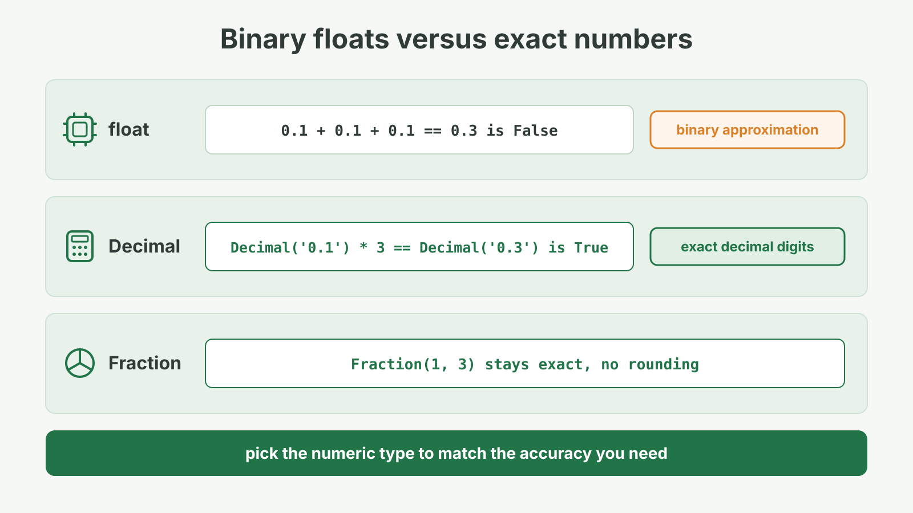
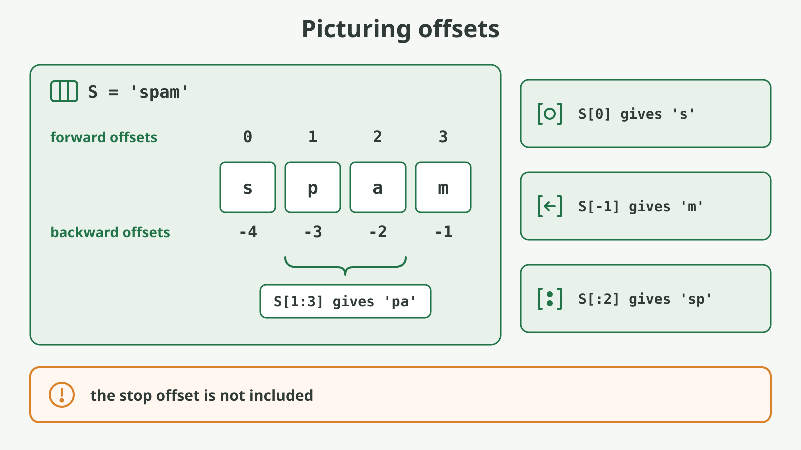
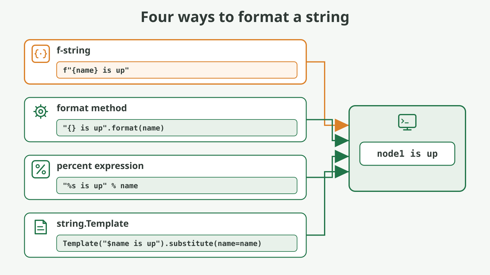
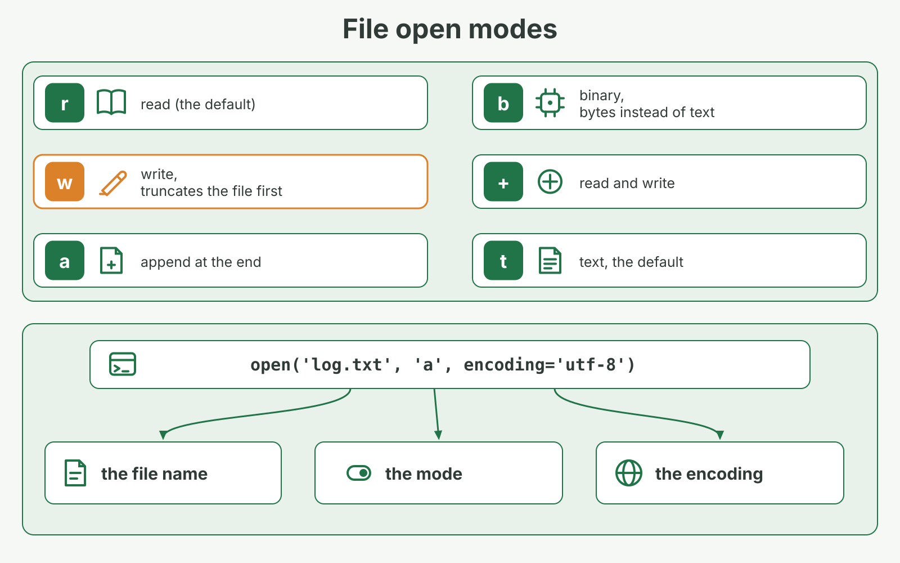

# 3.12 Objects, types and data structures in depth

Chapter 3.1 gave you a first look at this material. This chapter slows down and takes it apart. Picture a small script that opens an inventory file, counts the entries per node, and prints a short report. Nothing in that script looks exotic, yet every line leans on the ideas here: names that point at objects, numbers that behave like numbers, text that cannot be edited in place, and collections that grow as the file grows. You will meet the same ideas again whenever you read the Python behind schedulers, operators, exporters and training launchers.

## Where objects fit in a Python program

Python programs are built in layers, and it helps to see the whole stack at once. A program is made of modules. A module contains statements, a statement contains expressions, and expressions create and process objects. Chapter 3 introduced the top layer, modules. This part starts at the bottom. Before you can reason about a module, you need to know what the objects inside it are and how they behave.

Read almost any line of a real script and you will notice that statements are mostly there to manage objects. A loop walks through a list of objects. An `if` test checks a condition and picks a branch. Later, classes will let you define new object types by using and extending the types you learn now. That is why built-in objects are the starting point for every Python program.

### A note on terms

Many introductions to programming describe three building blocks. Sequence means do this, then do that. Selection means do this only when a condition holds. Repetition means do this again and again. Python has tools in each group, and the labels are a useful way to sort ideas early on. They are still artificial, though, and they can confuse you. A comprehension, for example, counts as both repetition and selection.

In Python, one idea holds the whole picture together: objects, and the things you can do with them.

## Why use built-in objects?

If you come from a lower-level language, much of your work centers on building objects, also called data structures, for the parts of your problem. You may need to lay out memory, manage allocation, and write search routines. Those chores are tedious and error-prone. Worse, they pull your attention away from the goal you actually care about, which is usually the problem, not the plumbing.

In a typical Python program, most of that work simply goes away. The language ships with powerful object types, so you rarely need to write your own before you start solving problems. Unless you need special processing that the built-ins cannot offer, a built-in is almost always the better choice. It is tested, it is fast, and the next reader already knows how it behaves.

### Built-in objects make programs easy to write

For simple tasks, built-in objects often describe the structure of a problem well enough on their own. A list gives you a collection. A dictionary gives you a search table. Both come for free, and you can get a lot of work done with the built-in types alone.

### Built-in objects are building blocks for extensions

Once a task outgrows the core types, you can build your own objects with classes or with C-language interfaces. Even then, the work usually rests on lists and dictionaries underneath. A stack, for example, can be a class that manages or customizes a built-in list.

### Built-in objects are often faster

Speed is another reason to start with the built-ins. Their algorithms are already tuned, and many are implemented in a lower-level language like C. You can write similar types yourself, but matching that performance is hard work with little reward.

### Built-in objects are a standard part of the language

Some languages lean heavily on their built-in tools, such as Lisp. Others expect you to supply your own, such as C++. Python can do either, but you do not need to write new object types just to get started. Built-ins are also always the same, while proprietary toolkits tend to differ from site to site.

So built-in object types make programming easier, and they are often more powerful than what you could build from scratch yourself. Whether or not you add new types later, built-in objects form the core of every Python program.

## Python's core object types

Before the details, a map helps. The table below previews Python's built-in objects and the syntax used to write their literals. A literal is simply an expression that creates an object. Numbers and strings represent numeric and text values, and file objects give you an interface to real files on your computer. Some of these types will look familiar if you have used other languages.

Lists and dictionaries are more flexible than you may be used to. A list keeps an ordered collection of other objects, and a dictionary stores objects by key. Both handle memory automatically, nest freely, grow and shrink on demand, and can hold objects of any kind.

### Python built-in (core) objects

| Object type | Example literals/creation |
| --- | --- |
| Numbers | `1234`, `3.1415`, `0b111`, `1_234`, `3+4j`, `Decimal`, `Fraction` |
| Strings | `'code'`, `"app's"`, `b'a\x01c'`, `'h\u00c4ck'`, `'hÄck'` |
| Lists | `[1, [2, 'three'], 4.5]`, `list(range(10))` |
| Dictionaries | `{'job': 'dev', 'years': 40}`, `dict(hours=10)` |
| Tuples | `(1, 'app', 4, 'U')`, `tuple('hack')`, `namedtuple` |
| Files | `open('docs.txt')`, `open(r'C:\data.bin', 'wb')` |
| Sets | `set('abc')`, `{'a', 'b', 'c'}` |
| Other core objects | Booleans, types, `None` |
| Program-unit objects | Functions, modules, classes (Parts IV, V, and VI) |
| Implementation objects | Compiled code, stack tracebacks (Parts IV and VII) |

### Program-unit and implementation objects

Functions, modules and classes are objects too. You create them with statements and expressions such as `def`, `class`, `import` and `lambda`. You can pass them around, store them inside other objects, and so on.

There is a third group as well: implementation objects, such as compiled code. Tool builders care about these far more than application developers do, so we will cover them briefly later.

### The table is not the whole list

That table is not the whole list, because everything you process in Python is some kind of object. Pattern-matching work creates pattern objects. Network scripts create socket objects. These usually come from importing functions in standard or add-on library modules. Patterns and sockets, for example, come from the `re` and `socket` modules.

We call the table's objects core object types because the language itself has specific syntax for most of them. Run this line in a REPL and you create a new string object:

```
>>> 'Python'
```

The quotes are what make it a literal expression. A square-bracket expression makes a list, and curly braces make a dictionary or a set. Python does not need type declarations here. The syntax you write decides which types you get.

### Dynamic and strong typing

Once an object exists, its set of operations is fixed. A string takes string operations and a list takes list operations. Formally, Python is dynamically typed, because it tracks object types for you without declaration code. It is also strongly typed, because you can only perform operations that are valid for an object's type.

Later chapters take each core type apart in detail. For now, this chapter shows them in action, which is enough to start reading real code.

## Numbers

Numbers are the most familiar core type, the one you reach for without thinking. You count nodes with them, divide a dataset size by a batch size, and compare a measured rate against a target. Python includes integers, floating-point numbers, complex numbers with imaginary parts, decimals with flexible precision, rationals with a numerator and denominator, and sets. Built-in numbers handle most everyday quantities. Vectors and matrices are available as third-party add-ons.

### Basic arithmetic

Basic numbers behave the way school arithmetic taught you. The plus sign adds, the star multiplies, and two stars raise a number to a power. Try the short session below in a REPL, the interactive prompt you started in Chapter 3:

```
$ python3 # Start up a REPL
>>> 123 + 222 # Integer addition
345
>>> 1.5 * 4 # Floating-point multiplication
6.0
>>> 1_234_567, 0x15, bin(21) # Separators, hex, binary
(1234567, 21, '0b10101')
>>> 2 ** 100 # 2 to the power 100, again
1267650600228229401496703205376
```

The integer type stretches to hold large numbers automatically. You can compute 2 to the power 12,345 as an integer. The result has nearly 4,000 digits, so reading it directly is a lot of work. You can ask how long it is instead:

```
>>> len(str(2 ** 12345)) # How many digits in a really BIG number
3717
```

This nested call works from the inside out. Python computes the power first, converts it to a string with `str`, and then measures that string with `len`. Both `str` and `len` work on many object types, and you will see them again.

### Numeric modules

Some numeric tools live in modules, which you load explicitly. A module is a package of extra tools that you bring in with `import`. The `math` module is the obvious first stop, and it provides advanced functions and constants:

```
>>> import math
>>> math.pi
3.141592653589793
>>> math.sqrt(85)
9.219544457292887
```

Randomness has its own module. The `random` module generates random numbers and makes random choices. Here it picks from a list written in square brackets:

```
>>> import random
>>> random.random()
0.7082048489415967
>>> random.choice([1, 2, 3, 4])
2
```

Beyond the everyday types, Python carries more specialized numeric objects, including complex, fixed-precision and rational numbers, along with sets and Booleans. The third-party open source ecosystem adds more, such as matrices, vectors and extended-precision numbers.

### Very large integers

Integers can grow as large as your computer's memory allows, which is generous but not free. Python 3.11 and later take extra steps before converting a very large number to a decimal string, for example for `str` or display. The reason is defence: this protects against rare denial-of-service attacks. The default limit is 4,300 digits.

You can lift that limit with `set_int_max_str_digits` from the `sys` module. Use it when you need to count digits in larger numbers, and check Python's documentation for the full details.

Python's calculator-style use is only the start. Next we turn to strings, which are a richer kind of object.

## Strings

A string records text, such as a node name, a job id or a line from a log. It can also hold any collection of bytes, such as the contents of an image file. Strings are our first example of a sequence. A sequence keeps its items in a left-to-right order, and you fetch an item by its position. A string is technically a sequence of one-character strings.

### Sequence operations

Start with a four-character string in quotes. Single and double quotes mean the same thing, though single quotes are more common. You can check its length with `len` and fetch characters with indexes:

```
>>> S = 'Code' # Make a 4-character string, and assign it to a name
>>> len(S) # Length: number characters
4
>>> S[0] # The first item in S, indexing by zero-based position
'C'
>>> S[1] # The second item from the left
'o'
```

Indexes count from zero, so the first item sits at index 0. Notice that Python variables need no declarations. A variable comes into existence the moment you assign it a value, and it can hold any type of object. It must be assigned before you use it.

Start at the left-hand end and count forward, and the indexes come out positive. Start at the right-hand end and count backward, and they come out negative. Both describe the same characters:

```
>>> S[-1] # The last item from the end in S
'e'
>>> S[-2] # The second-to-last item from the end
'd'
```

Python adds a negative index to the length to get a positive offset. These two lines do the same thing, though the first is easier to write and harder to get wrong:

```
>>> S[-1] # The last item in S
'e'
>>> S[len(S)-1] # Negative indexing, the hard way
'e'
```

Anything Python can compute may sit inside the brackets. A literal works, and so does a variable or a whole expression, as long as the result is an integer.

### Slicing

Slicing pulls out a whole section in one step. Think of it as taking a column out of a string. The general form `X[I:J]` means everything in `X` from offset `I` up to, but not including, offset `J`:

```
>>> S # A 4-character string
'Code'
>>> S[1:3] # Slice of S from offsets 1 through 2 (not 3)
'od'
```

The result is a new object. Leave out the left bound and it defaults to zero. Leave out the right bound and it defaults to the length:

```
>>> S[1:] # Everything past the first (1:len(S))
'ode'
>>> S # S itself hasn't changed
'Code'
>>> S[0:3] # Everything but the last
'Cod'
>>> S[:3] # Same as S[0:3]
'Cod'
>>> S[:-1] # Everything but the last again, but simpler (0:-1)
'Cod'
>>> S[:] # All of S as a top-level copy (0:len(S))
'Code'
```

Negative offsets are legal slice bounds as well. The last form above copies the entire string. Copying a string is rarely worth the effort, but the same trick pays off with lists.

### Concatenation and repetition

Two more operators work on strings. The plus sign concatenates, which means it joins two strings into a new one. The star repeats a string as many times as you ask:

```
>>> S
'Code'
>>> S + 'xyz' # Concatenation
'Codexyz'
>>> S # S is unchanged
'Code'
>>> S * 8 # Repetition
'CodeCodeCodeCodeCodeCodeCodeCode'
```

Notice that the plus sign means addition for numbers and concatenation for strings. Python calls this polymorphism, which means an operation's meaning depends on the objects it works on. Polymorphism makes Python code short and flexible. Code can often work on many types as long as they support a compatible operation.

### Immutability

None of the string operations so far changed the original string. Every string operation produces a new string, because strings are immutable. Once created, they cannot be changed in place. This is not a limitation to work around. It is a promise you can rely on: a string someone hands you will still read the same later.

You cannot overwrite part of an immutable object, and Python will not pretend otherwise. What you can do is build a new object and assign it to the same name. Python reclaims the old one as it goes, so the habit costs less than it sounds:

```
>>> S
'Code'
>>> S[0] = 'z' # Immutable objects cannot be changed
…error text omitted…
TypeError: 'str' object does not support item assignment
>>> S = 'Z' + S[1:] # But we can run expressions to make new objects
>>> S
'Zode'
```

Every object is either immutable or mutable. Numbers, strings and tuples are immutable. Lists, dictionaries and sets are mutable, so you can change them freely. Most new objects you write with classes are mutable too. This distinction matters a lot in practice. Immutability can guarantee that a value stays constant. A mutable value can change at any time and in any place, whether your code expects it or not, and that is where surprising bugs come from.

You can change text in place in two ways. One is to expand the string into a list of characters, change that list, and join it back together with nothing between the pieces:

```
>>> S = 'Python'
>>> L = list(S) # Expand to a list: […]
>>> L
['P', 'y', 't', 'h', 'o', 'n']
>>> L[0] = 'C' # Change it in place
>>> ''.join(L) # Join with empty delimiter
'Cython'
```

The other way is the special `bytearray` object:

```
>>> B = bytearray(b'app') # A bytes/list hybrid (ahead)
>>> B.extend(b'lication') # 'b' means bytes string
>>> B # B[i] = ord(x) works here too
bytearray(b'application')
>>> B.decode() # Translate to normal string
'application'
```

A `bytearray` can change text in place only when every character fits in 8 bits, as ASCII does. Other strings stay immutable. In effect, a `bytearray` mixes immutable bytes strings with mutable lists. You will understand both sides fully once you learn more about bytes and Unicode.

### Type-specific methods

Sequence operations are not the whole story. They work on other sequences too, such as lists and tuples. Strings also carry their own operations, called methods. A method is a function attached to an object and called with parentheses.

Two methods do most of the early work. The `find` method returns the offset of a substring, or `-1` if it is missing. The `replace` method swaps every match for new text. Both act on the string you call them on:

```
>>> S = 'Code'
>>> S.find('od') # Find the offset of a substring in S
1
>>> S
'Code'
>>> S.replace('od', 'abl') # Replace all substrings 'od' in S with 'abl'
'Cable'
>>> S
'Code'
```

Once again, these methods return new strings and leave the original alone. Other string methods split text on a delimiter, which is a simple way to parse data. They convert case, test the content for digits or letters, and strip whitespace from the ends:

```
>>> line = 'aaa,bbb,ccccc,dd'
>>> line.split(',') # Split on a delimiter into a list of substrings
['aaa', 'bbb', 'ccccc', 'dd']
>>> S = 'code'
>>> S.upper() # Upper- and lowercase conversions
'CODE'
>>> S.isalpha() # Content tests: isalpha, isdigit, etc.
True
>>> line = 'aaa,bbb,ccccc,dd\n'
>>> line.rstrip() # Remove whitespace characters on the right side
'aaa,bbb,ccccc,dd'
>>> line.rstrip().split(',') # Combine two operations, run left to right
['aaa', 'bbb', 'ccccc', 'dd']
```

Python runs chained calls from left to right. In the last line above, the strip happens before the split. Chaining works as long as each call returns an object that has the next method.

Formatting is another job strings do well. It fills placeholders with values and hands back a new string. Python offers three forms: the original format expression, the newer format method, and the newest f-string literal. Each one resolves its values at the moment it runs:

```
>>> tool = 'Python'
>>> major = 3
>>> minor = 3
>>> 'Using %s version %s.%s' % (tool, major, minor + 9) # Format expression
'Using Python version 3.12'
>>> 'Using {} version {}.{}'.format(tool, major, minor + 9) # Format method
'Using Python version 3.12'
>>> f'Using {tool} version {major}.{minor + 9}' # Format literal
'Using Python version 3.12'
```

All three are valid, and you will see each of them in code you read. You can pick one for your own work. Each has many options for controlling output, which matter most for readable reports with numbers:

```
>>> '%.2f | %+05d' % (3.14159, -62) # Digits, signs, padding
'3.14 | −0062'
>>> '{1:,.2f} | {0}'.format('sapp'[1:], 296999.256) # Commas, decimal digits
'296,999.26 | app'
>>> f'{296999.256:,.2f} | {'sapp'[1:]}' # Ditto, with Python 3.12+ nested quotes
'296,999.26 | app'
```

One rule explains a lot of Python's design. Sequence operations are generic, but methods are not, and string methods generally work only on strings. Generic operations that span types appear as built-in functions or expressions, such as `len(X)` and `X[0]`. Type-specific operations are method calls, such as `aString.upper()`.

### Getting help with dir and help

The methods you have seen are only a small sample. The built-in `dir` function lists the attributes of any object you pass to it. Methods are callable attributes, so they appear in that list. Here are the attributes of `S`, with the middle cut short:

```
>>> dir(S)
['__add__', '__class__', '__contains__', '__delattr__', '__dir__', '__doc__',
'__eq__', '__format__', '__ge__', '__getattribute__', '__getitem__',
…etc…
'rindex', 'rjust', 'rpartition', 'rsplit', 'rstrip', 'split', 'splitlines',
'startswith', 'strip', 'swapcase', 'title', 'translate', 'upper', 'zfill']
```

Run `dir` yourself for the full list, since strings have 81 attributes today. The plain names are the callable methods you can use. Names wrapped in double underscores support the object's internal implementation and customization, and you will study them when you learn operator overloading in classes.

Concatenation has an internal name. The `__add__` method is how it works, and Python maps the first form below to the second. You should not usually write the second form yourself, because it is less intuitive and may run slower:

```
>>> S + 'head!'
'Codehead!'
>>> S .__add__('head!')
'Codehead!'
```

The `dir` function gives you names only, and a name is not an explanation. To learn what a method does, pass it to `help`:

```
>>> help(S.replace) # Or help(str.replace)
Help on built-in function replace:
replace(old, new, count=-1, /) method of builtins.str instance
Return a copy with all occurrences of substring old replaced by new.
…etc…
```

Most console windows let you press the `Q` key to leave a `help` display. That display comes from Pydoc, a tool that pulls documentation out of objects. Pydoc can also render its reports as HTML for a web browser.

Calling `help(S)` on a string instance may not give you what you want, because it shows the string's value instead. To get help on the type, use `help(str)` or `help(type(S))`. Those describe every method, so `help` works best on one specific method at a time. For the full reference, you can also read Python's standard-library manual. For quick answers in a REPL, `dir` and `help` come first.

### Other ways to code strings

Some characters are hard to type and others cannot be seen at all, so Python lets a backslash stand in for them. A backslash plus a code is called an escape. When Python shows you a nonprintable character, it writes it as an `\xNN` hexadecimal escape, unless the character happens to be printable:

```
>>> S = 'A\nB\tC' # Escapes: \n is newline, \t is tab
>>> len(S) # Each stands for just one character
5
>>> S = 'A\0B\0C' # \0, a binary zero byte, does not terminate string
>>> len(S)
5
>>> S # Nonprintables are displayed as \xNN hex escapes
'A\x00B\x00C'
```

Quotes come in two flavours that mean exactly the same thing. Using the other flavour lets you embed a quote without an escape, and most programmers settle on single quotes for less clutter. Multiline text takes a third form, the triple quote. Every line is joined together, and newline characters appear where the line breaks were:

```
>>> msg = """
... aaaaaaaaaaaa
... bbb'''bbb""bbb
... cccccccc
... """
>>> msg
'\naaaaaaaaaaaa\nbbb\'\'\'bbb""bbb\ncccccccc\n'
```

Multiline HTML, YAML or JSON often finds a home inside a triple-quoted string, because you can paste it without adding escapes. A second use is quick and dirty: wrap a block of code in three quotes to switch it off while you experiment.

When backslashes get in the way, a raw string turns escapes off. You write it with a leading `r`. Raw strings suit regular-expression patterns and Windows directory paths, because you do not need doubled backslashes:

```
>>> r'C:\Users\you\code'
```

### Unicode strings

Non-ASCII text is normal on the modern web, in email, and in data files, so Python strings support Unicode. That includes non-English languages, symbols and emojis. The normal `str` type handles Unicode text, and ASCII is just a simple subset of it. The `bytes` type, and its mutable cousin `bytearray`, handle raw byte values, including encoded text and media:

```
>>> 'hÄck' # Normal str strings are Unicode text
'hÄck'
>>> b'a\x01c' # bytes strings are byte-based data
b'a\x01c'
```

A text string is a sequence of Unicode code points. A code point is a number that identifies a character. A bytes string is a sequence of 8-bit bytes, which is a different idea. One code point does not always map to one byte in memory or in a file. Some code points are too large for a byte, and encodings can use characters of any size:

```
>>> 'Code' # Characters may be any size in memory
'Code'
>>> 'Code'.encode('utf-8') # Encoded to 4 bytes in UTF-8 in files
b'Code'
>>> 'Code'.encode('utf-16') # But encoded to 10 bytes in UTF-16
b'\xff\xfeC\x00o\x00d\x00e\x00'
```

Rich text makes the point even more clearly. The `ord` function gives a character's code point, and `hex` gives that number as a hexadecimal string:

```
>>> len('hÄck') # One character (code point) each
6
>>> len('hÄck'.encode('utf-8')) # But encoded bytes sizes vary
13
>>> len('hÄck'.encode('utf-16'))
18
```

You have three ways to put non-ASCII characters into text strings. You can use `\x` hexadecimal escapes, short `\u` Unicode escapes, or long `\U` escapes. You can also write the character directly, and Python decodes the source using the encoding declared in the file. The default for source code is UTF-8. Here the letter Ä appears four ways:

```
>>> 'h\xc4\u00c4\U000000c4Äck' # Coding non-ASCII: hex, short, long, raw
'hÄÄÄÄck'
```

Inside a text string, every one of those forms gives a Unicode code point. A byte string is stricter: it accepts only `\x` escapes, which stand for raw byte values. When a byte string holds text, it holds the encoded form, not the code points. The two match only for simple text and simple encodings:

```
>>> '\u00A3', '\u00A3'.encode('latin1'), b'\xA3'.decode('latin1')
('£', b'\xa3', '£')
```

In practice, most Unicode work is about text moving in and out of files. A text file encodes strings to bytes when it saves, and decodes bytes to characters when it loads. After loading, you usually work with decoded strings. Text files accept and return text strings, while binary files deal in `bytes`. The rest of the Unicode story comes later, after you master basic string work.

Two more standard tools belong on the same shelf. Pattern matching comes from the `re` module, and parsing of JSON, CSV, XML and HTML has its own modules.

## Lists

The list is the most general sequence in Python, and the one you will use most. Picture a shelf with numbered slots. You can look at slot 3, take a section of slots, add a slot at the end, or relabel a slot in place. A list is an ordered collection of objects of any type, and it has no fixed size. Lists are mutable, so you can change them in place by assigning to positions or by calling list methods. That makes them a flexible tool for collections such as files in a folder, employees in a company, or emails in an inbox.

### Sequence operations

Everything you can do to a string, you can also do to a list, with one change: most of the results come back as lists. Here is a three-item list:

```
>>> L = [123, 'text', 1.23] # A list of three different-type objects
>>> len(L) # Number of items in the list
3
```

Indexing and slicing behave exactly as they did for strings, so the habit carries over:

```
>>> L[0] # Indexing by position (offset)
123
>>> L[:-1] # Slicing a list returns a new list
[123, 'text']
>>> L + [4, 5, 6] # Concat/repeat make new lists too
[123, 'text', 1.23, 4, 5, 6]
>>> L * 2
[123, 'text', 1.23, 123, 'text', 1.23]
>>> L # We're not changing the original list
[123, 'text', 1.23]
```

### Type-specific operations

If you know arrays from another language, a list will feel familiar and then surprise you. It has no fixed type, for a start, and the list above holds an integer, a string and a floating-point number. It also grows and shrinks on demand, using list-specific operations:

```
>>> L.append('Py') # Growing: add object at end of list
>>> L
[123, 'text', 1.23, 'Py']
>>> L.pop(2) # Shrinking: delete an item in the middle
1.23
>>> L # "del L[2]" deletes from a list too
[123, 'text', 'Py']
```

Three calls cover most day-to-day edits. The `append` method adds an item at the end. The `pop` method removes an item at a given offset. A `del` statement also removes an item. Other methods insert at a position with `insert`, remove by value with `remove`, and add several items at once with `extend`.

Most list methods change the list in place instead of making a new one, and the difference is worth remembering:

```
>>> M = ['bb', 'aa', 'cc']
>>> M.sort()
>>> M
['aa', 'bb', 'cc']
>>> M.reverse()
>>> M
['cc', 'bb', 'aa']
```

Sorting and reversing are methods, not functions, when you work in place. The `sort` method orders the list in ascending order by default, and `reverse` flips it. Both change the list directly. Similarly named functions that you will meet later do not.

### Bounds checking

A list has no fixed size, but Python still refuses to reference items that do not exist. Indexing past the end is always a mistake. Assigning past the end is also an error, and Python says so plainly:

```
>>> L
[123, 'text', 'Py']
>>> L[99]
IndexError: list index out of range
>>> L[99] = 1
IndexError: list assignment index out of range
```

None of this is an accident. Assigning off the end is usually a bug, and in C it can be a particularly nasty one, because C does less error checking. Python reports the error rather than silently growing the list. To grow a list, call a method such as `append`, or build a new list. Slicing behaves differently, because it adjusts offsets to fit inside the list.

### Nesting

Core object types nest in any combination and to any depth. A list can hold a dictionary, which holds another list, and so on. You can describe real-world structures this way, and the shape of the code starts to look like the shape of the data.

A nested list is the usual way to build a matrix, which is a grid of numbers. Inside brackets, indentation does not matter, and an expression can span several lines if its brackets stay open:

```
>>> M = [[1, 2, 3], # A 3 × 3 matrix, as nested lists
[4, 5, 6], # Code can span lines if bracketed
[7, 8, 9]]
>>> M
[[1, 2, 3], [4, 5, 6], [7, 8, 9]]
```

This list holds three lists, which together form a 3 by 3 grid. You can reach the parts in several ways, and each one drills a little deeper:

```
>>> M[1] # Get row 2
[4, 5, 6]
>>> M[1][2] # Get row 2, then get item 3 within the row
6
```

The first line fetches the whole second row. The second line fetches the third item inside that row, so chained indexes take you deeper into a nested structure. A nested list works for small jobs. For serious number crunching, the third-party NumPy extension stores and processes large matrices much more efficiently.

### Comprehensions

A list comprehension produces a fresh list. It evaluates an expression for every element of a sequence, moving from left to right. It is written in square brackets, which signal that the result is a list. A comprehension combines an expression with a loop that shares a variable name. Read it as a sentence: the expression comes first, then the loop that feeds it.

Say you want the second column. The matrix is stored by rows, so rows are easy to grab. Columns take a comprehension, but it is still short:

```
>>> col2 = [row[1] for row in M] # Collect the items in column 2
>>> col2
[2, 5, 8]
>>> M # The matrix is unchanged
[[1, 2, 3], [4, 5, 6], [7, 8, 9]]
```

Read it as a sentence: give me `row[1]` for each row in `M`, in a new list. Comprehensions can also do more work. One adds 1 to each item as it is collected. Another uses an `if` clause to keep only the even items, with `%` returning the remainder of a division:

```
>>> [row[1] + 1 for row in M] # Add 1 to each item in column 2
[3, 6, 9]
>>> [row[1] for row in M if row[1] % 2 == 0] # Filter out odd items (pick evens)
[2, 8]
```

Comprehensions work over any iterable object, not just lists. An iterable is either a physical sequence or a virtual one that makes its items on request. Here a comprehension steps over a list of coordinates, and then over a string:

```
>>> diag = [M[i][i] for i in [0, 1, 2]] # Collect a diagonal from matrix
>>> diag
[1, 5, 9]
>>> doubles = [c * 2 for c in 'hack'] # Repeat characters in a string
>>> doubles
['hh', 'aa', 'cc', 'kk']
```

When each item needs several values, wrap them in a nested collection. The `range` built-in generates successive integers. Wrap it in `list` so the REPL shows every value:

```
>>> list(range(4)) # Integers 0..(N-1)
[0, 1, 2, 3]
>>> list(range(−6, 7, 2)) # −6 to +6 by 2
[−6, −4, −2, 0, 2, 4, 6]
>>> [[x ** 2, x ** 3] for x in range(4)] # Multiple values, "if" filters
[[0, 0], [1, 1], [4, 8], [9, 27]]
>>> [[x, x // 2, x * 2] for x in range(-6, 7, 2) if x > 0]
[[2, 1, 4], [4, 2, 8], [6, 3, 12]]
```

None of this is compulsory, and a plain loop is always legal. Comprehensions are optional, but they are useful and often run faster. Python has both simple and advanced tools, and you will choose between them as you go.

Swap the square brackets for parentheses and the comprehension becomes a generator. A generator produces results on demand, following Python's iteration protocol. This example sums each row with `sum`, one row per call to `next`:

```
>>> M
[[1, 2, 3], [4, 5, 6], [7, 8, 9]]
>>> G = (sum(row) for row in M) # Make a generator of row sums
>>> next(G) # Run the iteration protocol (ahead)
6
>>> next(G) # A new row sum on each call
15
>>> next(G) # Row 3: 7 + 8 + 9
24
```

Change the brackets to braces and the same comprehension builds a set or a dictionary:

```
>>> {sum(row) for row in M} # Makes an unordered set of row sums
{24, 6, 15}
>>> {i: sum(M[i]) for i in range(3)} # Makes key:value table of row sums
{0: 6, 1: 15, 2: 24}
```

### Slice and index assignment

A list can change in place in two ways: assign to one position, or assign to a whole section. Index assignment replaces the single object at an offset. The reference at that offset then points to the new object:

```python
>>> L = ['code', 'Code', 'CODE!']
>>> L[1] = 'Hack' # Index assignment replaces item 1
>>> L
['code', 'Hack', 'CODE!']
>>> L[0:2] = ['write', 'Python'] # Slice assignment replaces items 0 and 1
>>> L
['write', 'Python', 'CODE!']
```

Slice assignment is harder to picture than index assignment. It helps to think of it as two steps. First, Python deletes the slice to the left of the `=`. Then it inserts the items from the iterable on the right at that spot. This is a simplification, but it explains why the number of items does not have to match.

Take a concrete case. Writing `L[1:2] = [4, 5]` replaces one item with two, so the list grows by one. Assigning to an empty slice, or assigning an empty list, can insert or delete items:

```python
>>> L = [1, 2, 3]
>>> L[1:2] = [4, 5] # Replacement and insertion
>>> L
[1, 4, 5, 3]
>>> L[1:1] = [6, 7] # Insertion: the slice is empty
>>> L
[1, 6, 7, 4, 5, 3]
>>> L[1:2] = [] # Deletion: nothing is inserted
>>> L
[1, 7, 4, 5, 3]
```

So slice assignment can overwrite, expand or shrink a list in one step. Python programmers often prefer clearer tools, such as the `insert`, `pop` and `remove` methods. Slice assignment can still add items at either end of a list:

```python
>>> L = [1]
>>> L[:0] = [2, 3, 4] # Insert at the front: an empty slice at :0
>>> L
[2, 3, 4, 1]
>>> L[len(L):] = [5, 6, 7] # Insert at the end: an empty slice at len(L):
>>> L
[2, 3, 4, 1, 5, 6, 7]
>>> L.extend([8, 9, 10]) # The named method does the same at the end
>>> L
[2, 3, 4, 1, 5, 6, 7, 8, 9, 10]
```

Read the `[:0]` form as the front of the list, with nothing removed. The `extend` method is easier to read when you only need to add to the end.

### Methods that find, insert and remove

Lists also have methods that search for items and change them by value or by offset. The `index` method returns the offset of an item. The `count` method returns how many times an item appears. Neither one changes the list:

```python
>>> L = ['hack', 'Py', 'code']
>>> L.index('Py') # Offset of an object (search)
1
>>> L.insert(1, 'more') # Insert at an offset or position
>>> L
['hack', 'more', 'Py', 'code']
>>> L.remove('code') # Delete by value
>>> L
['hack', 'more', 'Py']
>>> L.pop(1) # Delete by offset
'more'
>>> L
['hack', 'Py']
>>> L.count('Py') # Number of occurrences
1
```

The name `index` can be confusing, because it searches for an item's offset. It is not the same as the square-bracket indexing you saw earlier. The `pop` method takes an optional offset, and its default is the last item, at offset -1.

### Sorting with key and reverse

The `sort` method orders a list in place, using Python's standard comparison tests. Most examples here compare strings, but other objects can be sorted too. The default order is ascending. Two keyword arguments change that behaviour.

Two keyword arguments change the order. The `reverse` argument sorts in descending order. The `key` argument takes a one-argument function, which Python calls on each item, and the sort uses the value it returns. The next examples use the `lower` method of strings:

```python
>>> L = ['abc', 'ABD', 'aBe']
>>> L.sort() # Sort with mixed case
>>> L
['ABD', 'aBe', 'abc']
>>> L = ['abc', 'ABD', 'aBe']
>>> L.sort(key=str.lower) # Normalize to lowercase
>>> L
['abc', 'ABD', 'aBe']
>>> L = ['abc', 'ABD', 'aBe']
>>> L.sort(key=str.lower, reverse=True) # And change sort order
>>> L
['aBe', 'ABD', 'abc']
```

The newer `casefold` method may handle some types of Unicode text better than `lower`. The `key` argument is also useful for lists of dictionaries, where you can pick one field from each dictionary as the sort value.

Sorts can fail when types are mixed. Python treats magnitude comparisons between types such as `str` and `int` as an error, because the result is ambiguous, and sorting uses those comparisons. Use `key` to convert each value during the sort:

```python
>>> L = [1, 'hack', 2] # Mixed-type sorts fail by default
>>> L.sort()
TypeError: '<' not supported between instances of 'str' and 'int'
>>> L.sort(key=str) # Convert each item to a string for the sort
>>> L
[1, 2, 'hack']
```

Watch the return value, or you will lose your list. The `append`, `extend` and `sort` methods change the list but return `None`. If you write `L = L.append(X)`, you lose the list altogether. These methods change the object as a side effect, so do not assign their result.

### The sorted built-in

Python also has a `sorted` built-in function, which leaves the original alone. It sorts any collection, not only lists. It returns a new list and leaves the original unchanged. Its arguments match those of `list.sort`:

```python
>>> L = ['abc', 'ABD', 'aBe']
>>> sorted(L) # Sorting built-in function
['ABD', 'aBe', 'abc']
>>> L # L is not modified
['abc', 'ABD', 'aBe']
>>> sorted(L, key=str.lower, reverse=True) # Same arguments as list.sort
['aBe', 'ABD', 'abc']
```

A list comprehension changes the values that get sorted, which is a different job from `key`. The `key` function only affects the order during the sort. A comprehension changes the values in the result:

```python
>>> L = ['abc', 'ABD', 'aBe']
>>> sorted([x.lower() for x in L], reverse=True) # Pretransform items: differs
['abe', 'abd', 'abc']
```

The choice is simple. Use `sorted` when you need a new list or when you want to sort any collection. Use `list.sort` when you already have a list and want to change it.

### Reversing, stacks and reversed

Three tools reverse or remove. The `reverse` method reverses a list in place. The `pop` method deletes and returns one item, the last one by default. The `reversed` built-in does neither: it leaves the list alone and returns an iterable, so wrap it in `list` to see every value:

```python
>>> L = [1, 2, 3, 4, 5]
>>> L.pop() # Delete and return an item: the last one by default
5
>>> L
[1, 2, 3, 4]
>>> L.reverse() # In-place reversal
>>> L
[4, 3, 2, 1]
>>> list(reversed(L)) # Reversal built-in with a result (iterable)
[1, 2, 3, 4]
>>> L # L was unchanged
[4, 3, 2, 1]
```

Two list methods make a serviceable stack. A stack is last in, first out, and the end of the list acts as its top. Pushing adds to the top, and popping removes from the top:

```python
>>> L = []
>>> L.append(1) # Push onto the stack
>>> L.append(2)
>>> L
[1, 2]
>>> L.pop() # Pop off the stack
2
>>> L
[1]
```

### Membership, iteration and unpacking

Iteration works on lists exactly as it did on strings. The `in` operator tests membership. A `for` loop steps through the items from left to right. The `range` built-in makes a series of integers for counter loops:

```python
>>> 3 in [1, 2, 3] # Membership
True
>>> for x in [1, 2, 3]:
...     print(x, end=' ') # Iteration
...
1 2 3
>>> list(range(5)) # Counter generators (0 to N-1)
[0, 1, 2, 3, 4]
```

A `for` loop works with any sequence or other iterable, running one or more statements for each item. `range` values turn up in many roles, and counter loops are the most common.

List comprehensions build a new list by applying an expression to each item. A comprehension is close kin to a `for` loop that calls `append`, and the two versions below give the same answer. The comprehension is shorter and can run faster:

```python
>>> res = [x * 4 for x in 'code'] # List comprehension
>>> res
['cccc', 'oooo', 'dddd', 'eeee']
>>> res = [] # Equivalent loop code
>>> for x in 'code': # Append expression results
...     res.append(x * 4)
...
>>> res
['cccc', 'oooo', 'dddd', 'eeee']
```

Comprehensions can also filter with an `if` clause, or use nested `for` loops. The `map` built-in is a different tool: it applies a function, not an expression, to each item. Wrap it in `list` to collect every result:

```python
>>> [x * 4 for x in 'program' if x >= 'p'] # Filter items with if clauses
['pppp', 'rrrr', 'rrrr']
>>> [x + y for x in 'py' for y in '312'] # Nested loops
['p3', 'p1', 'p2', 'y3', 'y1', 'y2']
>>> list(map(abs, [-1, -2, 0, 1, 2])) # Map a function across a sequence
[1, 2, 0, 1, 2]
```

Since Python 3.5, a list literal can use `*` to unpack any iterable, which flattens the items into the new list. Without the star, the items would be nested:

```python
>>> L = ['code', 'hack']
>>> [L, 2, 3, L] # Normal assignments nest items
[['code', 'hack'], 2, 3, ['code', 'hack']]
>>> [*L, 2, 3, *L] # Iterable unpacking in list literal
['code', 'hack', 2, 3, 'code', 'hack']
>>> S = 'code' # Any sequence (or other iterable)
>>> [*'Py', *S, *range(3)]
['P', 'y', 'c', 'o', 'd', 'e', 0, 1, 2]
```

None of this is compulsory. Concatenation with `+` gives the same result for lists. For other iterables, you need conversions with `list`, because `+` expects lists on both sides. A loop also works and is more general, though it is more verbose:

```python
>>> L + [2, 3] + L # What * unpacking does, for lists
['code', 'hack', 2, 3, 'code', 'hack']
>>> list('Py') + list(S) + list(range(3)) # What * unpacking does, for nonlists
['P', 'y', 'c', 'o', 'd', 'e', 0, 1, 2]
>>> M = []
>>> for x in ('Py', S, range(3)): M.extend(x) # Loops are more general
...
>>> M
['P', 'y', 'c', 'o', 'd', 'e', 0, 1, 2]
```

### Deleting items and slices

Deletion uses a statement rather than a method. The `del` statement removes an item or a section in place. Deleting a slice is the same as assigning an empty list to that slice:

```python
>>> L = ['hack', 'more', 'Py', 'code']
>>> del L[0] # Delete one item (in place)
>>> L
['more', 'Py', 'code']
>>> del L[1:] # Delete an entire section
>>> L # Same as L[1:] = []
['more']
```

Assigning an empty list to a slice deletes the slice, because Python removes it and inserts nothing. Assigning an empty list to a single index does something different. It stores a reference to the empty list in that slot, so the list keeps its length:

```python
>>> L = ['hack', 'more', 'Py', 'code']
>>> L[0:1] = []
>>> L
['more', 'Py', 'code']
>>> L[1:] = []
>>> L
['more']
>>> L[0] = []
>>> L
[[]]
```

### Common list operations

The table below is a lookup sheet for the operations you will use most. It is not complete, so check `help(list)` or `dir(list)` for the full set of methods. The method list may also change over time, so cross-check it when you need it.

| Operation | Meaning |
| --- | --- |
| `L = []` | An empty list |
| `L = [123, 'abc', 1.23, {}]` | Four items: indexes 0 to 3 |
| `L = ['Pat', 40.0, ['dev', 'mgr']]` | Nested sublists |
| `L = list('code')` | List of an iterable's items |
| `L = list(range(-4, 4))` | List of successive integers |
| `L[i]`, `L[i][j]`, `L[i:j]`, `len(L)` | Index, index of index, slice, length |
| `L1 + L2`, `L * 3` | Concatenate, repeat |
| `L1 > L2`, `L1 == L2` | Comparisons: magnitude, equality |
| `3 in L`, `for x in L: print(x)` | Membership, iteration |
| `L.append(4)`, `L.extend([5, 6, 7])`, `L.insert(i, X)` | Methods: growing |
| `L.index(X)`, `L.count(X)` | Methods: searching |
| `L.sort()`, `L.reverse()`, `L.copy()`, `L.clear()` | Methods: sorting, reversing, copying, clearing |
| `L.pop(i)`, `L.remove(X)`, `del L[i]`, `del L[i:j]`, `L[i:j] = []` | Methods and statements: shrinking |
| `L[i] = 3`, `L[i:j] = [4, 5, 6]` | Index assignment, slice assignment |
| `L = [*x, 0, *y, *z]` | Iterable unpacking |
| `L = [x**2 for x in range(5)]`, `list(map(ord, 'python'))` | List comprehensions and maps |

A shallow copy has a name of its own. The `copy` method makes a top-level copy of a list, the same idea as `L[:]` and `list(L)`. Its name matches the `copy` methods of sets and dictionaries.

Mutability decides which operations are even possible. Because lists are mutable, the in-place changes above work on lists only, never on strings or tuples, however you write them. Mutability is a yes-or-no property of each object type.

## Dictionaries

A list is a shelf with numbered slots. A dictionary is a cabinet of labelled drawers, and you ask for a drawer by its label instead of its position. Dictionaries are not sequences. They are the only core mapping type. A mapping stores objects by key rather than by position. Dictionaries keep insertion order, which has been true since Python 3.7, but their main job is still mapping keys to values. Like lists, they are mutable, grow and shrink on demand, and can hold any kind of object. Their named keys suit records with labeled fields, such as the fields of a database row.

### Mapping operations

You write a dictionary with curly braces and a series of key-value pairs. Reach for one whenever you need to tie a value to a name, such as the properties of one thing. This dictionary records three attributes of a made-up worker, with keys for name, job and age:

```
>>> D = {'name': 'Pat', 'job': 'dev', 'age': 40}
```

Indexing a dictionary looks exactly like indexing a sequence, which is deliberate. The item in the brackets is a key, not a position. You can fetch a value by key, or change it:

```
>>> D['name'] # Fetch value of key 'name'
'Pat'
>>> D['job'] = 'mgr' # Change Pat's job description
>>> D
{'name': 'Pat', 'job': 'mgr', 'age': 40}
```

Real data rarely arrives complete, so dictionaries are often built up over time. This code starts with an empty dictionary and adds one key at a time. Assigning to a new key creates it. That differs from lists, where assigning past the end is forbidden:

```
>>> D = {}
>>> D['name'] = 'Pat' # Create keys by assignment
>>> D['job'] = 'dev'
>>> D['age'] = 40
>>> D
{'name': 'Pat', 'job': 'dev', 'age': 40}
```

Here the keys act as field names for a record describing an imaginary person. They also replace searches, because indexing by key is often the fastest way to search in Python.

There is more than one way to build one. You can pass keyword arguments to `dict`, written as `name=value`. Or you can pass the result of zipping together a list of keys and a list of values. Both forms below match the literal form. The keyword form needs string keys and is shorter. The `zip` form works well with values read at runtime, such as from a file:

```
>>> pat1 = dict(name='Pat', job='dev', age=40) # Keywords
>>> pat1
{'name': 'Pat', 'job': 'dev', 'age': 40}
>>> pat2 = dict(zip(['name', 'job', 'age'], ['Pat', 'dev', 40])) # Zipping
>>> pat2
{'name': 'Pat', 'job': 'dev', 'age': 40}
```

Keys keep the order in which you added them, even after changes. Before Python 3.7, key order was not guaranteed, and you sometimes needed a separate ordering step. The newer behaviour is more intuitive, and this book assumes it. It gives dictionaries a sequence-like flavour that other non-sequences lack.

### Nesting revisited

Suppose the record needs more detail, such as a first name, a last name, and several job titles. A nested structure handles that well, and you can write it all at once as a literal:

```
>>> rec = {'name': {'first': 'Pat', 'last': 'Smith'},
'jobs': ['dev', 'mgr'],
'age': 40.5}
```

The top level still has three keys. The `name` value is now a nested dictionary, and the `jobs` value is a nested list. You reach the parts the same way you reached the matrix, except that most indexes here are keys rather than list offsets:

```
>>> rec['name'] # 'name' is a nested dictionary
{'first': 'Pat', 'last': 'Smith'}
>>> rec['name']['last'] # Index the nested dictionary
'Smith'
>>> rec['jobs'] # 'jobs' is a nested list
['dev', 'mgr']
>>> rec['jobs'][-1] # Index the nested list
'mgr'
>>> rec['jobs'].append('janitor') # Expand Pat's job description in place
>>> rec
{'name': {'first': 'Pat', 'last': 'Smith'}, 'jobs': ['dev', 'mgr', 'janitor'], 'age': 40.5}
```

The `jobs` list is a separate object from the dictionary that holds it, which is why it can grow and shrink freely. The `pop` method is one way to shrink it. This may seem unusual if you come from a stricter language, but in Python it feels natural.

A low-level language would make you work harder for the same shape. In C, you would declare structures and arrays, fill in values, and link everything together. In Python, running the expression creates the whole nested structure. Saving time like this is one of the main benefits of scripting languages.

Memory follows the same pattern. Lower-level languages make you allocate ahead of time and release by hand. In Python, memory is allocated as needed and freed when you lose the last reference to an object. Assigning the variable to something else is one way to lose that reference:

```
>>> rec = 0 # Now the prior object's space is reclaimed
```

Unused memory does not pile up while your program runs, because Python reclaims it through garbage collection. In standard CPython, reference counts do most of the work, with a supplemental collector for cycles. You can use objects freely while Python manages their memory.

This record shape reappears in later chapters, where lists, dictionaries, tuples, named tuples and classes are compared. You can also save a structure like this to a file. The `pickle` module does that, and JSON is a language-neutral format that looks very much like a Python dictionary.

### Missing keys and if tests

Dictionaries support key access and the operations shown above, and they add methods for common jobs. The `copy` method copies a dictionary. The `update` method merges one dictionary into another in place. The `|` operator does the same merge, but it builds a new dictionary as its result. That is simply a copy plus an update.

Assigning to a new key grows a dictionary. Fetching a missing key is still an error, and the error arrives at the moment you ask:

```
>>> D = {'a': 1, 'b': 2, 'c': 3}
>>> D['d'] = 4 # Assigning new keys grows dictionaries
>>> D
{'a': 1, 'b': 2, 'c': 3, 'd': 4}
>>> D['e'] # Referencing a nonexistent key is an error
…error text omitted…
KeyError: 'e'
```

Usually that reporting is exactly what you want, because a missing key is often a programming error. In general programs, though, you cannot always know which keys will exist. One answer is to test first. The `in` expression checks whether a key exists, and an `if` statement branches on the result:

```
>>> 'e' in D # Boolean result: True or False
False
>>> if not 'e' in D: # Python's main selection statement
print('missing key!')
missing key!
```

The `if` statement is where a script starts making decisions. Its header is the word `if`, an expression that is true or false, and a colon. The indented block runs only when the expression is true. An `else` branch covers the false case, and any number of `elif` branches add more tests. The ternary `if`/`else` expression is a shorter form, and the `if` filter in comprehensions is a close relative. The newer `match` statement handles multiple selections, and you will meet it later.

Indentation marks blocks here, not braces. If a block has several statements, indent them all the same amount. Every multiline statement follows this pattern: a header line ending in a colon, then the indented block. You do not need semicolons after statements, and forgetting the colon is the most common beginner mistake:

```
>>> if not 'e' in D:
print('missing') # Statement blocks are indented
print('no, really...') # (Unless they're simple: see ahead)
missing
no, really...
```

Other routes avoid nonexistent keys too. The `get` method is a conditional index with a default value. The ternary expression is a compact `if`. The `try` statement catches and recovers from errors, and you will meet it later:

```
>>> D.get('a', 'missing') # Like D['a'] but with a default
1
>>> D.get('e', 'missing') # Default returned if absent
'missing'
>>> D['e'] if 'e' in D else 0 # if/else ternary expression form
0
```

### Item iteration with for loops

Dictionaries hold much of your data, so processing their items one at a time is a daily job. Three methods do the work. The `keys`, `values` and `items` methods return keys, values, and key-value pairs:

```
>>> D = dict(a=1, b=2, c=3)
>>> D
{'a': 1, 'b': 2, 'c': 3}
>>> list(D.keys()) # Keys, values, and key/value pairs
['a', 'b', 'c']
>>> list(D.values()) # list forces results generation
[1, 2, 3]
>>> list(D.items())
[('a', 1), ('b', 2), ('c', 3)]
```

These methods return objects that produce one result at a time, which is why the examples wrap them in `list`, just as with `range`. This is Python's iteration protocol. An iterable object has an iterator, and the iterator answers `next` calls with one item at a time:

```
>>> D.keys() # Get an iterable object
dict_keys(['a', 'b', 'c'])
>>> I = iter(D.keys()) # Get an iterator from an iterable
>>> next(I) # Get one result at a time from iterator
'a'
>>> next(I) # This is most of the iteration protocol
'b'
```

A generator is a one-pass tool, and that shapes how you use it. Generators skip the `iter` step. A generator does not support multiple scans, so it is its own iterator, and `iter` does nothing to it.

The protocol saves memory and reduces delays, because results are made one at a time rather than all at once. You rarely need to call `next` yourself. The `for` loop runs the protocol for you, stepping through items one by one. It works on strings, lists, and virtual sequences such as generators, `range`, and `keys`:

```
>>> for key in D.keys(): # Auto run the iteration protocol
print(key, '=>', D[key]) # Display multiple items, space between
a => 1
b => 2
c => 3
```

Every `for` loop needs two things: a variable name and an iterable. For each item, it assigns the item to the variable and runs the indented block. The `for` loop is one of Python's main repetition tools. The others are comprehensions and the `while` loop, which you will meet later.

Iterating over a dictionary is so common that the loop can skip the `keys` call. It can step through key-value pairs too. These two loops give the same output as the first. The choice is partly a matter of taste, but explicit code is usually better:

```
>>> for key in D: # Implicit keys() iteration
print(key, '=>', D[key])
>>> for (key, value) in D.items(): # Key/value-pair tuples iteration
print(key, '=>', value)
```

That second loop is doing two jobs at once. The second loop uses tuple assignment, which unpacks each pair into two variables. To understand what `items` returns, you need to know about tuples first.

### Dictionary operations

Dictionaries are the core mapping type, and the table below summarizes their common operations. Like the list table, it is not complete. Run `help(dict)` or `dir(dict)` for the full list of methods.

| Operation | Meaning |
| --- | --- |
| `D = {}` | Empty dictionary |
| `D = {'name': 'Pat', 'age': 40.0}` | Two-item dictionary |
| `E = {'cto': {'name': 'Sue', 'age': 40}}` | Nesting |
| `D = dict(name='Bob', age=40)` | Alternative construction: keywords |
| `D = dict([('name', 'Bob'), ('age', 40)])` | Alternative construction: key/value pairs |
| `D = dict(zip(keyslist, valueslist))` | Alternative construction: zipped key and value lists |
| `D = dict.fromkeys(['name', 'age'])` | Alternative construction: key lists |
| `D['name']`, `E['cto']['age']` | Indexing by key, nested indexes |
| `'age' in D`, `for key in D: print(D[key])` | Key membership and iteration |
| `D.keys()`, `D.values()`, `D.items()` | All keys, all values, all key and value tuples |
| `D.copy()`, `D.clear()`, `D.update(D2)` | Copy (top level), clear all items, merge by keys |
| `D.get(key, default?)` | Fetch by key; if absent, the default (or None) |
| `D.pop(key, default?)`, `D.setdefault(key, default?)`, `D.popitem()` | Remove by key, set default if absent, remove any pair |
| `len(D)` | Length: number of stored entries |
| `D[key] = 62` | Adding keys, changing key values |
| `del D[key]` | Deleting entries by key |
| `D1 == D2` | Comparisons: equality only |
| `list(D.keys())`, `D1.keys() & D2.keys()` | Dictionary views |
| `D = {**x, 'a': 1, **y, **z}` | Dictionary unpacking |
| `D = {x: x*2 for x in range(10)}` | Dictionary comprehensions |
| `D \| E` | Dictionary merge expression: copy plus update |

Most dictionary changes start with an assignment. Assigning to a new or existing key creates the entry or changes its value. The `del` statement deletes a key's entry. The `update` method merges one dictionary into another in place. The `pop` method removes a key and returns the value it had.

### Changing dictionaries in place

Dictionaries are mutable, just like lists. You can change, grow and shrink them without making new dictionaries. Assign a value to a key to change an entry or create it. The `del` statement removes the entry for a key. This example also nests a list inside a dictionary:

```python
>>> D = {'hack': 1, 'Py': 2, 'code': 3}
>>> D['Py'] = ['app', 'dev'] # Change entry (value is a list)
>>> D
{'hack': 1, 'Py': ['app', 'dev'], 'code': 3}
>>> del D['code'] # Delete entry (also D.pop(k))
>>> D
{'hack': 1, 'Py': ['app', 'dev']}
>>> D['years'] = 32 # Add new entry
>>> D
{'hack': 1, 'Py': ['app', 'dev'], 'years': 32}
>>> D['Py'][0] = 'program' # Change a nested list in place
>>> D
{'hack': 1, 'Py': ['program', 'dev'], 'years': 32}
```

Assigning to an existing list offset changes it, and assigning to an existing dictionary key changes it too. The difference appears with a new key. A new dictionary key creates a new entry. A list cannot do that, because it only accepts assignment to offsets that already exist. To grow a list, use `append` or slice assignment instead.

The `values` and `items` methods return all the values and all the key and value tuples. Each one returns an iterable object. Wrap it in `list` to see the results at once:

```python
>>> D = {'program': 1, 'script': 2, 'app': 3}
>>> list(D.keys()) # All keys
['program', 'script', 'app']
>>> list(D.values()) # All values
[1, 2, 3]
>>> list(D.items()) # All (key, value) tuples
[('program', 1), ('script', 2), ('app', 3)]
```

A missing key does not have to stop the program. The `get` method returns a default when a key is missing, such as `None` or a value you pass in. This avoids a missing-key error when you cannot predict the keys:

```python
>>> D.get('script') # A key that is present
2
>>> print(D.get('code')) # A key that is missing
None
>>> D.get('code', 4)
4
```

Merging is one call. The `update` method merges the keys and values of one dictionary into another. It adds new keys. For a key that already exists, it overwrites the value without warning:

```python
>>> D
{'program': 1, 'script': 2, 'app': 3}
>>> D2 = {'code': 4, 'hack': 5, 'app': 6} # New keys added, app: 6 wins
>>> D.update(D2)
>>> D
{'program': 1, 'script': 2, 'app': 6, 'code': 4, 'hack': 5}
```

Removing a key can also hand you its value. The dictionary `pop` method removes a key and returns its value. It works like the list `pop` method, but it takes a key instead of a position:

```python
>>> D.pop('app') # Pop a dictionary key
6
>>> D.pop('hack') # Delete key and return its value
5
>>> D
{'program': 1, 'script': 2, 'code': 4}
>>> L = ['aa', 'bb', 'cc', 'dd'] # Pop a list by position
>>> L.pop() # Delete and return from the end
'dd'
>>> L.pop(1) # Delete from a specific position
'bb'
>>> L
['aa', 'cc']
```

Copying matters only once two names point at the same dictionary. The `copy` method makes a copy of a dictionary. That matters when two names share one dictionary, so the shared references section covers it.

### Other ways to build dictionaries

Dictionaries are so useful that Python offers several ways to build them. The first two forms use a literal and key assignment. The last two use the `dict` type name. They produce the same result as the literal and key-assignment forms:

```python
>>> {'name': 'Pat', 'age': 40} # 1) Traditional literal expression
>>> D = {} # 2) Assign by keys dynamically
>>> D['name'] = 'Pat'
>>> D['age'] = 40
>>> dict(name='Pat', age=40) # 3) dict keyword-argument form
>>> dict([('name', 'Pat'), ('age', 40)]) # 4) dict key/value tuples form
```

All four forms create the same two-key dictionary, so the choice is about fit rather than output. Each one suits a different case:

The literal is handy when you can write the whole dictionary ahead of time.
Key assignment works when you build the dictionary one field at a time.
The keyword form takes less typing, but every key must be a string.
The key/value tuples form helps when keys and values are built as sequences at runtime.

The keyword form is newer than literals and common in Python code. It has less syntax, which leaves less room for mistakes. The `zip` function combines a list of keys with a list of values, which is useful when the values come from columns in a data file:

```python
>>> dict(zip(keyslist, valueslist)) # Zipped key/value tuples form
```

If all the values start out the same, `dict.fromkeys` builds the dictionary from a list of keys, with `None` as the default value. Notice that you call it on the `dict` type, not on an existing dictionary:

```python
>>> dict.fromkeys(['a', 'b'], 0)
{'a': 0, 'b': 0}
>>> dict.fromkeys('code') # Other iterables, default value
{'c': None, 'o': None, 'd': None, 'e': None}
```

### Dictionary unpacking and the union operator

Dictionary literals can unpack other dictionaries. Since Python 3.5, a dictionary literal can use `**` to unpack another dictionary at its top level. You can unpack any number of dictionaries. When keys collide, the rightmost value wins:

```python
>>> D = dict(a=4, c=3)
>>> {'a': 1, 'b': 2, **D} # Dictionary-literal unpacking
{'a': 4, 'b': 2, 'c': 3}
>>> dict(a=1, b=2) | D # Same, but with union operator
{'a': 4, 'b': 2, 'c': 3}
```

The `**` form works inside `dict` as well, because every function call unpacks keyword arguments this way. Inside `dict`, though, a repeated key is an error, while a literal quietly allows the repeat:

```python
>>> dict(a=1, **{'b': 2}, **dict(c=3)) # Works in dict(), as in all calls
{'a': 1, 'b': 2, 'c': 3} # As long as no keys are repeated!
>>> dict(a=1, b=2, **dict(a=4, c=3))
TypeError: dict() got multiple values for keyword argument 'a'
```

Python 3.9 added a `|` union operator for dictionaries. It builds a new dictionary, and for a repeated key the right side wins. Do not confuse it with a mathematical set union. This is a key-based merge, even though the symbol is the same one sets use:

```python
>>> D = dict(a=1, b=2)
>>> D | {'b': 3, 'c': 4} # Update, return, rightmost wins
{'a': 1, 'b': 3, 'c': 4}
>>> D | {'b': 3, 'c': 4} | dict(a=5, d=6)
{'a': 5, 'b': 3, 'c': 4, 'd': 6}
```

Merging without losing the original takes one extra step. The `update` method gives about the same result, but it changes the dictionary in place. To keep the original, make a copy first. The `|=` form works like calling `update` with one argument and no copy:

```python
>>> C = D.copy()
>>> C.update({'b': 3, 'c': 4}) # "Union" without the | expression
>>> C.update(dict(a=5, d=6))
>>> C
{'a': 5, 'b': 3, 'c': 4, 'd': 6}
```

A plain loop does the same merge. Writing `for k in D2: D1[k] = D2[k]` copies each key into `D1`. The book notes that Python now has three merge styles for one job, so choose the one that reads best in your code.

### Dictionary comprehensions

A dictionary comprehension runs an implied loop. On each iteration it collects a key and a value, and it fills a new dictionary with them. Abstractly, it maps to a loop like this, where both `k` and `v` can use the loop variable `x`:

```python
{k: v for x in iterable}  # Dictionary comprehension
new = {}                  # Equivalent loop code
for x in iterable:
    new[k] = v
```

A common way to build a dictionary dynamically is to zip its keys and values. The `zip` built-in pairs items from two lists. Wrap the result in `list` if you want to see the pairs:

```python
>>> list(zip(['a', 'b', 'c'], [1, 2, 3])) # Zip together keys and values
[('a', 1), ('b', 2), ('c', 3)]
>>> D = dict(zip(['a', 'b', 'c'], [1, 2, 3])) # Make a dict from zip result
>>> D
{'a': 1, 'b': 2, 'c': 3}
```

A dictionary comprehension gives the same result. It unpacks each pair with tuple assignment as it scans the zipped list from left to right:

```python
>>> D = {k: v for (k, v) in zip(['a', 'b', 'c'], [1, 2, 3])}
>>> D
{'a': 1, 'b': 2, 'c': 3}
```

Comprehensions are more general than this example suggests. The keys and the values can both be computed with expressions:

```python
>>> D = {x: x ** 2 for x in [1, 2, 3, 4]} # Or: in range(1, 5)
>>> D
{1: 1, 2: 4, 3: 9, 4: 16}
>>> D = {c: c * 4 for c in 'HACK'} # Loop over any iterable
>>> D
{'H': 'HHHH', 'A': 'AAAA', 'C': 'CCCC', 'K': 'KKKK'}
>>> D = {c.lower(): (c + '!') for c in ['HACK', 'PY', 'CODE']} # Expr: expr
>>> D
{'hack': 'HACK!', 'py': 'PY!', 'code': 'CODE!'}
```

The syntax shown here is the minimum you need to read other people's code. Comprehensions can also filter with `if` clauses and use nested `for` loops. The book covers those fully in later chapters, so this section only shows the basic form.

### Insertion order and popitem

Dictionaries keep their keys in insertion order. That became guaranteed in Python 3.7, after CPython 3.6 had it. Keys run from the oldest addition to the newest, and this holds for literals, `dict` calls, comprehensions and keys added later. Changing a value does not move its position:

```python
>>> D = dict(a=1, b=2) # Literal keys stored left to right
>>> D['c'] = 3 # New keys always added at the end
>>> D
{'a': 1, 'b': 2, 'c': 3}
>>> D.pop('b') # Method pop removes any key by name
2
>>> D # Other keys still in insertion order
{'a': 1, 'c': 3}
>>> D['b'] = 2 # Earlier key goes at the end too
>>> D
{'a': 1, 'c': 3, 'b': 2}
>>> D['c'] = 0 # Changing values doesn't impact order
>>> D['d'] = 1 # And new arrivals always go at the end
>>> D
{'a': 1, 'c': 0, 'b': 2, 'd': 1}
```

Insertion order works like the list stack you saw earlier. The `popitem` method returns the key and value pair added most recently. It also removes that pair from the end:

```python
>>> D.popitem()
('d', 1)
>>> D.popitem()
('b', 2)
>>> D
{'a': 1, 'c': 0}
```

Insertion order is not the same thing as a list. You cannot insert a key in the middle, and dictionaries are not sequences. Some outputs still need a sort. Ordering filenames for display, for example, usually calls for a sort on the strings instead of the insertion order.

### Books database example

Here is a small example of a dictionary at work. The table maps edition years, which are the keys, to titles, which are the values. You fetch an edition name by indexing with a year string:

```python
>>> table = {'2024': 'Learning Python, 6th Edition', # Year => title
...          '2013': 'Learning Python, 5th Edition',
...          '1999': 'Learning Python'}
>>> table['2024'] # Key => value
'Learning Python, 6th Edition'
>>> for year in table: # Keys iteration
...     print(year + '\t' + table[year])
...
2024	Learning Python, 6th Edition
2013	Learning Python, 5th Edition
1999	Learning Python
```

The `for` loop iterates through each key and prints a tab-separated line. The `\t` in a string means a horizontal tab. To step through a dictionary, you can call `keys` or loop over the dictionary itself. Both use the iteration protocol, and inside the loop you can index from key to value.

The mapping runs in one direction only, which is often all you need. The table maps years to titles, but not the other way around. You can build the table in reverse, with titles as keys:

```python
>>> table = {'Learning Python, 6th Edition': 2024, # Title => year
...          'Learning Python, 5th Edition': 2013,
...          'Learning Python': 1999}
>>> table['Learning Python'] # Key => value
1999
>>> list(table.items())[:2] # The list call is required for items
[('Learning Python, 6th Edition', 2024), ('Learning Python, 5th Edition', 2013)]
>>> [title for (title, year) in table.items() if year == 1999] # Value => key
['Learning Python']
```

A comprehension can also map a value back to its key. That search walks through every pair, so it is slower than a direct key lookup:

```python
>>> K = 'Learning Python'
>>> V = 1999
>>> table[K] # Key => value (normal usage)
1999
>>> [key for (key, value) in table.items() if value == V] # Value => key
['Learning Python']
>>> [key for key in table.keys() if table[key] == V] # Same: keys()
['Learning Python']
```

Reversing a mapping is possible, and the last shape shown here is the safe one. Both of the last two commands return a list. A dictionary holds one value per key. A value can still appear under many keys, or be a collection that holds many values. You can also invert a dictionary with `zip`, but only if its values are immutable and do not repeat:

```python
>>> dict(zip(table.values(), table.keys()))[1999] # Key/value inversion?
'Learning Python'
```

The inverted dictionary has integer keys here. That is fine, because integers are immutable. Store data once in a dictionary, and search backward only when you actually need to.

### Keys that are not strings

Keys do not have to be strings. Any immutable object works as a key, including integers and tuples. Tuples let a compound key, such as a date or an IP address, carry a value. Lists, sets and dictionaries cannot be keys, because they can change. They are still allowed as values.

A few more rules apply. A dictionary is a mapping, not a sequence. Concatenation and slicing do not apply to it, and Python raises an error if you try them. You can create a key with a literal or by assigning to a new key. The end result is the same.

### Integer keys as flexible lists

Lists refuse to grow this way, but dictionaries do not. A list cannot be assigned past its end, while a dictionary with integer keys can behave like a list that grows on assignment:

```python
>>> L = []
>>> L[99] = 'hack'
IndexError: list assignment index out of range
>>> D = {}
>>> D[99] = 'hack'
>>> D[99]
'hack'
>>> D
{99: 'hack'}
```

You can preallocate a list with repetition, such as `[0]*100`. A dictionary does not need that space, so it avoids the waste. The dictionary above looks like a 100-item list, but it holds only one entry:

```python
>>> D[62] = 'code'
>>> D[30] = 'write'
>>> D[62]
'code'
>>> D
{99: 'hack', 62: 'code', 30: 'write'}
```

Integer keys cannot contain nondigit characters, so they are less expressive than string keys. A year table can use integer keys to avoid quoting the year:

```python
>>> table = {2024: 'Learning Python, 6th Edition'} # Integers work as keys
>>> table[2024]
'Learning Python, 6th Edition'
```

### Sparse data with tuple keys

Sparse data is where dictionary keys earn their keep. Sparse data is mostly empty, such as a three-dimensional array where only a few positions hold values. The keys are tuples that record the coordinates of the filled slots:

```python
>>> Matrix = {}
>>> Matrix[(2, 3, 4)] = 88
>>> Matrix[(7, 8, 9)] = 99
>>> X = 2; Y = 3; Z = 4 # A ; separates statements
>>> Matrix[(X, Y, Z)]
88
>>> Matrix
{(2, 3, 4): 88, (7, 8, 9): 99}
```

Two entries stand in for a huge, mostly empty array. Accessing an empty slot raises a missing-key exception, because no value is stored there:

```python
>>> Matrix[(2, 3, 6)]
KeyError: (2, 3, 6)
```

Missing-key errors are common with sparse data, and you usually do not want them to stop the program. There are three ways to supply a default. The `get` method is the most concise. An `if` test checks for the key first. A `try` statement catches the error and recovers:

```python
>>> Matrix.get((2, 3, 4), 0) # Exists: fetch and return
88
>>> Matrix.get((2, 3, 6), 0) # Doesn't exist: use passed default
0
>>> if (2, 3, 6) in Matrix: # Check for key before fetch
...     print(Matrix[(2, 3, 6)])
... else:
...     print(0)
...
0
>>> try:
...     print(Matrix[(2, 3, 6)]) # Try to index
... except KeyError: # Catch and recover
...     print(0)
...
0
```

The `get` method is the most concise of the three. The `if` and `try` forms are more general, and you will use them in many other places.

### Dictionaries as records

Records are another natural fit. Dictionaries can represent structured information, playing the role of records or structs in other languages, and of JSON content in language-neutral roles. This example fills in a book record by assigning to new keys:

```python
>>> rec = {}
>>> rec['title'] = 'Learning Python, 5th Edition'
>>> rec['year'] = 2013
>>> rec['isbn'] = '9781449355739'
>>> rec['year'], rec['isbn']
(2013, '9781449355739')
```

The same record can be written as one literal, which reads better. You can also write the nested record all at once. Here a nested dictionary and a list describe the properties of one book:

```python
>>> rec = {'title': 'Learning Python, 5th Edition',
...        'date': {'year': 2013, 'month': 'July'},
...        'isbns': ['1449355730', '9781449355739']}
>>> rec['title']
'Learning Python, 5th Edition'
>>> rec['isbns']
['1449355730', '9781449355739']
>>> rec['isbns'][1]
'9781449355739'
>>> rec['date']['year']
2013
```

Chained indexes reach nested values. A record can also live inside a larger collection, so a list or a dictionary can act as a database of records:

```python
db = []
db.append(rec)  # A list "database"
db.append(other)
db[0]['isbns']
db = {}
db['lp5e'] = rec  # A dictionary "database"
db['lp6e'] = other
db['lp5e']['isbns']
```

Persistence is the natural next question after records. Later, the `shelve` module works much the same way. It maps objects to and from files, so the records stay after the program ends.

### Dictionary views

The `keys`, `values` and `items` methods return view objects. A view produces results on demand, instead of building a physical list. Displaying a view at the prompt shows its type:

```python
>>> D = dict(program=1, script=2, app=3)
>>> D.keys()
dict_keys(['program', 'script', 'app'])
```

A view is a window, not a snapshot. Views are iterable, so they produce one item at a time. They keep insertion order, reflect later changes to the dictionary, and support set operations. Because they are not lists, they do not support indexing or the `sort` method. Wrap them in `list` when you need list operations:

```python
>>> K = D.keys() # Makes a view object, not a list
>>> list(K) # Force a real list when needed
['program', 'script', 'app']
>>> K[0] # List operations fail unless converted
TypeError: 'dict_keys' object is not subscriptable
>>> K.sort()
AttributeError: 'dict_keys' object has no attribute 'sort'
>>> list(K)[0], list(K).sort()
('program', None)
```

Views do not copy the full results. They change as the dictionary changes. Keep this in mind if you hold on to a view, though most loops do not need to:

```python
>>> D = {'a': 1, 'b': 2, 'c': 3}
>>> K = D.keys()
>>> V = D.values()
>>> list(K), list(V) # Views maintain same order as dictionary
(['a', 'b', 'c'], [1, 2, 3])
>>> del D['b'] # Change the dictionary in place
>>> list(K), list(V) # Reflected in any current view objects
(['a', 'c'], [1, 3])
```

A `for` loop uses the view automatically. The forms `for k in D.keys()` and `for k in D` do the same thing, and most programmers write the shorter one.

Some views are set-like, and some are not. The `keys` view works with set operations. The `values` view does not, because its items need not be unique or hashable. An `items` view is set-like only when its pairs are hashable:

```python
>>> D = {'a': 1, 'c': 3}
>>> K = D.keys()
>>> V = D.values()
>>> K | {'x': 4} # Keys (and some items) views are set-like
{'x', 'a', 'c'} # Results are unordered sets, not views
>>> V | {'x': 4}
TypeError: unsupported operand type(s) for |: 'dict_values' and 'dict'
>>> D.keys() & {'b': 1} # Intersect view and dict
{'b'}
>>> {'a': [1, 2]}.items() | {0, 1} # Unhashable list in an item: no set ops
TypeError: unhashable type: 'list'
```

The `|` applied to a view is a set union, not a full dictionary merge. Keep it separate from the dictionary union operator earlier in this section. Set operations on views are rare, but they work when they help.

### Sorting keys and comparing dictionaries

Insertion order is not always the order you want to show, so keys sometimes need sorting. A view cannot be sorted directly, because `keys` does not return a list:

```python
>>> D = {'c': 3, 'b': 2, 'a': 1}
>>> Ks = D.keys() # Sorting a view object doesn't work!
>>> Ks.sort()
AttributeError: 'dict_keys' object has no attribute 'sort'
```

Two routes work. You can convert the keys to a list and sort that list, or you can call `sorted` on the view or on the dictionary itself:

```python
>>> Ks = list(D.keys()) # Convert keys to a list
>>> Ks.sort() # And then sort with list.sort()
>>> for k in Ks: print(k, D[k])
...
a 1
b 2
c 3
>>> for k in sorted(D): print(k, D[k]) # sorted() on the dict: iterators produce keys
...
a 1
b 2
c 3
```

Equality ignores order. Dictionaries compare for equality with `==`, which checks each key and value and ignores insertion order:

```python
>>> D1 = dict(a=1, b=2, c=3)
>>> D2 = dict(c=3, b=2, a=1)
>>> D1 == D2, D1 != D2
(True, False)
```

Magnitude is different, and dictionaries do not support it. Comparisons such as `<` and `>` do not work on dictionaries. You can compare the `items` lists yourself, but you must sort them first, because insertion order would change the result:

```python
>>> D1 = dict(a=1, b=2, c=4)
>>> D2 = dict(c=3, b=2, a=1)
>>> D1 > D2
TypeError: '>' not supported between instances of 'dict' and 'dict'
>>> list(D1.items()) > list(D2.items()) # Fails: insertion order
False
>>> D1.items() > D2.items() # Fails: superset, not magnitude
False
>>> sorted(D1.items()) > sorted(D2.items()) # OK: sorted to neutralize order
True
```

### Lists, dictionaries or sets

Lists and dictionaries are both flexible collections, and the difference is what you use to reach an item. Lists assign items to positions. Dictionaries assign items to keys, and the keys are more meaningful to people. A nested list can store a record, but the reader must remember what each position means:

```python
>>> L = ['Pat', 40.5, ['dev', 'mgr']] # List-based "record"
>>> L[0]
'Pat'
>>> L[1] # Positions/numbers for fields
40.5
>>> L[2][1]
'mgr'
```

Dictionary data carries more meaning. The keys name the fields, so the reader does not have to count positions:

```python
>>> D = {'name': 'Pat', 'age': 40.5, 'jobs': ['dev', 'mgr']}
>>> D['name']
'Pat'
>>> D['age'] # Dictionary-based "record"
40.5
>>> D['jobs'][1] # Names mean more than numbers
'mgr'
```

The choice between a list and a dictionary is mostly about labels. Lists suit collections of unlabeled items, such as the files in a directory or the employees in a company. Dictionaries suit labeled data, and they allow quick, direct lookup by name. Dictionary lookup is usually faster than a linear search through a list. Dictionaries are also a good fit for sparse collections and for collections that grow in unplanned ways.

When presence is all you need, a set is the lighter tool. A set is like the keys of a dictionary without values. Sets are useful for fast membership tests when there is no value to store. A visited-state check is a good example:

```python
>>> D = {}
>>> D['state1'] = True # A visited-state dictionary
>>> 'state1' in D
True
>>> S = set()
>>> S.add('state1') # Same, but with sets
>>> 'state1' in S
True
```

So choose a list for ordered items, a dictionary for labeled fields, and a set when you only need to know whether something is present.

## Tuples

A tuple is roughly a list that cannot change. Tuples are sequences like lists, but they are immutable like strings. Think of a tuple as a fixed group that travels together, such as the parts of a specific calendar date or the three numbers that identify one GPU. They are written in parentheses instead of square brackets. They support any object type, any nesting, and the usual sequence operations:

```
>>> T = (1, 2, 3, 4) # A 4-item tuple
>>> len(T) # Length
4
>>> T + (5, 6) # Concatenation: a new tuple
(1, 2, 3, 4, 5, 6)
>>> T[0], T[1:] # Indexing, slicing, and more
(1, (2, 3, 4))
```

A tuple has methods, though far fewer than a list:

```
>>> T.index(4) # Tuple methods: 4 appears at offset 3
3
>>> T.count(4) # 4 appears once
1
```

Immutability is the whole point. A tuple cannot change after creation, because it is an immutable sequence. A one-item tuple needs a trailing comma, or it looks like a plain expression in parentheses:

```
>>> T[0] = 2 # Tuples are immutable
TypeError: 'tuple' object does not support item assignment
>>> T = (2,) + T[1:] # Make a new tuple for a new value
>>> T
(2, 2, 3, 4)
```

Mixed types and nesting are fine, but size is fixed. Tuples support mixed types and nesting, and they do not grow or shrink:

```
>>> T = 'hack', 3.0, [11, 22, 33]
>>> T
('hack', 3.0, [11, 22, 33])
>>> T[1]
3.0
>>> T[2][1]
22
>>> T.append(4)
AttributeError: 'tuple' object has no attribute 'append'
```

The parentheses around a tuple can often be left out, as shown here. Where commas do not have another meaning, the commas themselves build the tuple. That is also why the REPL shows results in parentheses when you enter several comma-separated items.

### Why use tuples?

Tuples are less common than lists in practice, and they offer fewer operations. Their immutability is the point. A list passed around a program can be changed anywhere. A tuple cannot, and that gives you a kind of integrity constraint, which helps in larger programs. Later you will meet named tuples, an extension built on top of tuples.

## Files

File objects are how Python code reads and writes the content of files on your computer. Think of one as a doorway between your program and the disk: you open it, push strings through it, and close it. You can use files for text notes, audio, spreadsheets, saved emails, and anything else stored on your device. Files are core objects, but they have no literal syntax. You create one by calling the built-in `open` function with a filename and any options you need.

Text output starts with a mode. To create a text output file, pass the name and the `'w'` mode string. Python writes the newline character `\n` in a portable way when it moves text to and from files:

```
>>> f = open('data.txt', 'w') # Open a new file in text-output mode
>>> f.write('Hello\n') # Write strings of characters to it
6
>>> f.write('world!\n') # Return number of items written
7
>>> f.close() # Close to flush output buffers to disk
```

The filename can be a full path if the file lives elsewhere. To read the file back, reopen it in `'r'` mode, which is also the default if you leave the mode out. Read the content into a string. A file's content is always a string in your script, whatever kind of data the file holds:

```
>>> f = open('data.txt') # Open an existing file in text-input mode
>>> text = f.read() # Read entire file into a string
>>> text
'Hello\nworld!\n'
>>> print(text) # print interprets control characters
Hello
world!
>>> text.split() # File content is always a string
['Hello', 'world!']
```

File objects have more methods. The `read` method accepts an optional size limit. The `readline` method reads one line at a time. The `seek` method moves to a new position in the file. Often the best way to read a text file is not to read it directly at all. Files support iteration, so a `for` loop reads them line by line:

```
>>> for line in open('data.txt'): # Display lines in a file
print(line.rstrip()) # Single spaced (sans \n)
```

No printed list of methods stays current for long. To explore the full set of file methods, run `dir` on an open file, then run `help` on the names that come back.

### Unicode and byte files

The examples above depend on the platform's default Unicode encoding. Text files always encode strings when they write and decode them when they read. For plain ASCII text this rarely matters, because the bytes map to and from the text unchanged. Richer data can behave differently depending on the file interface.

Text and bytes are two different contracts with the same file. Python separates text from binary data in files. Text files represent content as normal `str` strings and handle encoding and decoding automatically. Binary files represent content as `bytes` and give you the raw content unchanged. Binary files suit media, data written by C programs, and similar content. What you send and receive is the literal content, whether it is encoded text or a JPEG image.

A single letter switches the file to bytes. To open a file in binary mode, add a `b` to the mode. On Windows, the line ending becomes `\r\n` instead of `\n`, because Windows newlines differ from Unix:

```
>>> bf = open('data.bin', 'wb')
>>> bf.write(b'h\xFFa\xEEc\xDDk\n') # Write binary data in a bytes
8
>>> bf.close()
>>> open('data.bin', 'rb').read() # Read binary data to a bytes
b'h\xffa\xeec\xddk\n'
```

For text files, you should also ask which encoding the file uses, since a text file can use any Unicode encoding. That is more likely when the file came from another system or from the web. For portable programs, state the encoding explicitly. Pass an `encoding` name to `open` to force one:

```
>>> tf = open('unidata.txt', 'w', encoding='utf-8')
>>> tf.write('h\u00c4ck') # Encodes to UTF-8
6
>>> tf.close()
```

Write and read with the same encoding and your characters survive the trip. Reading with the same encoding, or a compatible one, returns the same characters you wrote. The file itself stores UTF-8 bytes, but your code usually does not need to care:

```
>>> open('unidata.txt', 'r', encoding='utf-8').read() # Decodes from UTF-8
'hÄck'
>>> open('unidata.txt', 'rb').read() # Raw encoded text
b'\xf0\x9f\x90\x8dh\xc3\x84ck\xf0\x9f\x91\x8f'
```

Not all text starts life in a file, and the round trip still works. Sometimes text arrives from another source, such as an email or a network connection. Then you encode or decode it yourself:

```
>>> 'hÄck'.encode('utf-8')
b'h\xc3\x84ck'
>>> b'h\xc3\x84ck'.decode('utf-8')
'hÄck'
```

Non-ASCII file names are also supported, and that mostly happens automatically.

### Other file-like tools

Plain files cover most work, though they are not the only option. The `open` function handles most file work. For advanced jobs, Python offers more file-like tools, including pipes, FIFOs, sockets, keyed-access files, persistent object shelves, descriptor-based files, and database interfaces. This book does not cover most of them. You will find them useful once you program Python seriously.

## Other object types

A few core objects get less attention than the others, and that is unfair to them. They are small, but each one has a job it does better than anything else. The rest of this section covers them.

### Sets

A set is like a guest list at a door. A name is either on the list or it is not, and writing the same name twice does not add a second guest. Sets are neither mappings nor sequences. A set is an unordered collection of hashable, or immutable, objects, and each object is stored only once. You create a set with the `set` function on a sequence or other iterable, or with a set literal. Sets support the usual mathematical operations:

```
>>> X = set('hack') # Sequence => set
>>> Y = {'a', 'p', 'p'} # Set literal
>>> X, Y
({'c', 'k', 'a', 'h'}, {'p', 'a'})
>>> X & Y, X | Y # Intersection, union
({'a'}, {'p', 'c', 'k', 'h', 'a'})
>>> X - Y, X > Y # Difference, superset
({'c', 'k', 'h'}, False)
```

Sets are handy even for programmers who are not mathematically inclined. They filter out duplicates, find differences, and test equality without sorting:

```
>>> list(set([3, 1, 2, 1, 3, 1])) # Duplicates removal
[1, 2, 3]
>>> set('code') - set('hack') # Collection difference
{'d', 'o', 'e'}
>>> set('code') == set('deoc') # Order-neutral equality
True
```

Sets can change, with one limit on what they hold. A set is mutable, so you can change it with methods such as `remove` and `add`. The items inside a set must be immutable.

### Booleans and None

Two Boolean objects and one placeholder cover a surprising amount of Python. Python has two Boolean objects, `True` and `False`. They are essentially the integers 1 and 0 with custom display. Python also has `None`, a placeholder that often initializes names and objects. It also marks a function result that is absent:

```
>>> 1 > 2, 1 < 2 # Booleans
(False, True)
>>> bool('hack') # All objects have a Boolean value
True # Nonempty means True
>>> X = None # None placeholder
>>> print(X) # But None is a thing
None
>>> L = [None] * 100 # Initialize a list of 100 Nones
>>> L
[None, None, None, None, None, None, None, None, None, None, None, None,
None, None, None, None, None, None, None, None, …etc: a list of 100 Nones…]
```

### Types

Every value has a type, and the type is itself a value. The `type` built-in returns the type of an object, and that result is itself an object. Here is what it returns for a list:

```
>>> L = [1, 2, 3]
>>> type(L) # The type of a list object
<class 'list'>
>>> type(type(L)) # Even types are objects!
<class 'type'>
```

There is more than one way to ask an object what it is. Code can use `type` to check the types of the objects it handles. There are at least three ways to do it in a script:

```
>>> type(L) == type([]) # Type testing, if you must…
True # Using a real object
>>> type(L) == list # Using a type name
True
>>> isinstance(L, list) # The object-oriented way
True
```

Type checking is almost always the wrong move in Python, because it restricts your code to one type. Code without such checks can often work across a whole range of types. This is the polymorphism described earlier. Python does not use type declarations, so you code to object interfaces, which are the operations an object supports. You care what an object does, not what it is.

Type checks have a place, though it is a small one. Checking types is supported, and rare cases do need it. Still, programmers coming from stricter languages often check types out of habit, and that habit works against Python's style. Polymorphism is the key to writing Python well.

### Type hinting

Hints arrived late in Python's life and come from the JavaScript world. Python has also added a type-declaration feature called type hinting. It grew out of function annotations and was inspired by the TypeScript dialect of JavaScript. Syntax and module extensions let you name expected types for function arguments and results, class attributes, and simple variables. External type checkers such as mypy can read these hints:

```
>>> x: int = 1 # Optional hint: x might be an integer
>>> x = 'anything' # But it doesn't have to be!
```

Treat hints as notes, not rules. Type hints are for documentation and third-party tools. The Python language does not require them and does not use them itself. Hints are close to comments in value. They also sit a little against Python's core ideas. For beginners, type hinting is an optional topic that is best left until you are comfortable with dynamic typing. This book covers it only briefly.

Hints do not turn Python into a statically typed language. Type hinting does not make Python statically typed. A statically typed Python would not be Python. Some programmers add hints out of habit, but good Python code relies on polymorphism instead.

### User-defined objects

Classes are how you define types of your own. Suppose you want an object that models workers in a company, and no core type does that job, so a user-defined class fits. The `class` statement is covered later. Here is the outline of such a class:

```
>>> class Worker:
…stay tuned for Part VI…
```

A class like this would define attributes, such as `name` and `pay`, and behaviour in custom methods. Calling the class creates instances of the new type, and the class's methods then process those instances:

```
>>> sue = Worker('Sue Jones', 60000) # Make two new objects
>>> bob = Worker('Bob Smith', 50000) # Each has a name and pay
>>> sue.lastName() # Call a method to process sue
'Jones'
>>> bob.lastName() # Call a method to process bob
'Smith'
>>> sue.giveRaise(.10) # Update sue's pay
>>> sue.pay # Display sue's pay
66000.0
```

This style is called object-oriented, because each function in a class has an implied subject. Class-based objects use built-in objects internally. You could describe workers with dictionaries and lists instead, but classes give operations meaningful names and add structure. They also support inheritance, which lets you extend software by writing new classes rather than changing code that already works.

### Everything else

Everything you process in Python is an object, but not everything is part of the core toolset. Functions, modules, classes and compiled code relate to program execution. Other objects come from imported modules rather than language syntax. These often have application-specific roles, such as text patterns, database interfaces and network connections.

Core objects are the workhorses of nearly every Python script, and they are the basis for many larger, non-core objects. Keep in mind that these objects are not all object-oriented. That idea requires the `class` statement, which comes later.

## Chapter summary

The chapter closes by naming the ideas worth carrying forward. This chapter previewed Python's core object types and the operations you can run on them. You met generic operations that work on many types, such as indexing and slicing. You also met type-specific methods, such as string `split` and list `append`. Key terms include immutability, sequence and polymorphism.

Nothing here was special-cased; the flexibility is built into the types. Python's core types are more flexible than what lower-level languages offer. Lists and dictionaries nest, grow and shrink, and hold objects of any type. Their memory is created and cleaned up as you go. Strings and files work together for binary and text data. The iteration protocol, the object-oriented style, and the risks of type hinting also appeared. The `if` and `for` statements come up again in the next chapters.

Many details were skipped to keep this first tour readable. Do not worry if not everything made sense yet. The next chapters go deeper, with a second pass over each core type.

## Numeric literals and number types

Type `123` at a prompt and Python hands you an integer. Type `1.23` and you get something else. Numbers are not one single type in Python. They are a family of related types, and each one has its own way of being written in code. Most of the time you only need integers and floating-point numbers. The other types wait for the moment a task calls for them.

Here is a fairly complete list of Python's numeric toolbox:

- Integer and floating-point objects
- Complex number objects
- Decimal fixed-precision objects
- Fraction rational number objects
- Set objects and operations
- Boolean and bitwise operations
- Built-in modules, such as `math`, `cmath`, `random` and `statistics`
- Third-party add-ons, including vectors, visualization, plotting and extended precision

Two types carry most of the weight. Integer and floating-point objects get the most use, so we start with them. The sections after this one cover the rest.

### Writing numbers as literals

A literal is a number written directly in your code, as opposed to one computed at runtime. The table below shows the forms Python accepts, and the constructor calls for the advanced types.

| Literal | Interpretation |
| --- | --- |
| `1234`, `-24`, `0`, `9_999_999_999_999` | Integers (unlimited size) |
| `1.23`, `1.`, `3.14e-10`, `4E210`, `4.0e+210` | Floating-point numbers |
| `0o177`, `0x9ff`, `0b101010` | Octal, hex, and binary literals |
| `3+4j`, `3.0+4.0j`, `3J` | Complex number literals |
| `set('hack')`, `{1, 2, 3, 4}` | Sets: constructors and literals |
| `Decimal('1.0')`, `Fraction(1, 3)` | Decimal and fraction extension types |
| `bool(X)`, `True`, `False` | Boolean type and constants |

Big integers are a feature, not an accident. Integers are written as strings of decimal digits. Their size is limited only by the memory on your computer. You can compute 2 raised to the power 1,000,000, but printing a number that large takes time, and Python does not convert it to a string by default.

Floating-point numbers need a hint that they are not integers. They have a decimal point, an optional signed exponent introduced by `e` or `E`, or both. If you write a number with a decimal point or an exponent, Python makes it a floating-point object. Mixing a float with an integer also gives a floating-point result, because the integer is converted up first.

### Hex, octal and binary literals

Four bases, one integer type underneath. Integers can be written in decimal (base 10), hexadecimal (base 16), octal (base 8) or binary (base 2). The last three are common in some programming fields. A hex literal starts with `0x` or `0X`, followed by digits from `0` to `9` and `A` to `F`. Hex digits can be lowercase or uppercase.

The remaining bases follow the same pattern as hex. An octal literal starts with `0o` or `0O`, followed by digits from `0` to `7`. A binary literal starts with `0b` or `0B`, followed by `0` or `1`. All of these produce ordinary integer objects, so they are only different ways to spell the same values.

Three built-in calls turn an integer into text in another base. `hex(I)`, `oct(I)` and `bin(I)` each return a string. The call `int(str, base)` does the reverse for a string that is only known at runtime.

### Complex numbers

Complex literals are written as `realpart+imaginarypart`, with a `j` or `J` closing the imaginary part. The real part is optional, so a value like `3J` is valid on its own.

Inside the interpreter, a complex number is just two floats. Python stores a complex number as a pair of floating-point numbers. Every numeric operation performs complex math when it gets a complex value. You can also create one with the `complex(real, imag)` built-in call.

Complex numbers are a specialist tool and are treated as such. Complex numbers are used less often than the other types. They matter most in engineering and science code.

### Built-in numeric tools

Three kinds of tools work with numbers. Expression operators, such as `+`, `-`, `*`, `/`, `>>`, `**`, `&` and `%`, do most of the work. Built-in functions, such as `pow`, `abs`, `round`, `int`, `hex` and `bin`, handle common jobs without an import.

The toolset splits into three convenient groups. Utility modules, such as `random`, `math` and `statistics`, cover the rest. Numbers also have a few type-specific methods. Floating-point numbers have an `as_integer_ratio` method and an `is_integer` method. Integers have a `bit_length` method that reports how many bits the value needs.

### Coding other numeric types

Some numeric types live in modules rather than the language core. Some of the advanced types come from imported modules. Decimals and fractions are built by calling functions from the `decimal` and `fractions` modules. Sets have their own literal syntax, using braces. Booleans are a special kind of integer.

One tool does most of the arithmetic work. Expressions remain the most important tool for most number types. The next section covers them.

## Expression operators and precedence

Here is a line you have written a thousand times: `X + Y`. It looks like arithmetic, and it is, but it is also an expression, which is a combination of objects and operators. Python computes a value from it when the code runs. To add two numbers `X` and `Y`, you write `X + Y`, and the result is another number object.

Precedence is the rulebook for reading a mixed expression. Python has more operators than the four you learned in school. The table below lists all of them, from the lowest precedence to the highest. Some are numeric, and some are not. The `is` operator, for example, tests whether two names point to the same object in memory.

Table: Python expression operators, by increasing precedence (binding)

| Operators | Description |
| --- | --- |
| `yield x`, `yield from x` | Generator function `send` protocol |
| `x := y` | Assignment expression |
| `lambda args: expression` | Anonymous function generation |
| `x if y else z` | Ternary selection (`x` is evaluated only if `y` is true) |
| `x or y` | Logical OR (`y` is evaluated only if `x` is false) |
| `x and y` | Logical AND (`y` is evaluated only if `x` is true) |
| `not x` | Logical negation |
| `x in y`, `x not in y` | Membership (iterables) |
| `x is y`, `x is not y` | Object identity tests |
| `x < y`, `x <= y`, `x > y`, `x >= y` | Magnitude comparison, set subset and superset |
| `x == y`, `x != y` | Value equality operators |
| `x \| y` | Bitwise OR, set union, dictionary merge |
| `x ^ y` | Bitwise XOR, set symmetric difference |
| `x & y` | Bitwise AND, set intersection |
| `x << y`, `x >> y` | Shift `x` left or right by `y` bits |
| `x + y` | Addition, concatenation |
| `x - y` | Subtraction, set difference |
| `x * y` | Multiplication, repetition |
| `x % y` | Remainder, format |
| `x / y`, `x // y` | Division: true and floor |
| `x @ y` | Matrix multiplication (unused by Python) |
| `-x`, `+x`, `~x` | Negation, identity, bitwise NOT (inversion) |
| `x ** y` | Power (exponentiation) |
| `await x` | Await expression (async functions) |
| `x[i]`, `x[i:j:k]`, `x(...)`, `x.attr` | Indexing, slicing, call, attribute reference |
| `(...)`, `[...]`, `{...}` | Tuple, expression, generator expression; list, list comprehension; dictionary, set, dictionary and set comprehensions |

A few rows deserve a closer look. Parentheses are required for `yield` when it is not alone on the right side of an assignment. The same is true for `:=` in some contexts. Comparison operators compare all parts of collections, and they can be chained as a shorthand.

One operator in the table is a placeholder rather than a working tool. The `@` operator is meant for matrix multiplication, but Python does not implement it for numbers. Unless you code an implementation in a class or use a library that provides one, it does nothing. The `yield`, `lambda` and `await` operators belong to larger topics. You can safely ignore them for now.

Note: Python's no-op symbols

The same character has a second life outside expressions. The `@` character introduces function decorators in Python, which you will meet later. It is not an expression operator in practice, even though the table lists it that way. Together with `Ellipsis` (`...`) and type hinting, it is defined but not used by Python itself.

### Precedence decides the order

You combine operators into longer expressions, and Python needs rules to decide which part runs first. Those rules are called operator precedence. Operators lower in the table bind more tightly, so they run first in a mixed expression.

Read a row from left to right. Operators in the same row group from left to right. Exponentiation is the exception, and it groups from right to left. Comparisons chain from left to right.

Take `X + Y * Z`. Python multiplies `Y` by `Z` first. Then it adds `X`, because `*` binds more tightly than `+`.

### Parentheses override precedence

Parentheses let you stop thinking about precedence altogether. Python always evaluates them first, so you can force either order with the code below.

```
(X + Y) * Z
X + (Y * Z)
```

In the first line, `+` runs first because of the parentheses. In the second line, `*` runs first, just as it would without any parentheses. Adding parentheses to a large expression is a good habit: it forces the order you want, and it helps the next reader.

### Mixed types are converted up

When types differ, Python picks one before doing the arithmetic. Expressions can also mix numeric types. You can add an integer to a float, for example, with `40 + 3.14`. Python first converts the simpler operand up to the more complex type. Then it does the math on two values of the same type.

The ranking runs from simple to complex. Python ranks integers as simpler than floating-point numbers, and floating-point numbers as simpler than complex numbers. So an integer mixed with a float becomes a float, and the result is a float.

```
>>> 40 + 3.14 # Integer to float, float math/result
43.14
```

Complex values pull the other operand up with them. If one operand is complex, the other operand is converted to complex too. Conversions also happen in equality and magnitude comparisons. So `3 == 3.0` is true, but `3 > 3.0` is not.

Sometimes you want the conversion to be explicit. You can force a conversion with the built-in functions. The `int` function truncates a float, and the `float` function converts an integer to a float.

```
>>> int(3.1415) # Truncates float to integer
3
>>> float(3) # Converts integer to float
3.0
```

Most of the time you will not need to do this, because the automatic conversion already gives the result you want.

Numbers convert to numbers, and nothing else converts for free. Automatic conversion applies only to numeric objects mixed in an expression. Python does not convert across other type boundaries. Adding a string of digits to an integer raises an error unless you convert one of them yourself. Equality tests still work on mixed types, since a string is never equal to an integer. Magnitude comparisons do not work across those types.

### Operator overloading preview

Operators are not fixed in meaning. All Python operators can be overloaded, so classes you write, and C extension types, can give an operator a meaning for the objects they create. Later you will see objects that support `x+y` addition, or `x[i]` indexing.

Some overloading is built into Python itself. Python also overloads some operators on its own. The `+` operator adds numbers, but it concatenates sequences such as strings and lists. It can mean anything at all when it is applied to objects you define with classes.

Polymorphism is the name for this, and it is central to Python. This idea is called polymorphism. The meaning of an operation depends on the type of the objects it works on. It becomes more obvious when you study functions.

## Numbers in action: variables and expressions

The best way to understand numbers is to type them and watch what comes back. Start the interactive prompt, which you met in Chapter 3, and type the examples as you read. You do not need to type the comments, which begin with `#`.

### Variables and basic expressions

A variable is a name that refers to a value, and assignment is what creates it. In Python, a few rules apply. A variable is created the first time it is assigned. It is replaced by its value when it appears in an expression. It must be assigned before it is used. It does not need to be declared ahead of time.

```
$ python3 # Fire up a REPL
>>> a = 3 # Name created: no need to declare ahead of time
>>> b = 4
```

A comma is enough to produce a small tuple. With `a` and `b` set, you can use them in expressions. Python echoes each result back immediately. Two expressions separated by a comma produce a tuple, and the tuple is shown in parentheses.

```
>>> a + 1, a - 1 # Addition (3 + 1), subtraction (3 - 1)
(4, 2)
>>> b * 3, b / 2 # Multiplication (4 * 3), division (4 / 2)
(12, 2.0)
>>> a % 2, b ** 2 # Modulus (remainder), power (4 ** 2)
(1, 16)
>>> 2 + 4.0, 2.0 ** b # Mixed-type conversions
(6.0, 16.0)
```

Use a variable that was never assigned and Python reports an error. It does not fill in a default value.

```
>>> c * 2
NameError: name 'c' is not defined
```

Nothing is created for you behind the scenes. This means you must give counters a starting value of zero before you add to them. You must set lists to an empty list before you append to them.

### Grouping and conversions in practice

Grouping decides which operator gets its turn first. Two slightly larger expressions show how grouping works. In the first, there are no parentheses, so the rules of precedence decide the order. The `/` operator is lower in the table than `+`, so it binds more tightly and runs first. In the second, parentheses force the addition to run first.

```
>>> b / 2 + a # Same as ((4 / 2) + 3)
5.0
>>> b / (2 + a) # Same as (4 / (2 + 3))
0.8
```

Division changes the type of the result, even with integer inputs. All the numbers in these examples are integers. The `/` operator always gives a floating-point result, so the result of the whole expression is a float. You can force a float by writing `2.0` instead of `2`, but you do not have to.

The `//` operator is floor division, and it throws the decimal digits away. Because the result type follows the operand types, a float input gives back a truncated float.

```
>>> a, b # Same, original values
(3, 4)
>>> b // 2 + a # Floor division: integer
5
>>> b // (2 + a) # Truncates fraction (for positives)
0
>>> b // 2.0 + a # Auto-conversions: floating-point
5.0
>>> b // (2.0 + a)
0.0
```

### Display formats and str versus repr

Binary floating point has limits that show up in ordinary arithmetic. Once you work with numbers for a while, some results look odd. Python shows `3.3000000000000003` for `1.1 + 2.2`, and `print` shows the same long value. This comes from the limits of floating-point hardware. Some values cannot be stored exactly in a fixed number of bits.

The long display is a faithful report, not a defect. Python's display logic tries to show fewer digits, but it cannot always do that. Your computer's floating-point hardware is doing its best, and neither the hardware nor Python is in error. You can always force a shorter display with string formatting.

```
>>> num = 1.1 + 2.2
>>> num # Auto-echoes (and prints)
3.3000000000000003
>>> '%e' % num # String-formatting expression
'3.300000e+00'
>>> '%.1f' % num # Alternative floating-point format
'3.3'
>>> f'{num:e}', f'{num:.1f}' # F-strings (see also format method)
('3.300000e+00', '3.3')
```

Formatting is the cure for an ugly display. Each of these formatting tools returns a string, which is usually meant for display or a report. You will study string formatting in full in the chapter on strings.

Two built-in functions sit behind the output you see. The interactive echo uses `repr`, and `print` uses `str`.

```
>>> repr('hack') # Used by echoes: as-code form
"'hack'"
>>> str('hack') # Used by print: user-friendly form
'hack'
```

Two functions produce the two forms you see. Both functions turn any object into a string. `repr` produces text that looks like code. `str` produces a friendlier form, when the object has one. Some objects have both forms, and `repr` often shows extra detail.

The same name serves as a type and as a conversion function. The name `str` also names the string type. Called with an encoding name, it can decode a byte string into a Unicode string. This is an alternative to the `bytes.decode` method.

## Comparisons and floating-point equality

Sooner or later a script has to make a decision, and decisions rest on comparisons. Numbers can be compared, like every Python object. Comparisons work the way you would expect. They compare the sizes of the two operands and return `True` or `False`. You usually test that result in an `if` statement.

```
>>> 1 < 2 # Less than (magnitude)
True
>>> 2.0 >= 1 # Greater than or equal: mixed-type 1 converted to 1.0
True
>>> 2.0 == 2.0 # Equal value
True
>>> 2.0 != 2.0 # Not equal value
False
```

Mixed comparisons convert before they decide. In the second test, Python compares the values as floats, because float is the more complex type.

### Chained comparisons

A chain reads like a range check in mathematics. Python lets you chain comparisons. A chained comparison is shorthand for a larger Boolean expression. The expression `A < B < C` tests whether `B` falls between `A` and `C`. It is equivalent to `A < B and B < C`, but it is easier to read.

```
>>> X = 2
>>> Y = 4
>>> Z = 6
```

The short form also evaluates the middle value only once. The two expressions below have identical effects. The chained one is shorter to type. It may also run a little faster, because Python evaluates `Y` only once. That matters when `Y` is a call to a slow function.

```
>>> X < Y < Z # Chained comparisons: range tests
True
>>> X < Y and Y < Z
True
```

False results chain in the same way. The same equivalence holds for false results. A chain can be any length.

```
>>> X < Y > Z
False
>>> X < Y and Y > Z
False
>>> 1 < 2 < 3.0 < 4
True
>>> 1 > 2 > 3.0 > 4
False
```

Other comparison chains are legal, though they read strangely. You can chain other comparisons, but the results can look odd. Read them the way Python does. In the first line below, the result is `False` because `1` is not equal to `2`. Python does not compare that `False` to `3`.

```
>>> 1 == 2 < 3 # Same as: (1 == 2) and (2 < 3), but not: False < 3!
False
>>> True is False is True # Same as: (True is False) and (False is True)
False
```

### Floating-point equality

Magnitude is the normal question, and floating point complicates it. Chaining aside, numeric comparisons compare magnitudes. Floating-point numbers can surprise you, though. They may need conversions or other adjustments before they compare the way you want.

```
>>> 1.1 + 2.2 == 3.3 # Shouldn't this be True?
False
>>> 1.1 + 2.2 # Close to 3.3, but not exactly: limited precision
3.3000000000000003
```

Some decimals have no exact binary representation. Floating-point numbers cannot represent some values exactly, because they have a limited number of bits. This is a basic issue in numeric programming, and it is not unique to Python. To allow for it, you can truncate, round or use floors before you compare.

A tolerance test is often better than an equality test. Since Python 3.5, you can also call `isclose` from the `math` module. It returns `True` when two values are within a tolerance of each other.

```
>>> int(1.1 + 2.2) == int(3.3) # OK if convert: see also floor, trunc ahead
True
>>> round(1.1 + 2.2, 1) == round(3.3, 1)
True
>>> import math # Import modules to call their functions
>>> math.isclose(1.1 + 2.2, 3.3) # Within default-but-passable tolerances
True
```

Two exact types exist for this reason. Decimals and fractions can also solve these limits, and they are covered later in this chapter.

## Division, truncation and integer precision

Splitting a batch across four GPUs sounds simple until you meet the two division operators. Python has two of them, along with a related one. Each answers a different question, and mixing them up gives quietly wrong numbers. Here is the full set.

- `X / Y` is true division. It always keeps the remainder in a floating-point result, no matter the types.
- `X // Y` is floor division. It always rounds the fraction down to the floor, no matter the types. Its result type depends on the operand types.
- `X % Y` is modulus. It returns the remainder of a division. Its result type varies with the operand types. On strings, `%` also does formatting.

```
>>> 10 / 4 # True div: keeps remainder always
2.5
>>> 10 / 4.0 # Same for floats
2.5
>>> 10 // 4 # Floor div: drops remainder always
2
>>> 10 // 4.0 # Same for floats, but type varies
2.0
```

Floor division keeps the type of its operands. The type of a `//` result follows its operands. If either one is a float, the result is a float. Otherwise, it is an integer. To make sure you get an integer, wrap the expression in `int`.

```
>>> int(10 // 4.0)
2
```

The remainder comes back with the same type as its inputs. The modulus operator returns the remainder with a type that matches the operands. This helps when you need to know what is left over after a `//`. The `divmod` built-in gives both parts at once.

```
>>> 10 % 3, 10 % 3.0 # Remainder of division: (3 * 3) + 1
(1, 1.0)
>>> divmod(10, 3) # Both parts of division in a tuple
(3, 1)
```

### Floor is not always truncation

People often call `//` truncating division, but floor division is the accurate name. It rounds the result down to the closest whole number below the true answer. For negative results, that is different from truncation.

Python's `math` module shows the difference, and you must import it before you use it.

```
>>> import math
>>> math.floor(2.5) # Closest number below value
2
>>> math.floor(-2.5) # But not truncation for negative!
-3
>>> math.trunc(2.5) # Truncate fractional part (toward zero)
2
>>> math.trunc(-2.5) # And is truncation for negative
-2
```

Negative numbers expose the difference between floor and truncation. For positive results, truncation and floor give the same answer. For negative results, the division operators round down to the floor. The examples below use plain ASCII hyphens, because Python requires them for minus signs.

```
>>> 5 / 2, 5 / -2 # True division keeps remainders
(2.5, -2.5)
>>> 5 // 2, 5 // -2 # Truncates to floor: rounds to first lower integer
(2, -3)
>>> 5 / 2.0, 5 / -2.0 # Ditto for floats
(2.5, -2.5)
>>> 5 // 2.0, 5 // -2.0 # Though result is float too
(2.0, -3.0)
```

You can have truncation instead of floor, if that is what you want. If you want truncation toward zero for any sign, pass a true division result through `math.trunc`. The `int` built-in does the same, and it needs no import. The `round` built-in is related, but it works in a different way.

```
>>> import math
>>> 5 / -2 # Keep remainder
-2.5
>>> 5 // -2 # Floor below result
-3
>>> math.trunc(5 / -2) # Truncate instead of floor (same as int())
-2
```

Truncation matters in some programs. You will see a prime-number `while` loop later, and it depends on the truncating behaviour of `//`.

### Integer precision has no limit

Python integers have no fixed size. A number can grow until it fills the available memory, which is useful for money totals, large counts and math that would overflow in other languages.

```
>>> 999999999999999999999999999999 + 1
1000000000000000000000000000000
```

That precision has a cost, paid only when you need it. Python does extra work to support this precision. For very large numbers, integer math is usually slower than normal. If you need the precision, the built-in support is usually worth the cost.

```
>>> 2 ** 269
948568795032094272909893509191171341133987714380927500611236528192824358010355712
>>> x = 2 ** 1000000
>>> x
ValueError: Exceeds the limit (4300 digits) for integer string conversion;
use sys.set_int_max_str_digits() to increase the limit
```

## Complex, hex, octal and binary numbers

### Complex math in practice

Most programs never need a complex number, but Python keeps the type ready. Complex numbers are a distinct core type. Their real and imaginary parts are floating-point numbers. You write the imaginary part with a `j` or `J` suffix. You can also add a real part with a `+`. For example, the complex number with real part `2` and imaginary part `-3` is written `2 + -3j`.

```
>>> 1j * 1J
(-1+0j)
>>> 2 + 1j * 3
(2+3j)
>>> (2 + 1j) * 3
(6+3j)
```

Complex numbers expose their two parts as attributes. Complex numbers have `real` and `imag` attributes, which give their parts. They support the usual math. The standard `cmath` module provides complex versions of the tools in `math`. Complex numbers are rare in most programs, so the details live in Python's language reference.

### Other bases

Other bases are a spelling choice, not a different value. Python integers can be written in hex, octal and binary, along with the decimal form you have been using. Some programmers find these forms easier when a value's bytes and bits matter. Other-base literals are only a different spelling. An integer's value in memory is the same, no matter which base you used to write it.

```
>>> 0x01, 0x10, 0xFF # Hex literals: base 16, digits 0-9/A-F
(1, 16, 255)
>>> 0o1, 0o20, 0o377 # Octal literals: base 8, digits 0-7
(1, 16, 255)
>>> 0b1, 0b10000, 0b11111111 # Binary literals: base 2, digits 0-1
(1, 16, 255)
```

The arithmetic behind a base conversion is short enough to check by hand. The hex value `0xFF`, the octal value `0o377` and the binary value `0b11111111` all equal decimal `255`. Each `F` digit means `15` in decimal and `1111` in binary. Each position is a power of 16 in hex.

```
>>> 0xFF, (15 * (16 ** 1)) + (15 * (16 ** 0)) # How hex/binary map to decimal
(255, 255)
>>> 0x2F, (2 * (16 ** 1)) + (15 * (16 ** 0))
(47, 47)
>>> 0xF, 0b1111, (1*(2**3) + 1*(2**2) + 1*(2**1) + 1*(2**0))
(15, 15, 15)
```

Python prints integers in decimal by default. Three built-in functions turn an integer into a digit string in another base. The `oct` function gives octal, `hex` gives hexadecimal and `bin` gives binary. All three return strings.

```
>>> oct(64), hex(64), bin(64) # Numbers=>digit strings
('0o100', '0x40', '0b1000000')
```

To go the other way, the `int` built-in turns a string of digits into an integer. An optional second argument gives the base. This is useful for numbers that arrive from a file as text.

```
>>> 64, 0o100, 0x40, 0b1000000 # Digits=>numbers in scripts and strings
(64, 64, 64, 64)
>>> int('64'), int('100', 8), int('40', 16), int('1000000', 2)
(64, 64, 64, 64)
>>> int('0x40', 16), int('0b1000000', 2) # Literal forms supported too
(64, 64)
```

The `eval` route works, and it carries a security warning. The `eval` function also converts digit strings to numbers. It treats the string as Python code, so it usually runs more slowly. It also assumes the string comes from a trusted source. A clever user could submit a string that deletes files on your machine. Use `eval` sparingly, and only with trusted input.

```
>>> eval('64'), eval('0o100'), eval('0x40'), eval('0b1000000')
(64, 64, 64, 64)
```

Any of Python's three string-formatting tools can also produce a base-specific string. The `o` code formats octal, `b` formats binary and `x` formats hex. The `#X` form adds a base prefix and uses uppercase letters.

```
>>> '%o, %x, %#X' % (64, 255, 255) # Numbers=>digits formatting*3
'100, ff, 0XFF'
>>> '{:o}, {:b}, {:x}, {:#X}'.format(64, 64, 255, 255)
'100, 1000000, ff, 0XFF'
>>> f'{64:o}, {64:b}, {255:x}, {255:#X}' # The newest latest-and-greatest
'100, 1000000, ff, 0XFF'
```

Repeating the same inputs everywhere is a sign to pick one tool. You can avoid repeating the inputs in these tools. Picking one formatting tool is usually the better choice, because repeating features across tools adds confusion.

```
>>> '%(i)o, %(j)x, %(j)#X' % dict(i=64, j=255)
'100, ff, 0XFF'
>>> '{0:o}, {0:b}, {1:x}, {1:#X}'.format(64, 255)
'100, 1000000, ff, 0XFF'
>>> f'{(i:=64):o}, {i:b}, {(i:=255):x}, {i:#X}'
'100, 1000000, ff, 0XFF'
```

Size is no obstacle to any base. Other-base literals and converters handle very large integers too. The example below makes a large integer from hex, then shows it in decimal, octal and binary.

```
>>> X = 0xFFFFFFFFFFFFFFFFFFFFFFFFFFFF
>>> X
5192296858534827628530496329220095
>>> oct(X)
'0o17777777777777777777777777777777777777'
>>> bin(X)
'0b111111111111111111111111111111111111111111111111111111111 ...and so on... 11111'
```

## Bitwise operations and underscore separators

### Bit operations

Network packets, serial ports and packed binary formats all speak in bits, and Python can answer in the same language. It supports most of the numeric operators found in C. Some of them treat an integer as a string of binary bits. They are useful when your code handles network packets, serial ports or packed binary data. Such data often comes from a C program, or it must be read by one.

The topic is large, so we stay with the basics: shifts and Boolean operations on the bits of an integer. They are enough to read and write the flag words that turn up in device and protocol code.

```
>>> x = 1 # 1 decimal is 0001 in bits
>>> x << 2 # Shift left 2 bits: 0100
4
>>> x | 3 # Bitwise OR (either bit=1): 0001 | 0011
3
>>> x & 3 # Bitwise AND (both bits=1): 0001 & 0011
1
```

Follow the bits one operator at a time. Shifting the binary value `0001` left by two slots gives `0100`, which is `4`. The OR combines bits, so `0001 | 0011` gives `0011`. The AND keeps only the common bits, so `0001 & 0011` gives `0001`. This kind of bit masking lets one integer hold several flags.

Writing the values in binary or hex makes the pattern visible at a glance.

```
>>> X = 0b0001 # Binary literals
>>> X << 2 # Shift left
4
>>> bin(X << 2) # Binary digits string
'0b100'
>>> bin(X | 0b0011) # Bitwise OR: either
'0b11'
>>> bin(X & 0b11) # Bitwise AND: both
'0b1'
```

Hex literals behave in exactly the same way. The XOR operator, written `^`, gives a bit when exactly one of the two operands has it set.

```
>>> X = 0xFF # Hex literals
>>> bin(X)
'0b11111111'
>>> X ^ 0b10101010 # Bitwise XOR: either but not both
85
>>> bin(X ^ 0b10101010)
'0b1010101'
>>> int('01010101', 2) # Digits=>number: string to int per base
85
>>> hex(85) # Number=>digits: Hex digit string
'0x55'
```

Integers also have a `bit_length` method. It reports how many bits the value needs in binary. You could get the same answer by subtracting 2 from the length of the `bin` string, but that approach is less efficient, because it builds a temporary string first.

```
>>> X = 99
>>> bin(X), X.bit_length(), len(bin(X)) - 2
('0b1100011', 7, 7)
>>> bin(256), (256).bit_length(), len(bin(256)) - 2
('0b100000000', 9, 9)
```

In Python, reach for a list or a dictionary before you reach for a bit mask. Bit twiddling matters far less in a high-level language than in a low-level one. If you find yourself flipping bits in Python, stop and check which language you are really coding. Lists and dictionaries can hold information in a much clearer form than bit strings.

### Underscores in numeric literals

Long binary constants are hard to scan, so Python lets you space the digits. Since Python 3.6, numeric literals can contain underscores. The underscores group digits so long numbers are easier to read. They work for every base and for the decimal digits of floats. Python removes them after it reads your code, so they do not change the value.

```
>>> 9999999999999 == 9_999_999_999_999 # Decimal: thousands
True
>>> 0xFFFFFFFF == 0xFF_FF_FF_FF # Hex: 8-bit bytes
True
>>> 0o777777777777 == 0o777_777_777_777 # Octal: 9 bits each
True
>>> 0b1111111111111111 == 0b1111_1111_1111_1111 # Binary: 4-bit nibbles
True
>>> 3.141592653589793 == 3.141_592_653_589_793 # Float: decimal digits
True
>>> 123456789.123456789 == 123_456_789.123_456_789 # Float: both sides
True
```

The underscores are for your eyes only. This feature is only a cosmetic one, because numbers lose their underscores once Python reads them. The string formatting you will study later can add separators back for display. The original value does not keep them.

```
>>> x = 9_999_998 # Your number with "_"s for digit groupings
>>> x # But dropped when read: not in displays
9999998
>>> x + 1 # Ditto for derived computation results
9999999
>>> f'{x:,} and {x:_}' # Formatting adds separators, but just for show
'9,999,998 and 9_999_998'
```

Only the obvious mistakes are rejected. Python rejects underscores at the start, at the end, and when two appear in a row. Otherwise they are digit spacers, and you can place them anywhere.

```
>>> 99_9 # No position-error checking provided
999
>>> 1_23_456_7890 # Hmm…
1234567890
>>> _9
NameError: name '_9' is not defined. Did you mean: '_'?
>>> 9_
SyntaxError: invalid decimal literal
>>> 9_9__9
SyntaxError: invalid decimal literal
>>> 9_9_9 # Syntax oddities checked, semantics not
999
>>> hex(0xf_ff_fff_f_f) # And Python won't retain your "_"s
'0xffffffff'
```

A comma is never a digit separator here. It cannot be used in numeric literals, because a comma makes a tuple. A number written with commas does not give you the number you meant.

```
>>> 12_345_678 # Underscores are ignored
12345678
>>> 12,345,678 # But commas mean a tuple!
(12, 345, 678)
```

Most numbers in a program are computed, so this feature earns its place at the edges. Most Python programs compute their numbers rather than hardcode them, which is why underscores in literals are not common. Input is a better use, since string-to-number converters accept underscores too.

```
>>> int('1_234_567') # Works in text read from data files too
1234567
>>> eval('1_234_567') # But does raw-data readability matter?
1234567
>>> float('1_2_34.567_8_90')
1234.56789
```

Nothing forces you to use underscores. Scripts could strip underscores on their own, so this feature is not essential. Use it when it makes sense for your code.

## Math, random and statistics tools

Once arithmetic stops being enough, Python has a toolbox waiting. It has built-in functions and standard-library modules for numbers. The `pow` and `abs` built-ins compute powers and absolute values. The `math` module holds most of the tools from the C language's math library.

```
>>> import math
>>> math.pi, math.e # Common constants
(3.141592653589793, 2.718281828459045)
>>> math.sin(2 * math.pi / 180) # Sine, tangent, cosine
0.03489949670250097
>>> math.sqrt(144), math.sqrt(2) # Square root
(12.0, 1.4142135623730951)
>>> pow(2, 4), 2 ** 4, 2.0 ** 4.0 # Exponentiation (power)
(16, 16, 16.0)
>>> abs(-62.0), sum((1, 2, 3, 4)) # Absolute value, summation
(62.0, 10)
>>> min(3, 1, 2, 4), max(3, 1, 2, 4) # Minimum, maximum
(1, 4)
```

Three built-ins cover summing and the two extremes. The `sum` function works on any iterable of numbers. The `min` and `max` functions accept a collection, or separate arguments.

### Dropping decimal digits

Dropping digits can produce a number or a string, and the choice matters. There are several ways to drop the decimal digits of a float. Some of them are richer than the ones you saw earlier. The results are integers, or strings when you format them for display.

```
>>> math.floor(2.567), math.floor(-2.567) # Floor: next-lower integer
(2, -3)
>>> math.trunc(2.567), math.trunc(-2.567) # Truncate: drop digits
(2, -2)
>>> int(2.567), int(-2.567) # Truncate: alternative
(2, -2)
>>> round(2.567), round(2.567, 2), round(2567, -3) # Round to digits (+/-)
(3, 2.57, 3000)
>>> '%.1f' % 2.567, '{0:.2f}'.format(2.567) # Format display (Chapter 7)
('2.6', '2.57')
```

The `round` built-in rounds and drops digits, but it still produces a number in memory. String formatting produces a string, not a number, and the difference matters when you decide what the value is for.

```
>>> (1 / 3.0), round(1 / 3.0, 2), f'{(1 / 3.0):.2f}'
(0.3333333333333333, 0.33, '0.33')
```

### Three ways to find a square root

Three routes lead to the same square root. Python gives you three ways to compute a square root. You can call a function in the `math` module, use an expression, or call a built-in function.

```
>>> import math
>>> math.sqrt(144) # Module
12.0
>>> 144 ** .5 # Expression
12.0
>>> pow(144, .5) # Built-in
12.0
```

Modules such as `math` must be imported. Built-in functions such as `abs` and `round` are always available. Modules are external components, while built-in functions live in a namespace that Python searches automatically. For now, when you hear the word module, think import.

### Statistics and random

Two modules cover summary statistics and randomness. The `statistics` and `random` modules must be imported too. The `statistics` module offers the operations you would find on a calculator. The `random` module picks random numbers and random items.

```
>>> import statistics
>>> statistics.mean([1, 2, 4, 5, 7]) # Average, median
3.8
>>> statistics.median([1, 2, 4, 5, 7]) # And a whole lot more: see its docs
4
>>> import random
>>> random.random()
0.5566014960423105
>>> random.random() # Random floats, integers, choices, shuffles
0.051308506597373515
>>> random.randint(1, 10)
5
>>> random.randint(1, 10)
9
```

Picking and shuffling are two common needs. The `random` module can pick an item from a sequence, and it can shuffle a list in place.

```
>>> random.choice(['Pizza', 'Tacos', 'Tikka', 'Lasagna'])
'Tikka'
>>> random.choice(['Pizza', 'Tacos', 'Tikka', 'Lasagna'])
'Lasagna'
>>> suits = ['hearts', 'clubs', 'diamonds', 'spades']
>>> random.shuffle(suits)
>>> suits
['spades', 'hearts', 'diamonds', 'clubs']
>>> random.shuffle(suits)
>>> suits
['clubs', 'diamonds', 'hearts', 'spades']
```

Randomness has more uses than simulations. The `random` module is handy for shuffling cards in a game, picking images at random in a slideshow, or running statistical simulations. The Python library manual has the full list of its tools.

## Decimals, fractions and exact numbers



*Figure 3.12.1. float is a binary approximation, while Decimal and Fraction keep exact values.*

Try `0.1 + 0.1 + 0.1 - 0.3` and Python will not give you zero. That surprise is the reason two more numeric types exist. Core floating-point numbers are not exact. Python offers two more numeric types that address this. A decimal keeps a fixed number of decimal digits. A fraction keeps a numerator and a denominator. Both come from the standard library, and both cost some speed.

### Decimal objects

Money is the classic case for decimal arithmetic. A decimal is a floating-point value with a fixed, configurable number of decimal digits. It is built by calling the `Decimal` constructor from the `decimal` module. You can choose how the extra digits are rounded or cut off. Decimals suit money, where a fixed number of cents matters.

The failure starts in the hardware, not in your code. Floating-point math is not exact, because of the limited space used to store values. The following should give zero, but it does not.

```
>>> 0.1 + 0.1 + 0.1 - 0.3 # Almost zero, but not quite
5.551115123125783e-17
```

A decimal can end the argument where floats cannot. Printing the result does not help, because the hardware itself is limited. With decimals, the result can be exact.

```
>>> from decimal import Decimal
>>> Decimal('0.1') + Decimal('0.1') + Decimal('0.1') - Decimal('0.3')
Decimal('0.0')
```

Pass a string to the `Decimal` constructor to set its digits, and you can convert a float to a string with `str` first. When decimals with different digit counts meet in an expression, Python converts up to the largest count.

```
>>> Decimal('0.1') + Decimal('0.10') + Decimal('0.1000') - Decimal('0.30')
Decimal('0.0000')
```

Floats and decimals can meet, with a caveat. You can also create a decimal from a float. The `Decimal.from_float` method does this, and so does passing a float directly. The conversion is exact, but it can give a long default number of digits.

```
>>> Decimal(0.1) + Decimal(0.1) + Decimal(0.1) - Decimal(0.3)
Decimal('2.775557561565156540423631668E-17')
```

### Setting decimal precision

The `decimal` module has a context object. It sets the precision, which is the number of decimal digits, and the rounding mode, such as rounding down or up to a ceiling. The precision applies to every decimal created after you set it.

```
>>> import decimal
>>> decimal.Decimal(1) / decimal.Decimal(7) # Default precision
Decimal('0.1428571428571428571428571429')
>>> decimal.getcontext().prec = 4 # Fixed precision
>>> decimal.Decimal(1) / decimal.Decimal(7)
Decimal('0.1429')
>>> Decimal(0.1) + Decimal(0.1) + Decimal(0.1) - Decimal(0.3) # Closer to 0...
Decimal('1.110E-17')
```

The significance of a decimal comes from the digits you input, and the precision applies during math operations. This makes decimals a basis for some money calculations. They can also replace manual rounding and string formatting in some cases.

Decimals are a specialist tool, and the documentation covers them. Decimals are rarely needed in everyday scripts. The Python help function and the standard library manual cover them in detail.

### Fraction objects

The `fractions` module provides a rational number type called `Fraction`. It keeps a numerator and a denominator, which lets it avoid many of the inaccuracies of floating-point math. Fractions also map less directly to hardware, so they can be slower.

A fraction is stored as two whole numbers. You make a fraction by importing `Fraction` and passing in a numerator and a denominator. Python simplifies the fraction by dividing both parts by their greatest common divisor.

```
>>> from fractions import Fraction
>>> x = Fraction(1, 3) # Numerator, denominator
>>> y = Fraction(4, 6) # Simplified to 2, 3 by gcd
>>> x
Fraction(1, 3)
>>> y
Fraction(2, 3)
>>> print(y)
2/3
```

Arithmetic on fractions stays exact. Fractions work in expressions. Their results are exact, with a numerator and a denominator.

```
>>> x + y
Fraction(1, 1)
>>> x - y # Results are exact: numerator, denominator
Fraction(-1, 3)
>>> x * y
Fraction(2, 9)
```

Text can also produce a fraction. Fractions can also be made from strings of decimal digits, the same way decimals can.

```
>>> Fraction('.25')
Fraction(1, 4)
>>> Fraction('1.25')
Fraction(5, 4)
>>> Fraction('.25') + Fraction('1.25')
Fraction(3, 2)
```

### Accuracy in fractions and decimals

The difference between exact and approximate shows up in the results. Fraction math differs from floating-point math. Floating-point values are limited by the hardware. The examples below show floats giving inexact answers. Their displays may show fewer digits in recent Python versions, but the values in memory are still not exact.

```
>>> a = 1 / 3 # Only as accurate as floating-point hardware
>>> b = 4 / 6 # Can lose precision over many calculations
>>> a
0.3333333333333333
>>> b
0.6666666666666666
>>> a + b
1.0
>>> a - b
-0.3333333333333333
>>> a * b
0.2222222222222222
```

Exactness costs speed, which is the usual trade. Floating-point limits show up most with values that cannot be stored exactly. Fractions and decimals both give exact results, at the cost of speed and extra code. The zero example below works with both of them.

```
>>> 0.1 + 0.1 + 0.1 - 0.3 # This should be zero (close, but not exact)
5.551115123125783e-17
>>> from fractions import Fraction
>>> Fraction(1, 10) + Fraction(1, 10) + Fraction(1, 10) - Fraction(3, 10)
Fraction(0, 1)
>>> from decimal import Decimal
>>> Decimal('0.1') + Decimal('0.1') + Decimal('0.1') - Decimal('0.3')
Decimal('0.0')
```

Each type has its own idea of precision. Fractions and decimals are more intuitive in other ways too. A fraction keeps a rational form. A decimal limits its precision.

```
>>> 1 / 3 # Normal floating-point
0.3333333333333333
>>> Fraction(1, 3) # Numeric accuracy, two ways
Fraction(1, 3)
>>> import decimal
>>> decimal.getcontext().prec = 2
>>> Decimal(1) / Decimal(3)
Decimal('0.33')
```

There is a second difference: fractions simplify themselves, and floats do not.

```
>>> (1 / 3) + (6 / 12)
0.8333333333333333
>>> Fraction(1, 3) + Fraction(6, 12)
Fraction(5, 6)
>>> decimal.Decimal(1 / 3) + decimal.Decimal(6 / 12)
Decimal('0.83')
```

Converting between the exact and approximate types is supported. Floats have an `as_integer_ratio` method that gives a numerator and a denominator. Fractions have a `from_float` method. The `float` function also accepts a fraction. Fractions are a lesser-used tool, so the Python documentation is the place to learn more.

## Set operations in depth

You have already met sets as a quick way to drop duplicates. Here they get a proper introduction, because they carry a whole branch of mathematics with them. Sets are built-in objects that hold unique, unordered items. They support operations from mathematical set theory. A set can grow and shrink, and it can hold many types of objects. Sets sit between collections and math, but they lean toward math enough to belong here.

A set answers one question: is this item in the collection? An item appears only once in a set, no matter how often you add it. That property makes sets useful with numbers and databases. Sets are unordered, and they do not map keys to values. So they are neither sequences nor mappings. They form a category of their own.

### Creating sets

Two constructors cover every case, including the empty one. There are two ways to make a set. You can call `set` with an existing sequence or iterable, or you can write a literal with braces. The literal form uses the same braces as dictionaries, but it lists items without keys.

The empty braces catch people out. Calling `set` is also how you make an empty set. The text `{}` makes an empty dictionary, not a set.

```
>>> x = set('abcde') # Make a set by calling its type/function
>>> y = {99, 'b', 'y', 'd', 1.2} # Make a set by literal
>>> x
{'d', 'c', 'e', 'a', 'b'} # Order is scrambled, displays literal
>>> y
{1.2, 99, 'y', 'd', 'b'}
```

Order is not part of the deal with sets. Sets do not keep insertion order, unlike dictionary keys. Sequence operations such as indexing do not work on sets. Empty sets need a call. The `*` in a literal unpacks items. Both the call and the `*` accept any iterable, and duplicates are dropped.

```
>>> z = set() # Make empty set: {} is empty dictionary
>>> z
set()
>>> z = set([1.2, 'a', 3, 1.2, 'a']) # Any sequence works, duplicates dropped
>>> z
{'a', 1.2, 3}
>>> {1, *'abc', *[1, 2, 3]} # Literal star unpacking (Python 3.5+)
{1, 2, 3, 'c', 'b', 'a'}
```

### Set expressions and methods

Operators do the set algebra, once both sides are sets. Once you have sets, operators run set operations. To use these on sequences like strings or lists, first make a set from their items.

```
>>> x = set('abcd')
>>> y = set('bdxy')
>>> x - y # Difference: in x, not in y
{'a', 'c'}
>>> x | y # Union: in either
{'y', 'd', 'x', 'c', 'a', 'b'}
>>> x & y # Intersection: in both
{'d', 'b'}
>>> x ^ y # Symmetric difference: not in both
{'y', 'x', 'c', 'a'}
>>> x < y, x > y # Superset, subset tests
(False, False)
```

Membership is the exception to the set-only rule. The `in` operator is the exception. It works on every collection type, so you do not need to make a set first.

```
>>> 'd' in x # Membership (sets)
True
>>> 'd' in 'code', 2 in [1, 2, 3] # But works on other types too
(True, True)
```

The methods mirror the operators and add a few conveniences. Sets also have methods that match these operations. The `add` method inserts one item. The `update` method is an in-place union. The `remove` method deletes an item by its value. You can run `dir` on any set to list all of its methods.

```
>>> z = x.intersection(y) # Same as x & y
>>> z
{'d', 'b'}
>>> z.add('HACK') # Insert one item
>>> z
{'HACK', 'd', 'b'}
>>> z.update(set(['X', 'Y'])) # Merge: in-place union
>>> z
{'X', 'HACK', 'd', 'b', 'Y'}
>>> z.remove('b') # Delete one item
>>> z
{'X', 'HACK', 'd', 'Y'}
```

Methods take any iterable, which is a quiet advantage. The set methods accept any iterable. The set operators need two sets. The methods may run faster for that reason, though speed guesses are risky in Python.

```
>>> S = set([1, 2, 3])
>>> S | set([3, 4]) # Expressions require both to be sets
{1, 2, 3, 4}
>>> S | [3, 4]
TypeError: unsupported operand type(s) for |: 'set' and 'list'
>>> S.union([3, 4]) # But their methods allow any iterable
{1, 2, 3, 4}
>>> S.intersection((1, 3, 5))
{1, 3}
>>> S.issubset(range(-5, 5)) # Subset of range -5...4 series generator
True
>>> S = set([1, 2, 3])
>>> S.intersection_update((1, 2, 5))
>>> S
{1, 2}
>>>
>>> S |= {1, 2, 4}
>>> S
{1, 2, 4}
```

Iteration works on sets, but position does not. Sets are iterable. You can use them with `len`, `for` loops and list comprehensions. Because they are unordered, sets do not support indexing, slicing or concatenation.

```
>>> for item in set('abc'): # See Chapter 4 for "for"
print(item * 3)
aaa
ccc
bbb
>>> {'a', 'b', 'c'} + {'d'}
TypeError: unsupported operand type(s) for +: 'set' and 'set'
```

Set updates can also be written as augmented assignments. Sets can also be changed in place with extra methods and with assignment operators such as `&=` and `|=`. Python's built-in sets use efficient algorithms, so they are faster than a hand-built version made from lists or dictionaries.

### Sets hold only immutable items

Immutability is the price of membership. Sets have one constraint. Their items must be immutable. Python calls this hashable. Lists and dictionaries cannot be placed in a set. Tuples can, if their items are immutable too. Tuples are compared by their full value when they are used in a set.

```
>>> S = {1.23}
>>> S.add([1, 2, 3]) # Only immutable objects work in a set
TypeError: unhashable type: 'list'
>>> S.add({'a':1})
TypeError: unhashable type: 'dict'
>>> S.add((1, 2, 3))
>>> S # No list or dict; tuple, str, numbers OK
{1.23, (1, 2, 3)}
>>> S | {(4, 5, 6), (1, 2, 3)} # Union: same as S.union(...)
{1.23, (4, 5, 6), (1, 2, 3)}
>>> (1, 2, 3) in S # Membership: by complete values
True
>>> (1, 4, 3) in S
False
```

Tuples make useful set items because they can hold several values at once. Tuples in a set can stand for dates, records or IP addresses. Sets can also hold modules and type objects. A set is itself mutable, so you cannot nest one set inside another. The `frozenset` built-in works like `set`, but it creates an immutable set. A frozen set can be stored inside other sets.

```
>>> S.add(frozenset('app'))
>>> S
{1.23, (1, 2, 3), frozenset({'a', 'p'})}
```

### Set comprehensions

Comprehensions build sets as easily as lists. You can also build a set with a comprehension. A comprehension runs a loop, and it collects the result of an expression on each pass. Comprehensions use curly braces for sets. A loop variable gives the current value to the expression.

```
>>> {x ** 2 for x in [1, 2, 3, 4]} # Make a new set with a comprehension
{16, 1, 4, 9}
```

This reads as: give me a new set containing X squared, for every X in a list. Comprehensions can loop over other objects too, such as strings. The first example below also shows a comprehension that builds a set from an iterable.

```
>>> {x for x in 'py3X'} # Same as: set('py3x')
{'p', 'X', '3', 'y'}
>>> {c * 4 for c in 'py3X'} # Set of collected expression results
{'yyyy', '3333', 'XXXX', 'pppp'}
>>> {c * 4 for c in 'py3X' + 'py2X'} # Expressions work on both sides
{'yyyy', '3333', 'XXXX', '2222', 'pppp'}
>>> S = {c * 4 for c in 'py3X'} # All set ops work on results
>>> S | {'zzzz', 'XXXX'}
{'yyyy', '3333', 'XXXX', 'pppp', 'zzzz'}
>>> S & {'zzzz', 'XXXX'}
{'XXXX'}
```

There is more syntax than this section shows, and it can wait. Comprehensions support more syntax, such as nested loops and `if` tests. The rest of the story comes later, when you have studied larger statements.

### Why use sets

Duplicate removal is the everyday use of a set. Because items are stored only once, a set can remove duplicates from a collection. The cost is the original order, since sets have none. Convert the collection to a set, then convert it back to a list.

```
>>> L = [1, 2, 1, 3, 2, 4, 5]
>>> set(L)
{1, 2, 3, 4, 5}
>>> L = list(set(L)) # Removing duplicates
>>> L
[1, 2, 3, 4, 5]
>>> list(set(['yy', 'cc', 'aa', 'xx', 'dd', 'aa'])) # But order may change
['xx', 'cc', 'yy', 'aa', 'dd']
```

Set subtraction answers a natural comparison question. Sets can also find differences between lists and strings. Convert both to sets, then subtract. The result may come back in a different order than the originals.

```
>>> set([1, 3, 5, 7]) - set([1, 2, 4, 5, 6]) # Find list differences
{3, 7}
>>> set('abcdefg') - set('abdghij') # Find string differences
{'c', 'e', 'f'}
>>> set('code') - set(['t', 'o', 'e']) # Find differences, mixed
{'c', 'd'}
```

Equality without order is a small but useful guarantee. Sets also give an order-neutral equality test. Two sets are equal when each contains every element of the other. Sorting with `sorted` before a test gives the same result, but sorting costs more work. This helps when two programs should produce the same output in different orders.

```
>>> L1, L2 = [1, 3, 5, 2, 4], [2, 5, 3, 4, 1]
>>> L1 == L2 # Order matters in sequences
False
>>> set(L1) == set(L2) # Order-neutral equality
True
>>> sorted(L1) == sorted(L2) # Similar but results ordered
True
>>> 'code' == 'edoc', set('code') == set('edoc'), sorted('code') == sorted('edoc')
(False, True, True)
```

Visited-item tracking is a classic set job. Sets are also useful for tracking which items you have visited in a graph or other cyclic structure. A list works too, but each search scans the whole list. A set answers membership faster. A dictionary with visited items as keys works the same way, and a set is often easier to read.

Database results often reduce to intersections and unions. Sets are convenient for database results too. The intersection of two sets gives the items common to both. The union gives all items from either set. The example below uses people in a hypothetical company.

```
>>> engineers = {'pat', 'ann', 'bob', 'sue'}
>>> managers = {'sue', 'tom'}
>>> 'pat' in engineers # Is pat an engineer?
True
>>> engineers & managers # Who is both engineer and manager?
{'sue'}
>>> engineers | managers # All people in either category
{'ann', 'sue', 'pat', 'tom', 'bob'}
>>> engineers - managers # Engineers who are not managers
{'pat', 'ann', 'bob'}
>>> managers - engineers # Managers who are not engineers
{'tom'}
>>> engineers > managers # Are all managers engineers? (superset)
False
>>> {'sue', 'bob'} < engineers # Are both engineers? (subset)
True
>>> (managers | engineers) > managers # All people is a superset of managers
True
>>> managers ^ engineers # Who is in one group but not both?
{'ann', 'pat', 'tom', 'bob'}
```

## Booleans and numeric extensions

### Boolean objects

Somewhere in your code there is a flag that should read true or false, and `1` and `0` make poor labels for it. The Boolean type, `bool`, is the answer. It is a little numeric. Its two values, `True` and `False`, are customized versions of the integers `1` and `0`. They print themselves as words, which makes truth values easier to see in your code. An infinite loop reads better as `while True:` than as `while 1:`. A flag is clearer when you start it as `flag = False`.

Booleans are a subclass of integers, which explains some odd results. `True` and `False` are instances of `bool`. The `bool` type is a subclass of the built-in integer type, `int`. `bool` changes the `str` and `repr` output for its two values. Every logical test gives `True` or `False` as its result.

Treat the two words as constants and the arithmetic follows. For most purposes, you can treat `True` and `False` as predefined variables set to `1` and `0`. Because `True` is the integer `1` with a different display, `True + 4` gives the integer `5`.

```
>>> type(True) # True is a bool
<class 'bool'>
>>> isinstance(True, int) # As well as an int
True
>>> True == 1 # Same value
True
>>> True is 1 # But a different object: see the next chapter!
False
>>> True or False # Same as: 1 or 0
True
>>> True + 4 # (Hmmm)
5
```

Arithmetic on Booleans works, though it is rarely what you want. You will probably never write an expression like the last one in real code. Booleans come back in the sections on truth tests and Boolean operators.

### Numeric extensions

The core types stop where specialised libraries begin. Python's core numeric objects cover most applications. For more focused needs, a large set of third-party open source extensions exists. A common stack for advanced numeric work includes NumPy, SciPy, pandas and matplotlib, along with Jupyter. Other tools cover subdomains such as statistics, astronomy and AI.

This toolkit replaced a lot of hand-written numerical code. Research groups, financial firms and aerospace teams use this toolkit. It performs tasks that were once written in C++ or Fortran. Many people in the field see Python plus these extensions as a free and flexible alternative to MATLAB.

Numeric work is one domain among several, and this book stays general. Numeric programming is one way to use Python, and it fills whole books by itself. Web development is similarly large. This book focuses on the Python language that every domain uses. Once you know Python, add-ons are easy to find.

## Dynamic typing and references

Most examples so far have skipped one question, and it is worth stopping for. How does Python know what `a` is when you never declared it? The answer is Python's dynamic typing model, and it is the source of much of the language's flexibility. If you come from C, C++ or Java, this can feel strange at first, because you are used to a name having a type. The model is simpler than it looks once you separate names from objects.

### Variables are created by assignment

Assignment is the moment a name starts to exist. A variable, also called a name, is created the first time your code assigns it a value. Later assignments change the value that the name refers to. Python does detect some names before your code runs, such as local names inside a function. For everyday work, though, think of the first assignment as the moment the variable comes to life.

The name carries no type; the object does. A variable never carries type information of its own. The type belongs to the object the variable refers to. A variable is generic, and at any moment it simply refers to one object. When a name appears in an expression, Python replaces it with the object it refers to at that moment.

Nothing exists until you give it a value. Every variable must be assigned before you use it. Referencing a name that has never been assigned is an error. So you never declare names ahead of time, but you must give a name a value before you update it. A counter has to start at zero before you can add to it.

When you run `a = 3`, Python does three things, at least in concept. It creates an object to represent the value `3`. It creates the variable `a` if that name does not exist yet. Then it links `a` to the new object. Every assignment in Python follows this same pattern, whether it is a number, a list, a function or a class.

Names and objects live in different places, joined by references. Variables and objects live in different parts of memory, and links connect them. A variable always links to an object, never to another variable. A larger object can link to other objects, such as a list linking to the items it holds. These links from variables to objects are called references.

In concrete terms, a variable is a named entry in a system table with room for a link. An object is a block of allocated memory big enough to hold its value. A reference is a pointer that Python follows automatically whenever you use a variable. Picture a luggage tag tied to a suitcase. The tag is not the suitcase, and moving the tag to another bag changes what you are holding, not what the first bag contains.

Every result behaves like a fresh object, even when memory is reused. Each time an expression produces a new value, Python conceptually creates a new object for it. For speed, CPython caches and reuses some unchangeable objects, such as small integers and strings. So each `0` is not really new memory. From a logical point of view, though, every result behaves as a distinct object in its own piece of memory.

A value alone does not make an object; two header fields travel with it. Objects carry more than their value. Each object has two standard header fields. One is a type designator that marks the object's type. The other is a reference counter, which decides when the object's space can be reclaimed.

### References and C pointers

C programmers will recognise the shape of a Python reference. If you know C, Python references will look familiar. CPython implements them as pointers internally, and they often play similar roles. This is especially true for objects that can change in place, which you will meet shortly.

You cannot hold a reference, which removes a whole class of bugs. Python follows references automatically, so you cannot do much with a reference itself. The built-in `id` returns a unique ID for an object. That ID is not guaranteed to be the object's address in memory, so check Python's documentation for the details. Because you cannot handle raw pointers, a whole family of well-known C bugs cannot happen.

One mental picture makes the model click. It helps to think of Python references as C `void*` pointers that are followed automatically whenever they are used. That picture is close enough for most purposes.

### Types live with objects, not variables

One variable, several assignments, three different types. Watch what happens:

```
>>> a = 3 # It's an integer
>>> a = 'hack' # Now it's a string
>>> a = 1.23 # Now it's a floating point
```

A name can point at different kinds of object in successive lines. This is not typical Python code, but it works. The variable `a` starts as an integer, becomes a string, and then becomes a float. Programmers from C often read this as the type of `a` changing. That is not what happens.

Names have no types. Only objects do. In this example, we changed which object `a` refers to, not the type of the name. All we can ever say about a variable is that it refers to a particular object at a particular moment. That is a strange sentence at first, and it is the sentence that makes the rest of Python easy.

The type label lives inside the object, not beside the name. Objects know their own types. Each object has a header field that tags it with its type. The integer `3` holds the value 3 and points to the `int` type. The string `'hack'` points to `str`, and `1.23` points to `float`.

Most variables settle on one kind of object, though nothing forces that. In typical code, a variable refers to one kind of object. Python does not require this, though. That freedom is why good Python code often works on many types without any changes.

### Objects are garbage-collected

Reassignment raises a natural question about the old object. What happens to an object when its variable is reassigned? Consider this sequence, which sets `x` to a different object each time:

```
>>> x = 99
>>> x = 'Python' # Reclaim 99 now (unless referenced elsewhere)
>>> x = 3.1415 # Reclaim 'Python' now (ditto)
>>> x = [1, 2, 3] # Reclaim 3.1415 now (ditto)
```

Once a name stops referring to an object, and no other name or object refers to it, Python reclaims its space. This automatic reclaiming of memory is called garbage collection. It saves you from managing memory by hand, and it means you can create objects freely without tracking every one of them.

Reference counting is the mechanism behind the automatic cleanup. Python keeps a counter in every object that tracks how many references point to it. When that counter drops to zero, the object's memory is reclaimed at that moment. The space returns to the free pool for future objects. In the example, assigning `'Python'` lets Python reclaim `99`, as long as nothing else uses it.

The practical gain is that you stop thinking about allocation. The main benefit is that you can use objects freely. You never need to allocate or free space in your script. Lower-level languages such as C and C++ need a lot of bookkeeping code for this job, and Python removes it.

### More on garbage collection

Counting covers most cases, and cycles need the second mechanism. Python's garbage collection relies mainly on reference counters. It also has a component that finds and reclaims objects in cyclic references. A cycle happens when an object refers to itself, or to another object that refers back to it. For example, `L.append(L)` places a list inside itself and creates a cycle. Attributes of objects made from user-defined classes can form cycles too.

A cycle never reaches a count of zero, so it needs its own detector. Cycles are relatively rare. Their reference counts never drop to zero, so Python handles them in a special way. The cycle detector is enabled by default. You can disable it if you are sure your code creates no cycles. The `gc` module in Python's library documentation describes it in detail.

The headline is simple: memory takes care of itself. The main takeaway is that memory management is done for you, and it works well even with cycles.

This is a CPython story, not a language rule. This garbage-collection behavior describes the standard implementation, CPython. It is not part of the language definition. Other implementations, such as Jython, IronPython and PyPy, may use different schemes. The net effect is similar, though unused space may be reclaimed less immediately.

### Shared references

Now bring in a second variable:

```
>>> a = 3
>>> b = a
```

The second statement creates `b`. Python replaces `a` with the object it refers to, which is `3`, and makes `b` refer to that same object. Both names now point to one object. This situation is called a shared reference. The names are not linked to each other directly. Both simply point to the same object, like two tags on one suitcase.

Then add one more statement:

```
>>> a = 3
>>> b = a
>>> a = 'hack'
```

Reassignment touches one name and leaves the other alone. Python creates a new string object and points `a` at it. It does not change `b`, which still refers to `3`. The same thing happens if you assign `b` instead. An assignment changes only the name it targets.

The same story holds even when no type changes:

```
>>> a = 3
>>> b = a
>>> a = a + 2
```

Immutability explains why the second name keeps its old value. Python makes `a` and `b` share the object `3`. The last statement points `a` at a different object, the integer `5`, and `b` keeps `3`. Integers are immutable, so nothing can ever overwrite the value of the object `3`. You can only make new integer objects.

Think of Python variables as pointers to objects, not as labels on memory that can be edited. Setting a variable to a new value does not alter the old object. It points the variable at another object. So an assignment can affect only the single variable being assigned. Mutable objects change this picture, as the next section shows, because a change made through one name can be visible through another.

### Shared references and in-place changes

In-place change is what separates the mutable types from the rest. Some operations change an object in place. Only mutable types support this, including lists, dictionaries and sets. Assigning to a position in a list changes the list object itself. It does not create a brand-new list. Every name that shares that list sees the change.

Here is the same experiment with a list:

```
>>> L1 = [2, 3, 4] # A mutable object
>>> L2 = L1 # Make a reference to the same object
>>> L1[0] = 24 # An in-place change
>>> L1 # L1 is different
[24, 3, 4]
>>> L2 # But so is L2!
[24, 3, 4]
```

The change happened inside the list, not at either name. Notice that the change happened at the list level, not at the name level. We did not change `L1` itself. We changed a part of the object `L1` refers to. Because `L2` refers to that same object, the change shows up there too.

Sharing is the default, and copying is the opt-out. This behavior is the default, and it is usually what you want. If you do not want it, ask Python for a copy. Slicing from start to finish is a common way to copy a list:

```
>>> L1 = [2, 3, 4]
>>> L2 = L1[:] # Make a copy of L1 (or list(L1), L1.copy(), etc.)
>>> L1[0] = 24
>>> L1
[24, 3, 4]
>>> L2 # L2 is not changed this time: different objects
[2, 3, 4]
```

Two names, two objects, two separate futures. Here, the change made through `L1` does not show up in `L2`, because `L2` refers to a copy. The two variables point to different objects in different pieces of memory.

Dictionaries and sets need a different copying route. Slicing does not work on dictionaries and sets, because they are not sequences. To copy one of those, call its `copy` method, or pass the original object to `dict` or `set`. The standard-library `copy` module can copy any object type. It also copies nested structures, such as a dictionary that holds lists:

```
import copy
X = copy.copy(Y) # Make top-level "shallow" copy of any object Y
X = copy.deepcopy(Y) # Make deep copy of any object Y: copy all nested parts
```

Any mutable object can change behind your back once it is shared. Keep this in mind for any mutable object. Lists, dictionaries, sets and some objects made with classes can change in place wherever they travel in your code. If that is not what you want, copy the objects you need.

### Shared references and equality

For a few types, the memory story is more interesting than the code. Garbage collection can be more conceptual than literal for some types. Consider these statements:

```
>>> x = 99
>>> x = 'Python' # Reclaim 99 now?
```

Small values are kept around rather than recreated. Python caches and reuses small integers and small strings. So the object `99` probably stays in a system table, ready for the next time your code needs a `99`. Most other objects are reclaimed right away once nothing refers to them. The cache matters to your code only if you use the `is` operator or other unusual tools.

Equality and identity answer different questions. Python has two ways to check equality, and a shared reference shows why. Create one first:

```
>>> L = [1, 2, 3]
>>> M = L # Make M and L reference the same object
>>> L == M # Same values
True
>>> L is M # Same objects
True
```

The `==` operator tests whether the two objects have the same values. It is the method almost always used for equality checks in Python. The `is` operator tests object identity. It returns `True` only when both names point to the exact same object. That makes it a much stronger test, and most programs rarely need it. Two identical bicycles are equal in value but they are not the same bicycle. The main exceptions are single-instance objects such as `None`, `True` and `False`.

Identity compares where the names point, not what they contain. The `is` operator compares the pointers behind the references. It returns `False` when the names point to equivalent but different objects, as with two separate literal expressions:

```
>>> L = [1, 2, 3]
>>> M = [1, 2, 3] # Make M and L reference different objects
>>> L == M # Same values
True
>>> L is M # Different objects
False
```

Immutable objects tell a different story, and an integer shows it:

```
>>> X = 99
>>> Y = 99 # Should be two different objects
>>> X == Y
True
>>> X is Y # Same object anyhow: caching at work!
True
```

Two separate literals can still produce one shared object. You might expect `X` and `Y` to be equal but not identical, since they came from two literal expressions. Because Python caches some integers and strings, though, `is` reports that they are one shared object.

The interpreter offers tools for looking at identity and counts directly. For a deeper look, the `id` built-in gives an object's identity. The `getrefcount` function in the standard `sys` module returns an object's reference count. As of Python 3.12, that count is less useful than it once was. Objects considered immortal, meaning cached for reuse, report a very high count:

```
>>> import sys
>>> sys.getrefcount(99) # 99 is immortal (cached)
4294967295
>>> sys.getrefcount(2 ** 1000) # But this is not
1
>>> id(99) == id(99) # Same ID/same object (address?)
True
```

Caching is invisible unless you go looking for it. Caching is irrelevant to your code unless you run an `is` check. You cannot change immutable numbers or strings in place. So it does not matter how many names refer to the same cached object. Every reference always sees the same value. Caching is one of many ways Python speeds up execution.

### Dynamic typing is everywhere

You can use Python for years without drawing a single arrow. You do not need to draw circles and arrows to use Python. When you are starting out, though, tracing reference structures can help you understand unusual cases. If a mutable object changes unexpectedly as it moves through your program, you may be seeing shared references at work.

One assignment model covers every place a name appears. Dynamic typing works the same way in assignment statements, function arguments, `for` loop variables, module imports and class attributes. There is one assignment model in Python. Once you understand it, you can apply it everywhere.

Less code is the practical payoff of dynamic typing. At the most practical level, dynamic typing means less code to write. It is also the root of polymorphism, which you met earlier in this chapter. Because the language does not constrain types, code stays concise and flexible. When used well, this produces code that adapts as your systems evolve.

## Type hinting: optional and unused

Open a modern Python codebase and you will meet lines that look like they belong in Java. You may see Python code with type declarations for variable names. They can look out of place in a dynamically typed language:

```
>>> a: int
>>> b: int = 0
>>> c: list[int] = [1, 2, 3]
```

Hints are a small syntax with a large surrounding ecosystem. This is type hinting. Its syntax is a colon and an object type, placed between a variable and an optional assignment. The type can be a name or an expression. For example, `list[int]` means a list of integers. The standard `typing` module provides names such as `Iterable`, `Union` and `Any` for richer types. Python 3.12 added a `type` statement for defining type aliases. Simple assignments that came before it still work for the same job:

```
>>> type Data = list[float]
>>> Data = list[float]
```

The interpreter ignores hints completely. Type hints are optional and unused. Python does not require them, does not use them, and does not plan to. They exist for third-party tools such as type checkers. They also serve as a kind of documentation, an alternative to code comments. Plain `#` comments and documentation strings can say the same things more simply.

A hint describes an intention and enforces nothing. Even when you use hints, they do not constrain your code's types. The hint for `a` does not create the name `a`, because only an assignment does that. The hints for `b` and `c` are never enforced:

```
>>> a
NameError: name 'a' is not defined
>>> b = 'hack'
>>> c = 'code'
>>> b, c
('hack', 'code')
```

Functions carry hints in their signatures. Type hints can also appear in function and method definitions. They document the types of parameters and results. This reuses an older feature called function annotations. The following function hints that it takes an integer and a list of strings, and that it returns a float:

```
>>> def func(a: int, b: list[str]) -> float:
...     return 'anything' + a + b
```

The hints are stored, and then ignored at run time. These hints are stored in the `__annotations__` dictionary of the function object. They are still unused. When the function runs, anything goes. Strings work fine for both the inputs and the output, despite the rigid-looking hints:

```
>>> func('You', 'Want')
'anythingYouWant'
```

Optional tools read hints and report mismatches. External tools such as mypy can use type hints to check for mismatches. Some tools may also use them to improve performance. These tools are optional, uncommon, and separate from the Python language. Programs still need runtime testing in any language. Optimized Python implementations do not use type hints today, and some cannot, as with PyPy.

Hints can fight against the language's own philosophy. Type hinting also clashes with the core idea of dynamic typing. A dynamically typed language with type declarations can confuse newcomers more than it helps them. Beginners should avoid type hinting until they are comfortable with dynamic typing. This section does not go further into hints. If you choose to learn more, read Python's documentation.

Static typing is not what hints deliver. Type hinting does not make Python statically typed. Python still uses only dynamic typing. Remember that when you read code written by programmers from other languages.

## Weak references

There is one more corner of the reference model, and it has an unfortunate name. You may occasionally hear the term weak reference in the Python world. It is not a judgment about inferiority. A weak reference is an advanced tool connected to the reference model you have just studied. It is hard to understand without that model, just like the `is` operator.

A weak reference points without holding on. The `weakref` standard-library module implements weak references. A weak reference points to an object but does not keep it alive by itself. If the last remaining references to an object are all weak, Python can reclaim the object. The weak references are then notified that the object no longer exists, and they can respond as needed.

Caches are the classic use for weak references. Weak references are useful for nonessential caches of large objects that are mainly used elsewhere. If the cache used normal references, those references alone would keep the objects in memory indefinitely. With weak references, an object's space can be reclaimed once it is no longer needed for its main job. The cache learns about the object's removal on its next fetch, or through a callback.

Support depends on the type, so check before you rely on it. Not every object type can be weakly referenced. Support can be added for some types with object-oriented techniques covered later. Treat weak references as a special-case extension of the reference model. For details, read Python's library documentation for `weakref`.

## String literals in depth

Every string you have written so far used one small part of the syntax available. Python gives you several ways to write a string in code. Most of them use quotes. A few use backslashes to write characters that are hard to type. This section walks through each form, so you can read most string code you meet.

### Single and double quotes

Quote choice is a style decision with one technical catch. Single and double quotes mean the same thing. Both forms return the same type of object, so you can pick either one. The quotes must be straight, though. An editor that swaps in curly quotes will break the code, so check for that when an error looks strange.

House style leans towards single quotes. Most Python programmers prefer single quotes because they are easier to read. Python displays strings with single quotes too, unless the text itself contains one.

The two quote styles can nest inside each other. Because the two kinds are interchangeable, you can place one inside the other without a backslash:

```
>>> 'python"s', "python's"
('python"s', "python's")
```

Adjacent literals are joined while the file is being read. Adjacent string literals join into one string when Python reads the code. A comma between them changes the result, and you get a tuple instead:

```
>>> title = "Learning " 'Python' " 6E"
>>> title
'Learning Python 6E'
```

Parentheses let a long literal continue onto the next line. Wrapping adjacent literals in parentheses lets them span several lines. That helps with long text that you cannot place inside triple quotes.

### Escape sequences

Escapes exist for characters you cannot easily type. A backslash starts an escape sequence. An escape lets you put a character into a string that is hard to type or cannot be seen, such as a newline or a tab. Python replaces the backslash and the characters after it with one character.

```
>>> s = 'a\nb\tc'
>>> s
'a\nb\tc'
>>> print(s)
a
b	c
>>> len(s)
5
```

Count characters, not what you see on screen. This string holds five characters: `a`, a newline, `b`, a tab and `c`. The REPL echo shows the escapes, while `print` shows what they stand for. Use `len` when you need the true character count.

Length measures characters, not storage. Length is not a byte count, though. With plain ASCII text, it is tempting to read `len` as bytes, and that habit can mislead you. A string object stores extra bookkeeping, so it takes more memory than its text alone. A code point also does not always map to one byte, either in memory or in a file. Under UTF-16, for example, ASCII characters take more than one byte in a file. Think in characters, not bytes.

The table below is the full list of escapes Python recognises.

| Escape | Meaning |
| --- | --- |
| `\\` | Backslash (stores one `\`) |
| `\'` | Single quote (stores `'`) |
| `\"` | Double quote (stores `"`) |
| `\n` | Newline (a.k.a. linefeed) |
| `\r` | Carriage return (e.g., in Windows `\r\n`) |
| `\t` | Horizontal tab |
| `\v` | Vertical tab |
| `\a` | Bell (where supported) |
| `\b` | Backspace |
| `\f` | Formfeed |
| `\xhh` | Hexadecimal code-point or byte value (exactly 2 hex digits) |
| `\ooo` | Octal code-point or byte value (up to 3 digits, 377 ceiling) |
| `\0` | Null: octal binary 0 character (doesn't end string) |
| `\uhhhh` | Unicode character code point, 16-bit value (exactly 4 hex digits) |
| `\Uhhhhhhhh` | Unicode character code point, 32-bit value (exactly 8 hex digits) |
| `\N{name}` | Character with ID `name` in Unicode database |
| backslash, then newline | Ignored (precedes a continuation line) |
| `\` plus any other character | Retained verbatim, but a warning in 3.12, an error in the future |

A few of these escapes carry rules worth remembering:

- `\x`, `\u` and `\U` need exactly two, four and eight hex digits. Use digits `0` to `9` and `A` to `F`, in either case.
- `\o` takes one to three octal digits, from `0` to `7`. Python 3.12 warns when the value is over `\377`, because a value too big for a byte causes trouble in byte strings.
- `\u` and `\U` work only in text strings. `\x` and `\o` work in both text and bytes. In bytes they give a byte value, and in text they give a code point.
- Letter escapes such as `\n` stand for code points in text, and for their ASCII values in bytes.

Numeric escapes are the third way to name a character. Escapes can also give a character by its numeric value. Here is a five-character string with two zero characters in it:

```
>>> s = 'a\0b\0c'
>>> s
'a\x00b\x00c'
>>> len(s)
5
```

Python strings are not C strings, and the null character proves it. The character at code point zero is called NULL. In Python it does not end a string, the way a null byte does in C. Python stores the length along with the text, so no character ends a string.

```
>>> s = '\001\002\x03'
>>> s
'\x01\x02\x03'
>>> len(s)
3
```

The display normalises whatever escape you used. Python shows nonprintable characters as `\xNN` hex escapes, however you wrote them. You can mix plain characters, numeric escapes and symbolic escapes in one string:

```
>>> S = 'H\tA\nC\x00K'
>>> S
'H\tA\nC\x00K'
>>> len(S)
7
>>> print(S)
H	A
CK
```

Binary data is where the bytes type earns its place. This matters for binary data. A script stores file contents as strings, so binary values of any kind are fine there. When you open a file in binary mode, Python returns the raw bytes as `bytes`. That type is a string variant, and it supports most of the same tools.

One escape case is already noisy in Python 3.12. Two escape cases can cause trouble. First, a numeric octal escape with a value too large for a byte gives a warning in Python 3.12. Python will eventually treat it as an error, even though in text it stands for a code point:

```
>>> '\400'
<stdin>:1: SyntaxWarning: invalid octal escape sequence '\400'
'Ā'
```

The other escape case is a warning today and an error tomorrow. The second case is a backslash before a character that is not a valid escape. Python keeps the backslash in that case. Python 3.12 warns about it, and a future version will reject it:

```
>>> x = 'C:\py\code'
<stdin>:1: SyntaxWarning: invalid escape sequence '\p'
>>> x # Keeps \ literally (and displays it as \\)
'C:\\py\\code'
>>> len(x) # But not for long: don't rely on this anymore!
10
```

Both escape problems have the same easy fix. Code that depends on this rule is easy to get wrong. Double the backslash, or use a raw string instead, as the next subsection shows.

### Raw strings

Windows paths are where backslash escapes bite hardest. Backslash escapes cause trouble with Windows paths. Newcomers often write a path like this:

```
myfile = open('C:\new\text.dat', 'w')
```

What you meant and what Python read are two different paths. The author expects a file called `text.dat` in the folder `C:\new`. Instead, `\n` becomes a newline and `\t` becomes a tab. The call tries to open a file with a strange name, and it usually fails.

One letter turns escapes off for the whole literal. A raw string fixes this. Put the letter `r` just before the opening quote. The letter can be uppercase or lowercase, though lowercase is more common. Python then keeps every backslash exactly as you wrote it:

```
myfile = open(r'C:\new\text.dat', 'w') # Works: disable \ escapes
```

Doubling is the older fix, and it still works. You can also double each backslash, because two backslashes stand for one. This version works too:

```
myfile = open('C:\\new\\text.dat', 'w') # Also works: \\ means \
```

Three functions show the same path in three ways. The REPL shows a string as code, so it doubles the backslashes when it echoes one. The `print` function shows the plain text. The `len` function counts one character per backslash:

```
>>> path = r'C:\new\text.dat' # Raw string: keep \s
>>> path # Show as Python code
'C:\\new\\text.dat'
>>> print(path) # User-friendly format
C:\new\text.dat
>>> len(path) # String length: \s
15
```

Forward slashes are portable, though raw strings still have a role. Forward slashes also work on Windows and Unix. A path like `'C:/new/text.dat'` opens a Windows file. Raw strings still help when you want native backslashes or need to protect a backslash from being read as an escape. They also work with triple-quoted strings, and they are common in regular expression patterns.

A raw string has one awkward edge. Raw strings have one limit. A raw string cannot end with an odd number of backslashes, because the last one would escape the closing quote. If you need a string that ends in one backslash, you have three options. You can write two backslashes and slice off the last one, add a backslash with `+`, or use a normal string with doubled backslashes. All three make the same two-character result.

### Triple quotes and multiline text

Triple quotes exist for text that spans lines. Triple quotes start a block string. Begin with three quotes of either kind, type any number of lines, and close with the same three quotes. The string ends only when Python sees the matching triple quotes. Single and double quotes inside the block do not need escapes.

```
>>> quip = """Python strings
... sure have
... a lot of options"""
>>> quip
'Python strings\n sure have\na lot of options'
>>> print(quip)
Python strings
sure have
a lot of options
```

The continuation dots are a prompt, not part of the string. Some interactive prompts show three dots on continuation lines, and others do not. Do not type the dots yourself. Python keeps each line break as a `\n` character, and it keeps the leading spaces you typed.

Comments inside a block string are text, not comments. Be careful with comments inside a triple-quoted block. Python keeps all the text, including anything you meant as a comment. Use parentheses and adjacent literals when you need comments:

```
>>> menu = """
... Open # Comments here added to string!
... Save # Ditto
... """
>>> menu
'\nOpen # Comments here added to string!\nSave # Ditto\n'
>>> menu = (
... 'Open\n' # Comments here ignored
... 'Save\n' # But newlines not automatic
... )
>>> menu
'Open\nSave\n'
```

Blocks of markup or messages are the natural use for triple quotes. Triple quotes are useful for multiline text inside a script, such as an error message or a block of HTML, XML, JSON or YAML. You can embed the block directly, without a separate file or a chain of newline characters.

Docstrings follow the same syntax with a special position. Documentation strings, called docstrings, are often triple-quoted too. A docstring sits at a specific point in a file and acts as documentation. If it contains backslashes, write it as a raw triple-quoted string, such as `r'''`, to avoid escape warnings.

Triple quotes also make a convenient switch. Triple quotes also offer a quick way to disable lines while you develop. Wrap the lines in three quotes above and below them:

```
X = 1
"""
import os # Disable this code temporarily
print(os.getcwd())
"""
Y = 2
```

The trick costs a little memory and saves a lot of editing. Python may build a string from the disabled lines, but the cost is usually small. This is not what the literal was designed for, yet it is a common practice. For large sections of code, it is easier than adding a hash mark to every line. In Python, practicality often beats aesthetics.

## Slicing and indexing in depth

Sooner or later you will need the middle of a string, or everything after the first comma. That is the job of indexing and slicing. Strings are sequences, so you can fetch their items by position. Indexing returns one character. Slicing returns a section. Try each example in a REPL, because the rules are simple once you see them run.

### Picturing offsets



*Figure 3.12.2. Offsets count forward from 0 and backward from -1, and a slice stops before its end offset.*

Offsets are easier once you picture the cells. Think of each character as a cell in a row. Positive offsets count from the left, starting at 0. Negative offsets count from the right, starting at -1. An index points at one cell. A slice's right bound marks the first cell that is not included.

```
>>> S = 'code'
>>> S[0], S[-2]
('c', 'd')
>>> S[1:3], S[1:], S[:-1]
('od', 'ode', 'cod')
```

Negative offsets are shorthand for counting from the end. `S[0]` fetches the first character. `S[-2]` fetches the second character from the end, the same as `S[len(S)-2]`. Slicing returns a whole section, so it can pull out columns, drop prefixes or suffixes, and more.

### Indexing and slicing cheat sheet

Indexing with `S[I]` fetches one component, under three rules:

- The first item is at offset 0.
- Negative offsets count backward from the end.
- An offset outside the string is an error.

Slicing with `S[I:J]` extracts a contiguous section, and it is more forgiving:

- The upper bound is not included.
- Missing bounds default to 0 and to the length of the string.
- Bounds outside the string are adjusted to fit inside it.
- `S[:]` makes a top-level copy of the whole string.

A third number turns a slice into a filter. Extended slicing with `S[I:J:K]` takes a step, which defaults to `1`. The step lets you skip items or reverse their order, as shown below.

Copying matters for mutable objects, not for strings. A copy can matter for objects you can change. For strings, a copy is rarely useful. For lists, `S[:]` avoids the side effects that shared references can cause.

### Out-of-bounds offsets

Indexing is strict and slicing is forgiving. Indexing past the end of a string is an error. Slicing past the end is forgiving, because Python trims the bounds to fit. This helps when a program does not know the exact size of its data.

```
>>> S = 'code'
>>> S[99]
IndexError: string index out of range
>>> S[1:99]
'ode'
```

### Extended slicing and steps

The step is the third part of a slice. A slice can take a third number, the step. It is added to each offset. The form `S[I:J:K]` means take the items from offset `I` up to, but not including, offset `J`, moving by `K`. When you leave out the step, it defaults to 1.

```
>>> S = 'abcdefghijklmnop'
>>> S[1:10:2] # Skipping items
'bdfhj'
>>> S[::2]
'acegikmo'
```

A negative step walks backwards. A negative step runs in reverse. The easiest case is `S[::-1]`, which reverses the whole string:

```
>>> S = 'hello'
>>> S[::-1] # Reversing items
'olleh'
```

With a negative step, the two bounds swap jobs. With a negative step, the first two bounds swap their usual roles. The slice `S[5:1:-1]` collects offsets 5, 4, 3 and 2, in that order:

```
>>> S = 'abcedfg'
>>> S[5:1:-1] # Bounds roles differ
'fdec'
```

### Slice objects

Slicing syntax is shorthand for a slice object. Slicing syntax builds a slice object behind the scenes. You can create one yourself with the `slice` built-in, and the results match:

```
>>> 'code'[1:3] # Slicing syntax
'od'
>>> 'code'[slice(1, 3)] # Slice objects with index syntax + object
'od'
>>> 'code'[::-1]
'edoc'
>>> 'code'[slice(None, None, -1)]
'edoc'
```

### Slices in real scripts

Command-line arguments are the everyday slice. Scripts use slices all the time. The `sys.argv` list holds the words typed on the command line, starting with the program name:

```
# File echo.py
import sys
print(sys.argv)
```

```
$ python3 echo.py -a -b -c
['echo.py', '-a', '-b', '-c']
```

Dropping the program name is the usual first move. Usually you want only the arguments after the program name. The slice `sys.argv[1:]` returns `['-a', '-b', '-c']`, and your code can work with that list directly.

Slices also trim the newline from a line. Slices also clean up lines read from a file. If every line ends with a newline character, `line[:-1]` removes it. Calling `rstrip` is often the safer choice. It leaves a line alone when there is no newline at the end, which happens with some text editors. A slice works only when you are sure the line ends properly.

## Converting strings and numbers

A number read from a file arrives as text, and adding it to a number fails. The error surprises people, but Python has a reason. Python does not guess what you mean. Adding a number and a string raises an error, even when the string holds only digits. The `+` operator could mean addition or concatenation, so Python refuses to choose for you.

```
>>> '62' + 1
TypeError: can only concatenate str (not "int") to str
```

Text and numbers need an explicit conversion. When your script reads a number as text, convert it first. The `int` function turns text into an integer. The `str` function turns a value into its printed form:

```
>>> int('62'), str(62)
(62, '62')
```

Convert one operand first, and the mixed expression works:

```
>>> S = '62'
>>> I = 1
>>> int(S) + I # Force addition
63
>>> S + str(I) # Force concatenation
'621'
```

Floats follow the same pattern with the `float` function:

```
>>> float('1.5') + 2.8
4.3
>>> '1.5' + str(2.8)
'1.52.8'
```

The general converter is also the riskiest one. The `eval` built-in runs a string as Python expression code, so it can convert text to any kind of object. The `int` and `float` functions convert only to numbers. Their narrow job makes them usually faster, and safer, since they never run expression code.

### Converting characters and code points

Characters and numbers can be converted in both directions. The `ord` built-in takes a one-character string and returns its integer code. The `chr` built-in does the reverse:

```
>>> ord('h') # Character => ID (code point)
104
>>> chr(104) # ID => character (string)
'h'
>>> for c in 'hack': # All code points in a string
... print(c, ord(c))
...
h 104
a 97
c 99
k 107
```

Simple character arithmetic depends on `ord` and `chr`. These tools support simple math on characters. To move to the next character, convert it to an integer, add one, and convert back:

```
>>> S = '5'
>>> S = chr(ord(S) + 1)
>>> S
'6'
>>> S = chr(ord(S) + 1)
>>> S
'7'
```

Digit conversion has a second, arithmetic route. For single characters, `ord` can also replace `int` when you convert a digit. Subtracting the code of `'0'` gives the digit's value. This only works when the character codes are in the order your code expects:

```
>>> int('5')
5
>>> ord('5') - ord('0')
5
```

### Comparing strings

String ordering follows character codes. Python compares two strings from left to right, one character at a time. It compares code point values, the same numbers that `ord` returns. The comparison stops at the first mismatch. If one string is the start of the other, the longer string is larger:

```
>>> 'hack' == 'hack', 'hact' > 'hack', 'hacker' > 'hack'
(True, True, True)
```

A worked example makes the ordering rule concrete. Here `t` has a higher code point than `k`, so `hact` sorts after `hack`. The word `hacker` also sorts after `hack`, because it is longer and starts with the same letters. Byte strings compare byte by byte in the same way, and lists compare their items.

## String methods in depth

### Calling methods

A method call is the most common line of Python you will read. It looks like this: an object, a dot, a name, and parentheses. A method is a function attached to an object. You call it with the object, a dot, the method name and parentheses:

```
object.method(arguments)
```

A method call does two things in one expression. Python first fetches the method from the object, then calls it with the object and the arguments. If the method returns a result, that result is the value of the whole expression. The same call pattern works for methods on lists, dictionaries and the objects you build with classes.

The list of string methods is long, so treat it as a lookup. Strings have many methods. Some of the most common calls are `S.capitalize()`, `S.casefold()`, `S.lower()`, `S.upper()`, `S.title()`, `S.swapcase()`, `S.isalnum()`, `S.isalpha()`, `S.isascii()`, `S.isdecimal()`, `S.isdigit()`, `S.isidentifier()`, `S.islower()`, `S.isnumeric()`, `S.isprintable()`, `S.isspace()`, `S.istitle()` and `S.isupper()`. The list changes over time, so check Python's standard library manual for the current version. Running `dir` or `help` on a string also shows what is available.

### Finding and replacing text

Searching returns a position, or a marker when nothing is found. The `find` method returns the offset of a substring, or `-1` if the substring is missing. It searches from the front by default. The `rfind` method searches from the back.

```
>>> S = 'Code'
>>> S.find('od') # Find the offset of a substring in S
1
>>> S
'Code'
>>> S.replace('od', 'abl') # Replace all substrings 'od' in S with 'abl'
'Cable'
>>> S
'Code'
```

Replacement is the most common text edit. The `replace` method swaps every match for new text. It takes an optional third argument that limits how many replacements happen. Use it for simple template jobs, such as filling in a form letter:

```
>>> '--@--@--@--'.replace('@', 'PY', 2)
'--PY--PY--@--'
```

One exact edit can be done with a search and a slice. When you need to replace text at one exact spot, you can search with `find` and then slice. Here the `replace` method does the same job with less code:

```
>>> S = 'xxxxPYxxxxPYxxxx'
>>> where = S.find('PY') # Search for position
>>> where # Occurs at offset 4
4
>>> S = S[:where] + 'CODE' + S[(where+2):]
>>> S
'xxxxCODExxxxPYxxxx'
```

```
>>> S = 'xxxxPYxxxxPYxxxx'
>>> S.replace('PY', 'CODE', 1) # Replace one
'xxxxCODExxxxPYxxxx'
>>> S.replace('PY', 'CODE') # Replace all
'xxxxCODExxxxCODExxxx'
>>> 'xxxxWHATxxxxHOWxxxx'.replace('WHAT', 'CODE').replace('HOW', 'PYTHON')
'xxxxCODExxxxPYTHONxxxx'
```

Nothing is edited in place; every call returns a new string. Every string method returns a new string, and the original stays the same. That is true even for a method named `replace`. Because each call returns a string, you can chain calls, as the last example does. To keep the result, assign it to a name:

```
>>> S = S.replace('PY', 'CODE')
>>> S
'xxxxCODExxxxCODExxxx'
```

Editing large strings by rebuilding them has a cost. Each change makes a new string with its own copy of the text. For a very large string with many edits, that can slow a script down. You can convert the string to a list, change the list, and join it back together:

```
>>> S = 'text'
>>> L = list(S) # Explode string into a list
>>> L
['t', 'e', 'x', 't']
>>> L[0] = 'h' # Works for lists, not strings
>>> L[3] = '!'
>>> L
['h', 'e', 'x', '!']
>>> S = ''.join(L) # Implode back to a string
>>> S
'hex!'
```

Text can be mutated, but only within limits. Python also has a mutable `bytearray` type, which can change in place. It holds small 8-bit values, so it suits simple byte-sized text such as ASCII. Richer Unicode text still needs the techniques shown here.

### Splitting and joining text

`join` belongs to the separator, which surprises people. The `join` method looks backward at first. It is a method of the delimiter string, not of the list. It places the strings from a list or other iterable together, with the delimiter between each pair. An empty string as the delimiter glues the pieces with nothing between them:

```
>>> 'PY'.join(['which', 'language', 'is', 'best', '?'])
'whichPYlanguagePYisPYbestPY?'
```

`split` is the inverse of `join`. The `split` method does the opposite. It breaks a string into a list of substrings around a delimiter. With no delimiter, it splits on whitespace, which covers spaces, tabs and newlines:

```
>>> line = 'aaa bbb ccc'
>>> cols = line.split()
>>> cols
['aaa', 'bbb', 'ccc']
>>> line = 'Python,3.12,scripting,33'
>>> line.split(',')
['Python', '3.12', 'scripting', '33']
```

A delimiter does not have to be a single character:

```
>>> line = 'youPYarePYaPYstringPYcoder'
>>> line.split('PY')
['you', 'are', 'a', 'string', 'coder']
```

### Parsing text with slices and splits

Parsing by position works when the format is fixed. Slicing works for parsing when each piece of data sits at a known offset. The next example pulls three columns from a line:

```
>>> line = 'aaa bbb ccc'
>>> col1 = line[:3]
>>> col2 = line[4:8]
>>> col3 = line[-3:]
>>> col1, col2, col3
('aaa', 'bbb ', 'ccc')
```

Delimiters make parsing more robust than fixed offsets. When a delimiter separates the data, splitting is easier. It works even when the data moves around in the string. Slicing and splitting are fast and handle basic extraction well. For comma-separated data with more rules, the `csv` module in the standard library is the better tool.

### Other common methods

A few methods cover the most common text clean-up jobs. Some methods strip whitespace, change case, test content, or check the start and end of a string:

```
>>> line = "Python's strings are awesome!\n"
>>> line.rstrip() # Drop whitespace (or other)
"Python's strings are awesome!"
>>> line.upper() # Case conversions
"PYTHON'S STRINGS ARE AWESOME!\n"
>>> line.isalpha() # Content tests
False
>>> line.endswith('awesome!\n') # Suffix and prefix tests
True
>>> line.startswith('Python')
True
```

Chaining reads left to right, like a sentence. Python runs chained calls from left to right. In `line.rstrip().split(',')`, the strip happens first, and each call must return an object that has the next method.

Some results have both a method form and an expression form. You can get some of these results without a method. The `in` operator tests for a substring, and slicing can mimic `endswith`:

```
>>> line.find('awesome') != -1 # Search via method call or expression
True
>>> 'awesome' in line
True
>>> sub = 'awesome!\n'
>>> line.endswith(sub) # End test via method call or slice
True
>>> line[-len(sub):] == sub
True
```

Patterns are a different tool, not a string method. None of the string methods accepts patterns. For pattern-based text processing, use the `re` module from the standard library. String methods can run faster than `re`, because they do less work. Use `help(S.replace)` for details on one method, or `help(str)` for the type as a whole.

## String formatting in depth

A report with columns that do not line up is a small embarrassment that costs real reading time. Formatting fixes it, and it does more besides. Formatting fills placeholders in a string with values in one step. It is handy for reports and for messages that users read. Python has three main tools for this job, and a fourth in the standard library. New tools arrive with promises to improve on the old ones, yet the older tools keep running for decades. You will see all of them in existing code, so this section covers each one.

One tool is a sensible default for new code. For new code, the f-string is a good default. It is the newest tool, and it is the least likely to be dropped in a future version. The expression and the method still appear in many programs, so learn to read them too.

### The formatting expression

The oldest formatting tool is an operator. The `%` operator works on strings as well as numbers. Put a format string on the left with conversion targets that start with `%`. Put the values on the right. Use a tuple when you have more than one value:

```
>>> 'There are %d ways to %s!' % (3, 'format') # Formatting expression
'There are 3 ways to format!'
```

One value needs no tuple. A single value does not need a tuple. Every type fits a `%s` target, because every object has a printed form:

```
>>> option = 'expression'
>>> 'Meet the formatting %s!' % option # String substitution
'Meet the formatting expression!'
>>> '%d %s %g you' % (1, 'formatter', 4.0) # Type-specific substitutions
'1 formatter 4 you'
>>> '%s -- %s -- %s' % (42, 3.14159, [1, 2, 3]) # All types match a %s target
'42 -- 3.14159 -- [1, 2, 3]'
```

A new string is the only possible result. Formatting always returns a new string, because strings cannot change in place. Assign the result to a name if you need to keep it.

### Formatting expression type codes

The letter after the percent sign chooses the conversion. Each conversion target can carry a type code after the `%`. The codes follow the C `printf` style. The difference is that Python returns the result instead of printing it. The table lists the codes.

| Code | Meaning |
| --- | --- |
| `s` | String (or any object's `str(X)` string) |
| `r` | Same as `s`, but uses `repr`, not `str` |
| `a` | Same as `s`, but uses `ascii`, not `str` |
| `c` | Character (integer code or string) |
| `d` | Decimal (signed base-10 integer) |
| `i` | Integer (see `d`) |
| `u` | Same as `d` (obsolete: no longer unsigned) |
| `o` | Octal integer (base 8) |
| `x` | Hex integer (base 16) |
| `X` | Same as `x`, but with uppercase letters |
| `e` | Floating point with exponent, lowercase |
| `E` | Same as `e`, but uses uppercase letters |
| `f` | Floating-point decimal |
| `F` | Same as `f`, but uses uppercase letters |
| `g` | Floating-point `e` or `f` |
| `G` | Floating-point `E` or `F` |
| `%` | Literal `%` (coded as `%%`) |

A conversion target has a shape worth learning once. A conversion target has a general structure. Each part in square brackets is optional, and the brackets are not typed:

```
%[(keyname)][flags][width][.precision]typecode
```

Four optional pieces can sit between the sign and the code. Between the `%` and the type code, you can add any of these parts:

- A key name, in parentheses, to look up a value in a dictionary.
- Flags. `0` pads with zeros, `-` left-justifies, `+` shows a sign, and a space shows a blank before positive numbers. A `-` overrides `0`, and a `+` overrides a space.
- A minimum field width for the substituted text.
- A precision, which sets the digits after the decimal point for floating-point numbers.

Width and precision can also arrive at run time. The width and precision can also be a `*`. The `*` takes the value from the next item in the input. That helps when the size is not known until the program runs. A plain `%s` replaces the target with the value's default printed text, whatever its type.

### Formatting expression examples

Widths and padding are easier to see than to describe. This example formats one integer three ways: plain, left-justified in a six-character field, and zero-padded to six characters:

```
>>> x = 1234
>>> res = 'integers: ...%d...%-6d...%06d' % (x, x, x)
>>> res
'integers: ...1234...1234 ...001234'
```

Three codes cover most floating-point output. The `%e`, `%f` and `%g` codes show a floating-point number in different ways. The `%E` code matches `%e`, but it uses an uppercase exponent. The `%g` code picks a format from the number's size, so it can look surprising at first:

```
>>> x = 1.23456789
>>> x # Default REPL display
1.23456789
>>> '%e | %f | %g' % (x, x, x)
'1.234568e+00 | 1.234568 | 1.23457'
>>> '%E' % x
'1.234568E+00'
```

Flags and widths let you shape the number, not just the format. Flags and widths add more control for floating-point numbers. For simple jobs, `%s` or `str` gives the full text:

```
>>> '%-6.2f | %05.2f | %+06.1f' % (x, x, x)
'1.23 | 01.23 | +001.2'
>>> '%s' % x, str(x)
('1.23456789', '1.23456789')
```

Some field sizes only become known while the program runs. When the width or precision is not known until runtime, use `*`. The 4 in this tuple supplies the precision:

```
>>> '%f, %.2f, %.*f' % (1/3.0, 1/3.0, 4, 1/3.0)
'0.333333, 0.33, 0.3333'
```

### Dictionary-based formatting expressions

Template filling is the other big use of the percent operator. The `%` operator can also take a dictionary on the right. Put key names in parentheses on the left, and each target fetches its value from the dictionary. This makes the expression work as a template:

```
>>> '%(qty)s more %(tool)s' % {'qty': 1, 'tool': 'formatter'}
'1 more formatter'
```

Generators of markup lean on this pattern heavily. Programs that generate HTML or XML often work this way. They build a dictionary of values and fill a template in one step. A template can be a string in the script or text loaded from a file:

```
>>> # Template with substitution targets
>>> reply = """
... Hello %(name)s!
... Welcome to %(year)s
... """
>>> values = {'name': 'Pat', 'year': 2024} # Build up values to substitute
>>> print(reply % values) # Perform substitutions
Hello Pat!
Welcome to 2024
```

Local variables can serve as the value source for a template. The `vars` built-in returns a dictionary of the variables that exist where it is called. Passing it to a formatting expression lets the template use variable names as keys:

```
>>> name = 'Pat'
>>> year = 2024
>>> '%(name)s from %(year)s' % vars() # Variables are keys in vars()
'Pat from 2024'
```

A dictionary also lets one value appear more than once in a template:

```
>>> '%(value)f, %(value).2f, %(value).f' % ({'value': 1 / 3.0})
'0.333333, 0.33, 0'
```

### The formatting method

The method form was Python 3.0's answer to the percent operator. Python 3.0 added the formatting method, `str.format`. It uses function-call syntax instead of an operator. The string is a template, and the arguments you pass are the values to insert. Each substitution target sits in curly braces. Arguments can be matched by position, by absolute position or by keyword:

```
>>> template = '{}, {}, and {}' # Relative position
>>> template.format('expr', 'method', 'fstring')
'expr, method, and fstring'
>>> template = '{0}, {1}, and {2}' # Absolute position
>>> template.format('expr', 'method', 'fstring')
'expr, method, and fstring'
>>> template = '{first}, {second}, and {third}' # Keyword name
>>> template.format(first='expr', second='method', third='fstring')
'expr, method, and fstring'
>>> template = '{first}, {0}, and {third}' # Combos ({0} or {})
>>> template.format('method', first='expr', third='fstring')
'expr, method, and fstring'
```

The method fixes an old awkwardness in the operator. The method avoids the single-value-or-tuple quirk of `%`, because values are simply arguments. It still uses the same type codes, and the two tools overlap a lot. The `%` form uses dictionaries where the method uses keyword arguments:

```
>>> template = '%s, %s, and %s' # Equivalent %s
>>> template % ('expr', 'method', 'fstring')
'expr, method, and fstring'
>>> template = '%(first)s, %(second)s, and %(third)s'
>>> template % dict(first='expr', second='method', third='fstring')
'expr, method, and fstring'
```

Keyword construction keeps the call readable. The `dict()` call builds a dictionary from keyword arguments. It is often less cluttered than a `{...}` literal.

The thing being formatted does not have to be a variable. The subject of a `format` call can be a literal, and it can insert objects of any type:

```
>>> '{pi}, {} and {years}'.format(62, pi=3.14, years=[1995, 2024])
'3.14, 62 and [1995, 2024]'
```

The result behaves like any other string. As with other string operations, `format` returns a new string. You can print it, save it or split it:

```
>>> X = '{pi}, {} and {years}'.format(62, pi=3.14, years=[1995, 2024])
>>> X
'3.14, 62 and [1995, 2024]'
>>> X.split(' and ')
['3.14, 62', '[1995, 2024]']
>>> Y = X.replace('and', 'but under no circumstances')
>>> Y
'3.14, 62 but under no circumstances [1995, 2024]'
```

### Formatting method keys, attributes and offsets

Targets can reach into objects, not just into names. Format strings can reach into object attributes and dictionary keys. Square brackets name a dictionary key. A dot names an attribute. The first example below indexes a dictionary with `kind`, then reads the `platform` attribute from the `sys` module. The second example passes the same objects by keyword:

```
>>> import sys # Standard-library module
>>> 'This {1[kind]} runs {0.platform}'.format(sys, {'kind': 'laptop'})
'This laptop runs darwin'
>>> 'This {map[kind]} runs {sys.platform}'.format(sys=sys, map={'kind': 'phone'})
'This phone runs linux'
```

Indexing inside a target is deliberately limited. Square brackets can also name a list offset, but only one positive offset works inside them. For negative offsets or slices, compute the value outside the format string, as you would with `%`. The `*` in a call unpacks a tuple into separate arguments:

```
>>> somelist = list('HACK')
>>> somelist
['H', 'A', 'C', 'K']
>>> 'zero={0[0]}, two={0[2]}'.format(somelist)
'zero=H, two=C'
>>> 'first={}, last={}'.format(somelist[0], somelist[-1]) # [-1] fails in fmt
'first=H, last=K'
>>> parts = (somelist[0], somelist[-1], somelist[1:3]) # [1:3] fails in fmt
>>> 'first={}, last={}, middle={}'.format(*parts) # Or {0}, {1}, {2}
"first=H, last=K, middle=['A', 'C']"
```

### Custom formats with the formatting method

Layout is where the method earns its keep. After a colon, a format specifier sets the field size, the alignment and the type code. A substitution target has four optional parts, and none of them may have spaces between them:

```
{[fieldname][component][!conversionflag][:formatspec]}
```

Inside a target, each part has one job:

- `fieldname` is an optional number or keyword that names an argument. Leave it out to use the arguments in order.
- `component` is zero or more `.name` or `[index]` references. They fetch an attribute or an indexed value. Leave it out to use the whole argument.
- `conversionflag` is `!` followed by `s`, `r` or `a`. These call `str`, `repr` or `ascii` on the value.
- `formatspec` starts with `:` and describes how the value looks.

One oddity catches everyone: doubled braces print a single literal brace. Inside a target, the `formatspec` part has its own structure:

```
[[fill]align][sign][z][#][0][width][grouping][.precision][typecode]
```

A handful of parts do most of the work:

- `fill` is any character except `{` or `}`, used to pad the field.
- `align` is `<` for left, `>` for right, `=` for padding after a sign, or `^` for centered.
- `sign` is `+` to sign all numbers, `-` to sign only negatives, or a space to leave a space for positives.
- `grouping` is `,` or `_`. It adds a separator every three digits in decimal numbers, and every four digits in hex, octal and binary numbers, where only `_` works.
- `width` and `precision` work as they do in the `%` expression.
- `typecode` is similar to the `%` codes, with a few differences.

The two code sets overlap but are not identical. For numbers, a `0` before the width enables sign-aware zero padding. A `#` adds a prefix, such as `0b` or `0X`, for binary and hex codes. The method adds `b` for binary, and `%` for percentages. It uses only `d` for base-10 integers, so `i` and `u` are not used. It uses `!` conversion flags in some cases, and it needs a string object for `s`.

Nesting is allowed one level deep. Nested `{}` targets can fill any part of a `formatspec` from the arguments at runtime. This works much like the `*` in a `%` expression.

### Formatting method examples

Field sizes sit to the right of the colon. Here `{0:10}` means the first argument in a field 10 characters wide. The `{1:<10}` target left-justifies the second argument. The `^10` centers in ten characters, and `{0.platform:>10}` right-justifies an attribute:

```
>>> '{0:10} = {1:10}'.format('text', 123.4567)
'text = 123.4567'
>>> '{0:>10} = {1:<10}'.format('text', 123.4567)
' text = 123.4567 '
>>> '{1[kind]:^10} = {0.platform:^10}'.format(sys, dict(kind='laptop'))
' laptop = darwin '
```

Argument numbers are optional when the order is obvious. You can leave out argument numbers when you select arguments from left to right. This is shorter, but readers must count the braces to match each argument:

```
>>> '{:10} = {:10}'.format('text', 123.4567)
'text = 123.4567'
```

Floats reuse the same type codes you saw with `%`:

```
>>> '{0:e}, {1:.3e}, {2:g}'.format(3.14159, 3.14159, 3.14159)
'3.141590e+00, 3.142e+00, 3.14159'
>>> '{:f}, {:.2f}, {:06.2f}'.format(3.14159, 3.14159, 3.14159)
'3.141590, 3.14, 003.14'
```

Binary output is the method's own trick. The method formats integers in hex, octal and binary, which `%` does not do for binary. Compare these with the built-in conversion functions:

```
>>> '{:X}, {:o}, {:b}'.format(255, 255, 255) # Hex, octal, binary
'FF, 377, 11111111'
>>> hex(255), int('FF', 16), 0xFF # Other to/from hex
('0xff', 255, 255)
>>> oct(255), int('377', 8), 0o377 # Other to/from octal
('0o377', 255, 255)
>>> bin(255), int('11111111', 2), 0b11111111 # Other to/from binary
('0b11111111', 255, 255)
```

Readability separators are built in. The method can insert commas or underscores between groups of digits, and it can reuse an argument by number:

```
>>> '{:,.2f}'.format(12345.678)
'12,345.68'
>>> '{0:,} {0:_} {1:_x} {1:_b}'.format(2 ** 32, 0x1FFFF)
'4,294,967,296 4_294_967_296 1_ffff 1_1111_1111_1111_1111'
```

Sizes can be fixed in the template or supplied at call time. Parameters can be fixed in the format string, or taken from the arguments with nested braces:

```
>>> '{:.4f}'.format(1 / 3.0) # Parameters hardcoded
'0.3333'
>>> '%.4f' % (1 / 3.0) # Ditto for expression
'0.3333'
>>> '{0:.{1}f}'.format(1 / 3.0, 4) # Take value from arguments
'0.3333'
>>> '%.*f' % (4, 1 / 3.0) # Ditto for expression
'0.3333'
```

Every part of the spec can come from an argument, which is more general than `%`. This example sets fill, alignment, sign, width, comma grouping and precision in several ways:

```
>>> '{0:0<+12,.2f}!'.format(1234.564)
'+1,234.56000!'
>>> '{0:{1}{2}{3}{4}{5}.{6}{7}}!'.format(1234.564, 0, '<', '+', 12, ',', 2, 'f')
'+1,234.56000!'
>>> '{:{}{}{}{}{}{}{}{}}!'.format(1234.564, 0, '<', '+', 12, ',', '.', 2, 'f')
'+1,234.56000!'
```

For a single value, the built-in is shorter. The built-in `format` function formats one value, and it is often simpler than the method for a single item:

```
>>> '{:.2f}'.format(1.2345) # String method
'1.23'
>>> format(1.2345, '.2f') # Built-in function
'1.23'
>>> '%.2f' % 1.2345 # Expression
'1.23'
>>> f'{1.2345:.2f}' # Preview: f-string
'1.23'
```

### The f-string

F-strings put the expression right where the value will appear. Python 3.6 added f-strings. They perform string interpolation, which means an expression inside the string runs when the string is built, and its result replaces the expression. You put the letter `f` before the opening quote. The braces hold any Python expression, not only a name:

```
>>> what = 'coding'
>>> tool = 'Python'
>>> f'Learning {what} in {tool}'
'Learning coding in Python'
```

The same sentence takes more keystrokes with the older tools:

```
>>> 'Learning %s in %s' % (what, tool) # Expression equivalent
'Learning coding in Python'
>>> 'Learning {} in {}'.format(what, tool) # Method equivalent
'Learning coding in Python'
```

Any expression is allowed inside the braces:

```
>>> task = f'Learning {what.upper() + '!'} in {tool + str(3.12)}'
>>> task
'Learning CODING! in Python3.12'
```

Timing is the key difference between an f-string and a docstring. An f-string runs when your code reaches it, not when Python reads the file. That is why it cannot serve as a docstring, which must be a fixed string. In a function, an f-string runs only when the function is called. It uses the current values of the names it refers to:

```
>>> what = 'f-strings'
>>> task = f'Learning {what.upper() + '!'} in {tool + str(3.12)}'
>>> task
'Learning F-STRINGS! in Python3.12'
```

Prefixes can be combined, with one exception. The `f` prefix can combine with `r` in either order, to make a formatted raw string. An f-string cannot combine with `b`, so it works only for text, not for bytes.

The layout syntax is shared with the method, almost exactly. An f-string uses the same custom-format syntax as the method. A colon introduces the format specifier, and the `!s`, `!r` and `!a` flags work the same way:

```
>>> a = 3.14156
>>> b = 1_234_567
>>> f'{a} and {b}' # Defaults
'3.14156 and 1234567'
>>> f'{a:.2f} and {b:09}' # Decimals, padding
'3.14 and 001234567'
>>> f'{a * 1000:,.2f} and {b:,} and {b:_}' # Comma and underscore separators
'3,141.56 and 1,234,567 and 1_234_567'
>>> f'{a * 1000:e} and {b:+012,}' # Exponents, signs, and padding
'3.141560e+03 and +001,234,567'
>>> f'{b:_X} and {b:_o} and {b // 64:_b}' # Hex, octal, binary, underscores
'12_D687 and 455_3207 and 100_1011_0101_1010'
```

A small equals sign turns an f-string into a debugging aid. An `=` after the expression labels the output. It helps when you debug, because it shows the expression text:

```
>>> f'{a=:e} and {b=:+012,}' # Labeled
'a=3.141560e+00 and b=+001,234,567'
>>> f'{a + 1=:e} and {b * 2=:+012,}'
'a + 1=4.141560e+00 and b * 2=+002,469,134'
```

Three flags control how text is displayed. The `s`, `r` and `a` flags change how a text value looks. Here `c` contains a non-ASCII character, an A with a diaeresis:

```
>>> c = 'h\xc4ck' # \xc4 (a.k.a Ä) is non-ASCII Ä
>>> f'{c} and {c} and {c}' # Defaults
'hÄck and hÄck and hÄck'
>>> f'{c!s} and {c!r} and {c!a}' # Display mode, two ways
"hÄck and 'hÄck' and 'h\\xc4ck'"
>>> f'{str(c)} and {repr(c)} and {ascii(c)}'
"hÄck and 'hÄck' and 'h\\xc4ck'"
>>> f'{c=!s} and {c=!r} and {c=!a}' # Labeled
"c=hÄck and c='hÄck' and c='h\\xc4ck'"
>>> f'{c=!s:8} and {repr(c)} and {c:0>8}' # Width, fill, alignment
"c=hÄck and 'hÄck' and 0000hÄck"
```

Sizes can arrive from variables just as easily as constants. Parts of a format specifier can also come from runtime values. A nested `{}` holds an expression, and its result is used in place of the nested braces:

```
>>> width = 8
>>> f'{a:.8f} and {c:0>8}' # Hardcoded parameters
'3.14156000 and 0000hÄck'
>>> f'{a:.{width}f} and {c:0>{width}}' # Dynamic parameters
'3.14156000 and 0000hÄck'
>>> f'{a=:.{width}f} and {c * 2:0>{width * 3}}'
'a=3.14156000 and 0000000000000000hÄckhÄck'
```

The nested form means something slightly different here. Unlike the method, a nested `{}` in an f-string holds an expression, not an argument name. That is why the f-string format is only nearly identical to the method's. The next example assigns several names at once, then uses them in one specifier:

```
>>> what = 1_234.564
>>> a, b, c, d, e, f, g, h = 0, '<', '+', 12, ',', '.', 2, 'f'
>>> f'{what:0<+12,.2f}!'
'+1,234.56000!'
>>> f'{what:{a}{b}{c}{d}{e}{f}{g}{h}}!'
'+1,234.56000!'
```

### Nested quotes, backslashes and comments in f-strings

Quote rules changed in Python 3.12, which caused some relief. Python 3.12 relaxed the rules for quotes inside an f-string. Before 3.12, the quotes inside the braces had to differ from the outer quotes. Some forms of the examples below now work, and others still fail:

```
f'Learning {what + '!'}' # OK as of Python 3.12
f'Learning {what + '!'}' # An error before Python 3.12
f'Learning {what + \'!\'}' # And this doesn't make it work
f"Learning {what + '!'}" # OK before (and after) Python 3.12
f'''Learning {what + '!'}''' # Ditto
f'Learning '{what + '!'}'' # An error in 3.12+
f'Learning \'{what + '!'}\'' # OK if escape quotes outside {}
```

Backslashes and comments became legal inside braces in 3.12. Also in Python 3.12, a backslash can appear inside an f-string's braces. Comments and line breaks work there too:

```
>>> f'{'\n'.join([what] * 3) + '\x21'}'
'f-strings\nf-strings\nf-strings!'
>>> f'Learning { # Your comment here
... what.upper() + '!'
... } in {tool + str(3.12)}'
'Learning F-STRINGS! in Python3.12'
```

Version matters more for f-strings than for the older tools. If you use f-strings, you will like them best on Python 3.12 or later. This section follows the 3.12 rules. For older versions, change the quotes as shown above.

### F-strings with data and templates

A dictionary of values needs an extra step with f-strings. Substitution values collected in a container at runtime are harder to use with f-strings. The expression and the method can read keys from a dictionary. An f-string reads names only. The `**` syntax turns dictionary keys into keyword arguments:

```
>>> values = dict(tool='Python', role='scripting') # Collected values
>>> 'Use %(tool)s for %(role)s.' % values # Expression: keys
'Use Python for scripting.'
>>> 'Use {tool} for {role}.'.format(**values) # Method: keywords
'Use Python for scripting.'
>>> 'Use {0[tool]} for {0[role]}.'.format(values) # Method: reused-arg keys
'Use Python for scripting.'
>>> f'Use {values['tool']} for {values['role']}.' # F-string: expressions
'Use Python for scripting.'
```

Readable f-strings usually start with readable variable names. For the most readable f-strings, assign the values to variables in the same scope first:

```
>>> tool = 'Python'
>>> role = 'scripting'
>>> f'Use {tool} for {role}.'
'Use Python for scripting.'
```

Loading a template from a file changes the safety calculation. Templates loaded from a file at runtime are a poor fit for f-strings. The `%` expression and the method treat such a template as plain text. An f-string is program code, so you must run it with `eval`. Only do that with code you trust, because a Python expression can do real damage:

```
>>> fs = """f'Use {tool} for {role}.'""" # As if loaded from a file
>>> eval(fs) # Run as code - and trust!
'Use Python for scripting.'
```

Power and suitability are not the same thing. F-strings are powerful, but their nested expressions suit formatting inside a program better than formatting data. The language reference describes f-strings in full.

### string.Template

A fourth tool exists, and it is rarely the right one. The standard library's `string` module has a fourth tool, `Template`. It is rarely used, so this section gives it a short look. The expression, the method and the f-string can all act as templates. They refer to values by key, keyword or variable name:

```
>>> 'The %(num)s %(tool)ss' % dict(num=4, tool='formatter')
'The 4 formatters'
>>> 'The {num} {tool}s'.format(num=4, tool='formatter')
'The 4 formatters'
>>> num=4; tool='formatter'; f'The {num} {tool}s'
'The 4 formatters'
```

`Template` trades features for simplicity. `Template` uses a `$` prefix for names. It supports fewer features than the other tools, and that simplicity is its main appeal:

```
>>> import string
>>> t = string.Template('The $num ${tool}s')
>>> t.substitute(num=4, tool='formatter')
'The 4 formatters'
>>> t.substitute(dict(num=4, tool='formatter'))
'The 4 formatters'
```

Newer options keep arriving. You may see `Template` in other people's code, along with third-party tools. Python 3.14 added yet another option, template strings written as `t'...'`. That feature is outside the scope of this section.

### Choosing a formatting tool



*Figure 3.12.3. Four formatting tools produce the same text, and f-strings are the most direct.*

No rule forces a single tool on every program. Python does not force one formatting tool on you. There is no strong argument for throwing out any of them in every case. In new code, the f-string is usually the best choice. Newer tools are less likely to be removed later, and f-strings read cleanly.

The older tools still have work to do. The expression and the method still have jobs to do. Text loaded from a file is one example, since it needs a template you can fill in later. Knowing all three helps you read the code that already exists, and the choice in your own code is yours to make.

## Type categories and mutability

By now you have met strings, lists, tuples and dictionaries one at a time. Seen together, they share a shape. Strings are the first sequence type you studied in depth. Strings, lists and tuples share one set of sequence operations, and the same ideas cover other types too. This section sums up those shared ideas.

### Operations by category

Python sorts its generic operations into three broad categories:

- Numbers, such as integers, floats, decimals and fractions. They support addition, multiplication and similar operations.
- Sequences, such as strings, lists and tuples. They support indexing, slicing and concatenation.
- Mappings, such as dictionaries. They support indexing by key.

Sets sit outside the three categories, which is not a problem. Sets do not fit neatly into any of these groups, because they neither map keys to values nor keep items in position. For any two sequence objects `X` and `Y`, `X + Y` makes a new sequence with both contents joined. The expression `X * N` makes a new sequence with `N` copies of `X`.

The result keeps the type of its operands. These operations work the same way on any sequence. The result has the same type as the operands. Concatenating two lists gives you a new list, not a string. The type of the object tells Python which version of the operation to run.

### Mutable and immutable types

Immutability is a promise the type makes. If a type is immutable, you cannot change its value in place. Python raises an error when you try. Instead, you build a new object and assign it to a name. The core types split like this:

- Immutables: numbers, strings, tuples and frozensets. None of these change in place.
- Mutables: lists, dictionaries, sets and `bytearray`. You can change these in place, without creating a new object.

That promise has real value in a large program. Immutable types give you some integrity. Nothing else in the program can change their values behind your back. A mutable value can change at any time, and that is useful only when you expect it.

## Tuples in depth

Tuples close out the collection types, and they feel different. Tuples are the last collection type in this part. A tuple groups a few objects into one unit. It works much like a list, with one big difference: you cannot change it in place. Tuples are usually written inside parentheses instead of square brackets.

Order is kept, but size is not negotiable. A tuple keeps its items in left-to-right order. It can hold any kind of object, including lists, dictionaries and other tuples. You reach items by offset, with the same indexing and slicing you already know from strings and lists. Because tuples are fixed in size, changing the size means building a new tuple.

### Tuple syntax and operations

The table is the quick reference for tuple syntax and operations. The table lists the common ways to write tuples and the operations you can run on them.

| Form or operation | Meaning |
|---|---|
| `()` | An empty tuple |
| `T = (0,)` | A one-item tuple |
| `T = (0, 'Py', 1.2, 3)` | A four-item tuple |
| `T = 0, 'Py', 1.2, 3` | The same four-item tuple without parentheses |
| `T = ('Pat', ('dev', 'mgr'))` | Nested tuples |
| `T = tuple('hack')` | A tuple of the items in an iterable |
| `T[i]`, `T[i][j]`, `T[i:j]`, `len(T)` | Index, index of index, slice, length |
| `T1 + T2`, `T * 3` | Concatenate, repeat |
| `T1 > T2`, `T1 == T2` | Comparisons: magnitude, equality |
| `'code' in T` | Membership |
| `for x in T: print(x)` | Iteration |
| `[x ** 2 for x in T]` | Build a list from the items |
| `T = (*x, 0, *y, *x)` | Iterable unpacking |
| `T.index('Py')`, `T.count('Py')` | Methods: search, count |
| `namedtuple('Emp', ['name', 'jobs'])` | Named-tuple extension type |

There are far fewer tuple methods, and that is by design. Tuples have far fewer methods than lists. An `append` call does not work on a tuple. They do support the usual sequence operations, compare recursively, and accept the `*` unpacking syntax in their literals, as this session shows:

```
$ python3 # Start your REPL
>>> (1, 2) + (3, 4) # Concatenation
(1, 2, 3, 4)
>>> (1, 2) * 4 # Repetition
(1, 2, 1, 2, 1, 2, 1, 2)
>>> T = (1, 2, 3, 4)
>>> T[0], T[1:3] # Indexing, slicing
(1, (2, 3))
>>> T == (1, 2, 3, 4), T > (1, 2, 3, 3), T > (1, 2, 3)
(True, True, True)
>>> L = ['code', 'hack']
>>> (*L, 1, 2, *(3, 4)) # Iterable unpacking
('code', 'hack', 1, 2, 3, 4)
```

#### One-item tuples and the comma

One object in parentheses is ambiguous without a comma. Parentheses also group expressions, so Python needs a hint when one object sits in parentheses. The comma is that hint. A single item needs a trailing comma, or Python reads it as a plain value:

```
>>> x = (40) # An integer!
>>> x
40
>>> y = (40,) # A tuple containing an integer
>>> y
(40,)
```

Parentheses are often optional, because the comma does the work. You can also leave out the parentheses where the syntax is clear. A comma builds the tuple, not the parentheses. The REPL shows the result in parentheses even when you typed none:

```
>>> 1, 2, 3, 4 # Tuple without parentheses, in REPL and elsewhere
(1, 2, 3, 4)
```

The same unpacking rule explains multiple assignment. Sequence assignment uses the same trick. Names on the left pair with values on the right by position, and both sides are tuples without parentheses:

```
>>> a, b, c = 1, 2, 3 # Sequence assignment: tuples on both sides
>>> a, b, c
(1, 2, 3)
```

Where you need the parentheses is worth memorising. Parentheses are required in some places. They matter inside a function call or when a tuple sits inside a larger expression. Commas matter inside a function call or inside a list or dictionary literal. Everywhere else, the parentheses are optional. For a beginner, writing them every time is simpler than remembering the rules. Many programmers also find that parentheses make tuples easier to read.

The comma has a precedence of its own. The comma acts as a low-precedence operator when nothing else claims it. That is why it builds tuples. Leaving out the parentheses can cause odd syntax errors, for example inside a `lambda` expression. Adding them as a habit avoids those problems.

#### Conversions, methods and immutability

Everything except the literal syntax carries over from lists. Apart from the literal syntax, tuple operations match those for strings and lists. The `+`, `*` and slicing operations return new tuples. Tuples also lack the methods that strings, lists and dictionaries provide. To sort a tuple, convert it to a list first, or use the `sorted` built-in, which accepts any sequence:

```
>>> T = ('cc', 'aa', 'dd', 'bb')
>>> tmp = list(T) # Make a list from a tuple's items
>>> tmp.sort() # Sort the list
>>> tmp
['aa', 'bb', 'cc', 'dd']
>>> T = tuple(tmp) # Make a tuple from the list's items
>>> T
('aa', 'bb', 'cc', 'dd')
>>> sorted(T, reverse=True) # Or use the sorted built-in, and save steps
['dd', 'cc', 'bb', 'aa']
```

Conversion between sequences is a single call. The `list` and `tuple` functions build new objects from any iterable. The effect is a conversion. A list comprehension can convert a tuple too, and it can change each item on the way:

```
>>> T = (1, 2, 3, 4, 5)
>>> L = [x + 20 for x in T] # Like list(T) + expression logic
>>> L
[21, 22, 23, 24, 25]
```

There is no tuple comprehension, and one workaround exists. A list comprehension always builds a new list. It can loop over any sequence, including tuples and strings, and over other iterables such as files. Python has no tuple comprehension. To get one, pass a generator to `tuple`:

```
>>> tuple(x + 20 for x in T) # Tuple "comprehension" = generator + builder
(21, 22, 23, 24, 25)
```

Two methods are all a tuple needs. Tuples have two methods of their own, `index` and `count`. They work as they do for lists:

```
>>> T = (1, 2, 3, 2, 4, 2) # Tuple methods
>>> T.index(2) # Offset of first appearance of 2: index _of_!
1
>>> T.index(2, 2) # Offset of appearance after offset 2
3
>>> T.count(2) # How many 2s are there?
3
```

Only the outer layer is protected. The immutability rule applies only to the top level of a tuple. A list inside a tuple can still change:

```
>>> T = (1, [2, 3], 4)
>>> T[1] = 'mod' # This fails: can't change tuple itself
TypeError: 'tuple' object does not support item assignment
>>> T[1][0] = 'mod' # This works: can change mutables inside
>>> T
(1, ['mod', 3], 4)
```

### Why lists and tuples

The list versus tuple question has a conceptual answer. Beginners often ask why tuples exist when lists do. Part of the answer is meaning. A tuple is a simple grouping of objects, while a list is a structure that changes over time. The idea comes from mathematics, and it also matches a row in a relational database table.

Integrity is the practical argument for tuples. Immutability gives integrity. You can be sure that no other reference elsewhere in the program changes a tuple. A list has no such guarantee. Tuples play a role similar to constants in other languages, although in Python the constant quality belongs to the object, not the name.

A few operations simply require a tuple. Tuples can also do things lists cannot. They can serve as dictionary keys. Some built-in operations expect tuples, such as the substitution values for the `%` string formatting operator. As a rule of thumb, use a list for an ordered collection that may change. Use a tuple for a fixed association.

### Named tuples

Position-based records work, though they are hard to read. Tuples can act as records too. A tuple record stores each field by position:

```
>>> pat = ('Pat', 40.5, ['dev', 'mgr']) # Tuple record
>>> pat
('Pat', 40.5, ['dev', 'mgr'])
>>> pat[0], pat[2] # Access by position
('Pat', ['dev', 'mgr'])
```

Named fields make the same record self-explanatory. A dictionary record gives each field a name, which is easier to read:

```
>>> pat = dict(name='Pat', age=40.5, jobs=['dev', 'mgr']) # Dictionary record
>>> pat['name'], pat['jobs'] # Access by key
('Pat', ['dev', 'mgr'])
```

Parts of the dictionary can be turned into tuples when a tuple is what you need:

```
>>> tuple(pat.values()) # Values to tuple
('Pat', 40.5, ['dev', 'mgr'])
>>> list(pat.items()) # Items to tuple list
[('name', 'Pat'), ('age', 40.5), ('jobs', ['dev', 'mgr'])]
```

You do not have to choose between the two styles. The choice between these forms is a false dichotomy. The `namedtuple` utility gives you both styles. It lives in the standard library `collections` module. Each field is reachable by position and by attribute name, and the record converts to a dictionary-like form when you need keys:

```
>>> from collections import namedtuple # Import extension type
>>> Rec = namedtuple('Rec', ['name', 'age', 'jobs']) # Make a generated class
>>> pat = Rec('Pat', age=40.5, jobs=['dev', 'mgr']) # A named-tuple record
>>> pat
Rec(name='Pat', age=40.5, jobs=['dev', 'mgr'])
>>> pat[0], pat[2] # Access by position
('Pat', ['dev', 'mgr'])
>>> pat.name, pat.jobs # Access by attribute
('Pat', ['dev', 'mgr'])
```

Converting to a dictionary buys you key-based access as well:

```
>>> D = pat._asdict() # Dictionary-like form
>>> D['name'], D['jobs'] # Access by key too
('Pat', ['dev', 'mgr'])
>>> D
{'name': 'Pat', 'age': 40.5, 'jobs': ['dev', 'mgr']}
```

That convenience is not free. Named tuples mix a tuple, a class and a dictionary. That extra utility has a cost. You need two startup lines to import the type and build the class, and the magic adds some runtime cost. Named tuples are extension types from the standard library, like the `Fraction` and `Decimal` types. The Python library reference covers them in full.

## Files in depth

A file is an operating-system object before it is a Python object. A file is a named storage area on your computer, managed by the operating system. The built-in `open` function creates a file object. That object links your program to one file. After that, you move strings to and from the file by calling the object's methods.

A file object sits oddly among the core types, because it has no literals and no operators. It is not a number, a sequence or a mapping, and it does not respond to expression operators. It exports only methods. Most methods move data in and out, while others seek to a new position or flush output buffers. The table summarizes common file operations.

| Operation | Meaning |
|---|---|
| `output = open(r'C:\data', 'w')` | Create an output file (Windows path, `'w'` means write) |
| `input = open('/home/me/data', 'r')` | Create an input file (Unix path, `'r'` means read) |
| `input = open('data')` | Create an input file in the current directory; `'r'` is the default |
| `aString = input.read()` | Read the entire file into one string |
| `aString = input.read(N)` | Read up to the next `N` characters or bytes into a string |
| `aString = input.readline()` | Read the next line, including its `\n`, into a string |
| `aList = input.readlines()` | Read the entire file into a list of line strings, each with its `\n` |
| `output.write(aString)` | Write a string of characters or bytes to the file |
| `output.writelines(aList)` | Write all line strings in a list to the file, exactly as given |
| `output.close()` | Close the file manually; Python does it for you when the object is reclaimed |
| `output.flush()` | Flush the output buffer to disk without closing |
| `input.seek(N)` | Change the file position to offset `N` for the next operation |
| `for line in input: use line` | File iterators read one line at a time |
| `open('f.txt', encoding='utf-8')` | Unicode text files, using `str` strings |
| `open('f.bin', 'rb')` | Bytes files, using `bytes` strings |
| `codecs.open('f.txt', ...)` | Alternative Unicode text-file interface |

### Opening files



*Figure 3.12.4. The open() mode letters choose reading, writing, appending, and text or binary.*

Everything starts with one call. To open a file, call `open` with the external filename first and a processing mode second. Both arguments are strings, and the call returns a file object with methods for transferring data:

```
afile = open(filename, mode)
afile.method()
```

A path is either complete or relative. The filename can include a directory path, and that path can be absolute or relative. On Unix systems such as macOS and Linux, a path uses forward slashes, as in `a/b/file.txt`. On Windows, a path uses backslashes, as in `a\b\file.txt`.

With no path at all, the file is looked up in the current working directory, or CWD. That is the folder where the script runs, or where you are working in a REPL. Run `pwd` in most shells to see it. In Python, `os.getcwd()` after `import os` shows the same folder.

The mode is the second argument, and it decides what the file is for. Use `'r'` to open a file for text input, which is the default. Use `'w'` to create and open a file for text output. Use `'a'` to append text to the end, which suits log files. The mode can carry extra options:

- Adding `b`, as in `'wb'`, processes binary content. End-of-line translation and text encoding are turned off.
- Adding `+`, as in `'r+'`, opens the file for both input and output. Use `seek` to move between reads and writes.

A third argument, usually left alone, controls buffering. Passing zero makes output unbuffered, so each write reaches the file at once. Other arguments handle special cases, such as the name of a Unicode encoding for text files. Run `help(open)` in a REPL for the full set of options.

### Reading and writing files

Three habits prevent most file bugs. Once you have a file object, its methods read from or write to the file. Content always takes the form of strings in your program. Reading returns strings, and writing expects strings.

For line work, reach for the iterator first. A file is also an iterator that returns one line at a time in a `for` loop. The read methods remain useful, but you will often skip them for line work.

Second, the content you get back is strings, not objects. Reads return strings even when the file holds numbers. Writes do not format or convert anything, so you must convert values yourself. The `int`, `float` and `str` functions and string formatting help here. Also, `print` adds newlines but file writes do not, so printing text read from a file can double the spacing.

Third, output files are buffered. Written text may wait in memory before it reaches the disk. Closing a file, or calling `flush`, forces buffered data to disk. You can turn buffering off with extra `open` arguments, but that can slow the program. Files are also random-access by byte offset, and the `seek` method lets a script jump to a position before it reads or writes.

Closing is mostly optional, and mostly a good habit. Calling `close` ends the connection, frees system resources and flushes buffered output. When a file object is no longer referenced, Python reclaims it and closes it if it is still open. Simple scripts and short-lived temporary files can skip `close`. Still, an explicit `close` is a good habit, especially in long-running programs and in REPL sessions. The automatic close is a detail of CPython, the standard implementation, not part of the language itself. It may not run when you expect in a REPL, and other implementations may behave differently. The `with` statement, covered below, closes files for you.

A short session shows the whole write-then-read cycle. Here is a short session that writes two lines and reads them back:

```
>>> myfile = open('myfile.txt', 'w') # Open for text output: create/empty
>>> myfile.write('hello text file\n') # Write a line of text: string
16
>>> myfile.write('goodbye text file\n')
18
>>> myfile.close() # Ensure output is flushed to disk
>>> myfile = open('myfile.txt') # Open for text input: 'r' is default
>>> myfile.readline() # Read the lines back
'hello text file\n'
>>> myfile.readline()
'goodbye text file\n'
>>> myfile.readline() # Empty string: end-of-file
''
```

End of file announces itself quietly, as an empty string. The third `readline` returns an empty string, and most read methods use that value to signal the end of the file. Empty lines in the file come back as strings containing only `'\n'`, not as empty strings. Each write call returns the number of characters written, a count that is mostly useful for error checks.

Line endings are your responsibility when you write. Writes do not add a newline for you. Include `\n` in each string, or the next write extends the same line. To display the file with its newlines interpreted, read it all at once and print it:

```
>>> open('myfile.txt').read() # Read all at once into string
'hello text file\ngoodbye text file\n'
>>> print(open('myfile.txt').read()) # User-friendly display
hello text file
goodbye text file
```

Line-by-line reading is the normal way to scan a text file. To scan a text file line by line, use the file iterator in a loop:

```
>>> for line in open('myfile.txt'): # Use file iterators, not reads
...     print(line, end='') # Don't add another \n: line has one!
...
hello text file
goodbye text file
```

Anything that is not a string must be converted before it goes out. The `str` call and explicit separators and newlines do the job, copying what `print` does automatically. Passing a float to `write` fails, so convert it first:

```
>>> myfile = open('myfile2.txt', 'w') # Nonstring objects fail
>>> myfile.write(3.14)
TypeError: write() argument must be str, not float
>>> myfile.write(str(3.14) + '\n') # Convert (and emulate print)
5
>>> myfile.close()
>>> open('myfile2.txt').read() # Can reconvert with float()
'3.14\n'
```

A quick look at the folder uses the `os` module:

```
>>> import os
>>> os.getcwd() # Show the current working directory
'/Users/me/code/Chapter09'
>>> os.listdir() # List files here (or in a passed path)
['myfile2.txt', 'myfile.txt']
```

Those names land in the CWD because they carry no path. The filename `myfile.txt` in that folder means the same as `/Users/me/code/Chapter09/myfile.txt` to `open` and other tools.

Windows paths need special care around backslashes. On Windows, a full path needs care. The backslash is also the escape character in Python strings. Any of these forms works for a Windows path:

```python
open(r'C:\Users\me\code\newdata.txt') # Raw strings
open('C:/Users/me/code/newdata.txt') # Forward slashes
open('C:\\Users\\me\\code\\newdata.txt') # Doubled-up escapes
```

Each of the three forms avoids the escape problem differently. The raw string form turns off unintended escapes, such as `\n`. The other two forms avoid the issue too. On Unix, use forward slashes and leave out the drive letter, because drives are mounted rather than separate.

### Text and binary files

The mode decides whether you get text or bytes. Text files represent content as normal `str` strings. They encode and decode Unicode automatically, and they translate line endings to and from `\n` by default. Binary files represent content as `bytes` and hand you the content unchanged. Use binary mode for media and other nontext data.

Plain ASCII survives the simple path. Programs that handle plain ASCII text can use the basic text interface. ASCII is a subset of Unicode, so ASCII files are Unicode files too. For non-ASCII text or byte-oriented data, match the object type to the file mode. Use `bytes` for binary files and `str` for text files. Do not open binary data in text mode, because decoding it will likely fail.

A bytes object looks like a string and behaves like a list of numbers. A `bytes` object is a sequence of small integers, each one a byte value. It has a leading `b` and behaves much like a text string. Each item, though, is a number:

```
>>> myfile = open('myfile3.bin', 'wb') # Make binary file: wb=write binary
>>> myfile.write(b'\x00\x01hack\x02\x03') # Bytes string holds binary data
8
>>> myfile.close()
>>> data = open('myfile3.bin', 'rb').read() # Read binary file: rb=read binary
>>> data # Raw, unaltered bytes returned
b'\x00\x01hack\x02\x03'
>>> data[2:6] # Bytes act like text strings
b'hack'
>>> byte = data[2:6][0] # But really small 8-bit integers
>>> byte, chr(byte), bin(byte)
(104, 'h', '0b1101000')
```

Binary files leave bytes exactly as they are, with no newline translation. Text files also accept an `encoding` argument to `open`. If you leave it out, Python falls back on the platform default, which may not match other systems.

### Storing objects with conversions

Mixed objects need conversion before they can be stored. Next, store several Python objects in one text file, one per line. Writes accept only strings, so convert each value first:

```
>>> X, Y, Z = 62, 63, 64 # Native Python objects
>>> S = 'Text' # Must be strings to store in file
>>> D = {'a': 1, 'b': 2}
>>> L = [1, 2, 3]
>>> F = open('datafile.txt', 'w') # Create output text file
>>> F.write(S + '\n') # Terminate lines with \n
>>> F.write(f'{X},{Y},{Z}\n') # Convert numbers to strings
>>> F.write(str(L) + '$' + str(D) + '\n') # Convert and separate with $
>>> F.close()
```

The file holds text, and the display makes that visible. Reading the file back shows the exact characters. The raw display shows the escaped newlines, while `print` shows a friendlier view:

```
>>> chars = open('datafile.txt').read() # Raw string display
>>> chars
"Text\n62,63,64\n[1, 2, 3]${'a': 1, 'b': 2}\n"
>>> print(chars) # User-friendly display
Text
62,63,64
[1, 2, 3]${'a': 1, 'b': 2}
```

Reading back is the reverse trip, with conversion at every step. Parsing the file back takes conversions. Python never turns strings into numbers or other objects on its own. Start with the first line, and remove its trailing newline with `rstrip`:

```
>>> F = open('datafile.txt') # Open again
>>> line = F.readline() # Read one line
>>> line
'Text\n'
>>> line.rstrip() # Remove newline
'Text'
```

One slice is safe only under a condition. A slice such as `line[:-1]` also works, but only if every line ends with `\n`. The last line of a file sometimes does not.

Splitting and converting turn a line back into numbers. Next, read the line of numbers and split it on commas. Then convert the pieces to integers:

```
>>> line = F.readline() # Next line from file
>>> line # It's a string here
'62,63,64\n'
>>> parts = line.rstrip().split(',') # Split (parse) on commas
>>> parts
['62', '63', '64']
>>> int(parts[1]) # Convert from string to int
63
>>> numbers = [int(P) for P in parts] # Convert all in list at once
>>> numbers
[62, 63, 64]
```

A little slack in the converter saves a step here. The `int` function ignores whitespace around digits, so `rstrip` was not strictly needed here. Being explicit is still a good habit.

Objects and containers can also be written, with more care. The third line holds a list and a dictionary. Split it on `$`, then run each part through `eval`:

```
>>> line = F.readline() # Next line from file
>>> line
"[1, 2, 3]${'a': 1, 'b': 2}\n"
>>> parts = line.split('$') # Split (parse) on $
>>> parts
['[1, 2, 3]', "{'a': 1, 'b': 2}\n"]
>>> eval(parts[0]) # Convert to any object type
[1, 2, 3]
>>> objects = [eval(P) for P in parts] # Do same for all in list
>>> objects
[[1, 2, 3], {'a': 1, 'b': 2}]
```

`eval` is the most powerful and least safe option shown. The `eval` function treats a string as Python code and runs it. That makes it powerful and risky. It runs any expression it receives, including one that deletes files if your account has permission to do so. The `pickle` module offers a safer route for native objects, as the next section shows. Once parsing ends, the result is a list of normal Python objects, and list and dictionary operations apply to them.

### Storing objects with pickle

Pickle skips the conversion work entirely. The `pickle` module stores almost any Python object in a file directly. You skip the string conversions. It works like a general formatting and parsing tool. To store a dictionary, open the file in binary mode and call `pickle.dump`:

```python
D = {'a': 1, 'b': 2}
F = open('datafile.pkl', 'wb')
import pickle
pickle.dump(D, F)  # Pickle almost any object to file
F.close()
```

Loading reverses the dump in one call. To get the dictionary back, open the file in binary mode and call `pickle.load`:

```python
F = open('datafile.pkl', 'rb')
E = pickle.load(F)  # Load almost any object from file
```

The stored form is not meant for human eyes. Pickle performs serialization. It converts objects to and from a bytes form, and you never handle that form yourself. The format is not meant for reading, and it can change with protocol options and future versions. Pickle files must use binary mode:

```
>>> open('datafile.pkl', 'rb').read() # Format is prone to change!
b'\x80\x04\x95\x11\x00\x00\x00\x00\ …etc… \x8c\x01a\x94K\x01\x8c\x01b\x94K\x02u.'
```

Keyed storage is one module away from pickle. The `shelve` module uses pickle to store Python objects in an access-by-key file. This handbook does not cover it, but it is worth a look once you need keyed storage. The Python library reference covers both modules in full.

### Storing objects with JSON

JSON is the format that other languages also understand. Pickle translates nearly any Python object into a format built for Python. JSON is a newer data interchange format. It is neutral across programming languages and supported by many systems. MongoDB stores documents in a JSON-style format, and JSON often appears in configuration files.

Its portability comes with a smaller type vocabulary. JSON supports fewer Python types than pickle. Its portability is the advantage. JSON looks very close to Python dictionaries and lists, so the `json` standard-library module translates between them automatically. A nested Python dictionary is almost JSON already:

```
>>> who = dict(first='Pat', last='Smith')
>>> rec = dict(name=who, job=['dev', 'mgr'], age=40.5)
>>> rec
{'name': {'first': 'Pat', 'last': 'Smith'}, 'job': ['dev', 'mgr'], 'age': 40.5}
```

The conversion is a single call in each direction. The `json` module makes the translation official. This example works on strings in memory:

```
>>> import json
>>> json.dumps(rec)
'{"name": {"first": "Pat", "last": "Smith"}, "job": ["dev", "mgr"], "age": 40.5}'
>>> S = json.dumps(rec) # Python => JSON
>>> O = json.loads(S) # JSON => Python
>>> O
{'name': {'first': 'Pat', 'last': 'Smith'}, 'job': ['dev', 'mgr'], 'age': 40.5}
>>> O == rec
True
```

Files follow the same pattern as strings. JSON data in files works the same way. Use `json.dump` to write and `json.load` to read. Both use text files, because JSON is text:

```
>>> file = open('testjson.txt', 'w')
>>> json.dump(rec, fp=file, indent=4) # Python => JSON
>>> file.close()
>>> print(open('testjson.txt').read()) # Human-readable file content
{
"name": {
"first": "Pat",
"last": "Smith"
},
"job": [
"dev",
"mgr"
],
"age": 40.5
}
>>> P = json.load(open('testjson.txt')) # JSON => Python
>>> P
{'name': {'first': 'Pat', 'last': 'Smith'}, 'job': ['dev', 'mgr'], 'age': 40.5}
>>> P == rec
True
```

A Python module can hold data too, with different trade-offs. You could also store dictionaries and lists in a `.py` module. That data would be just as readable and editable. JSON is not run as code, though, and many people see it as more interoperable today. JSON strings are Unicode. Python strings in memory are Unicode too, so the text encoding matters most when you move JSON in and out of files.

### Other storage tools: struct and csv

Packed binary data needs a different tool again. The `struct` module creates and parses packed binary data, the kind often shared with C programs:

```
>>> import struct
>>> data = struct.pack('i6s', 62, b'Python') # Pack an int and str in bytes
>>> data
b'>\x00\x00\x00Python'
>>> file = open('data.bin', 'wb') # Write/read file, and unpack
>>> file.write(data) # Binary data in binary files
>>> file.close()
>>> struct.unpack('i6s', open('data.bin', 'rb').read())
(62, b'Python')
```

Tabular text has its own standard module. The `csv` module parses and creates comma-separated value (CSV) data. It maps less directly to Python objects than JSON does, so each field needs a conversion after parsing:

```
>>> import csv
>>> rdr = csv.reader(open('csvdata.txt'))
>>> for row in rdr: print(row)
...
['a', 'bbb', 'cc', 'dddd']
['11', '22', '33', '44']
```

Two more storage options turn up often in practice: YAML and SQLite.

### Closing files with a context manager

The safest file pattern is a block, not a pair of calls. The `with` statement wraps file code in a block. The file closes when the block exits, and output is flushed to disk. This happens even when an error occurs. That is safer than relying on garbage collection or on a manual `close` call:

```python
with open('data.txt') as myfile:  # File closed on "with" exit
    for line in myfile:  # Read one line at a time
        ...  # Use line here
```

The manual version costs three extra lines. Without `with`, a `try` and `finally` pair does a similar job. It costs three extra lines of code:

```python
myfile = open('data.txt')
try:
    for line in myfile:
        ...  # Use line here
finally:
    myfile.close()
```

One form guarantees cleanup, and the other is more general. The `with` form guarantees release of system resources on every Python version. It is especially useful for output files, because it guarantees that buffers flush. The `try` form is more general, but the `with` form works only with objects that support its protocol. Files support it, so use `with` for file work.

### More file methods and tools

Random access and buffering have their own calls. The `seek` method resets your position in a file, so the next read or write happens there. The `flush` method writes buffered output to disk without closing the file. The `readlines` and `writelines` methods work with lists of lines. For the full list, run `dir` on a file object, then run `help` on the names you want.

Other file-like tools exist beyond `open`, and each has a niche:

- Standard streams: preopened file objects in the `sys` module, such as `sys.stdout`, connected to the interface where the script runs.
- Descriptor files in the `os` module: integer handles for lower-level tools, such as read-only access. The `x` mode modifier in `open` creates a file only if it does not exist.
- Sockets, pipes and FIFOs: file-like objects that synchronize processes or communicate over a network.
- Shelves: access-by-key files that store pickled Python objects by key.
- Shell command streams: `os.popen` and `subprocess.Popen` start shell commands and read and write their standard streams.

Beyond the standard library, more file-like tools exist. Third-party projects add more, such as PySerial for serial ports and pexpect for interactive programs.

Under the surface, `open` is a front end for another module. The `open` function is an interface to the standard-library `io` module. That module adds logic on top of the system's file tools, which makes them portable and efficient. Look there for documentation or customization hooks. The `io` module is a package, which is a folder of modules.

## Core types review

Before the chapter closes, it helps to see the whole family in one place. Python's core types fall into categories, and each category shares operations. Once you see the category, you can predict most of what an object can do. The table classifies the main types and shows which ones can change in place:

| Object type | Category | Mutable? |
|---|---|---|
| Numbers | Numeric | No |
| Strings | Sequence | No |
| Lists | Sequence | Yes |
| Dictionaries | Mapping | Yes |
| Tuples | Sequence | No |
| Files | Extension | N/A |
| Sets | Set | Yes |
| `frozenset` | Set | No |
| `bytearray` | Sequence | Yes |

A few notes help when you read the table:

- Objects share operations by category. Sequences such as strings, lists and tuples share concatenation, length and indexing.
- Only mutable objects change in place: lists, dictionaries and sets. You cannot change a number, string or tuple in place, but you can create a new one with a different value.
- Files export only methods. Mutability does not really apply to them, because their state changes as you process them.
- The Numbers row covers every number type, including integer, float, complex, decimal and fraction.
- The Strings row covers `str` for text and `bytes` for binary data. The `bytearray` type breaks the pattern, because it is a mutable string.
- Sets act like the keys of a dictionary with no values. They are unordered and map to nothing, so they are neither mappings nor sequences. The `frozenset` type is an immutable set.
- Every type in the table also has methods, which are specific to that type.

### Object flexibility

Flexibility differs by type. Lists, dictionaries and tuples can hold any kind of object. Sets can hold only immutable objects. Lists, dictionaries and tuples can nest to any depth. Lists, dictionaries and sets can grow and shrink as needed.

Nesting is what makes these types useful for real data. That flexibility makes these types good at representing complex information. A dictionary value can be a list, which can hold a tuple, which can hold a dictionary. The nesting can go as deep as your data needs. To reach a nested item, chain as many index operations as you need. Python evaluates them from left to right:

```
>>> L = ['abc', [(1, 2), ([3], 4)], 5]
>>> L[1]
[(1, 2), ([3], 4)]
>>> L[1][1]
([3], 4)
>>> L[1][1][0]
[3]
>>> L[1][1][0][0]
3
```

### Operator overloading

A class can join a category by implementing the right methods. A class can choose which categories its objects belong to. A class can build a sequence that behaves like the built-in sequences. It does this by overloading indexing and concatenation with special methods:

```python
class MySequence:
    def __getitem__(self, index):
        ...  # Called on self[index], others
    def __add__(self, other):
        ...  # Called on self + other
    def __iter__(self):
        ...  # Preferred in iterations
```

Mutability is also a choice a class can make. A class can also be mutable or not. Implementing `__setitem__` makes `self[index] = value` assignments work. Types written in C as extension types choose their operation sets in a similar way. That is beyond this chapter.

## Shared references and copies

A bug that changes three places at once usually comes down to one line of assignment. Assignment stores a reference to an object, not a copy of it. Two names can point to one list. Here, `X` is also referenced from inside `L` and from inside `D`, so three separate places lead back to one list:

```
>>> X = [1, 2, 3]
>>> L = ['a', X, 'b'] # Embed references to X's object in two others
>>> D = {'x':X, 'y':2}
```

One change through one name reaches every other name. Lists are mutable, so changing the shared list through any one reference changes what the other two see:

```
>>> X[1] = 'surprise' # Changes all three references!
>>> L
['a', [1, 'surprise', 3], 'b']
>>> D
{'x': [1, 'surprise', 3], 'y': 2}
```

A reference acts like a pointer that Python always follows. You cannot grab the reference itself, but you can store it in many places. That lets you pass a large object around without copying it, which is usually what you want. When you want independence, request a copy explicitly:

- A slice with empty limits, `L[:]`, copies a sequence.
- The `copy` method, `X.copy()`, copies a dictionary, set or list.
- The built-in functions `list`, `dict` and `set` make copies, as in `list(L)`, `dict(D)` and `set(S)`.
- The `copy` standard-library module makes full, recursive copies when needed.

Copying is how you keep two variables independent. Suppose you want changes to one variable to stay out of another. Assign copies, not the same objects:

```
>>> L = [1,2,3]
>>> D = {'a':1, 'b':2}
>>> A = L[:] # Instead of A = L (or list(L), L.copy())
>>> B = D.copy() # Instead of B = D (ditto for sets)
>>> A[1] = 'Py'
>>> B['c'] = 'code' # Changes copies, not originals
>>>
>>> L, D
([1, 2, 3], {'a': 1, 'b': 2})
>>> A, B
([1, 'Py', 3], {'a': 1, 'b': 2, 'c': 'code'})
```

Shallow copies stop at the top level. Empty-limit slices and the dictionary `copy` method copy only the top level. Nested structures still share their inner objects. For a complete, independent copy of a deeply nested structure, use the `copy` module:

```python
import copy
X = copy.deepcopy(Y)  # Fully copy an arbitrarily nested object Y
```

A deep copy is thorough, and often unnecessary. A deep copy traverses every part of the object, however deep it goes. It is rarer than you might expect. References are usually what you want. When they are not, a slice or a copy method is usually enough.

### Common reference mistakes

Growing programs are where shared references start to hurt. Shared references matter most when a program grows. If objects change in ways you did not expect, copy them. Here, `M` holds a reference to `L`, so changing `L` also changes `M`:

```
>>> L = [1, 2, 3]
>>> M = ['X', L, 'Y'] # Embed a reference to L
>>> M
['X', [1, 2, 3], 'Y']
>>> L[1] = 0 # Changes M (what M references) too
>>> M
['X', [1, 0, 3], 'Y']
```

Embedding a copy of the list avoids the problem entirely:

```
>>> L = [1, 2, 3]
>>> M = ['X', L[:], 'Y'] # Embed a copy of L
>>> L[1] = 0 # Changes only L, not M
>>> L
[1, 0, 3]
>>> M
['X', [1, 2, 3], 'Y']
```

Omitted bounds mean the whole sequence. Slice limits default to 0 and to the length of the sequence. If you omit both, the slice takes every item and makes a top-level copy with no shared objects.

Repetition has the same one-level rule as slicing. Repetition also adds one level deep. Repeating a sequence is like adding it to itself several times. When the sequence holds mutable items, the result can surprise you. Here, `X` repeats `L` as flat items, but `Y` repeats a list that contains `L`:

```
>>> L = [4, 5, 6]
>>> X = L * 4 # Like [4, 5, 6] + [4, 5, 6] + ...
>>> Y = [L] * 4 # [L] + [L] + ... = [L, L, ...]
>>> X
[4, 5, 6, 4, 5, 6, 4, 5, 6, 4, 5, 6]
>>> Y
[[4, 5, 6], [4, 5, 6], [4, 5, 6], [4, 5, 6]]
```

Because `L` sits inside `Y`, changing `L` reaches `Y` but never `X`:

```
>>> L[1] = 0 # Impacts Y but not X
>>> X
[4, 5, 6, 4, 5, 6, 4, 5, 6, 4, 5, 6]
>>> Y
[[4, 0, 6], [4, 0, 6], [4, 0, 6], [4, 0, 6]]
```

One copy shared four ways is not the same as four copies. Copy the list when you want a separate version. This copies once, but all four slots still share that one copy:

```
>>> L = [4, 5, 6]
>>> Y = [list(L)] * 4 # Embed a (shared) copy of L
>>> L[1] = 0
>>> Y
[[4, 5, 6], [4, 5, 6], [4, 5, 6], [4, 5, 6]]
>>> Y[0][1] = 99 # All four copies are still the same
>>> Y
[[4, 99, 6], [4, 99, 6], [4, 99, 6], [4, 99, 6]]
```

A comprehension is the fix for per-slot copies. To give each slot its own copy, build the list in a comprehension:

```
>>> L = [4, 5, 6]
>>> Y = [list(L) for i in range(4)]
>>> Y
[[4, 5, 6], [4, 5, 6], [4, 5, 6], [4, 5, 6]]
>>> Y[0][1] = 99 # And now they're not!
>>> Y
[[4, 99, 6], [4, 5, 6], [4, 5, 6], [4, 5, 6]]
```

Repetition, concatenation and slicing copy only the top level of their operands. Keep that rule in mind, and these cases make more sense. A copy of a list of lists gives you a new outer list whose slots still point at the original inner lists.

### Cyclic data structures

Self-reference is legal, and Python marks it in the display. A collection can contain a reference to itself. Such an object is cyclic. Python prints `[...]` when it detects a cycle, instead of looping forever:

```
>>> L = ['stuff'] # Append reference to same object
>>> L.append(L) # Makes a cycle back to the same object: [...]
>>> L
['stuff', [...]]
```

Code that walks data must be ready for a cycle. The three dots in brackets mark a cycle. Cycles can cause trouble in your own code. A program that walks structured data may loop endlessly if it does not expect them. Such programs often keep a list, dictionary or set of items they have already visited, and check it before they step into a cycle again. Cycle detection matters in recursion, which you will meet later.

Prevention is easier than detection. The solution is knowledge. Avoid cyclic references unless you need them. If you create one, make sure the code that handles it knows about the cycle.

### Immutable types cannot change in place

Immutable objects change by replacement, not by editing. You cannot change an immutable object in place. Build a new object with slicing or concatenation, then assign it back to the name if you still need it:

```python
T = (1, 2, 3)
T[2] = 4  # Error!
T = T[:2] + (4,)  # OK: (1, 2, 4)
```

The extra work buys freedom from side effects. That takes extra work, but it avoids most of the side effects described above. Immutable objects like tuples and strings cannot change in place, so other references cannot change them by surprise.

## Comparisons, equality and truth

Two lists can print the same and still be different objects, which is the kind of detail that decides an `if` test. Every Python object responds to comparisons. Equality tests and magnitude tests work across all core types. Python comparisons inspect every part of a compound object until they can decide the result. They work from left to right, and they go as deep as the nesting requires. The first difference found decides the result.

Comparison descends into the structure. This process is recursive. The same comparison applies to each nested object, and to the objects inside those, until Python reaches a result. You do not need to write that recursion. The core types do it for you. A list comparison checks each component until it finds a mismatch or reaches the end:

```
>>> L1 = [1, ('a', 3)] # Same value, but different objects
>>> L2 = [1, ('a', 3)]
>>> L1 == L2, L1 is L2 # Same value? Same object?
(True, False)
```

Value equality and identity answer different questions. The `==` operator tests value equivalence. Python compares all nested objects recursively. The `is` operator tests object identity. It asks whether both names refer to the same object in memory. Here, `L1` and `L2` have equal values but are separate objects.

Short strings can fool the `is` test, which surprises almost everyone:

```
>>> S1 = 'text'
>>> S2 = 'text'
>>> S1 == S2, S1 is S2
(True, True)
```

Short strings are cached, which can confuse an identity test. Python caches and reuses some objects as an optimization, so there is only one `'text'` in memory. Longer strings behave as you might expect:

```
>>> S1 = 'a longer string'
>>> S2 = 'a longer string'
>>> S1 == S2, S1 is S2
(True, False)
```

Equality is the right default for strings. Strings are immutable, so caching never affects your code. For almost all equality checks, use `==`. Reserve `is` for specialized cases.

Ordering works the same way on nested structures, recursing as it goes:

```
>>> L1 = [1, ('a', 3)] # Nested 3 > nested 2
>>> L2 = [1, ('a', 2)]
>>> L1 < L2, L1 == L2, L1 > L2 # Less, equal, greater: tuple of results
(False, False, True)
```

A nested difference decides the whole comparison. Here, `L1` is greater than `L2`, because the nested `3` is greater than the nested `2`. The core types compare as follows:

- Numbers compare by magnitude, after conversion to the highest common type. For example, `1` becomes `1.0` before `1 < 1.1` is checked.
- Strings compare lexicographically, character by character, using the code point values that `ord` returns. For example, `'abc' < 'ac'` is true.
- Lists and tuples compare component by component, from left to right, recursing into nested structures. For example, `[1, 3] > [1, 2]` is true.
- Sets are equal when each contains the other's items. Magnitude operators on sets apply subset and superset tests.
- Dictionaries compare as equal when their sorted `(key, value)` lists are equal. Magnitude comparisons do not work on dictionaries.
- Magnitude comparisons between nonnumeric mixed types are errors. Sorting uses those comparisons, so mixed collections cannot be sorted without conversion.

Structured comparison behaves like comparing the literals by hand. In general, comparing structured objects works as if you had written both as literals and compared their parts one at a time. Classes can change how their objects compare, which you will see later.

### Mixed-type comparisons and sorts

Equality crosses types; ordering does not. Equality works across types, but magnitude does not. Python allows magnitude tests only between numbers and between values you convert by hand:

```
>>> 11 == '11' # Equality works but magnitude does not
False
>>> 11 >= '11'
TypeError: '>=' not supported between instances of 'int' and 'str'
>>> ['11', '22'].sort() # Ditto for sorts
>>> [11, '11'].sort()
TypeError: '<' not supported between instances of 'str' and 'int'
>>> 11 > 9.123 # Mixed numbers convert to highest type
True
>>> str(11) >= '11', 11 >= int('11') # Manual conversions force the issue
(True, True)
>>> [11, '11'].sort(key=str) # Ditto for sorts: see Chapter 8
```

### Dictionary comparisons

Dictionaries are equality-only, for a good reason. Magnitude comparisons do not work on dictionaries. Equality does work, because it does not need to compare items in order:

```
>>> D1 = {'b':3, 'a':1}
>>> D2 = {'a':1, 'b':3}
>>> D1 == D2 # Equality, not magnitude
True
>>> D1 < D2
TypeError: '<' not supported between instances of 'dict' and 'dict'
```

Ordering dictionaries takes extra work. To compare dictionaries by magnitude, write loops that compare values by key. Or compare sorted item lists, which combine the `items` method with `sorted`:

```
>>> list(D1.items())
[('b', 3), ('a', 1)]
>>> sorted(D1.items())
[('a', 1), ('b', 3)]
>>> sorted(D1.items()) < sorted(D2.items()) # Dictionary magnitude tests
False
>>> sorted(D1.items()) >= sorted(D2.items())
True
```

That extra work has a cost, and it is rarely worth paying. That approach takes more code and may run slowly. Most programs that need it either find a faster way or do not need the speed.

### The meaning of True and False

Truth is a property every object has. The comparisons above return `True` and `False`. Both words print as plain text, but they carry a precise meaning. In Python, the integer `0` means false and the integer `1` means true. Python also treats an empty data structure as false and a nonempty one as true. Every object is either true or false:

- Numbers are false if they are zero, and true otherwise.
- Collections are false if they are empty, and true otherwise.
- The `None` placeholder is always false.
- `True` and `False` are preset to true and false.

A small table makes the pattern concrete:

| Object | Value |
|---|---|
| `'text'` | `True` |
| `''` | `False` |
| `[1, 2]` | `True` |
| `[]` | `False` |
| `{'a': 1}` | `True` |
| `{}` | `False` |
| `1` | `True` |
| `0.0` | `False` |
| `None` | `False` |

Objects can be tested directly, without comparing to an empty value. Because objects carry their own truth values, you can test the object directly. Writing `if X:` for a string means the same as `if X != '':`. You ask the object whether it holds anything, instead of comparing it to an empty value of the same type.

### The None object

`None` is a real object with a single job. `None` is the special object that always counts as false. It is the only value of its type. It usually serves as an empty placeholder, much like a `NULL` pointer in C.

Pre-sizing a list is one legitimate use for `None`. Lists do not grow when you assign past the end. To preset a list so you can store values at any offset, fill it with `None` objects:

```
>>> size = 50
>>> L = []
>>> L[size - 1] = 'NO'
IndexError: list assignment index out of range
>>> L = [None] * size
>>> L[size - 1] = 'OK'
>>> L[-10:]
[None, None, None, None, None, None, None, None, None, 'OK']
```

Pre-sizing sets an initial shape, not a permanent limit. This does not limit the list's size. The list can still grow and shrink later. It only sets an initial size for future index assignments. You could fill the list with zeros instead. Best practice is to use `None` when the type of the contents is variable or not yet known.

`None` is a value, not an absence of one. `None` does not mean undefined. It is something, not nothing, despite its name. It is a real object with real memory, created by Python. Functions that finish without a `return` statement that gives a value also return `None`.

### The bool type

The names `True` and `False` are a convenience layer over integers. The `bool` type gives `True` and `False` their names. The two words are customized versions of the integers `1` and `0`, as if Python preassigned them. Using the words makes your intent clearer. Two cases stand out:

- In a truth test, `True` and `False` work the same as `1` and `0`, but they say what you mean.
- Results of Boolean tests print as `True` and `False` in the REPL, not as `1` and `0`.

A truth test accepts any object, not only a Boolean. You do not have to use Booleans in an `if` statement. Any object works there. The `bool` built-in function reports the truth value of any object, which is useful for checking whether an object holds something:

```
>>> bool(1)
True
>>> bool('text')
True
>>> bool({})
False
```

## Type hierarchies and other objects

One idea ties this whole chapter together, and it is easy to state. Everything a Python program processes is an object. This is called a first-class object model. All objects stand on equal footing. You can pass a class to a function, assign it to a variable, or store it in a list or dictionary.

Types themselves are ordinary objects. Types are objects too. The type of an object is an object of type `type`. The call `type(X)` returns the type object for `X`. You can compare type objects in `if` statements. Manual type checks usually limit your code, though. Python code is generally more flexible when it asks what an object can do, not what its type is.

The built-in type names are classes you can call. Core type names such as `dict`, `list`, `str`, `tuple`, `int`, `float`, `complex`, `bytes`, `type` and `set` refer to classes. Calling one of them constructs an object, so it is more than a simple conversion. The `types` standard-library module supplies type names that are not built in, such as `types.FunctionType`. The `isinstance` built-in checks types with inheritance in mind. Use it only when code must know a specific type.

Most objects in a real program come from outside the core. Beyond the core types, a typical Python install offers dozens more. They come from C extensions or imported classes. Examples include regular-expression objects, GUI widgets and network sockets. Named tuples, along with `Decimal` and `Fraction`, belong to this group too. Core types have built-in syntax, such as `4` for an integer or `[1,2]` for a list. Other types come from standard-library modules that you import. For example, `re.compile()` creates a regular-expression object after `import re`.

One type in the documentation sits awkwardly among the sequences. The Python documentation places `range` among the sequence types, but it returns an iterable that produces values on demand, so it is not a stored sequence. It supports indexing but not concatenation. Calling it an immutable sequence of integers mixes up the categories.

## Common object gotchas

The same four mistakes catch almost everyone, and they are worth naming in one place. Several pitfalls trap new users and some experienced ones. Most come from shared references, repetition, cycles and immutability. The sections above showed each idea. This section puts the rules side by side.

### Assignment creates references, not copies

This pitfall is common enough to deserve a second telling. Shared references to mutable objects matter, and here the list assigned to `L` is referenced from `L` and from inside `M`. Changing `L` in place also changes `M`:

```
>>> L = [1, 2, 3]
>>> M = ['X', L, 'Y'] # Embed a reference to L
>>> M
['X', [1, 2, 3], 'Y']
>>> L[1] = 0 # Changes M (what M references) too
>>> M
['X', [1, 0, 3], 'Y']
```

Copy explicitly when you want independence, and not before. If objects change in ways you do not want, copy them, but shared references are often exactly what you want, so copy only when needed.

### Repetition adds one level deep

Repetition has the same one-level rule as a slice. It copies only the top level, as the earlier section showed, so a nested list repeated four times still shares its inner list. Copy each inner list when you need separate values, and a comprehension is the easiest way to build a new list for each slot.

### Cyclic structures need care

Self-reference is legal, and it needs care. A collection that refers to itself is a cyclic object, and Python prints the cycle as `[...]`. Code that walks structured data must track visited items, or it may loop forever. Use cycles only when you need them, and handle them where they can occur.

### Immutable types cannot change in place

Replacement is the only route for an immutable object. You cannot change one in place, so build a new object by slicing or concatenation, then assign the result. Tuples and strings are immutable, which means most of the shared-reference surprises cannot happen with them.

## Checkpoint questions

1. Name four of Python's core object types.

<details><summary>Answer</summary>

Numbers, strings, lists, dictionaries, tuples, files and sets. Any four of these are correct.

</details>

2. What does immutable mean, and which three core types are immutable?

<details><summary>Answer</summary>

An immutable object cannot be changed after it is created. Numbers, strings and tuples are immutable.

</details>

3. For `S = 'Code'`, what does `S[1:3]` return?

<details><summary>Answer</summary>

It returns `'od'`. A slice runs from offset 1 up to, but not including, offset 3.

</details>

4. What is the difference between a sequence and a mapping?

<details><summary>Answer</summary>

A sequence keeps its items in a left-to-right order and fetches them by position. A mapping stores values by key. Python's dictionary is the only mapping among the core types.

</details>

5. Why is checking types with `type(L) == list` usually the wrong approach?

<details><summary>Answer</summary>

It limits your code to one type. Code that depends only on what an object can do, which is polymorphism, works with many more types.

</details>

6. What happens if you assign `L[99] = 1` to a three-item list?

<details><summary>Answer</summary>

Python raises an `IndexError` with the message "list assignment index out of range." To grow a list, use a method such as `append`.

</details>

7. What is the value of `2 * (3 + 4)`, and why?

<details><summary>Answer</summary>

The value is `14`. The parentheses force the addition to run before the multiplication, so `2 * 7` gives `14`.

</details>

8. What is the value of `2 * 3 + 4`, and why?

<details><summary>Answer</summary>

The value is `10`. Multiplication has higher precedence than addition, so `2 * 3` runs first, and `6 + 4` gives `10`.

</details>

9. What is the type of the result of `1 + 2.0 + 3`, and why?

<details><summary>Answer</summary>

The result is a float. The integers are converted up to floating point, the most complex type in the expression, and floating-point math gives the answer.

</details>

10. How can you truncate and round a floating-point number?

<details><summary>Answer</summary>

Use `int(N)` or `math.trunc(N)` to truncate, and `round(N, digits)` to round. You can also compute the floor with `math.floor(N)`.

</details>

11. How would you display an integer in octal, hexadecimal or binary notation?

<details><summary>Answer</summary>

Use the `oct`, `hex` and `bin` built-in functions. Each returns the digit string for the integer in its base.

</details>

12. How might you convert an octal, hexadecimal or binary string to a plain integer?

<details><summary>Answer</summary>

Use `int(S, base)` with `8`, `16` or `2` as the base. The `eval` function can do the same job, but it is slower and can have security risks.

</details>

13. In the statements `A = 'code'`, `B = A`, `B = 'Python'`, does the value of `A` change?

<details><summary>Answer</summary>

No. `A` still shows `'code'`. Assigning `B` only points `B` at a new string. Strings are immutable, so nothing overwrites `'code'` in place.

</details>

14. In the statements `A = ['code']`, `B = A`, `B[0] = 'Python'`, does the value of `A` change?

<details><summary>Answer</summary>

Yes. `A` now shows `['Python']`. The change happens inside the list object that both names share, so `A` sees it.

</details>

15. In the statements `A = ['code']`, `B = A[:]`, `B[0] = 'Python'`, does the value of `A` change?

<details><summary>Answer</summary>

No. The slice makes a copy of the list before it is assigned to `B`. Changing `B` leaves `A` as `['code']`.

</details>

16. Can the `find` method search a list?

<details><summary>Answer</summary>

No. Methods are specific to one type, so `find` works only on strings. The `in` expression searches both strings and lists.

</details>

17. Can a slice expression work on a list?

<details><summary>Answer</summary>

Yes. Slicing is a sequence operation, so it works on strings, lists and tuples. Slicing a list gives you a new list.

</details>

18. How do you convert a character to its integer code, and back again?

<details><summary>Answer</summary>

Use `ord` to get the integer code of a character. Use `chr` to turn an integer code back into a character.

</details>

19. Given `S = 'c,od,e'`, name two ways to extract the two middle characters.

<details><summary>Answer</summary>

`S[2:4]` returns `'od'`. Splitting on the comma and indexing also works, as in `S.split(',')[1]`.

</details>

20. How many characters are in `"a\nb\x1f\000d"`?

<details><summary>Answer</summary>

Six. They are `a`, a newline, `b`, the `\x1f` control character, the `\000` null character and `d`.

</details>

21. Write a formatting expression, a method call and an f-string that each combine `'Python'` and `3.12` into a sentence.

<details><summary>Answer</summary>

`'%s is %s' % ('Python', 3.12)` works for the expression, and `'{} is {}'.format('Python', 3.12)` works for the method. An f-string works best when the values sit in variables first, as in `x = 'Python'`, `y = 3.12` and `f'{x} is {y}'`.

</details>

16. How can you find out how large a tuple is, and why is `len` a built-in function instead of a method?

<details><summary>Answer</summary>

Call `len(T)`. The function works on many kinds of containers, so it is a built-in. Methods belong to a single type, although some method names, such as `index`, appear on more than one type.

</details>

17. Write an expression that changes the first item of the tuple `(4, 5, 6)` so it becomes `(1, 5, 6)`.

<details><summary>Answer</summary>

Use `T = (1,) + T[1:]`. The trailing comma makes `(1,)` a one-item tuple. Converting to a list and back also works, but it costs more, so use a list when you know the object will change.

</details>

18. What is the default processing mode in an `open` call?

<details><summary>Answer</summary>

The default is `'r'`, which opens the file for text input. Pass only the filename to read a text file with the default settings.

</details>

19. Which standard-library module stores Python objects in a file without converting them to strings yourself?

<details><summary>Answer</summary>

The `pickle` module does this. The `json` module converts a limited set of objects to and from JSON text. The `struct` module assumes the data is packed binary.

</details>

20. How can you copy all the parts of a nested structure at once?

<details><summary>Answer</summary>

Import the `copy` module and call `copy.deepcopy(X)`. Shallow copies, such as `aList[:]`, `aDict.copy()` and `set(aSet)`, are enough in most programs.

</details>

21. When does Python consider an object to be true?

<details><summary>Answer</summary>

An object is true when it is a nonzero number or a nonempty collection. `True` and `False` have the same meanings as the integers `1` and `0`.

</details>

22. Name two ways to build a list containing five integer zeros.

<details><summary>Answer</summary>

A literal such as `[0, 0, 0, 0, 0]` and a repetition expression such as `[0] * 5` both work. You can also start with an empty list and call `append(0)` in a loop, or use a list comprehension such as `[0 for i in range(5)]`.

</details>

23. Name two ways to build a dictionary with two keys, `'a'` and `'b'`, each with the value `0`.

<details><summary>Answer</summary>

A literal such as `{'a': 0, 'b': 0}` works, and so does a series of assignments to new keys. The keyword form `dict(a=0, b=0)` and `dict.fromkeys('ab', 0)` also work, because all the values are the same.

</details>

24. Name four operations that change a list in place.

<details><summary>Answer</summary>

Any four of these are correct: `append` and `extend` grow a list, `sort` and `reverse` reorder it, `insert` adds an item at an offset, `remove` and `pop` delete by value and by position, `del` removes an item or slice, and index and slice assignment replace items.

</details>

25. Name four operations that change a dictionary in place.

<details><summary>Answer</summary>

Any four of these are correct: assigning to a new or existing key, the `del` statement, the `update` method, and `D.pop(key)`. The `popitem` and `setdefault` methods also change a dictionary.

</details>

26. Why might you use a dictionary instead of a list?

<details><summary>Answer</summary>

Dictionaries suit data with labeled parts, such as a record with field names. Lists suit collections of unlabeled items, such as the files in a directory. Dictionary lookup is usually quicker than searching a list.

</details>

## Sources and review notes

- Source: *Learning Python*, 6th edition (`learning-python-6th-edition`). Chapters used are listed in each section.
- Source: `learning-python-6th-edition`, chapter 4, "Introducing Python Objects."
- Source: `learning-python-6th-edition`, chapter 5, "Numbers and Expressions."
- Source: `learning-python-6th-edition`, chapter 6, "The Dynamic Typing Interlude."
- Source: `learning-python-6th-edition`, chapter 7, "String Fundamentals."
- Source: `learning-python-6th-edition`, chapter 8, "Lists and Dictionaries."
- Source: `learning-python-6th-edition`, chapter 9, "Tuples, Files, and Everything Else."
