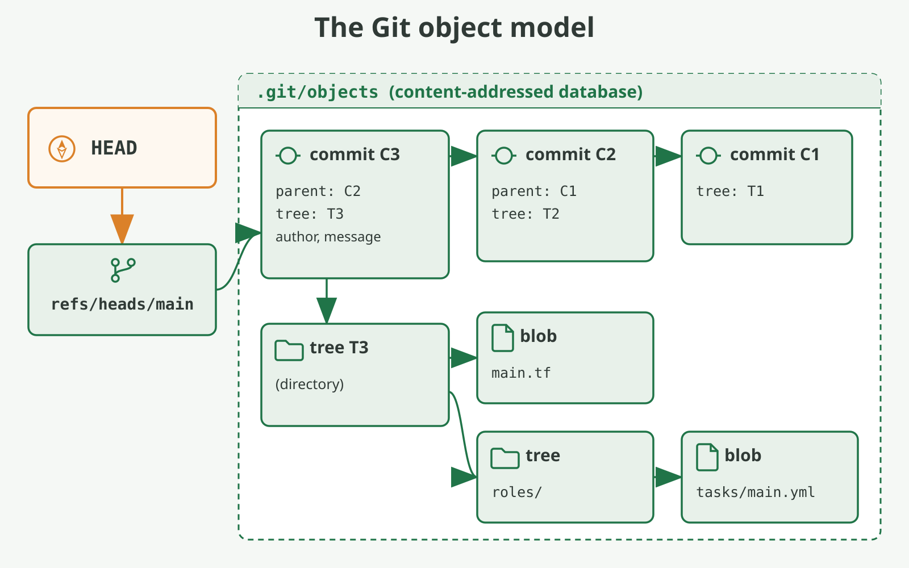
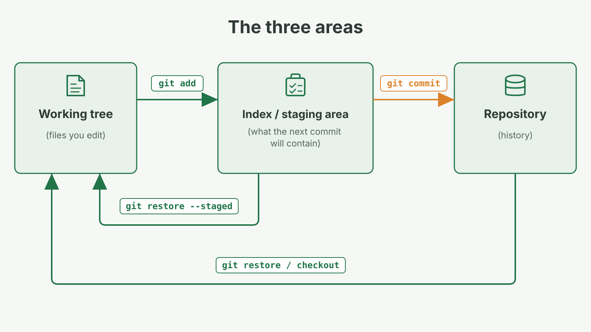
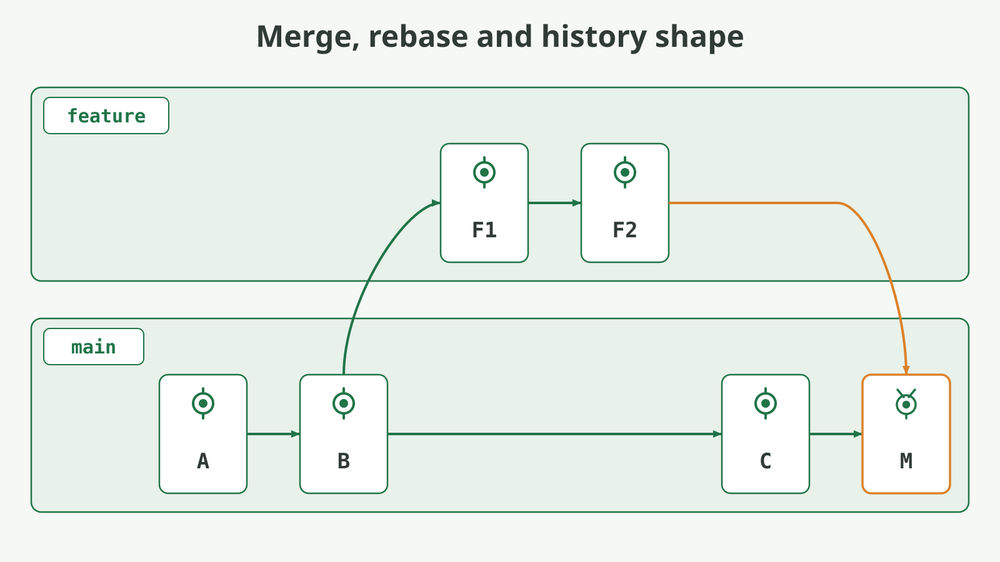
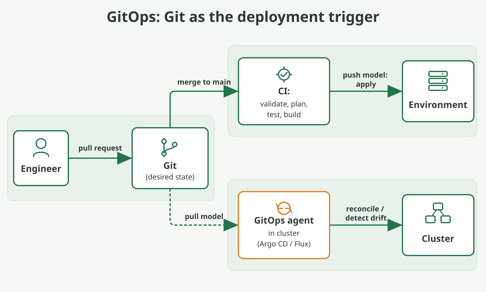

# 4.1 Git from scratch for infrastructure engineers

| | |
|---|---|
| Level | Beginner to intermediate |
| Priority tier | 0 |
| Lab venue | Git 2.40+ and a throwaway remote (GitHub/GitLab) |
| Part | Part 4: Automation and infrastructure as code |
| Status | Drafted, labs **untested** |

## Why this matters for AI infrastructure

Picture the on-call engineer at two in the morning. A training job has stopped reaching its storage network, and the engineer finds that an interface MTU changed earlier that day, from `9000` to `1500`. Nobody remembers who made the change, what else changed in the same session, or which value worked before the incident. The cluster is expensive and the training deadline is close, and all the engineer has is a few shell histories and an unreviewed terminal note.

That scene is worth slowing down on, because it is the exact problem Git was built to prevent. The engineer is not short of skill. The engineer is short of a record. The MTU (maximum transmission unit, the largest packet a network interface sends in one piece) is a small setting, but one wrong value on one interface can quietly slow a whole fabric. The cost then shows up hours later, far away from the change that caused it.

In an AI factory, almost everything that matters is, or should be, text in a repository. That includes Terraform that creates networks and GPU VMs, Ansible roles that install drivers and tune kernels, Slurm configuration, Kubernetes manifests and Helm values, Dockerfiles for training images, CI pipelines and runbooks. Git is the evidence trail for all of it. It tells you who changed the NCCL settings, when the MTU went from 9000 to 1500, which commit introduced the regression that halved training throughput, and how to go back. A cluster that cannot be rebuilt from Git is a pet, and a change that did not pass through review is an incident waiting to happen.

Put the same MTU change into Git and the story changes. The commit names the author, the time and the reason, and `git log -S` finds the exact day the value moved. The engineer spends a few minutes reading history instead of guessing at a terminal log. We start with the object model, because every later command makes sense only once you know what Git stores. After that we cover the workflows that infrastructure teams use, namely trunk-based development, review, rebase and recovery. Last, we connect Git to CI/CD (4.2) and GitOps (4.26).

## Prerequisites and outcomes

You should already be comfortable at a shell (Part 1). You do not need to have used Git on a team before. If you have only ever typed `git commit -m "stuff"` and moved on, this chapter is written for you. Use the list below as a self-check. Each line names one ability that a working infrastructure engineer uses every week. If a line feels unfamiliar when you reach the end, that is normal. Go back to the matching section and read it again slowly, and try the command on a scratch repository while you read.

- Explain what a commit, tree, blob and ref are. You will also see why history is a directed acyclic graph, and why Git's model makes branching cheap and history tamper-evident.
- Use the working tree, index and repository boundaries on purpose. That means staging hunks, reviewing diffs and writing good commits.
- Branch, merge and rebase safely. Resolve conflicts, including conflicts in generated lock files, and use `--onto`, cherry-pick and revert. Never rewrite shared history.
- Recover from mistakes with `reflog`, `restore`, `reset` and `revert`, and find regressions with `bisect`.
- Structure repositories as polyrepo or monorepo, choose trunk-based development for infrastructure, and enforce quality with pre-commit hooks, branch protection, `CODEOWNERS` and required checks.
- Keep secrets and large binaries out of history, remediate a leak correctly, and use Git LFS where it fits.
- Explain push-based versus pull-based delivery, and how Git becomes the source of truth for GitOps.

## 1. Why version control (the infrastructure view)

A colleague posts in the team channel that they changed something on a switch last night, but they are not sure what. Nobody can say what the switch looked like before, or whether the change is still there. Version control exists to stop that kind of conversation. It keeps a record of every change, so the answer is one command away.

Suppose someone says, "I changed something on the switch last night." Version control turns that sentence into a reviewed, diffable, revertable commit. "Diffable" means you can compare the before and after side by side, the way you compare two photographs of the same rack taken a day apart. "Revertable" means you can go back to the earlier photograph in one step. The configuration file is the photograph, and Git keeps every version of it.

It also lets automated checks run before anything touches the hardware. A pipeline can render the new configuration, check its syntax and refuse to continue if something is wrong. The switch never sees the bad line at all.

Version control gives you five things. It tracks every change, with who made it, when and why. It provides accountability through blame and review trails. It lets parallel work merge in a predictable way. It lets you restore any prior state. It provides process hooks for CI, approvals and deployment triggers. Configuration that is not in version control is undocumented, unreviewable and unrecoverable. If you cannot answer "what did this look like yesterday," then you cannot answer "what did we change," either.

Git won for four practical reasons. It is distributed: every clone is a full backup with full history, so you can work offline and there is no single point of failure. Think of a shared spreadsheet that every engineer keeps a complete copy of on a laptop. If the central server burns down, the team still has every row. It is fast, because local operations run on a content-addressed database. Content-addressed means that Git finds an object by the hash of what it contains, not by a name that someone chose, so a lookup is a direct jump rather than a search. It is nonlinear, because a branch is a tiny pointer. In `.git/refs/heads/<branch>`, that pointer is a 40-character hexadecimal SHA-1 hash plus a newline, which makes it 41 bytes, so experimenting is essentially free. It is also integrity-protected, since every object is named by a hash of its content, and silent corruption or tampering can be detected. If a single byte of an old file changes, its hash no longer matches its name, and Git can tell.

Christian Adell, Scott Lowe, Matt Oswalt and Jason Edelman tell this history in chapter 11 of *Network Programmability and Automation*. Linus Torvalds created Git in April 2005. By then, the Linux kernel community had stopped using the proprietary BitKeeper system. It needed a fast, nonlinear, fully distributed version control system that could scale to thousands of kernel contributors.

### Infrastructure developer environments (*Network Programmability and Automation* Chapter 5)

Before you touch a production fabric or a GPU cluster, you need a local developer environment. In it, code and topologies can be edited, diffed and tested in a repeatable way. Chapter 5 of *Network Programmability and Automation* describes this setup.

- **Editors and the Language Server Protocol (`LSP`):** Editors such as Vim or Neovim, Visual Studio Code, Sublime Text and PyCharm talk to language servers over LSP. The servers provide syntax highlighting, real-time linting, auto-completion and semantic navigation (*Go to Definition*, *Find References*, *Refactor*) across Python, Go, YAML, Jinja2 and Terraform HCL. You also get Git gutter diffs and branch status prompts. The `git-sh-prompt` script sits at `/usr/lib/git-core/git-sh-prompt` on Debian and Ubuntu, or at `/usr/share/git-core/contrib/completion/git-prompt.sh` on RHEL and Fedora.
- **Semantic YAML diffing (dyff):** A line-based `diff` struggles when keys are reordered in YAML manifests or switch configs, because the lines change even when the meaning does not. `dyff between -b before.yaml after.yaml` parses the YAML and reports exact structural changes. For example, it reports `switches.sw02.interfaces.eth3.vlans -> + one list entry added: - 50`.
- **Emulating network and server topologies locally from text in Git (Vagrant and Containerlab):**
  1. **Vagrant with VirtualBox or libvirt (`Vagrantfile`):** A `Vagrantfile` defines a multi-VM network lab. The example uses three `vyos/current` routers, r1 at `192.168.12.11`, r2 at `192.168.12.12` and r3 at `192.168.12.13`. They are wired over `virtualbox__intnet` private networks and configured automatically through `config.vm.provision "ansible" { |ansible| ansible.playbook = "playbook.yml" }`. You launch the lab with `vagrant up`, reach a router with `vagrant ssh r1`, and tear it down with `vagrant destroy -f`.
  2. **Containerlab (`topology1.clab.yaml`):** Containerlab starts lightweight containerized network operating systems in seconds. Examples include Nokia SR Linux (`ghcr.io/nokia/srlinux`), Arista cEOS, and SONiC nodes. The example lab uses the SONiC nodes `srl01` and `srl02`, with `startup-config: srl1.cfg` and a point-to-point link described by `endpoints: ["srl01:e1-1", "srl02:e1-1"]`. You deploy the lab with `containerlab deploy`, inspect a node with `ssh admin@172.20.20.2` or `docker exec`, and destroy it with `containerlab destroy`.

Consider what this buys you on a normal Tuesday. A new engineer joins the team and needs a three-router test network to try a routing change. Instead of an afternoon of clicking through a hypervisor, they clone the repository and run `vagrant up`. The lab that comes up is the same lab the rest of the team tested against last week, because both came from the same text file.

The same idea holds for the fabric lab. If a `*.clab.yaml` file says which two nodes are wired together, then the wiring is written down, reviewed and reproducible. Nothing depends on someone's memory of which cable went into which port.

Because a `Vagrantfile` and a `*.clab.yaml` file are plain text tracked in Git, every engineer and CI runner boots the exact same lab topology. Keep every lab definition under version control, because a file that is not tracked cannot be reviewed or rebuilt.

## 2. The Git object model

Say a colleague asks, "What exactly did we change in the GPU driver role last Tuesday?" To answer, you need to know what Git stores. Many engineers treat Git as a magic undo button, and that works until the day it does not. Once you see the four object types, every Git command becomes a question about one of them. A branch name, a log line and a diff are all just different ways of reading the same small set of objects.

Read the diagram from left to right. The newest commit, `C3`, is at the left, and each arrow points backwards to its parent. Each commit points to a tree, which is the folder snapshot at that moment. The tree points to blobs, which hold the file contents, and to smaller trees, which hold subfolders. The label `refs/heads/main` points to the newest commit, and `HEAD` points to the branch you are on. Nothing in the diagram is a list of changes. Every box is a full picture, and Git reads the changes by comparing pictures.



*Figure 4.1.1. The Git object model, as a diagram.*

Git stores four kinds of objects. Each one is named by the hash of its content, either a SHA-1 hash or, in newer repositories, a SHA-256 hash. A hash is a short fingerprint computed from the bytes. Same bytes, same fingerprint, every time. The table lists the four kinds. Read it as a set of building blocks: a commit points to a tree, and a tree points to blobs and subtrees.

Here is what a single commit writes when you run `git commit`. Git first stores each changed file as a blob. Then it builds a tree for each folder that changed, and it records the new hashes in those trees. It builds a root tree for the whole repository. Last, it writes a commit that points to that root tree and to the previous commit, and it moves the branch label forward. Those few small writes are enough, and the new snapshot is complete. Files you did not touch are not copied again, because their blobs already exist and the new tree simply points to them.

| Object | Meaning |
|---|---|
| **blob** | The contents of one file (no name, no mode) |
| **tree** | A directory: a list of (mode, name, object id) pointing to blobs and subtrees |
| **commit** | A snapshot: pointer to a root tree, parent commit(s), author, committer, timestamp, message |
| **tag** (annotated) | A named, optionally signed pointer to an object (usually a commit) with a message |

These design choices explain much of how Git behaves.

- A commit is a full snapshot of the tree, not a diff. Git stores it efficiently by sharing unchanged objects and packing them with deltas, and it computes diffs on demand.
- Identical content always has the same hash. Renaming a file therefore creates no new blob, and two branches that contain the same file share one object.
- A commit's hash covers its tree, its parents and its metadata. Changing anything in history therefore changes the hash of every commit that comes after it. That makes history a **Merkle DAG**. When you rewrite history, you are really creating new commits.
- Branches and tags are just refs, which are files that hold a commit hash, such as `.git/refs/heads/main`. `HEAD` points to the current branch, or straight to a commit when it is detached. So creating a branch costs one tiny file.
- Git does not delete objects right away. Unreachable objects stay until garbage collection (`git gc`, with a default grace period of about two weeks). That delay is why recovery with `reflog` usually works.

The design choices above can feel abstract until you look at them. Git keeps all of this in plain files under `.git/`, so you can read them with ordinary commands. That is a good habit to build. When a Git command surprises you, look at the objects it touched. The output below does exactly that on a throwaway repository with one Terraform stub file.

```bash
git init demo && cd demo
echo "provider \"google\" {}" > main.tf
git add main.tf && git commit -m "Add provider stub"
git cat-file -t HEAD            # commit
git cat-file -p HEAD            # tree <hash>, author, committer, message
git cat-file -p 'HEAD^{tree}'   # 100644 blob <hash>  main.tf
git cat-file -p $(git rev-parse HEAD:main.tf)     # file contents
find .git/objects -type f | head
cat .git/HEAD .git/refs/heads/main
```

Each command prints one layer of the object model. Follow the chain from the commit to the tree, and from the tree to the `main.tf` blob. Run them in order, and read each output before you run the next one. The first command should print `commit`, and the second should show a `tree` line, your name and the message you typed. The third lists the single file in the root tree. The last one prints the Terraform line you wrote, which proves the blob holds the real bytes.

Think of it as a set of nested labels. The commit is the sticker on a box, the tree is the list of what is inside, and the blob is the item itself. Each label holds the hash of the thing it points to, so if someone swaps an item, the label no longer matches and the change shows up. That matching is why Git can tell you that history has not been tampered with.

A useful way to hold this in your head is to picture a rack diagram. The commit is the cover sheet with a revision number. The tree is the list of devices in each rack. The blob is the device label printed with its serial number. If someone quietly replaces a switch, the serial number on the label no longer matches the one in the inventory, and the audit catches it.

### The three areas



*Figure 4.1.2. The three areas, as a diagram.*

The index is what lets you commit only part of your work. Think of it as a packing table. You edit files all day in the working tree, which is the messy workshop. When you are ready to commit, you carry only the items you want onto the packing table, and then you seal the box. Anything left in the workshop stays out of the shipment.

The index is what makes that possible. With `git add -p`, you stage individual hunks, which means separate blocks of changed lines, so each commit holds one logical change. Suppose you fixed a typo in a Terraform variable description and also changed a firewall rule in the same file. You can stage the typo fix alone, commit it, and then stage the firewall rule in its own commit. Reviewers see two clear changes instead of one tangled one.

Once you know the three boundaries, the output of `status`, `diff`, `diff --staged`, `restore` and `reset` makes sense. Here, `diff` compares the working tree with the index, and `diff --staged` compares the index with `HEAD`. Stage hunks with `git add -p` whenever one file holds two unrelated changes.

## 3. The daily workflow

Most mistakes that reach a shared repository happen in the last minute before a push. A stray debug line, a local key or a half-finished file sits in the working tree, and a quick `git add .` sweeps it into the commit. The routine below is built to make that moment boring. Each step asks one small question before anything is shared. Experienced engineers run the same routine on a two-line fix as on a large change, because the habit is what protects them on the day they are tired.

Set these options once on each machine. They control how Git merges, fetches, pushes and signs. You do not need to memorize them. Each line answers a question you would otherwise hit by accident. For example, `pull.rebase true` decides what happens when your local history and the remote history have both moved on, and it stops Git from creating a surprise merge commit at two in the morning.

```bash
git config --global user.name  "Jane Operator"
git config --global user.email "jane@example.com"
git config --global init.defaultBranch main
git config --global pull.rebase true          # or ff-only; avoid accidental merge commits
git config --global rebase.autoStash true
git config --global fetch.prune true
git config --global push.autoSetupRemote true
git config --global core.editor "vim"
git config --global commit.gpgsign true       # sign commits (see section 11)
```

Here is what a safe change to infrastructure code looks like, from the first fetch to the push. Imagine a small job: the NCCL settings on the GPU nodes make NIC selection flap, and you want to pin the list of adapters. You will go through nine steps, and each one has a reason. Each numbered comment marks one step, so you can match the command to its reason.

```bash
git fetch origin                               # 1. learn the latest remote state; changes nothing locally
git switch -c tune-nccl-ib-hca origin/main     # 2. isolate work on a branch from the latest mainline
# ... edit files ...
git status                                     # 3. what changed? what is untracked junk?
git diff                                       # 4. review your own work (leftover debug? a secret?)
git add roles/nccl/templates/nccl.conf.j2      # 5. stage explicit paths, not `git add .`
git diff --staged --check                      # 6. whitespace errors break YAML; check before committing
git commit -m "nccl: pin IB HCA list to mlx5_0-7 to stop NIC auto-selection flapping"   # 7. the why, not the what
git log --oneline --decorate -5                # 8. confirm the history looks right
git push -u origin tune-nccl-ib-hca            # 9. publish; CI runs speculative plans/tests; open a pull request
```

Each step guards against a specific mistake. Fetching first keeps you from building on stale state. If someone pushed a fix to `main` an hour ago, your local copy does not know about it yet, and your change could quietly undo it. A branch protects `main`, which should always be deployable. Reviewing the diff catches stray edits, secrets and generated files. It is the moment to ask, "Would I be comfortable if this line were printed on a slide in the team meeting?" Staging explicit paths keeps `.terraform/`, state files, keys and crash logs out of the commit. The `--check` flag catches trailing-whitespace and tab-and-space damage, which can corrupt YAML. YAML treats indentation as meaning, so a stray tab or a misplaced space can break the file or move a key under the wrong parent, and a quick read may miss it. A message that explains *why* is the only part of the record that the diff cannot reconstruct. The diff shows that the pinned list changed. Only the message can say that it changed to stop the adapters from flapping. Finally, the push triggers CI, so the change is validated before it is merged.

### Commit hygiene

- **Atomic commits:** Keep each commit to one logical change, and make it pass tests where possible. A clean commit makes reverts and bisects easy. Keep refactors apart from behaviour changes, and formatting apart from logic.
- **Message format:** Write the subject as a short imperative line of about 50 characters. Follow it with a blank line, then a body that explains the motivation and effect, plus a link to the ticket. Conventional Commits use prefixes such as `feat:`, `fix:`, `chore:`, `docs:` and `refactor:`. You can scope a prefix, as in `fix(slurm): ...`, and add a `!` or a `BREAKING CHANGE:` footer. That structure lets tooling generate changelogs and semantic versions.
- Use `git commit --amend` to fix the last commit, but only if you have not pushed it yet. To tidy a series before review, create a commit with `git commit --fixup <sha>`, then run `git rebase -i --autosquash`.
- Use `git add -p` and `git restore -p` for fine control over what you stage. Use `git stash` when you need to switch context. Add `-u` to include untracked files, and manage the stack with `git stash list`, `git stash pop` and `git stash apply`.

A good commit message is a note to the engineer who will read this line in two years, usually while something is on fire. A subject that says "fix stuff" tells that engineer nothing. A subject that says "nccl: pin IB HCA list to stop NIC auto-selection flapping" tells them the component, the action and the symptom. Spend the extra half minute on the message. It is the cheapest documentation your team will ever write.

### Looking at history

When something breaks, the first question is usually "what changed?" These commands answer it from different angles. `log` walks the timeline, `show` opens one moment, `diff` compares two moments, and `blame` tells you who wrote a particular line. Use them the way a detective uses a case file. Start broad, with the timeline for one folder, and narrow in on the line that matters.

```bash
git log --oneline --graph --decorate --all
git log -p -- roles/gpu_driver/            # patches touching a path
git log --since=2.weeks --author=jane --grep='NCCL' --stat
git show a1b2c3d                           # one commit with diff
git diff main...feature                    # changes on feature since it diverged (three-dot)
git diff main..feature                     # difference between the two tips
git blame -L 20,40 slurm.conf              # who last changed each line (and `git blame -w -C` ignores whitespace/moves)
git log -S'MTU' --oneline -- netplan/      # pickaxe: commits that added/removed the string
git log -L :function_name:file.py          # history of a function
git shortlog -sn                           # who contributes how much
```

To find out which change added a value, start with `git blame` for the line, then use `git log -S` to search for the string. Blame answers "who last touched this line," which is often a teammate who can explain the reason. The pickaxe search (`-S`) answers a different question. It asks which commit added or removed the string at all, even if the line has been edited many times since. Together they cover the MTU story from the opening scene: blame points at the day the value changed, and the pickaxe finds every change to the MTU.

## 4. Ignoring files and keeping the repo clean

Picture a Terraform run on a laptop. It creates a `.terraform/` folder and a `terraform.tfstate` file that records the current infrastructure, including resource IDs and sometimes secrets. Run `git add .` and both files go into the commit, and then into every clone. The `.gitignore` file is how you tell Git which files belong to the machine and not to the project.

Think of the repository as the shipping box and `.gitignore` as the packing list you tape to the inside of the lid. Anything on the list stays on the workbench. Terraform state and generated folders belong on the workbench, because they describe one machine at one moment. Source files belong in the box, because every engineer needs them.

`.gitignore` is your first line of defence against committing state, secrets and junk. Here is a starting point for an infrastructure repository. Read the comments as the reasons. Each group names a kind of file and says why it does not belong in history.

```gitignore
# Terraform / OpenTofu
.terraform/
*.tfstate
*.tfstate.*
crash.log
*.tfvars              # may hold secrets; commit *.tfvars.example instead
*.tfvars.json
override.tf
override.tf.json
*_override.tf
*tfplan*
.terraformrc
terraform.rc
# keep the lock file in version control: do NOT ignore .terraform.lock.hcl

# Ansible
*.retry
.vault_pass*
ansible.log
inventory/**/secrets*.yml
group_vars/**/vault.yml.dec

# Keys and certificates
*.pem
*.key
*.p12
id_rsa*
*.kubeconfig
kubeconfig*

# Python
__pycache__/
*.py[cod]
.venv/
.mypy_cache/
.pytest_cache/
*.egg-info/
dist/
build/

# OS / editor
.DS_Store
.idea/
.vscode/
*.swp

# Data and artefacts (use Git LFS or object storage instead)
*.ckpt
*.pt
*.safetensors
*.parquet
```

A few rules are easy to get wrong. A `.gitignore` entry affects only **untracked** files, so a file that is already tracked stays tracked until you run `git rm --cached`. This is the trap most teams fall into. Someone adds `*.tfstate` to the ignore list, feels safe, and then discovers the state file is still listed in every commit. The file was committed before the rule existed, and Git keeps tracking a file it already knows about. The fix is to untrack it once, which keeps the file on disk but removes it from future commits.

Keep per-user ignores in `~/.config/git/ignore` by setting `core.excludesFile`, and keep per-clone ignores in `.git/info/exclude`. Your editor's swap files belong in the first place, since they are yours and not the project's. A local scratch folder that only you use belongs in the second. Use `git status --ignored` to list ignored files, and `git check-ignore -v path` to see which rule matched. The `-v` flag prints the file and line of the rule, which saves a lot of guessing when two rules seem to disagree. A negation (`!pattern`) cannot re-include a file whose parent directory is excluded. Run `git status --ignored` after you add a rule, so you can see what it catches.

## 5. Remotes and collaboration

A remote is another copy of the repository, usually on a server that the whole team can reach. Your clone gives it a short name, `origin`. Git also keeps remote-tracking branches, such as `origin/main`, which record where that remote copy was the last time you fetched. Think of `origin/main` as a photo of the team's main branch taken at your last fetch. It is not the live branch, and it goes stale as soon as someone else pushes.

This is why the word "pull" causes so much confusion. Pulling changes your own branch in one step, and that can be surprising when the photo is out of date. Fetching only updates the photo. Your own branch, and the files you are looking at, stay exactly where they were. Once the photo is current, you can compare it with your work and choose what to do next.

The commands below cover everyday work with remotes. Read them as a sequence of looking before touching. `remote -v` shows where each name points, `fetch` refreshes the photo, `branch -vv` shows which local branch follows which remote one, and `push` sends your work out only after you have looked.

```bash
git remote -v
git remote add upstream git@github.com:org/infra.git
git fetch --all --prune
git pull --rebase                       # fetch + rebase local commits on the updated upstream
git push origin HEAD
git push --force-with-lease             # the only acceptable force push: fails if someone else pushed meanwhile
git branch -vv                          # tracking relationships
git branch -d feature                   # delete merged branch; -D forces
git push origin --delete feature
```

- `git pull` is really a `fetch` followed by a `merge` (or a rebase). Learn both halves, and prefer to run `fetch` first so you can decide what happens next. Chapter 11 of *Network Programmability and Automation* shows why. Running `git fetch origin` updates the remote-tracking branch `origin/main`, which is stored in `.git/refs/remotes/origin/main`. It leaves your working directory and your local `main` alone. You can then inspect the incoming changes with `git log main..origin/main` and `git diff main..origin/main`, and merge them with `git merge origin/main` when you are ready.
- **Working and bare repositories (`git init --bare` and `git clone --bare`, *Network Programmability and Automation*, chapter 11):** A normal repository has a working directory and a `.git/` subfolder. If you push straight into a non-bare repository that has a branch checked out, its working tree and index fall out of sync with `HEAD`, so Git refuses by default. Shared repositories on a Git server, such as `na-shared.git` reached over `ssh://host/~/na-shared.git`, are therefore created as bare repositories. You make one with `git clone --bare net-auto na-shared.git`. A bare repository holds only the contents of `.git/`, which are `HEAD`, `config`, `objects/` and `refs/`. It has no working tree, and it exists to receive `git push` and serve `git fetch` and `git clone`.
- **Lightweight and annotated tags (`git tag`, *Network Programmability and Automation*, chapter 11):** A lightweight tag, such as `git tag golive d40fe74`, is just a ref file that points straight at a commit hash. An annotated tag, such as `git tag -a v1.0 -m "Version 1.0 of network automation tools"`, creates a full tag object in `.git/objects`. That object records the tagger's name, email, date and message, plus an optional GPG or SSH signature. You can read it with `git show v1.0`. Remember that `git push` does not send tags by default. Push them explicitly with `git push origin v1.0` or `git push origin --tags`.
- Never force-push a shared branch, such as `main` or a release branch. Use `--force-with-lease` only on your own feature branch, after a rebase. Protect `main` on the server, so that a force push is impossible.
- **Authentication:** Use SSH keys (ed25519), credential helpers or short-lived tokens. Give CI a deploy key with read-only scope. Never embed a token in a URL, because it lands in `.git/config` and in logs.
- **Forks and pull or merge requests** are the review unit. Keep them small, at hundreds of lines. Describe the intent and the risk, link the plan output for IaC changes, and require passing checks.

Fetch first, read the incoming log, and only then decide how to combine the two histories. A short example shows why the order matters. Suppose a teammate pushed a change to the NCCL template while you were editing the same file. A plain `git pull` might merge the two changes without asking you, and you would find the result only at the next run. After a fetch, `git log main..origin/main` shows you the teammate's commit first. You can read it, decide whether it overlaps your work, and only then pick merge or rebase with full information.

## 6. Branching strategies for infrastructure

Imagine a team with three long-lived branches: `develop`, `staging` and `prod`. A hotfix lands on `prod`, and someone copies it to `staging`, but nobody copies it back to `develop`. Six weeks later the next release brings the bug back. Long-lived branches make the history lie about what is deployed. The strategies below try to keep one honest answer to "what is running now?"

Notice how the drift happens. Nobody decided to break anything. Each branch was correct when it was last touched, and the copies simply stopped matching. Every extra branch is another copy that someone must remember to update, and people forget.

GitFlow uses long-lived `develop` branches, plus release and hotfix branches. It suits versioned software that ships on a cadence, such as a desktop app with numbered releases that customers install. Infrastructure is different. Long-lived branches drift away from the live environment, merges grow huge, and the question "what is deployed?" has no single answer. A network change that lives on `develop` for a month may collide with three other changes that landed on `prod` in the meantime.

Trunk-based development fits infrastructure better. Branches are short-lived and merge back to `main` within a day or two, and `main` stays deployable at all times. Incomplete work hides behind feature flags or variables, so a half-built feature can sit in `main` without reaching production. Environments differ by configuration rather than by branch. The repository then mirrors reality, every change is small and easy to review, and rollback is a `revert`. CI promotes the same commit through each environment, so the staging test covered exactly the bytes that go to production. Cut a release branch only when you must maintain several supported versions at once, such as an internal Helm chart or Ansible collection that many teams consume.

Model environments as directories or variable files, not as branches, as in `envs/staging` and `envs/prod`. Separate `staging` and `prod` branches drift apart, and then cherry-picks turn into folklore. To promote a change, edit the version pin in the prod directory and send it through a reviewed commit. Picture the prod directory as a sealed shipment and the pin as the single line that says which module version it uses. Moving the pin is the whole promotion, and the reviewer sees exactly one line change. If you are choosing a model, pick trunk-based development and keep each environment in its own directory. With that setup, the repository tells you what is deployed.

## 7. Merge, rebase and history shape

A teammate's push is rejected with "your branch and origin/main have diverged." Both histories have grown from a common ancestor and then moved apart. You must pick how to join them, and each choice writes a different history. The diagram shows the shape you are choosing between. Read it from the top. Commits `A` and `B` are shared history. Your feature branch adds `F1` and `F2`, while `main` moves on with `C`. The merge commit `M` is the place where the two lines meet again.

The word "diverged" is worth understanding, because it describes a fork in a road. Neither side did anything wrong. Two people made changes from the same starting point, and Git now needs a decision about how to combine them. Merging keeps the fork visible in history. Rebasing pretends the fork never happened by replaying your work on top of the newest `main`. Both answers are correct. They simply tell different stories.



*Figure 4.1.3. Merge, rebase and history shape, as a diagram.*

- **Merge** creates a merge commit with two parents. That keeps the true shape of history. `--ff-only` refuses to merge unless a fast-forward is possible. `--no-ff` forces a merge commit even when a fast-forward is possible, which keeps the branch boundary visible.
- **Rebase** replays your commits on a new base. Each replayed commit gets a new hash, and the history becomes linear. A squash merge collapses a whole branch into one commit on `main`. That is clean for atomic infrastructure changes, but the intermediate commits are gone.
- **Golden rule: never rebase commits that others have based work on.** That includes anything pushed to a shared branch. Rebase your private feature branch, and merge or squash shared work.

Why does the golden rule exist? A rebase creates new commits with new hashes. If a teammate already built their work on the old commit, their history now points at a commit that no longer has a branch leading to it. Their next push tries to join two histories that look unrelated, and the mess lands on the whole team. Rebasing your own branch is safe because nobody else has based work on it yet.

Here is a safe rebase of a feature branch, which ends with a lease-protected push. Think of the lease as a reservation. The push goes through only if the remote branch is still where you last saw it.

```bash
git fetch origin
git switch tune-nccl-ib-hca
git rebase origin/main              # replay my commits onto the latest main
# conflict? edit files, then:
git add <files> && git rebase --continue      # or: git rebase --abort to return to the pre-rebase state
git push --force-with-lease         # branch is mine; lease protects against a surprise
```

During a rebase, "ours" means the branch you are rebasing onto, and "theirs" means your commit being replayed. That is the reverse of a merge, and it causes many mistakes. The easiest way to remember it is to ask, "Which side is the base?" During a rebase the base is `origin/main`, so "ours" is the base. Your own work is the visitor being replayed, so it is "theirs."

**Interactive rebase** (`git rebase -i origin/main`) lets you reorder commits before review. You can squash (`s`), fixup (`f`), reword (`r`), edit (`e`) or drop (`d`) them. Squash folds one commit into the one above it and keeps both messages. Fixup does the same job but throws away the extra message. Pair it with `--autosquash` when you have fixup commits, and Git will move each fixup next to the commit it belongs to. Use it to tidy a series before a reviewer sees it, the way you would reorder the slides in a deck before presenting.

**`git rebase --onto new-base old-base branch`** moves a stacked branch. Suppose `feature-B` was started from `feature-A`, and `feature-A` was squash-merged. The squash created one new commit on `main`, so the old commits of `feature-A` no longer match anything on `main`. Then `git rebase --onto main feature-A feature-B` transplants only the commits that belong to `feature-B`. Without `--onto`, a plain rebase would try to replay the old `feature-A` commits too, and you would see the same change conflict with itself.

### Resolving conflicts, including generated files

A conflict shows both sides between the markers `<<<<<<<`, `=======` and `>>>>>>>`. Edit the file to the result you want, then run `git add` and continue. Read the block as two versions of the same paragraph. The top half is one side, the bottom half is the other, and your job is to write the paragraph the team needs. Deleting both halves and starting again is a valid choice when neither side is right.

Several tools help. `git mergetool` opens a merge tool, and `git diff --diff-filter=U` lists the files that are still in conflict. `git checkout --conflict=diff3 file` shows the common ancestor as well, which is the version both sides started from. That third view often makes the right answer obvious. `git rerere` remembers your resolutions and replays them later. This is helpful when the same conflict returns, for example when you rebase the same branch twice.

Generated files need different treatment. These include `.terraform.lock.hcl`, `poetry.lock`, `package-lock.json` and Helm `Chart.lock`. Do not merge them by hand. A lock file records exact versions that a tool resolved, and a hand-merged version describes a set of versions that nobody actually tested. Take the mainline version and regenerate it. During a rebase, "ours" is main, so run `git checkout --ours -- .terraform.lock.hcl`. Then run `terraform init`, and add `-upgrade` only if you mean to change versions. Finish with `git add` and continue. For Terraform state, the answer is to never keep state in Git at all (see 4.19).

## 8. Undoing things safely

Say you ran `git reset --hard` in the wrong terminal and lost a commit you had not pushed. The commit is not gone yet. Git keeps it in the object store until cleanup, so the reflog can still point you back to it. The table below pairs each situation with the safe command, so that you do not reach for the dangerous one in a hurry.

Pick the command by what has already happened, not by what you want to happen. Each of the commands below moves a pointer, rewrites part of the index, or discards files, and each one leaves a different trail. Before you run anything destructive, ask whether the thing you are about to change has been shared. If it has, prefer a command that adds a new commit. If it has not, you have more room, and the reflog is there as a backstop.

The table covers the common cases.

| Situation | Command | Notes |
|---|---|---|
| Discard unstaged edits to a file | `git restore path` | Destructive; edits are gone |
| Unstage a file | `git restore --staged path` | Keeps the edits |
| Fix the last commit message/content (unpushed) | `git commit --amend` | Rewrites that commit |
| Undo a **published** commit | `git revert <sha>` | New inverse commit; safe on shared branches; `-m 1` for merge commits |
| Move a branch pointer back (local) | `git reset --soft/--mixed/--hard <sha>` | soft keeps index+tree, mixed keeps tree, hard discards both; never on shared history |
| Apply one commit elsewhere | `git cherry-pick <sha>` | Backports a hotfix to a release branch; records a new commit |
| Lost commits after a bad reset or rebase | `git reflog` then `git branch rescue <sha>` | Local safety net |
| Remove an untracked file | `git clean -n` (preview), then `git clean -f` | Always dry-run first |

The reflog is your local safety net. Git records every movement of `HEAD` and of the branch tips. Think of it as a ship's log that notes each time the boat changed position. By default, reachable entries are kept for about 90 days, and unreachable entries for 30 days. Suppose you run `reset --hard` by mistake. `git reflog` then shows `HEAD@{1}: commit: ...`, and `git branch rescue HEAD@{1}` recovers the commit. Read the reflog from the top, where the newest movement is listed first, and find the line just before the mistake. That line holds the hash you want.

The reflog is local only, and it does not survive a fresh clone. A teammate who clones the repository next week will not see your reflog at all. Treat it as a seat belt, not a backup. The real backup is the shared remote, and that is why pushing early matters.

Bisect finds the commit that introduced a regression, using a binary search. You mark a known-bad commit and a known-good one, and Git checks out the midpoint each time. The idea is the same as finding a word in a printed dictionary. You do not read every page. You open to the middle, see whether your word comes before or after that point, and throw away the half that cannot hold it. Each answer halves the remaining search space, so even a long history takes only a few checks.

```bash
git bisect start
git bisect bad                    # current commit is broken (e.g. nccl-tests bandwidth halved)
git bisect good v2.3.0            # last known good tag
# Git checks out the midpoint; test it, then answer:
git bisect good    # or: git bisect bad
# fully automated with a script that exits 0 (good), 1-127 except 125 (bad), 125 (skip):
git bisect run ./tests/check_bandwidth.sh
git bisect reset
```

Bisect works best when commits are small and the test is fast and repeatable. The reason is simple. Each commit that bisect tests has to build, and a large commit that mixes three changes makes it unclear which of the three caused the failure. For infrastructure, the test might render a template and assert a value. It could also run `ansible-lint`, or evaluate a Terraform plan. A plan check is slower, so it suits a bisect that runs overnight, while a template check runs in seconds.

When a regression has no obvious author, write a test for the symptom and let `git bisect run` find the commit. The test does not need to know the cause. It only needs to answer one yes or no question about each commit, such as "does the rendered config still set the right HCA list?" Once the answer is automatic, Git does the walking and you do the thinking.

## 9. Repository architecture

A platform team has a Terraform module for the GPU network, an Ansible role that installs drivers, and the environment definitions that call both. Should these live in one repository or three? The answer depends on who changes them and how often they must move together. A change that touches all three at once is easy in one repository and awkward across three.

Think about the people involved. A network team that owns the module should not need to approve a change to a driver role, and a driver team should not wait on network reviews. Separate repositories give each team its own door. Yet a real change, such as a new NIC model, often touches the module, the role and the environment in one story. Splitting that story across three pull requests means three reviews, three merge times and a window where only one of the changes has landed. Either shape has a cost, and the table lays out both sides.

| | Polyrepo (one repo per component/module/service) | Monorepo (many components in one repo) |
|---|---|---|
| Pros | Clear ownership and permissions; independent versioning and release; small clones; module reuse via version pins | Atomic cross-cutting changes; one place to search; shared tooling and CI; easy refactors |
| Cons | Version skew; cross-repo changes need coordinated PRs; discoverability | Needs CODEOWNERS and path-scoped CI; large clone; one permission boundary; tooling (Bazel, Nx, path filters) at scale |
| Fits | Reusable Terraform modules, Ansible roles/collections, published Helm charts | Platform repos for one organisation's environments and cluster definitions |

A common pattern for an AI-infrastructure team combines both. It keeps a **live (environment) monorepo**, with paths such as `terraform/envs/prod/...`, `ansible/inventories/...` and `k8s/clusters/...`. That monorepo consumes **versioned module and role repos**, pinned by tag. Picture the module repos as a library of tested parts, and the monorepo as the building that uses them. The building always says which edition of each part it uses, so a library update never changes a building by surprise.

CI uses path filters, so a change under `envs/staging/` plans only staging. A path filter is a rule that says which folders trigger which jobs. Without it, every small edit would plan every environment, and the queue would grow long.

**Submodules** point to another repository's commit, and **subtree** vendors one in. Vendoring means copying the other repository's files into yours. Both work, but both have sharp edges, such as a forgotten `--recurse-submodules` or detached HEADs. A detached HEAD means you are looking at a commit with no branch name attached, so any new commit you make can be lost when you switch away. Where the tool supports it, prefer package-style pins. Examples are the Terraform module `ref=v1.4.2` and an Ansible `requirements.yml` with versions. A pin is one line that names a version, and anyone can read it and check it.

A few other features help at scale. **`git worktree add ../hotfix hotfix-branch`** gives you a second checkout of the same repository without a re-clone, which is handy when you must patch production in the middle of a change. A re-clone means downloading the whole history again, and on a large repository that takes real time. A worktree shares the same database, so it starts almost at once. **Sparse checkout** and **partial clone** (`--filter=blob:none`) suit huge repositories. Sparse checkout writes only the folders you need into your working tree. Partial clone downloads the commits and trees now and fetches file contents only when you touch them. A **shallow clone** (`--depth 1`) suits CI, because a build needs only the newest snapshot. Some tools need the history, though, such as `git describe` and changelog generation, so check before you shallow clone a release job. Use **tags** for releases, as in `git tag -a v1.4.0 -m ...`, and push them explicitly. A tag is a permanent name for one commit, so the release you deployed on a given day can always be found by name. Sign them with `-s`. Then `git describe --tags` gives you build versions.

Keep reusable modules in their own repositories, and keep environments in one monorepo, since each fits that shape. Modules change slowly and are used by many teams, so they benefit from separate versions and separate owners. Environments change every day and must move together, so they benefit from one place to see the whole picture.

## 10. Hooks and pre-commit: shifting left

A developer pushes a Terraform file with an API token pasted into a variable, or a YAML file with a tab in the wrong place. The mistake is cheap to catch on the laptop, and expensive to catch later in CI or on the cluster. Hooks move the check to the moment of the commit. "Shifting left" simply means checking earlier in the workflow, closer to where the mistake is made. Picture a building inspector who checks the wiring while the wall is still open. Finding a fault then costs a few minutes with a screwdriver. Finding it after the walls are painted costs a crew and a delay.

Git hooks run scripts at events such as `pre-commit`, `commit-msg` and `pre-push`. A hook is a small program that Git runs at one of those moments, and a failing hook stops the step. They live in `.git/hooks/*`, and that folder is not versioned. Git does not copy it when someone clones the repository, so a hook you wrote on your laptop never reaches a teammate. The pre-commit framework fixes this. It keeps the hook configuration in `.pre-commit-config.yaml`, which is a tracked file, and it installs the hooks for every contributor with `pre-commit install`. You can run every check across the repository with `pre-commit run --all-files`. That command is useful right after you add a new check, because it shows you every existing file the check would flag:

```yaml
repos:
- repo: https://github.com/pre-commit/pre-commit-hooks
  rev: v4.6.0
  hooks:
  - id: check-yaml
  - id: end-of-file-fixer
  - id: trailing-whitespace
  - id: check-added-large-files
    args: [--maxkb=500]
  - id: detect-private-key
- repo: https://github.com/antonbabenko/pre-commit-terraform
  rev: v1.92.0
  hooks: [ { id: terraform_fmt }, { id: terraform_validate }, { id: terraform_tflint } ]
- repo: https://github.com/ansible/ansible-lint
  rev: v24.9.0
  hooks: [ { id: ansible-lint } ]
- repo: https://github.com/gitleaks/gitleaks
  rev: v8.18.4
  hooks: [ { id: gitleaks } ]
```

The versions in that file are examples, so pin the versions you have reviewed. Pinning matters because a hook that updates itself can start flagging files that passed yesterday, and then nobody trusts the hook. Local hooks are advisory, because a developer can bypass them with `--no-verify`. Sometimes that bypass is legitimate, for example when a hook is broken on a new laptop. That is exactly why the same checks must also run on the server. For that reason, **run the same checks in CI as required status checks**. A required status check is a result the server insists on before it accepts a merge.

Put fast checks, such as format, syntax and secrets, in pre-commit. They finish in seconds, and the developer sees them right away. Put slow checks, such as plans and integration tests, in CI. A full plan can take minutes, and running it on every keystroke would only annoy people. Start with the fast checks locally, then make the same ones required in CI.

## 11. Secrets and sensitive history

A developer pushes a branch with an AWS key inside a YAML file. The pipeline flags it an hour later. By then two CI runners and a colleague's laptop have cloned the branch, so the key has already left the building. Deleting the file in the next commit does nothing to those copies. That is why the order below starts with rotation, not with cleanup.

Git remembers everything. Deleting a secret in a later commit does not remove it from history, forks, clones, CI caches or backups. A useful picture is a photocopier. Once a copy of the page has gone out of the office, tearing up the original does not call back the copy. Treat any committed secret as **compromised**. Assume that someone has already read it, even if you have no evidence that they did.

Work through these steps in order. Each step depends on the one before it, and skipping ahead wastes effort or leaves the door open.

1. **Revoke and rotate** the credential right away, because a copy may already exist. You cannot take back what someone has already copied. This is the only step that actually fixes the exposure. Revoking turns the old key into a dead one, and rotating issues a new key to the systems that still need access. Then check the access logs for any use of it, so you know whether the key was already used by someone else.
2. Remove the secret from the current tree, and replace it with a reference to a secret manager (see 4.12). The next deploy then reads the new value at run time, not from a file in Git.
3. Only after that, optionally rewrite history to purge the secret. Tools include `git filter-repo --path secrets.yml --invert-paths`, `--replace-text`, and BFG Repo-Cleaner. Rewriting history is slow, disruptive and never complete, which is why it comes third. Every collaborator must re-clone, and every open pull request still holds the old commits. Then force-push, ask collaborators to re-clone, and expire server-side caches and forks. The platform may still keep references, such as pull request refs, so contact support if needed.
4. Finally, prevent the next leak. Add pre-commit secret scanning with gitleaks, trufflehog or detect-secrets, and turn on platform push protection. Push protection is a server-side check that refuses a push containing a recognised secret pattern. Add `.gitignore` entries too. Use encrypted alternatives such as Ansible Vault, SOPS with age or KMS, sealed secrets and external secrets operators. Each of these keeps the secret encrypted at rest, so the repository holds only ciphertext.

Sign your commits and tags as well, with SSH or GPG. Set `git config gpg.format ssh` to use SSH, and check signatures with `git log --show-signature`. Signed commits make provenance verifiable. A signature is a mark that proves a specific person's key made the commit, so you can trust who wrote it. On protected branches where supply-chain integrity matters, require signed commits. Rotate the credential first, and only then touch the repository. Your repository history comes second.

## 12. Governance: branch protection and CODEOWNERS

A Slurm configuration change is merged on a Friday afternoon. The only approval came from a teammate who has never owned Slurm. Two days later the scheduler misbehaves, and nobody who understands the change had seen it. CODEOWNERS and branch protection exist so that the person who knows the domain sees the change before it lands, and so that a rushed merge cannot skip that step.

Governance sounds like paperwork, but think of it as the rule that stops a junior engineer from approving their own change on a slow afternoon. The rule is not there because people cannot be trusted. It is there because a second pair of eyes finds the mistake that the first pair has read past a dozen times.

On the server, which means GitHub or GitLab, configure the following for `main`. These settings are enforced by the platform, not by a good intention, which is the whole point.

- Require pull requests, with at least one approving review, or two for production. Dismiss stale approvals when new commits are pushed.
- Require status checks, such as lint, validate, plan and tests. The branch must also be up to date before merge.
- If you want a clean `main`, require linear history or squash merges. Block force pushes and deletions, and include administrators in these rules.
- If your policy demands it, require signed commits and resolved conversations.
- Restrict who can push tags, and who can bypass the rules.

The `CODEOWNERS` file maps paths to the reviewers who must approve changes there.

```text
# .github/CODEOWNERS (last matching pattern wins)
*                          @org/sre
/terraform/network/        @org/network-team
/ansible/roles/gpu_*       @org/hpc-team
/k8s/                      @org/mlops
/storage/                  @org/storage-team
/.github/                  @org/sre-leads
```

The file turns team boundaries into enforcement. A Slurm change needs HPC approval, and a VPC change needs the network team. Read the file from the bottom up, because the last matching line wins. The catch-all line at the top gives the SRE team a default, and the more specific lines below override it for their own paths. A reviewer who opens a pull request that touches `/ansible/roles/gpu_driver/` sees the HPC team requested, and nobody has to remember who owns what.

Pair the file with a pull request template that asks what changed, what the risk is and what the rollback plan is, plus a link to the plan output. The template is a short form the author fills in before a reviewer sees the change. Add labels that show the blast radius, such as `gpu-fleet-wide` or `single-rack`, so a reviewer can tell at a glance how careful to be.

### Review by blast radius

Blast radius is the amount of damage a change can do if it goes wrong. Review effort should follow risk. A documentation change can merge quickly. A change to a shared module, a firewall rule, a kernel parameter on all GPU nodes, a scheduler config or a state or backends file needs more. Such a change gets domain-owner review, a plan or dry-run artefact, a staged rollout plan and a rollback statement. For example, the rollout might canary one rack first, then more racks. A canary is a small first step that tests the change on a few machines before the rest of the fleet sees it. If the canary misbehaves, the damage stays inside one rack. Encode this with `CODEOWNERS`, labels and required environments in CI. Before you merge, ask how many machines the change touches, and let that answer set the level of review.

## 13. Large files, binaries and LFS

A model team commits a checkpoint by accident, and the repository now carries that file in its history. Every clone downloads it, and CI checkouts slow down. Removing it later is possible but painful, so the best time to decide where big files go is before the first one is added. The options below give you that choice.

Git stores whole snapshots, so large binary files bloat the repository forever. A binary file is one that is not plain text, such as a disk image or a trained model. Git can compress text well, but a model file is already dense and barely shrinks. Golden OS images, model checkpoints and datasets are the usual culprits. Every clone then gets slower, and every new engineer pays that cost on their first day.

You have three options. **Git LFS** keeps small pointers in Git and the content on an LFS server. A pointer is a short text file that says where the real bytes live and which hash they have. You set it up with `git lfs install` and `git lfs track "*.qcow2"`, then commit `.gitattributes`. The `.gitattributes` file is the rule that tells Git which file types go through LFS. Each clone downloads only the versions it needs, but hosting quotas and bandwidth still apply. Pick LFS when the big file belongs next to the code and changes alongside it.

The second option is object storage with content addressing, plus a manifest in Git. Content addressing means the storage key is the hash of the file, so the same bytes always land in the same place. A manifest is a small list of those hashes that Git can version. Tools here include DVC, lakeFS, or a simple `artifacts.lock` file of SHA-256 hashes. This option suits datasets that run to many gigabytes, because the big bytes never enter Git at all. The third option is an artifact registry, such as a container registry, Artifactory or the Hugging Face Hub, for images and models. A registry is a library built for large artifacts, with access control, versions and download tools already built in.

Never put checkpoints or datasets in plain Git. If a large file gets committed by mistake, purge it with `git filter-repo` before it spreads. Purging after the fact is the last resort, because every clone made in the meantime already holds the file. Also turn on `check-added-large-files` in pre-commit. That hook stops the commit on the laptop, so the file never leaves it. Decide where each large file will live before the first commit that adds it.

## 14. GitOps: Git as the deployment trigger

An engineer runs `kubectl edit` on a production deployment at 3 AM to raise a memory limit. Git knows nothing about the change. At the next CI run, the pipeline either silently reverts the fix or leaves it in place, and nobody can say which. GitOps exists to make Git the one place where the desired state lives, so that every change can be traced and every drift can be seen.

The key word is "desired." Git holds what the cluster should look like. The live cluster holds what it actually looks like. When the two differ, that difference is drift, and drift is where mysteries start. GitOps keeps the two in agreement, and it shows you the gap when they disagree.

Git can drive deployment in two ways. The difference is who does the work of applying a change, and that decides where the credentials live.

In the **push-based** model, CI builds the change and then pushes it to the target. CI runs `terraform apply`, `ansible-playbook`, `kubectl apply` or `helm upgrade` itself. Think of CI as a courier who drives to the site and does the work. This model is simple and flexible, and most teams start here. However, CI needs credentials with broad write access to production, which makes the pipeline a high-value attack target. Drift between pushes also goes unnoticed, because the courier only visits when a new change arrives.

In the **pull-based (GitOps)** model, an agent inside the target environment pulls the desired state from Git. Here the site keeps its own staff. The agent checks Git on a loop, compares it with the live cluster, and corrects any difference. Argo CD and Flux are examples of such agents, and you can use either one. The agent reconciles the cluster to match Git, and it reports or automatically reverts any drift. Credentials stay inside the cluster, Git serves as the audit log, and rollback is a revert. The system also self-heals, because the agent keeps checking even when nobody has pushed anything. See 4.26.



*Figure 4.1.4. GitOps: Git as the deployment trigger, as a diagram.*

A few conventions keep this model clean. Keep application code repos apart from environment and config repos. The reason is that a code change and a deployment change have different reviewers and different rhythms. CI can then update an image tag in the config repo through a pull request, and the agent deploys the change. Pin each image by an immutable digest or tag, so the bytes you tested are the bytes that run. A digest is a fingerprint of the image, and a tag such as `latest` can quietly point at something new tomorrow. Keep one source of truth per environment, so nobody has to guess which file wins. Keep secrets out of Git by using external secret operators or SOPS-encrypted files. Choose the model before you wire the first pipeline, because it decides who holds the cluster credentials. Changing that answer later means rebuilding the trust path, which is far more work than choosing well at the start.

## 15. Lab

Start with the self-checking Python lab in `code/part04/git_infrastructure_workflow_lab.py`. You can run it before touching any real repository. It verifies Git's content-addressed SHA-1 hashing. The check uses the `blob <size>\0<content>` format, and it gives `ce013625030ba8dba906f756967f9e9ca394464a`. It confirms that a blob is reused when `main.tf` is renamed to `providers.tf`. It checks the Merkle DAG commit chaining in `build_git_commit_dag`. It also evaluates the last-matching-pattern rules in `.github/CODEOWNERS` with `resolve_codeowners`, and it runs an automated `git bisect run` binary search through `simulate_git_bisect_run`. Each of these checks matches one idea from the chapter, so a failing check tells you which idea to reread.

```bash
python3 code/part04/git_infrastructure_workflow_lab.py
```

Run the lab first, and read its output line by line. A lab that passes on your machine tells you the model of Git is sound. It does not tell you that your team's remote is set up correctly, which is why the exercises below use a throwaway remote.

Next, work through the exercises below on any machine with Git 2.40+. The interactive shell steps have not been run on live hardware, so you will need to check them yourself. Do each one in a scratch folder, and keep a notes file of what you saw. Those notes are the evidence that you understand the drill, and they are worth more than a clean terminal.

1. Start with the object model. Init a repo and make three commits. Use `cat-file`, `ls-tree`, `rev-parse` and `count-objects -v` to trace a commit to its tree and then to its blob. Modify one file and see which objects you get as new. Run `git gc` and compare the size of `.git`. Then show that renaming a file creates no new blob, and check the result yourself.
2. Practise staging. Edit two unrelated things in one file, then split them into two commits with `git add -p`, which lets you choose each hunk. Use `git diff --staged --check` to catch a trailing space in YAML.
3. Test the ignore rules. Create a Terraform-style directory that holds `.terraform/`, a `.tfstate`, a `.tfvars` and a key. Verify the result with `git status --ignored` and `git check-ignore -v`. Then track one of those files by accident, and fix it with `git rm --cached`.
4. Walk through a branch and pull request flow. Create a throwaway remote and push a branch. Open a PR, then add a failing CI check, such as a YAML lint, and watch the merge get blocked. Fix the problem, and merge with squash.
5. Compare merge and rebase. Diverge two branches, merge one of them and rebase the other, and then compare the two with `git log --graph`. Next, try to rebase a pushed shared branch, and look at the damage in a second clone. Recover with `reflog`.
6. Practise conflict resolution. Create a conflict in a YAML file and in a lock file. Resolve the YAML file by hand, and regenerate the lock file. Use `rerere`, repeat the conflict, and watch the resolution replay. Use `--onto` to move a stacked branch after a squash merge.
7. Practise recovery. Use `reset --hard` to throw away a commit, then recover it through `reflog`. Revert a published commit and a merge commit (`-m 1`). Cherry-pick a fix onto a `release/1.0` branch.
8. Hunt a regression with bisect. Build a 40-commit history, and inject a regression at commit 27. For example, a template could render the wrong value. Then locate the regression with `git bisect run` and a script.
9. Test the hooks. Install pre-commit with `detect-private-key`, `check-added-large-files`, a YAML check and gitleaks. Try to commit a fake key and an oversized file. Then confirm that the same checks fail in CI.
10. Run a secret leak drill. Commit a dummy token. Practise the remediation order: pretend to rotate the token, purge it with `git filter-repo`, force-push to the throwaway remote, and re-clone. Verify the purge with `git log -S`. Then write down what a fork would still contain.
11. Set up governance. Configure branch protection and a `CODEOWNERS` file on the throwaway repo. Open PRs that touch different paths, and verify which reviewers are required.
12. Try Git LFS. Track `*.bin`, and commit a 50 MB file. Inspect the pointer, then clone the repo and watch `git lfs pull` at work. Compare the repository size with and without LFS.
13. Practise worktrees and stash. Patch a "production" hotfix in a second worktree while a feature branch still has uncommitted changes. Use `stash` as well, and compare the two approaches.
14. Finish by cleaning up the throwaway remote and repos. Do all of these drills on the throwaway remote only, so that a failed step cannot touch real history.

## 16. Common mistakes

Most of these mistakes look harmless when they happen. A `git add .` on a Friday, a `--force` used to fix a rejected push, or a copied `prod` branch that no one owns. Each one feels like a small shortcut in the moment, and each one is the first step of a longer story that ends in an incident review. The list below is what those reviews keep returning to. Read it as a pattern, not a checklist of rules. Most entries come down to the same habit, which is looking at what a command will touch before you run it. Check your staged files against the list before you open a pull request.

- Using `git add .` or `git commit -a` sweeps in state files, keys, build output and unrelated edits.
- Committing secrets, `.tfstate` files or kubeconfigs, and assuming that a follow-up commit removes them.
- Keeping long-lived environment branches such as `staging` and `prod`. They drift apart, and cherry-picks turn into folklore. Promote through configuration instead.
- Rebasing or force-pushing shared branches, or using plain `--force` where `--force-with-lease` belongs.
- Writing giant commits that mix refactors, formatting and behaviour, with messages like "fix" or "update".
- Hand-merging lock files and other generated files.
- Relying on local hooks alone, which can be bypassed, with no CI enforcement, or pushing directly to `main` without review.
- Running `git reset --hard` or `git clean -fd` without checking what will be lost. The reflog is local and time-limited, so it may not save you.
- Using Git as a file store for checkpoints and images.
- Not pinning module or role versions, so that a moving `main` changes production silently.
- Treating deleted branches as deleted history. The commits stay reachable through refs, the reflog and forks.

Before your next pull request, check your staged files against this list.

## 17. Interview angles

- What is a commit physically, and why are branches cheap? A commit is a snapshot object with parents, and a branch is a pointer.
- What is the difference between merge and rebase, and what is the golden rule?
- You pushed a bad change to `main`. What do you do? Revert it through a PR, not with reset or force. Follow CI, and consider the incident process.
- A secret was committed. Walk through remediation. Rotate first, then purge, then prevent.
- How do you find which commit broke throughput? Use bisect with an automated test.
- Should platform code live in a monorepo or in polyrepos, and how do you organise environments? Use directories rather than branches, and versioned modules.
- How do trunk-based development and GitFlow compare for infrastructure?
- Push-based versus pull-based deployment: where does Git fit?
- How do `CODEOWNERS` and branch protection enforce team boundaries?
- I lost commits after a rebase. How do I get them back? Use the reflog.

The last question ties back to the reflog section above, so review that section before an interview.

## Exercises

1. A colleague renames `main.tf` to `providers.tf` and changes nothing else in the file. Why does that rename create no new blob? Using `git_hash_object()` and `build_git_commit_dag()` in `code/part04/git_infrastructure_workflow.py`, check which objects change and which stay the same. Why do the tree and commit hashes still change? What does a branch file such as `.git/refs/heads/main` hold, and why is it only 41 bytes? Which two areas does `git diff` compare, and which two does `git diff --staged` compare? The material comes from *Network Programmability and Automation* Chapter 11.
2. A new engineer finishes an NCCL change on a laptop and is ready to share it. Which command fetches the latest remote state without changing local files? Walk through the operational workflow from `git fetch origin` to `git push -u`, and name the step that catches stray whitespace. Why should `.gitignore` exclude `*.tfstate*`, `.terraform/` and keys, while `.terraform.lock.hcl` stays tracked? How does `git rm --cached` untrack a state file that was committed by mistake? Why is a shared remote such as `na-shared.git` created with `git clone --bare`? The material comes from *Network Programmability and Automation* Chapters 5 and 11.
3. Your team is choosing between long-lived `staging` and `prod` branches and directory-based environments such as `envs/staging` and `envs/prod`. Which model keeps one honest answer to "what is deployed?" Why? State the golden rule of rebase in one sentence. During a rebase, which side is `--ours`, and why does that swap compared with a merge? How do you resolve a conflict in `.terraform.lock.hcl` without editing it by hand? What does `git rebase --onto main feature-A feature-B` move?
4. A bad `reset --hard` lost a commit on your laptop, and a separate change halved the bandwidth in `nccl-tests`. What does `git revert <sha>` do on a branch that is already published? When would you use `git revert -m 1 <merge_sha>` instead? How does `git reflog` find the lost commit so that you can recover it? Using `simulate_git_bisect_run()` in `code/part04/git_infrastructure_workflow.py`, how many bisect steps does `git bisect run ./tests/check_bandwidth.sh` need across 40 commits? What do exit codes `0`, `1..127` (except `125`) and `125` mean to bisect?
5. A teammate commits a private key to a public branch. Which step comes first in the remediation order? Why must rotation happen before `git filter-repo` rewrites history? Why should the checks in `.pre-commit-config.yaml`, such as `detect-private-key` and `gitleaks`, also run as required status checks in CI? Using `resolve_codeowners()`, which owner approves a change to `/terraform/network/`? How does the last matching rule in `.github/CODEOWNERS` decide that owner?
6. Your GPU platform team is choosing a repository layout and a deployment model. Should the reusable Terraform modules live in a monorepo or in versioned polyrepos? When would you reach for `git worktree add` during an urgent patch? When is `git lfs track` the right tool for a large file? In push-based delivery, where does the cluster credential live? In pull-based GitOps with Argo CD or Flux, which component holds the cluster credential?

## Checkpoint questions (20)

<details>
<summary>1. What four object types exist in `.git/objects`, how are they named, and why does renaming a file create no new `blob`?</summary>

Git keeps everything in a content-addressed object store. Each object is named by a hash of its contents, a 40-character hexadecimal SHA-1 (or SHA-256) computed over `<type> <size>\0<content>`. There are four object types:
1. **`blob`**: the raw bytes of a file. A blob holds no filename and no permissions.
2. **`tree`**: a directory listing that maps `(file mode, filename, blob/subtree SHA)`.
3. **`commit`**: a snapshot that points to the root `tree` SHA and to its parent commit SHAs, and that carries the author and committer timestamps and the commit message.
4. **`tag` (annotated)**: a named, optionally signed object that points to a commit and carries tagger metadata and a message.

A blob stores only file content, and the filename lives in the enclosing tree. So renaming `main.tf` to `providers.tf` creates a new `tree` and a new `commit`, and both point to the exact same `blob` SHA.
</details>

<details>
<summary>2. Is a Git commit a diff or a snapshot, why is Git history a tamper-evident Merkle DAG, and why is creating a branch practically free (*Network Programmability and Automation* Chapter 11)?</summary>

- **A snapshot, not a diff:** every commit points to a root `tree` that describes the complete state of all tracked files at that moment. Unchanged files share their existing `blob` and `tree` objects, and `git gc` delta-compresses packfiles later.
- **A Merkle DAG:** each commit's hash covers its root `tree` hash and its parent commit hashes. Change one byte in any historical file, and its `blob` hash changes, then its `tree` hash, then that `commit` hash, and then the hash of every descendant commit after it. That chain is what makes the history tamper-evident.
- **Cheap branches:** a branch in `.git/refs/heads/<name>` is only a 41-byte plain-text file. It holds a 40-character commit SHA and a newline (`\n`). `HEAD` (`ref: refs/heads/main`) points to the active branch.
</details>

<details>
<summary>3. Compare `git diff`, `git diff --staged`, `git diff HEAD`, `git diff A..B`, and `git diff A...B`.</summary>

- **`git diff`**: compares the **Working Tree** with the **Index** (the staging area). It shows unstaged edits.
- **`git diff --staged` (or `--cached`)**: compares the **Index** with **`HEAD`**. It shows exactly what the next commit will contain. Add `--check` to fail on trailing whitespace or conflict markers.
- **`git diff HEAD`**: compares the **Working Tree** directly with **`HEAD`**, so staged and unstaged changes appear together.
- **`git diff main..feature` (two-dot)**: compares the current tip of `main` directly with the tip of `feature`.
- **`git diff main...feature` (three-dot)**: compares the merge base (the common ancestor) of `main` and `feature` with `feature`. You see only the changes that were added on `feature` after it branched off `main`.
</details>

<details>
<summary>4. How does `.gitignore` work, how do you untrack a file that was already committed, and why must `.terraform.lock.hcl` NOT be ignored?</summary>

A `.gitignore` rule only stops **untracked** files from being staged. Use `git status --ignored` and `git check-ignore -v <path>` to see which rule matches a file. If a file such as `inventory/secrets.yml` or `terraform.tfstate` was committed before you added the rule, Git keeps tracking it. To stop tracking it, run **`git rm --cached <path>`** and commit that change.

Ignore `.terraform/`, `*.tfstate*`, and secret `*.tfvars` files. Do not ignore `.terraform.lock.hcl`. It must be committed, because it locks the exact SHA-256 hash of every Terraform provider binary, so laptops and CI runners all use the same binaries.
</details>

<details>
<summary>5. What is the difference between `git fetch` and `git pull`, and why must shared central repositories be created as Bare Repositories (`git clone --bare`, *Network Programmability and Automation* Chapter 11)?</summary>

- **`git fetch` and `git pull`:** `git fetch origin` downloads new objects and updates the remote-tracking refs, such as `.git/refs/remotes/origin/main`. It leaves your local branches and working tree alone, so you can inspect incoming changes first with `git log main..origin/main`. `git pull` runs a fetch and then immediately runs a `git merge`, or a `git rebase` when `pull.rebase=true`.
- **Bare repositories (`git init --bare` or `git clone --bare`):** a bare repository has no working tree and no checked-out branch. It holds only the Git database. If you pushed to a non-bare repository that had the target branch checked out, its working tree would fall out of sync with `HEAD`. That is why central remotes such as `origin` are always bare.
</details>

<details>
<summary>6. Why does Trunk-Based Development with directory-based environments (`envs/staging`, `envs/prod`) beat GitFlow and environment branches for infrastructure?</summary>

Suppose you keep long-lived `staging` and `prod` branches, or GitFlow `develop` and `release` branches, for infrastructure. Hotfixes, environment-specific tuning and cherry-picks make those branches drift apart. Eventually nobody knows what is really deployed, or what a merge from `staging` to `prod` will overwrite.

Trunk-based development avoids this. `main` is the single source of truth, feature branches merge within a day, and each environment is a directory such as `envs/staging` or `envs/prod`. Those directories reference version-pinned modules (`ref=v1.4.2`). Promoting a change from staging to production then becomes a small, auditable pull request on `main`.
</details>

<details>
<summary>7. Contrast `git merge` and `git rebase`, state the Golden Rule of Rebase, and explain why `--force-with-lease` is mandatory when pushing a rebased branch.</summary>

- **`git merge`** joins two histories with a new merge commit that has two parents. The exact branching graph stays in the history.
- **`git rebase`** lifts your feature commits and replays them one at a time on top of the target branch. Each replayed commit is new, with a new SHA-1 hash, so the history stays linear.
- **The golden rule:** never rebase commits that have been pushed to a shared branch such as `main`, because teammates may already be building on them. When you rebase your own feature branch, push with **`git push --force-with-lease`**. It checks that the remote branch still matches the commit you last fetched, and it aborts if a teammate has pushed in the meantime. A plain `--force` would silently overwrite their work.
</details>

<details>
<summary>8. During a rebase conflict, why do `"ours"` (`--ours`) and `"theirs"` (`--theirs`) mean the opposite of what they mean during a merge, and how should you resolve conflicts in generated lock files?</summary>

During `git rebase origin/main`, Git checks out `origin/main` as `HEAD`. Then it replays your feature commits onto it one at a time. So during a rebase conflict:
- **`--ours` (`HEAD`)** is **`origin/main`**, the upstream base you are rebasing onto.
- **`--theirs`** is **your feature commit** that is being replayed right now.

For generated lock files such as `.terraform.lock.hcl`, `poetry.lock` and `uv.lock`, do not fix the conflict markers by hand. Check out the mainline version with `git checkout --ours -- .terraform.lock.hcl` during a rebase, or with `--theirs` during a merge. Then re-run the tool, such as `terraform init` or `uv lock`, to regenerate a valid lock file. Finish with `git add` and `git rebase --continue`.
</details>

<details>
<summary>9. How does `git rebase --onto newbase oldbase branch` work when unstacking dependent branches?</summary>

Suppose you branched `feature-B` off `feature-A`, and then `feature-A` was squash-merged into `main`, or its commits were amended. Running **`git rebase --onto main feature-A feature-B`** tells Git to take every commit reachable from `feature-B` that is not reachable from `feature-A` (`feature-A..feature-B`). It replays only those commits onto `main`. That moves `feature-B` cleanly, without dragging along the old commits from `feature-A` that were replaced by the squash.
</details>

<details>
<summary>10. Contrast `git restore`, `git reset --soft`, `git reset --mixed`, `git reset --hard`, and `git revert` (including `git revert -m 1` for merge commits).</summary>

- **`git restore <file>`**: overwrites `<file>` in the working tree with the version from the index, which discards unstaged edits. `git restore --staged <file>` removes `<file>` from the index and leaves the working tree untouched.
- **`git reset --soft <sha>`**: moves `HEAD` and the current branch pointer to `<sha>`. The Index and Working Tree stay as they are, so every change since `<sha>` remains staged.
- **`git reset --mixed <sha>` (the default)**: moves `HEAD` to `<sha>` and resets the Index to match it. Your edits stay in the Working Tree, unstaged.
- **`git reset --hard <sha>`**: moves `HEAD` and overwrites both the Index and the Working Tree to match `<sha>`. It destroys uncommitted changes.
- **`git revert <sha>`**: creates a new commit that applies the exact inverse of `<sha>`. It undoes a published change on `main` without rewriting history. To revert a merge commit, use **`git revert -m 1 <merge_sha>`** to name parent `1` as the side to keep.
</details>

<details>
<summary>11. How does `git reflog` rescue commits lost after a mistaken `git reset --hard` or bad rebase, and what are its limits?</summary>

Every time `HEAD` or a local branch tip moves, through a commit, checkout, reset, merge or rebase, Git writes an entry to the reflog in `.git/logs/HEAD` and `.git/logs/refs/heads/*`. Suppose `git reset --hard HEAD~3` leaves three commits unreachable from any branch. Their objects still sit in `.git/objects` until garbage collection runs (`git gc`, about 30 days for unreachable objects). Run **`git reflog`** to find the previous SHA, which appears as `HEAD@{1}`. Then **`git branch rescue HEAD@{1}`**, or `git reset --hard HEAD@{1}`, brings the lost commits back.

The reflog has two limits. It is strictly local to your clone and is never pushed to remotes. It also cannot recover uncommitted working-tree edits that were never staged or committed.
</details>

<details>
<summary>12. How does `git bisect run` find a regression across hundreds of commits automatically, and what do script exit codes `0`, `1`, and `125` mean?</summary>

Git bisect uses a binary search, so the number of steps grows with the logarithm of the commit count, $O(\log_2 N)$. Start with `git bisect start`, mark the current commit with `git bisect bad HEAD`, and mark a known-good release with `git bisect good v2.3.0`. For 40 commits that takes at most 6 steps, and for 1,000 commits it takes 10. Then run **`git bisect run ./check_perf.sh`**. Git runs the script at each midpoint commit, and the script's exit code decides the next move:
- **Exit code `0`**: the commit is marked **`good`**, and the search moves to the newer half.
- **Exit code `1..127` (except `125`)**: the commit is marked **`bad`**, and the search moves to the older half.
- **Exit code `125`**: the commit is marked **`skip`**. Use this when a commit cannot build for an unrelated reason. Git then tests a neighbouring commit instead.

When the search finishes, run `git bisect reset` to return `HEAD` to the branch you started on.
</details>

<details>
<summary>13. What is the exact 4-step remediation order when a secret (API token, SSH key, BMC password) is committed and pushed to Git?</summary>

1. **Revoke and rotate the credential right away** in the target system, such as cloud IAM, the BMC or a vault. This is the only step that neutralizes the breach, because any clone, CI log or webhook listener may already hold a copy of the secret. Audit the access logs for unauthorized use.
2. **Remove the secret** from the current code. Replace it with an external secret reference, such as Vault, AWS or GCP Secret Manager, SOPS, or an environment variable.
3. **Purge the secret from every historical commit and ref** with **`git filter-repo --invert-paths --path <file>`** (or `--replace-text`). Force-push all branches and tags, and ask collaborators to re-clone. Also purge any cached refs that pull requests keep on the server.
4. **Prevent a repeat.** Add `gitleaks` and `detect-private-key` to `.pre-commit-config.yaml`, turn on server-side push protection, and tighten `.gitignore`.
</details>

<details>
<summary>14. Why can't local Git hooks (`.git/hooks` / `pre-commit`) be your only quality or security gate?</summary>

Git does not track `.git/hooks`. If a developer forgets to run `pre-commit install`, or commits with **`git commit --no-verify` (`-n`)**, or pushes from a machine without `pre-commit`, every local hook is skipped. Local hooks exist to give developers feedback in under a second, before they commit. Because of that, every check, including `yamllint`, `ansible-lint`, `terraform fmt` and `validate`, and `gitleaks`, must also run in CI as a required branch-protection status check before a merge.
</details>

<details>
<summary>15. How do `.github/CODEOWNERS` and Branch Protection rules enforce blast-radius governance?</summary>

- **`.github/CODEOWNERS`:** maps repository paths to owning teams, for example `* @org/sre`, `/terraform/network/ @org/network-team` and `/ansible/roles/gpu_* @org/hpc-team`. When several patterns match, the last matching pattern in the file wins.
- **Branch protection on `main`:** requires pull requests, which blocks direct and force pushes, admins included. It requires approval from the Code Owners of every touched path. It dismisses stale approvals when new commits arrive. It requires all CI status checks, such as lint, `terraform plan` and `ansible --check`, to pass on an up-to-date branch. It can also require SSH or GPG-signed commits, set with `git config commit.gpgsign true`.
</details>

<details>
<summary>16. Compare a Monorepo and a Polyrepo for AI infrastructure code, and explain how they are commonly combined.</summary>

- **Polyrepo (one repo per reusable module, role or chart):** gives clear ownership and access boundaries, independent semantic versions such as `v1.4.2`, and small clones. Atomic changes that span several of these repos are harder to make.
- **Monorepo (all environments and platform services in one repo):** allows atomic cross-stack pull requests, unified search and shared CI. It needs path-filtered CI workflows and `CODEOWNERS`, so that teams do not block each other.
- **The hybrid pattern used in production:** keep reusable Terraform modules and Ansible roles or collections in versioned repos, or in a `modules/` tree tagged by release. Keep a live environment monorepo, with `envs/staging`, `envs/prod` and `clusters/`, that pins module versions by Git tag (`?ref=v1.4.2`).
</details>

<details>
<summary>17. How do `git worktree`, `git stash`, and `git cherry-pick` help during an urgent production incident?</summary>

- **`git worktree add ../hotfix-mtu origin/main`**: creates a second, independent working directory backed by the same `.git` repository, in milliseconds. You can write, test and push an urgent hotfix there without touching or stashing the feature branch you have open in your main working directory.
- **`git stash push -u -m "wip"`**: saves your uncommitted tracked edits and untracked (`-u`) files onto a local stack, `stash@{0}`, and leaves a clean working tree. Bring them back with `git stash pop` or `git stash apply`.
- **`git cherry-pick <sha>`**: applies the diff of one commit, such as a bugfix on `main`, onto another branch, such as a supported `release/1.2` branch. The result is a new commit.
</details>

<details>
<summary>18. Why must large binary files (OS images, `.pt`/`.safetensors` weights, datasets) stay out of standard Git history, and what are the alternatives?</summary>

Every Git clone downloads the full history of the repository. If you commit a 10 GB `.qcow2` node image or a model checkpoint, it bloats `.git/objects` for good, even after you run `git rm` in the next commit. Clones and CI checkouts then start to time out. Use these alternatives instead:
1. Store container and OS images in an **OCI / artifact registry**. Store model weights and datasets in **object storage (S3 or GCS)**, referenced by SHA-256 digests, or use **DVC / Hugging Face Hub**.
2. If binary assets must be versioned next to the code, use **Git LFS (`git lfs track "*.qcow2"`)**. It commits a tiny pointer file of about 130 bytes into Git and keeps the binary on an external LFS server, fetched on demand.
3. Enforce `check-added-large-files` (`--maxkb=500`) in `pre-commit` and in CI.
</details>

<details>
<summary>19. Contrast Push-Based CI/CD delivery with Pull-Based GitOps reconciliation (`Argo CD` / `Flux`).</summary>

- **Push-based delivery:** after a merge, a CI runner runs `kubectl apply`, `helm upgrade`, `ansible-playbook` or `terraform apply` against the target cluster. That means the CI system must hold external cluster-admin credentials, which makes CI a high-value attack target. Manual changes made out of band, such as `kubectl edit` on the cluster, go unnoticed until the next CI run.
- **Pull-based GitOps (`Argo CD`, `Flux`):** an agent running inside the target Kubernetes cluster pulls the desired manifests from Git and keeps the live cluster state in line with them. The cluster credentials never leave the cluster. Drift is detected at once and alerted on, or healed automatically. Every rollback becomes a normal `git revert` pull request.
</details>

<details>
<summary>20. How do `Vagrant`, `Containerlab`, and `dyff` (*Network Programmability and Automation* Chapter 5) complement Git in an infrastructure engineer's daily workflow?</summary>

- **`Vagrant` (`Vagrantfile`) and `Containerlab` (`*.clab.yaml`):** these define multi-node virtual topologies of routers, switches and servers, such as VyOS VMs, Nokia SR Linux, Arista cEOS and SONiC containers. Each definition is a small text file tracked in Git. Engineers and CI pipelines can boot the same network lab with `vagrant up` or `containerlab deploy`, run Ansible or Python automation against it, and tear it down with `containerlab destroy`.
- **`dyff between -b before.yaml after.yaml`:** runs structure-aware AST diffs on YAML files, such as Kubernetes manifests, Ansible variables and Netplan configs. Key-order noise is ignored, so the review shows exactly which values were added, deleted or changed.
</details>

## Sources and review notes

- **Sources read in full:**
  - `network-programmability-and-automation-2nd-edition` — Christian Adell, Scott Lowe, Matt Oswalt & Jason Edelman, *Network Programmability and Automation*, 2nd ed., **Chapter 5: Network Developer Environments** (editors, IDEs, Language Server Protocol `LSP`, Docker/Compose, `dyff between`, `Vagrant` 3-router `vyos/current` `Vagrantfile` with Ansible provisioner, and `Containerlab` `topology1.clab.yaml` with Nokia SR Linux `ghcr.io/nokia/srlinux`) and **Chapter 11: Source Control with Git** (read in full: Linus Torvalds 2005 BitKeeper history, benefits of source control, Working Directory vs Index `.git/index` vs Repository `.git/objects` and 41-byte `.git/refs/heads/*`, `git init`, `git config`, `git add`, `git commit`, `git commit --amend`, `.gitignore` excluding `credentials.yml`, lightweight vs annotated tags `git tag -a v1.0`, `git log` range syntax `A..B` and `HEAD~N`, branching, fast-forward vs three-way merges, conflict resolution, `git stash`, remotes, `git clone --bare` `na-shared.git`, `git fetch` + `git diff main..origin/main` vs `git pull`, and GitHub forks and pull requests).
  - `nvidia-devops` (`volume-10/17-git-for-infrastructure-and-operations.md`): Git object model, safe operational workflow, `.gitignore` for AI infrastructure, `pre-commit` hooks, polyrepo vs monorepo architecture, trunk-based development, rebase workflows (`--onto`, `--force-with-lease`), blast-radius review (`CODEOWNERS`), GitOps push vs pull models, secret leak remediation (`git filter-repo`), recovery (`reflog`), and `git bisect run`.
- **Run here:** `python3 code/part04/git_infrastructure_workflow_lab.py` (4 passed, 0 failed).
- **Explicitly labelled inferences:** The `git_hash_object`, `build_git_commit_dag`, `resolve_codeowners`, and `simulate_git_bisect_run` models in `code/part04/git_infrastructure_workflow.py`, the AI-factory `.gitignore` and `.pre-commit-config.yaml` templates, and the `CODEOWNERS` ruleset are the author's constructions applying *Network Programmability and Automation* Chapters 5 & 11 and `volume-10` to GPU cluster operations (plus original study items 21, 22, 23, 24, 25, 26, 27, 28, 29, 30, 31, 32, 33, 34, 35, 36, 37, 38, 39, and 40).
- **Not verified on live hardware:** Interactive `git`, `vagrant`, `containerlab`, `dyff`, `pre-commit`, `gitleaks`, and `git filter-repo` shell commands (`Git 2.40+` / `2.41.0`, `9000` to `1500` MTU, `v4.6.0`, `v1.92.0`, `v24.9.0`, `v8.18.4`, `500` KB, `192.168.12.11..13`, `172.20.20.2`, `90`/`30` days reflog) are marked as not run in this chapter where `git_infrastructure_workflow_lab.py` does not execute them.
