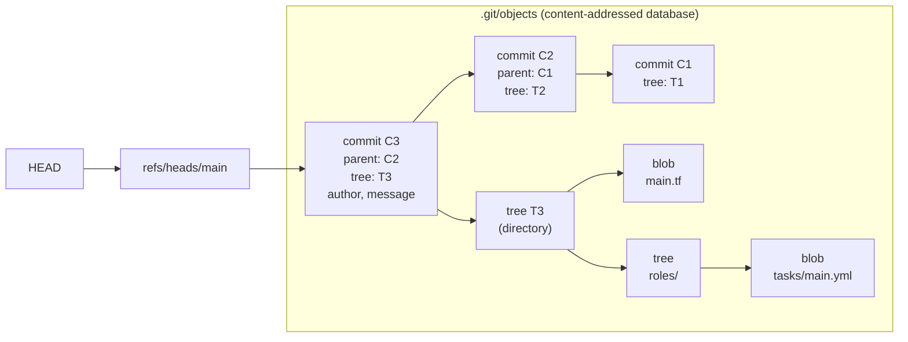
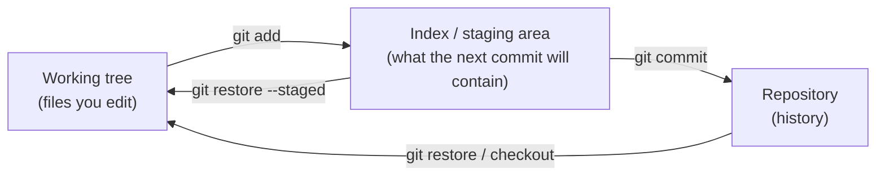
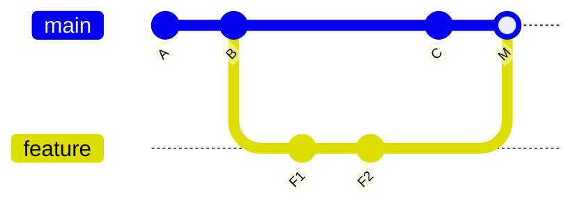
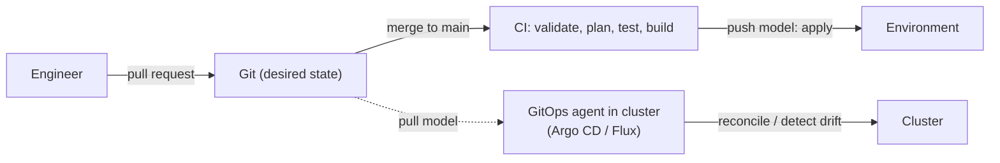

# 4.1 Git from scratch for infrastructure engineers

| | |
|---|---|
| Level | Beginner to intermediate |
| Priority tier | 0 |
| Lab venue | Git 2.40+ and a throwaway remote (GitHub/GitLab) |
| Part | Part 4: Automation and infrastructure as code |
| Status | Drafted, labs **untested** |

## Why this matters for AI infrastructure

In an AI factory almost everything that matters is, or should be, text in a repository: Terraform that creates networks and GPU VMs, Ansible roles that install drivers and tune kernels, Slurm configuration, Kubernetes manifests and Helm values, Dockerfiles for training images, CI pipelines, runbooks. Git is the evidence trail for all of it: who changed the NCCL settings, when MTU went from 9000 to 1500, which commit introduced the regression that halved training throughput, and how to go back. A cluster that cannot be rebuilt from Git is a pet; a change that did not pass through review is an incident waiting to happen. This chapter teaches Git from the object model up, then the workflows (trunk-based development, review, rebase, recovery) used by infrastructure teams, and connects Git to CI/CD (4.2) and GitOps (4.26).

## Prerequisites and outcomes

You should be comfortable at a shell (Part 1). After this chapter you can:

- Explain what a commit, tree, blob and ref are, why history is a directed acyclic graph, and why Git's model makes branching cheap and history tamper-evident.
- Use the working tree / index / repository boundaries deliberately: stage hunks, review diffs, write good commits.
- Branch, merge and rebase safely; resolve conflicts (including generated lock files); use `--onto`, cherry-pick and revert; never rewrite shared history.
- Recover from mistakes using `reflog`, `restore`, `reset`, `revert`, and find regressions with `bisect`.
- Structure repositories (polyrepo versus monorepo), choose a branching strategy (trunk-based for infrastructure), and enforce quality with pre-commit hooks, branch protection, CODEOWNERS and required checks.
- Keep secrets and large binaries out of history; remediate a leak correctly; use Git LFS where appropriate.
- Explain push-based versus pull-based delivery and how Git becomes the source of truth for GitOps.

## 1. Why version control (the infrastructure view)

Version control provides **change tracking** (every modification, who, when, why), **accountability** (blame and review trails), **collaboration** (parallel work merged deterministically), **reversibility** (restore any prior state), and **process hooks** (CI, approvals, deployment triggers). For networks and infrastructure specifically it turns "I changed something on the switch last night" into a reviewed, diffable, revertable commit and enables automated validation before anything touches hardware. Configuration that is not in version control is undocumented, unreviewable and unrecoverable.

Git won because it is **distributed** (every clone is a full backup with full history; work offline; no single point of failure), **fast** (local operations on a content-addressed database), **nonlinear** (branches are 41-byte pointers, so experimenting is free), and **integrity-protected** (every object is named by a hash of its content, so silent corruption or tampering is detectable).

## 2. The Git object model



Four object types, all stored by SHA-1 (or SHA-256 in newer repositories) of their content:

| Object | Meaning |
|---|---|
| **blob** | The contents of one file (no name, no mode) |
| **tree** | A directory: a list of (mode, name, object id) pointing to blobs and subtrees |
| **commit** | A snapshot: pointer to a root tree, parent commit(s), author, committer, timestamp, message |
| **tag** (annotated) | A named, optionally signed pointer to an object (usually a commit) with a message |

Consequences worth internalising:

- A commit is a **full snapshot** of the tree (stored efficiently by sharing unchanged objects and packing with deltas), not a diff. Diffs are computed on demand.
- Identical content has an identical hash: renaming a file does not create a new blob; two branches with the same file share one object.
- A commit's hash covers its tree, parents and metadata, so changing anything in history changes every descendant hash: history is a **Merkle DAG**, and "rewriting history" really means creating new commits.
- **Branches and tags are just refs**: files containing a commit hash (`.git/refs/heads/main`). `HEAD` points to the current branch (or directly to a commit when detached). Creating a branch costs one tiny file.
- Nothing is deleted immediately: unreachable objects linger until garbage collection (`git gc`, default grace about two weeks), which is why recovery with `reflog` usually works.

Inspect the machinery yourself:

```bash
git init demo && cd demo
echo "provider \"google\" {}" > main.tf
git add main.tf && git commit -m "Add provider stub"
git cat-file -t HEAD            # commit
git cat-file -p HEAD            # tree <hash>, author, committer, message
git cat-file -p 'HEAD^{tree}'   # 100644 blob <hash>  main.tf
git cat-file -p $(git rev-parse HEAD:main.tf)     # file contents
find .git/objects -type f | head
cat .git/HEAD .git/refs/heads/main
```

### The three areas



The index is why you can commit part of your work: `git add -p` stages individual hunks so each commit is one logical change. Understanding these three boundaries explains `status`, `diff` (working vs index), `diff --staged` (index vs HEAD), `restore`, `reset`.

## 3. The daily workflow

```bash
git config --global user.name  "Jane Operator"
git config --global user.email "jane@example.com"
git config --global init.defaultBranch main
git config --global pull.rebase true          # or ff-only; avoid accidental merge commits
git config --global rebase.autoStash true
git config --global fetch.prune true
git config --global push.autoSetupRemote true
git config --global core.editor "vim"
git config --global commit.gpgsign true       # sign commits (see section 11)
```

A safe change to infrastructure code:

```bash
git fetch origin                               # 1. learn the latest remote state; changes nothing locally
git switch -c tune-nccl-ib-hca origin/main     # 2. isolate work on a branch from the latest mainline
# ... edit files ...
git status                                     # 3. what changed? what is untracked junk?
git diff                                       # 4. review your own work (leftover debug? a secret?)
git add roles/nccl/templates/nccl.conf.j2      # 5. stage explicit paths, not `git add .`
git diff --staged --check                      # 6. whitespace errors break YAML; check before committing
git commit -m "nccl: pin IB HCA list to mlx5_0-7 to stop NIC auto-selection flapping"   # 7. the why, not the what
git log --oneline --decorate -5                # 8. confirm the history looks right
git push -u origin tune-nccl-ib-hca            # 9. publish; CI runs speculative plans/tests; open a pull request
```

Why each step exists in operations: `fetch` first avoids building on stale truth; a branch protects `main`, which should always be deployable; reviewing the diff catches stray edits, secrets and generated files; staging explicit paths avoids committing `.terraform/`, state files, keys, or crash logs; `--check` catches the trailing-whitespace and tab/space damage that corrupts YAML; a message explaining *why* is the only part of the record the diff cannot reconstruct; pushing triggers CI so the change is validated before merge.

### Commit hygiene

- **Atomic commits**: one logical change per commit, passing tests where possible, so reverts and bisects are clean. Separate refactors from behaviour changes and formatting from logic.
- **Message format**: a short imperative subject (about 50 characters), blank line, body explaining motivation and effect, linked ticket. **Conventional Commits** (`feat:`, `fix:`, `chore:`, `docs:`, `refactor:`, optionally scoped `fix(slurm): ...`, with `!` or `BREAKING CHANGE:` footer) lets tooling generate changelogs and semantic versions.
- `git commit --amend` fixes the last *unpushed* commit; `git commit --fixup <sha>` plus `git rebase -i --autosquash` tidies a series before review.
- Use `git add -p`, `git restore -p` and `git stash` (`-u` includes untracked; `git stash list/pop/apply`) for fine control and context switches.

### Looking at history

```bash
git log --oneline --graph --decorate --all
git log -p -- roles/gpu_driver/            # patches touching a path
git log --since=2.weeks --author=jane --grep='NCCL' --stat
git show a1b2c3d                           # one commit with diff
git diff main...feature                    # changes on feature since it diverged (three-dot)
git diff main..feature                     # difference between the two tips
git blame -L 20,40 slurm.conf              # who last changed each line (and `git blame -w -C` ignores whitespace/moves)
git log -S'MTU' --oneline -- netplan/      # pickaxe: commits that added/removed the string
git log -L :function_name:file.py          # history of a function
git shortlog -sn                           # who contributes how much
```

## 4. Ignoring files and keeping the repo clean

`.gitignore` is the first defence against committing state, secrets and junk. A starting point for an infrastructure repository:

```gitignore
# Terraform / OpenTofu
.terraform/
*.tfstate
*.tfstate.*
crash.log
*.tfvars              # may hold secrets; commit *.tfvars.example instead
*.tfvars.json
override.tf
override.tf.json
*_override.tf
*tfplan*
.terraformrc
terraform.rc
# keep the lock file in version control: do NOT ignore .terraform.lock.hcl

# Ansible
*.retry
.vault_pass*
ansible.log
inventory/**/secrets*.yml
group_vars/**/vault.yml.dec

# Keys and certificates
*.pem
*.key
*.p12
id_rsa*
*.kubeconfig
kubeconfig*

# Python
__pycache__/
*.py[cod]
.venv/
.mypy_cache/
.pytest_cache/
*.egg-info/
dist/
build/

# OS / editor
.DS_Store
.idea/
.vscode/
*.swp

# Data and artefacts (use Git LFS or object storage instead)
*.ckpt
*.pt
*.safetensors
*.parquet
```

Notes: `.gitignore` affects only **untracked** files (already-tracked files stay tracked until `git rm --cached`); per-user ignores go in `~/.config/git/ignore` (set `core.excludesFile`) and per-clone ignores in `.git/info/exclude`; `git status --ignored` lists ignored files; `git check-ignore -v path` explains which rule matched. A negation (`!pattern`) cannot re-include a file whose parent directory is excluded.

## 5. Remotes and collaboration

```bash
git remote -v
git remote add upstream git@github.com:org/infra.git
git fetch --all --prune
git pull --rebase                       # fetch + rebase local commits on the updated upstream
git push origin HEAD
git push --force-with-lease             # the only acceptable force push: fails if someone else pushed meanwhile
git branch -vv                          # tracking relationships
git branch -d feature                   # delete merged branch; -D forces
git push origin --delete feature
```

- `git pull` is `fetch` plus `merge` (or rebase). Understand both halves; prefer explicit `fetch` then decide.
- **Never force-push shared branches** (`main`, release branches). Use `--force-with-lease` only on your own feature branch after a rebase. Protect `main` on the server so it is impossible.
- **Authentication**: SSH keys (ed25519), credential helpers, short-lived tokens; deploy keys with read-only scope for CI; never embed tokens in URLs (they land in `.git/config` and logs).
- **Forks and pull/merge requests**: the review unit. Keep them small (hundreds of lines), describe intent and risk, link the plan output for IaC changes, and require passing checks.

## 6. Branching strategies for infrastructure

**GitFlow** (long-lived `develop`, release and hotfix branches) suits versioned software shipped on a cadence. It handles infrastructure poorly: long-lived branches drift from the live environment, merges become huge, and "what is deployed?" has no single answer.

**Trunk-based development** (short-lived branches, merge to `main` within a day or two, `main` always deployable, feature flags or variables for incomplete work, environments differentiated by configuration, not by branches) fits infrastructure: the repository mirrors reality, every change is small and reviewable, rollback is `revert`, and CI promotes the same commit through environments. Release branches are cut only when you must maintain several supported versions (for example an internal Helm chart or Ansible collection consumed by many teams).

Environments should be **directories or variable files, not branches** (`envs/staging`, `envs/prod`): a `staging` branch and a `prod` branch drift and cherry-picks turn into folklore. Promote by changing a version pin in the prod directory through a reviewed commit.

## 7. Merge, rebase and history shape



- **Merge** creates a merge commit with two parents, preserving the true shape of history. `--ff-only` refuses unless a fast-forward is possible; `--no-ff` forces a merge commit even when a fast-forward is possible (keeps a branch boundary).
- **Rebase** replays your commits on a new base, producing new commits (new hashes) and a linear history. Squash-merge collapses a branch into one commit on `main`: clean for atomic infrastructure changes; you lose the intermediate commits.
- **Golden rule: never rebase commits that others have based work on** (anything pushed to a shared branch). Rebase your private feature branch; merge or squash shared work.

Safe rebase of a feature branch:

```bash
git fetch origin
git switch tune-nccl-ib-hca
git rebase origin/main              # replay my commits onto the latest main
# conflict? edit files, then:
git add <files> && git rebase --continue      # or: git rebase --abort to return to the pre-rebase state
git push --force-with-lease         # branch is mine; lease protects against a surprise
```

During a rebase "ours" is the branch being rebased onto (upstream) and "theirs" is your commit being replayed: the reverse of a merge, a frequent source of mistakes.

**Interactive rebase** (`git rebase -i origin/main`) lets you reorder, squash (`s`), fixup (`f`), reword (`r`), edit (`e`) or drop (`d`) commits before review; use `--autosquash` with fixup commits. **`git rebase --onto new-base old-base branch`** moves a stacked branch: if `feature-B` was started from `feature-A` and A was squash-merged, `git rebase --onto main feature-A feature-B` transplants only B's own commits.

### Resolving conflicts, including generated files

Conflict markers (`<<<<<<<`, `=======`, `>>>>>>>`) show both sides; resolve by editing to the intended result, then `git add` and continue. `git mergetool`, `git diff --diff-filter=U`, `git checkout --conflict=diff3 file` (shows the common ancestor) and `git rerere` (remember resolutions and replay them) help. For **generated files** (Terraform `.terraform.lock.hcl`, `poetry.lock`, `package-lock.json`, Helm `Chart.lock`), do not hand-merge: take the mainline version, then regenerate: `git checkout --ours -- .terraform.lock.hcl` (remember the rebase inversion: here "ours" is main), run `terraform init` (add `-upgrade` only if you mean to change versions), `git add`, continue. Resolve conflicts in Terraform state by never having state in Git at all (4.19).

## 8. Undoing things safely

| Situation | Command | Notes |
|---|---|---|
| Discard unstaged edits to a file | `git restore path` | Destructive; edits are gone |
| Unstage a file | `git restore --staged path` | Keeps the edits |
| Fix the last commit message/content (unpushed) | `git commit --amend` | Rewrites that commit |
| Undo a **published** commit | `git revert <sha>` | New inverse commit; safe on shared branches; `-m 1` for merge commits |
| Move a branch pointer back (local) | `git reset --soft/--mixed/--hard <sha>` | soft keeps index+tree, mixed keeps tree, hard discards both; never on shared history |
| Apply one commit elsewhere | `git cherry-pick <sha>` | Backports a hotfix to a release branch; records a new commit |
| Lost commits after a bad reset or rebase | `git reflog` then `git branch rescue <sha>` | Local safety net |
| Remove an untracked file | `git clean -n` (preview), then `git clean -f` | Always dry-run first |

**Reflog**: Git records every movement of `HEAD` and branch tips locally (default retention about 90 days for reachable, 30 for unreachable entries). After a mistaken `reset --hard`, `git reflog` shows `HEAD@{1}: commit: ...`; `git branch rescue HEAD@{1}` recovers it. The reflog is local only and does not survive a fresh clone, so it is a seat belt, not a backup.

**Bisect** finds the commit that introduced a regression by binary search:

```bash
git bisect start
git bisect bad                    # current commit is broken (e.g. nccl-tests bandwidth halved)
git bisect good v2.3.0            # last known good tag
# Git checks out the midpoint; test it, then answer:
git bisect good    # or: git bisect bad
# fully automated with a script that exits 0 (good), 1-127 except 125 (bad), 125 (skip):
git bisect run ./tests/check_bandwidth.sh
git bisect reset
```

Bisect works best with small atomic commits and a fast reproducible test; for infrastructure regressions the test might render a template and assert a value, run `ansible-lint`, or evaluate a Terraform plan.

## 9. Repository architecture

| | Polyrepo (one repo per component/module/service) | Monorepo (many components in one repo) |
|---|---|---|
| Pros | Clear ownership and permissions; independent versioning and release; small clones; module reuse via version pins | Atomic cross-cutting changes; one place to search; shared tooling and CI; easy refactors |
| Cons | Version skew; cross-repo changes need coordinated PRs; discoverability | Needs CODEOWNERS and path-scoped CI; large clone; one permission boundary; tooling (Bazel, Nx, path filters) at scale |
| Fits | Reusable Terraform modules, Ansible roles/collections, published Helm charts | Platform repos for one organisation's environments and cluster definitions |

A common pattern for an AI-infrastructure team: a **live (environment) monorepo** (`terraform/envs/prod/...`, `ansible/inventories/...`, `k8s/clusters/...`) that consumes **versioned module/role repos** pinned by tag. CI uses path filters so a change to `envs/staging/` plans only staging. **Submodules** (pointer to another repo's commit) and **subtree** vendor other repositories; they work but have sharp edges (forgotten `--recurse-submodules`, detached HEADs); prefer package-style pins (Terraform module `ref=v1.4.2`, Ansible `requirements.yml` with versions) where the tool supports them.

Other useful features: **`git worktree add ../hotfix hotfix-branch`** (multiple checkouts of one repository without re-cloning: handy when you must patch production while mid-change), **sparse checkout** and **partial clone** (`--filter=blob:none`) for huge repos, **shallow clone** (`--depth 1`) for CI (but some tools need history: `git describe`, changelog generation), **tags** for releases (`git tag -a v1.4.0 -m ...`, push tags explicitly; signed with `-s`), **`git describe --tags`** for build versions.

## 10. Hooks and pre-commit: shifting left

Git hooks (`.git/hooks/*`, not versioned) run scripts at events (`pre-commit`, `commit-msg`, `pre-push`). The **pre-commit** framework versions the hook configuration in `.pre-commit-config.yaml` and installs it for every contributor (`pre-commit install`, `pre-commit run --all-files`):

```yaml
repos:
- repo: https://github.com/pre-commit/pre-commit-hooks
  rev: v4.6.0
  hooks:
  - id: check-yaml
  - id: end-of-file-fixer
  - id: trailing-whitespace
  - id: check-added-large-files
    args: [--maxkb=500]
  - id: detect-private-key
- repo: https://github.com/antonbabenko/pre-commit-terraform
  rev: v1.92.0
  hooks: [ { id: terraform_fmt }, { id: terraform_validate }, { id: terraform_tflint } ]
- repo: https://github.com/ansible/ansible-lint
  rev: v24.9.0
  hooks: [ { id: ansible-lint } ]
- repo: https://github.com/gitleaks/gitleaks
  rev: v8.18.4
  hooks: [ { id: gitleaks } ]
```

(Versions are examples; pin versions you have reviewed.) Local hooks are advisory (developers can bypass with `--no-verify`), so **run the same checks in CI as required status checks**. Fast checks (format, syntax, secrets) belong in pre-commit; slow ones (plans, integration tests) in CI.

## 11. Secrets and sensitive history

Git remembers everything: deleting a secret in a later commit does not remove it from history, forks, clones, CI caches or backups. Treat any committed secret as **compromised**.

Remediation order:

1. **Revoke and rotate** the credential immediately (the only step that actually fixes the exposure); check access logs for use.
2. Remove it from the current tree and replace with a reference to a secret manager (4.12).
3. Only then, optionally rewrite history to purge it (`git filter-repo --path secrets.yml --invert-paths` or `--replace-text`, or BFG Repo-Cleaner), force-push, ask collaborators to re-clone, and expire server-side caches/forks; the platform may retain references (pull request refs) so contact support if needed.
4. Add prevention: pre-commit secret scanning (gitleaks, trufflehog, detect-secrets), platform push protection, `.gitignore` entries, and encrypted-at-rest alternatives (Ansible Vault, SOPS with age/KMS, sealed secrets, external secrets operators).

Also sign commits and tags (SSH or GPG: `git config gpg.format ssh`; `git log --show-signature`) so provenance is verifiable, and require signed commits on protected branches where supply-chain integrity matters.

## 12. Governance: branch protection and CODEOWNERS

On the server (GitHub/GitLab) configure for `main`:

- Require pull requests; require at least one (two for production) approving review; dismiss stale approvals on new pushes.
- Require status checks (lint, validate, plan, tests) and up-to-date branches before merge.
- Require linear history or squash merges if you want a clean `main`; block force pushes and deletions; include administrators.
- Require signed commits and conversation resolution if policy demands.
- Restrict who can push tags and who can bypass.

`CODEOWNERS` maps paths to reviewers who must approve changes there:

```text
# .github/CODEOWNERS (last matching pattern wins)
*                          @org/sre
/terraform/network/        @org/network-team
/ansible/roles/gpu_*       @org/hpc-team
/k8s/                      @org/mlops
/storage/                  @org/storage-team
/.github/                  @org/sre-leads
```

This encodes team boundaries as enforcement: a Slurm change needs HPC approval, a VPC change needs the network team. Pair with a pull request template (what changed, risk, rollback plan, plan output link) and labels for blast radius.

### Review by blast radius

Review effort should track risk: a documentation change merges quickly; a change to a shared module, a firewall rule, a kernel parameter on all GPU nodes, a scheduler config or a state/backends file gets domain-owner review, a plan or dry-run artefact, a staged rollout plan (canary one rack, then more), and a rollback statement. Encode this with CODEOWNERS, labels, and required environments in CI.

## 13. Large files, binaries and LFS

Git stores whole snapshots; large binary files (golden OS images, model checkpoints, datasets) bloat the repository forever and slow every clone. Options: **Git LFS** (stores pointers in Git and content on an LFS server: `git lfs install`, `git lfs track "*.qcow2"`, commit `.gitattributes`; every clone downloads only needed versions; hosting quotas and bandwidth apply); **object storage with content addressing and a manifest in Git** (DVC, lakeFS, or a simple `artifacts.lock` of SHA-256s); or an **artifact registry** (container registry, Artifactory, Hugging Face Hub) for images and models. Do not put checkpoints or datasets in plain Git. If a large file is committed by mistake, purge it with `git filter-repo` before it spreads, and set `check-added-large-files` in pre-commit.

## 14. GitOps: Git as the deployment trigger

Two delivery models:

- **Push-based**: CI builds and then *pushes* changes to the target (runs `terraform apply`, `ansible-playbook`, `kubectl apply`, `helm upgrade`). Simple and flexible; CI needs credentials with broad write access to production, which makes the pipeline a high-value attack target, and drift between pushes goes unnoticed.
- **Pull-based (GitOps)**: an agent inside the target environment (Argo CD, Flux) continuously *pulls* the desired state from Git and reconciles the cluster to match, reporting or auto-reverting drift. Credentials stay inside the cluster, Git is the audit log, rollback is a revert, and the system self-heals. See 4.26.



Practical conventions: separate **application code repos** from **environment/config repos** (CI updates an image tag in the config repo via PR, the agent deploys it), pin by immutable digests or tags, keep one source of truth per environment, and keep secrets out of Git by using external secret operators or SOPS-encrypted files.

## 15. Lab (untested)

1. **Object model**: init a repo, make three commits, and use `cat-file`, `ls-tree`, `rev-parse`, `count-objects -v` to trace commit to tree to blob; modify one file and see which objects are new; run `git gc` and compare `.git` size; show that renaming a file creates no new blob.
2. **Staging discipline**: edit two unrelated things in one file; split into two commits with `git add -p`; use `git diff --staged --check` to catch a trailing space in YAML.
3. **Ignore rules**: create a Terraform-style directory with `.terraform/`, a `.tfstate`, a `.tfvars` and a key; verify with `git status --ignored` and `git check-ignore -v`; accidentally track one then fix with `git rm --cached`.
4. **Branch and PR flow**: create a throwaway remote; push a branch; open a PR; add a failing CI check (a YAML lint) and see merge blocked; fix and merge with squash.
5. **Merge vs rebase**: diverge two branches, merge one way and rebase the other, compare `git log --graph`; then try to rebase a pushed shared branch and observe the damage in a second clone (and recover with `reflog`).
6. **Conflict resolution**: create a conflict in a YAML file and a lock file; resolve both (hand merge and regenerate); use `rerere` and repeat to see it replay; use `--onto` to move a stacked branch after a squash merge.
7. **Recovery**: `reset --hard` away a commit and recover it via `reflog`; `revert` a published commit and a merge commit (`-m 1`); cherry-pick a fix to a `release/1.0` branch.
8. **Bisect**: build a 40-commit history with a regression injected at commit 27 (for example a template rendering the wrong value); locate it with `git bisect run` and a script.
9. **Hooks**: install pre-commit with `detect-private-key`, `check-added-large-files`, YAML check and gitleaks; try to commit a fake key and an oversized file; confirm the same checks fail in CI.
10. **Secret leak drill**: commit a dummy token; practise the remediation order: rotate (pretend), purge with `git filter-repo`, force-push to the throwaway remote, re-clone, and verify with `git log -S`; document what a fork would still contain.
11. **Governance**: configure branch protection and a `CODEOWNERS` file on the throwaway repo; open PRs touching different paths and verify the required reviewers.
12. **LFS**: track `*.bin`, commit a 50 MB file, inspect the pointer, clone and observe `git lfs pull`; compare repository size without LFS.
13. **Worktrees and stash**: patch a "production" hotfix in a second worktree while a feature branch has uncommitted changes; use `stash` and compare.
14. **Clean up** the throwaway remote and repos.

Mark tested only after execution.

## 16. Common mistakes

- `git add .` and `git commit -a` sweeping in state files, keys, build output and unrelated edits.
- Committing secrets, `.tfstate`, kubeconfigs; assuming a follow-up commit removes them.
- Long-lived environment branches (`staging`, `prod`) that drift; cherry-pick folklore instead of promotion by config.
- Rebasing or force-pushing shared branches; plain `--force` instead of `--force-with-lease`.
- Giant commits mixing refactors, formatting and behaviour; messages like "fix" or "update".
- Hand-merging lock files and generated files.
- Relying on local hooks only (bypassable) with no CI enforcement; unreviewed direct pushes to `main`.
- `git reset --hard` or `git clean -fd` without checking what will be lost; forgetting the reflog is local and time-limited.
- Using Git as a file store for checkpoints and images.
- Not pinning module/role versions, so a moving `main` changes production silently.
- Treating deleted branches as deleted history: the commits remain reachable via refs, reflog and forks.

## 17. Interview angles

- "What is a commit physically? Why are branches cheap?" (snapshot object with parents; branch is a pointer.)
- "Merge versus rebase: trade-offs? What is the golden rule?" 
- "You pushed a bad change to main. What do you do?" (revert via PR, not reset/force; follow CI; consider incident process.)
- "A secret was committed. Walk through remediation." (rotate first, then purge, then prevent.)
- "How do you find which commit broke throughput?" (bisect with an automated test.)
- "Monorepo or polyrepo for platform code? How do you organise environments?" (directories not branches; versioned modules.)
- "Trunk-based development versus GitFlow for infrastructure?"
- "Push-based versus pull-based deployment; where does Git fit?"
- "How do CODEOWNERS and branch protection enforce team boundaries?"
- "I lost commits after a rebase. How do I get them back?" (reflog.)

## 18. Checkpoint questions (40)

1. What four object types does Git store? **A:** Blob, tree, commit, tag.
2. What names a Git object? **A:** Hash of its content.
3. Is a commit a diff or a snapshot? **A:** A snapshot (of the root tree).
4. What is a branch? **A:** A ref file holding a commit hash.
5. What is `HEAD`? **A:** Pointer to the current branch (or commit when detached).
6. Why is history tamper-evident? **A:** Each hash covers parents; changing one changes descendants.
7. Three areas of Git? **A:** Working tree, index, repository.
8. What does `git add -p` do? **A:** Stages selected hunks.
9. What does `diff --staged` compare? **A:** Index with HEAD.
10. Why `fetch` before branching? **A:** Start from the latest remote state.
11. Why avoid `git add .`? **A:** It stages untracked junk and secrets.
12. What does `--check` catch? **A:** Whitespace errors.
13. What should a commit message explain? **A:** Why the change was made.
14. What are Conventional Commits for? **A:** Structured messages enabling changelogs and versioning.
15. Does `.gitignore` untrack tracked files? **A:** No; use `git rm --cached`.
16. Why keep `.terraform.lock.hcl` in Git? **A:** Pins provider versions and hashes.
17. What does `--force-with-lease` do? **A:** Force-pushes only if remote hasn't changed unexpectedly.
18. Why trunk-based for infrastructure? **A:** Small changes, mainline mirrors reality, easy rollback.
19. Why directories not branches for environments? **A:** Avoid drift and cherry-pick folklore.
20. Merge vs rebase difference? **A:** Merge preserves branching with a merge commit; rebase replays commits for linear history.
21. Golden rule of rebase? **A:** Never rebase shared/published history.
22. In a rebase, what is "ours"? **A:** The branch you're rebasing onto.
23. What does `rebase --onto` do? **A:** Transplants a range of commits onto a new base.
24. How handle a lock-file conflict? **A:** Take mainline version and regenerate.
25. What does `rerere` do? **A:** Records and reuses conflict resolutions.
26. How undo a published commit? **A:** `git revert`.
27. Difference between `reset --soft`, `--mixed`, `--hard`? **A:** Keep index+tree, keep tree, discard both.
28. What does `cherry-pick` do? **A:** Applies one commit onto the current branch.
29. What is the reflog? **A:** Local log of ref movements enabling recovery.
30. How does `bisect run` decide? **A:** Script exit code (0 good, 1 bad, 125 skip).
31. Polyrepo vs monorepo trade-off? **A:** Ownership/versioning independence vs atomic changes/shared tooling.
32. What do submodules store? **A:** A pointer to a commit in another repo.
33. What does `git worktree` provide? **A:** Multiple checkouts of one repo.
34. Why can't local hooks be the only control? **A:** They can be bypassed.
35. First step after a secret leak? **A:** Revoke and rotate it.
36. Tool to purge history? **A:** `git filter-repo` (or BFG).
37. What does CODEOWNERS enforce? **A:** Required reviewers per path.
38. Branch protection essentials? **A:** Required review, checks, no force push, up-to-date branch.
39. Why not store checkpoints in Git? **A:** Bloat; use LFS, object storage, registries.
40. Push- vs pull-based delivery? **A:** CI pushes changes vs in-cluster agent pulls and reconciles from Git.

## 19. Sources and review notes

**Written in original words.** Principal sources:

- Jason Edelman, Scott Lowe and Matt Oswalt, *Network Programmability and Automation* (chapter 11 on source control with Git: benefits, Git terminology, repositories, commits, ignoring files, history, branches, remotes; chapter 5 on developer environments).
- The author's `nvidia-devops` repository, volume 10 chapter 17 (Git for infrastructure and operations: object model, safe workflow, `.gitignore` for AI infrastructure, pre-commit, repository architecture, trunk-based development, rebase workflows, blast-radius review, GitOps, secrets remediation, branch protection and CODEOWNERS, recovery, bisect, LFS).
- Pro Git (Chacon and Straub) and Git documentation for command semantics.
- Examples are the author's constructions.

**Flagged for verification before publishing:** Git option names and defaults for the version in use, pre-commit hook repository tags, `git filter-repo` invocations, branch-protection feature names per platform (GitHub versus GitLab), SHA-256 repository support status, and every command listing; all labs are **untested**.
