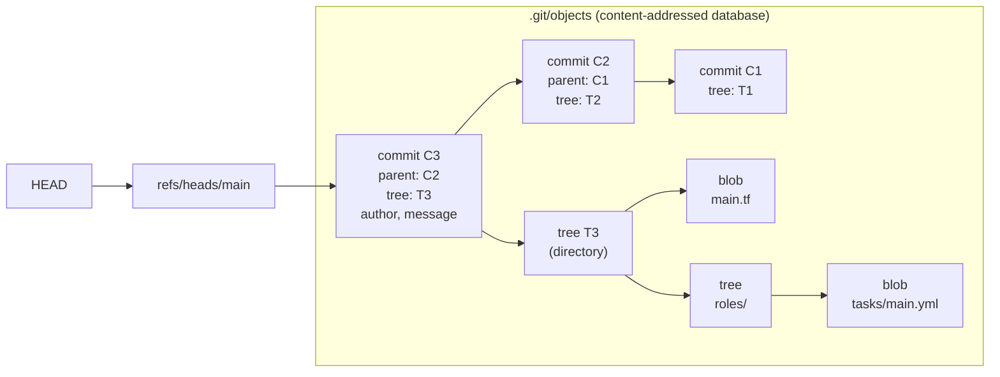
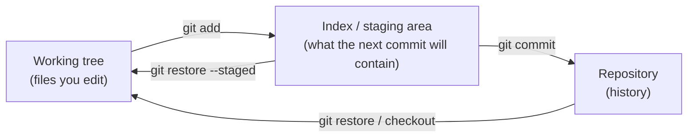
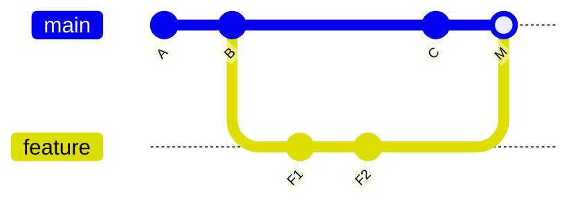
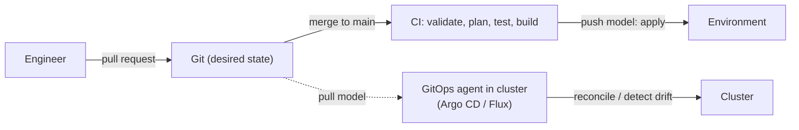

# 4.1 Git from scratch for infrastructure engineers

| | |
|---|---|
| Level | Beginner to intermediate |
| Priority tier | 0 |
| Lab venue | Git 2.40+ and a throwaway remote (GitHub/GitLab) |
| Part | Part 4: Automation and infrastructure as code |
| Status | Drafted, labs **untested** |

## Why this matters for AI infrastructure

At two in the morning, a training job stops reaching its storage network. The on-call engineer finds that an interface MTU changed earlier in the day from `9000` to `1500`. No one remembers who changed it, what else changed in the same session, or which value was working before the incident. The cluster is expensive, the training deadline is close, and the only available evidence is a few shell histories and an unreviewed terminal note.

In an AI factory almost everything that matters is, or should be, text in a repository: Terraform that creates networks and GPU VMs, Ansible roles that install drivers and tune kernels, Slurm configuration, Kubernetes manifests and Helm values, Dockerfiles for training images, CI pipelines, runbooks. Git is the evidence trail for all of it: who changed the NCCL settings, when MTU went from 9000 to 1500, which commit introduced the regression that halved training throughput, and how to go back. A cluster that cannot be rebuilt from Git is a pet; a change that did not pass through review is an incident waiting to happen. This chapter teaches Git from the object model up, then the workflows (trunk-based development, review, rebase, recovery) used by infrastructure teams, and connects Git to CI/CD (4.2) and GitOps (4.26).

## Prerequisites and outcomes

You should be comfortable at a shell (Part 1). After this chapter you can:

- Explain what a commit, tree, blob and ref are, why history is a directed acyclic graph, and why Git's model makes branching cheap and history tamper-evident.
- Use the working tree / index / repository boundaries deliberately: stage hunks, review diffs, write good commits.
- Branch, merge and rebase safely; resolve conflicts (including generated lock files); use `--onto`, cherry-pick and revert; never rewrite shared history.
- Recover from mistakes using `reflog`, `restore`, `reset`, `revert`, and find regressions with `bisect`.
- Structure repositories (polyrepo versus monorepo), choose a branching strategy (trunk-based for infrastructure), and enforce quality with pre-commit hooks, branch protection, CODEOWNERS and required checks.
- Keep secrets and large binaries out of history; remediate a leak correctly; use Git LFS where appropriate.
- Explain push-based versus pull-based delivery and how Git becomes the source of truth for GitOps.

## 1. Why version control (the infrastructure view)

Version control provides **change tracking** (every modification, who, when, why), **accountability** (blame and review trails), **collaboration** (parallel work merged deterministically), **reversibility** (restore any prior state), and **process hooks** (CI, approvals, deployment triggers). For networks and infrastructure specifically it turns "I changed something on the switch last night" into a reviewed, diffable, revertable commit and enables automated validation before anything touches hardware. Configuration that is not in version control is undocumented, unreviewable and unrecoverable.

Git won because it is **distributed** (every clone is a full backup with full history; work offline; no single point of failure), **fast** (local operations on a content-addressed database), **nonlinear** (branches are 41-byte pointers—a 40-character hexadecimal SHA-1 hash plus a newline in `.git/refs/heads/<branch>`, so experimenting is free), and **integrity-protected** (every object is named by a hash of its content, so silent corruption or tampering is detectable). As Christian Adell, Scott Lowe, Matt Oswalt, and Jason Edelman recount in *Network Programmability and Automation* Chapter 11 (`NPA` Chapter 11), Linus Torvalds created Git in April 2005 when the Linux kernel community stopped using the proprietary BitKeeper system and needed a fast, non-linear, fully distributed version control system that could scale to thousands of kernel contributors.

### Infrastructure developer environments (`NPA` Chapter 5)

Before touching production fabrics or GPU clusters, an infrastructure engineer needs a local developer environment where code and topologies are edited, diffed, and tested reproducibly (`NPA` Chapter 5):
- **Editors, IDEs, and the Language Server Protocol (`LSP`):** Whether you use **Vim/Neovim**, **Visual Studio Code**, **Sublime Text**, or **PyCharm**, modern editors talk to language servers over **LSP** to provide syntax highlighting, real-time linting, auto-completion, and semantic navigation (*Go to Definition*, *Find References*, *Refactor*) across Python, Go, YAML, Jinja2, and Terraform HCL, alongside built-in Git gutter diffs and branch status prompts (`git-sh-prompt` in `/usr/lib/git-core/git-sh-prompt` on Debian/Ubuntu or `/usr/share/git-core/contrib/completion/git-prompt.sh` on RHEL/Fedora).
- **Semantic YAML diffing (`dyff`):** Plain line-based `diff` struggles when keys are reordered in YAML manifests or switch configs; `dyff between -b before.yaml after.yaml` parses the YAML AST and reports exact structural changes (for example, `switches.sw02.interfaces.eth3.vlans -> + one list entry added: - 50`).
- **Emulating network and server topologies locally from text in Git (`Vagrant` and `Containerlab`):**
  1. **Vagrant + VirtualBox/libvirt (`Vagrantfile`):** Defines multi-VM network labs (such as three `vyos/current` routers `r1` `192.168.12.11`, `r2` `192.168.12.12`, and `r3` `192.168.12.13` wired over `virtualbox__intnet` private networks and configured automatically via `config.vm.provision "ansible" { |ansible| ansible.playbook = "playbook.yml" }`), launched with `vagrant up`, accessed via `vagrant ssh r1`, and torn down with `vagrant destroy -f`.
  2. **Containerlab (`topology1.clab.yaml`):** Launches lightweight containerized network operating systems (such as Nokia SR Linux `ghcr.io/nokia/srlinux`, Arista cEOS, or SONiC nodes `srl01` and `srl02` with `startup-config: srl1.cfg` and point-to-point `endpoints: ["srl01:e1-1", "srl02:e1-1"]`) in seconds via `containerlab deploy`, inspected with `ssh admin@172.20.20.2` or `docker exec`, and destroyed with `containerlab destroy`. Because both `Vagrantfile` and `*.clab.yaml` are plain text files tracked in Git, every engineer and CI runner boots the exact same lab topology.

## 2. The Git object model



Four object types, all stored by SHA-1 (or SHA-256 in newer repositories) of their content:

| Object | Meaning |
|---|---|
| **blob** | The contents of one file (no name, no mode) |
| **tree** | A directory: a list of (mode, name, object id) pointing to blobs and subtrees |
| **commit** | A snapshot: pointer to a root tree, parent commit(s), author, committer, timestamp, message |
| **tag** (annotated) | A named, optionally signed pointer to an object (usually a commit) with a message |

Consequences worth internalising:

- A commit is a **full snapshot** of the tree (stored efficiently by sharing unchanged objects and packing with deltas), not a diff. Diffs are computed on demand.
- Identical content has an identical hash: renaming a file does not create a new blob; two branches with the same file share one object.
- A commit's hash covers its tree, parents and metadata, so changing anything in history changes every descendant hash: history is a **Merkle DAG**, and "rewriting history" really means creating new commits.
- **Branches and tags are just refs**: files containing a commit hash (`.git/refs/heads/main`). `HEAD` points to the current branch (or directly to a commit when detached). Creating a branch costs one tiny file.
- Nothing is deleted immediately: unreachable objects linger until garbage collection (`git gc`, default grace about two weeks), which is why recovery with `reflog` usually works.

Inspect the machinery yourself:

```bash
git init demo && cd demo
echo "provider \"google\" {}" > main.tf
git add main.tf && git commit -m "Add provider stub"
git cat-file -t HEAD            # commit
git cat-file -p HEAD            # tree <hash>, author, committer, message
git cat-file -p 'HEAD^{tree}'   # 100644 blob <hash>  main.tf
git cat-file -p $(git rev-parse HEAD:main.tf)     # file contents
find .git/objects -type f | head
cat .git/HEAD .git/refs/heads/main
```

### The three areas



The index is why you can commit part of your work: `git add -p` stages individual hunks so each commit is one logical change. Understanding these three boundaries explains `status`, `diff` (working vs index), `diff --staged` (index vs HEAD), `restore`, `reset`.

## 3. The daily workflow

```bash
git config --global user.name  "Jane Operator"
git config --global user.email "jane@example.com"
git config --global init.defaultBranch main
git config --global pull.rebase true          # or ff-only; avoid accidental merge commits
git config --global rebase.autoStash true
git config --global fetch.prune true
git config --global push.autoSetupRemote true
git config --global core.editor "vim"
git config --global commit.gpgsign true       # sign commits (see section 11)
```

A safe change to infrastructure code:

```bash
git fetch origin                               # 1. learn the latest remote state; changes nothing locally
git switch -c tune-nccl-ib-hca origin/main     # 2. isolate work on a branch from the latest mainline
# ... edit files ...
git status                                     # 3. what changed? what is untracked junk?
git diff                                       # 4. review your own work (leftover debug? a secret?)
git add roles/nccl/templates/nccl.conf.j2      # 5. stage explicit paths, not `git add .`
git diff --staged --check                      # 6. whitespace errors break YAML; check before committing
git commit -m "nccl: pin IB HCA list to mlx5_0-7 to stop NIC auto-selection flapping"   # 7. the why, not the what
git log --oneline --decorate -5                # 8. confirm the history looks right
git push -u origin tune-nccl-ib-hca            # 9. publish; CI runs speculative plans/tests; open a pull request
```

Why each step exists in operations: `fetch` first avoids building on stale truth; a branch protects `main`, which should always be deployable; reviewing the diff catches stray edits, secrets and generated files; staging explicit paths avoids committing `.terraform/`, state files, keys, or crash logs; `--check` catches the trailing-whitespace and tab/space damage that corrupts YAML; a message explaining *why* is the only part of the record the diff cannot reconstruct; pushing triggers CI so the change is validated before merge.

### Commit hygiene

- **Atomic commits**: one logical change per commit, passing tests where possible, so reverts and bisects are clean. Separate refactors from behaviour changes and formatting from logic.
- **Message format**: a short imperative subject (about 50 characters), blank line, body explaining motivation and effect, linked ticket. **Conventional Commits** (`feat:`, `fix:`, `chore:`, `docs:`, `refactor:`, optionally scoped `fix(slurm): ...`, with `!` or `BREAKING CHANGE:` footer) lets tooling generate changelogs and semantic versions.
- `git commit --amend` fixes the last *unpushed* commit; `git commit --fixup <sha>` plus `git rebase -i --autosquash` tidies a series before review.
- Use `git add -p`, `git restore -p` and `git stash` (`-u` includes untracked; `git stash list/pop/apply`) for fine control and context switches.

### Looking at history

```bash
git log --oneline --graph --decorate --all
git log -p -- roles/gpu_driver/            # patches touching a path
git log --since=2.weeks --author=jane --grep='NCCL' --stat
git show a1b2c3d                           # one commit with diff
git diff main...feature                    # changes on feature since it diverged (three-dot)
git diff main..feature                     # difference between the two tips
git blame -L 20,40 slurm.conf              # who last changed each line (and `git blame -w -C` ignores whitespace/moves)
git log -S'MTU' --oneline -- netplan/      # pickaxe: commits that added/removed the string
git log -L :function_name:file.py          # history of a function
git shortlog -sn                           # who contributes how much
```

## 4. Ignoring files and keeping the repo clean

`.gitignore` is the first defence against committing state, secrets and junk. A starting point for an infrastructure repository:

```gitignore
# Terraform / OpenTofu
.terraform/
*.tfstate
*.tfstate.*
crash.log
*.tfvars              # may hold secrets; commit *.tfvars.example instead
*.tfvars.json
override.tf
override.tf.json
*_override.tf
*tfplan*
.terraformrc
terraform.rc
# keep the lock file in version control: do NOT ignore .terraform.lock.hcl

# Ansible
*.retry
.vault_pass*
ansible.log
inventory/**/secrets*.yml
group_vars/**/vault.yml.dec

# Keys and certificates
*.pem
*.key
*.p12
id_rsa*
*.kubeconfig
kubeconfig*

# Python
__pycache__/
*.py[cod]
.venv/
.mypy_cache/
.pytest_cache/
*.egg-info/
dist/
build/

# OS / editor
.DS_Store
.idea/
.vscode/
*.swp

# Data and artefacts (use Git LFS or object storage instead)
*.ckpt
*.pt
*.safetensors
*.parquet
```

Notes: `.gitignore` affects only **untracked** files (already-tracked files stay tracked until `git rm --cached`); per-user ignores go in `~/.config/git/ignore` (set `core.excludesFile`) and per-clone ignores in `.git/info/exclude`; `git status --ignored` lists ignored files; `git check-ignore -v path` explains which rule matched. A negation (`!pattern`) cannot re-include a file whose parent directory is excluded.

## 5. Remotes and collaboration

```bash
git remote -v
git remote add upstream git@github.com:org/infra.git
git fetch --all --prune
git pull --rebase                       # fetch + rebase local commits on the updated upstream
git push origin HEAD
git push --force-with-lease             # the only acceptable force push: fails if someone else pushed meanwhile
git branch -vv                          # tracking relationships
git branch -d feature                   # delete merged branch; -D forces
git push origin --delete feature
```

- `git pull` is `fetch` plus `merge` (or rebase). Understand both halves; prefer explicit `fetch` then decide (`NPA` Chapter 11 demonstrates why: running `git fetch origin` updates your remote-tracking branch `origin/main` in `.git/refs/remotes/origin/main` without touching your working directory or local `main`, allowing you to inspect incoming changes safely with `git log main..origin/main` and `git diff main..origin/main` before merging with `git merge origin/main`).
- **Working vs. bare repositories (`git init --bare` / `git clone --bare`, `NPA` Chapter 11):** A normal repository has a working directory and a `.git/` subfolder; pushing directly into a non-bare repository that has a checked-out branch causes the working tree and index to fall out of sync with `HEAD` (so Git refuses by default). Central shared repositories on a Git server (or `na-shared.git` over SSH `ssh://host/~/na-shared.git`) are created as **bare repositories** (`git clone --bare net-auto na-shared.git`), which contain only the contents of `.git/` (`HEAD`, `config`, `objects/`, `refs/`) with **no working tree**—designed exclusively to receive `git push` and serve `git fetch`/`git clone`.
- **Lightweight vs. annotated tags (`git tag`, `NPA` Chapter 11):** A **lightweight tag** (`git tag golive d40fe74`) is simply an unchanging ref file pointing directly to a commit hash, whereas an **annotated tag** (`git tag -a v1.0 -m "Version 1.0 of network automation tools"`) creates a full tag object in `.git/objects` recording the tagger name, email, date, message, and optional GPG/SSH signature (`git show v1.0`). Remember that `git push` does not transfer tags by default; push them explicitly with `git push origin v1.0` or `git push origin --tags`.
- **Never force-push shared branches** (`main`, release branches). Use `--force-with-lease` only on your own feature branch after a rebase. Protect `main` on the server so it is impossible.
- **Authentication**: SSH keys (ed25519), credential helpers, short-lived tokens; deploy keys with read-only scope for CI; never embed tokens in URLs (they land in `.git/config` and logs).
- **Forks and pull/merge requests**: the review unit. Keep them small (hundreds of lines), describe intent and risk, link the plan output for IaC changes, and require passing checks.

## 6. Branching strategies for infrastructure

**GitFlow** (long-lived `develop`, release and hotfix branches) suits versioned software shipped on a cadence. It handles infrastructure poorly: long-lived branches drift from the live environment, merges become huge, and "what is deployed?" has no single answer.

**Trunk-based development** (short-lived branches, merge to `main` within a day or two, `main` always deployable, feature flags or variables for incomplete work, environments differentiated by configuration, not by branches) fits infrastructure: the repository mirrors reality, every change is small and reviewable, rollback is `revert`, and CI promotes the same commit through environments. Release branches are cut only when you must maintain several supported versions (for example an internal Helm chart or Ansible collection consumed by many teams).

Environments should be **directories or variable files, not branches** (`envs/staging`, `envs/prod`): a `staging` branch and a `prod` branch drift and cherry-picks turn into folklore. Promote by changing a version pin in the prod directory through a reviewed commit.

## 7. Merge, rebase and history shape



- **Merge** creates a merge commit with two parents, preserving the true shape of history. `--ff-only` refuses unless a fast-forward is possible; `--no-ff` forces a merge commit even when a fast-forward is possible (keeps a branch boundary).
- **Rebase** replays your commits on a new base, producing new commits (new hashes) and a linear history. Squash-merge collapses a branch into one commit on `main`: clean for atomic infrastructure changes; you lose the intermediate commits.
- **Golden rule: never rebase commits that others have based work on** (anything pushed to a shared branch). Rebase your private feature branch; merge or squash shared work.

Safe rebase of a feature branch:

```bash
git fetch origin
git switch tune-nccl-ib-hca
git rebase origin/main              # replay my commits onto the latest main
# conflict? edit files, then:
git add <files> && git rebase --continue      # or: git rebase --abort to return to the pre-rebase state
git push --force-with-lease         # branch is mine; lease protects against a surprise
```

During a rebase "ours" is the branch being rebased onto (upstream) and "theirs" is your commit being replayed: the reverse of a merge, a frequent source of mistakes.

**Interactive rebase** (`git rebase -i origin/main`) lets you reorder, squash (`s`), fixup (`f`), reword (`r`), edit (`e`) or drop (`d`) commits before review; use `--autosquash` with fixup commits. **`git rebase --onto new-base old-base branch`** moves a stacked branch: if `feature-B` was started from `feature-A` and A was squash-merged, `git rebase --onto main feature-A feature-B` transplants only B's own commits.

### Resolving conflicts, including generated files

Conflict markers (`<<<<<<<`, `=======`, `>>>>>>>`) show both sides; resolve by editing to the intended result, then `git add` and continue. `git mergetool`, `git diff --diff-filter=U`, `git checkout --conflict=diff3 file` (shows the common ancestor) and `git rerere` (remember resolutions and replay them) help. For **generated files** (Terraform `.terraform.lock.hcl`, `poetry.lock`, `package-lock.json`, Helm `Chart.lock`), do not hand-merge: take the mainline version, then regenerate: `git checkout --ours -- .terraform.lock.hcl` (remember the rebase inversion: here "ours" is main), run `terraform init` (add `-upgrade` only if you mean to change versions), `git add`, continue. Resolve conflicts in Terraform state by never having state in Git at all (4.19).

## 8. Undoing things safely

| Situation | Command | Notes |
|---|---|---|
| Discard unstaged edits to a file | `git restore path` | Destructive; edits are gone |
| Unstage a file | `git restore --staged path` | Keeps the edits |
| Fix the last commit message/content (unpushed) | `git commit --amend` | Rewrites that commit |
| Undo a **published** commit | `git revert <sha>` | New inverse commit; safe on shared branches; `-m 1` for merge commits |
| Move a branch pointer back (local) | `git reset --soft/--mixed/--hard <sha>` | soft keeps index+tree, mixed keeps tree, hard discards both; never on shared history |
| Apply one commit elsewhere | `git cherry-pick <sha>` | Backports a hotfix to a release branch; records a new commit |
| Lost commits after a bad reset or rebase | `git reflog` then `git branch rescue <sha>` | Local safety net |
| Remove an untracked file | `git clean -n` (preview), then `git clean -f` | Always dry-run first |

**Reflog**: Git records every movement of `HEAD` and branch tips locally (default retention about 90 days for reachable, 30 for unreachable entries). After a mistaken `reset --hard`, `git reflog` shows `HEAD@{1}: commit: ...`; `git branch rescue HEAD@{1}` recovers it. The reflog is local only and does not survive a fresh clone, so it is a seat belt, not a backup.

**Bisect** finds the commit that introduced a regression by binary search:

```bash
git bisect start
git bisect bad                    # current commit is broken (e.g. nccl-tests bandwidth halved)
git bisect good v2.3.0            # last known good tag
# Git checks out the midpoint; test it, then answer:
git bisect good    # or: git bisect bad
# fully automated with a script that exits 0 (good), 1-127 except 125 (bad), 125 (skip):
git bisect run ./tests/check_bandwidth.sh
git bisect reset
```

Bisect works best with small atomic commits and a fast reproducible test; for infrastructure regressions the test might render a template and assert a value, run `ansible-lint`, or evaluate a Terraform plan.

## 9. Repository architecture

| | Polyrepo (one repo per component/module/service) | Monorepo (many components in one repo) |
|---|---|---|
| Pros | Clear ownership and permissions; independent versioning and release; small clones; module reuse via version pins | Atomic cross-cutting changes; one place to search; shared tooling and CI; easy refactors |
| Cons | Version skew; cross-repo changes need coordinated PRs; discoverability | Needs CODEOWNERS and path-scoped CI; large clone; one permission boundary; tooling (Bazel, Nx, path filters) at scale |
| Fits | Reusable Terraform modules, Ansible roles/collections, published Helm charts | Platform repos for one organisation's environments and cluster definitions |

A common pattern for an AI-infrastructure team: a **live (environment) monorepo** (`terraform/envs/prod/...`, `ansible/inventories/...`, `k8s/clusters/...`) that consumes **versioned module/role repos** pinned by tag. CI uses path filters so a change to `envs/staging/` plans only staging. **Submodules** (pointer to another repo's commit) and **subtree** vendor other repositories; they work but have sharp edges (forgotten `--recurse-submodules`, detached HEADs); prefer package-style pins (Terraform module `ref=v1.4.2`, Ansible `requirements.yml` with versions) where the tool supports them.

Other useful features: **`git worktree add ../hotfix hotfix-branch`** (multiple checkouts of one repository without re-cloning: handy when you must patch production while mid-change), **sparse checkout** and **partial clone** (`--filter=blob:none`) for huge repos, **shallow clone** (`--depth 1`) for CI (but some tools need history: `git describe`, changelog generation), **tags** for releases (`git tag -a v1.4.0 -m ...`, push tags explicitly; signed with `-s`), **`git describe --tags`** for build versions.

## 10. Hooks and pre-commit: shifting left

Git hooks (`.git/hooks/*`, not versioned) run scripts at events (`pre-commit`, `commit-msg`, `pre-push`). The **pre-commit** framework versions the hook configuration in `.pre-commit-config.yaml` and installs it for every contributor (`pre-commit install`, `pre-commit run --all-files`):

```yaml
repos:
- repo: https://github.com/pre-commit/pre-commit-hooks
  rev: v4.6.0
  hooks:
  - id: check-yaml
  - id: end-of-file-fixer
  - id: trailing-whitespace
  - id: check-added-large-files
    args: [--maxkb=500]
  - id: detect-private-key
- repo: https://github.com/antonbabenko/pre-commit-terraform
  rev: v1.92.0
  hooks: [ { id: terraform_fmt }, { id: terraform_validate }, { id: terraform_tflint } ]
- repo: https://github.com/ansible/ansible-lint
  rev: v24.9.0
  hooks: [ { id: ansible-lint } ]
- repo: https://github.com/gitleaks/gitleaks
  rev: v8.18.4
  hooks: [ { id: gitleaks } ]
```

(Versions are examples; pin versions you have reviewed.) Local hooks are advisory (developers can bypass with `--no-verify`), so **run the same checks in CI as required status checks**. Fast checks (format, syntax, secrets) belong in pre-commit; slow ones (plans, integration tests) in CI.

## 11. Secrets and sensitive history

Git remembers everything: deleting a secret in a later commit does not remove it from history, forks, clones, CI caches or backups. Treat any committed secret as **compromised**.

Remediation order:

1. **Revoke and rotate** the credential immediately (the only step that actually fixes the exposure); check access logs for use.
2. Remove it from the current tree and replace with a reference to a secret manager (4.12).
3. Only then, optionally rewrite history to purge it (`git filter-repo --path secrets.yml --invert-paths` or `--replace-text`, or BFG Repo-Cleaner), force-push, ask collaborators to re-clone, and expire server-side caches/forks; the platform may retain references (pull request refs) so contact support if needed.
4. Add prevention: pre-commit secret scanning (gitleaks, trufflehog, detect-secrets), platform push protection, `.gitignore` entries, and encrypted-at-rest alternatives (Ansible Vault, SOPS with age/KMS, sealed secrets, external secrets operators).

Also sign commits and tags (SSH or GPG: `git config gpg.format ssh`; `git log --show-signature`) so provenance is verifiable, and require signed commits on protected branches where supply-chain integrity matters.

## 12. Governance: branch protection and CODEOWNERS

On the server (GitHub/GitLab) configure for `main`:

- Require pull requests; require at least one (two for production) approving review; dismiss stale approvals on new pushes.
- Require status checks (lint, validate, plan, tests) and up-to-date branches before merge.
- Require linear history or squash merges if you want a clean `main`; block force pushes and deletions; include administrators.
- Require signed commits and conversation resolution if policy demands.
- Restrict who can push tags and who can bypass.

`CODEOWNERS` maps paths to reviewers who must approve changes there:

```text
# .github/CODEOWNERS (last matching pattern wins)
*                          @org/sre
/terraform/network/        @org/network-team
/ansible/roles/gpu_*       @org/hpc-team
/k8s/                      @org/mlops
/storage/                  @org/storage-team
/.github/                  @org/sre-leads
```

This encodes team boundaries as enforcement: a Slurm change needs HPC approval, a VPC change needs the network team. Pair with a pull request template (what changed, risk, rollback plan, plan output link) and labels for blast radius.

### Review by blast radius

Review effort should track risk: a documentation change merges quickly; a change to a shared module, a firewall rule, a kernel parameter on all GPU nodes, a scheduler config or a state/backends file gets domain-owner review, a plan or dry-run artefact, a staged rollout plan (canary one rack, then more), and a rollback statement. Encode this with CODEOWNERS, labels, and required environments in CI.

## 13. Large files, binaries and LFS

Git stores whole snapshots; large binary files (golden OS images, model checkpoints, datasets) bloat the repository forever and slow every clone. Options: **Git LFS** (stores pointers in Git and content on an LFS server: `git lfs install`, `git lfs track "*.qcow2"`, commit `.gitattributes`; every clone downloads only needed versions; hosting quotas and bandwidth apply); **object storage with content addressing and a manifest in Git** (DVC, lakeFS, or a simple `artifacts.lock` of SHA-256s); or an **artifact registry** (container registry, Artifactory, Hugging Face Hub) for images and models. Do not put checkpoints or datasets in plain Git. If a large file is committed by mistake, purge it with `git filter-repo` before it spreads, and set `check-added-large-files` in pre-commit.

## 14. GitOps: Git as the deployment trigger

Two delivery models:

- **Push-based**: CI builds and then *pushes* changes to the target (runs `terraform apply`, `ansible-playbook`, `kubectl apply`, `helm upgrade`). Simple and flexible; CI needs credentials with broad write access to production, which makes the pipeline a high-value attack target, and drift between pushes goes unnoticed.
- **Pull-based (GitOps)**: an agent inside the target environment (Argo CD, Flux) continuously *pulls* the desired state from Git and reconciles the cluster to match, reporting or auto-reverting drift. Credentials stay inside the cluster, Git is the audit log, rollback is a revert, and the system self-heals. See 4.26.



Practical conventions: separate **application code repos** from **environment/config repos** (CI updates an image tag in the config repo via PR, the agent deploys it), pin by immutable digests or tags, keep one source of truth per environment, and keep secrets out of Git by using external secret operators or SOPS-encrypted files.

## 15. Lab

First, run the self-checking Python lab (`code/part04/git_infrastructure_workflow_lab.py`) locally. It verifies Git's content-addressed SHA-1 object hashing (`blob <size>\0<content>` -> `ce013625030ba8dba906f756967f9e9ca394464a`), blob reuse across file renames (`main.tf` -> `providers.tf`) and Merkle DAG commit chaining (`build_git_commit_dag`), `.github/CODEOWNERS` last-matching-pattern evaluation (`resolve_codeowners`), and automated `git bisect run` binary search (`simulate_git_bisect_run`).

```bash
python3 code/part04/git_infrastructure_workflow_lab.py
```

Next, on any machine with Git 2.40+ (all interactive shell steps below are `untested here`), work through these exercises:

1. **Object model**: init a repo, make three commits, and use `cat-file`, `ls-tree`, `rev-parse`, `count-objects -v` to trace commit to tree to blob; modify one file and see which objects are new; run `git gc` and compare `.git` size; show that renaming a file creates no new blob.
2. **Staging discipline**: edit two unrelated things in one file; split into two commits with `git add -p`; use `git diff --staged --check` to catch a trailing space in YAML.
3. **Ignore rules**: create a Terraform-style directory with `.terraform/`, a `.tfstate`, a `.tfvars` and a key; verify with `git status --ignored` and `git check-ignore -v`; accidentally track one then fix with `git rm --cached`.
4. **Branch and PR flow**: create a throwaway remote; push a branch; open a PR; add a failing CI check (a YAML lint) and see merge blocked; fix and merge with squash.
5. **Merge vs rebase**: diverge two branches, merge one way and rebase the other, compare `git log --graph`; then try to rebase a pushed shared branch and observe the damage in a second clone (and recover with `reflog`).
6. **Conflict resolution**: create a conflict in a YAML file and a lock file; resolve both (hand merge and regenerate); use `rerere` and repeat to see it replay; use `--onto` to move a stacked branch after a squash merge.
7. **Recovery**: `reset --hard` away a commit and recover it via `reflog`; `revert` a published commit and a merge commit (`-m 1`); cherry-pick a fix to a `release/1.0` branch.
8. **Bisect**: build a 40-commit history with a regression injected at commit 27 (for example a template rendering the wrong value); locate it with `git bisect run` and a script.
9. **Hooks**: install pre-commit with `detect-private-key`, `check-added-large-files`, YAML check and gitleaks; try to commit a fake key and an oversized file; confirm the same checks fail in CI.
10. **Secret leak drill**: commit a dummy token; practise the remediation order: rotate (pretend), purge with `git filter-repo`, force-push to the throwaway remote, re-clone, and verify with `git log -S`; document what a fork would still contain.
11. **Governance**: configure branch protection and a `CODEOWNERS` file on the throwaway repo; open PRs touching different paths and verify the required reviewers.
12. **LFS**: track `*.bin`, commit a 50 MB file, inspect the pointer, clone and observe `git lfs pull`; compare repository size without LFS.
13. **Worktrees and stash**: patch a "production" hotfix in a second worktree while a feature branch has uncommitted changes; use `stash` and compare.
14. **Clean up** the throwaway remote and repos.

## 16. Common mistakes

- `git add .` and `git commit -a` sweeping in state files, keys, build output and unrelated edits.
- Committing secrets, `.tfstate`, kubeconfigs; assuming a follow-up commit removes them.
- Long-lived environment branches (`staging`, `prod`) that drift; cherry-pick folklore instead of promotion by config.
- Rebasing or force-pushing shared branches; plain `--force` instead of `--force-with-lease`.
- Giant commits mixing refactors, formatting and behaviour; messages like "fix" or "update".
- Hand-merging lock files and generated files.
- Relying on local hooks only (bypassable) with no CI enforcement; unreviewed direct pushes to `main`.
- `git reset --hard` or `git clean -fd` without checking what will be lost; forgetting the reflog is local and time-limited.
- Using Git as a file store for checkpoints and images.
- Not pinning module/role versions, so a moving `main` changes production silently.
- Treating deleted branches as deleted history: the commits remain reachable via refs, reflog and forks.

## 17. Interview angles

- "What is a commit physically? Why are branches cheap?" (snapshot object with parents; branch is a pointer.)
- "Merge versus rebase: trade-offs? What is the golden rule?"
- "You pushed a bad change to main. What do you do?" (revert via PR, not reset/force; follow CI; consider incident process.)
- "A secret was committed. Walk through remediation." (rotate first, then purge, then prevent.)
- "How do you find which commit broke throughput?" (bisect with an automated test.)
- "Monorepo or polyrepo for platform code? How do you organise environments?" (directories not branches; versioned modules.)
- "Trunk-based development versus GitFlow for infrastructure?"
- "Push-based versus pull-based deployment; where does Git fit?"
- "How do CODEOWNERS and branch protection enforce team boundaries?"
- "I lost commits after a rebase. How do I get them back?" (reflog.)

## Exercises

1. **The Git Object Model (`blob`, `tree`, `commit`, `tag`), Merkle DAG Integrity, and the Three Areas (`NPA` Chapter 11):** Using `git_hash_object()` and `build_git_commit_dag()` in `code/part04/git_infrastructure_workflow.py`, explain: (a) why renaming `main.tf` to `providers.tf` creates zero new `blob` objects while changing the `tree` and `commit` SHA-1 hashes; (b) why branches are 41-byte ref files (`.git/refs/heads/main`) and what `HEAD` points to; and (c) what `git diff`, `git diff --staged`, and `git diff HEAD` each compare across the Working Tree, Index, and Repository.
2. **Safe Operational Workflow, `.gitignore` Hygiene, and Remotes (`fetch` vs. `pull` and Bare Repos, `NPA` Chapters 5 & 11):** (a) Trace the 9-step operational workflow (`git fetch origin` -> `git switch -c` -> edit -> `git status` -> `git diff` -> `git add <path>` -> `git diff --staged --check` -> `git commit` -> `git push -u`), explaining why `.gitignore` must exclude `*.tfstate*`, `.terraform/`, `*.tfvars`, and keys while **keeping** `.terraform.lock.hcl` and how `git rm --cached` untracks a file committed by mistake; (b) contrast `git fetch` + `git diff main..origin/main` with `git pull`, and explain why shared remotes (`na-shared.git`) are initialized with `git clone --bare` (and how Vagrant/Containerlab topologies in `NPA` Chapter 5 are versioned in Git).
3. **Branching Strategies (Trunk-Based vs. GitFlow), Merge vs. Rebase, the Ours/Theirs Rebase Inversion, and `--onto`:** (a) Explain why infrastructure teams use trunk-based development with directory-based environments (`envs/staging`, `envs/prod`) rather than long-lived `staging` and `prod` branches; (b) state the golden rule of rebase, explain why `"ours"` and `"theirs"` invert during a rebase compared to a merge, show how to resolve conflicts in generated lock files (`.terraform.lock.hcl`), and show how `git rebase --onto main feature-A feature-B` transplants a stacked branch.
4. **Undoing Mistakes (`restore`, `revert`, `reset --soft/--mixed/--hard`, `reflog`) and Automated Regression Hunting (`git bisect run`):** (a) Contrast `git revert <sha>` (and `git revert -m 1 <merge_sha>`) on a published branch with `git reset --soft/--mixed/--hard` on local history, and show how `git reflog` recovers a commit lost to a bad `reset --hard`; (b) using `simulate_git_bisect_run()` in `code/part04/git_infrastructure_workflow.py`, explain how `git bisect run ./tests/check_bandwidth.sh` locates a regression across 40 commits in 5 steps and what exit codes `0`, `1..127` (except `125`), and `125` mean.
5. **Secrets Remediation Order, Pre-Commit Hooks, Branch Protection, and `CODEOWNERS` (`volume-10`):** (a) State the 4-step remediation order when a credential or private key is committed to Git (why must rotation precede `git filter-repo`?), and explain why `.pre-commit-config.yaml` checks (`check-yaml`, `detect-private-key`, `gitleaks`, `terraform_fmt`, `ansible-lint`) must also run as required status checks in CI; (b) using `resolve_codeowners()`, explain how `.github/CODEOWNERS` last-matching-pattern rules enforce domain-owner approvals by blast radius.
6. **Repository Architecture (Polyrepo vs. Monorepo, `git worktree`), Large Files (`Git LFS` vs. Object Storage), and Push vs. Pull GitOps:** (a) Compare polyrepos (versioned Terraform modules / Ansible roles) with a live environment monorepo, and explain when to use `git worktree add`, `git lfs track`, or content-addressed object storage; (b) contrast push-based CI deployment (`terraform apply` from CI runner) with pull-based GitOps reconciliation (`Argo CD` / `Flux` in-cluster agent).

## Checkpoint questions (20)

<details>
<summary>1. What four object types exist in `.git/objects`, how are they named, and why does renaming a file create no new `blob`?</summary>

Git's content-addressed object store holds four object types, each named by the 40-character hexadecimal SHA-1 (or SHA-256) hash of `<type> <size>\0<content>`:
1. **`blob`**: raw byte contents of a file (contains **no filename** or permissions).
2. **`tree`**: directory listing mapping `(file mode, filename, blob/subtree SHA)`.
3. **`commit`**: snapshot pointing to the root `tree` SHA, parent `commit` SHA(s), author/committer timestamps, and commit message.
4. **`tag` (annotated)**: named, optionally signed object pointing to a commit with tagger metadata and a message.
Because a `blob` stores only file content and the filename lives in the enclosing `tree`, renaming `main.tf` to `providers.tf` creates a new `tree` and `commit` that point to the **exact same `blob` SHA**.
</details>

<details>
<summary>2. Is a Git commit a diff or a snapshot, why is Git history a tamper-evident Merkle DAG, and why is creating a branch practically free (`NPA` Chapter 11)?</summary>

- **Snapshot, not diff:** Every commit points to a root `tree` representing the **complete snapshot** of all tracked files at that moment (unchanged files share existing `blob` and `tree` objects, and `git gc` delta-compresses packfiles later).
- **Merkle DAG:** Because each commit's hash is computed over its root `tree` hash and its **parent commit hashes**, altering a single byte in any historical file changes its `blob` hash, its `tree` hash, that `commit` hash, and the hash of **every descendant commit** after it.
- **Cheap branches:** A branch in `.git/refs/heads/<name>` is just a **41-byte plain-text file** containing a 40-character commit SHA plus a newline (`\n`), and `HEAD` (`ref: refs/heads/main`) points to the active branch.
</details>

<details>
<summary>3. Compare `git diff`, `git diff --staged`, `git diff HEAD`, `git diff A..B`, and `git diff A...B`.</summary>

- **`git diff`**: compares the **Working Tree** against the **Index (staging area)** (unstaged edits).
- **`git diff --staged` (or `--cached`)**: compares the **Index** against **`HEAD`** (exact changes that will go into the next commit; add `--check` to fail on trailing whitespace or conflict markers).
- **`git diff HEAD`**: compares the **Working Tree** directly against **`HEAD`** (both staged and unstaged changes combined).
- **`git diff main..feature` (two-dot)**: compares the current tip of `main` directly against the tip of `feature`.
- **`git diff main...feature` (three-dot)**: compares the **merge-base (common ancestor)** of `main` and `feature` against `feature`—showing only the changes introduced on `feature` since it branched off `main`.
</details>

<details>
<summary>4. How does `.gitignore` work, how do you untrack a file that was already committed, and why must `.terraform.lock.hcl` NOT be ignored?</summary>

`.gitignore` rules only prevent **untracked** files from being staged (`git status --ignored` and `git check-ignore -v <path>` debug matching rules). If a file (such as `inventory/secrets.yml` or `terraform.tfstate`) was already committed before being added to `.gitignore`, Git continues tracking it until you remove it from the index with **`git rm --cached <path>`** and commit.
While `.terraform/`, `*.tfstate*`, and secret `*.tfvars` must be ignored, **`.terraform.lock.hcl` must be committed** because it locks the exact cryptographic SHA-256 hashes of every Terraform provider binary across developer laptops and CI runners.
</details>

<details>
<summary>5. What is the difference between `git fetch` and `git pull`, and why must shared central repositories be created as Bare Repositories (`git clone --bare`, `NPA` Chapter 11)?</summary>

- **`git fetch` vs `git pull`:** `git fetch origin` downloads new objects from the remote and updates remote-tracking refs (`.git/refs/remotes/origin/main`) **without modifying your local branches or working tree**, letting you inspect incoming changes (`git log main..origin/main`) first. `git pull` runs `git fetch` immediately followed by `git merge` (or `git rebase` when `pull.rebase=true`).
- **Bare repositories (`git init --bare` / `git clone --bare`):** A bare repository has no working tree or checked-out branch—only the `.git` database itself. Pushing to a non-bare repo that has the target branch checked out would desynchronize its working tree from `HEAD`, so central collaboration remotes (`origin`) are always bare repositories.
</details>

<details>
<summary>6. Why does Trunk-Based Development with directory-based environments (`envs/staging`, `envs/prod`) beat GitFlow and environment branches for infrastructure?</summary>

When teams maintain long-lived `staging` and `prod` branches (or GitFlow `develop`/`release` branches) for infrastructure, hotfixes, environment-specific tunings, and cherry-picks quickly cause the branches to diverge—until nobody knows what is actually deployed or what a merge from `staging` to `prod` will overwrite. Under **trunk-based development**, `main` is the single source of truth, feature branches merge within a day, and environments are modeled as **directories (`envs/staging`, `envs/prod`)** referencing version-pinned modules (`ref=v1.4.2`) so promoting a change from staging to production is a small, auditable pull request on `main`.
</details>

<details>
<summary>7. Contrast `git merge` and `git rebase`, state the Golden Rule of Rebase, and explain why `--force-with-lease` is mandatory when pushing a rebased branch.</summary>

- **`git merge`** joins two histories by creating a new merge commit with two parents, preserving the exact historical branching graph.
- **`git rebase`** lifts the commits from your feature branch and **replays them one by one onto the tip of the target branch**, creating brand-new commits with new SHA-1 hashes for a clean linear history.
- **Golden rule:** **Never rebase commits that have been pushed to a shared branch (`main`)** on which teammates base their work. When updating your own feature branch after a rebase, push with **`git push --force-with-lease`**—which checks that the remote branch ref still matches the commit you last fetched and aborts if a teammate pushed a new commit in the meantime (unlike blind `--force`, which silently overwrites their work).
</details>

<details>
<summary>8. During a rebase conflict, why do `"ours"` (`--ours`) and `"theirs"` (`--theirs`) mean the opposite of what they mean during a merge, and how should you resolve conflicts in generated lock files?</summary>

During `git rebase origin/main`, Git first checks out `origin/main` as `HEAD` and then replays your feature commits onto it one at a time. Therefore, during a rebase conflict:
- **`--ours` (`HEAD`)** is **`origin/main`** (the upstream base branch you are rebasing onto).
- **`--theirs`** is **your feature commit** currently being replayed.
For generated lock files (`.terraform.lock.hcl`, `poetry.lock`, `uv.lock`), never resolve conflict markers by hand: check out the mainline version (`git checkout --ours -- .terraform.lock.hcl` during rebase, or `--theirs` during merge), re-run the tool (`terraform init` or `uv lock`) to regenerate a valid lock file, `git add`, and `git rebase --continue`.
</details>

<details>
<summary>9. How does `git rebase --onto newbase oldbase branch` work when unstacking dependent branches?</summary>

Suppose you branched `feature-B` off `feature-A`, and `feature-A` was squash-merged into `main` (or had commits amended). Running **`git rebase --onto main feature-A feature-B`** tells Git: take all commits reachable from `feature-B` that are **not** reachable from `feature-A` (`feature-A..feature-B`), and replay **only those commits** onto `main`—cleanly transplanting `feature-B` without dragging along `feature-A`'s old pre-squash commits.
</details>

<details>
<summary>10. Contrast `git restore`, `git reset --soft`, `git reset --mixed`, `git reset --hard`, and `git revert` (including `git revert -m 1` for merge commits).</summary>

- **`git restore <file>`**: overwrites `<file>` in the working tree from the index (discards unstaged local edits); `git restore --staged <file>` unstages `<file>` from the index without touching the working tree.
- **`git reset --soft <sha>`**: moves `HEAD` (and the current branch pointer) to `<sha>`, keeping both the **Index** and **Working Tree** unchanged (all changes since `<sha>` remain staged).
- **`git reset --mixed <sha>` (default)**: moves `HEAD` to `<sha>` and resets the **Index** to match `<sha>`, keeping edits in the **Working Tree** (unstaged).
- **`git reset --hard <sha>`**: moves `HEAD` and overwrites **both the Index and Working Tree** to match `<sha>` (destructive to uncommitted changes).
- **`git revert <sha>`**: creates a **new commit** that applies the exact inverse diff of `<sha>`, safely undoing a published change on `main` without rewriting history. Reverting a merge commit requires **`git revert -m 1 <merge_sha>`** to specify mainline parent `1` as the side to keep.
</details>

<details>
<summary>11. How does `git reflog` rescue commits lost after a mistaken `git reset --hard` or bad rebase, and what are its limits?</summary>

Whenever `HEAD` or a local branch tip moves (by commit, checkout, reset, merge, or rebase), Git appends an entry to `.git/logs/HEAD` and `.git/logs/refs/heads/*` (**the reflog**). Even if `git reset --hard HEAD~3` makes three commits unreachable from any branch, the commit objects remain in `.git/objects` until garbage collection (`git gc`, ~30 days for unreachable objects). Running **`git reflog`** reveals the previous SHA (`HEAD@{1}`), and **`git branch rescue HEAD@{1}`** (or `git reset --hard HEAD@{1}`) restores the lost commits immediately. Limitation: reflogs are **strictly local to your clone** (never pushed to remotes) and cannot recover uncommitted working-tree edits that were never staged or committed.
</details>

<details>
<summary>12. How does `git bisect run` find a regression across hundreds of commits automatically, and what do script exit codes `0`, `1`, and `125` mean?</summary>

Given `git bisect start`, `git bisect bad HEAD`, and `git bisect good v2.3.0`, Git performs a **binary search** ($O(\log_2 N)$ steps—at most 6 steps for 40 commits, or 10 steps for 1,000 commits). Running **`git bisect run ./check_perf.sh`** executes the script at each midpoint commit:
- **Exit code `0`**: marks the commit **`good`** and searches the newer half.
- **Exit code `1..127` (except `125`)**: marks the commit **`bad`** and searches the older half.
- **Exit code `125`**: marks the commit **`skip`** (for example, when that commit fails to build for an unrelated reason) so Git tests an adjacent commit.
Finish with `git bisect reset` to return `HEAD` to your original branch.
</details>

<details>
<summary>13. What is the exact 4-step remediation order when a secret (API token, SSH key, BMC password) is committed and pushed to Git?</summary>

1. **Revoke and rotate the credential immediately** in the target system (cloud IAM, BMC, vault)—this is the *only* step that neutralizes the breach, because any clone, CI log, or webhook listener may have already copied the secret. Audit access logs for unauthorized use.
2. **Remove the secret** from the current code and replace it with an external secret reference (Vault, AWS/GCP Secret Manager, SOPS, or environment variable).
3. **Purge the secret from all historical commits and refs** using **`git filter-repo --invert-paths --path <file>`** (or `--replace-text`), force-push all branches/tags, and ask collaborators to re-clone (and purge server-side PR cached refs).
4. **Prevent recurrence** by adding `gitleaks` / `detect-private-key` to `.pre-commit-config.yaml`, enabling server-side push protection, and tightening `.gitignore`.
</details>

<details>
<summary>14. Why can't local Git hooks (`.git/hooks` / `pre-commit`) be your only quality or security gate?</summary>

`.git/hooks` is not tracked by Git, so a developer who forgets to run `pre-commit install`—or passes **`git commit --no-verify` (`-n`)** or pushes from a machine without `pre-commit`—bypasses all local hooks completely. Local `pre-commit` hooks exist to give developers sub-second feedback before committing; **every check (`yamllint`, `ansible-lint`, `terraform fmt/validate`, `gitleaks`) must also run in CI as a required branch-protection status check** before merge.
</details>

<details>
<summary>15. How do `.github/CODEOWNERS` and Branch Protection rules enforce blast-radius governance?</summary>

- **`.github/CODEOWNERS`:** Maps repository file paths to owning teams (`* @org/sre`, `/terraform/network/ @org/network-team`, `/ansible/roles/gpu_* @org/hpc-team`); **the last matching pattern in the file wins**.
- **Branch protection on `main`:** Enforces pull requests (blocking direct pushes and force pushes, including by admins), requires approval from **Code Owners** of touched paths, dismisses stale approvals when new commits are pushed, requires all CI status checks (lint, `terraform plan`, `ansible --check`) to pass on an up-to-date branch, and optionally requires **SSH/GPG-signed commits** (`git config commit.gpgsign true`).
</details>

<details>
<summary>16. Compare a Monorepo and a Polyrepo for AI infrastructure code, and explain how they are commonly combined.</summary>

- **Polyrepo (one repo per reusable module/role/chart):** Clear ownership and ACL boundaries, independent semantic versioning (`v1.4.2`), and small clones; harder to make atomic cross-cutting changes.
- **Monorepo (all environments and platform services in one repo):** Atomic cross-stack PRs, unified search, and shared CI; requires path-filtered CI workflows and `CODEOWNERS` so teams don't block each other.
- **Hybrid production pattern:** Put reusable **Terraform modules and Ansible roles/collections in versioned repos** (or a `modules/` tree tagged by release), and keep a **live environment monorepo** (`envs/staging`, `envs/prod`, `clusters/`) that pins module versions by Git tag (`?ref=v1.4.2`).
</details>

<details>
<summary>17. How do `git worktree`, `git stash`, and `git cherry-pick` help during an urgent production incident?</summary>

- **`git worktree add ../hotfix-mtu origin/main`**: checks out a second, independent working directory backed by the **same `.git` repository** in milliseconds—letting you write, test, and push an urgent production hotfix without disturbing or stashing an in-progress feature branch in your main working directory.
- **`git stash push -u -m "wip"`**: saves uncommitted tracked and untracked (`-u`) edits onto a local stack (`stash@{0}`) and restores a clean working tree (`git stash pop` or `git stash apply`).
- **`git cherry-pick <sha>`**: applies the diff of a single commit `<sha>` (such as a bugfix on `main`) onto another branch (such as a supported `release/1.2` branch) as a new commit.
</details>

<details>
<summary>18. Why must large binary files (OS images, `.pt`/`.safetensors` weights, datasets) stay out of standard Git history, and what are the alternatives?</summary>

Because every Git clone downloads the repository's history, committing a 10 GB `.qcow2` node image or model checkpoint bloats `.git/objects` permanently—even if you `git rm` it in the next commit—making clones and CI checkouts time out. Instead:
1. Store container and OS images in an **OCI / artifact registry** and model weights/datasets in **object storage (S3/GCS)** referenced by SHA-256 digests or **DVC / Hugging Face Hub**.
2. If binary assets must be versioned alongside code, use **Git LFS (`git lfs track "*.qcow2"`)**, which commits a tiny ~130-byte pointer file into Git and stores the binary payload on an external LFS server fetched on demand.
3. Enforce `check-added-large-files` (`--maxkb=500`) in `pre-commit` and CI.
</details>

<details>
<summary>19. Contrast Push-Based CI/CD delivery with Pull-Based GitOps reconciliation (`Argo CD` / `Flux`).</summary>

- **Push-based delivery:** A CI runner executes `kubectl apply`, `helm upgrade`, `ansible-playbook`, or `terraform apply` against the target cluster after merge. This requires storing **external cluster-admin credentials inside the CI system** (making CI a high-value attack vector), and manual out-of-band changes (`kubectl edit` on the cluster) go undetected until the next CI run.
- **Pull-based GitOps (`Argo CD`, `Flux`):** An agent running **inside** the target Kubernetes cluster continuously pulls the desired manifests from the Git repository and reconciles live cluster state toward Git—keeping cluster credentials inside the cluster, detecting and alerting on (or auto-healing) configuration drift continuously, and making every rollback a standard `git revert` PR.
</details>

<details>
<summary>20. How do `Vagrant`, `Containerlab`, and `dyff` (`NPA` Chapter 5) complement Git in an infrastructure engineer's daily workflow?</summary>

- **`Vagrant` (`Vagrantfile`) and `Containerlab` (`*.clab.yaml`):** Define multi-node virtual router/switch/server topologies (VyOS VMs, Nokia SR Linux, Arista cEOS, SONiC containers) as small text files tracked in Git, allowing engineers and CI pipelines to boot an identical network lab (`vagrant up` or `containerlab deploy`), run Ansible/Python automation against it, and tear it down (`containerlab destroy`).
- **`dyff between -b before.yaml after.yaml`:** Performs structure-aware AST diffs on YAML files (Kubernetes manifests, Ansible vars, Netplan configs), ignoring key-order noise to highlight exact semantic additions, deletions, and value changes during code review.
</details>

## Sources and review notes

- **Sources read in full:**
  - `network-programmability-and-automation-2nd-edition` — Christian Adell, Scott Lowe, Matt Oswalt & Jason Edelman, *Network Programmability and Automation*, 2nd ed., **Chapter 5: Network Developer Environments** (editors, IDEs, Language Server Protocol `LSP`, Docker/Compose, `dyff between`, `Vagrant` 3-router `vyos/current` `Vagrantfile` with Ansible provisioner, and `Containerlab` `topology1.clab.yaml` with Nokia SR Linux `ghcr.io/nokia/srlinux`) and **Chapter 11: Source Control with Git** (read in full: Linus Torvalds 2005 BitKeeper history, benefits of source control, Working Directory vs Index `.git/index` vs Repository `.git/objects` and 41-byte `.git/refs/heads/*`, `git init`, `git config`, `git add`, `git commit`, `git commit --amend`, `.gitignore` excluding `credentials.yml`, lightweight vs annotated tags `git tag -a v1.0`, `git log` range syntax `A..B` and `HEAD~N`, branching, fast-forward vs three-way merges, conflict resolution, `git stash`, remotes, `git clone --bare` `na-shared.git`, `git fetch` + `git diff main..origin/main` vs `git pull`, and GitHub forks and pull requests).
  - `nvidia-devops` (`volume-10/17-git-for-infrastructure-and-operations.md`): Git object model, safe operational workflow, `.gitignore` for AI infrastructure, `pre-commit` hooks, polyrepo vs monorepo architecture, trunk-based development, rebase workflows (`--onto`, `--force-with-lease`), blast-radius review (`CODEOWNERS`), GitOps push vs pull models, secret leak remediation (`git filter-repo`), recovery (`reflog`), and `git bisect run`.
- **Run here:** `python3 code/part04/git_infrastructure_workflow_lab.py` (4 passed, 0 failed).
- **Explicitly labelled inferences:** The `git_hash_object`, `build_git_commit_dag`, `resolve_codeowners`, and `simulate_git_bisect_run` models in `code/part04/git_infrastructure_workflow.py`, the AI-factory `.gitignore` and `.pre-commit-config.yaml` templates, and the `CODEOWNERS` ruleset are the author's constructions applying *Network Programmability and Automation* Chapters 5 & 11 and `volume-10` to GPU cluster operations (plus original study items 21, 22, 23, 24, 25, 26, 27, 28, 29, 30, 31, 32, 33, 34, 35, 36, 37, 38, 39, and 40).
- **Not verified on live hardware:** Interactive `git`, `vagrant`, `containerlab`, `dyff`, `pre-commit`, `gitleaks`, and `git filter-repo` shell commands (`Git 2.40+` / `2.41.0`, `9000` to `1500` MTU, `v4.6.0`, `v1.92.0`, `v24.9.0`, `v8.18.4`, `500` KB, `192.168.12.11..13`, `172.20.20.2`, `90`/`30` days reflog) are marked (`untested here`) where not executed by `git_infrastructure_workflow_lab.py`.
