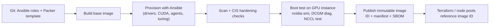
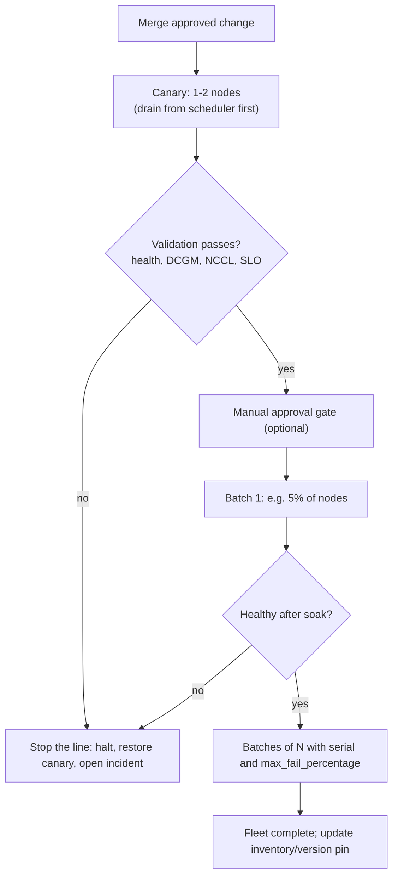

# 4.2 CI/CD pipelines: concepts and design

| | |
|---|---|
| Level | Intermediate |
| Priority tier | 0 |
| Lab venue | GitHub/GitLab runner or local `act`; Terraform/OpenTofu, Ansible, Conftest, Packer optional |
| Part | Part 4: Automation and infrastructure as code |
| Status | Drafted, labs **untested** |

## Why this matters for AI infrastructure

Application CI/CD ships a stateless artefact that can be rolled back in seconds. Infrastructure CI/CD changes stateful, shared, expensive and sometimes physical things: GPU nodes that cost tens of dollars per hour, InfiniBand fabrics, Slurm controllers, firmware, storage clusters holding checkpoints. A wrong merge can idle a thousand GPUs, delete a bucket, or take a fabric offline. The discipline is therefore different: pipelines must produce **evidence** (what will change, is it safe, who approved) before anything **mutates**, must limit blast radius, must be auditable, and must hold the keys to production without becoming the easiest way to compromise it. This chapter explains the concepts and design patterns (tool specifics for Terraform, Ansible and GitOps follow in 4.3 to 4.27).

## Prerequisites and outcomes

Needs 4.1 (Git workflow). After this chapter you can:

- Contrast application CI/CD with infrastructure CI/CD and explain "CI produces evidence, CD controls mutation".
- Design a pipeline with stages for static analysis, security scanning, policy checks, plans, tests, approvals, deployment, verification and rollback.
- Use pull requests as the control plane (plan on PR, apply on merge) and know Atlantis, GitHub Actions, GitLab CI, Jenkins, and AWX/AAP roles.
- Authenticate pipelines without long-lived secrets (OIDC federation); manage secrets in pipelines; apply least privilege per environment.
- Apply policy as code (OPA/Rego, Conftest, Sentinel, Checkov), golden image pipelines (Packer), canary and batch rollouts for physical fleets, and drift detection.
- Test infrastructure code at several levels and decide what runs on every commit versus nightly.

## 1. Application CI/CD versus infrastructure CI/CD

| Dimension | Application pipeline | Infrastructure pipeline |
|---|---|---|
| Artefact | Immutable build (image, binary) | Desired-state code plus a computed **change set** (plan/diff) |
| Target | Stateless, replicated | Stateful, shared, sometimes physical |
| Failure cost | Rollback in seconds | Destroys data, strands capacity, may be unrecoverable |
| Test environments | Cheap ephemeral | Expensive; GPU clusters and fabrics rarely duplicable |
| Rollback | Redeploy previous version | Revert code **and** reconcile reality; some changes (firmware, deleted volumes, migrated data) cannot be undone |
| Trigger | Every merge, many times a day | Fewer, reviewed, often windowed; blast-radius-aware |
| Credentials | Deploy token to a registry/cluster | Broad cloud/admin credentials: the highest-value secrets in the company |

Consequences: plan before apply, human approval for risky changes, narrow permissions, staged rollout, and drift detection because the real world changes outside the pipeline (console clicks, autoscalers, hardware failures).

## 2. Core principles

1. **CI produces evidence; CD controls mutation.** Continuous integration answers "is this change well-formed, safe and understood?" with logs, lint results, plans, policy decisions and test reports attached to the pull request. Continuous delivery/deployment is the controlled application of an *approved, specific* change. Never let a pipeline apply something nobody saw.
2. **Plan-then-apply of the same artefact.** Save the plan (`terraform plan -out=tfplan`), review it, and apply exactly that file; re-planning at apply time can produce a different change than the one approved.
3. **Everything as code, reviewed in Git** (4.1): the repository is the source of truth; the pipeline is a transformation from commit to environment.
4. **Environments are configuration, promotion is a commit.** The same module and artefact flow dev, staging, prod; only variables differ.
5. **Least privilege and separation of duties.** Plan jobs get read-only credentials; apply jobs get write credentials only for their environment, run only on protected branches, and need approval; the author cannot be the sole approver.
6. **Idempotent, repeatable, observable.** Re-running a failed pipeline is safe; every run is logged with commit, actor, plan hash and result.
7. **Small batches, fast feedback.** Short pipelines for most changes; heavier checks nightly; smaller change sets limit blast radius.
8. **The pipeline is production software**: version it, test it, monitor its health, protect its runners and secrets, and treat compromise of CI as compromise of production.

## 3. Pipeline anatomy

```mermaid
flowchart LR
  A["Pull request"] --> B["Static analysis\nfmt, validate, lint, yamllint, shellcheck"]
  B --> C["Security & secrets scan\ngitleaks, trivy/checkov, tfsec"]
  C --> D["Plan / dry-run / diff\nterraform plan, ansible --check, helm template"]
  D --> E["Policy as code\nOPA/Conftest, Sentinel, cost checks"]
  E --> F["Unit / integration tests\nmolecule, terratest, kind"]
  F --> G["Human review + approval\nCODEOWNERS, environment gates"]
  G --> H["Merge to main"]
  H --> I["Deploy: apply saved plan\nstaging then canary then fleet"]
  I --> J["Verify\nsmoke tests, health checks, SLO watch"]
  J -->|fail| K["Rollback / stop the line"]
  J -->|ok| L["Promote next env"]
```



Typical stages and what belongs in each:

- **Static checks (seconds)**: formatting (`terraform fmt -check`, `ruff`, `yamllint`), syntax/validation (`terraform validate`, `ansible-playbook --syntax-check`, `helm lint`, `kubeconform`), linters (`tflint`, `ansible-lint`, `hadolint`, `shellcheck`, `actionlint`).
- **Security scans**: secret detection (gitleaks, trufflehog), IaC misconfiguration scanners (Checkov, tfsec/trivy config, KICS), dependency and container image scanning (trivy, grype), licence checks, SBOM generation.
- **Plan / dry run**: compute and publish the change set as a PR comment and an immutable artefact: `terraform plan`, `ansible-playbook --check --diff`, `helm diff`, `kubectl diff`, `argocd app diff`. The plan is the review object.
- **Policy gates**: machine-enforced rules over the plan or manifests (no public buckets, required tags, allowed instance types, region allow-list, cost ceilings, no deletion of protected resources, network ingress limits). Section 7.
- **Tests**: unit-style (render templates, evaluate modules), integration in ephemeral environments (kind clusters, containers, a small cloud sandbox), and end-to-end on a staging slice; section 10.
- **Approval**: protected environments with required reviewers for production, manual gates for high blast radius, change-window checks.
- **Deploy**: apply the approved artefact with concurrency control (one apply per state/env at a time), staged by environment and by fleet slice.
- **Verify and observe**: smoke tests, health checks, SLO/alert watch for a soak period; automatic halt on regression.
- **Rollback / roll-forward policy**: for stateless pieces revert and redeploy; for stateful ones prefer roll-forward with a prepared fix, backups and tested restore procedures; document irreversible changes.

## 4. Pull requests as the control plane

For Terraform the dominant pattern is: **plan on pull request, apply on merge (or on an approved comment)**, with the PR as the audit trail. Tools:

- **Atlantis** (self-hosted): a server receiving webhooks; comments `atlantis plan` / `atlantis apply` on the PR; locks the workspace while a plan is pending so two PRs cannot apply conflicting changes; configured by `atlantis.yaml` (projects, workflows, `apply_requirements: [approved, mergeable]`) and server-side repo allow-lists that control what repos may override. It centralises credentials on one hardened server.
- **GitHub Actions / GitLab CI** doing the same with workflow files: PR event runs `plan` and posts it; a protected environment gates `apply` on `main`. Easier to adopt, but you must design locking (concurrency groups, state locks) and credentials carefully.
- **Terraform Cloud / HCP Terraform, Spacelift, env0, Scalr**: managed runs with policy, remote state, drift detection and RBAC.
- **Argo CD / Flux** for Kubernetes: PR changes manifests; the in-cluster controller applies after merge (4.26). **AWX / Ansible Automation Platform**: CI triggers job templates so playbooks run on a controller with credentials, RBAC, inventory and audit trail (4.15).

Design rules: only a merge to the protected branch can apply; the applied plan must match the reviewed commit; concurrency groups per environment/state; PR comments must not leak secrets (mask outputs, mark sensitive values); fork PRs never receive credentials.

## 5. Authentication: OIDC instead of stored keys

Long-lived cloud keys in CI secrets are a classic breach path. **OpenID Connect federation** lets the CI provider mint a short-lived signed identity token for each job; the cloud trusts the issuer and exchanges the token for temporary credentials scoped by claims (repository, branch, environment).

```yaml
# GitHub Actions: no stored cloud keys
permissions:
  id-token: write          # allow the job to request an OIDC token
  contents: read
jobs:
  plan:
    runs-on: ubuntu-latest
    steps:
    - uses: actions/checkout@v4
    - uses: google-github-actions/auth@v2          # example: GCP Workload Identity Federation
      with:
        workload_identity_provider: projects/123/locations/global/workloadIdentityPools/ci/providers/github
        service_account: tf-plan@my-project.iam.gserviceaccount.com
    - run: terraform init -input=false && terraform plan -input=false -out=tfplan
```

On the cloud side, bind the identity to a service account with a **condition** on the claim (for example `repo:org/infra` and `ref:refs/heads/main` for apply, any PR for read-only plan) so a pull request from a fork or a feature branch cannot assume the apply role. The same pattern exists for AWS (IAM role with web identity trust policy), Azure (federated credentials) and Vault (JWT auth). Use separate identities for plan (read-only) and apply (write, protected environment).

**Secrets in pipelines**: prefer fetching at run time from a secret manager (Vault, cloud secret manager) using the OIDC identity; use masked variables only when unavoidable; never print them; remember that values read into Terraform data sources land in the **state file**, so the state backend is a secret store and must be encrypted and access-controlled (4.19, 4.22); for Git-stored secrets use SOPS with KMS/age or sealed secrets (4.12).

## 6. A reference GitHub Actions pipeline

```yaml
name: infra
on:
  pull_request:
    paths: ["terraform/**", "ansible/**", ".github/workflows/infra.yml"]
  push:
    branches: [main]
permissions: { contents: read, pull-requests: write, id-token: write }
concurrency:                                   # one pipeline per environment at a time
  group: infra-${{ github.ref }}
  cancel-in-progress: false                    # never cancel an in-flight apply

jobs:
  static:
    runs-on: ubuntu-latest
    steps:
    - uses: actions/checkout@v4
    - uses: hashicorp/setup-terraform@v3
    - run: terraform fmt -check -recursive terraform/
    - run: |
        cd terraform/envs/staging
        terraform init -backend=false -input=false && terraform validate
    - run: pip install ansible-lint yamllint && yamllint . && ansible-lint ansible/
    - uses: gitleaks/gitleaks-action@v2

  plan:
    needs: static
    runs-on: ubuntu-latest
    steps:
    - uses: actions/checkout@v4
    - uses: hashicorp/setup-terraform@v3
    # cloud auth via OIDC (read-only role) goes here
    - run: |
        cd terraform/envs/staging
        terraform init -input=false
        terraform plan -input=false -lock-timeout=5m -out=tfplan
        terraform show -json tfplan > plan.json
    - name: Policy check
      run: conftest test terraform/envs/staging/plan.json --policy policies/
    - uses: actions/upload-artifact@v4
      with: { name: tfplan, path: terraform/envs/staging/tfplan }

  apply-staging:
    if: github.ref == 'refs/heads/main'
    needs: plan
    runs-on: ubuntu-latest
    environment: staging                       # protected environment: reviewers, wait timer, branch rule
    steps:
    - uses: actions/checkout@v4
    - uses: hashicorp/setup-terraform@v3
    - uses: actions/download-artifact@v4
      with: { name: tfplan, path: terraform/envs/staging }
    - run: cd terraform/envs/staging && terraform init -input=false && terraform apply -input=false tfplan
```

(Action versions and flags are examples; pin to reviewed versions.) Production usually adds a second protected environment (`prod`) with required reviewers, a saved plan generated against the prod state, a change-window check, and a post-apply verification job. In a monorepo use path filters or a changed-directory matrix so a change to `envs/staging` does not plan production.

Equivalent patterns in other systems: GitLab CI (`stages`, `rules`, `environment:` with `when: manual`, protected variables, `resource_group` for locking), Jenkins (declarative pipeline with `input` approval steps and credential binding), Buildkite or Argo Workflows for heavy jobs on your own hardware.

## 7. Policy as code

Humans miss things; policies do not get tired. Evaluate **machine-readable plans or manifests** against rules before merge or apply.

- **OPA / Rego + Conftest**: general-purpose; run `terraform show -json tfplan | conftest test -`, or on Kubernetes manifests and Helm output. **Sentinel** (HashiCorp Enterprise), **Checkov**/**tfsec**/**trivy config** (rule libraries), **Kyverno** and **Gatekeeper** (admission control inside Kubernetes, enforcing the same policies at runtime), **Cloud Custodian** (cloud resource policies).

```rego
package terraform.cost
import rego.v1

restricted_types := {"p5.48xlarge", "p4d.24xlarge"}            # high-cost GPU instances (example list)

created contains rc if {
    some rc in input.resource_changes
    rc.type == "aws_instance"
    "create" in rc.change.actions
    rc.change.after.instance_type in restricted_types
}

deny contains msg if {
    count(created) > 16
    not input.planned_values.root_module.resources[_].values.tags["Override-Capacity"]
    msg := sprintf("plan creates %d restricted GPU instances; add the Override-Capacity tag after approval", [count(created)])
}

deny contains msg if {
    some rc in input.resource_changes
    "delete" in rc.change.actions
    rc.change.before.tags["Mission-Critical"] == "true"
    msg := sprintf("%s is tagged Mission-Critical and cannot be deleted by pipeline", [rc.address])
}
```

(Rego syntax differs between OPA versions; the example uses the 1.x style.) Useful policy domains for AI infrastructure: **cost** (instance family allow-lists, maximum GPU count per plan, budget tags), **network** (no `0.0.0.0/0` on management ports, no public IPs on GPU nodes, required flow logs, MTU/jumbo settings on training networks), **IAM** (no wildcard admin, no long-lived keys, MFA, boundary policies), **data** (encryption at rest, bucket public-access block, retention on checkpoint buckets), **tagging** (owner, cost-centre, environment), **region/residency**, and **protected resources** (deny deletion of state buckets, production databases, shared storage). Treat policy changes like code: reviewed, tested with allow/deny fixtures, versioned, with an explicit break-glass process and logged overrides.

## 8. Golden images as pipeline artefacts

Fleets of GPU nodes should boot from **versioned, tested images** rather than being configured by hand after boot. A golden image pipeline (HashiCorp **Packer**, Image Builder, or `virt-customize`/OS-specific tooling) runs: base OS, Ansible roles (drivers, CUDA, container runtime, monitoring agents, kernel parameters), hardening, vulnerability scan, boot/driver smoke test on a real GPU instance (`nvidia-smi`, a short NCCL test), then publishes an immutable image ID plus metadata (git SHA, driver version, CUDA version, kernel, date, SBOM). Terraform or the provisioning system references the image version by ID; rollouts replace nodes rather than mutating them. Trigger rebuilds on base image updates, security advisories and role changes, and keep N previous images for rollback.



Packer builds can be slow and expensive on GPU instances: run smoke tests on the smallest GPU shape that exercises the stack, and run broader qualification in a separate scheduled job.

## 9. Rolling out to physical and large fleets

Applying a change "to everything" is the way to learn that it was wrong on every node at once. Staged rollout for fleets (Slurm clusters, bare-metal nodes, Kubernetes node pools):



Practices: drain nodes from the scheduler before disruptive changes (`scontrol update NodeName=... State=DRAIN Reason="..."`, `kubectl drain`), apply with limited concurrency (Ansible `serial:` and `max_fail_percentage`, rolling node-pool updates with `maxUnavailable`), run a **validation playbook** after each batch (driver loaded, GPUs visible, ECC clean, fabric links up at expected speed, a short NCCL all-reduce within tolerance, Slurm `sinfo` state), return nodes to service only when healthy, and make the pipeline stop automatically on failure thresholds. Include maintenance windows and capacity checks so a rollout never drains more than the SLO allows, and record every step for the post-incident timeline. Firmware and BIOS changes need extra care: stage by hardware generation, keep the previous version available, and verify the BMC reachable before and after (Part 7).

## 10. Testing infrastructure code

| Level | What | Tools | When |
|---|---|---|---|
| Static | Syntax, style, schema, security smells | `terraform validate/fmt`, `tflint`, `ansible-lint`, `yamllint`, `kubeconform`, `checkov` | Every commit |
| Unit-ish | Render templates; evaluate modules with mock inputs; policy tests | `terraform test` (mock providers), Conftest unit tests, Jinja rendering with golden outputs | Every commit |
| Plan-level | Is the diff what we intended? Does it respect policy? | `terraform plan`, `ansible --check --diff` | Every PR |
| Integration | Apply into an ephemeral environment and assert | Terratest (Go), `terraform test` with real providers, Molecule + testinfra, kind/k3d for Kubernetes | PR (small) or nightly |
| End-to-end | Real stack on a representative slice | Staging cluster, NCCL/nccl-tests, MLPerf-style smoke jobs | Pre-prod, nightly |
| Operational | Backup restore, failover, drift, chaos | Game days, restore drills, `terraform plan` on schedule | Scheduled |

Principles: the cost of a test should match the risk it covers; destroy ephemeral environments automatically (budgets and TTL tags guard against leaks); keep integration tests deterministic with unique names; flaky infra tests are bugs. Pre-commit hooks (4.1) run the cheapest checks locally; CI repeats them as required checks.

## 11. Drift detection and self-healing

Drift is the difference between code and reality: a console edit, an autoscaler, manual hotfix, failed partial apply or a hardware replacement. Detect it **on a schedule**:

- `terraform plan -detailed-exitcode` (exit code 2 means changes pending) in a nightly job per environment, posting results to chat/ticket; do not auto-apply for stateful resources.
- Argo CD/Flux continuously compare the cluster to Git and can auto-revert (`selfHeal`) or alert; Ansible `--check --diff` against fleets reveals configuration drift on hosts; AWX scheduled jobs can enforce desired state.
- Decide per resource class: **auto-heal** (stateless Kubernetes objects, config files) versus **alert only** (databases, buckets, networks, anything where a revert could destroy data), and record accepted exceptions.

```yaml
# nightly drift check (sketch)
on: { schedule: [ { cron: "0 3 * * *" } ] }
jobs:
  drift:
    runs-on: ubuntu-latest
    steps:
    - uses: actions/checkout@v4
    - run: |
        cd terraform/envs/prod
        terraform init -input=false
        set +e; terraform plan -input=false -detailed-exitcode -lock=false -out=drift.tfplan; rc=$?; set -e
        if [ "$rc" = 2 ]; then echo "DRIFT DETECTED"; terraform show -no-color drift.tfplan | head -200; exit 2; fi
```

## 12. Operating the pipeline itself

- **Runners**: ephemeral and isolated; self-hosted runners with network access to private infrastructure are high-value targets: run them in a restricted network zone, rebuild per job (containers or VMs), no shared state, no persistent credentials, egress filtering. GPU runners are labelled and reserved for GPU tests.
- **Supply chain**: pin actions and images by digest, verify checksums/signatures of Terraform providers and tools (`.terraform.lock.hcl`), mirror dependencies, restrict who can edit workflows (CODEOWNERS on `.github/`), treat `pull_request_target` and untrusted inputs (branch names, PR titles) as injection vectors, never interpolate untrusted values into shell commands.
- **Concurrency and locking**: state locking (backend), CI concurrency groups, Atlantis locks; never run two applies against one state; avoid cancelling in-flight applies.
- **Observability**: pipeline duration, failure rate, queue time, flake rate, change failure rate and mean time to recovery (the DORA metrics); alert on stuck applies and on long-lived pending plans.
- **Break-glass**: a documented, logged, time-limited path for emergency manual changes, followed by a reconciliation commit so Git matches reality.
- **Notifications and auditability**: plan and apply summaries to chat; keep logs and plan artefacts for the retention period required by compliance.

## 13. Lab (untested)

1. **Pipeline skeleton**: create a repo with a tiny Terraform config (null/random providers or a local-only config) and an Ansible playbook; add the static job (fmt, validate, yamllint, ansible-lint, gitleaks). Break each check deliberately and watch the PR fail.
2. **Plan on PR**: add the plan job producing `tfplan` and posting the output as a PR comment; confirm the apply job downloads and applies exactly that artefact; change code after approval and observe the plan mismatch behaviour.
3. **Environments and approvals**: define `staging` and `prod` environments with required reviewers; try to apply from a feature branch (should be denied); add concurrency groups and verify two simultaneous runs serialise.
4. **OIDC**: configure workload identity federation to a sandbox cloud project (or a Vault JWT role); assert a feature-branch job gets read-only access and cannot assume the apply role; remove all static cloud secrets from the repo.
5. **Policy as code**: write the Rego cost and deletion policies; build allow/deny JSON fixtures; run `conftest verify`; wire into the pipeline; demonstrate a denial and the break-glass tag process.
6. **Atlantis (optional)**: run Atlantis locally with `ngrok`/tunnel on a test repo; observe workspace locking with two PRs.
7. **Golden image**: write a Packer template that builds a container or VM image with an Ansible role, scans it with trivy, runs a smoke test and publishes an image manifest with git SHA; switch a Terraform variable to the new image ID.
8. **Fleet rollout**: simulate 20 hosts (containers); write a rollout playbook with a canary group, a validation play, `serial: 5`, `max_fail_percentage: 10`; inject a failure on the canary and confirm the pipeline stops; inject a failure at batch 3 and confirm the halt threshold.
9. **Drift**: apply Terraform, change a resource out-of-band, and run the nightly drift job; resolve once by reapplying and once by importing/adopting the change; document the decision.
10. **Pipeline security review**: list every secret and permission your pipeline uses; replace long-lived ones with OIDC; test a malicious PR that edits the workflow and one that injects shell via branch name; apply fixes (CODEOWNERS on workflows, no `pull_request_target`, quoted inputs).
11. **Metrics**: compute lead time, deployment frequency, change failure rate and time to restore from your repo history for one month.
12. **Clean up.**

Mark tested only after execution.

## 14. Common mistakes

- Re-planning at apply time instead of applying the reviewed plan artefact.
- Pipelines with admin credentials stored as long-lived secrets; one identity for plan and apply; fork PRs able to read secrets.
- No locking or concurrency control: two applies racing on one state or one fleet.
- Branch-per-environment instead of directory/variable-per-environment.
- Auto-applying on merge to production with no approval, window or verification; auto-heal for stateful resources.
- Applying to the whole fleet at once; no canary, no validation, no halt threshold.
- Policies that nobody can test or override cleanly, leading to disabled gates.
- Treating secrets in Terraform data sources as safe while the state file is world-readable.
- Slow, flaky pipelines that people bypass; checks that are optional rather than required.
- Unpinned actions, runners, providers and tool versions; self-hosted runners that retain state between jobs.
- No drift detection, so Git slowly stops describing reality.
- Rollback plans that assume everything is reversible.

## 15. Interview angles

- "How is infrastructure CI/CD different from application CI/CD?" (state, blast radius, evidence versus mutation.)
- "Design a pipeline for Terraform changes to a GPU cluster." (static, plan artefact, policy, approvals, apply of saved plan, verification, drift.)
- "How do you give CI access to the cloud securely?" (OIDC federation, scoped claims, separate plan/apply identities.)
- "How do you roll out a kernel parameter or driver change to 1,000 GPU nodes?" (drain, canary, validate, batches, halt rules.)
- "What is policy as code and what policies would you enforce?" (cost, network, IAM, tagging, protected resources.)
- "Push versus pull deployment: when each?" (CI-driven apply versus GitOps controllers.)
- "How do you detect and handle drift?" (scheduled plans, GitOps compare, auto-heal vs alert.)
- "What makes a pipeline itself a security risk and how do you reduce it?" (runner isolation, supply chain pins, workflow protection, least privilege.)
- "How would you test Ansible roles and Terraform modules?"

## 16. Checkpoint questions (35)

1. What does "CI produces evidence, CD controls mutation" mean? **A:** CI gathers proof about a change; CD applies only approved changes.
2. Why save the plan file? **A:** Apply exactly what was reviewed.
3. Why is infra rollback harder than app rollback? **A:** State, data loss, shared resources, irreversible actions.
4. What goes in static checks? **A:** fmt, validate, lint, syntax, schema.
5. What is a plan/diff used for? **A:** The reviewable change set.
6. What is policy as code? **A:** Machine-enforced rules over plans/manifests.
7. Name two policy engines. **A:** OPA/Conftest, Sentinel (also Kyverno/Gatekeeper, Checkov).
8. What does Atlantis do? **A:** Runs Terraform plan/apply from PR comments with locking.
9. What is OIDC federation in CI? **A:** Short-lived identity tokens exchanged for temporary cloud credentials.
10. Why separate plan and apply identities? **A:** Least privilege: plan read-only.
11. What claim conditions should gate the apply role? **A:** Repository, protected branch, environment.
12. Why is the state file sensitive? **A:** May contain secrets read via data sources.
13. What does `concurrency` with `cancel-in-progress: false` protect? **A:** Prevents cancelling an in-flight apply.
14. What do protected environments add? **A:** Required reviewers, wait timers, branch rules.
15. What does `terraform plan -detailed-exitcode` return for pending changes? **A:** Exit code 2.
16. What is drift? **A:** Reality differing from code.
17. Auto-heal vs alert-only: when each? **A:** Stateless config auto-heal; stateful resources alert.
18. What is a golden image pipeline? **A:** Build, harden, test and publish versioned immutable images.
19. What smoke tests for a GPU image? **A:** `nvidia-smi`, DCGM diag, short NCCL test.
20. Why reference images by immutable ID? **A:** Reproducible rollouts and rollbacks.
21. What is a canary rollout? **A:** Apply to a few nodes, validate, then expand.
22. What do `serial` and `max_fail_percentage` do? **A:** Batch size and failure halt threshold in Ansible.
23. Why drain nodes first? **A:** Avoid disrupting running jobs.
24. Test pyramid levels for IaC? **A:** Static, unit/render, plan, integration, end-to-end, operational.
25. What tools test Terraform modules? **A:** `terraform test`, Terratest.
26. What tools test Ansible roles? **A:** Molecule with testinfra.
27. Why ephemeral runners? **A:** No persistent state/credentials to steal.
28. What is a supply-chain control for actions? **A:** Pin by SHA/digest, restrict workflow edits.
29. Why avoid `pull_request_target` with untrusted code? **A:** It runs with secrets in the base context.
30. What are DORA metrics? **A:** Lead time, deploy frequency, change failure rate, time to restore.
31. What is break-glass? **A:** Logged emergency path followed by reconciliation commit.
32. Why environments as directories? **A:** Same code, different config; promotion by commit.
33. What blocks two applies on one state? **A:** Backend state locking plus CI concurrency.
34. What should a PR comment never include? **A:** Secrets/sensitive outputs.
35. What does Argo CD `selfHeal` do? **A:** Reverts out-of-band changes to match Git.

## 17. Sources and review notes

**Written in original words.** Principal sources:

- Jason Edelman, Scott Lowe and Matt Oswalt, *Network Programmability and Automation* (chapter 13 on continuous integration and delivery for network automation).
- Rene Moser and Lorin Hochstein, *Ansible: Up and Running* (chapter 22 on using Ansible with other tools and CI integration).
- The author's `nvidia-devops` repository, volume 10 chapter 11 (CI/CD for infrastructure and cluster configuration: evidence versus mutation, Atlantis, Argo CD and Flux, AWX integration, an OIDC-based GitHub Actions pipeline, OPA policies for cost, network and IAM, golden image pipelines with Packer, secrets management, canary rollouts for physical fleets, drift detection).
- Tool documentation for Terraform/OpenTofu, Atlantis, GitHub Actions, GitLab CI, OPA/Conftest and Packer.
- Examples are the author's constructions.

**Flagged for verification before publishing:** action and tool versions, Rego syntax for the OPA version in use, OIDC claim names and provider setup per cloud, Atlantis configuration keys, GPU instance type lists in the example policy, platform feature names (protected environments, `resource_group`), and every code listing; all labs are **untested**.
