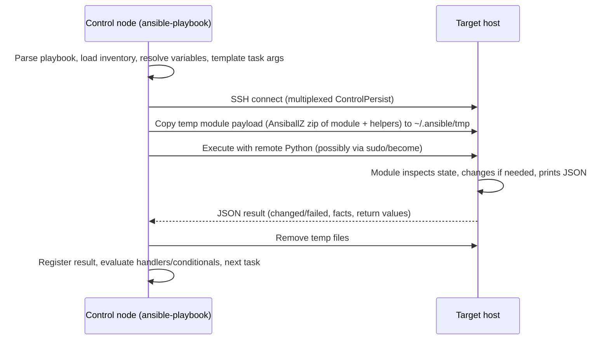

# 4.3 Ansible from zero: what it is, how it works, installation and ad-hoc commands

| | |
|---|---|
| Level | Beginner |
| Priority tier | 0 |
| Lab venue | Control node with Python 3.10+; 2 to 3 target Linux hosts reachable over SSH (Vagrant, multipass, Docker with sshd, or cloud VMs) |
| Part | Part 4: Automation and infrastructure as code |
| Status | Drafted, labs **untested** |

## Why this matters for AI infrastructure

A GPU cluster is hundreds of nearly identical Linux machines that must have the same kernel parameters, the same driver and CUDA stack, the same container runtime, the same monitoring agents and the same NCCL environment, and that must be changed in a controlled way when a security advisory or a driver release arrives. Doing that by SSH-ing into machines is slow and error-prone; writing bespoke shell scripts is brittle. Ansible is the de facto tool for configuration management and fleet operations in HPC and AI environments (NVIDIA's DeepOps and many BCM/Slurm deployments are Ansible-driven, and Kubespray installs Kubernetes with it) because it is **agentless** (SSH is the only requirement on targets, which matters on bare metal and appliances), **declarative and idempotent**, readable by operators who are not programmers, and extensible. This chapter builds the mental model and gets you running commands across a fleet; the following chapters add inventories, playbooks, templates, roles and scale.

## Prerequisites and outcomes

You need SSH and basic Linux administration (Part 1) and Python basics (Part 3). After this chapter you can:

- Explain what Ansible does and does not do, and how a task becomes a module executed on a target.
- Compare Ansible with shell scripts, Puppet/Chef/Salt, Terraform and cloud-init, and choose appropriately.
- Install Ansible correctly (ansible-core versus the community package, collections, virtual environments, pipx, execution environments) and understand versioning.
- Configure `ansible.cfg`, SSH multiplexing, privilege escalation (`become`) and host key handling.
- Write a minimal inventory and run ad-hoc commands (`ping`, `command`, `shell`, `copy`, `package`, `service`, `setup`) against groups, with limits and forks.
- Explain idempotency, check mode, and why `command`/`shell` need care.
- Write and run a first playbook.

## 1. What Ansible is

Ansible is an automation engine that runs **tasks** (calls to **modules**) on **hosts** drawn from an **inventory**, organised into **plays** inside **playbooks**. You describe the desired state ("package `chrony` is installed, service `chronyd` is enabled and running, file `/etc/chrony.conf` has this content") in YAML; the module checks the current state and changes only what differs, reporting `ok` (already correct), `changed`, `failed`, `skipped` or `unreachable`.

Key properties:

- **Agentless, push-based.** The control node connects over SSH (or WinRM/PSRP for Windows, or local, or APIs for network devices and clouds), copies a small module to the target, executes it, collects JSON, and removes it. No daemon to install, patch or secure on targets; any host you can SSH to is manageable. (Contrast Puppet/Chef/Salt minions that *pull* from a server and need an agent.)
- **Declarative modules, procedural playbooks.** Modules express desired state; playbooks run tasks **top to bottom** in order, which is easy to reason about (and differs from Terraform's dependency graph).
- **Idempotent by design.** Running a playbook twice yields the same end state with no changes the second time (when modules and your tasks are written well). Idempotency is what makes automation safe to rerun after partial failure and usable for drift correction.
- **Batteries included.** Thousands of modules in collections: packages, services, users, files, templates, cloud providers, Kubernetes, network devices, databases, containers, BMC/Redfish, monitoring.
- **Simple to read, easy to audit.** YAML plus Jinja2 templating; playbooks double as documentation and are reviewable in Git.
- **Scales down and up.** One-liner on a laptop, parallel over thousands of hosts (forks, strategies, pull mode, AWX/AAP).
- **Extensible and embeddable (`ansible_runner`).** Custom modules (any language that emits JSON), plugins (inventory, lookups, filters, callbacks, connection), roles and collections for sharing. You can also invoke Ansible directly from Python services using **`ansible-runner`** (`r = ansible_runner.run(private_data_dir='./playbooks', playbook='playbook.yml'); print(r.status, r.rc, r.stats)`, `AUR` Chapter 1).
- **Origin of the name, system abstraction, and single-run execution vs. CFEngine convergence (`AUR` Chapter 1):**
  - *What's with the name Ansible?* As Bas Meijer, Lorin Hochstein, and René Moser note in *Ansible: Up and Running* Chapter 1, an *ansible* is a fictional faster-than-light communication device coined by Ursula K. Le Guin in *Rocannon's World* (1966) and used by Orson Scott Card in *Ender's Game* (1985) to command fleets of remote ships simultaneously across vast distances—the metaphor cofounder Michael DeHaan chose for controlling fleets of remote servers at once.
  - *System abstraction (`file` and `package` vs shell scripts):* In a shell script, creating a secure directory requires three imperative commands (`mkdir -p /etc/skel/.ssh && chown root:root /etc/skel/.ssh && chmod go-wrx /etc/skel/.ssh`). In Ansible, a single declarative `file` task (`path: /etc/skel/.ssh`, `mode: '0700'`, `owner: root`, `group: root`, `state: directory`) or cross-distro `package` task (`name: nginx`, abstracting `apt`, `dnf`, and `yum`) enforces the state in one step.
  - *Single-run top-to-bottom execution vs. CFEngine eventual convergence:* Older configuration management systems like Mark Burgess's **CFEngine** (and Puppet) rely on multi-pass *convergence* toward eventual consistency. Ansible executes tasks deterministically **top to bottom in a single pass** across `web1`, `web2`, and `web3` (waiting for all hosts to complete task 1 before starting task 2), which makes **multitier orchestration**—such as registering monitoring maintenance windows, draining a web server from the load balancer, migrating the database, and upgrading the web servers in strict sequence—straightforward in a push model. And if you ever need pull-based execution at massive scale without a central master, Ansible includes **`ansible-pull`** to pull and run playbooks directly from a Git repository on each node.

What it is **not**: a continuous reconciliation loop (it acts when you run it, unless triggered by a scheduler, `ansible-pull` or AAP), a provisioning engine with state like Terraform (no state file; it learns state by inspecting hosts every run), or a great place for complex programming logic (push complexity into modules). Note also the terminology difference with **Vagrant** (`AUR` Chapter 1): Vagrant calls hypervisors like VirtualBox or VMware *providers* (which create virtual *machines* from base images called *boxes*) and calls configuration management tools like Ansible *provisioners*.

### Where it fits

| Tool | Role | Relationship |
|---|---|---|
| Terraform/OpenTofu | Create cloud/network resources, keeps state | Provision machines; Ansible configures what runs on them (4.17, 4.27) |
| cloud-init | First-boot bootstrap | Seeds SSH keys/users; Ansible does the real configuration |
| Packer | Build images | Uses Ansible as provisioner (4.2) |
| Puppet/Chef/Salt | Agent-based continuous convergence | Alternatives; stronger for constant enforcement, heavier to operate |
| Shell scripts | Glue | Not idempotent, hard to reuse; Ansible modules replace most |
| Kubernetes/Helm/Argo | Workloads on clusters | Ansible installs clusters (Kubespray) and nodes, not the application layer |
| Slurm | Job scheduling | Ansible installs and configures Slurm and its nodes (Part 6) |

## 2. How Ansible executes a task



Details that explain behaviour you will meet:

- **Target Python**: most modules run on the target with its Python interpreter (`ansible_python_interpreter`; Ansible discovers `/usr/bin/python3` automatically). Minimal images without Python need the `raw` module (or `ansible.builtin.script`) to bootstrap Python first, or `gather_facts: false`. Network devices usually run modules on the control node (`connection: local`/`network_cli`/`httpapi`).
- **Parallelism**: each task runs across hosts in parallel up to `forks` (default 5; raise to 20 to 200 for fleets), then Ansible waits for all hosts before the next task (the default `linear` strategy). `strategy: free` lets hosts proceed independently; `serial:` batches hosts for rolling updates (4.14).
- **Facts**: unless disabled, each play starts with `setup`, collecting host facts (distribution, kernel, CPUs, memory, interfaces, mounts) into `ansible_facts`. Facts power conditionals and templates but cost time; use `gather_subset`, fact caching, or `gather_facts: false` when not needed.
- **Connection reuse**: SSH **ControlMaster/ControlPersist** multiplexes many commands over one connection; **pipelining** (`pipelining = True`) reduces SSH round trips by streaming the module over stdin (requires `requiretty` off in sudoers). These two settings are the biggest easy speed-ups.
- **Templating**: task arguments are Jinja2 templates evaluated on the control node before sending; the target never needs Jinja.
- **Result semantics**: a module returns `changed`/`failed`/`rc`/output; `register` stores it; `failed_when`/`changed_when` override judgements; `ignore_errors` continues; unreachable hosts are removed from the run unless configured otherwise.

## 3. Installation and versions

### Components and versions

- **ansible-core**: the engine (CLI tools, `ansible.builtin` modules, plugin framework). Versioned `2.x` (for example 2.16, 2.17, 2.18); each has a Python requirement for the control node and a separate, often narrower, Python support range for targets.
- **ansible** (the community package): ansible-core plus a curated bundle of collections, versioned `9.x`, `10.x`, ... Convenient but large; production setups often install `ansible-core` and pin only the collections they use in `requirements.yml`.
- **Collections** (`namespace.name`, like `community.general`, `ansible.posix`, `kubernetes.core`, `nvidia.*`) package modules, roles and plugins; install with `ansible-galaxy collection install -r requirements.yml`. Modules are referenced by **fully qualified collection name (FQCN)** such as `ansible.builtin.copy`. Always use FQCNs; short names are ambiguous and ansible-lint flags them.
- **Execution environments (EE)**: container images that bundle ansible-core, collections, Python dependencies and system libraries, built with `ansible-builder` and run with `ansible-navigator` or in AAP/AWX. They end "works on my laptop" by making the runtime reproducible (4.15).
- **Check supported combinations** in the Ansible release/support matrix before upgrading; a core upgrade can change module behaviour and deprecate features. To manage thousands of modules and more than 20,000 community roles (`AUR` Chapter 1), the project reorganized content into three tiers: (1) **Core components** (`ansible-core`, created by the Ansible team), (2) **Certified content** (created and supported by Red Hat and its partners via Automation Hub), and (3) **Community content** (shared on Ansible Galaxy). Note also that some plugins and modules have **loose Python dependencies** (`AUR` Chapter 2)—for example, managing Windows hosts or Docker containers requires `pip3 install pywinrm docker` inside your virtualenv (and if you ever test bleeding-edge Ansible from `git clone https://github.com/ansible/ansible.git --recursive`, you activate it with `source ./hacking/env-setup`).

### Setting up a local test environment with Vagrant (`AUR` Chapter 2)

In *Ansible: Up and Running* Chapter 2, the authors use **Vagrant + VirtualBox** to boot disposable Linux VMs (`ubuntu/focal64`, `centos/stream8`) on a laptop before touching cloud or bare-metal servers:
- **Booting and inspecting SSH parameters (`vagrant up` and `vagrant ssh-config`):** Running `vagrant init ubuntu/focal64 && vagrant up` imports the base box, attaches a NAT adapter forwarding host port `2222` to guest port `22` (`127.0.0.1:2222`), and mounts the current directory at `/vagrant`. Because Ansible connects with the standard OpenSSH client rather than `vagrant ssh`, running **`vagrant ssh-config`** reveals the exact connection parameters (`HostName 127.0.0.1`, `User vagrant`, `Port 2222`, `IdentityFile .vagrant/machines/default/virtualbox/private_key`—note that since Vagrant 1.7, Vagrant generates a unique private key per VM rather than sharing `$HOME/.vagrant.d/insecure_private_key`), which map directly to `inventory/vagrant.ini`:
  ```ini
  [webservers]
  testserver ansible_port=2222
  [webservers:vars]
  ansible_host=127.0.0.1
  ansible_user=vagrant
  ansible_private_key_file=.vagrant/machines/default/virtualbox/private_key
  ```
- **Networking, SSH agent forwarding, and provisioners in `Vagrantfile` (`Examples 2-3` to `2-6`):** Since a `Vagrantfile` is executable **Ruby** code, you can forward web ports (`config.vm.network :forwarded_port, host: 8080, guest: 80` and `host: 8443, guest: 443`), assign a direct host-accessible IP (`config.vm.network "private_network", ip: "192.168.33.10"`), enable SSH agent forwarding (`config.ssh.forward_agent = true` so the VM can `git clone` private repositories using your laptop's SSH agent), use plugins (`vagrant-hostmanager` to manage `/etc/hosts` across VMs and `vagrant-vbguest`), or loop over a `config.json` array (`f = JSON.parse(File.read('config.json')); f.each do |g| ...`) to define 15 Linux distributions (`vagrant up focal`, `vagrant up centos8`). Vagrant also supports two built-in Ansible provisioners: **`config.vm.provision "ansible"`** (runs Ansible from your host machine) and **`config.vm.provision "ansible_local"`** (installs and runs Ansible inside the guest VM itself, useful when the host is Windows without WSL2), re-triggered on demand via `vagrant provision`, `vagrant reload --provision`, or `vagrant up --no-provision`, and torn down cleanly via `vagrant destroy -f` (*"Kill Your Darlings"*).

### Install on the control node

Use an isolated environment, never system Python:

```bash
python3 -m venv ~/venvs/ansible && source ~/venvs/ansible/bin/activate
pip install --upgrade pip
pip install "ansible-core>=2.16,<2.19" ansible-lint yamllint     # pin to a tested range
# or isolated CLI tools:
pipx install --include-deps ansible
# or macOS: brew install ansible     (convenient; less controllable versioning)
ansible --version        # shows core version, config file, module search path, Python
ansible-galaxy collection install ansible.posix community.general
```

Pin versions in a `requirements.txt`/`requirements.yml` committed with the repo, so every engineer and CI use the same toolchain:

```yaml
# collections/requirements.yml
collections:
  - name: ansible.posix
    version: ">=1.5.0,<2.0.0"
  - name: community.general
    version: ">=8.0.0,<10.0.0"
  - name: kubernetes.core
```

The control node must be Linux or macOS (or WSL on Windows). Targets need SSH and a supported Python (Windows uses WinRM/SSH with PowerShell modules).

### Prepare targets

1. A user the control node can SSH to with key authentication (`ssh-keygen -t ed25519`; `ssh-copy-id user@host`). Prefer a dedicated automation user over personal accounts.
2. Passwordless `sudo` for that user for tasks that need root (or use `become` with a vaulted password; passwordless sudo restricted to needed commands is common; manage via `/etc/sudoers.d/ansible` validated with `visudo -cf`).
3. Python 3 installed; time synchronised; DNS or `/etc/hosts` resolution.
4. First-connection host key: `ssh-keyscan` into `known_hosts`, or `host_key_checking = False` for labs only. In production keep host key checking on (disabling it exposes you to man-in-the-middle attacks).

## 4. Configuration: ansible.cfg

Ansible reads settings from (first found wins, not merged): `ANSIBLE_CONFIG` env var, `./ansible.cfg` (current directory), `~/.ansible.cfg`, `/etc/ansible/ansible.cfg`. Environment variables and command-line flags override file values. Keep a project-level `ansible.cfg` in the repo root (the config file is only honoured from the current directory if it is not world-writable).

```ini
# ansible.cfg
[defaults]
inventory            = inventories/lab/hosts.yml
remote_user          = automation
forks                = 20
host_key_checking    = True
interpreter_python   = auto_silent
gathering            = smart                  ; use cached facts when available
fact_caching         = jsonfile
fact_caching_connection = .ansible_facts
fact_caching_timeout = 3600
roles_path           = roles
collections_path     = collections
retry_files_enabled  = False
stdout_callback      = yaml                   ; readable output (community.general.yaml or default with result_format=yaml)
callbacks_enabled    = timer, profile_tasks   ; show timing per task
timeout              = 30

[privilege_escalation]
become               = False                  ; enable per play/task
become_method        = sudo
become_ask_pass      = False

[ssh_connection]
pipelining           = True
ssh_args             = -o ControlMaster=auto -o ControlPersist=60s -o ServerAliveInterval=30
control_path_dir     = ~/.ansible/cp
```

Inspect effective configuration with `ansible-config dump --only-changed` and `ansible-config list`. Precedence: command line, environment, config file, defaults. In shared repositories avoid secrets or personal paths in `ansible.cfg`.

### Privilege escalation (become)

`become: true` runs a task as root via sudo (default); `become_user: postgres` switches to another user; `become_method`: `sudo`, `su`, `doas`, `pbrun`, and others. Common failures: missing tty (`requiretty`), password prompts without `--ask-become-pass`, `become_user` unprivileged-user temp file permissions (set `allow_world_readable_tmpfiles` only if you understand the risk, or install `acl`), and sudo rules not allowing the module path. As `AUR` Chapter 2 explains, **command-specific `sudoers` allow-lists and restricted shells (`rbash`) do not work with Ansible**: because Ansible uploads modules to temporary directories with random names (`~/.ansible/tmp/ansible-tmp-.../AnsiballZ_...py`) and invokes Python on those changing file paths, `sudo` cannot match a static command path. Instead, grant the dedicated automation group full `sudo` (`%ansible ALL=(ALL) ALL` or `NOPASSWD: ALL` in `/etc/sudoers.d/ansible`, validated with `visudo -cf`) and shift change control to Git peer review, staging environments, and Ansible Automation Controller RBAC. Note also that Ansible logs every executed module and its arguments (`ansible-command Invoked with _raw_params=...`) to `/var/log/syslog` / `journald` on the target host for auditability. Do the minimum as root: scope `become` to the tasks that need it.

## 5. Inventory basics (preview)

An inventory lists hosts and groups. INI or YAML; full coverage in 4.5.

```ini
# inventories/lab/hosts.ini
[gpu]
gpu01 ansible_host=10.0.10.11
gpu02 ansible_host=10.0.10.12

[login]
login01 ansible_host=10.0.10.5

[cluster:children]
gpu
login

[cluster:vars]
ansible_user=automation
ansible_python_interpreter=/usr/bin/python3
```

Inspect: `ansible-inventory --graph`, `ansible-inventory --list`, `ansible-inventory --host gpu01`. Patterns select hosts: `all`, `gpu`, `gpu:login` (union), `gpu:&rack1` (intersection), `gpu:!gpu02` (exclusion), `gpu*`, `~gpu0[1-4]` (regex), `--limit` narrows a run further.

## 6. Ad-hoc commands

An **ad-hoc command** runs a single module on matching hosts without writing a playbook: ideal for discovery, quick checks, and emergency actions (it is also how you learn modules). Syntax: `ansible <pattern> -m <module> -a "<args>" [options]`.

```bash
ansible all -m ansible.builtin.ping                                    # SSH + Python reachability test (not ICMP)
ansible gpu -m ansible.builtin.command -a "nvidia-smi -L"             # run a command (no shell features)
ansible gpu -m ansible.builtin.shell   -a "dmesg | grep -i xid | tail -5" # shell features: pipes, redirects, globbing
ansible gpu -b -m ansible.builtin.package -a "name=chrony state=present"   # -b = become (sudo)
ansible gpu -b -m ansible.builtin.service -a "name=chronyd state=started enabled=yes"
ansible gpu -b -m ansible.builtin.copy -a "src=./motd dest=/etc/motd mode=0644"
ansible gpu -m ansible.builtin.setup -a "filter=ansible_distribution*"    # facts
ansible gpu -m ansible.builtin.setup -a "gather_subset=hardware filter=ansible_processor*"
ansible all -m ansible.builtin.file -a "path=/tmp/x state=absent" --check  # dry run
ansible gpu -m ansible.builtin.reboot -b --limit gpu02                    # reboot and wait for return
ansible 'gpu:!gpu02' -m ansible.builtin.command -a "uptime" -f 50 -o       # forks=50, one-line output
ansible gpu -m ansible.builtin.fetch -a "src=/var/log/slurm/slurmd.log dest=./logs/ flat=no"
ansible gpu -B 3600 -P 15 -m ansible.builtin.command -a "long-job.sh"      # async: background 3600s, poll every 15s
```

Useful flags: `-i inventory`, `-l/--limit`, `-u user`, `-b`, `-K` (ask become password), `-k` (ask SSH password), `-f` forks, `-o` one-line, `-v/-vvv` verbosity (connection debugging at `-vvvv`), `--check`, `--diff`, `-e "var=value"`, `-t tree` (save output per host).

### Command, shell, raw and idempotency

- **`command`** runs an executable without a shell: safest, no pipes/redirects/env expansion; not idempotent unless you add `creates:`/`removes:` or `changed_when`.
- **`shell`** passes through `/bin/sh`: needed for pipes and redirects; vulnerable to quoting/injection mistakes if variables are untrusted.
- **`raw`** sends a plain SSH command with no module and no Python needed: for bootstrapping Python on minimal systems and devices.
- **`script`** copies and runs a local script on the target.

Prefer purpose-built modules (`package`, `service`, `user`, `file`, `lineinfile`, `template`, `sysctl`, `systemd`, `mount`, `cron`) because they are idempotent, support check mode and give structured results. A shell one-liner used for convenience in a playbook is a smell: it always reports `changed`, cannot be dry-run, and hides intent. When unavoidable, add `creates`/`removes`, a guard task, or `changed_when`/`failed_when` expressions.

### Idempotency and check mode

Run the same `package` ad-hoc twice: the first reports `CHANGED`, the second `SUCCESS` with `"changed": false`. That is idempotency. `--check` simulates changes (modules that support it report what *would* change); `--diff` shows content differences for templated files. Check mode is not a perfect prediction (tasks depending on earlier changes, `command` tasks that cannot predict) but is the core of safe fleet operations and drift detection (4.2).

## 7. Your first playbook

A playbook is a YAML list of plays; each play targets hosts and runs tasks.

```yaml
# site.yml
- name: Baseline for GPU nodes
  hosts: gpu
  become: true
  gather_facts: true
  vars:
    ntp_package: chrony
  tasks:
    - name: Ensure chrony is installed
      ansible.builtin.package:
        name: "{{ ntp_package }}"
        state: present

    - name: Ensure chrony is enabled and running
      ansible.builtin.service:
        name: chronyd
        state: started
        enabled: true

    - name: Show kernel version
      ansible.builtin.debug:
        msg: "{{ inventory_hostname }} runs {{ ansible_kernel }} on {{ ansible_distribution }} {{ ansible_distribution_version }}"
```

```bash
ansible-playbook site.yml --syntax-check        # parse only
ansible-playbook site.yml --check --diff        # dry run with diffs
ansible-playbook site.yml                        # apply
ansible-playbook site.yml                        # run again: everything "ok", changed=0 -> idempotent
ansible-playbook site.yml --limit gpu01 -v      # one host, more output
ansible-playbook site.yml --list-tasks --list-hosts
```

Read the recap:

```text
PLAY RECAP ***********************************************************
gpu01 : ok=4 changed=2 unreachable=0 failed=0 skipped=0 rescued=0 ignored=0
gpu02 : ok=4 changed=2 unreachable=0 failed=0 skipped=0 rescued=0 ignored=0
```

`changed=0` on a rerun is the target. Full playbook mechanics (variables, handlers, loops, blocks, error handling, roles) follow in 4.6 to 4.11.

## 8. Troubleshooting connections (first 30 minutes)

| Symptom | Likely cause | Check |
|---|---|---|
| `UNREACHABLE ... Permission denied (publickey)` | Wrong user/key, key not authorised | `ssh -v user@host`, `ansible -vvvv`, `ansible_user`, `ansible_ssh_private_key_file`, agent loaded (`ssh-add -l`) |
| `Host key verification failed` | New or changed host key | `ssh-keyscan`, fix `known_hosts` (investigate changed keys: could be MITM or a reinstall) |
| `Missing sudo password` / `sudo: a terminal is required` | Passwordless sudo missing / `requiretty` | `-K`, sudoers drop-in, disable `requiretty` for the automation user |
| `/bin/sh: python: not found` or interpreter errors | No Python on target / wrong path | `raw` bootstrap, `ansible_python_interpreter`, `interpreter_python` |
| `Failed to connect to the host via ssh: Connection timed out` | Network/firewall/DNS; wrong `ansible_host` | `ssh`, `nc -vz host 22`, bastion/`ProxyJump` via `ansible_ssh_common_args` |
| Slow runs | Fact gathering, no pipelining/multiplexing, DNS lookups on SSH (`UseDNS`), low forks | `profile_tasks`, `pipelining`, `ControlPersist`, `gathering`, `forks` |
| Module warns about discovered interpreter | Interpreter discovery | Set `interpreter_python=auto_silent` or explicit variable |
| Changes silently skipped | Pattern matched no hosts or `--limit` too narrow | `--list-hosts`, `ansible-inventory --graph` |

Bastion hosts: set `ansible_ssh_common_args: '-o ProxyJump=bastion.example.com'` in group vars or use `~/.ssh/config`; Ansible honours your SSH config.

## 9. Security and good practice from day one

- Use SSH keys (ed25519), dedicated automation accounts, and restrict `sudo` to what is needed; protect the control node as a crown jewel (it can log in everywhere): hardened host, MFA for access, audit logging, no shared accounts. Prefer AAP/AWX or CI runners with credential stores for team use (4.15).
- Keep host key checking enabled in production; distribute host keys via `ssh_known_hosts` or SSH certificates.
- Never commit secrets: use Ansible Vault or an external secret manager (4.12); mask sensitive output with `no_log: true`.
- Always use FQCNs; pin ansible-core and collection versions; lint with `ansible-lint` and `yamllint`.
- Use `--check --diff` before applying; test on a canary host (`--limit`); keep changes small.
- Prefer modules over shell; make every task idempotent.
- Keep playbooks and inventories in Git (4.1) and run them from CI for repeatability (4.2).

## 10. Lab

First, run the self-checking Python lab (`code/part04/ansible_foundations_lab.py`) locally. It verifies `ansible.cfg` 4-level discovery precedence and the world-writable CWD security guard (`resolve_ansible_cfg_path`), host-pattern matching across union (`:`), intersection (`:&`), exclusion (`:!`), and regex (`~`, `match_host_pattern`), and idempotent `file` module execution and `--check` dry-run mode (`simulate_idempotent_file_module`, `AUR` Ch. 1 & 2).

```bash
python3 code/part04/ansible_foundations_lab.py
```

Next, on a control node with 2–3 Linux targets (all interactive shell steps below are `untested here`), work through these exercises:

1. **Bring up targets**: create three Linux targets (Vagrant, Multipass, or Docker containers running sshd with Python); create an automation user with key auth and passwordless sudo.
2. **Install and pin**: create a venv; install `ansible-core` and `ansible-lint`; write `requirements.yml`; install collections; run `ansible --version` and read the config path and Python.
3. **Config**: write `ansible.cfg` with the settings above; compare run time of `ansible all -m ping` with and without `pipelining` and `ControlPersist`; use `ansible-config dump --only-changed` to verify.
4. **Inventory**: create the INI inventory, then rewrite in YAML; practise patterns (`gpu:!gpu02`, regex, `--limit`), `ansible-inventory --graph/--list/--host`.
5. **Ad-hoc**: `ping`; gather a facts subset; install and start `chrony` and run it twice to see `changed` then not; run a `command` and a `shell` with a pipe and observe failures of `command` with pipes; use `-o`, `-f`, `--check`, `--diff`, `-B/-P` async.
6. **Bootstrap**: create a target without Python; use `raw` to install it; then run `ping`.
7. **First playbook**: write `site.yml`; use `--syntax-check`, `--check --diff`, apply, rerun for idempotency; introduce a failure (misspelt package) and read the output; fix; add `-v` and `-vvv` to see module arguments and returned data.
8. **Become and keys**: run a task needing root without `become` and observe failure; add `become`; try a locked-down sudoers drop-in and validate it with `visudo -cf`.
9. **Failure modes**: reproduce `UNREACHABLE` (wrong user), host key failure (rebuild a target and watch the changed host key warning), and fix each properly without disabling checks.
10. **Execution environment (optional)**: build an EE with `ansible-builder` and run the playbook with `ansible-navigator run site.yml -m stdout --eei <image>`.
11. **Clean up** targets.

## 11. Common mistakes

- Installing Ansible into system Python or relying on whatever the OS packaged; unpinned versions across a team.
- Short module names instead of FQCNs; missing collections in CI.
- Using `shell`/`command` where a module exists; unguarded commands that always report `changed`.
- `host_key_checking = False` left on in production; using root SSH logins and shared keys.
- Running everything with `become: true` globally, including file copies from the control node.
- Gathering facts needlessly on large fleets; leaving `forks` at 5 and wondering why runs are slow.
- Treating `ping` as ICMP; treating a green recap as proof the service works (modules verify state, not application behaviour).
- Editing `ansible.cfg` in `/etc` so behaviour differs between laptops and CI.
- No dry run before applying to production; applying to `all` instead of a canary limit.
- Secrets in plain text in inventories, playbooks or logs.

## 12. Interview angles

- "What does agentless mean? What happens when `ansible-playbook` runs a task?" (SSH, module payload, JSON, cleanup.)
- "Ansible versus Terraform; versus Puppet/Chef/Salt." (procedural push configuration vs declarative stateful provisioning vs agent-based convergence.)
- "What is idempotency and how do you keep `shell` tasks idempotent?" (`creates`/`removes`, `changed_when`, prefer modules.)
- "How would you speed up Ansible on 1,000 hosts?" (forks, pipelining, ControlPersist, fact caching/disable, strategy free, `serial` for safety, mitogen-like alternatives, pull mode, AAP.)
- "Explain inventory, play, task, module, role, collection, handler."
- "How do you secure the control node and credentials?"
- "What is an execution environment and why use one?"
- "How do you do a dry run and what are its limits?"

## Exercises

1. **Ansible Architecture, Agentless Task Execution (`AnsiballZ`), and Push vs. Pull Convergence (`AUR` Chapter 1):** (a) Trace the 6 runtime steps when the control node executes a task on a target host (`AnsiballZ` payload, `~/.ansible/tmp`, remote Python, JSON return, cleanup, syslog audit entry); (b) compare Ansible's agentless, top-to-bottom push model with Puppet/Chef/CFEngine pull-based convergence and Terraform's stateful resource graph, and explain how `ansible-pull` and `ansible_runner.run()` work.
2. **Packaging Tiers (`ansible-core` vs. `ansible`, Collections, FQCNs, Execution Environments) and Vagrant Testbeds (`AUR` Chapters 1 & 2):** (a) Contrast `ansible-core` (`2.16`–`2.18`), the community `ansible` package, Collections (`requirements.yml`, FQCN `ansible.builtin.copy`), and Execution Environments (`ansible-builder` / `ansible-navigator`); (b) explain how `vagrant ssh-config` maps to `inventory/vagrant.ini` (`ansible_port=2222`, `ansible_host=127.0.0.1`, `ansible_private_key_file`) and the difference between Vagrant's `ansible` and `ansible_local` provisioners.
3. **`ansible.cfg` Discovery Precedence, SSH Multiplexing (`ControlPersist`), Pipelining, and `become` Sudo Rules (`AUR` Chapter 2):** Using `resolve_ansible_cfg_path()` in `code/part04/ansible_foundations.py`, explain: (a) the 4-level search order for `ansible.cfg` and why `./ansible.cfg` is ignored if world-writable; (b) how `ControlMaster=auto -o ControlPersist=60s` and `pipelining = True` accelerate SSH execution (and why `pipelining` requires disabling `requiretty`); and (c) why command-specific `sudoers` rules and `rbash` fail with Ansible.
4. **Inventory Basics and Host-Pattern Set Algebra (`match_host_pattern`):** Using `match_host_pattern()` in `code/part04/ansible_foundations.py`, evaluate `gpu:login` (union), `gpu:&rack1` (intersection), `gpu:!gpu02` (exclusion), and `~gpu0[1-4]` (regex), and explain how `ansible-inventory --graph/--list/--host` and `--limit` prevent accidental fleet-wide mutations.
5. **Ad-Hoc Commands (`ping`, `command`, `shell`, `raw`, `package`, `service`, `setup`) and Idempotency (`simulate_idempotent_file_module`):** Using `simulate_idempotent_file_module()`, compare `command` (default module, no shell expansion), `shell` (pipes/redirects via `/bin/sh`), and `raw` (no remote Python required), and explain how `file` (`path=/etc/skel/.ssh mode=0700`) achieves idempotency (`changed=True` then `changed=False`) compared to raw shell commands (`creates:`/`removes:`, `changed_when`).
6. **Writing, Dry-Running (`--check --diff`), and Troubleshooting a First Playbook (`site.yml`):** Trace how `ansible-playbook site.yml --syntax-check`, `--check --diff`, and `--limit gpu01 -v` validate `site.yml` before applying, interpret the `PLAY RECAP` counters (`ok`, `changed`, `unreachable`, `failed`, `skipped`, `rescued`, `ignored`), and diagnose `Permission denied (publickey)`, `Missing sudo password`, `/bin/sh: python: not found`, and slow fact gathering.

## Checkpoint questions (20)

<details>
<summary>1. What does "agentless" mean in Ansible, and what happens under the hood when `ansible-playbook` executes a task on a Linux host?</summary>

**Agentless** means target machines do not run a background daemon (unlike Puppet, Chef, or Salt minions); Linux targets need only **SSH and Python** (and network devices need only SSH or an HTTPS API). When executing a task:
1. The control node resolves variables and renders Jinja2 task arguments locally.
2. It opens (or reuses via `ControlPersist`) an SSH connection to the target.
3. It packages the module Python code and arguments into a self-contained **`AnsiballZ`** payload in `~/.ansible/tmp/` (or streams it over `stdin` when `pipelining = True`).
4. It executes the payload with the target's Python interpreter (escalating via `sudo`/`become` if configured), which logs the invocation to `/var/log/syslog` / `journald`, inspects/updates host state, and prints a **JSON object** (`changed`, `failed`, `rc`, return values) to `stdout`.
5. It deletes the temporary directory and evaluates the next task.
</details>

<details>
<summary>2. Where does the name "Ansible" come from, and how does Ansible's execution model differ from CFEngine/Puppet convergence and Terraform (`AUR` Chapter 1)?</summary>

- **Origin of the name:** Coined by Ursula K. Le Guin in *Rocannon's World* (1966) and used by Orson Scott Card in *Ender's Game* (1985), an *ansible* is a fictional faster-than-light device used to command many remote ships simultaneously across vast distances—adopted by Ansible creator Michael DeHaan as a metaphor for controlling fleets of servers.
- **Vs. CFEngine / Puppet convergence:** Pull-based agent systems rely on eventual *convergence* across multiple periodic runs; Ansible is **push-based** and executes tasks deterministically **top to bottom in a single run** (running each task in parallel across hosts up to `forks` and waiting for all hosts to finish before starting the next task), making multi-tier orchestration (monitoring -> load balancer -> database -> web servers) natural.
- **Vs. Terraform:** Terraform maintains a persistent **state file (`terraform.tfstate`)** and builds a declarative dependency DAG to provision cloud/network infrastructure; Ansible has **no state file**—it discovers live state on every run and executes plays procedurally from top to bottom.
</details>

<details>
<summary>3. Contrast `ansible-core`, the `ansible` community package, Collections (`FQCN`), and Execution Environments (`EE`).</summary>

- **`ansible-core` (`2.16`, `2.17`, `2.18`):** The core CLI engine (`ansible`, `ansible-playbook`, `ansible-galaxy`, `ansible-inventory`, `ansible-config`, `ansible-vault`) plus the 71 built-in modules in **`ansible.builtin`**.
- **`ansible` (`9.x`, `10.x`):** The "batteries-included" meta-package bundling `ansible-core` plus ~100 community collections.
- **Collections (`namespace.collection` / `namespace.collection.module`, e.g., `ansible.posix`, `community.general`, `kubernetes.core`):** Distributable bundles of modules, roles, and plugins pinned in `collections/requirements.yml` and referenced by **Fully Qualified Collection Name (`FQCN`)** (`ansible.builtin.package`).
- **Execution Environments (`EE`):** OCI container images built with **`ansible-builder`** and executed with **`ansible-navigator`** or AWX/AAP that package `ansible-core`, collections, Python libraries (`pywinrm`, `docker`), and system binaries into an immutable, reproducible runtime.
</details>

<details>
<summary>4. What is the exact 4-step search order for `ansible.cfg`, why is `./ansible.cfg` ignored in world-writable directories, and how do you inspect active settings (`AUR` Chapter 2)?</summary>

Ansible uses the **first file found** (it does *not* merge multiple files) in this order:
1. **`ANSIBLE_CONFIG`** environment variable.
2. **`./ansible.cfg`** in the current working directory.
3. **`~/.ansible.cfg`** in the user's home directory.
4. **`/etc/ansible/ansible.cfg`** (or `/usr/local/etc/ansible/ansible.cfg` on BSD).
If the current working directory is **world-writable**, Ansible ignores `./ansible.cfg` so an untrusted user on a shared system cannot drop a malicious `ansible.cfg` (e.g., pointing `roles_path` or callback plugins at attacker code) that runs when an admin executes `ansible` in that directory. Inspect active settings with **`ansible-config dump --only-changed`**.
</details>

<details>
<summary>5. What are the two biggest SSH performance settings in `ansible.cfg`, and why does `pipelining = True` require `Defaults !requiretty` in `sudoers`?</summary>

1. **SSH Multiplexing (`ssh_args = -o ControlMaster=auto -o ControlPersist=60s`):** Reuses a single persistent TCP/SSH connection across all tasks for a host instead of performing a new TCP + SSH handshake on every task.
2. **Pipelining (`pipelining = True`):** Instead of opening multiple SSH sessions to create a directory in `~/.ansible/tmp`, `scp`/`sftp` the `AnsiballZ` file, execute it, and delete it, Ansible streams the Python module payload directly over the SSH session's **`stdin`** to the remote Python interpreter in a single round-trip. Because streaming over `stdin` cannot allocate a pseudo-terminal (`pty`), `/etc/sudoers` on the target must **not** enforce `Defaults requiretty`.
</details>

<details>
<summary>6. Why do command-specific `sudoers` rules and restricted shells (`rbash`) fail with Ansible (`AUR` Chapter 2)?</summary>

When `pipelining` is off (or for modules that require files), Ansible creates a temporary directory with a **random name** (`~/.ansible/tmp/ansible-tmp-1710000000.12-98765/AnsiballZ_package.py`) and runs `/usr/bin/python3` on that temporary path via `sudo`. Because the script path changes on every task, traditional `sudoers` rules that allow only fixed binary paths (`/usr/bin/apt-get`, `/bin/systemctl`) cannot match the command, and `rbash` blocks directory/path operations. Grant the dedicated automation account full `sudo` (`%ansible ALL=(ALL) NOPASSWD: ALL` in `/etc/sudoers.d/ansible`, validated with `visudo -cf`) and enforce change control in Git and AWX/AAP.
</details>

<details>
<summary>7. How does `vagrant ssh-config` help you build an Ansible inventory for local test VMs, and how do Vagrant's `ansible` and `ansible_local` provisioners differ (`AUR` Chapter 2)?</summary>

Running `vagrant ssh-config` prints the localhost NAT port and per-VM private key generated by Vagrant (`HostName 127.0.0.1`, `User vagrant`, `Port 2222`, `IdentityFile .vagrant/machines/default/virtualbox/private_key`), which translate directly to `ansible_host=127.0.0.1`, `ansible_port=2222`, `ansible_user=vagrant`, and `ansible_private_key_file=...` in `inventory/vagrant.ini` (or use `config.vm.network "private_network", ip: "192.168.33.10"`).
- **`config.vm.provision "ansible"`:** Runs `ansible-playbook` on your **host machine** over SSH into the guest VM.
- **`config.vm.provision "ansible_local"`:** Installs Ansible **inside the guest VM** and runs `playbook.yml` locally inside the guest (ideal when the host OS is Windows without WSL2).
</details>

<details>
<summary>8. How do Ansible host patterns work for unions, intersections, exclusions, globs, and regular expressions?</summary>

In `ansible <pattern>` or a play's `hosts:` field:
- **Union (`:` or `,`):** `gpu:login` selects all hosts in `gpu` **or** `login`.
- **Intersection (`:&`):** `gpu:&rack1` selects only hosts in **both** `gpu` and `rack1`.
- **Exclusion (`:!host`):** `gpu:!gpu02` selects all hosts in `gpu` **except** `gpu02` (quote `'gpu:!gpu02'` in Bash so the exclamation mark is not expanded as shell history).
- **Wildcard (`*`):** `gpu*` matches hostnames starting with `gpu`.
- **Regex (`~`):** `~gpu0[1-4]` matches hostnames against the regular expression `gpu0[1-4]`.
Pass **`--limit <pattern>`** (`-l`) on the CLI to further restrict a run to a canary host or rack.
</details>

<details>
<summary>9. What does `ansible all -m ansible.builtin.ping` actually test (and why is it not ICMP `ping`)?</summary>

Despite its name, `ansible.builtin.ping` does **not** send ICMP Echo Request packets. Instead, it logs into the target host over **SSH** as the configured `remote_user`, discovers and invokes a usable **Python interpreter** (`/usr/bin/python3`) on the target, executes the `ping` module, and returns `{"changed": false, "ping": "pong"}`—proving end-to-end SSH authentication and Python readiness.
</details>

<details>
<summary>10. Compare the four command-execution modules: `command`, `shell`, `raw`, and `script`.</summary>

1. **`ansible.builtin.command` (the default `-m` module when omitted):** Executes the binary directly (`execve`) **without invoking a shell**—so environment variables (`$HOME`) and shell operators (`|`, `>`, `<`, `;`, `&`, `*`) are not expanded, making it immune to shell injection.
2. **`ansible.builtin.shell`:** Executes the command string through `/bin/sh -c`, enabling pipes (`dmesg | grep -i xid | tail -5`), redirects, and globs (always quote variables with `{{ var | quote }}`).
3. **`ansible.builtin.raw`:** Sends a raw command directly over SSH **without uploading a Python wrapper or requiring Python on the target**—used to bootstrap `/usr/bin/python3` on minimal OS images or appliances.
4. **`ansible.builtin.script`:** Copies a local script from the control node to the target and executes it there.
</details>

<details>
<summary>11. Why is `ansible.builtin.file` (or `package` / `service`) preferred over `command` / `shell`, and how do you make `command` idempotent when no module exists (`AUR` Chapter 1)?</summary>

Declarative modules like `file` (`path: /etc/skel/.ssh, mode: '0700', owner: root, group: root, state: directory`, replacing `mkdir -p` + `chown` + `chmod`), `package`, and `service` inspect current state first, mutate only if needed, report accurate `ok` vs `changed` status, and support `--check` and `--diff`. By contrast, `command` and `shell` run blindly on every play and always report `CHANGED`. When `command`/`shell` is unavoidable:
- Pass **`creates: /path/to/artifact`** (skips the command if the path already exists) or **`removes: /path/to/file`** (skips if the path does not exist).
- For read-only inspection commands (`nvidia-smi -L`, `uptime`), set **`changed_when: false`** and **`check_mode: false`** (or `failed_when:` to customize error detection).
</details>

<details>
<summary>12. What do `--check` and `--diff` do, and when can `--check` give a false result?</summary>

- **`--check` (Check Mode / Dry Run):** Simulates playbook execution without mutating target hosts; modules that support check mode inspect the host and report whether they *would* return `ok` or `changed`.
- **`--diff`:** Prints a unified diff (`--- before` / `+++ after`) of file or template changes (`template`, `copy`, `lineinfile`).
- **Limitation of `--check`:** If Task 2 depends on a side effect of Task 1 (for example, Task 1 installs a package that creates a user or binary, and Task 2 chowns a file to that user or runs that binary), Task 1 does not actually install the package during `--check`, so Task 2 may fail in `--check` mode even though a real run would succeed (and `command`/`shell` tasks are skipped in `--check` mode unless `check_mode: false` is set).
</details>

<details>
<summary>13. What are Ansible "facts", which module collects them, and how do you speed up fact gathering on a 500-node GPU cluster?</summary>

**Facts** are structured host hardware, OS, network, and filesystem properties (`ansible_facts['distribution']`, `ansible_kernel`, `ansible_processor_vcpus`, `ansible_default_ipv4`, mounts) automatically collected at the start of each play by the implicit **`ansible.builtin.setup`** task. On a 500-node cluster, full fact gathering can take 10–30 seconds per play. Speed it up by:
1. Setting **`gathering = smart`** and **`fact_caching = jsonfile`** (or `redis`) with `fact_caching_timeout = 3600` in `ansible.cfg`.
2. Limiting collection to needed subsets (`gather_subset: ["!all", "!min", "network", "hardware"]`).
3. Setting **`gather_facts: false`** on plays that do not reference `ansible_facts`.
</details>

<details>
<summary>14. How do Asynchronous Ad-Hoc Commands (`-B` and `-P`) work for long-running fleet tasks?</summary>

When running a long operation across a fleet (such as a 20-minute `dcgmi diag -r 3` or firmware flash) that might exceed SSH idle timeouts, pass **`-B <timeout_seconds> -P <poll_interval_seconds>`** (for example, `ansible gpu -B 3600 -P 15 -m command -a "long-job.sh"`). Ansible forks the task in the background on each target host with a 3,600-second deadline and reconnects every 15 seconds to poll job status (`-P 0` launches fire-and-forget and returns a `jid` that can be checked later with the `async_status` module).
</details>

<details>
<summary>15. How does `ansible.builtin.reboot` work on a GPU node, and why must you combine it with `--limit` or `serial`?</summary>

`ansible gpu -m ansible.builtin.reboot -b --limit gpu02` issues a graceful reboot on `gpu02`, waits for the SSH port to go down, polls until SSH comes back up and executes a test command (`whoami`), and marks the task complete. Without `--limit` or `serial:` in a playbook, running `reboot` against `gpu` would **reboot every GPU node in the cluster simultaneously**. Always drain the node from Slurm/Kubernetes first and scope reboots with `--limit` or rolling `serial` batches.
</details>

<details>
<summary>16. Compare `ansible.builtin.copy` and `ansible.builtin.fetch` for moving files between the control node and target hosts.</summary>

- **`ansible.builtin.copy`**: pushes a file **from the control node to target hosts** (`src=./motd dest=/etc/motd owner=root group=root mode=0644`), comparing SHA-1 checksums first so the file is only transferred if its content or permissions differ.
- **`ansible.builtin.fetch`**: pulls a file **from each target host back to the control node** (`src=/var/log/slurm/slurmd.log dest=./logs/ flat=no`), automatically namespacing the downloaded file under `./logs/<inventory_hostname>/var/log/slurm/slurmd.log` so files from 100 hosts do not overwrite one another.
</details>

<details>
<summary>17. Interpret the seven counters in an Ansible `PLAY RECAP` line (`ok`, `changed`, `unreachable`, `failed`, `skipped`, `rescued`, `ignored`).</summary>

- **`ok`**: tasks that succeeded (includes both no-op tasks and `changed` tasks).
- **`changed`**: tasks that modified state on the target host (`changed=0` on a second run proves idempotency).
- **`unreachable`**: host could not be contacted over SSH/WinRM (removed from remaining tasks in the play).
- **`failed`**: task returned a non-zero exit code / failure not handled by `rescue` or `ignore_errors`.
- **`skipped`**: task bypassed because its `when:` conditional evaluated to `false`.
- **`rescued`**: failed task inside a `block:` that was caught and recovered by a `rescue:` section.
- **`ignored`**: failed task where `ignore_errors: true` was set.
</details>

<details>
<summary>18. How do you configure Ansible to reach private GPU cluster nodes through an SSH Bastion / Jump Host?</summary>

Configure `ProxyJump` in group variables (`group_vars/cluster.yml` or `[cluster:vars]`):
`ansible_ssh_common_args: '-o ProxyJump=automation@bastion.example.com'`
(or define `Host 10.0.10.*` with `ProxyJump bastion.example.com` in `~/.ssh/config`, which Ansible's OpenSSH connection plugin honors automatically). Enable SSH agent forwarding (`-o ForwardAgent=yes` or `config.ssh.forward_agent = true` in Vagrant) only when targets must authenticate outward using your key.
</details>

<details>
<summary>19. Why is the Ansible Control Node a "Crown Jewel" security asset, and how do you prevent tasks from leaking secrets into logs?</summary>

Because the control node holds SSH private keys and passwordless `sudo` access across every server in the fleet, compromising the control node compromises the entire cluster. Harden it with MFA, dedicated automation users, SSH certificates or `known_hosts` verification (`host_key_checking = True`), and AWX/AAP credential stores. On any task that handles passwords, tokens, or private keys, set **`no_log: true`** so Ansible suppresses module arguments and return payloads from stdout, callback logs, and target `/var/log/syslog`.
</details>

<details>
<summary>20. How do you debug an Ansible SSH connection failure vs. a module execution failure (`-v` through `-vvvv` and `ANSIBLE_KEEP_REMOTE_FILES=1`)?</summary>

- **`-v`:** Shows task return values (`stdout`, `stderr`, `msg`).
- **`-vv`:** Shows task input arguments and configuration/handler locations.
- **`-vvv`:** Shows detailed SSH connection setup and temporary paths.
- **`-vvvv`:** Passes `-vvv` to the underlying `ssh` binary, printing full SSH key negotiation, `ProxyJump` hops, and `sudo` prompts.
- **`ANSIBLE_KEEP_REMOTE_FILES=1`:** Tells Ansible not to delete the `~/.ansible/tmp/ansible-tmp-.../AnsiballZ_*.py` script on the target so you can log in and run `python3 AnsiballZ_*.py explode` to inspect and debug the exact Python code on the remote machine.
</details>

## Sources and review notes

- **Sources read in full:**
  - `ansible-up-and-running-3rd-edition` — Bas Meijer, Lorin Hochstein & René Moser, *Ansible: Up and Running*, 3rd ed., **Chapter 1: Introduction** (read in full: version landscape `2.9.27` / `5.9.0` and 3-tier content split into Core, Certified, and Community; origin of the name "Ansible" from Ursula K. Le Guin's 1966 *Rocannon's World* and Orson Scott Card's 1985 *Ender's Game* via Michael DeHaan; configuration management, deployment, orchestration, and provisioning; 4-step parallel lockstep task execution on `web1..web3`; 21 reasons for Ansible including YAML/Jinja2 readability, `file` module abstraction vs `mkdir`/`chown`/`chmod`, single-run top-to-bottom execution vs CFEngine convergence, push-based vs Puppet/Chef pull agents, multi-tier orchestration, `ansible-pull`, and `ansible_runner.run()` Python embedding) and **Chapter 2: Installation and Setup** (read in full: installing in a virtualenv `python3 -m venv .venv --prompt A`, loose Python dependencies `pywinrm`/`docker`, `ansible-builder`, running from Git `source ./hacking/env-setup`, setting up Vagrant test VMs `ubuntu/focal64`, `vagrant ssh-config` port `2222` and `.vagrant/machines/default/virtualbox/private_key`, `inventory/vagrant.ini`, `ansible testserver -m ping`, 4-level `ansible.cfg` search order, ad-hoc `command` `-a uptime` and `-b -a "tail /var/log/syslog"` with syslog audit entries, `package` `name=nginx update_cache=yes` and `service`, Vagrant port forwarding `8000->80`/`8443->443`, `private_network` `192.168.33.10`, `forward_agent`, `ansible` vs `ansible_local` provisioners, `vagrant-hostmanager` and `vagrant-vbguest`, `config.json` 15-distro Ruby loop, and why restrictive `sudoers` command lists and `rbash` fail on Ansible's random temporary script names).
- **Run here:** `python3 code/part04/ansible_foundations_lab.py` (3 passed, 0 failed).
- **Explicitly labelled inferences:** The `resolve_ansible_cfg_path`, `match_host_pattern`, and `simulate_idempotent_file_module` functions in `code/part04/ansible_foundations.py`, the GPU cluster `ansible.cfg` and `hosts.ini` examples, and the `site.yml` `chrony` baseline playbook are the author's constructions applying *Ansible: Up and Running* Chapters 1 & 2 to GPU fleet management (plus original study items 21, 22, 23, 24, 25, 26, 27, 28, 29, 30, 31, 32, 33, 34, and 35).
- **Not verified on live hardware:** Live `ansible`, `ansible-playbook`, `ansible-galaxy`, `ansible-navigator`, and `vagrant` commands (`2.16`–`2.19`, `9.x`, `10.x`, `10.0.10.5`, `10.0.10.11..12`, `192.168.33.10`, `192.168.56.6..8`, `2222`, `8000`, `8080`, `8443`, `3600`s) are marked (`untested here`) where not executed by `ansible_foundations_lab.py`.
