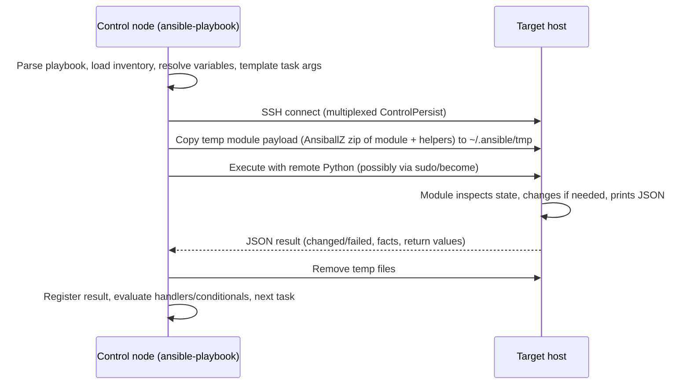

# 4.3 Ansible from zero: what it is, how it works, installation and ad-hoc commands

| | |
|---|---|
| Level | Beginner |
| Priority tier | 0 |
| Lab venue | Control node with Python 3.10+; 2 to 3 target Linux hosts reachable over SSH (Vagrant, multipass, Docker with sshd, or cloud VMs) |
| Part | Part 4: Automation and infrastructure as code |
| Status | Drafted, labs **untested** |

## Why this matters for AI infrastructure

A GPU cluster is hundreds of nearly identical Linux machines that must have the same kernel parameters, the same driver and CUDA stack, the same container runtime, the same monitoring agents and the same NCCL environment, and that must be changed in a controlled way when a security advisory or a driver release arrives. Doing that by SSH-ing into machines is slow and error-prone; writing bespoke shell scripts is brittle. Ansible is the de facto tool for configuration management and fleet operations in HPC and AI environments (NVIDIA's DeepOps and many BCM/Slurm deployments are Ansible-driven, and Kubespray installs Kubernetes with it) because it is **agentless** (SSH is the only requirement on targets, which matters on bare metal and appliances), **declarative and idempotent**, readable by operators who are not programmers, and extensible. This chapter builds the mental model and gets you running commands across a fleet; the following chapters add inventories, playbooks, templates, roles and scale.

## Prerequisites and outcomes

You need SSH and basic Linux administration (Part 1) and Python basics (Part 3). After this chapter you can:

- Explain what Ansible does and does not do, and how a task becomes a module executed on a target.
- Compare Ansible with shell scripts, Puppet/Chef/Salt, Terraform and cloud-init, and choose appropriately.
- Install Ansible correctly (ansible-core versus the community package, collections, virtual environments, pipx, execution environments) and understand versioning.
- Configure `ansible.cfg`, SSH multiplexing, privilege escalation (`become`) and host key handling.
- Write a minimal inventory and run ad-hoc commands (`ping`, `command`, `shell`, `copy`, `package`, `service`, `setup`) against groups, with limits and forks.
- Explain idempotency, check mode, and why `command`/`shell` need care.
- Write and run a first playbook.

## 1. What Ansible is

Ansible is an automation engine that runs **tasks** (calls to **modules**) on **hosts** drawn from an **inventory**, organised into **plays** inside **playbooks**. You describe the desired state ("package `chrony` is installed, service `chronyd` is enabled and running, file `/etc/chrony.conf` has this content") in YAML; the module checks the current state and changes only what differs, reporting `ok` (already correct), `changed`, `failed`, `skipped` or `unreachable`.

Key properties:

- **Agentless, push-based.** The control node connects over SSH (or WinRM/PSRP for Windows, or local, or APIs for network devices and clouds), copies a small module to the target, executes it, collects JSON, and removes it. No daemon to install, patch or secure on targets; any host you can SSH to is manageable. (Contrast Puppet/Chef/Salt minions that *pull* from a server and need an agent.)
- **Declarative modules, procedural playbooks.** Modules express desired state; playbooks run tasks **top to bottom** in order, which is easy to reason about (and differs from Terraform's dependency graph).
- **Idempotent by design.** Running a playbook twice yields the same end state with no changes the second time (when modules and your tasks are written well). Idempotency is what makes automation safe to rerun after partial failure and usable for drift correction.
- **Batteries included.** Thousands of modules in collections: packages, services, users, files, templates, cloud providers, Kubernetes, network devices, databases, containers, BMC/Redfish, monitoring.
- **Simple to read, easy to audit.** YAML plus Jinja2 templating; playbooks double as documentation and are reviewable in Git.
- **Scales down and up.** One-liner on a laptop, parallel over thousands of hosts (forks, strategies, pull mode, AWX/AAP).
- **Extensible.** Custom modules (any language that emits JSON), plugins (inventory, lookups, filters, callbacks, connection), roles and collections for sharing.

What it is **not**: a continuous reconciliation loop (it acts when you run it, unless triggered by a scheduler, `ansible-pull` or AAP), a provisioning engine with state like Terraform (no state file; it learns state by inspecting hosts every run), or a great place for complex programming logic (push complexity into modules).

### Where it fits

| Tool | Role | Relationship |
|---|---|---|
| Terraform/OpenTofu | Create cloud/network resources, keeps state | Provision machines; Ansible configures what runs on them (4.17, 4.27) |
| cloud-init | First-boot bootstrap | Seeds SSH keys/users; Ansible does the real configuration |
| Packer | Build images | Uses Ansible as provisioner (4.2) |
| Puppet/Chef/Salt | Agent-based continuous convergence | Alternatives; stronger for constant enforcement, heavier to operate |
| Shell scripts | Glue | Not idempotent, hard to reuse; Ansible modules replace most |
| Kubernetes/Helm/Argo | Workloads on clusters | Ansible installs clusters (Kubespray) and nodes, not the application layer |
| Slurm | Job scheduling | Ansible installs and configures Slurm and its nodes (Part 6) |

## 2. How Ansible executes a task



Details that explain behaviour you will meet:

- **Target Python**: most modules run on the target with its Python interpreter (`ansible_python_interpreter`; Ansible discovers `/usr/bin/python3` automatically). Minimal images without Python need the `raw` module (or `ansible.builtin.script`) to bootstrap Python first, or `gather_facts: false`. Network devices usually run modules on the control node (`connection: local`/`network_cli`/`httpapi`).
- **Parallelism**: each task runs across hosts in parallel up to `forks` (default 5; raise to 20 to 200 for fleets), then Ansible waits for all hosts before the next task (the default `linear` strategy). `strategy: free` lets hosts proceed independently; `serial:` batches hosts for rolling updates (4.14).
- **Facts**: unless disabled, each play starts with `setup`, collecting host facts (distribution, kernel, CPUs, memory, interfaces, mounts) into `ansible_facts`. Facts power conditionals and templates but cost time; use `gather_subset`, fact caching, or `gather_facts: false` when not needed.
- **Connection reuse**: SSH **ControlMaster/ControlPersist** multiplexes many commands over one connection; **pipelining** (`pipelining = True`) reduces SSH round trips by streaming the module over stdin (requires `requiretty` off in sudoers). These two settings are the biggest easy speed-ups.
- **Templating**: task arguments are Jinja2 templates evaluated on the control node before sending; the target never needs Jinja.
- **Result semantics**: a module returns `changed`/`failed`/`rc`/output; `register` stores it; `failed_when`/`changed_when` override judgements; `ignore_errors` continues; unreachable hosts are removed from the run unless configured otherwise.

## 3. Installation and versions

### Components and versions

- **ansible-core**: the engine (CLI tools, `ansible.builtin` modules, plugin framework). Versioned `2.x` (for example 2.16, 2.17, 2.18); each has a Python requirement for the control node and a separate, often narrower, Python support range for targets.
- **ansible** (the community package): ansible-core plus a curated bundle of collections, versioned `9.x`, `10.x`, ... Convenient but large; production setups often install `ansible-core` and pin only the collections they use in `requirements.yml`.
- **Collections** (`namespace.name`, like `community.general`, `ansible.posix`, `kubernetes.core`, `nvidia.*`) package modules, roles and plugins; install with `ansible-galaxy collection install -r requirements.yml`. Modules are referenced by **fully qualified collection name (FQCN)** such as `ansible.builtin.copy`. Always use FQCNs; short names are ambiguous and ansible-lint flags them.
- **Execution environments (EE)**: container images that bundle ansible-core, collections, Python dependencies and system libraries, built with `ansible-builder` and run with `ansible-navigator` or in AAP/AWX. They end "works on my laptop" by making the runtime reproducible (4.15).
- Check supported combinations in the Ansible release/support matrix before upgrading; a core upgrade can change module behaviour and deprecate features.

### Install on the control node

Use an isolated environment, never system Python:

```bash
python3 -m venv ~/venvs/ansible && source ~/venvs/ansible/bin/activate
pip install --upgrade pip
pip install "ansible-core>=2.16,<2.19" ansible-lint yamllint     # pin to a tested range
# or isolated CLI tools:
pipx install --include-deps ansible
# or macOS: brew install ansible     (convenient; less controllable versioning)
ansible --version        # shows core version, config file, module search path, Python
ansible-galaxy collection install ansible.posix community.general
```

Pin versions in a `requirements.txt`/`requirements.yml` committed with the repo, so every engineer and CI use the same toolchain:

```yaml
# collections/requirements.yml
collections:
  - name: ansible.posix
    version: ">=1.5.0,<2.0.0"
  - name: community.general
    version: ">=8.0.0,<10.0.0"
  - name: kubernetes.core
```

The control node must be Linux or macOS (or WSL on Windows). Targets need SSH and a supported Python (Windows uses WinRM/SSH with PowerShell modules).

### Prepare targets

1. A user the control node can SSH to with key authentication (`ssh-keygen -t ed25519`; `ssh-copy-id user@host`). Prefer a dedicated automation user over personal accounts.
2. Passwordless `sudo` for that user for tasks that need root (or use `become` with a vaulted password; passwordless sudo restricted to needed commands is common; manage via `/etc/sudoers.d/ansible` validated with `visudo -cf`).
3. Python 3 installed; time synchronised; DNS or `/etc/hosts` resolution.
4. First-connection host key: `ssh-keyscan` into `known_hosts`, or `host_key_checking = False` for labs only. In production keep host key checking on (disabling it exposes you to man-in-the-middle attacks).

## 4. Configuration: ansible.cfg

Ansible reads settings from (first found wins, not merged): `ANSIBLE_CONFIG` env var, `./ansible.cfg` (current directory), `~/.ansible.cfg`, `/etc/ansible/ansible.cfg`. Environment variables and command-line flags override file values. Keep a project-level `ansible.cfg` in the repo root (the config file is only honoured from the current directory if it is not world-writable).

```ini
# ansible.cfg
[defaults]
inventory            = inventories/lab/hosts.yml
remote_user          = automation
forks                = 20
host_key_checking    = True
interpreter_python   = auto_silent
gathering            = smart                  ; use cached facts when available
fact_caching         = jsonfile
fact_caching_connection = .ansible_facts
fact_caching_timeout = 3600
roles_path           = roles
collections_path     = collections
retry_files_enabled  = False
stdout_callback      = yaml                   ; readable output (community.general.yaml or default with result_format=yaml)
callbacks_enabled    = timer, profile_tasks   ; show timing per task
timeout              = 30

[privilege_escalation]
become               = False                  ; enable per play/task
become_method        = sudo
become_ask_pass      = False

[ssh_connection]
pipelining           = True
ssh_args             = -o ControlMaster=auto -o ControlPersist=60s -o ServerAliveInterval=30
control_path_dir     = ~/.ansible/cp
```

Inspect effective configuration with `ansible-config dump --only-changed` and `ansible-config list`. Precedence: command line, environment, config file, defaults. In shared repositories avoid secrets or personal paths in `ansible.cfg`.

### Privilege escalation (become)

`become: true` runs a task as root via sudo (default); `become_user: postgres` switches to another user; `become_method`: `sudo`, `su`, `doas`, `pbrun`, and others. Common failures: missing tty (`requiretty`), password prompts without `--ask-become-pass`, `become_user` unprivileged-user temp file permissions (set `allow_world_readable_tmpfiles` only if you understand the risk, or install `acl`), and sudo rules not allowing the module path. Do the minimum as root: scope `become` to the tasks that need it.

## 5. Inventory basics (preview)

An inventory lists hosts and groups. INI or YAML; full coverage in 4.5.

```ini
# inventories/lab/hosts.ini
[gpu]
gpu01 ansible_host=10.0.10.11
gpu02 ansible_host=10.0.10.12

[login]
login01 ansible_host=10.0.10.5

[cluster:children]
gpu
login

[cluster:vars]
ansible_user=automation
ansible_python_interpreter=/usr/bin/python3
```

Inspect: `ansible-inventory --graph`, `ansible-inventory --list`, `ansible-inventory --host gpu01`. Patterns select hosts: `all`, `gpu`, `gpu:login` (union), `gpu:&rack1` (intersection), `gpu:!gpu02` (exclusion), `gpu*`, `~gpu0[1-4]` (regex), `--limit` narrows a run further.

## 6. Ad-hoc commands

An **ad-hoc command** runs a single module on matching hosts without writing a playbook: ideal for discovery, quick checks, and emergency actions (it is also how you learn modules). Syntax: `ansible <pattern> -m <module> -a "<args>" [options]`.

```bash
ansible all -m ansible.builtin.ping                                    # SSH + Python reachability test (not ICMP)
ansible gpu -m ansible.builtin.command -a "nvidia-smi -L"             # run a command (no shell features)
ansible gpu -m ansible.builtin.shell   -a "dmesg | grep -i xid | tail -5" # shell features: pipes, redirects, globbing
ansible gpu -b -m ansible.builtin.package -a "name=chrony state=present"   # -b = become (sudo)
ansible gpu -b -m ansible.builtin.service -a "name=chronyd state=started enabled=yes"
ansible gpu -b -m ansible.builtin.copy -a "src=./motd dest=/etc/motd mode=0644"
ansible gpu -m ansible.builtin.setup -a "filter=ansible_distribution*"    # facts
ansible gpu -m ansible.builtin.setup -a "gather_subset=hardware filter=ansible_processor*"
ansible all -m ansible.builtin.file -a "path=/tmp/x state=absent" --check  # dry run
ansible gpu -m ansible.builtin.reboot -b --limit gpu02                    # reboot and wait for return
ansible 'gpu:!gpu02' -m ansible.builtin.command -a "uptime" -f 50 -o       # forks=50, one-line output
ansible gpu -m ansible.builtin.fetch -a "src=/var/log/slurm/slurmd.log dest=./logs/ flat=no"
ansible gpu -B 3600 -P 15 -m ansible.builtin.command -a "long-job.sh"      # async: background 3600s, poll every 15s
```

Useful flags: `-i inventory`, `-l/--limit`, `-u user`, `-b`, `-K` (ask become password), `-k` (ask SSH password), `-f` forks, `-o` one-line, `-v/-vvv` verbosity (connection debugging at `-vvvv`), `--check`, `--diff`, `-e "var=value"`, `-t tree` (save output per host).

### Command, shell, raw and idempotency

- **`command`** runs an executable without a shell: safest, no pipes/redirects/env expansion; not idempotent unless you add `creates:`/`removes:` or `changed_when`.
- **`shell`** passes through `/bin/sh`: needed for pipes and redirects; vulnerable to quoting/injection mistakes if variables are untrusted.
- **`raw`** sends a plain SSH command with no module and no Python needed: for bootstrapping Python on minimal systems and devices.
- **`script`** copies and runs a local script on the target.

Prefer purpose-built modules (`package`, `service`, `user`, `file`, `lineinfile`, `template`, `sysctl`, `systemd`, `mount`, `cron`) because they are idempotent, support check mode and give structured results. A shell one-liner used for convenience in a playbook is a smell: it always reports `changed`, cannot be dry-run, and hides intent. When unavoidable, add `creates`/`removes`, a guard task, or `changed_when`/`failed_when` expressions.

### Idempotency and check mode

Run the same `package` ad-hoc twice: the first reports `CHANGED`, the second `SUCCESS` with `"changed": false`. That is idempotency. `--check` simulates changes (modules that support it report what *would* change); `--diff` shows content differences for templated files. Check mode is not a perfect prediction (tasks depending on earlier changes, `command` tasks that cannot predict) but is the core of safe fleet operations and drift detection (4.2).

## 7. Your first playbook

A playbook is a YAML list of plays; each play targets hosts and runs tasks.

```yaml
# site.yml
- name: Baseline for GPU nodes
  hosts: gpu
  become: true
  gather_facts: true
  vars:
    ntp_package: chrony
  tasks:
    - name: Ensure chrony is installed
      ansible.builtin.package:
        name: "{{ ntp_package }}"
        state: present

    - name: Ensure chrony is enabled and running
      ansible.builtin.service:
        name: chronyd
        state: started
        enabled: true

    - name: Show kernel version
      ansible.builtin.debug:
        msg: "{{ inventory_hostname }} runs {{ ansible_kernel }} on {{ ansible_distribution }} {{ ansible_distribution_version }}"
```

```bash
ansible-playbook site.yml --syntax-check        # parse only
ansible-playbook site.yml --check --diff        # dry run with diffs
ansible-playbook site.yml                        # apply
ansible-playbook site.yml                        # run again: everything "ok", changed=0 -> idempotent
ansible-playbook site.yml --limit gpu01 -v      # one host, more output
ansible-playbook site.yml --list-tasks --list-hosts
```

Read the recap:

```text
PLAY RECAP ***********************************************************
gpu01 : ok=4 changed=2 unreachable=0 failed=0 skipped=0 rescued=0 ignored=0
gpu02 : ok=4 changed=2 unreachable=0 failed=0 skipped=0 rescued=0 ignored=0
```

`changed=0` on a rerun is the target. Full playbook mechanics (variables, handlers, loops, blocks, error handling, roles) follow in 4.6 to 4.11.

## 8. Troubleshooting connections (first 30 minutes)

| Symptom | Likely cause | Check |
|---|---|---|
| `UNREACHABLE! ... Permission denied (publickey)` | Wrong user/key, key not authorised | `ssh -v user@host`, `ansible -vvvv`, `ansible_user`, `ansible_ssh_private_key_file`, agent loaded (`ssh-add -l`) |
| `Host key verification failed` | New or changed host key | `ssh-keyscan`, fix `known_hosts` (investigate changed keys: could be MITM or a reinstall) |
| `Missing sudo password` / `sudo: a terminal is required` | Passwordless sudo missing / `requiretty` | `-K`, sudoers drop-in, disable `requiretty` for the automation user |
| `/bin/sh: python: not found` or interpreter errors | No Python on target / wrong path | `raw` bootstrap, `ansible_python_interpreter`, `interpreter_python` |
| `Failed to connect to the host via ssh: Connection timed out` | Network/firewall/DNS; wrong `ansible_host` | `ssh`, `nc -vz host 22`, bastion/`ProxyJump` via `ansible_ssh_common_args` |
| Slow runs | Fact gathering, no pipelining/multiplexing, DNS lookups on SSH (`UseDNS`), low forks | `profile_tasks`, `pipelining`, `ControlPersist`, `gathering`, `forks` |
| Module warns about discovered interpreter | Interpreter discovery | Set `interpreter_python=auto_silent` or explicit variable |
| Changes silently skipped | Pattern matched no hosts or `--limit` too narrow | `--list-hosts`, `ansible-inventory --graph` |

Bastion hosts: set `ansible_ssh_common_args: '-o ProxyJump=bastion.example.com'` in group vars or use `~/.ssh/config`; Ansible honours your SSH config.

## 9. Security and good practice from day one

- Use SSH keys (ed25519), dedicated automation accounts, and restrict `sudo` to what is needed; protect the control node as a crown jewel (it can log in everywhere): hardened host, MFA for access, audit logging, no shared accounts. Prefer AAP/AWX or CI runners with credential stores for team use (4.15).
- Keep host key checking enabled in production; distribute host keys via `ssh_known_hosts` or SSH certificates.
- Never commit secrets: use Ansible Vault or an external secret manager (4.12); mask sensitive output with `no_log: true`.
- Always use FQCNs; pin ansible-core and collection versions; lint with `ansible-lint` and `yamllint`.
- Use `--check --diff` before applying; test on a canary host (`--limit`); keep changes small.
- Prefer modules over shell; make every task idempotent.
- Keep playbooks and inventories in Git (4.1) and run them from CI for repeatability (4.2).

## 10. Lab (untested)

1. **Bring up targets**: create three Linux targets (Vagrant, Multipass, or Docker containers running sshd with Python); create an automation user with key auth and passwordless sudo.
2. **Install and pin**: create a venv; install `ansible-core` and `ansible-lint`; write `requirements.yml`; install collections; run `ansible --version` and read the config path and Python.
3. **Config**: write `ansible.cfg` with the settings above; compare run time of `ansible all -m ping` with and without `pipelining` and `ControlPersist`; use `ansible-config dump --only-changed` to verify.
4. **Inventory**: create the INI inventory, then rewrite in YAML; practise patterns (`gpu:!gpu02`, regex, `--limit`), `ansible-inventory --graph/--list/--host`.
5. **Ad-hoc**: `ping`; gather a facts subset; install and start `chrony` and run it twice to see `changed` then not; run a `command` and a `shell` with a pipe and observe failures of `command` with pipes; use `-o`, `-f`, `--check`, `--diff`, `-B/-P` async.
6. **Bootstrap**: create a target without Python; use `raw` to install it; then run `ping`.
7. **First playbook**: write `site.yml`; use `--syntax-check`, `--check --diff`, apply, rerun for idempotency; introduce a failure (misspelt package) and read the output; fix; add `-v` and `-vvv` to see module arguments and returned data.
8. **Become and keys**: run a task needing root without `become` and observe failure; add `become`; try a locked-down sudoers drop-in and validate it with `visudo -cf`.
9. **Failure modes**: reproduce `UNREACHABLE` (wrong user), host key failure (rebuild a target and watch the changed host key warning), and fix each properly without disabling checks.
10. **Execution environment (optional)**: build an EE with `ansible-builder` and run the playbook with `ansible-navigator run site.yml -m stdout --eei <image>`.
11. **Clean up** targets.

Mark tested only after execution.

## 11. Common mistakes

- Installing Ansible into system Python or relying on whatever the OS packaged; unpinned versions across a team.
- Short module names instead of FQCNs; missing collections in CI.
- Using `shell`/`command` where a module exists; unguarded commands that always report `changed`.
- `host_key_checking = False` left on in production; using root SSH logins and shared keys.
- Running everything with `become: true` globally, including file copies from the control node.
- Gathering facts needlessly on large fleets; leaving `forks` at 5 and wondering why runs are slow.
- Treating `ping` as ICMP; treating a green recap as proof the service works (modules verify state, not application behaviour).
- Editing `ansible.cfg` in `/etc` so behaviour differs between laptops and CI.
- No dry run before applying to production; applying to `all` instead of a canary limit.
- Secrets in plain text in inventories, playbooks or logs.

## 12. Interview angles

- "What does agentless mean? What happens when `ansible-playbook` runs a task?" (SSH, module payload, JSON, cleanup.)
- "Ansible versus Terraform; versus Puppet/Chef/Salt." (procedural push configuration vs declarative stateful provisioning vs agent-based convergence.)
- "What is idempotency and how do you keep `shell` tasks idempotent?" (`creates`/`removes`, `changed_when`, prefer modules.)
- "How would you speed up Ansible on 1,000 hosts?" (forks, pipelining, ControlPersist, fact caching/disable, strategy free, `serial` for safety, mitogen-like alternatives, pull mode, AAP.)
- "Explain inventory, play, task, module, role, collection, handler."
- "How do you secure the control node and credentials?"
- "What is an execution environment and why use one?"
- "How do you do a dry run and what are its limits?"

## 13. Checkpoint questions (35)

1. What does agentless mean? **A:** No software daemon on targets; SSH/API only.
2. How does Ansible execute a module? **A:** Copies payload over SSH, runs it with target Python, returns JSON, cleans up.
3. What is idempotency? **A:** Reapplying yields no further changes.
4. Push or pull by default? **A:** Push.
5. What is a play? **A:** Hosts plus tasks.
6. What is a module? **A:** A unit of work implementing desired state.
7. What is FQCN? **A:** `namespace.collection.module`, e.g. `ansible.builtin.copy`.
8. ansible-core vs ansible package? **A:** Engine vs engine plus bundled collections.
9. What is a collection? **A:** Packaged modules, roles, plugins.
10. What is an execution environment? **A:** Container image with core, collections, dependencies.
11. How to install collections reproducibly? **A:** `requirements.yml` with versions.
12. Where is `ansible.cfg` searched? **A:** `ANSIBLE_CONFIG`, current dir, home, `/etc/ansible`.
13. Command to see effective config? **A:** `ansible-config dump --only-changed`.
14. Two biggest SSH speed-ups? **A:** ControlPersist multiplexing and pipelining.
15. Default forks? **A:** 5.
16. What does `become` do? **A:** Privilege escalation (sudo by default).
17. What does `ping` module test? **A:** SSH login and usable Python.
18. `command` vs `shell`? **A:** No shell vs through shell (pipes etc.).
19. When use `raw`? **A:** Bootstrap Python on hosts without it.
20. How make `command` idempotent? **A:** `creates`/`removes` or `changed_when`.
21. What is `--check`? **A:** Dry run simulating changes.
22. What does `--diff` show? **A:** Content differences of changed files.
23. What is `gather_facts`? **A:** Runs `setup` collecting host facts.
24. How limit to one host? **A:** `--limit hostname`.
25. Pattern for intersection? **A:** `groupA:&groupB`.
26. Pattern for exclusion? **A:** `all:!host`.
27. What is `ansible-inventory --graph`? **A:** Group/host tree view.
28. Why keep host key checking on? **A:** Prevent MITM.
29. What does `changed=0` on rerun mean? **A:** Idempotent, no drift.
30. How to run in background? **A:** `-B` with `-P` poll interval (async).
31. How to reach hosts via bastion? **A:** `ProxyJump` in `ansible_ssh_common_args` or SSH config.
32. What is `no_log` for? **A:** Hide sensitive task output.
33. Why a dedicated automation user? **A:** Least privilege and auditability.
34. Why pin versions? **A:** Reproducible behaviour across team and CI.
35. Ansible state: where is it stored? **A:** Nowhere; it inspects hosts each run.

## 14. Sources and review notes

**Written in original words.** Principal sources:

- Rene Moser and Lorin Hochstein, *Ansible: Up and Running*, 3rd edition (chapter 1 introduction: how Ansible works, what makes it appealing, versioning; chapter 2 on playbooks: inventory, ansible.cfg, ad-hoc commands, first playbook).
- Ansible documentation for installation, configuration settings, connection plugins, privilege escalation, ad-hoc commands and execution environments.
- Examples are the author's constructions.

**Flagged for verification before publishing:** ansible-core and collection version ranges and Python support matrix, `ansible.cfg` key names and callback settings for the version in use (`stdout_callback = yaml` has changed across releases), ansible-builder/navigator syntax, and every command listing; all labs are **untested**.
