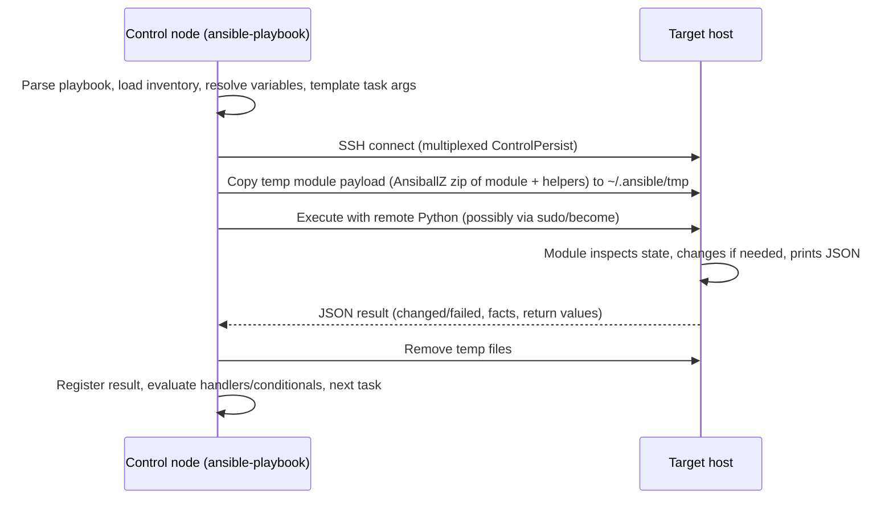

# 4.3 Ansible from zero: what it is, how it works, installation and ad-hoc commands

| | |
|---|---|
| Level | Beginner |
| Priority tier | 0 |
| Lab venue | Control node with Python 3.10+; 2 to 3 target Linux hosts reachable over SSH (Vagrant, multipass, Docker with sshd, or cloud VMs) |
| Part | Part 4: Automation and infrastructure as code |
| Status | Drafted, labs **untested** |

## Why this matters for AI infrastructure

Picture a GPU cluster with hundreds of nearly identical Linux machines. Every one of them needs the same kernel parameters, the same driver and CUDA stack, the same container runtime, the same monitoring agents and the same NCCL environment. When a security advisory or a driver release arrives, you have to change all of them in a controlled way.

Doing that by SSH-ing into each machine is slow and error-prone. Writing bespoke shell scripts is brittle too. That is why Ansible has become the de facto tool for configuration management and fleet operations in HPC and AI environments. NVIDIA's DeepOps and many BCM/Slurm deployments are driven by Ansible, and Kubespray uses it to install Kubernetes.

Ansible has a few properties that make it suit this work. It is **agentless**, so SSH is the only requirement on the targets, and that matters on bare metal and appliances. It is **declarative and idempotent**, and operators who are not programmers can read it. It is also extensible.

This chapter builds the mental model and gets you running commands across a fleet. The following chapters add inventories, playbooks, templates, roles and scale. Next time a security advisory lands, plan the change as one Ansible run rather than a list of SSH sessions.

## Prerequisites and outcomes

You need SSH and basic Linux administration from Part 1, and Python basics from Part 3. With those in hand, this chapter teaches you the following skills.

Start with the mental model. You should be able to explain what Ansible does and what it does not do, and how a task becomes a module that runs on a target. You should also be able to compare Ansible with shell scripts, Puppet, Chef, Salt, Terraform and cloud-init, and choose the right one for a job.

Next comes installation. You should know the difference between ansible-core and the community package. You should also understand collections, virtual environments, pipx, execution environments and versioning, and install Ansible correctly with them. Then configure the control side: `ansible.cfg`, SSH multiplexing, privilege escalation with `become`, and host key handling.

Finally, you will write a minimal inventory and run ad-hoc commands against groups, using `ping`, `command`, `shell`, `copy`, `package`, `service` and `setup`, with limits and forks. You should be able to explain idempotency and check mode, and why `command` and `shell` need care. The chapter ends with a first playbook. If you cannot yet do one of these items, that is where to start.

## 1. What Ansible is

Suppose you must make sure every server you own runs the time service, has the right config file and keeps its permissions correct. You could log in and type commands on each one. Or you could describe the state you want and let a tool make the machines match it. Ansible is that tool. It runs **tasks** (calls to **modules**) on **hosts** drawn from an **inventory**, and the tasks are grouped into **plays** inside **playbooks**. You describe the desired state in YAML, for example: package `chrony` is installed, service `chronyd` is enabled and running, and file `/etc/chrony.conf` has this content. The module checks the current state and changes only what differs. It then reports `ok` (already correct), `changed`, `failed`, `skipped` or `unreachable`.

Ansible is **agentless and push-based**. The control node connects over SSH, or over WinRM or PSRP for Windows, or runs locally, or calls APIs for network devices and clouds. It copies a small module to the target, runs it, collects the JSON result and removes the module again. Nothing has to be installed, patched or secured on the targets, so any host you can SSH to is manageable. Puppet, Chef and Salt work differently. Their minions *pull* from a server and need an agent on every machine.

Modules are **declarative**, but playbooks are **procedural**. A module expresses the state it wants. A playbook runs its tasks **top to bottom**, in order, which makes the run easy to follow. That differs from Terraform, which works from a dependency graph.

Ansible is **idempotent by design**. Run a playbook twice and you get the same end state, with no changes on the second run, provided the modules and your tasks are written well. That property makes it safe to rerun after a partial failure, and it is what lets you use Ansible to correct drift.

Ansible also comes with batteries included. Thousands of modules ship in collections, covering packages, services, users, files, templates, cloud providers, Kubernetes, network devices, databases, containers, BMC and Redfish, and monitoring. Playbooks are plain YAML with Jinja2 templating, so they double as documentation and you can review them in Git. The same tool scales down to a one-liner on a laptop and up to parallel runs over thousands of hosts, using forks, strategies, pull mode, AWX and AAP.

Finally, Ansible is extensible and embeddable. You can write custom modules in any language that emits JSON, and add plugins for inventory, lookups, filters, callbacks and connections. Roles and collections make it easy to share the work. You can also call Ansible straight from a Python service with **`ansible-runner`**: `r = ansible_runner.run(private_data_dir='./playbooks', playbook='playbook.yml'); print(r.status, r.rc, r.stats)`.

The name has a story behind it. An *ansible* is a fictional faster-than-light communication device. Ursula K. Le Guin coined it in *Rocannon's World* (1966). Orson Scott Card later used it in *Ender's Game* (1985) to command fleets of remote ships at once across vast distances. Cofounder Michael DeHaan borrowed that metaphor for controlling many remote servers at the same time.

The **system abstraction** is the reason to prefer modules over shell scripts. Creating a secure directory in a shell script takes three imperative commands: `mkdir -p /etc/skel/.ssh && chown root:root /etc/skel/.ssh && chmod go-wrx /etc/skel/.ssh`. In Ansible, one declarative `file` task does the same job: `path: /etc/skel/.ssh`, `mode: '0700'`, `owner: root`, `group: root`, `state: directory`. It enforces the state in one step. A `package` task works the same way across distributions. Its `name: nginx` abstracts `apt`, `dnf` and `yum` alike.

Older systems take a different route. Mark Burgess's **CFEngine**, and Puppet, rely on repeated passes that *converge* toward a consistent state. Ansible runs tasks deterministically, top to bottom, in a single pass across `web1`, `web2` and `web3`. It waits for every host to finish task 1 before starting task 2. That makes multitier orchestration straightforward in a push model. Registering monitoring maintenance windows, draining a web server from the load balancer, migrating the database and upgrading the web servers all run in strict sequence. If you need pull-based execution at massive scale with no central master, `ansible-pull` pulls and runs playbooks straight from a Git repository on each node.

Ansible is not a continuous reconciliation loop. It acts when you run it, unless a scheduler, `ansible-pull` or AAP triggers it. It is also not a provisioning engine with state, like Terraform. It has no state file and learns the state of a host by inspecting it on every run. Keep complex programming logic out of playbooks and push it into modules instead.

Vagrant uses different words for the same ideas. It calls hypervisors such as VirtualBox or VMware *providers*, which create virtual *machines* from base images called *boxes*. It calls configuration management tools such as Ansible *provisioners*.

### Where it fits

Ansible sits alongside several other tools, and each one owns a different job. The table below shows who does what. Read it to decide which tool a given change belongs to.

| Tool | Role | Relationship |
|---|---|---|
| Terraform/OpenTofu | Create cloud/network resources, keeps state | Provision machines; Ansible configures what runs on them (4.17, 4.27) |
| cloud-init | First-boot bootstrap | Seeds SSH keys/users; Ansible does the real configuration |
| Packer | Build images | Uses Ansible as provisioner (4.2) |
| Puppet/Chef/Salt | Agent-based continuous convergence | Alternatives; stronger for constant enforcement, heavier to operate |
| Shell scripts | Glue | Not idempotent, hard to reuse; Ansible modules replace most |
| Kubernetes/Helm/Argo | Workloads on clusters | Ansible installs clusters (Kubespray) and nodes, not the application layer |
| Slurm | Job scheduling | Ansible installs and configures Slurm and its nodes (Part 6) |

The split is simple. Terraform creates the machines, and Ansible decides what runs on them.

## 2. How Ansible executes a task

Suppose you run one task against `web1`. The short command you type hides a sequence of steps, and those steps explain most of the behaviour you will see later. The diagram shows them in order.



Read the diagram from top to bottom. The control node does most of the planning and bookkeeping. The target only runs the small module and prints its JSON result.

A few details explain behaviour you will meet soon. Most modules run on the target, using that machine's Python interpreter. You can set it with `ansible_python_interpreter`, and Ansible discovers `/usr/bin/python3` automatically. Minimal images without Python need the `raw` module, or `ansible.builtin.script`, to bootstrap Python first. Otherwise you can set `gather_facts: false`. Network devices usually run their modules on the control node instead, through `connection: local`, `network_cli` or `httpapi`.

Parallelism is the next detail. Each task runs across hosts in parallel, up to `forks`. The default is 5, and for fleets you can raise it to 20 to 200. Ansible then waits for every host to finish before it starts the next task. That waiting is the default `linear` strategy. With `strategy: free`, each host proceeds on its own. `serial:` batches hosts instead, which is how rolling updates work (4.14).

Facts come next. Unless you disable them, each play starts with `setup`. It collects host facts such as the distribution, kernel, CPUs, memory, interfaces and mounts into `ansible_facts`. Facts drive conditionals and templates, but collecting them takes time. When you do not need them, use `gather_subset`, fact caching or `gather_facts: false`.

Connection reuse saves round trips. SSH **ControlMaster** and **ControlPersist** let many commands share one connection. **Pipelining**, set with `pipelining = True`, streams the module over stdin and cuts SSH round trips. It requires `requiretty` to be off in `sudoers`. Together these two settings are the biggest easy speed-ups.

Templating happens on the control node. Task arguments are Jinja2 templates, and the control node evaluates them before anything is sent. The target therefore never needs Jinja.

Results drive the rest of the run. A module returns `changed`, `failed`, `rc` and its output. `register` stores that result in a variable. `failed_when` and `changed_when` override Ansible's judgement, and `ignore_errors` lets the run continue past an error. Unreachable hosts leave the run, unless you configure it otherwise.

If a run feels slow, start with the two speed-ups above. Then ask whether every play really needs facts.

## 3. Installation and versions

Installing Ansible looks trivial, until the toolchain on your laptop differs from the one in CI. Pin versions from the start, and keep each install isolated, so that every engineer and every CI job runs the same thing.

### Components and versions

**ansible-core** is the engine. It holds the CLI tools, the `ansible.builtin` modules and the plugin framework. Its versions look like `2.x`, such as 2.16, 2.17 or 2.18. Each version has a Python requirement for the control node, and a separate, often narrower, Python range for targets.

The **ansible** community package is ansible-core plus a curated bundle of collections. Its versions look like `9.x` or `10.x`. It is convenient but large. Production setups often install `ansible-core` and pin only the collections they use in `requirements.yml`.

**Collections** use the `namespace.name` form, such as `community.general`, `ansible.posix`, `kubernetes.core` and `nvidia.*`. They package modules, roles and plugins. Install them with `ansible-galaxy collection install -r requirements.yml`. Reference each module by its **fully qualified collection name**, or FQCN, such as `ansible.builtin.copy`. Always use FQCNs. Short names are ambiguous, and ansible-lint flags them.

**Execution environments**, or EE, are container images. They bundle ansible-core, collections, Python dependencies and system libraries. You build them with `ansible-builder` and run them with `ansible-navigator`, or inside AAP or AWX. They end the "works on my laptop" problem by making the runtime reproducible (4.15).

Check the Ansible release and support matrix before you upgrade. A core upgrade can change module behaviour and deprecate features.

To manage thousands of modules and more than 20,000 community roles, the project split its content into three tiers. Core components are `ansible-core` itself, created by the Ansible team. Certified content is created and supported by Red Hat and its partners through Automation Hub. Community content is shared on Ansible Galaxy.

Some plugins and modules have loose Python dependencies, which is the next thing to watch. Managing Windows hosts or Docker containers, for example, requires `pip3 install pywinrm docker` inside your virtualenv. If you test bleeding-edge Ansible from `git clone https://github.com/ansible/ansible.git --recursive`, activate it with `source ./hacking/env-setup`.

### Setting up a local test environment with Vagrant

Vagrant with VirtualBox boots disposable Linux VMs on a laptop, so you can practise before touching cloud or bare-metal servers. Two common boxes are `ubuntu/focal64` and `centos/stream8`.

Start with `vagrant init ubuntu/focal64 && vagrant up`. That imports the base box, attaches a NAT adapter that forwards host port `2222` to guest port `22` (`127.0.0.1:2222`), and mounts the current directory at `/vagrant`. Ansible connects with the standard OpenSSH client, not with `vagrant ssh`. So run **`vagrant ssh-config`** to see the exact connection parameters: `HostName 127.0.0.1`, `User vagrant`, `Port 2222` and `IdentityFile .vagrant/machines/default/virtualbox/private_key`. These map directly onto `inventory/vagrant.ini`:

  ```ini
  [webservers]
  testserver ansible_port=2222
  [webservers:vars]
  ansible_host=127.0.0.1
  ansible_user=vagrant
  ansible_private_key_file=.vagrant/machines/default/virtualbox/private_key
  ```

Note that since Vagrant 1.7, Vagrant generates a unique private key for each VM, rather than sharing `$HOME/.vagrant.d/insecure_private_key`.

A `Vagrantfile` is executable **Ruby** code, so you can shape the VM with it. Forward web ports with `config.vm.network :forwarded_port, host: 8080, guest: 80` and `host: 8443, guest: 443`. Assign a host-accessible IP with `config.vm.network "private_network", ip: "192.168.33.10"`. Enable SSH agent forwarding with `config.ssh.forward_agent = true`, and the VM can `git clone` private repositories using your laptop's SSH agent. Plugins such as `vagrant-hostmanager`, which manages `/etc/hosts` across VMs, and `vagrant-vbguest` extend the setup further. You can also loop over a `config.json` array with `f = JSON.parse(File.read('config.json')); f.each do |g| ...` to define 15 Linux distributions. Then start them with `vagrant up focal` or `vagrant up centos8`.

Vagrant has two built-in Ansible provisioners. **`config.vm.provision "ansible"`** runs Ansible from your host machine. **`config.vm.provision "ansible_local"`** installs and runs Ansible inside the guest VM itself. That helps when the host is Windows without WSL2. You re-run provisioning on demand with `vagrant provision`, `vagrant reload --provision` or `vagrant up --no-provision`. Tear the VMs down cleanly with `vagrant destroy -f`, the *"Kill Your Darlings"* step.

### Install on the control node

Give the control node its own environment. Never install Ansible into system Python.

```bash
python3 -m venv ~/venvs/ansible && source ~/venvs/ansible/bin/activate
pip install --upgrade pip
pip install "ansible-core>=2.16,<2.19" ansible-lint yamllint     # pin to a tested range
# or isolated CLI tools:
pipx install --include-deps ansible
# or macOS: brew install ansible     (convenient; less controllable versioning)
ansible --version        # shows core version, config file, module search path, Python
ansible-galaxy collection install ansible.posix community.general
```

Pin the versions in a `requirements.txt` and a `requirements.yml`, and commit them with the repo. That way every engineer and CI job uses the same toolchain. The collections file looks like this:

```yaml
# collections/requirements.yml
collections:
  - name: ansible.posix
    version: ">=1.5.0,<2.0.0"
  - name: community.general
    version: ">=8.0.0,<10.0.0"
  - name: kubernetes.core
```

The control node must be Linux or macOS, or WSL on Windows. Targets need SSH and a supported Python. Windows targets use WinRM/SSH with PowerShell modules.

### Prepare targets

Each target needs a few things before the first run.

1. Create a user that the control node can SSH to with key authentication. Generate a key with `ssh-keygen -t ed25519` and copy it over with `ssh-copy-id user@host`. Prefer a dedicated automation user over personal accounts.
2. Give that user passwordless `sudo` for tasks that need root. You can also use `become` with a vaulted password instead. Passwordless sudo, restricted to the commands you need, is common. Manage the rule in `/etc/sudoers.d/ansible` and validate it with `visudo -cf`.
3. Install Python 3, keep the time synchronised, and set up DNS or `/etc/hosts` resolution.
4. Handle the host key on the first connection. Run `ssh-keyscan` to write the key into `known_hosts`, or set `host_key_checking = False`, but only for labs. In production, keep host key checking on, because disabling it exposes you to man-in-the-middle attacks.

Commit the requirements files before your first run, so the whole team starts from the same toolchain.

## 4. Configuration: ansible.cfg

Picture a run that hits the wrong inventory, because a file in another directory was read first. You avoid that by knowing exactly which settings file Ansible reads.

Ansible reads settings from the first file it finds, and it never merges them. It checks `ANSIBLE_CONFIG` first, then `./ansible.cfg` in the current directory, then `~/.ansible.cfg`, and finally `/etc/ansible/ansible.cfg`. Environment variables and command-line flags override the values in the file. Keep a project-level `ansible.cfg` in the repo root. The config file in the current directory is honoured only if it is not world-writable.

```ini
# ansible.cfg
[defaults]
inventory            = inventories/lab/hosts.yml
remote_user          = automation
forks                = 20
host_key_checking    = True
interpreter_python   = auto_silent
gathering            = smart                  ; use cached facts when available
fact_caching         = jsonfile
fact_caching_connection = .ansible_facts
fact_caching_timeout = 3600
roles_path           = roles
collections_path     = collections
retry_files_enabled  = False
stdout_callback      = yaml                   ; readable output (community.general.yaml or default with result_format=yaml)
callbacks_enabled    = timer, profile_tasks   ; show timing per task
timeout              = 30

[privilege_escalation]
become               = False                  ; enable per play/task
become_method        = sudo
become_ask_pass      = False

[ssh_connection]
pipelining           = True
ssh_args             = -o ControlMaster=auto -o ControlPersist=60s -o ServerAliveInterval=30
control_path_dir     = ~/.ansible/cp
```

Read the example as a set of decisions. It names the inventory and the remote user. It sets `forks = 20`, caches facts for 3600 seconds, and turns on pipelining with connection reuse. To see what Ansible actually uses, run `ansible-config dump --only-changed` and `ansible-config list`. Precedence runs from the command line, to environment variables, to the config file, and then to defaults. In shared repositories, keep secrets and personal paths out of `ansible.cfg`.

### Privilege escalation (become)

`become: true` runs a task as root through sudo, which is the default. Set `become_user: postgres` to switch to another user instead. `become_method` chooses the tool, such as `sudo`, `su`, `doas`, `pbrun`, and others.

Escalation fails in a few predictable ways. A missing tty shows up as `requiretty`. Password prompts appear when you leave out `--ask-become-pass`. An unprivileged `become_user` can run into temp file permission problems. You can set `allow_world_readable_tmpfiles`, but only if you understand the risk, or you can install `acl`. Sudo rules may also refuse the module path.

Command-specific `sudoers` allow-lists and restricted shells (`rbash`) do not work with Ansible. Ansible uploads each module to a temporary directory with a random name, such as `~/.ansible/tmp/ansible-tmp-.../AnsiballZ_...py`, and runs Python on that changing path. A static command rule cannot match that path, so `sudo` cannot match it either.

Instead, grant a dedicated automation group full sudo. Use `%ansible ALL=(ALL) ALL`, or `NOPASSWD: ALL` in `/etc/sudoers.d/ansible`, and validate the file with `visudo -cf`.

`NOPASSWD: ALL` is broad: anyone who can log in as that account is root on every host it reaches. It is only reasonable under three conditions. The account is dedicated to automation and used by nothing else. Interactive logins are blocked for it, so only key-based SSH from the control node works, and the private key is protected. Its use is audited, through the controller's job log and the target's `journald`. If you cannot meet those conditions, keep the password prompt with `%ansible ALL=(ALL) ALL` and supply the password through Ansible Vault.

Then move change control into Git peer review, staging environments and Ansible Automation Controller RBAC. Ansible also logs every executed module and its arguments, such as `ansible-command Invoked with _raw_params=...`, to `/var/log/syslog` or `journald` on the target host. That helps with auditability.

Keep root to the minimum. Scope `become` to the tasks that need it, and leave the rest of the play unescalated.

## 5. Inventory basics (preview)

An inventory lists hosts and groups, in INI or YAML. Section 4.5 covers it in full.

```ini
# inventories/lab/hosts.ini
[gpu]
gpu01 ansible_host=10.0.10.11
gpu02 ansible_host=10.0.10.12

[login]
login01 ansible_host=10.0.10.5

[cluster:children]
gpu
login

[cluster:vars]
ansible_user=automation
ansible_python_interpreter=/usr/bin/python3
```

`cluster:vars` sets the remote user and Python interpreter. Inspect the result with `ansible-inventory --graph`, `ansible-inventory --list` or `ansible-inventory --host gpu01`.

Patterns select hosts. `all` picks everything, `gpu*` matches by name, `gpu:login` is a union, `gpu:&rack1` an intersection and `gpu:!gpu02` an exclusion. `~gpu0[1-4]` is a regex, and `--limit` narrows a run further.

Test patterns before you change a group.

## 6. Ad-hoc commands

Sometimes you need one answer now. An **ad-hoc command** runs a single module on matching hosts, without a playbook. It suits discovery, quick checks and emergencies, and it is the fastest way to learn a module. The syntax is `ansible <pattern> -m <module> -a "<args>" [options]`.

```bash
ansible all -m ansible.builtin.ping                                    # SSH + Python reachability test (not ICMP)
ansible gpu -m ansible.builtin.command -a "nvidia-smi -L"             # run a command (no shell features)
ansible gpu -m ansible.builtin.shell   -a "dmesg | grep -i xid | tail -5" # shell features: pipes, redirects, globbing
ansible gpu -b -m ansible.builtin.package -a "name=chrony state=present"   # -b = become (sudo)
ansible gpu -b -m ansible.builtin.service -a "name=chronyd state=started enabled=yes"
ansible gpu -b -m ansible.builtin.copy -a "src=./motd dest=/etc/motd mode=0644"
ansible gpu -m ansible.builtin.setup -a "filter=ansible_distribution*"    # facts
ansible gpu -m ansible.builtin.setup -a "gather_subset=hardware filter=ansible_processor*"
ansible all -m ansible.builtin.file -a "path=/tmp/x state=absent" --check  # dry run
ansible gpu -m ansible.builtin.reboot -b --limit gpu02                    # reboot and wait for return
ansible 'gpu:!gpu02' -m ansible.builtin.command -a "uptime" -f 50 -o       # forks=50, one-line output
ansible gpu -m ansible.builtin.fetch -a "src=/var/log/slurm/slurmd.log dest=./logs/ flat=no"
ansible gpu -B 3600 -P 15 -m ansible.builtin.command -a "long-job.sh"      # async: background 3600s, poll every 15s
```

The examples are a tour of common modules. `ping` tests SSH and Python, not ICMP. `command` runs without a shell, so pipes do not work there, while `shell` accepts them. The `-b` examples use sudo to install, enable and copy. `setup` gathers facts, and `gather_subset` narrows them. `reboot` waits for the host to return, and `fetch` copies a file back to the control node. The `file` example with `--check` is a dry run. The last example uses async: `long-job.sh` runs in the background for 3600 seconds, polled every 15 seconds.

Some flags are worth memorising. `-i` picks the inventory, `-l/--limit` narrows the hosts and `-u` sets the user. `-b` turns on become, `-K` asks for the become password and `-k` asks for the SSH password. `-f` sets forks, `-o` prints one line per host, and `-v` or `-vvv` adds output. `-vvvv` is for connection debugging. `--check` and `--diff` preview changes, `-e "var=value"` sets a variable and `-t tree` saves output per host.

### Command, shell, raw and idempotency

`command` runs an executable without a shell, which makes it the safest option. It has no pipes, redirects or environment expansion. It is not idempotent unless you add `creates:` or `removes:`, or a `changed_when` expression. `shell` passes the command through `/bin/sh`, so you need it for pipes and redirects. It is vulnerable to quoting and injection mistakes when variables are untrusted. `raw` sends a plain SSH command with no module and no Python, which suits bootstrapping Python on minimal systems and devices. `script` copies a local script to the target and runs it there.

Prefer purpose-built modules such as `package`, `service`, `user`, `file`, `lineinfile`, `template`, `sysctl`, `systemd`, `mount` and `cron`. They are idempotent, support check mode and return structured results. A shell one-liner in a playbook always reports `changed`, cannot be dry-run and hides intent. If you cannot avoid one, add `creates` or `removes`, a guard task, or `changed_when` and `failed_when` expressions.

### Idempotency and check mode

Run the same `package` ad-hoc twice. The first run reports `CHANGED`, and the second reports `SUCCESS` with `"changed": false`. That is idempotency in action. `--check` simulates changes, and modules that support it report what *would* change. `--diff` shows content differences for templated files.

Check mode is not a perfect prediction, because tasks that depend on earlier changes, and `command` tasks, may differ. It is still the core of safe fleet operations and drift detection (4.2). Use ad-hoc commands for discovery and quick checks, and move anything you repeat into a playbook.

## 7. Your first playbook

Suppose every GPU node needs the same baseline: chrony installed and running, and the kernel version reported. A playbook captures that in one file. It is a YAML list of plays, and each play targets hosts and runs tasks.

```yaml
# site.yml
- name: Baseline for GPU nodes
  hosts: gpu
  become: true
  gather_facts: true
  vars:
    ntp_package: chrony
  tasks:
    - name: Ensure chrony is installed
      ansible.builtin.package:
        name: "{{ ntp_package }}"
        state: present

    - name: Ensure chrony is enabled and running
      ansible.builtin.service:
        name: chronyd
        state: started
        enabled: true

    - name: Show kernel version
      ansible.builtin.debug:
        msg: "{{ inventory_hostname }} runs {{ ansible_kernel }} on {{ ansible_distribution }} {{ ansible_distribution_version }}"
```

Run the checks in order. Start with the syntax check, then do a dry run with diffs, then apply the playbook. Run it a second time to confirm that it is idempotent.

```bash
ansible-playbook site.yml --syntax-check        # parse only
ansible-playbook site.yml --check --diff        # dry run with diffs
ansible-playbook site.yml                        # apply
ansible-playbook site.yml                        # run again: everything "ok", changed=0 -> idempotent
ansible-playbook site.yml --limit gpu01 -v      # one host, more output
ansible-playbook site.yml --list-tasks --list-hosts
```

Read the recap at the end of each run. It shows, for each host, how many tasks were ok, changed, unreachable, failed, skipped, rescued and ignored.

```text
PLAY RECAP ***********************************************************
gpu01 : ok=4 changed=2 unreachable=0 failed=0 skipped=0 rescued=0 ignored=0
gpu02 : ok=4 changed=2 unreachable=0 failed=0 skipped=0 rescued=0 ignored=0
```

A rerun that shows `changed=0` means you have reached the target. The full playbook mechanics, including variables, handlers, loops, blocks, error handling and roles, follow in 4.6 to 4.11.

## 8. Troubleshooting connections (first 30 minutes)

Your first run fails on one host, and the error message is the only clue you have. The table matches common symptoms with a likely cause and a check to run. Work through the row that matches your error before you change anything else.

| Symptom | Likely cause | Check |
|---|---|---|
| `UNREACHABLE ... Permission denied (publickey)` | Wrong user/key, key not authorised | `ssh -v user@host`, `ansible -vvvv`, `ansible_user`, `ansible_ssh_private_key_file`, agent loaded (`ssh-add -l`) |
| `Host key verification failed` | New or changed host key | `ssh-keyscan`, fix `known_hosts` (investigate changed keys: could be MITM or a reinstall) |
| `Missing sudo password` / `sudo: a terminal is required` | Passwordless sudo missing / `requiretty` | `-K`, sudoers drop-in, disable `requiretty` for the automation user |
| `/bin/sh: python: not found` or interpreter errors | No Python on target / wrong path | `raw` bootstrap, `ansible_python_interpreter`, `interpreter_python` |
| `Failed to connect to the host via ssh: Connection timed out` | Network/firewall/DNS; wrong `ansible_host` | `ssh`, `nc -vz host 22`, bastion/`ProxyJump` via `ansible_ssh_common_args` |
| Slow runs | Fact gathering, no pipelining/multiplexing, DNS lookups on SSH (`UseDNS`), low forks | `profile_tasks`, `pipelining`, `ControlPersist`, `gathering`, `forks` |
| Module warns about discovered interpreter | Interpreter discovery | Set `interpreter_python=auto_silent` or explicit variable |
| Changes silently skipped | Pattern matched no hosts or `--limit` too narrow | `--list-hosts`, `ansible-inventory --graph` |

Read each row as a question. Which user is Ansible logging in as, and which key does it offer? Does the host name resolve, and does the port answer? Answer those questions before you touch the playbook.

If your targets sit behind a bastion host, set `ansible_ssh_common_args: '-o ProxyJump=bastion.example.com'` in group vars. You can also use `~/.ssh/config`, because Ansible honours your SSH config. Clear the connection errors before you debug any playbook logic.

## 9. Security and good practice from day one

Suppose someone gets into your control node. That machine can log in everywhere, so it deserves the strongest protection in the whole setup. Use ed25519 SSH keys and dedicated automation accounts, and restrict `sudo` to what is needed. Give the control node a hardened host, MFA for access, audit logging and no shared accounts. For team use, prefer AAP or AWX, or CI runners with credential stores (4.15).

Keep host key checking enabled in production. Distribute host keys with `ssh_known_hosts` or with SSH certificates.

Never commit secrets. Use Ansible Vault or an external secret manager (4.12), and mask sensitive output with `no_log: true`.

Always use FQCNs, and pin the versions of ansible-core and your collections. Lint your playbooks with `ansible-lint` and `yamllint`.

Before you apply a change, run `--check --diff`. Test on a canary host by using `--limit`, and keep each change small. Prefer modules over shell, and make every task idempotent. Keep playbooks and inventories in Git (4.1), and run them from CI for repeatability (4.2).

## 10. Lab

Start on your own machine. The self-checking Python lab, `code/part04/ansible_foundations_lab.py`, checks the four-level discovery order for `ansible.cfg`. It confirms that the guard refuses a world-writable working directory (`resolve_ansible_cfg_path`). It also checks host pattern matching: union (`:`), intersection (`:&`), exclusion (`:!`) and regex (`~`), through `match_host_pattern`. Last, it checks that the `file` module is idempotent and that the `--check` dry-run mode works (`simulate_idempotent_file_module`).

```bash
python3 code/part04/ansible_foundations_lab.py
```

Next, move to a control node with 2–3 Linux targets. The interactive steps below were not run on live hardware, so expect to adjust them on your own setup. Work through the exercises in order.

1. Bring up three Linux targets with Vagrant, Multipass, or Docker containers running sshd with Python. Then create an automation user that uses key authentication and passwordless sudo.
2. Create a venv and install `ansible-core` and `ansible-lint`. Write `requirements.yml` and install the collections. Run `ansible --version` to read the config path and the Python in use.
3. Write `ansible.cfg` with the settings above. Compare the run time of `ansible all -m ping` with and without `pipelining` and `ControlPersist`. Then use `ansible-config dump --only-changed` to verify the result.
4. Create the INI inventory, then rewrite it in YAML. Practise patterns such as `gpu:!gpu02`, a regex, and `--limit`. Finish with `ansible-inventory --graph/--list/--host`.
5. Run `ping`, then gather a facts subset. Install and start `chrony`, and run the task twice to see `changed` the first time and nothing the second. Run a `command` and a `shell` with a pipe, and watch where `command` fails on the pipe. Finally, try `-o`, `-f`, `--check`, `--diff` and `-B/-P` async.
6. Create a target without Python. Use `raw` to install Python on it, then run `ping`.
7. Write `site.yml`, then run `--syntax-check`, `--check --diff`, the real apply, and a rerun to check idempotency. Introduce a failure, such as a misspelt package name, and read the output. Fix it, then add `-v` and `-vvv` to see the module arguments and returned data.
8. Run a task that needs root without `become` and observe the failure. Add `become`, then try a locked-down sudoers drop-in and validate it with `visudo -cf`.
9. Reproduce `UNREACHABLE` by using a wrong user. Reproduce the host key failure by rebuilding a target and watching for the changed host key warning. Fix both properly, without disabling the checks.
10. Optionally, build an execution environment with `ansible-builder`. Then run the playbook with `ansible-navigator run site.yml -m stdout --eei <image>`.
11. Clean up the targets when you finish.

## 11. Common mistakes

Most of these mistakes start with the environment. Installing Ansible into system Python, or relying on whatever the OS packaged, leaves versions unpinned across a team. Missing collections in CI are a similar trap.

Module choice causes the next group. Using `shell` or `command` where a module exists gives you unguarded commands that always report `changed`. Short module names instead of FQCNs are another habit to drop.

Security mistakes are common too. Leaving `host_key_checking = False` on in production is one. Using root SSH logins and shared keys is another. Running everything with `become: true` globally, including file copies from the control node, is a third. Secrets in plain text in inventories, playbooks or logs are a fourth.

Some mistakes make runs slow or misleading. Gathering facts needlessly on large fleets, and leaving `forks` at 5, are common reasons runs drag. Treating `ping` as ICMP is wrong. So is treating a green recap as proof that the service works, because modules verify state, not application behaviour.

Editing `ansible.cfg` in `/etc` makes behaviour differ between laptops and CI. Applying to production with no dry run, or applying to `all` instead of a canary limit, skips the safety steps. Check your current setup against this list before the next production run.

## 12. Interview angles

Interviewers often start with the basics. Ask yourself, "What does agentless mean? What happens when `ansible-playbook` runs a task?" Your answer should cover SSH, the module payload, the JSON result and the cleanup. A related question compares tools: "Ansible versus Terraform; versus Puppet/Chef/Salt." That answer contrasts procedural push configuration with declarative stateful provisioning and with agent-based convergence.

Idempotency comes up next. "What is idempotency and how do you keep `shell` tasks idempotent?" Point to `creates` and `removes`, to `changed_when`, and to preferring modules.

Scale questions are common. "How would you speed up Ansible on 1,000 hosts?" List the levers: forks, pipelining, ControlPersist, fact caching or disabling it, strategy free, `serial` for safety, mitogen-like alternatives, pull mode, and AAP.

Be ready to explain inventory, play, task, module, role, collection and handler. Expect to answer "How do you secure the control node and credentials?" and "What is an execution environment and why use one?" Finally, "How do you do a dry run and what are its limits?" tests whether you know where check mode falls short.

## Exercises

Each item below asks you to work through one part of the chapter. Note what you find, so you can compare it with the answer later.

1. Ansible architecture, agentless execution with `AnsiballZ`, and push versus pull convergence. In part (a), trace the 6 runtime steps when the control node runs a task on a target: the `AnsiballZ` payload, `~/.ansible/tmp`, remote Python, the JSON return, cleanup, and the syslog audit entry. In part (b), compare Ansible's agentless, top-to-bottom push model with Puppet, Chef and CFEngine pull-based convergence, and with Terraform's stateful resource graph. Then explain how `ansible-pull` and `ansible_runner.run()` work.
2. Packaging tiers and Vagrant testbeds. In part (a), contrast `ansible-core` (`2.16`–`2.18`), the community `ansible` package, collections (`requirements.yml`, FQCN `ansible.builtin.copy`), and execution environments (`ansible-builder` / `ansible-navigator`). In part (b), show how `vagrant ssh-config` maps to `inventory/vagrant.ini` (`ansible_port=2222`, `ansible_host=127.0.0.1`, `ansible_private_key_file`). Then explain the difference between Vagrant's `ansible` and `ansible_local` provisioners.
3. `ansible.cfg` discovery precedence, SSH multiplexing with `ControlPersist`, pipelining, and sudo rules for `become`. Using `resolve_ansible_cfg_path()` in `code/part04/ansible_foundations.py`, explain the 4-level search order for `ansible.cfg`, and why `./ansible.cfg` is ignored when it is world-writable. Then explain how `ControlMaster=auto -o ControlPersist=60s` and `pipelining = True` speed up SSH execution, and why `pipelining` requires disabling `requiretty`. Last, explain why command-specific `sudoers` rules and `rbash` fail with Ansible.
4. Inventory basics and host-pattern set operations, using `match_host_pattern()` in `code/part04/ansible_foundations.py`. Evaluate `gpu:login` (union), `gpu:&rack1` (intersection), `gpu:!gpu02` (exclusion) and `~gpu0[1-4]` (regex). Then explain how `ansible-inventory --graph/--list/--host` and `--limit` stop a change from reaching the whole fleet by accident.
5. Ad-hoc commands and idempotency, using `simulate_idempotent_file_module()`. Compare `command` (the default module, with no shell expansion), `shell` (pipes and redirects through `/bin/sh`), and `raw` (no remote Python required). Then explain how the `file` task (`path=/etc/skel/.ssh mode=0700`) reaches idempotency, with `changed=True` on the first run and `changed=False` on the second. Compare that with raw shell commands that rely on `creates:`/`removes:` and `changed_when`.
6. Writing, dry-running and troubleshooting the first playbook, `site.yml`. Trace how `ansible-playbook site.yml --syntax-check`, `--check --diff` and `--limit gpu01 -v` check the playbook before you apply it. Interpret the `PLAY RECAP` counters: `ok`, `changed`, `unreachable`, `failed`, `skipped`, `rescued` and `ignored`. Finally, diagnose `Permission denied (publickey)`, `Missing sudo password`, `/bin/sh: python: not found`, and slow fact gathering.

## Checkpoint questions (20)

<details>
<summary>1. What does "agentless" mean in Ansible, and what happens under the hood when `ansible-playbook` executes a task on a Linux host?</summary>

**Agentless** means the target machines do not run a background daemon. Puppet, Chef, and Salt rely on a minion or agent on each machine, but Ansible does not. A Linux target needs only **SSH and Python**, and a network device needs only SSH or an HTTPS API. When a task runs, the work happens in five steps:
1. The control node resolves variables and renders Jinja2 task arguments locally.
2. It opens an SSH connection to the target, or reuses one through `ControlPersist`.
3. It packages the module Python code and arguments into a self-contained **`AnsiballZ`** payload in `~/.ansible/tmp/`. With `pipelining = True`, it streams the payload over `stdin` instead.
4. It runs the payload with the target's Python interpreter, escalating through `sudo` or `become` if you configured them. The payload logs the invocation to `/var/log/syslog` or journald, inspects or updates host state, and prints a **JSON object** (`changed`, `failed`, `rc`, return values) to `stdout`.
5. It deletes the temporary directory and moves on to the next task.
</details>

<details>
<summary>2. Where does the name "Ansible" come from, and how does Ansible's execution model differ from CFEngine/Puppet convergence and Terraform?</summary>

- **Origin of the name:** Ursula K. Le Guin coined the word in *Rocannon's World* (1966), and Orson Scott Card used it in *Ender's Game* (1985). In those books, an *ansible* is a fictional faster-than-light device for commanding many remote ships at once across vast distances. Ansible creator Michael DeHaan borrowed the idea as a metaphor for controlling fleets of servers.
- **Versus CFEngine and Puppet convergence:** Pull-based agent systems rely on eventual convergence across several periodic runs. Ansible is push-based instead. It runs tasks top to bottom in a single run, and it runs each task in parallel across hosts, up to `forks` at a time. It waits for every host to finish before it starts the next task. That makes multi-tier orchestration natural, such as monitoring, then load balancer, then database, then web servers.
- **Versus Terraform:** Terraform keeps a persistent **state file (`terraform.tfstate`)** and builds a declarative dependency DAG to provision cloud and network infrastructure. Ansible has no state file. It discovers live state on every run, and it executes plays procedurally from top to bottom.
</details>

<details>
<summary>3. Contrast `ansible-core`, the `ansible` community package, Collections (FQCN), and Execution Environments (EE).</summary>

- **`ansible-core` (`2.16`, `2.17`, `2.18`):** The core CLI engine. It provides `ansible`, `ansible-playbook`, `ansible-galaxy`, `ansible-inventory`, `ansible-config`, and `ansible-vault`. It also includes the 71 built-in modules in **`ansible.builtin`**.
- **`ansible` (`9.x`, `10.x`):** A "batteries-included" meta-package. It bundles `ansible-core` with about 100 community collections.
- **Collections (`namespace.collection` / `namespace.collection.module`, for example `ansible.posix`, `community.general`, `kubernetes.core`):** Distributable bundles of modules, roles, and plugins. You pin them in `collections/requirements.yml`, and you refer to them by their Fully Qualified Collection Name, such as `ansible.builtin.package`.
- **Execution Environments (EE):** OCI container images built with **`ansible-builder`** and run with **`ansible-navigator`** or AWX/AAP. Each image packages `ansible-core`, collections, Python libraries (`pywinrm`, `docker`), and system binaries into an immutable, reproducible runtime.
</details>

<details>
<summary>4. What is the exact 4-step search order for `ansible.cfg`, why is `./ansible.cfg` ignored in world-writable directories, and how do you inspect active settings ?</summary>

Ansible uses the **first file it finds**. It does *not* merge several files. It checks these locations in order:
1. The file named by the **`ANSIBLE_CONFIG`** environment variable.
2. **`./ansible.cfg`** in the current working directory.
3. **`~/.ansible.cfg`** in your home directory.
4. **`/etc/ansible/ansible.cfg`**, or `/usr/local/etc/ansible/ansible.cfg` on BSD.

If the current working directory is **world-writable**, Ansible ignores `./ansible.cfg`. Without that rule, an untrusted user on a shared system could drop in a malicious `ansible.cfg`. That file might point `roles_path` or callback plugins at attacker code, and the code would run when an admin runs `ansible` in that directory. To see which settings are active, run **`ansible-config dump --only-changed`**.
</details>

<details>
<summary>5. What are the two biggest SSH performance settings in `ansible.cfg`, and why does `pipelining = True` require `Defaults !requiretty` in `sudoers`?</summary>

1. **SSH multiplexing (`ssh_args = -o ControlMaster=auto -o ControlPersist=60s`):** Ansible reuses one persistent TCP and SSH connection for all the tasks on a host. It does not perform a new TCP and SSH handshake for every task.
2. **Pipelining (`pipelining = True`):** Without pipelining, Ansible opens several SSH sessions. It creates a directory in `~/.ansible/tmp`, copies the `AnsiballZ` file over with `scp` or `sftp`, runs it, and deletes it. With pipelining, Ansible streams the Python module payload straight over the SSH session's **`stdin`** to the remote Python interpreter, in a single round-trip. Streaming over `stdin` cannot allocate a pseudo-terminal (`pty`). So `/etc/sudoers` on the target must **not** enforce `Defaults requiretty`.
</details>

<details>
<summary>6. Why do command-specific `sudoers` rules and restricted shells (`rbash`) fail with Ansible ?</summary>

When pipelining is off, or when a module needs files, Ansible creates a temporary directory with a **random name**. An example path is `~/.ansible/tmp/ansible-tmp-1710000000.12-98765/AnsiballZ_package.py`. Ansible then runs `/usr/bin/python3` on that temporary path through `sudo`. The script path changes on every task, so a traditional `sudoers` rule that allows only fixed binaries, such as `/usr/bin/apt-get` or `/bin/systemctl`, cannot match the command. Restricted shells (`rbash`) block directory and path operations, so they fail as well. Grant the dedicated automation account full `sudo`. Put `%ansible ALL=(ALL) NOPASSWD: ALL` in `/etc/sudoers.d/ansible`, and check the file with `visudo -cf`. Then enforce change control in Git and AWX/AAP.
</details>

<details>
<summary>7. How does `vagrant ssh-config` help you build an Ansible inventory for local test VMs, and how do Vagrant's `ansible` and `ansible_local` provisioners differ ?</summary>

Running `vagrant ssh-config` prints the localhost NAT port and the private key that Vagrant generates for each VM. The output shows `HostName 127.0.0.1`, `User vagrant`, `Port 2222`, and `IdentityFile .vagrant/machines/default/virtualbox/private_key`. You can map these values directly to `ansible_host=127.0.0.1`, `ansible_port=2222`, `ansible_user=vagrant`, and `ansible_private_key_file=...` in `inventory/vagrant.ini`. Alternatively, you can use `config.vm.network "private_network", ip: "192.168.33.10"`.
- **`config.vm.provision "ansible"`:** Runs `ansible-playbook` on your **host machine**, over SSH into the guest VM.
- **`config.vm.provision "ansible_local"`:** Installs Ansible **inside the guest VM** and runs `playbook.yml` locally inside the guest. This suits a host that runs Windows without WSL2.
</details>

<details>
<summary>8. How do Ansible host patterns work for unions, intersections, exclusions, globs, and regular expressions?</summary>

In `ansible <pattern>`, or in a play's `hosts:` field:
- **Union (`:` or `,`):** `gpu:login` selects every host in `gpu` **or** in `login`.
- **Intersection (`:&`):** `gpu:&rack1` selects only the hosts that are in **both** `gpu` and `rack1`.
- **Exclusion (`:!host`):** `gpu:!gpu02` selects every host in `gpu` **except** `gpu02`. Quote the pattern as `'gpu:!gpu02'` in Bash, so the exclamation mark is not expanded by shell history.
- **Wildcard (`*`):** `gpu*` matches hostnames that start with `gpu`.
- **Regex (`~`):** `~gpu0[1-4]` matches hostnames against the regular expression `gpu0[1-4]`.

Pass **`--limit <pattern>`**, or `-l`, on the command line to narrow a run further, for example to a canary host or a rack.
</details>

<details>
<summary>9. What does `ansible all -m ansible.builtin.ping` actually test (and why is it not ICMP `ping`)?</summary>

Despite its name, `ansible.builtin.ping` does **not** send ICMP Echo Request packets. It logs into the target host over **SSH** as the configured `remote_user`. Then it finds a usable **Python interpreter** (`/usr/bin/python3`) on the target, runs the `ping` module, and returns `{"changed": false, "ping": "pong"}`. A successful reply proves two things. SSH authentication works end to end, and the target is ready to run Python.
</details>

<details>
<summary>10. Compare the four command-execution modules: `command`, `shell`, `raw`, and `script`.</summary>

1. **`ansible.builtin.command`** is the default `-m` module when you omit it. It runs the binary directly with `execve`, without a shell. Environment variables such as `$HOME`, and shell operators such as `|`, `>`, `<`, `;`, `&`, and `*`, are not expanded. That makes it immune to shell injection.
2. **`ansible.builtin.shell`** runs the command string through `/bin/sh -c`. That enables pipes, such as `dmesg | grep -i xid | tail -5`, as well as redirects and globs. Always quote variables with `{{ var | quote }}`.
3. **`ansible.builtin.raw`** sends the command straight over SSH. It does not upload a Python wrapper, and it does not need Python on the target. You use it to bootstrap `/usr/bin/python3` on minimal OS images or appliances.
4. **`ansible.builtin.script`** copies a local script from the control node to the target, and then runs it there.
</details>

<details>
<summary>11. Why is `ansible.builtin.file` (or `package` / `service`) preferred over `command` / `shell`, and how do you make `command` idempotent when no module exists?</summary>

Declarative modules such as `file`, `package`, and `service` check the current state first. They change something only when a change is needed. They report an accurate `ok` or `changed` status, and they support `--check` and `--diff`. A `file` task looks like this: `path: /etc/skel/.ssh, mode: '0700', owner: root, group: root, state: directory`. That one task replaces `mkdir -p` followed by `chown` and `chmod`. By contrast, `command` and `shell` run blindly on every play, and they always report `CHANGED`.

When you cannot avoid `command` or `shell`, you have two tools:
- Pass **`creates: /path/to/artifact`** to skip the command if that path already exists. Or pass **`removes: /path/to/file`** to skip it if the path does not exist.
- For read-only inspection commands such as `nvidia-smi -L` and `uptime`, set **`changed_when: false`** and **`check_mode: false`**. You can also set `failed_when:` to customize error detection.
</details>

<details>
<summary>12. What do `--check` and `--diff` do, and when can `--check` give a false result?</summary>

- **`--check` (check mode, or dry run):** Simulates a playbook run without changing the target hosts. Modules that support check mode inspect the host and report whether they *would* return `ok` or `changed`.
- **`--diff`:** Prints a unified diff, with `--- before` and `+++ after`, for file or template changes made by `template`, `copy`, or `lineinfile`.
- **Limitation of `--check`:** Suppose Task 2 depends on something Task 1 does. For example, Task 1 installs a package that creates a user or a binary, and Task 2 changes a file's owner to that user or runs that binary. In `--check` mode, Task 1 does not really install the package, so Task 2 may fail even though a real run would succeed. Also, `command` and `shell` tasks are skipped in `--check` mode unless you set `check_mode: false`.
</details>

<details>
<summary>13. What are Ansible "facts", which module collects them, and how do you speed up fact gathering on a 500-node GPU cluster?</summary>

**Facts** are structured properties of a host: its hardware, OS, network, and filesystems. They include `ansible_facts['distribution']`, `ansible_kernel`, `ansible_processor_vcpus`, `ansible_default_ipv4`, and mounts. The implicit **`ansible.builtin.setup`** task collects them automatically at the start of each play. On a 500-node cluster, full fact gathering can take 10–30 seconds per play. You can speed it up in three ways:
1. Set **`gathering = smart`**, and set **`fact_caching = jsonfile`** (or `redis`) with `fact_caching_timeout = 3600` in `ansible.cfg`.
2. Limit collection to the subsets you need, for example `gather_subset: ["!all", "!min", "network", "hardware"]`.
3. Set **`gather_facts: false`** on plays that do not reference `ansible_facts`.
</details>

<details>
<summary>14. How do Asynchronous Ad-Hoc Commands (`-B` and `-P`) work for long-running fleet tasks?</summary>

Suppose you run a long job across a fleet, such as a 20-minute `dcgmi diag -r 3` run or a firmware flash. It might outlast SSH idle timeouts. To avoid that, pass **`-B <timeout_seconds> -P <poll_interval_seconds>`**. For example: `ansible gpu -B 3600 -P 15 -m command -a "long-job.sh"`. Ansible forks the task in the background on each target host, with a 3,600-second deadline. It reconnects every 15 seconds to poll the job status. With `-P 0`, Ansible launches the job and moves on, returning a `jid` that you can check later with the `async_status` module.
</details>

<details>
<summary>15. How does `ansible.builtin.reboot` work on a GPU node, and why must you combine it with `--limit` or `serial`?</summary>

`ansible gpu -m ansible.builtin.reboot -b --limit gpu02` reboots `gpu02` gracefully. It waits for the SSH port to go down, then polls until SSH comes back up. It runs a test command, `whoami`, and then marks the task complete. Without `--limit` or `serial:` in a playbook, running `reboot` against `gpu` would **reboot every GPU node in the cluster at the same time**. So always drain the node from Slurm or Kubernetes first. Then scope the reboot with `--limit`, or with rolling `serial` batches.
</details>

<details>
<summary>16. Compare `ansible.builtin.copy` and `ansible.builtin.fetch` for moving files between the control node and target hosts.</summary>

- **`ansible.builtin.copy`** pushes a file from the control node to target hosts. For example: `src=./motd dest=/etc/motd owner=root group=root mode=0644`. It compares SHA-1 checksums first, so it transfers the file only when the content or the permissions differ.
- **`ansible.builtin.fetch`** pulls a file from each target host back to the control node. For example: `src=/var/log/slurm/slurmd.log dest=./logs/ flat=no`. It namespaces each download under `./logs/<inventory_hostname>/var/log/slurm/slurmd.log`, so files from 100 hosts never overwrite one another.
</details>

<details>
<summary>17. Interpret the seven counters in an Ansible `PLAY RECAP` line (`ok`, `changed`, `unreachable`, `failed`, `skipped`, `rescued`, `ignored`).</summary>

- **`ok`:** Tasks that succeeded. This includes tasks that changed nothing and tasks that changed something.
- **`changed`:** Tasks that changed state on the target host. `changed=0` on a second run proves idempotency.
- **`unreachable`:** The host could not be contacted over SSH or WinRM. Ansible removes it from the remaining tasks in the play.
- **`failed`:** A task returned a non-zero exit code, and no `rescue` or `ignore_errors` handled the failure.
- **`skipped`:** Ansible bypassed the task because its `when:` condition evaluated to `false`.
- **`rescued`:** A task inside a `block:` failed, and a `rescue:` section caught and recovered it.
- **`ignored`:** The task failed, but `ignore_errors: true` was set.
</details>

<details>
<summary>18. How do you configure Ansible to reach private GPU cluster nodes through an SSH Bastion / Jump Host?</summary>

Set `ProxyJump` in group variables, in `group_vars/cluster.yml` or `[cluster:vars]`:
`ansible_ssh_common_args: '-o ProxyJump=automation@bastion.example.com'`

You can also define `Host 10.0.10.*` with `ProxyJump bastion.example.com` in `~/.ssh/config`. Ansible's OpenSSH connection plugin honors that automatically. Enable SSH agent forwarding only when targets must authenticate outward using your key. You can turn it on with `-o ForwardAgent=yes`, or with `config.ssh.forward_agent = true` in Vagrant.
</details>

<details>
<summary>19. Why is the Ansible Control Node a "Crown Jewel" security asset, and how do you prevent tasks from leaking secrets into logs?</summary>

The control node holds SSH private keys and passwordless `sudo` access on every server in the fleet. If someone compromises the control node, they compromise the whole cluster. Harden it with MFA, dedicated automation users, SSH certificates or `known_hosts` verification, with `host_key_checking = True`, and AWX/AAP credential stores. On any task that handles passwords, tokens, or private keys, set **`no_log: true`**. Ansible then suppresses module arguments and return payloads from stdout, callback logs, and the target's `/var/log/syslog`.
</details>

<details>
<summary>20. How do you debug an Ansible SSH connection failure vs. a module execution failure (`-v` through `-vvvv` and `ANSIBLE_KEEP_REMOTE_FILES=1`)?</summary>

- **`-v`** shows task return values, such as `stdout`, `stderr`, and `msg`.
- **`-vv`** shows the task's input arguments, and where the configuration and handlers are located.
- **`-vvv`** shows detailed SSH connection setup and temporary paths.
- **`-vvvv`** passes `-vvv` to the underlying `ssh` binary. That prints the full SSH key negotiation, the `ProxyJump` hops, and the `sudo` prompts.
- **`ANSIBLE_KEEP_REMOTE_FILES=1`** tells Ansible not to delete the `~/.ansible/tmp/ansible-tmp-.../AnsiballZ_*.py` script on the target. You can then log in and run `python3 AnsiballZ_*.py explode` to inspect the exact Python code on the remote machine.
</details>

## Sources and review notes

- **Sources read in full:**
  - `ansible-up-and-running-3rd-edition` — Bas Meijer, Lorin Hochstein & René Moser, *Ansible: Up and Running*, 3rd ed., **Chapter 1: Introduction** (read in full: version landscape `2.9.27` / `5.9.0` and 3-tier content split into Core, Certified, and Community; origin of the name "Ansible" from Ursula K. Le Guin's 1966 *Rocannon's World* and Orson Scott Card's 1985 *Ender's Game* via Michael DeHaan; configuration management, deployment, orchestration, and provisioning; 4-step parallel lockstep task execution on `web1..web3`; 21 reasons for Ansible including YAML/Jinja2 readability, `file` module abstraction vs `mkdir`/`chown`/`chmod`, single-run top-to-bottom execution vs CFEngine convergence, push-based vs Puppet/Chef pull agents, multi-tier orchestration, `ansible-pull`, and `ansible_runner.run()` Python embedding) and **Chapter 2: Installation and Setup** (read in full: installing in a virtualenv `python3 -m venv .venv --prompt A`, loose Python dependencies `pywinrm`/`docker`, `ansible-builder`, running from Git `source ./hacking/env-setup`, setting up Vagrant test VMs `ubuntu/focal64`, `vagrant ssh-config` port `2222` and `.vagrant/machines/default/virtualbox/private_key`, `inventory/vagrant.ini`, `ansible testserver -m ping`, 4-level `ansible.cfg` search order, ad-hoc `command` `-a uptime` and `-b -a "tail /var/log/syslog"` with syslog audit entries, `package` `name=nginx update_cache=yes` and `service`, Vagrant port forwarding `8000->80`/`8443->443`, `private_network` `192.168.33.10`, `forward_agent`, `ansible` vs `ansible_local` provisioners, `vagrant-hostmanager` and `vagrant-vbguest`, `config.json` 15-distro Ruby loop, and why restrictive `sudoers` command lists and `rbash` fail on Ansible's random temporary script names).
- **Run here:** `python3 code/part04/ansible_foundations_lab.py` (3 passed, 0 failed).
- **Explicitly labelled inferences:** The `resolve_ansible_cfg_path`, `match_host_pattern`, and `simulate_idempotent_file_module` functions in `code/part04/ansible_foundations.py`, the GPU cluster `ansible.cfg` and `hosts.ini` examples, and the `site.yml` `chrony` baseline playbook are the author's constructions applying *Ansible: Up and Running* Chapters 1 & 2 to GPU fleet management (plus original study items 21, 22, 23, 24, 25, 26, 27, 28, 29, 30, 31, 32, 33, 34, and 35).
- **Not verified on live hardware:** Live `ansible`, `ansible-playbook`, `ansible-galaxy`, `ansible-navigator`, and `vagrant` commands (`2.16`–`2.19`, `9.x`, `10.x`, `10.0.10.5`, `10.0.10.11..12`, `192.168.33.10`, `192.168.56.6..8`, `2222`, `8000`, `8080`, `8443`, `3600`s) are marked (`untested here`) where not executed by `ansible_foundations_lab.py`.
