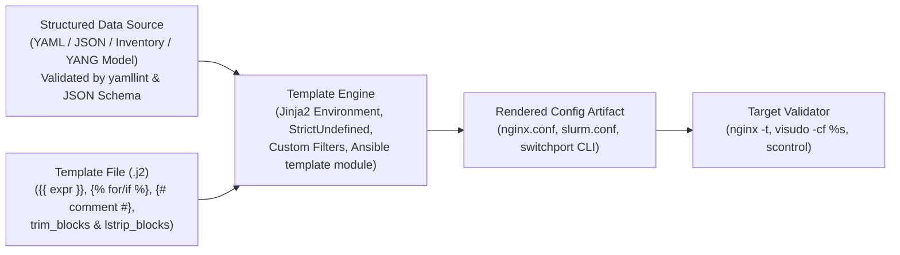

# 4.4 YAML and Jinja2 for infrastructure code

| | |
|---|---|
| Level | Beginner |
| Priority tier | 0 |
| Lab venue | Python 3.10+, `pip install jinja2 pyyaml yamllint ansible-core` |
| Part | Part 4: Automation and infrastructure as code |
| Status | Drafted, labs **untested** |

## Why this matters for AI infrastructure

Nearly every control surface in this handbook is YAML, JSON or a template of one: Ansible playbooks and inventories, Kubernetes manifests, Helm values and charts, Slurm and NCCL config generated from templates, GitHub Actions and GitLab CI pipelines, Prometheus rules, Docker Compose, cloud-init user data, Argo CD applications. Most production incidents "caused by automation" are really YAML mistakes (indentation, type coercion such as `no` becoming a boolean, a tab character) or template mistakes (undefined variables, wrong whitespace, an unescaped brace). Mastering YAML's data model and Jinja2's expression language removes a large class of errors and makes you faster at everything that follows.

## Prerequisites and outcomes

Basic scripting familiarity. After this chapter you can:

- Write correct YAML: scalars, sequences, mappings, multi-line strings, anchors/aliases/merge keys, multi-document files, comments, and avoid type-coercion traps.
- Convert between YAML and JSON mentally; validate with `yamllint`, schemas, and parsers.
- Use Jinja2: variables, expressions, filters, tests, conditionals, loops, macros, includes/inheritance, whitespace control and comments; know the difference between Jinja2 and Ansible-specific behaviour.
- Generate configuration files (Slurm, NCCL, chrony, netplan, Prometheus targets) from data with templates, and test templates offline.
- Recognise how Helm (Go templates), Terraform (HCL interpolation) and Kustomize differ, and pick the right tool.

## 1. YAML essentials

YAML ("YAML Ain't Markup Language") is a human-friendly serialisation format. It is a superset of JSON in practice (JSON is valid YAML 1.2), so `{"a": 1}` works anywhere YAML does. Everything is built from three structures:

| Structure | Syntax | JSON/Python equivalent |
|---|---|---|
| Scalar | `42`, `3.14`, `true`, `null`, `hello`, `"quoted"` | number, bool, null, string |
| Sequence (list) | `- item` on separate lines, or `[a, b]` | array / list |
| Mapping (dict) | `key: value` pairs, or `{a: 1, b: 2}` | object / dict |

```yaml
---                                # optional document start marker
cluster:
  name: ai-prod-1                  # mapping inside mapping
  racks: [r1, r2, r3]              # flow-style sequence
  nodes:                           # block-style sequence of mappings
    - name: gpu01
      gpus: 8
      tags: [h100, nvlink]
    - name: gpu02
      gpus: 8
      tags:
        - h100
  motd: |                          # literal block: newlines preserved
    Authorised use only.
    Contact: ops@example.com
  description: >                   # folded block: newlines become spaces
    A long description that
    wraps across lines.
  enabled: true
  contact: null
...                                # optional document end marker
```

### Rules that bite

- **Indentation is structure.** Spaces only, never tabs (a tab character is a parse error). Use two spaces consistently; sequences under a key may be indented or not (`key:\n- a` and `key:\n  - a` are both valid; pick one style).
- **A colon followed by a space** separates key and value. Values containing `: ` or ` #` must be quoted. A `#` preceded by a space starts a comment.
- **Quoting**: unquoted strings are parsed by type inference. Single quotes are literal (only `''` escapes a quote); double quotes support escapes (`\n`, `\t`, `é`). Use quotes whenever in doubt.
- **Type coercion traps** (YAML 1.1 parsers such as PyYAML, which Ansible uses): `yes`, `no`, `on`, `off`, `y`, `n` become booleans (the "Norway problem": country code `NO` becomes `false`); `1.10` becomes the float 1.1 (a version number lost its zero); `010` may be octal; `1e3` a float; `2024-01-15` a date object; `~` and empty values are null; `0.0.0.0` is a string but `1.2` is a float; a leading `0x` is hex; `:` times like `22:30` may parse as sexagesimal integers in 1.1. Quote versions, codes, IDs, modes (`mode: "0644"` or `0644` is octal in YAML 1.1 but many tools want a string; Ansible's own guidance is to quote file modes), and anything that must stay textual.
- **Strings starting with special characters** (asterisk, ampersand, exclamation mark, percent, at sign, backtick, braces, brackets, pipe, greater-than) must be quoted: `"{{ var }}"` in Ansible values that begin with a Jinja expression needs quotes because an opening brace starts a flow mapping.
- **Multi-line strings**: `|` keeps newlines (config files, scripts); `>` folds newlines to spaces; chomping indicators: `|-` strips the final newline, `|+` keeps all trailing newlines; an indentation indicator (`|2`) handles content that starts with spaces.
- **Duplicate keys** in a mapping: most parsers silently keep the last one, which hides copy-paste bugs; `yamllint` flags it (`key-duplicates`).
- **Multiple documents** in one file are separated by `---` (Kubernetes manifests and Helm output use this); a single parse call usually expects one document unless you use `yaml.safe_load_all`.
- **Security**: never use `yaml.load` on untrusted input (it can instantiate arbitrary Python objects); use `yaml.safe_load`. Anchors can be abused for "billion laughs" expansion in untrusted documents.

### Anchors, aliases and merge keys

Anchors (`&name`) mark a node; aliases (`*name`) reuse it; the merge key `<<` merges a mapping into another (a YAML 1.1 convention supported by PyYAML and Kubernetes tooling, but not part of the YAML 1.2 core and not honoured by every parser).

```yaml
defaults: &node_defaults
  gpus: 8
  os: ubuntu-22.04
  tags: [h100]

nodes:
  - name: gpu01
    <<: *node_defaults           # copy defaults
  - name: gpu02
    <<: *node_defaults
    gpus: 4                      # override
```

Anchors work inside a single file only (not across files) and make diffs harder to read when overused; CI definitions (GitLab `extends`, GitHub Actions reusable workflows) provide higher-level reuse.

### JSON, YAML and other formats

- Convert for inspection: `python3 -c 'import sys,yaml,json; print(json.dumps(yaml.safe_load(sys.stdin), indent=2))' < file.yml`; `yq` (mikefarah) and `jq` process YAML/JSON on the command line (`yq '.nodes[].name' nodes.yml`; `yq -o=json`; in-place edits with `yq -i`). Kubernetes accepts either.
- JSON has no comments and is stricter (good for machine exchange); YAML is better for human-edited configuration; TOML (Python tooling), HCL (Terraform), INI (ansible.cfg, systemd) are alternatives. Choose based on who edits the file.
- **Schema validation and data models (`NPA` Chapter 8):** YAML has no built-in schema enforcement, so validate with JSON Schema (`check-jsonschema`, `kubeconform` for Kubernetes, `pydantic` models in Python, Ansible argument specs for roles) and lint style with `yamllint`. In *Network Programmability and Automation* Chapter 8 (*Data Formats and Models*), the authors place YAML in the broader landscape of **structured data formats** versus fragile CLI **screen scraping** (parsing human-oriented `show interfaces em0` output, which breaks whenever a vendor changes spacing, versus requesting structured XML `show interfaces em0 | display xml` or JSON):
  1. **Markup vs. Data Serialization, and Decoding/Deserializing vs. Serializing/Encoding:** Markup languages like HTML annotate documents for rendering, whereas data serialization formats represent typed data structures across languages. On the wire, reading a text-based payload requires **two phases**: (a) **decoding** raw bytes into a UTF-8 string (`"{\"vendors\":[\"Cisco\",\"Juniper\",\"Arista\"]}"`), and (b) **deserializing** that string into native language structures (`json.loads()` -> Python `dict` and `list`); sending reverses the flow (**serializing** -> **encoding**).
  2. **Text-based formats (`YAML`, `JSON`, `XML` + `XPath`/`XQuery`) vs. Binary formats (`Protobuf`, `FlatBuffers`, `pickle`):** XML uses tags, attributes, and `xmlns:` namespaces queried with **XPath** (`//device/model` or `//device[@name="leaf"]/model`) and validated with **XSD** (`xmlschema`); JSON is lighter-weight and validated with **JSON Schema** (`"$schema": "https://json-schema.org/draft/2020-12/schema"`, checking `minLength`, `maxLength`, `minimum: 1`, `maximum: 4094`, and IPv4 `pattern` regexes via Python's `jsonschema.validate()`). For high-throughput RPCs (such as gRPC telemetry or distributed training control planes), binary **Protocol Buffers (`protobuf`, `.proto` compiled with `protoc` and validated with `protoc-gen-validate`)** and **FlatBuffers** (which reads serialized fields directly from the flat byte buffer without unpacking) eliminate text-parsing overhead (whereas Python's `pickle` is Python-only and unsafe on untrusted bytes).
  3. **Model-driven network APIs (`YANG`, IETF RFC 6020 / RFC 7950):** Crucially, **YANG is a data-modeling language, not a wire serialization format** (NETCONF and RESTCONF serialize YANG-modeled data as XML or JSON on the wire). A YANG module (`module acme-switch`, `namespace`, `prefix`, `import ietf-inet-types`) defines reusable types (`typedef vlan-id { type uint16 { range "1..4094"; } }`), single-value `leaf` nodes, scalar lists (`leaf-list name-server`), and keyed `container` / `list` hierarchies (`container vlans { list vlan { key "id"; unique "name"; ... } }`), standardized across vendors by **OpenConfig** and IETF models.
- **Pure YAML task dictionaries vs. `key=value` string arguments in Ansible (`AUR` Chapter 3):** In *Ansible: Up and Running* Chapter 3, the authors show why Ansible playbooks should always pass module arguments as **pure YAML dictionaries** (`package:\n  name: nginx\n  update_cache: true`) rather than legacy inline `key=value` strings (`package: name=nginx update_cache=yes`): pure YAML syntax highlights properly in editors, avoids multi-line backslash escaping, and converts numeric/boolean types cleanly.



```yaml
# .yamllint
extends: default
rules:
  line-length: { max: 140, level: warning }
  truthy: { allowed-values: ["true", "false"] }     # flag yes/no/on/off
  indentation: { spaces: 2, indent-sequences: true }
  comments: { min-spaces-from-content: 2 }
  document-start: { present: false }
```

## 2. Jinja2 essentials

Jinja2 is a Python templating engine. Templates mix literal text with three kinds of delimiters:

| Delimiter | Purpose |
|---|---|
| `{{ expression }}` | Output the value of an expression |
| `` | Control flow: `if`, `for`, `set`, `macro`, `include`, `block` |
| `{# comment #}` | Comment (not rendered) |

Rendering = template + context (variables) = text. Ansible uses Jinja2 for variable interpolation in playbooks, conditionals and `template` files; Salt, Flask, dbt, Superset, Cookiecutter and many network-automation tools also use it. (Helm and Terraform do **not**; they use Go templates and HCL respectively.)

```python
from jinja2 import Environment, StrictUndefined
env = Environment(undefined=StrictUndefined, trim_blocks=True, lstrip_blocks=True, keep_trailing_newline=True)
tpl = env.from_string("""

NodeName={{ n.name }} Gres=gpu:{{ n.gpus }} State=UNKNOWN

""")
print(tpl.render(nodes=[{"name": "gpu01", "gpus": 8}, {"name": "gpu02", "gpus": 8}]))
```

`StrictUndefined` makes a missing variable an error instead of an empty string: the single most useful safety setting (Ansible's default also errors on undefined variables unless you provide a `default`).

### Expressions

Variables and attribute access: `{{ cluster.name }}` (attribute then item), `{{ cluster['name'] }}`, `{{ list[0] }}`, `{{ list[-1] }}`, slices `{{ list[1:3] }}`. Literals: strings, numbers, `true`/`false` (Python's `True`/`False` also work), `none`, lists `[1, 2]`, dicts `{'a': 1}`, tuples. Operators: arithmetic `+ - * / // % **`, comparison `== != < > <= >=`, logic `and or not`, membership `in`, string concatenation `~` (preferred over `+` for strings), conditional expression `{{ 'a' if cond else 'b' }}`, test syntax `is`.

### Filters

A filter transforms a value: `{{ value | filter(args) }}`, chainable.

| Category | Filters |
|---|---|
| Strings | `upper`, `lower`, `title`, `trim`, `replace('a','b')`, `regex_replace` (Ansible), `split(',')`, `join(', ')`, `truncate`, `indent(4)`, `center`, `wordwrap`, `urlencode` |
| Defaults / safety | `default('x')`, `default('x', true)` (also for empty/falsy), `mandatory` (Ansible), `string`, `int`, `float`, `bool`, `abs`, `round` |
| Collections | `length`, `first`, `last`, `sort`, `unique`, `reverse`, `list`, `map(attribute='name')`, `select`, `reject`, `selectattr('gpus','gt',4)`, `rejectattr`, `groupby('rack')`, `sum`, `min`, `max`, `batch(3)`, `slice(3)` |
| Dict | `dictsort`, `items`, `dict2items`/`items2dict` (Ansible), `combine` (Ansible merge), `json_query` (JMESPath, Ansible) |
| Serialisation | `tojson`, `to_json`, `to_nice_json`, `to_yaml`, `to_nice_yaml`, `from_json`, `from_yaml` (Ansible), `b64encode`/`b64decode`, `hash('sha256')`, `password_hash` |
| Paths | `basename`, `dirname`, `expanduser`, `realpath`, `splitext` (Ansible) |
| Network (Ansible `ansible.utils`/`ansible.netcommon`) | `ipaddr`/`ansible.utils.ipaddr`, `ipv4`, `ipmath`, `cidr_merge`, `hwaddr`, `ansible.utils.next_nth_usable` |

```jinja
{{ nodes | map(attribute='name') | list }}                       {# ['gpu01', 'gpu02'] #}
{{ nodes | selectattr('gpus', 'ge', 8) | map(attribute='name') | join(',') }}   {# gpu01,gpu02 #}
{{ nodes | sum(attribute='gpus') }}                              {# total GPUs #}
{{ cluster.timeout | default(30) | int }}
{{ users | groupby('team') }}
{{ ports | join(',') }}
{{ config | to_nice_yaml(indent=2) }}
```

### Tests

``: `defined`, `undefined`, `none`, `string`, `number`, `integer`, `mapping`, `iterable`, `sequence`, `even`, `odd`, `divisibleby(3)`, `equalto`, `in`, `lower`, `upper`, `callable`; Ansible adds `success`, `failed`, `changed`, `skipped`, `match`, `search`, `version('2.0', '>=')`, `subset`, `superset`, `contains`, `file`, `directory`, `exists`.

```jinja
...
...
{{ result is failed }}
```

### Control structures

```jinja

  Gres=gpu:{{ node.gpus }}

  # login node

  # other



# rack {{ rack }}

{{ n.name }}   {{ loop.index }}/{{ loop.length }}{{ ' first' if loop.first }}{{ ' last' if loop.last }}

(no nodes)





   {# variable scoping workaround #}
```

`loop` variables: `index` (1-based), `index0`, `first`, `last`, `length`, `revindex`, `cycle('a','b')`, `previtem`, `nextitem`. Variables set inside a `for` are scoped to that loop; use `namespace` to carry values out. `......` runs the else block when the sequence is empty.

### Whitespace control

Templates that produce config files must control blank lines and indentation. Options: `` strip whitespace before/after a tag; `trim_blocks=True` removes the first newline after a block tag; `lstrip_blocks=True` strips leading whitespace before a block tag. Ansible's `template` module sets `trim_blocks=True` by default (and `lstrip_blocks` is configurable via `jinja2_extensions`/`# jinja2:` header). A common idiom is a first-line override:

```jinja
#jinja2: trim_blocks:True, lstrip_blocks:True
# {{ ansible_managed }}
```

Always render and read the output; whitespace errors are invisible in the template and fatal in whitespace-sensitive output (YAML, Makefiles).

### Macros, includes, inheritance, raw blocks

```jinja

NodeName={{ n.name }} CPUs={{ n.cpus }} Gres=gpu:{{ n.gpus | default(default_gpus) }}


{{ node_line(n) }}


                       {# render another template with the same context #}
{{ m.node_line(n) }}

{# inheritance: base.j2 defines ; child:  ... #}

{{ this is output literally }}      {# to emit braces, e.g. Prometheus/Go templates #}
```

When a template must output literal `{{ }}` (Prometheus alert annotations, Helm templates, Grafana), wrap in `` or use `{{ '{{' }}`.

## 3. Jinja2 in Ansible

Ansible adds variables, filters and tests on top of Jinja2 and evaluates templates on the **control node**.

- **Where it applies**: task arguments, `vars`, `when` (the `when` expression is already a Jinja expression: write `when: ansible_distribution == 'Ubuntu'`, not `when: "{{ ... }}"`), `loop`, `failed_when`, `changed_when`, file contents via the `template` module (`src: nccl.conf.j2`), and inventory variables.
- **Quoting**: a YAML value that **starts** with `{{` must be quoted: `msg: "{{ var }}"`. Inside quotes you can mix: `path: "/data/{{ project }}/{{ env }}"`.
- **Undefined variables** error by default; use `{{ var | default('x') }}`, `{{ var | mandatory }}`, `is defined` checks, and `default(omit)` to drop an optional module parameter.
- **Types**: Ansible templating returns strings unless the value is a single native expression; booleans from `{{ }}` can arrive as strings (`"True"`). Use `| bool`, `| int`, and `when:` conditionals rather than string compares. `jinja2_native` can change this behaviour; test carefully.
- **Lookups and facts**: `lookup('env', 'HOME')`, `lookup('file', 'x')`, `lookup('pipe', 'cmd')` (control node), `query`, `hostvars['host']['ansible_default_ipv4']['address']`, `groups['gpu']`, `inventory_hostname`, `ansible_facts`, `play_hosts`.
- **`template` module**: `ansible.builtin.template` renders on the control node and copies the result; options `owner`, `group`, `mode`, `backup`, `validate: "visudo -cf %s"` (validate before installing, essential for sudoers, sshd, nginx), `variable_start_string` if you need different delimiters, and `{{ ansible_managed }}` for a "do not edit" header.

Example template for Slurm node definitions from inventory data:

```jinja
# {{ ansible_managed }}


NodeName={{ host }} NodeAddr={{ h.ansible_host }} CPUs={{ h.ansible_processor_vcpus }} RealMemory={{ (h.ansible_memtotal_mb * 0.95) | int }} Gres=gpu:{{ h.gpu_count | default(8) }} State=UNKNOWN

PartitionName=gpu Nodes={{ groups['gpu'] | join(',') }} Default=YES MaxTime=INFINITE State=UP
```

and NCCL environment from variables:

```jinja
# {{ ansible_managed }}

NCCL_{{ k | upper }}={{ v }}

```

with `nccl_env: { debug: WARN, ib_hca: "mlx5_0,mlx5_1", socket_ifname: eth0 }`.

### Network switchport templates, custom Python filters (`get_interface_speed`), and NGINX TLS templates (`NPA` Ch. 9 & `AUR` Ch. 3)

Two classic walkthroughs from the Gem Books show how data and Jinja2 templates come together in practice (modeled in `code/part04/yaml_jinja2_templates.py`):
1. **Rendering switchport configurations with loops, conditionals, filter chains, and custom filters (`NPA` Chapter 9 `Examples 9-4` to `9-10`):** Given a `data.yml` list of switch interfaces (`GigabitEthernet0/1` with `uplink: true`, and `GigabitEthernet0/2..3` with `vlan: 10`), a Python script loads the template via `ENV = Environment(loader=FileSystemLoader('.')); template = ENV.get_template("template.jinja")`, registers a custom Python function `def get_interface_speed(interface_name):` in **`ENV.filters['get_interface_speed'] = get_interface_speed`** (returning `1000` for `gigabit`, `100` for `fast`, and `0` otherwise), and renders:
   ```jinja
   
   interface {{ interface.name }}
     description {{ interface.desc | upper | reverse }}
   
     switchport mode trunk
   
     switchport access vlan {{ interface.vlan }}
     switchport mode access
   
     speed {{ interface.name | get_interface_speed }}
   
   ```
   Notice that you can pass either a Python `dict` (`interface_dict`) or a custom Python class instance (`NetworkInterface("GigabitEthernet0/1", "Server Port", 10)`) into `template.render()`, and Jinja2 resolves `interface.name` seamlessly on both. (`NPA` Chapter 9 also contrasts Jinja2 with **XSLT** XML transformations using `lxml.etree.XSLT` and **Go `text/template`** using `{{range $i, $interface := .Interfaces}}` and `template.FuncMap{"ifparse": IfParse}`.)
2. **Templating `nginx.conf.j2` and `index.html.j2` in an Ansible playbook (`AUR` Chapter 3 `webservers-tls.yml`):** In *Ansible: Up and Running* Chapter 3, `webservers-tls.yml` defines play-level `vars:` (`tls_dir: /etc/nginx/ssl/`, `key_file: nginx.key`, `cert_file: nginx.crt`, `conf_file: /etc/nginx/sites-available/default`, `server_name: localhost`), uses `template: src=nginx.conf.j2 dest={{ conf_file }} mode='0644'` (interpolating `{{ server_name }}` and `{{ tls_dir }}{{ cert_file }}` inside the NGINX `server` block) and `template: src=index.html.j2 dest=/usr/share/nginx/html/index.html` (interpolating the built-in `{{ inventory_hostname }}` variable), and triggers `notify: Restart nginx` whenever the rendered file changes.

## 4. Templating elsewhere (and how not to confuse them)

| Tool | Language | Notes |
|---|---|---|
| Ansible, Salt, Cookiecutter, dbt | Jinja2 | `{{ }}`, ``, filters |
| Helm | Go `text/template` + Sprig functions | `{{ .Values.image.tag \| quote }}`, `{{- if .Values.gpu }}`, `{{ include "chart.fullname" . }}`, `toYaml \| nindent 4`; whitespace trimmed with `{{-` and `-}}` |
| Terraform/OpenTofu | HCL expressions and `templatefile()` | `"${var.name}"`, `for` expressions, `%{ if }` directives |
| Kustomize | No templating; overlays, patches (JSON6902, strategic merge) | Declarative patching rather than templating |
| GitHub Actions | `${{ expression }}` | Different expression syntax and contexts |
| Docker Compose | `${VAR:-default}` variable substitution | Shell-like |
| cloud-init | Jinja2 optional header `## template: jinja` | Renders `{{ v1.local_hostname }}` instance data |
| Packer | HCL2 | `templatefile`, locals |
| Prometheus/Alertmanager | Go templates | `{{ $labels.instance }}`; conflicts with Jinja in Ansible-templated rule files; use `` |

Design guidance: **separate data from templates** (variables in inventory/vars files, logic-light templates), prefer declarative overlays (Kustomize) or typed config where possible, avoid templating a templating language (Helm values rendered by Jinja rendered by Terraform), and keep logic in code or modules, not in 200-line Jinja files. Generated YAML should be validated after rendering (`yamllint`, `kubeconform`, `kubectl --dry-run=server`).

## 5. Testing and debugging templates

- **Render offline** with the `jinja2` Python API and a fixtures file, or with Ansible: `ansible localhost -m ansible.builtin.template -a "src=nccl.conf.j2 dest=/tmp/out" -e @vars.yml --diff`; or a one-task playbook; or `ansible -m debug -a "msg={{ ... }}"` for expressions.
- **Golden-file tests**: render with representative data (including empty lists and missing optional keys) and compare with an expected file (see 3.9 testing patterns); snapshot tests catch accidental whitespace changes.
- **Validate the output** with the target's own parser: `nginx -t`, `visudo -cf`, `sshd -t`, `slurmd -C`/`scontrol` checks, `kubeconform`, `promtool check rules`, `python -c 'import yaml; yaml.safe_load(...)'`.
- **Debug** with `{{ var | to_nice_json }}` in `debug` tasks, `ansible-playbook -vvv`, and `ansible-inventory --host name` to view merged variables. For undefined errors read the exact variable name and precedence layer (4.7).
- **Common failure messages**: `AnsibleUndefinedVariable: 'x' is undefined`, `template error while templating string: unexpected '}'` (unbalanced braces or YAML flow mapping confusion), `mapping values are not allowed here` (YAML colon in unquoted string), `found character '\t' that cannot start any token` (tab), `did not find expected key` (indentation), `The task includes an option with an undefined variable`.
- **Performance**: heavy Jinja in loops over thousands of hosts is slow; precompute with `set_fact` or filters, avoid `lookup('pipe')` per host in large loops, and keep templates simple.

## 6. Security considerations

- Untrusted data in templates: never render user-provided strings as templates (server-side template injection); Ansible marks values from facts as "unsafe" to prevent re-templating; avoid `!unsafe` removal and `eval`-like constructs.
- Secrets in rendered files: set `mode: "0600"`, `owner`, `no_log: true` on tasks that render secrets, and avoid putting secrets in `--diff` output (`diff: false`).
- Quote shell interpolation (`| quote` filter) when templating values into shell commands.
- Use `yaml.safe_load`; pin and review parsers in tooling.

## 7. Lab

First, run the self-checking Python lab (`code/part04/yaml_jinja2_templates_lab.py`) locally. It verifies YAML 1.1 scalar type-coercion traps (`classify_yaml11_unquoted_scalar` on `NO`, `1.10`, `010`, `0x1f`, `22:30`, `~`), multi-line block chomping indicators (`apply_yaml_block_chomping` on `|`, `|-`, `|+`, `>-`), *Network Programmability and Automation* Chapter 9's switchport template with `upper | reverse` filter chaining and custom `get_interface_speed` filter (`render_switchport_template`), and Slurm node configuration rendering with `StrictUndefined` validation (`render_slurm_nodes_template`).

```bash
python3 code/part04/yaml_jinja2_templates_lab.py
```

Next, on any machine with Python 3.10+ and `jinja2` / `pyyaml` / `yamllint` (all interactive shell steps below are `untested here`), work through these exercises:

1. **YAML traps**: parse a file containing `no`, `yes`, `1.10`, `010`, `22:30`, `2024-01-01`, `~`, `0x1f`, `"quoted"` with PyYAML and print Python types; then quote each correctly; run `yamllint` with the `truthy` rule.
2. **Anchors and merge**: build the node defaults file; load with PyYAML and with `yq`; show a parser that ignores `<<`; refactor to explicit inheritance in code.
3. **Multi-line strings**: write `|`, `>`, `|-`, `>+` blocks and print repr to see newlines; embed a script and a systemd unit in YAML.
4. **Jinja basics**: render the Slurm node template from a Python script using `StrictUndefined`; remove a variable and observe the error; compare behaviour without `StrictUndefined`.
5. **Filters**: from a nodes list produce (a) comma-joined names with 8 GPUs, (b) total GPUs, (c) nodes grouped by rack, (d) a YAML dump with `to_nice_yaml`.
6. **Whitespace**: render the same loop with and without `trim_blocks`, `lstrip_blocks` and `{%-`; diff the outputs; fix a template that emits blank lines in the middle of a config file.
7. **Macros and includes**: factor repeated stanzas; test `` by templating a Prometheus alert rule that contains Go template syntax.
8. **Ansible templating**: write `nccl.conf.j2`, render with the `template` module, `--diff`, `--check`, `validate:` using a custom validator command; show `default(omit)` skipping an optional parameter; reproduce the YAML error from an unquoted `{{ }}` value.
9. **Types in Ansible**: demonstrate a boolean arriving as the string `"False"` and fix with `| bool`; compare `when: var` versus `when: var | bool`.
10. **Cross-tool**: write the same service config as a Jinja2 template (Ansible), a Helm template and a Kustomize patch; list when each is preferable.
11. **Validation pipeline**: add `yamllint`, `check-jsonschema` (or `kubeconform`), and a golden-file render test to pre-commit/CI.
12. **Clean up.**

## 8. Common mistakes

- Tabs in YAML; inconsistent indentation; mixing list styles that confuse readers.
- Unquoted values that YAML reinterprets (`NO`, `1.10`, `yes`, times, leading zeros); unquoted `{{ var }}` at the start of a value.
- `when: "{{ var }}"` (double templating) instead of `when: var`.
- Relying on undefined variables silently rendering as empty strings.
- Templates with extensive logic and nested loops that nobody can review; templating generated templates.
- Whitespace bugs in generated config because output was never inspected.
- Forgetting `` when templating Go-template or Jinja-in-Jinja content.
- Using `yaml.load` on untrusted data; rendering untrusted strings as templates.
- Anchors across files (unsupported) or overused merge keys that hide the effective configuration.
- No validation of rendered output before deployment.

## 9. Interview angles

- "What are YAML's gotchas? Give examples of values that change type." (Norway problem, versions, octal.)
- "Difference between `|` and `>` block scalars?"
- "How do you reuse YAML sections? What are the limits of anchors?"
- "Explain Jinja2 statements, expressions and comments; how does Ansible use them?"
- "How do you iterate over inventory hosts to build a config file? How do you avoid blank lines?"
- "`default`, `mandatory`, `omit`: when each?"
- "How do you test and validate templates?"
- "Helm vs Jinja2 vs Kustomize vs Terraform templatefile: differences and when to choose each?"
- "Why is `yaml.load` dangerous?"

## Exercises

1. **YAML Data Model, Type-Coercion Traps (`NO`, `1.10`, `010`, `22:30`), Block Scalars (`|`, `>`, `|-`, `|+`), and Anchors (`&`, `*`, `<<`, `AUR` Ch. 3):** Using `classify_yaml11_unquoted_scalar()` and `apply_yaml_block_chomping()` in `code/part04/yaml_jinja2_templates.py`, explain: (a) how YAML 1.1 parsers coerce `NO`, `1.10`, `010`, `0x1f`, `22:30`, and `~` and why file modes (`"0644"`) and version strings must be quoted; (b) the exact newline difference between `|`, `|-`, `|+`, `>`, and `>-`; and (c) how `&anchor`, `*alias`, and `<<` work and why pure YAML task dictionaries beat `key=value` inline strings in Ansible.
2. **Data Serialization Formats (`YAML`, `JSON`, `XML`, `Protobuf`, `FlatBuffers`) and Data Modeling (`JSON Schema`, `YANG`, `NPA` Chapter 8):** (a) Explain the two phases of reading/writing text-based formats on the wire (decoding + deserializing vs serializing + encoding) and why structured formats beat CLI screen scraping; (b) compare `JSON Schema` with `YANG` (RFC 6020 / 7950 `container`, `list`, `leaf`, `leaf-list`, `typedef`) and explain why YANG is a data-modeling language rather than a wire serialization format.
3. **Jinja2 Core: Delimiters, `StrictUndefined`, Filters, Tests, Loop Scoping (`namespace`), and Whitespace Control (`NPA` Chapter 9):** Using `get_interface_speed()`, `render_switchport_template()`, and `render_slurm_nodes_template()`, explain: (a) how `{{ }}`, ``, and `{# #}` work with `StrictUndefined`, `trim_blocks=True`, `lstrip_blocks=True`, and ``; (b) how `map(attribute=...)`, `selectattr`, `groupby`, `default('x', true)`, and custom filters (`ENV.filters['get_interface_speed']`) transform collections; and (c) why updating a counter inside `` requires `namespace(count=0)`.
4. **Jinja2 in Ansible (`template`, `validate:`, `default(omit)`, `when:`, ``) (`AUR` Chapter 3):** (a) Explain why YAML values starting with `"{{ var }}"` must be quoted whereas `when: ansible_distribution == 'Ubuntu'` must **not** wrap the expression in `{{ }}`; (b) show how `ansible.builtin.template` uses `validate: "visudo -cf %s"` (or `nginx -t`), how `default(omit)` drops optional module parameters, and how `...` escapes literal `{{ }}` for Prometheus/Helm rules.
5. **Comparing Templating and Configuration Tools Across the Stack (`Jinja2`, `Helm` Go Templates, `Terraform` `templatefile`, `Kustomize`):** Compare how Ansible (`Jinja2`), Helm (`Go text/template` + Sprig `{{ .Values.x | quote }}`, `{{-`), Terraform (`HCL` `${var.x}` and `templatefile()`), and Kustomize (template-free strategic-merge and JSON6902 patches) parameterize configurations, and explain why templating a template (e.g., Jinja generating Helm templates) is an anti-pattern.
6. **Offline Template Rendering, Golden-File Testing, and Server-Side Template Injection (`SSTI`) Security:** (a) Design a CI validation step that renders `slurm.conf.j2` and `nccl.conf.j2` offline against test fixtures with `StrictUndefined`, diffs against golden files, and validates syntax with `yamllint` and `check-jsonschema`; (b) explain Server-Side Template Injection (`SSTI`), why `yaml.safe_load` is mandatory, and why tasks rendering secret templates need `mode: "0600"`, `no_log: true`, and `diff: false`.

## Checkpoint questions (20)

<details>
<summary>1. What are YAML's three fundamental data structures, why is JSON valid YAML, and why are tabs forbidden (`AUR` Chapter 3 & `NPA` Chapter 8)?</summary>

YAML builds every document from three primitives: (1) **Scalars** (strings, numbers, booleans, `null`), (2) **Sequences** (ordered lists written with `- item` block lines or `[a, b]` flow syntax), and (3) **Mappings** (key-value dictionaries written with `key: value` lines or `{a: 1}` flow syntax). Since YAML 1.2 was designed as a strict superset of JSON, any valid JSON document is valid YAML. YAML uses **indentation with spaces** to denote nesting structure and strictly forbids **tab characters (`\t`)** for indentation (`found character '\t' that cannot start any token`).
</details>

<details>
<summary>2. Explain six classic YAML type-coercion traps (`NO`, `1.10`, `010`, `0x1f`, `22:30`, `~`) and how to prevent them in `yamllint`.</summary>

In YAML 1.1 parsers (such as PyYAML used by Ansible):
1. **The Norway problem (`NO`, `yes`, `no`, `on`, `off`, `y`, `n`):** Unquoted `NO` (Norway's ISO country code) or `off` parses as boolean `False` (`yes`/`on` parse as `True`).
2. **Truncated trailing zeros (`1.10`):** Unquoted version `1.10` parses as float `1.1`.
3. **Octal integers (`010`, `0644`):** Leading zeros parse as base-8 octal integers (`010` -> `8`, `0644` -> `420`), breaking tools that expect a 4-character string `"0644"`.
4. **Hexadecimal integers (`0x1f`):** Parses as integer `31`.
5. **Base-60 sexagesimal numbers (`22:30`):** Unquoted `22:30` (a port range or time) parses as $22 \times 60 + 30 = 1350$ in YAML 1.1.
6. **Null shorthands (`~` or empty):** Parses as `None`.
Always quote versions, country codes, file modes (`mode: "0644"`), and strings containing colons, and configure `yamllint` with `truthy: { allowed-values: ["true", "false"] }`.
</details>

<details>
<summary>3. Contrast YAML's literal (`|`) and folded (`>`) block scalars, and explain the chomping indicators (`|-`, `|+`, `|2`).</summary>

- **`|` (literal block scalar):** Preserves every internal newline literally (ideal for embedded shell scripts, certificates, and multi-line config files like `motd` or `visiting_address` in `AUR` Chapter 3).
- **`>` (folded block scalar):** Folds single newlines between lines into spaces so long paragraphs wrap cleanly in source while rendering as a single line.
- **Chomping indicators:** Default (`|` or `>`) keeps **one** final newline at the end of the block; **`|-` / `>-` (strip)** removes all trailing newlines; **`|+` / `>+` (keep)** preserves all trailing blank lines; and an explicit digit like **`|2`** tells the parser the block is indented by 2 spaces when the first content line itself starts with leading spaces.
</details>

<details>
<summary>4. How do YAML anchors (`&`), aliases (`*`), and merge keys (`<<`) work, and what are their limitations?</summary>

An **anchor (`&node_defaults`)** labels a YAML node; an **alias (`*node_defaults`)** references that node elsewhere in the **same file**; and the **merge key (`<<: *node_defaults`)** copies all keys from the anchored mapping into the current mapping (allowing local keys like `gpus: 4` to override defaults). Limitations: anchors **cannot cross file boundaries**, `<<` is a YAML 1.1 extension not supported by all YAML 1.2 parsers, and deep anchor chains obscure diffs (and can be abused for "billion laughs" memory amplification on untrusted inputs).
</details>

<details>
<summary>5. In *Network Programmability and Automation* Chapter 8, what are the two phases of reading text-based data off the wire, and why is YANG NOT a serialization format?</summary>

- **Two phases on the wire:** When receiving bytes from an API or socket, the program first **decodes** the raw bits into a UTF-8 character string (`bytes.decode('utf-8')`), and then **deserializes** that string into native in-memory data structures (`json.loads` / `yaml.safe_load` -> Python `dict`/`list`). Sending reverses the process (**serialize** -> **encode**).
- **YANG (RFC 6020 / 7950):** YANG is a **data-modeling (schema) language**, not a wire serialization format. YANG defines the hierarchy, types (`typedef vlan-id`), constraints (`range "1..4094"`), `container`s, keyed `list`s, and `leaf` nodes of a network device's configuration and state, which protocols like NETCONF, RESTCONF, and gNMI then serialize on the wire as **XML, JSON, or Protobuf**.
</details>

<details>
<summary>6. Compare Text-Based formats (`YAML`, `JSON`, `XML`) with Binary formats (`Protobuf`, `FlatBuffers`, `pickle`) (`NPA` Chapter 8).</summary>

- **Text-based (`YAML`, `JSON`, `XML`):** Human-readable and editable in any text editor; validated with **JSON Schema** or **XSD** and queried with `jq`/`yq` or **XPath**. YAML is best for human-authored configs/playbooks; JSON is stricter (no comments, no type-coercion traps) and ideal for REST APIs.
- **Binary (`Protobuf`, `FlatBuffers`, `pickle`):** Compact wire size and fast encoding/decoding for high-rate RPCs (gRPC). **Protobuf** compiles `.proto` schemas via `protoc` into typed Go/Python/C++ classes; **FlatBuffers** reads fields directly from the serialized byte buffer without unpacking; Python's **`pickle`** is Python-only and unsafe on untrusted data (`yaml.load` has the same arbitrary-object execution risk—always use **`yaml.safe_load`**).
</details>

<details>
<summary>7. What are Jinja2's three delimiter pairs, what does `StrictUndefined` do, and why use `~` instead of `+` for string concatenation?</summary>

- **Delimiters:** `{{ expression }}` evaluates and prints an expression; `` executes control flow (`if`, `for`, `set`, `macro`, `include`, `extends`, `block`, `raw`); and `{# comment #}` is stripped entirely from the rendered output.
- **`StrictUndefined`:** By default, standalone Jinja2 renders an undefined variable `{{ missing }}` as an empty string `""`, silently producing broken config files. Passing `undefined=StrictUndefined` to `jinja2.Environment` (which is also Ansible's default behavior) raises an immediate `UndefinedError` whenever a variable is missing.
- **`~` operator:** Converts both operands to strings and concatenates them (`{{ "gpu" ~ 1 }}` -> `"gpu1"`), whereas `+` attempts numeric addition and raises a `TypeError` when mixing `str` and `int`.
</details>

<details>
<summary>8. How do `default('x')`, `default('x', true)`, `mandatory`, and Ansible's `default(omit)` differ?</summary>

- **`{{ val | default('x') }}`**: returns `'x'` **only if `val` is undefined** (if `val` is defined as `""`, `None`, or `False`, it returns that falsy value).
- **`{{ val | default('x', true) }}` (or `boolean=True`)**: returns `'x'` if `val` is undefined **or** evaluates to falsy (`""`, `None`, `0`, `False`, `[]`).
- **`{{ val | mandatory }}`**: fails immediately with a clear error message if `val` is undefined.
- **`{{ val | default(omit) }}` (Ansible module arguments)**: if `val` is undefined, Ansible **completely omits that parameter key** from the module call so the module uses its own internal default.
</details>

<details>
<summary>9. How do Jinja2 collection filters (`map`, `selectattr`, `rejectattr`, `groupby`, `sum`, `dict2items`, `combine`, `json_query`) replace verbose loops?</summary>

- `nodes | selectattr('gpus', 'ge', 8) | map(attribute='name') | join(',')` filters a list of node dicts to those with $\ge 8$ GPUs, extracts each node's `name`, and joins them into `"gpu01,gpu02"` in a single pipeline.
- `nodes | sum(attribute='gpus')` sums GPU counts across all nodes.
- `nodes | groupby('rack')` groups nodes by rack for two-level rendering.
- In Ansible (`ansible.utils` and `community.general`), `dict2items` / `items2dict` convert between `{k: v}` mappings and `[{'key': k, 'value': v}]` lists, `combine(recursive=True)` deep-merges dictionaries, and `json_query` runs JMESPath queries.
</details>

<details>
<summary>10. How do you Register a Custom Python Filter in Jinja2 (`get_interface_speed` in `NPA` Chapter 9), and how do Jinja Tests (`is`) differ from Filters (`|`)?</summary>

- **Custom filter (`NPA` Chapter 9 `Example 9-9`):** Define a standard Python function `def get_interface_speed(interface_name): ...` taking the piped value as its first argument, and register it on the Jinja2 `Environment` via **`ENV.filters['get_interface_speed'] = get_interface_speed`** so templates can write `{{ interface.name | get_interface_speed }}`.
- **Filters (`|`) vs. Tests (`is`):** A **filter** (`{{ x | upper }}`) transforms a value into a new value; a **test** (``) evaluates a boolean predicate on a value for `if`/`elif`/`select`/`selectattr`.
</details>

<details>
<summary>11. Why does `` inside a Jinja2 `` loop fail to update `count` outside the loop, and how does `namespace()` fix it?</summary>

Jinja2 loop bodies are lexically scoped: assigning `` inside a `for` loop creates a new local variable inside that loop iteration without modifying the outer `count` variable. To mutate state across loop iterations and read it after ``, allocate a mutable **`namespace`** object before the loop:
``
``
`Total: {{ ns.count }}`.
</details>

<details>
<summary>12. How do `trim_blocks`, `lstrip_blocks`, and `` control whitespace in generated configuration files?</summary>

Without whitespace control, every `` and `` line leaves behind a blank line and leading indentation spaces in the rendered file.
- **`trim_blocks=True`** (enabled by default in Ansible): strips the first newline immediately following a `` tag.
- **`lstrip_blocks=True`** (or `#jinja2: trim_blocks:True, lstrip_blocks:True` on line 1 of an Ansible template): strips leading spaces/tabs from the start of a line up to a `` block tag.
- **`` (or `{{-` and `-}}`):** manually strip all whitespace (including newlines) immediately before or after that specific tag.
</details>

<details>
<summary>13. Why must you quote `msg: "{{ var }}"` in an Ansible YAML file, and why must you NOT write `when: "{{ var }}"`?</summary>

- **Quoting `"{{ var }}"` in YAML:** In YAML syntax, an unquoted value starting with `{` begins a **flow mapping (dictionary)**. Writing `msg: {{ var }}` without quotes is a YAML syntax error (`template error` / `found unhashable key`); always quote values that begin with `{{`: `msg: "{{ var }}"`.
- **Never wrap `when:` in `{{ }}`:** Ansible's `when:`, `failed_when:`, and `changed_when:` clauses are **already evaluated as bare Jinja2 expressions**. Writing `when: "{{ my_var }}"` causes double-templating warnings and string-truthiness bugs; write **`when: my_var | bool`** or `when: ansible_distribution == 'Ubuntu'`.
</details>

<details>
<summary>14. Why can a Jinja2 expression in Ansible return the string `"False"` instead of a boolean, and how do you handle it safely?</summary>

By default (unless `ANSIBLE_JINJA2_NATIVE=true` is enabled), Ansible's template engine coerces multi-part interpolated results to **strings**—and in Python, any non-empty string (including `"False"`) is truthy. Whenever an expression evaluates a boolean or integer that another task or conditional consumes, pipe it through **`| bool`** or **`| int`** explicitly (`enabled: "{{ service_enabled | bool }}"`).
</details>

<details>
<summary>15. How do you output literal `{{ }}` braces inside an Ansible Jinja2 template when generating a Prometheus alert rule or Helm template?</summary>

Because Ansible's Jinja2 engine evaluates every `{{ ... }}` in a `.j2` template on the control node, an unescaped Prometheus annotation like `{{ $labels.instance }}` fails with `AnsibleUndefinedVariable: '$labels' is undefined`. Wrap the literal section in a **`...`** block (or escape the delimiters as `{{ '{{' }} $labels.instance {{ '}}' }}`).
</details>

<details>
<summary>16. What does the `validate:` parameter on `ansible.builtin.template` do, and why is it essential for `/etc/sudoers`, `sshd_config`, and `nginx.conf`?</summary>

When `validate: "visudo -cf %s"` (or `validate: "sshd -t -f %s"`, `validate: "nginx -t -c %s"`) is set on `ansible.builtin.template`, Ansible renders the template to a temporary file on the target host and runs the validation command against `%s` **before** overwriting the destination file. If validation exits non-zero, Ansible aborts the task and leaves the existing working `/etc/sudoers` or `sshd_config` untouched—preventing a template typo from locking administrators out of the fleet.
</details>

<details>
<summary>17. Compare Jinja2 (Ansible), Go `text/template` (Helm), HCL `templatefile()` (Terraform), and Kustomize (`NPA` Chapter 9).</summary>

- **Jinja2 (Ansible, Salt, Python):** Pythonic expression syntax (`{{ var | filter }}`, ``).
- **Go `text/template` + Sprig (Helm, Prometheus, Consul-template):** Uses a cursor dot `.` (`{{ .Values.image.tag | quote }}`, `{{- range $k, $v := .Values.env }}`, `{{ toYaml .Values.resources | nindent 8 }}`, and custom `template.FuncMap` functions).
- **HCL `templatefile(path, vars)` (Terraform/OpenTofu, Packer):** Renders a file using HCL interpolation (`${var}`, `%{ for x in list ~} ... %{ endfor ~}`).
- **Kustomize (`kubectl apply -k`):** **Template-free**; starts from valid base YAML manifests and applies declarative overlays (`strategicMergePatch`, `patchesJson6902`, `images`, `replicas`) so every file in Git remains valid YAML that `kubeconform` and IDEs can parse directly.
</details>

<details>
<summary>18. How do you render and test Jinja2 templates offline in CI without connecting to real servers?</summary>

1. **Pure Python unit test (`pytest`):** Load the `.j2` file with `jinja2.Environment(loader=FileSystemLoader('templates'), undefined=StrictUndefined, trim_blocks=True, lstrip_blocks=True)`, render it against representative fixture dicts (including edge cases like 0 GPUs, missing optional vars, and multi-rack hosts), compare against a reviewed **golden file**, and parse the output with `yaml.safe_load` / `kubeconform` / target config validators.
2. **Local Ansible dry-run:** Run `ansible localhost -m ansible.builtin.template -a "src=templates/slurm.conf.j2 dest=/tmp/slurm.conf" -e @tests/fixtures.yml --diff`.
</details>

<details>
<summary>19. What is Server-Side Template Injection (`SSTI`), and how does Ansible's `!unsafe` tag protect against re-templating?</summary>

**Server-Side Template Injection (`SSTI`)** occurs when untrusted user input or external strings (such as an HTTP parameter, pod annotation, or remote command output containing `{{ lookup('file', '/etc/shadow') }}`) are passed into `Template(user_input).render()`, allowing the attacker to execute arbitrary lookups or Python methods on the control node. Never render untrusted strings as templates; only pass untrusted values as **context variables** into a static template. In Ansible, facts and command outputs returned from remote hosts are automatically tagged **`!unsafe`** (`AnsibleUnsafeText`) so Ansible's template engine refuses to evaluate `{{ ... }}` expressions found inside them.
</details>

<details>
<summary>20. How do you prevent secret values rendered by `ansible.builtin.template` from leaking into CI logs or world-readable files?</summary>

1. Explicitly set restrictive file ownership and permissions on the `template` task: **`owner: root`**, **`group: root`**, **`mode: "0600"`** (or `"0640"` for service group read).
2. Set **`no_log: true`** and **`diff: false`** on the task so running the playbook with `--diff` or `-v` in CI does not print the rendered secret plaintext into the build log or PR comment.
</details>

## Sources and review notes

- **Sources read in full:**
  - `ansible-up-and-running-3rd-edition` — Bas Meijer, Lorin Hochstein & René Moser, *Ansible: Up and Running*, 3rd ed., **Chapter 3: Playbooks: A Beginning** (read in full: YAML start `---` and end `...` markers, comments `#`, strings, multiline `|` vs `>` and `|+` on `visiting_address`, booleans `true`/`false`/`yes`/`no`/`on`/`off`, inline vs block lists and dictionaries, pure YAML task dictionaries vs `key=value` string arguments, and evolving `webservers.yml` into `webservers-tls.yml` with `templates/nginx.conf.j2` and `templates/index.html.j2` using `{{ inventory_hostname }}`, `{{ server_name }}`, `{{ tls_dir }}{{ cert_file }}`, and `notify: Restart nginx`).
  - `network-programmability-and-automation-2nd-edition` — Christian Adell, Scott Lowe, Matt Oswalt & Jason Edelman, *Network Programmability and Automation*, 2nd ed., **Chapter 8: Data Formats and Models** (read in full: structured data vs fragile CLI screen scraping on `show interfaces em0`, markup vs data serialization, decoding/deserializing vs serializing/encoding, YAML syntax and PyYAML, XML/XSD/XPath/XQuery, JSON and JSON Schema `draft/2020-12`, binary Protobuf `.proto`/`protoc`/`protoc-gen-validate` and FlatBuffers vs `pickle`, and YANG RFC 6020 / 7950 `module`, `typedef`, `container`, `list`, `leaf`, `leaf-list`, and OpenConfig) and **Chapter 9: Templates** (read in full: web vs network templating, separating templates from data, Jinja2 `Environment(loader=FileSystemLoader('.'))`, dictionary vs `NetworkInterface` class rendering, switchport trunk/access conditionals and loops, filter chaining `| upper | reverse`, custom Python filter `get_interface_speed`, XSLT with `lxml.etree`, and Go `text/template` with `{{range}}`, pipelines, and `template.FuncMap{"ifparse": IfParse}`).
- **Run here:** `python3 code/part04/yaml_jinja2_templates_lab.py` (4 passed, 0 failed).
- **Explicitly labelled inferences:** The `classify_yaml11_unquoted_scalar`, `apply_yaml_block_chomping`, and `render_slurm_nodes_template` functions in `code/part04/yaml_jinja2_templates.py` and the Slurm/NCCL `.j2` templates are the author's constructions applying *Ansible: Up and Running* Chapter 3 and *Network Programmability and Automation* Chapters 8 & 9 to AI cluster configurations (plus original study items 21, 22, 23, 24, 25, 26, 27, 28, 29, 30, 31, 32, 33, 34, and 35).
- **Not verified on live hardware:** Interactive `yq`, `yamllint`, `kubeconform`, and `ansible-playbook` commands (`1.10`, `010`, `22:30`, `0x1f`, `0644`, `0600`, `550`, `4094`, `1000`, `100`) are marked (`untested here`) where not executed by `yaml_jinja2_templates_lab.py`.
