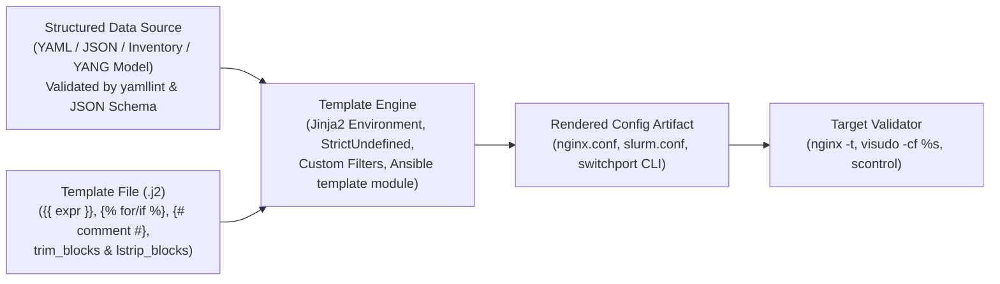

# 4.4 YAML and Jinja2 for infrastructure code

| | |
|---|---|
| Level | Beginner |
| Priority tier | 0 |
| Lab venue | Python 3.10+, `pip install jinja2 pyyaml yamllint ansible-core` |
| Part | Part 4: Automation and infrastructure as code |
| Status | Drafted, labs **untested** |

## Why this matters for AI infrastructure

Almost every control surface in this handbook is YAML, JSON or a template that produces one. That covers Ansible playbooks and inventories, Kubernetes manifests, Helm values and charts, Slurm and NCCL config generated from templates, GitHub Actions and GitLab CI pipelines, Prometheus rules, Docker Compose, cloud-init user data and Argo CD applications. When one of these files misbehaves, the cause is usually small. Most production incidents blamed on automation are really YAML mistakes, such as bad indentation, a type change like `no` becoming a boolean, or a tab character. The rest are template mistakes: an undefined variable, wrong whitespace or an unescaped brace. Learning YAML's data model and Jinja2's expression language removes a large class of these errors. It also makes you faster at everything that follows.

Picture a Friday change to a Slurm configuration. The diff is four lines long, the reviewer skims it, and the change goes out before the weekend. On Monday the scheduler refuses to start, and the log points at a line that looks correct when you read it. The cause is often one invisible character, such as a tab that looks like spaces, or a colon hiding inside an unquoted value. Nobody made a design mistake. The file simply meant something other than what it appeared to say. This chapter teaches you to read these files the way the parser reads them, so the Monday morning version of the story takes minutes instead of hours.

## Prerequisites and outcomes

You need only basic scripting familiarity to follow this chapter. By the end, you should be able to write correct YAML. That includes scalars, sequences, mappings, multi-line strings, anchors, aliases and merge keys, multi-document files and comments, all without falling into type-coercion traps. You should be able to move between YAML and JSON in your head. You should also check a file with `yamllint`, schemas and parsers.

On the template side, you will work with Jinja2 variables, expressions, filters, tests, conditionals, loops, macros, includes, inheritance, whitespace control and comments. You will know where Jinja2 ends and Ansible-specific behaviour begins. Finally, you will generate configuration files for Slurm, NCCL, chrony, netplan and Prometheus targets from data, and test those templates offline. You will also tell Helm (Go templates), Terraform (HCL interpolation) and Kustomize apart, so you can pick the right tool.

## 1. YAML essentials

Picture a pull request that changes the `mode` of a sudoers drop-in in a playbook. The reviewer reads `0644` in the diff, nods, and approves. The file is valid YAML, so every check passes. The parser, though, reads the unquoted `0644` as an octal number, and the file lands on the target with permissions nobody intended. Most of YAML's traps look harmless in a diff, which is why this section matters before you write your first real file.

A YAML file looks like plain text, but a parser turns each value into a typed object before any tool reads it. Think of the parser as a clerk at a counter. The clerk looks at each word, decides whether it is a number, a true or false value, or plain text, and files it in the right box. Those types are the source of several traps. YAML ("YAML Ain't Markup Language") is a human-friendly serialisation format, which means a way of writing data as text. In practice it is a superset of JSON, because JSON is valid YAML 1.2. So `{"a": 1}` works anywhere YAML does. Every YAML file is built from three structures, shown in the table below.

| Structure | Syntax | JSON/Python equivalent |
|---|---|---|
| Scalar | `42`, `3.14`, `true`, `null`, `hello`, `"quoted"` | number, bool, null, string |
| Sequence (list) | `- item` on separate lines, or `[a, b]` | array / list |
| Mapping (dict) | `key: value` pairs, or `{a: 1, b: 2}` | object / dict |

```yaml
---                                # optional document start marker
cluster:
  name: ai-prod-1                  # mapping inside mapping
  racks: [r1, r2, r3]              # flow-style sequence
  nodes:                           # block-style sequence of mappings
    - name: gpu01
      gpus: 8
      tags: [h100, nvlink]
    - name: gpu02
      gpus: 8
      tags:
        - h100
  motd: |                          # literal block: newlines preserved
    Authorised use only.
    Contact: ops@example.com
  description: >                   # folded block: newlines become spaces
    A long description that
    wraps across lines.
  enabled: true
  contact: null
...                                # optional document end marker
```

Read the example from the top. The `---` line opens the document, and the `cluster:` key opens a mapping. Everything indented under `cluster:` belongs to that mapping, so `name`, `racks` and `nodes` are its keys. The `racks` line uses flow style, a compact bracket form that holds three names on one line. The `nodes` line switches to block style, with one dash per node, because each node is a small mapping that reads better across several lines. Indentation tells the parser where each item ends, and the brackets tell it the same thing for the short lists.

Notice that the example mixes block style, which uses indentation, with flow style, which uses brackets and braces. Both are valid, and the two can sit side by side inside one file. The `gpu01` node writes its tags in flow style, while `gpu02` writes them as a block list. The parser reads both as the same list. Pick the form that a human reviewer reads fastest, and keep that form consistent within each file.

### Rules that bite

Indentation is structure, so use spaces and never tabs. Picture a parser that reads your file from left to right and top to bottom. It counts the leading spaces on each line to decide which key owns which value. A tab character breaks that count, so the parser stops with a parse error, even when the tab looks exactly like two spaces in your editor. Use two spaces consistently, and let each level sit two spaces deeper than its parent. Sequences under a key may be indented or not, since `key:\n- a` and `key:\n  - a` are both valid. The two forms mean the same thing, so pick one style and keep it across the whole repository.

A colon followed by a space separates a key from its value. Consider `msg: Disk full: retry` in a playbook. The parser sees a second colon followed by a space, and it can no longer tell where the key ends and the value begins. A value that contains `: ` or ` #` must be quoted, so the line becomes `msg: "Disk full: retry"`. A `#` that follows a space starts a comment, so `path: /data #1` silently stores only `/data`. The rest of the line is ignored, and no error appears.

Quoting matters because unquoted strings go through type inference. Type inference means the parser guesses a type from the text before it stores the value. Single quotes are literal, so `'C:\temp'` keeps its backslash exactly as written, and only `''` escapes a quote inside them. Double quotes support escapes such as `\n`, `\t` and `é`, so `"line one\nline two"` holds a real line break. When you are in doubt, quote the value. A quoted string is never reinterpreted, and a reader can see at a glance that the value is meant to be text.

Type coercion is one of the easiest traps to fall into. Coercion means the parser changes a value into another type without asking you first. Imagine a site inventory with a country column, where Norway's row silently turns into a boolean and the column stops making sense. That is the whole trap in one picture. YAML 1.1 parsers such as PyYAML, which Ansible uses, read `yes`, `no`, `on`, `off`, `y` and `n` as booleans. This is the "Norway problem": the country code `NO` becomes `false`. The same parsers read `1.10` as the float 1.1, so a version number loses its zero. They can read `010` as octal, `1e3` as a float and `2024-01-15` as a date object. The values `~` and empty become null, and a leading `0x` is hex. Times such as `22:30` may parse as sexagesimal integers in YAML 1.1. Meanwhile `0.0.0.0` stays a string, but `1.2` is a float.

Quote versions, codes, IDs and file modes such as `mode: "0644"`. Ansible's guidance is to quote file modes, since `0644` is octal in YAML 1.1 while many tools expect a string. The reviewer in the opening picture read `0644` and pictured the permissions that the octal reading does not give. Quote anything else that must stay text, because a human reading the file and a parser reading the file may disagree about what it means.

A string that begins with an asterisk, ampersand, exclamation mark, percent sign, at sign, backtick, brace, bracket, pipe or greater-than sign must be quoted. In Ansible, a value that starts with a Jinja expression needs quotes as well. For example, `"{{ var }}"` must be quoted, because an opening brace would otherwise start a flow mapping.

Multi-line strings have their own style choices. Picture an embedded shell script with three commands on separate lines. Under `|` each command keeps its own line, so the script runs as written. Under `>` the lines are folded together with spaces, and the shell receives one long line that no longer behaves like the script you wrote. So `|` keeps every newline, which suits config files and scripts. `>` folds newlines into spaces, which suits long prose such as a description. Chomping indicators control the end of the block: `|-` strips the final newline, and `|+` keeps all trailing newlines. An indentation indicator such as `|2` handles content that starts with spaces.

Duplicate keys are easy to miss. Picture a vars file where someone copies a block, and the copy keeps the old `mode` line below the new one. Most parsers silently keep the last one, which hides copy-paste bugs, and nothing on screen tells you that a value was thrown away. `yamllint` flags them with the `key-duplicates` rule.

Several documents can share one file if you separate them with `---`. Each section between separators is a complete, independent document, so a Kubernetes file with three deployments holds three documents side by side. Kubernetes manifests and Helm output use this layout. A single parse call usually expects one document, so the call reads only the first one, unless you call `yaml.safe_load_all`, which returns every document in order.

Never call `yaml.load` on untrusted input, because it can instantiate arbitrary Python objects. A YAML tag can ask the loader to build an object of any class it can import, and that object runs code when it is created. The result is that reading a file becomes the same as running it. Use `yaml.safe_load` instead, which builds only plain dictionaries, lists, strings and numbers. Anchors can also be abused for "billion laughs" expansion in untrusted documents.

### Anchors, aliases and merge keys

Picture a node pool of forty identical GPU machines, where each entry repeats the same OS, GPU count and tags. Copy-pasting forty blocks works until someone changes one shared value, and then thirty-nine entries have to be edited by hand. Anchors solve that problem. An anchor (`&name`) marks a node, and an alias (`*name`) reuses it. The merge key `<<` merges one mapping into another. It is a YAML 1.1 convention that PyYAML and Kubernetes tooling support. It is not part of the YAML 1.2 core, and not every parser honours it. The example below shows the idea.

```yaml
defaults: &node_defaults
  gpus: 8
  os: ubuntu-22.04
  tags: [h100]

nodes:
  - name: gpu01
    <<: *node_defaults           # copy defaults
  - name: gpu02
    <<: *node_defaults
    gpus: 4                      # override
```

Walk through the example as a parser would. It reads the `defaults` block first and stores it under the name `node_defaults`. When it reaches `gpu01`, the `<<: *node_defaults` line copies `gpus: 8`, `os` and `tags` into that node. For `gpu02`, it makes the same copy and then reads `gpus: 4`, which replaces the copied 8. The override wins because the local key comes after the merge. The other two keys still come from the defaults, so `gpu02` keeps its OS and tags.

Anchors work inside a single file only, not across files. Overused anchors make diffs harder to read. A reviewer who sees `<<: *node_defaults` has to scroll to the top of the file to learn what the node really contains, and a chain of anchors that refer to other anchors makes that search longer still. CI definitions, such as GitLab `extends` or GitHub Actions reusable workflows, give you higher-level reuse.

### JSON, YAML and other formats

Suppose a colleague sends you a nodes file and asks why the scheduler reads a value you did not expect. The fastest way to see what the parser actually produced is to convert the file to JSON, where every type is spelled out. Quoted strings stay strings, and unquoted `no` shows up as `false`. You will often need to convert a file or query it from the command line. Run `python3 -c 'import sys,yaml,json; print(json.dumps(yaml.safe_load(sys.stdin), indent=2))' < file.yml` to convert it for inspection. The `yq` tool (mikefarah) and `jq` both process YAML and JSON. Examples are `yq '.nodes[].name' nodes.yml`, `yq -o=json` and in-place edits with `yq -i`. Kubernetes accepts either format.

Choose the format by asking who edits the file. A person who edits a config every week wants comments, room for notes and light punctuation. A program that sends the same data to an API every second wants strict rules and no surprises. JSON has no comments and is stricter, which suits machine exchange. YAML suits human-edited configuration. TOML (Python tooling), HCL (Terraform) and INI (ansible.cfg, systemd) are the alternatives.

YAML has no built-in schema enforcement. A parser only checks that the text is well formed, so a file with `gpus: eight` parses without complaint, even though no tool that expects a number will accept it. A schema adds the missing rule, and it says what each key must hold. Validate it with JSON Schema through `check-jsonschema`, with `kubeconform` for Kubernetes, with `pydantic` models in Python, or with Ansible argument specs for roles. Lint the style with `yamllint`. Schema validation and data models are also covered in *Network Programmability and Automation*, chapter 8 (Data Formats and Models). That chapter places YAML among structured data formats, which beat fragile CLI screen scraping. Screen scraping means parsing human-oriented output such as `show interfaces em0`, which breaks whenever a vendor changes the spacing. Requesting structured output, such as XML from `show interfaces em0 | display xml` or JSON, avoids that problem.

The same chapter covers three ideas worth knowing, and each one answers a question that comes up when data moves between machines. The first is the two phases of reading text off the wire. Markup languages like HTML annotate documents for rendering, while data serialization formats represent typed data structures across languages. When bytes arrive, you decode them into a UTF-8 string, such as `"{\"vendors\":[\"Cisco\",\"Juniper\",\"Arista\"]}"`. Then you deserialize that string into native structures with `json.loads()`, which gives you a Python `dict` and `list`. Sending reverses the flow: you serialize first and then encode.

The second is the split between text and binary formats. XML uses tags, attributes and `xmlns:` namespaces. You query it with **XPath**, for example `//device/model` or `//device[@name="leaf"]/model`, or with **XQuery**. You validate it with **XSD** (`xmlschema`). JSON is lighter, and you validate it with **JSON Schema**. A schema starts with `"$schema": "https://json-schema.org/draft/2020-12/schema"` and can check `minLength`, `maxLength`, `minimum: 1`, `maximum: 4094` and IPv4 `pattern` regexes through Python's `jsonschema.validate()`. For high-throughput RPCs, such as gRPC telemetry or distributed training control planes, binary **Protocol Buffers** and **FlatBuffers** remove the text-parsing overhead. Protocol Buffers use `.proto` files, compiled with `protoc` and validated with `protoc-gen-validate`. FlatBuffers lets you read fields straight from the byte buffer without unpacking it. Python's `pickle` works only with Python, and it is unsafe on untrusted bytes.

The third is YANG. YANG is a data-modeling language, not a wire serialization format. The language is defined in RFC 6020 and RFC 7950. NETCONF and RESTCONF serialize YANG-modeled data as XML or JSON on the wire. A YANG module, such as `module acme-switch`, declares a `namespace`, a `prefix` and an `import ietf-inet-types`. It defines reusable types like `typedef vlan-id { type uint16 { range "1..4094"; } }`. It also defines single-value `leaf` nodes, scalar lists such as `leaf-list name-server`, and keyed `container` and `list` hierarchies such as `container vlans { list vlan { key "id"; unique "name"; ... } }`. OpenConfig and IETF models use these ideas to standardize data across vendors.

Ansible module arguments follow the same thinking. In *Ansible: Up and Running*, chapter 3, the authors recommend passing module arguments as pure YAML dictionaries. You write `package:\n  name: nginx\n  update_cache: true` rather than legacy `key=value` string arguments such as `package: name=nginx update_cache=yes`. Pure YAML highlights properly in editors, avoids multi-line backslash escaping and converts numeric and boolean types cleanly.

The flow below shows how the pieces fit together. Data and templates feed a template engine, and the rendered output goes to a target validator.



Store the lint rules in a `.yamllint` file, as in the example below. The comment on the `truthy` line says that it flags `yes`, `no`, `on` and `off`.

```yaml
# .yamllint
extends: default
rules:
  line-length: { max: 140, level: warning }
  truthy: { allowed-values: ["true", "false"] }     # flag yes/no/on/off
  indentation: { spaces: 2, indent-sequences: true }
  comments: { min-spaces-from-content: 2 }
  document-start: { present: false }
```

## 2. Jinja2 essentials

A network engineer needs forty switch configurations by Friday. Writing them by hand means forty chances for one interface to get the wrong VLAN. A template writes the pattern once, and a data file decides what differs from switch to switch. Think of the template as a form letter and the data as the names and addresses on the envelopes. The letter stays the same, and each envelope gets its own details.

Writing a Slurm node list by hand for every machine invites mistakes. Each line looks almost the same, and the one that goes wrong is the one nobody re-reads. Jinja2 lets you write the pattern once and feed it data. It is a Python templating engine, which means it reads a template file, fills in the blanks from a Python dictionary or list, and returns plain text. A template mixes literal text with three kinds of delimiters, shown in the table below. Each kind does a different job, so learn to recognise them at a glance.

| Delimiter | Purpose |
|---|---|
| `{{ expression }}` | Output the value of an expression |
| `` | Control flow: `if`, `for`, `set`, `macro`, `include`, `block` |
| `{# comment #}` | Comment (not rendered) |

Rendering takes a template plus a context, which is the set of variables, and produces text. Think of the template as the form letter and the context as the mail merge list. Rendering runs once per row of data, fills each blank, and gives you a finished page. Nothing is sent or installed at this stage. You only get text, which you can read before anything touches a server. Ansible uses Jinja2 for variable interpolation in playbooks, conditionals and `template` files. Salt, Flask, dbt, Superset, Cookiecutter and many network-automation tools also use it. Helm and Terraform do not. Helm uses Go templates, and Terraform uses HCL.

```python
from jinja2 import Environment, StrictUndefined
env = Environment(undefined=StrictUndefined, trim_blocks=True, lstrip_blocks=True, keep_trailing_newline=True)
tpl = env.from_string("""

NodeName={{ n.name }} Gres=gpu:{{ n.gpus }} State=UNKNOWN

""")
print(tpl.render(nodes=[{"name": "gpu01", "gpus": 8}, {"name": "gpu02", "gpus": 8}]))
```

Notice that the loop writes one line per node, with each GPU count filled in. Here is what happens when the code runs. Jinja2 reads the first line of the template, sees the `for` tag, and starts a loop over the two nodes in the list. For `gpu01`, it writes the text `NodeName=gpu01 Gres=gpu:8 State=UNKNOWN` and a line break. It then does the same for `gpu02`, and the closing `endfor` tag ends the loop. The `trim_blocks` setting removes the blank line that the tag itself would otherwise leave behind, which keeps the output tidy.

The `StrictUndefined` setting turns a missing variable into an error instead of an empty string. Suppose you rename `gpus` to `gpu_count` in the data but forget to update the template. Without the setting, every line would quietly read `Gres=gpu:` with nothing after the colon. With it, the render stops and names the missing variable. That is the single most useful safety setting. Ansible's default also errors on undefined variables unless you provide a `default`.

### Expressions

Expressions are how a template reads values out of your data. Think of the context as a filing cabinet and an expression as the label you write to pull out one folder. `{{ cluster.name }}` opens the drawer called `cluster` and takes the `name` folder from it. Write `{{ cluster.name }}` to read an attribute, or `{{ cluster['name'] }}` for the item form. Lists work the same way: `{{ list[0] }}`, `{{ list[-1] }}` and slices such as `{{ list[1:3] }}`. Literals include strings, numbers, `true` and `false` (Python's `True` and `False` also work), `none`, lists such as `[1, 2]`, dicts such as `{'a': 1}`, and tuples.

The operators are arithmetic `+ - * / // % **`, comparison `== != < > <= >=`, logic `and or not`, and membership `in`. Use `~` to join strings, not `+`. The reason is that `~` always treats its operands as text, so a node number of 1 joins cleanly as `gpu` `~` `1`. The `+` operator tries arithmetic first, and mixing text with a number fails. The conditional expression `{{ 'a' if cond else 'b' }}` picks one value or the other. The `is` keyword applies a test, which the next section covers.

### Filters

A filter transforms a value, and you can chain filters together. The form is `{{ value | filter(args) }}`. The table groups the common filters by category, so use it as a lookup.

| Category | Filters |
|---|---|
| Strings | `upper`, `lower`, `title`, `trim`, `replace('a','b')`, `regex_replace` (Ansible), `split(',')`, `join(', ')`, `truncate`, `indent(4)`, `center`, `wordwrap`, `urlencode` |
| Defaults / safety | `default('x')`, `default('x', true)` (also for empty/falsy), `mandatory` (Ansible), `string`, `int`, `float`, `bool`, `abs`, `round` |
| Collections | `length`, `first`, `last`, `sort`, `unique`, `reverse`, `list`, `map(attribute='name')`, `select`, `reject`, `selectattr('gpus','gt',4)`, `rejectattr`, `groupby('rack')`, `sum`, `min`, `max`, `batch(3)`, `slice(3)` |
| Dict | `dictsort`, `items`, `dict2items`/`items2dict` (Ansible), `combine` (Ansible merge), `json_query` (JMESPath, Ansible) |
| Serialisation | `tojson`, `to_json`, `to_nice_json`, `to_yaml`, `to_nice_yaml`, `from_json`, `from_yaml` (Ansible), `b64encode`/`b64decode`, `hash('sha256')`, `password_hash` |
| Paths | `basename`, `dirname`, `expanduser`, `realpath`, `splitext` (Ansible) |
| Network (Ansible `ansible.utils`/`ansible.netcommon`) | `ipaddr`/`ansible.utils.ipaddr`, `ipv4`, `ipmath`, `cidr_merge`, `hwaddr`, `ansible.utils.next_nth_usable` |

Read the examples below as short pipelines. Each one takes the nodes list and returns a single answer, such as the names of the GPU nodes or their total. A pipe character works like a conveyor belt. The value enters on the left, each filter changes it once, and the result moves on to the right. Take the second line. `selectattr('gpus', 'ge', 8)` keeps only the nodes whose `gpus` value is 8 or more. `map(attribute='name')` then pulls the name out of each remaining node, and `join(',')` glues the names together with commas. If the first filter keeps nothing, the later filters receive an empty list and the output is an empty string.

```jinja
{{ nodes | map(attribute='name') | list }}                       {# ['gpu01', 'gpu02'] #}
{{ nodes | selectattr('gpus', 'ge', 8) | map(attribute='name') | join(',') }}   {# gpu01,gpu02 #}
{{ nodes | sum(attribute='gpus') }}                              {# total GPUs #}
{{ cluster.timeout | default(30) | int }}
{{ users | groupby('team') }}
{{ ports | join(',') }}
{{ config | to_nice_yaml(indent=2) }}
```

### Tests

A test asks a yes-or-no question about a value. You write it after `is`, usually inside an `if`. The core tests are `defined`, `undefined`, `none`, `string`, `number`, `integer`, `mapping`, `iterable`, `sequence`, `even`, `odd`, `divisibleby(3)`, `equalto`, `in`, `lower`, `upper` and `callable`. Ansible adds more, including `success`, `failed`, `changed`, `skipped`, `match`, `search`, `version('2.0', '>=')`, `subset`, `superset`, `contains`, `file`, `directory` and `exists`.

```jinja
...
...
{{ result is failed }}
```

Use `is version` when a version number matters, such as a GPU driver check. A plain `>=` comparison on version text can go wrong, because text compares character by character, so one version string can sort after a newer one. The version test compares the parts as versions, so the check reads the driver branch correctly. The other tests answer simpler questions about whether a value exists or what type it has. A test is the right tool when the answer is yes or no, and a filter is the right tool when the answer is a new value.

### Control structures

Control structures let a template make decisions and repeat text. Think of them as the branches and loops in a recipe. An `if` tag asks a question about the data and keeps one branch, and a `for` tag repeats one block for each item. Together they let one template produce a different line for a compute node, a login node and a node with no GPUs. The `if` block below picks a line based on the node's role. The `for` loop groups nodes by rack, and its `else` branch covers an empty group.

```jinja

  Gres=gpu:{{ node.gpus }}

  # login node

  # other



# rack {{ rack }}

{{ n.name }}   {{ loop.index }}/{{ loop.length }}{{ ' first' if loop.first }}{{ ' last' if loop.last }}

(no nodes)





   {# variable scoping workaround #}
```

Here is the loop on the first rack in plain words. The `groupby('rack')` filter sorts the nodes into one bundle per rack, and the outer `for` walks those bundles. The inner loop then sorts each bundle by name and prints one line per node. Only the first and last node get extra words, and an empty rack prints the `(no nodes)` line from the `else` branch.

Inside a loop, the `loop` variable tells you where you are. `index` is 1-based, and `index0` counts from 0. You also get `first`, `last`, `length`, `revindex`, `cycle('a','b')`, `previtem` and `nextitem`. A variable set inside a `for` stays inside that loop. When you need a value after the loop, use `namespace` to carry it out. The `......` form runs the `else` block when the sequence is empty.

### Whitespace control

Templates that produce config files must control blank lines and indentation, and a template can break them without any visible sign. Picture a sshd config where every `` line leaves an empty line behind. Each block adds a gap, and after twenty conditionals the file looks like it has been edited by hand. Nothing is broken yet, but the diff against the last deploy shows a dozen changes that mean nothing. Jinja2 gives you several tools. `` strip whitespace before or after a tag. `trim_blocks=True` removes the first newline after a block tag. `lstrip_blocks=True` strips leading whitespace before a block tag. Ansible's `template` module sets `trim_blocks=True` by default. You can set `lstrip_blocks` through `jinja2_extensions` or a `# jinja2:` header. A common pattern is a first-line override, shown below.

```jinja
#jinja2: trim_blocks:True, lstrip_blocks:True
# {{ ansible_managed }}
```

Always render the template and read the output. Whitespace errors are invisible in the template itself, because the template looks neat in your editor while the output drifts. They are fatal in whitespace-sensitive output such as YAML or Makefiles. A Makefile, for example, needs a real tab before each recipe line, so a template that swaps that tab for spaces produces a file that the tool refuses to read. Read the rendered file the way the target will read it, and the drift becomes obvious.

### Macros, includes, inheritance, raw blocks

A macro lets you reuse a stanza, and an include renders another template with the same context. The examples below show both, plus inheritance and raw blocks.

```jinja

NodeName={{ n.name }} CPUs={{ n.cpus }} Gres=gpu:{{ n.gpus | default(default_gpus) }}


{{ node_line(n) }}


                       {# render another template with the same context #}
{{ m.node_line(n) }}

{# inheritance: base.j2 defines ; child:  ... #}

{{ this is output literally }}      {# to emit braces, e.g. Prometheus/Go templates #}
```

A macro is like a small function that returns text. You define it once, give it arguments such as the node and a default GPU count, and call it wherever the stanza is needed. An include is closer to pasting in another file. Inheritance lets a base layout hold the common shell of a file, while each child fills in only its own block. Each of these tools keeps one copy of a repeated piece, which means a fix goes in one place. Prometheus alert annotations, Helm templates and Grafana are the usual cases where a template must output literal `{{ }}`. Wrap that text in ``, or write it with `{{ '{{' }}`.

## 3. Jinja2 in Ansible

Your Ansible run fails with `AnsibleUndefinedVariable` on one host, while the same playbook works on the others. The template uses a variable that is defined only in a different inventory group. Knowing where Ansible evaluates a template, and which variables are visible at that point, tells you where to look first. The sections below walk through the places where Jinja2 shows up in a playbook, and the quoting rules that go with each one.

Ansible adds its own variables, filters and tests on top of Jinja2. It evaluates templates on the control node, the machine you run Ansible from, and not on the servers being configured. That split explains a lot of confusion. A `template` task fills in its blanks on your laptop or CI runner, then copies the finished text to the target. A `shell` task runs on the target. You will meet Jinja2 in several places, and each place has its own quoting rules.

Jinja2 appears in task arguments, `vars`, `when`, `loop`, `failed_when`, `changed_when`, file contents rendered by the `template` module (such as `src: nccl.conf.j2`), and inventory variables. The `when` clause is already a Jinja expression. Write `when: ansible_distribution == 'Ubuntu'`, not `when: "{{ ... }}"`.

A YAML value that starts with `{{` must be quoted, for example `msg: "{{ var }}"`. Inside quotes you can mix literal text and expressions, as in `path: "/data/{{ project }}/{{ env }}"`.

Undefined variables cause an error by default. The error usually means the variable is set in a group that this host does not belong to, or in a file the play never loads. Use `{{ var | default('x') }}` when a sensible fallback exists. Use `{{ var | mandatory }}` when the run should stop with a clear message. An `is defined` check lets a task decide what to do when a variable is missing. Use `default(omit)` when the module should use its own built-in value for a parameter you did not set.

Ansible templating returns strings unless the value is a single native expression. Picture a flag that a previous task registered as `False`, which then passes through a template on its way to a second task. The flag comes out as the text `"False"`. Text is never empty, so a plain truth test reads it as true, and the second task runs when it should have been skipped. A boolean from `{{ }}` can therefore arrive as the string `"True"`. Use `| bool`, `| int` and `when:` conditionals instead of string comparisons. The `jinja2_native` setting can change this behaviour, so test carefully.

Lookups and facts give you data from outside the template. Examples include `lookup('env', 'HOME')`, `lookup('file', 'x')`, `lookup('pipe', 'cmd')` (run on the control node), `query`, `hostvars['host']['ansible_default_ipv4']['address']`, `groups['gpu']`, `inventory_hostname`, `ansible_facts` and `play_hosts`.

Think of the `ansible.builtin.template` module as a careful courier. It fills in the form on the control node, checks the result if you asked it to, and only then delivers the finished copy to the target. The module renders on the control node and copies the result to the target. Its options include `owner`, `group`, `mode`, `backup`, `variable_start_string` for different delimiters, and `validate: "visudo -cf %s"`. The `validate` option checks the file before it is installed, which is essential for sudoers, sshd and nginx. The `{{ ansible_managed }}` variable gives you a "do not edit" header.

The next example renders Slurm node definitions from inventory data.

```jinja
# {{ ansible_managed }}


NodeName={{ host }} NodeAddr={{ h.ansible_host }} CPUs={{ h.ansible_processor_vcpus }} RealMemory={{ (h.ansible_memtotal_mb * 0.95) | int }} Gres=gpu:{{ h.gpu_count | default(8) }} State=UNKNOWN

PartitionName=gpu Nodes={{ groups['gpu'] | join(',') }} Default=YES MaxTime=INFINITE State=UP
```

Walk through one host to see how the loop behaves. The loop runs once for each name in `groups['gpu']`, sorted alphabetically. Inside the loop, `set h = hostvars[host]` gives the template a short handle on that host's variables. For a host without a `gpu_count` variable, the `default(8)` filter fills the gap, so its line reads `Gres=gpu:8`. If the host sets `gpu_count` to 4, the same line reads `Gres=gpu:4`. The rest of the line stays the same either way.

The NCCL environment is the next case, and it follows the same pattern. Here the template turns a dictionary of settings into environment lines, one per key. `dictsort` puts the keys in a stable order, so the file comes out identical on every render, and a stable order is what lets a diff show only real changes. The `| default({})` guard means that a host without NCCL settings still renders a valid, empty file.

```jinja
# {{ ansible_managed }}

NCCL_{{ k | upper }}={{ v }}

```

Here the variables are `nccl_env: { debug: WARN, ib_hca: "mlx5_0,mlx5_1", socket_ifname: eth0 }`.

### Network switchport templates, custom Python filters (`get_interface_speed`), and NGINX TLS templates (*Network Programmability and Automation* Ch. 9 & *Ansible: Up and Running* Ch. 3)

Two classic walkthroughs from the Gem Books show how data and Jinja2 templates come together in practice. The code for both is modeled in `code/part04/yaml_jinja2_templates.py`.

The first walkthrough renders switchport configurations with loops, conditionals, filter chains and custom filters. It comes from *Network Programmability and Automation*, chapter 9, examples 9-4 to 9-10. The script starts from a `data.yml` list of switch interfaces. `GigabitEthernet0/1` has `uplink: true`, and `GigabitEthernet0/2..3` have `vlan: 10`. The script loads the template with `ENV = Environment(loader=FileSystemLoader('.')); template = ENV.get_template("template.jinja")`. It then registers a custom Python function, `def get_interface_speed(interface_name):`, with `ENV.filters['get_interface_speed'] = get_interface_speed`. That function returns `1000` for `gigabit`, `100` for `fast`, and `0` otherwise.

```jinja

interface {{ interface.name }}
  description {{ interface.desc | upper | reverse }}

  switchport mode trunk

  switchport access vlan {{ interface.vlan }}
  switchport mode access

  speed {{ interface.name | get_interface_speed }}

```

Notice that you can pass either a Python `dict` (`interface_dict`) or a custom Python class instance (`NetworkInterface("GigabitEthernet0/1", "Server Port", 10)`) into `template.render()`. Jinja2 resolves `interface.name` on both. The same chapter contrasts Jinja2 with **XSLT** XML transformations, which use `lxml.etree.XSLT`, and with **Go `text/template`**, which uses `{{range $i, $interface := .Interfaces}}` and `template.FuncMap{"ifparse": IfParse}`.

The second walkthrough templates `nginx.conf.j2` and `index.html.j2` in an Ansible playbook. It comes from *Ansible: Up and Running*, chapter 3, in the file `webservers-tls.yml`. That file defines play-level `vars:`: `tls_dir: /etc/nginx/ssl/`, `key_file: nginx.key`, `cert_file: nginx.crt`, `conf_file: /etc/nginx/sites-available/default` and `server_name: localhost`. The task `template: src=nginx.conf.j2 dest={{ conf_file }} mode='0644'` fills `{{ server_name }}` and `{{ tls_dir }}{{ cert_file }}` into the NGINX `server` block. A second task, `template: src=index.html.j2 dest=/usr/share/nginx/html/index.html`, uses the built-in `{{ inventory_hostname }}` variable. Whenever the rendered file changes, `notify: Restart nginx` restarts the service.

Picture a playbook run that replaces `/etc/sudoers` with a template containing one mistyped character. Without `validate`, the broken file lands on the server, and the next `sudo` command fails for every administrator. With `validate: "visudo -cf %s"`, the check runs first, and the bad file is rejected while the old one stays in place. For any file that a broken config could lock you out of, such as sudoers or sshd, set `validate` before you trust the template.

## 4. Templating elsewhere (and how not to confuse them)

In one afternoon you might open a Helm chart, then an Ansible role, then a Terraform module. Each one uses curly braces, and each one means something different. A Jinja filter pasted into a Go template fails, and a `${var}` pasted into a Jinja template may be read as text. The table below is the cheat sheet that stops you from making that mistake under time pressure.

Several tools in this stack use templates, and their syntax looks alike even where the rules differ. The problem is that the same `{{` can mean three different things depending on which file you are in. Picture a Helm values file pasted into a Jinja template: Jinja reads the Helm braces first and tries to fill them in, and the render fails with a message about an undefined name. Each row in the table answers the question of which engine is reading the braces in front of you. The table shows which language each tool uses, so you can check before you edit a file.

| Tool | Language | Notes |
|---|---|---|
| Ansible, Salt, Cookiecutter, dbt | Jinja2 | `{{ }}`, ``, filters |
| Helm | Go `text/template` + Sprig functions | `{{ .Values.image.tag \| quote }}`, `{{- if .Values.gpu }}`, `{{ include "chart.fullname" . }}`, `toYaml \| nindent 4`; whitespace trimmed with `{{-` and `-}}` |
| Terraform/OpenTofu | HCL expressions and `templatefile()` | `"${var.name}"`, `for` expressions, `%{ if }` directives |
| Kustomize | No templating; overlays, patches (JSON6902, strategic merge) | Declarative patching rather than templating |
| GitHub Actions | `${{ expression }}` | Different expression syntax and contexts |
| Docker Compose | `${VAR:-default}` variable substitution | Shell-like |
| cloud-init | Jinja2 optional header `## template: jinja` | Renders `{{ v1.local_hostname }}` instance data |
| Packer | HCL2 | `templatefile`, locals |
| Prometheus/Alertmanager | Go templates | `{{ $labels.instance }}`; conflicts with Jinja in Ansible-templated rule files; use `` |

A few habits keep templated configuration manageable. Separate data from templates by keeping variables in inventory or vars files, and keep the templates light on logic. Where you can, prefer declarative overlays such as Kustomize, or typed config. Avoid templating a templating language, such as Helm values rendered by Jinja and then rendered again by Terraform. Keep logic in code or modules rather than in 200-line Jinja files. Validate the generated YAML after rendering with `yamllint`, `kubeconform` or `kubectl --dry-run=server`.

A useful test is to ask whether a reviewer could understand the change without running anything. If the answer is no, the logic has probably moved into the template and out of the data. Keep a template for the parts that really vary, and keep the data in a file you can read without rendering it.

## 5. Testing and debugging templates

A template can render without errors and still produce a broken file. The usual failure looks like this: the render succeeds, the service refuses to start, and the log says the config is malformed on line 14. The fix is to render offline first, compare the result with an expected file, and let the target's own tools judge the output. Each of the three checks below catches a different kind of problem.

Picture a template change that passes review, renders cleanly on your laptop, and still breaks the service after deployment. The fix is a loop you run before anything reaches a server. First, render the template on your own machine with realistic data. Second, compare the output with a file you already reviewed. Third, hand the output to the target's own checker. Each step catches a different kind of mistake, and together they turn a surprise on Monday into a failed test on Friday.

You can render offline in three ways. Use the `jinja2` Python API with a fixtures file. Run a single task with `ansible localhost -m ansible.builtin.template -a "src=nccl.conf.j2 dest=/tmp/out" -e @vars.yml --diff`, or use a one-task playbook. To check a single expression, run `ansible -m debug -a "msg={{ ... }}"`.

Golden-file tests render representative data, including empty lists and missing optional keys, and compare the result with an expected file. The expected file is called the golden file, and someone reviews it once and commits it. From then on, any change to the template shows up as a diff against that file, so a reviewer sees exactly which line moved. Choose inputs that stress the template. An empty list, a missing optional key and a host with zero GPUs will expose more bugs than a tidy, typical host. See 3.9 for testing patterns. Snapshot tests catch accidental whitespace changes, because a stray space that a human would never notice still shows up in a diff.

Validate the output with the target's own parser. Examples include `nginx -t`, `visudo -cf`, `sshd -t`, `slurmd -C` or `scontrol` checks, `kubeconform`, `promtool check rules`, and `python -c 'import yaml; yaml.safe_load(...)'`.

When something goes wrong, the fastest path is to look at what the template actually received. Printing the data shows you the values, and a missing or misspelled key is usually visible at once.

When something goes wrong, print the data. Use `{{ var | to_nice_json }}` in `debug` tasks, run `ansible-playbook -vvv`, or run `ansible-inventory --host name` to see merged variables. For an undefined-variable error, read the exact variable name and the precedence layer (4.7).

The table below matches common error messages to their usual causes.

| Message | What it usually means |
|---|---|
| `AnsibleUndefinedVariable: 'x' is undefined` | A variable is missing from the context |
| `template error while templating string: unexpected '}'` | Unbalanced braces, or confusion with a YAML flow mapping |
| `mapping values are not allowed here` | An unquoted string contains a YAML colon |
| `found character '\t' that cannot start any token` | A tab character in the file |
| `did not find expected key` | Indentation is wrong |
| `The task includes an option with an undefined variable` | An option refers to a variable that does not exist |

Work through the table from the top. An undefined variable is the most common cause, so check the exact variable name and the layer that should define it before you touch the template. Most of the other rows point at a single character, such as a tab, a colon or a brace, so read the line number in the error and look there first.

Think of each `lookup('pipe')` call as a trip to the shop. One trip is cheap, but repeating it for every host in a fleet of thousands adds up to a long wait. Heavy Jinja inside loops over thousands of hosts is slow. Precompute values with `set_fact` or filters, and avoid `lookup('pipe')` per host.

Before you ship a template, render it once against your edge-case fixtures and read the output.

## 6. Security considerations

A colleague builds a notification feature that takes free text from a web form and runs it through a template engine on the server. A user types a template expression into that field, and the engine evaluates it with the server's privileges. Nothing in the code looked wrong, because the danger came from treating user input as template source. The rule below prevents that, and the rest of this section covers secrets that end up in rendered files.

Think of a template engine as a machine that obeys whatever text it is given as a recipe. Feed it your own recipe, and it does what you intend. Feed it a recipe written by a stranger, and the stranger decides what happens on your machine. Untrusted data is the main risk when templates are involved. Never render a user-provided string as a template, because that opens the door to server-side template injection. Ansible marks values from facts as "unsafe", which stops them from being templated again. Do not remove that `!unsafe` marking, and avoid `eval`-like constructs.

Secrets need extra care in rendered files, because a rendered file is a copy of the secret sitting on disk. Picture a database password that ends up in a config file readable by every user on the host. The fix is to limit who can read the file and to keep the value out of logs. Set `mode: "0600"`, `owner` and `no_log: true` on any task that renders a secret. Set `diff: false` as well, so the secret stays out of `--diff` output. When you template values into shell commands, quote them with the `| quote` filter. Use `yaml.safe_load` for parsing, and pin and review your parsers as part of your tooling.

## 7. Lab

Start with the self-checking Python lab. Run it on your own machine to confirm the core ideas. When you run it, it checks the YAML 1.1 scalar type-coercion traps, through `classify_yaml11_unquoted_scalar` on `NO`, `1.10`, `010`, `0x1f`, `22:30` and `~`. It checks block chomping indicators through `apply_yaml_block_chomping` on `|`, `|-`, `|+` and `>-`. It renders the switchport template from *Network Programmability and Automation*, chapter 9, with its `upper | reverse` filter chain and custom `get_interface_speed` filter, through `render_switchport_template`. Finally, it renders Slurm node configuration with `StrictUndefined` validation, through `render_slurm_nodes_template`.

```bash
python3 code/part04/yaml_jinja2_templates_lab.py
```

Think of the lab as a rehearsal before a real rollout. Start with the script, watch each check pass, and then move on to the exercises. Next, work through the exercises below on any machine with Python 3.10+ and `jinja2`, `pyyaml` and `yamllint` installed. The interactive shell steps have not been run on live hardware, so treat your first run as the real test.

1. Read a file that contains `no`, `yes`, `1.10`, `010`, `22:30`, `2024-01-01`, `~`, `0x1f` and `"quoted"`. Parse it with PyYAML and print each Python type. Then quote each value correctly, and run `yamllint` with the `truthy` rule.
2. Build the node defaults file, then load it with PyYAML and with `yq`. Show a parser that ignores `<<`. Finally, refactor the file to use explicit inheritance in code.
3. Write `|`, `>`, `|-` and `>+` blocks, and print their `repr` to see the newlines. Then embed a script and a systemd unit in YAML.
4. Render the Slurm node template from a Python script with `StrictUndefined`. Remove a variable and watch the error. Then compare the behaviour without `StrictUndefined`.
5. Take a nodes list where some nodes have 8 GPUs and others have 4. Produce the comma-joined names of the 8-GPU nodes. Then produce the total GPU count. Next, group the nodes by rack. Finally, dump the whole list with `to_nice_yaml`.
6. Render the same loop with and without `trim_blocks`, `lstrip_blocks` and `{%-`. Diff the outputs. Then fix a template that emits blank lines in the middle of a config file.
7. Factor the repeated stanzas into macros and includes. Test `` by templating a Prometheus alert rule that contains Go template syntax.
8. Write `nccl.conf.j2` and render it with the `template` module. Use `--diff`, `--check`, and `validate:` with a custom validator command. Show `default(omit)` skipping an optional parameter, and reproduce the YAML error that an unquoted `{{ }}` value causes.
9. Demonstrate a boolean that arrives as the string `"False"`, then fix it with `| bool`. Compare `when: var` with `when: var | bool`.
10. Write the same service config three ways: as a Jinja2 template for Ansible, as a Helm template and as a Kustomize patch. List when each one is the better choice.
11. Add `yamllint`, `check-jsonschema` (or `kubeconform`) and a golden-file render test to pre-commit or CI.
12. Clean up.

## 8. Common mistakes

Most of these mistakes survive review, because each one looks correct at a glance. Reviewers read intent, and the mistakes live in what the parser or the renderer does with the text. Think of a reviewer as someone who checks the recipe, while the parser is the cook who might misread a quantity. A value that reads as a version, a template that reads as plain text, or a loop that reads as obvious. Check each one by rendering the file and reading the output, not by trusting the source.

Tabs and uneven indentation are the first things you should check in YAML. Mixing list styles also makes a file harder for others to read. Unquoted values such as `NO`, `1.10`, `yes`, times and values with leading zeros get reinterpreted by YAML. An unquoted `{{ var }}` at the start of a value causes trouble too.

In templates, `when: "{{ var }}"` double-templates a condition, where `when: var` is correct. Relying on undefined variables that quietly render as empty strings is another trap. So are templates with heavy logic and nested loops that nobody can review, and templates that generate other templates. Whitespace bugs slip through when no one inspects the generated output. Forgetting `` breaks Go-template or Jinja-in-Jinja content.

Security mistakes matter too. Using `yaml.load` on untrusted data, or rendering untrusted strings as templates, is a mistake to avoid. Anchors across files are not supported, and overused merge keys can hide the effective configuration. Deploying rendered output that you never validated is a mistake of its own.

Inspect the rendered output on every template change. Whitespace bugs show up there, not in the template. Make it a habit to open the rendered file before you open the diff of the template, because the rendered file shows what the target will receive.

## 9. Interview angles

Use these questions to check what you have learned.

- "What are YAML's gotchas? Name values that change type, such as the Norway problem, versions and octal."
- "What is the difference between `|` and `>` block scalars?"
- "How do you reuse YAML sections? What are the limits of anchors?"
- "How do Jinja2 statements, expressions and comments differ? How does Ansible use them?"
- "How do you loop over inventory hosts to build a config file? How do you avoid blank lines?"
- "When do you use default, mandatory and omit?"
- "How do you test and validate templates?"
- "How do Helm, Jinja2, Kustomize and Terraform `templatefile()` differ? When would you choose each?"
- "Why is `yaml.load` dangerous?"

## Exercises

These exercises check whether you have understood the ideas. Each one points at a specific function or file, so you can see the behaviour yourself.

1. A config review flags a value that the parser read differently from how it looks. Run `classify_yaml11_unquoted_scalar()` from `code/part04/yaml_jinja2_templates.py` on `NO` and on `1.10`. What type does each one become? Why must the file mode `"0644"` stay quoted? Next, run `apply_yaml_block_chomping()` on `|`, `|-` and `|+`. Which of those styles keeps a trailing blank line? Does `>-` strip the final newline? A playbook uses `&anchor`, `*alias` and `<<` to share settings. How does the parser build the final mapping for each host? Why does `0x1f` read as a number while `22:30` needs quotes? Why do pure YAML task dictionaries read better than `key=value` strings, as *Ansible: Up and Running*, chapter 3, explains?
2. A telemetry team must choose a format for switch data. Which two phases turn incoming bytes into a Python dictionary? Why does structured output beat scraping `show interfaces em0` by hand? Which element would you use for a plain list of name servers in YANG, `leaf-list` or `container`? How does a `typedef` such as `vlan-id` differ from a `leaf`? Why is YANG a data-modeling language and not a wire format? Check your answer against *Network Programmability and Automation*, chapter 8, and against the `JSON Schema` rules in that chapter.
3. A switchport template prints extra blank lines in the middle of a config. Which setting, `trim_blocks=True` or `lstrip_blocks=True`, removes the newline after a block tag? What happens when `StrictUndefined` meets a missing variable? Why does `{%-` remove more whitespace than a plain `{%` tag? Which pipeline uses `selectattr` and `map(attribute=...)` to return the GPU name list for nodes with 8 or more GPUs? Why does a counter updated inside `` need `namespace(count=0)`? Use `get_interface_speed()` and `render_switchport_template()` from *Network Programmability and Automation*, chapter 9, to test your answer.
4. A playbook fails on a value that starts with a brace. Why must `msg: "{{ var }}"` be quoted? Why must `when: ansible_distribution == 'Ubuntu'` skip the `{{ }}` wrapper? Which `validate` command stops a broken sudoers file from reaching the server, and which one would you choose for `nginx -t`? When does `default(omit)` drop an optional module parameter? How would `...` protect a Prometheus rule that contains literal braces, and how does `ansible.builtin.template` decide when to copy the file?
5. A team uses Ansible, Helm, Terraform and Kustomize in one repository. Which of those tools uses no templating at all? How does Helm's `{{ .Values.x | quote }}` differ from Jinja's filter syntax? How does Terraform's `${var.x}` differ from `templatefile()` when it fills a file? Why is a Jinja template that generates a Helm template an anti-pattern? Check your answer against the table in section 4, where `{{-` and `templatefile()` are listed.
6. Your merge request changes `slurm.conf.j2` and `nccl.conf.j2`. What should the CI step render, and with which undefined-variable setting, `StrictUndefined` or the default? How does a golden-file diff catch a stray space? Which two checkers, `yamllint` or `check-jsonschema`, validate the syntax of the output? Why must the parsing call be `yaml.safe_load` rather than `yaml.load`? Why does a user-supplied string never belong in `Template(user_input).render()`, the Server-Side Template Injection (`SSTI`) pattern? Which three task settings, `mode: "0600"`, `no_log: true` and `diff: false`, keep a rendered secret safe?

## Checkpoint questions (20)

<details>
<summary>1. What are YAML's three fundamental data structures, why is JSON valid YAML, and why are tabs forbidden (*Ansible: Up and Running* chapter 3 and *Network Programmability and Automation* chapter 8)?</summary>

YAML builds every document from three primitives. Scalars are single values such as strings, numbers, booleans and `null`. Sequences are ordered lists, written with `- item` lines or `[a, b]` flow syntax. Mappings are key-value dictionaries, written as `key: value` lines or `{a: 1}` flow syntax. Because YAML 1.2 was designed as a strict superset of JSON, any valid JSON document is also valid YAML. YAML uses spaces for indentation and forbids tab characters there. A tab triggers the error `found character '\t' that cannot start any token`.
</details>

<details>
<summary>2. Explain six classic YAML type-coercion traps (`NO`, `1.10`, `010`, `0x1f`, `22:30`, `~`) and how to prevent them in `yamllint`.</summary>

In YAML 1.1 parsers, such as PyYAML used by Ansible, six traps catch people out. The first is the Norway problem. An unquoted `NO`, `off`, `yes`, `on`, `y` or `n` becomes a boolean. Here `NO` is Norway's ISO country code and parses as `False`, while `yes` and `on` parse as `True`. The second is `1.10`, which parses as the float 1.1 and loses its trailing zero. Third, leading zeros make octal numbers, so `010` becomes `8` and `0644` becomes `420`. That breaks tools that expect the four-character string `"0644"`. Fourth, `0x1f` parses as the integer `31`. Fifth, `22:30` parses as a base-60 number, 22 × 60 + 30 = 1350. Sixth, `~` or an empty value parses as `None`. Quote versions, country codes, file modes such as `mode: "0644"`, and any string that contains a colon. Then configure `yamllint` with `truthy: { allowed-values: ["true", "false"] }`.
</details>

<details>
<summary>3. Contrast YAML's literal (`|`) and folded (`>`) block scalars, and explain the chomping indicators (`|-`, `|+`, `|2`).</summary>

The literal style, `|`, keeps every newline inside the block. That makes it ideal for embedded shell scripts, certificates and multi-line config files such as `motd` or `visiting_address` in *Ansible: Up and Running*, chapter 3. The folded style, `>`, turns single newlines into spaces. Long paragraphs can wrap neatly in your source and still come out as one line. Chomping controls the newlines at the end. By default, `|` or `>` keeps one final newline. `|-` and `>-` strip all trailing newlines, while `|+` and `>+` keep every trailing blank line. A digit such as `|2` says the block is indented by 2 spaces, which you need when the first content line itself starts with spaces.
</details>

<details>
<summary>4. How do YAML anchors (`&`), aliases (`*`), and merge keys (`<<`) work, and what are their limitations?</summary>

An anchor, written `&node_defaults`, labels a YAML node. An alias, `*node_defaults`, points back to that node later in the same file. The merge key, `<<: *node_defaults`, copies all the keys from the anchored mapping into the current one. Local keys such as `gpus: 4` override the copied defaults. Anchors have limits. They cannot cross file boundaries, and the `<<` key is a YAML 1.1 extension that not every YAML 1.2 parser supports. Deep anchor chains also hide changes in diffs. On untrusted input, they can be abused for "billion laughs" memory amplification.
</details>

<details>
<summary>5. In *Network Programmability and Automation* Chapter 8, what are the two phases of reading text-based data off the wire, and why is YANG NOT a serialization format?</summary>

When your program receives bytes from an API or socket, it decodes them first. Decoding turns the raw bits into a UTF-8 string, for example with `bytes.decode('utf-8')`. Then it deserializes that string into native in-memory data, such as a Python `dict` or `list` from `json.loads` or `yaml.safe_load`. Sending reverses the process: you serialize the data first, and then encode it. YANG (RFC 6020 and RFC 7950) is a data-modeling and schema language, not a wire format. It defines the hierarchy, types such as `typedef vlan-id`, constraints such as `range "1..4094"`, `container` nodes, keyed `list` nodes and `leaf` nodes for a device's configuration and state. Protocols such as NETCONF, RESTCONF and gNMI then serialize that data on the wire as XML, JSON or Protobuf.
</details>

<details>
<summary>6. Compare Text-Based formats (`YAML`, `JSON`, `XML`) with Binary formats (`Protobuf`, `FlatBuffers`, `pickle`) (*Network Programmability and Automation* chapter 8).</summary>

Text-based formats such as YAML, JSON and XML are readable in any text editor. You validate JSON with JSON Schema and XML with XSD, and you query them with `jq`, `yq` or XPath. YAML suits configs and playbooks that people write by hand. JSON is stricter, with no comments and no type-coercion traps, which makes it a good fit for REST APIs. Binary formats such as Protobuf, FlatBuffers and `pickle` are compact and fast, which suits high-rate RPCs such as gRPC. Protobuf compiles `.proto` schemas with `protoc` into typed Go, Python or C++ classes. FlatBuffers lets you read fields straight from the serialized buffer without unpacking it. Python's `pickle` works only with Python, and it is unsafe on untrusted bytes. `yaml.load` carries the same risk of running arbitrary objects, so always use `yaml.safe_load`.
</details>

<details>
<summary>7. What are Jinja2's three delimiter pairs, what does `StrictUndefined` do, and why use `~` instead of `+` for string concatenation?</summary>

The three delimiter pairs are `{{ expression }}`, which evaluates and prints a value; ``, which runs control flow such as `if`, `for`, `set`, `macro`, `include`, `extends`, `block` and `raw`; and `{# comment #}`, which is removed from the output entirely. By default, a missing variable such as `{{ missing }}` renders as an empty string, which can silently break a config file. Passing `undefined=StrictUndefined` to `jinja2.Environment` makes a missing variable raise an `UndefinedError` right away, and Ansible's default behaviour is the same. The `~` operator converts both operands to strings and joins them, so `{{ "gpu" ~ 1 }}` gives `"gpu1"`. The `+` operator tries numeric addition and raises a `TypeError` when you mix `str` and `int`.
</details>

<details>
<summary>8. How do `default('x')`, `default('x', true)`, `mandatory`, and Ansible's `default(omit)` differ?</summary>

`{{ val | default('x') }}` returns `'x'` only when `val` is undefined. If `val` is defined but empty, `None` or `False`, it returns that falsy value instead. `{{ val | default('x', true) }}`, which you can also write with `boolean=True`, returns `'x'` when `val` is undefined or falsy, including `""`, `None`, `0`, `False` and `[]`. `{{ val | mandatory }}` fails at once with a clear message when `val` is undefined. In Ansible module arguments, `{{ val | default(omit) }}` drops the whole parameter key when `val` is undefined, so the module uses its own internal default.
</details>

<details>
<summary>9. How do Jinja2 collection filters (`map`, `selectattr`, `rejectattr`, `groupby`, `sum`, `dict2items`, `combine`, `json_query`) replace verbose loops?</summary>

Take a list of node dictionaries. `nodes | selectattr('gpus', 'ge', 8) | map(attribute='name') | join(',')` keeps the nodes with 8 or more GPUs, pulls out each name, and joins them into `"gpu01,gpu02"` in one pipeline. `nodes | sum(attribute='gpus')` adds up the GPU counts across all nodes, and `nodes | groupby('rack')` groups nodes by rack for two-level rendering. In Ansible, the `ansible.utils` and `community.general` collections provide `dict2items` and `items2dict`, which convert between a `{k: v}` mapping and a `[{'key': k, 'value': v}]` list. `combine(recursive=True)` deep-merges dictionaries, and `json_query` runs JMESPath queries.
</details>

<details>
<summary>10. How do you Register a Custom Python Filter in Jinja2 (`get_interface_speed` in *Network Programmability and Automation* chapter 9), and how do Jinja Tests (`is`) differ from Filters (`|`)?</summary>

Define a normal Python function, such as `def get_interface_speed(interface_name): ...`. Its first argument receives the piped value. Then register it on the Jinja2 environment with `ENV.filters['get_interface_speed'] = get_interface_speed`, and templates can call it as `{{ interface.name | get_interface_speed }}`. A filter, written with `|`, turns a value into a new value, as in `{{ x | upper }}`. A test, written with `is`, asks a yes-or-no question about a value, as in ``. Tests work inside `if`, `elif`, `select` and `selectattr`.
</details>

<details>
<summary>11. Why does `` inside a Jinja2 `` loop fail to update `count` outside the loop, and how does `namespace()` fix it?</summary>

Loop bodies in Jinja2 are scoped. When you assign with `` inside a `for` loop, you create a new local variable for that iteration, and the outer `count` stays unchanged. To carry state across iterations and read it after ``, create a mutable `namespace` object before the loop:
``
``
`Total: {{ ns.count }}`.
</details>

<details>
<summary>12. How do `trim_blocks`, `lstrip_blocks`, and `` control whitespace in generated configuration files?</summary>

Without whitespace control, each `` and `` line leaves a blank line and leading spaces behind in the rendered file. `trim_blocks=True` removes the first newline after a block tag, and it is on by default in Ansible. `lstrip_blocks=True` removes the leading spaces and tabs before a block tag. You can set both with `#jinja2: trim_blocks:True, lstrip_blocks:True` on line 1 of an Ansible template. ``, or `{{-` and `-}}`, strip all whitespace, including newlines, next to that one tag.
</details>

<details>
<summary>13. Why must you quote `msg: "{{ var }}"` in an Ansible YAML file, and why must you NOT write `when: "{{ var }}"`?</summary>

An unquoted value that starts with `{` begins a flow mapping, which is a YAML dictionary. So `msg: {{ var }}` without quotes is a YAML syntax error, and you may see `template error` or `found unhashable key`. Always quote values that begin with `{{`, as in `msg: "{{ var }}"`. The `when:`, `failed_when:` and `changed_when:` clauses are already bare Jinja2 expressions. Writing `when: "{{ my_var }}"` causes double-templating warnings and string-truthiness bugs. Write `when: my_var | bool` or `when: ansible_distribution == 'Ubuntu'` instead.
</details>

<details>
<summary>14. Why can a Jinja2 expression in Ansible return the string `"False"` instead of a boolean, and how do you handle it safely?</summary>

Unless `ANSIBLE_JINJA2_NATIVE=true` is set, Ansible's template engine turns multi-part interpolated results into strings. In Python, any non-empty string is truthy, and that includes `"False"`. So when a boolean or integer from an expression feeds another task or conditional, pipe it through `| bool` or `| int` explicitly, for example `enabled: "{{ service_enabled | bool }}"`.
</details>

<details>
<summary>15. How do you output literal `{{ }}` braces inside an Ansible Jinja2 template when generating a Prometheus alert rule or Helm template?</summary>

Ansible's Jinja2 engine evaluates every `{{ ... }}` in a `.j2` template on the control node. So an unescaped Prometheus annotation such as `{{ $labels.instance }}` fails with `AnsibleUndefinedVariable: '$labels' is undefined`. Wrap the literal section in a `...` block, or escape the delimiters as `{{ '{{' }} $labels.instance {{ '}}' }}`.
</details>

<details>
<summary>16. What does the `validate:` parameter on `ansible.builtin.template` do, and why is it essential for `/etc/sudoers`, `sshd_config`, and `nginx.conf`?</summary>

When you set `validate: "visudo -cf %s"` on `ansible.builtin.template`, Ansible first renders the template to a temporary file on the target host. It then runs the validation command against `%s`, and it overwrites the destination only after the check passes. Other examples are `validate: "sshd -t -f %s"` and `validate: "nginx -t -c %s"`. If the check exits non-zero, Ansible aborts the task and leaves the working `/etc/sudoers` or `sshd_config` untouched. That stops a template typo from locking administrators out of the fleet.
</details>

<details>
<summary>17. Compare Jinja2 (Ansible), Go `text/template` (Helm), HCL `templatefile()` (Terraform), and Kustomize (*Network Programmability and Automation* chapter 9).</summary>

- **Jinja2 (Ansible, Salt, Python):** Pythonic expression syntax, such as `{{ var | filter }}` and ``.
- **Go `text/template` with Sprig (Helm, Prometheus, Consul-template):** Uses a cursor dot, `.`, as in `{{ .Values.image.tag | quote }}`, `{{- range $k, $v := .Values.env }}` and `{{ toYaml .Values.resources | nindent 8 }}`. You can also write custom `template.FuncMap` functions.
- **HCL `templatefile(path, vars)` (Terraform, OpenTofu, Packer):** Renders a file with HCL interpolation, such as `${var}` and `%{ for x in list ~} ... %{ endfor ~}`.
- **Kustomize (`kubectl apply -k`):** Uses no templating at all. It starts from valid base YAML manifests and applies declarative overlays, such as `strategicMergePatch`, `patchesJson6902`, `images` and `replicas`. Every file in Git stays valid YAML, so `kubeconform` and IDEs can parse it directly.
</details>

<details>
<summary>18. How do you render and test Jinja2 templates offline in CI without connecting to real servers?</summary>

Use two checks. First, write a pure Python unit test with `pytest`. Load the `.j2` file with `jinja2.Environment(loader=FileSystemLoader('templates'), undefined=StrictUndefined, trim_blocks=True, lstrip_blocks=True)`. Render it against fixture dictionaries that include edge cases, such as 0 GPUs, missing optional variables and hosts spread across several racks. Compare the output with a reviewed golden file, and parse it with `yaml.safe_load`, `kubeconform` or a target config validator. Second, run a local Ansible dry run: `ansible localhost -m ansible.builtin.template -a "src=templates/slurm.conf.j2 dest=/tmp/slurm.conf" -e @tests/fixtures.yml --diff`.
</details>

<details>
<summary>19. What is Server-Side Template Injection (`SSTI`), and how does Ansible's `!unsafe` tag protect against re-templating?</summary>

Server-Side Template Injection, or `SSTI`, happens when untrusted input reaches `Template(user_input).render()`. An HTTP parameter, a pod annotation or remote command output can carry a string such as `{{ lookup('file', '/etc/shadow') }}`, and the attacker can then run lookups or Python methods on the control node. Never render untrusted strings as templates. Pass untrusted values only as context variables into a static template. Ansible tags facts and command output from remote hosts as `!unsafe` (`AnsibleUnsafeText`), so its template engine will not evaluate `{{ ... }}` expressions inside them.
</details>

<details>
<summary>20. How do you prevent secret values rendered by `ansible.builtin.template` from leaking into CI logs or world-readable files?</summary>

1. Set restrictive ownership and permissions on the `template` task: `owner: root`, `group: root` and `mode: "0600"`, or `"0640"` if the service group needs to read the file.
2. Set `no_log: true` and `diff: false` on the task, so a CI run with `--diff` or `-v` does not print the rendered secret plaintext into the build log or a PR comment.
</details>

## Sources and review notes

- **Sources read in full:**
  - `ansible-up-and-running-3rd-edition` — Bas Meijer, Lorin Hochstein & René Moser, *Ansible: Up and Running*, 3rd ed., **Chapter 3: Playbooks: A Beginning** (read in full: YAML start `---` and end `...` markers, comments `#`, strings, multiline `|` vs `>` and `|+` on `visiting_address`, booleans `true`/`false`/`yes`/`no`/`on`/`off`, inline vs block lists and dictionaries, pure YAML task dictionaries vs `key=value` string arguments, and evolving `webservers.yml` into `webservers-tls.yml` with `templates/nginx.conf.j2` and `templates/index.html.j2` using `{{ inventory_hostname }}`, `{{ server_name }}`, `{{ tls_dir }}{{ cert_file }}`, and `notify: Restart nginx`).
  - `network-programmability-and-automation-2nd-edition` — Christian Adell, Scott Lowe, Matt Oswalt & Jason Edelman, *Network Programmability and Automation*, 2nd ed., **Chapter 8: Data Formats and Models** (read in full: structured data vs fragile CLI screen scraping on `show interfaces em0`, markup vs data serialization, decoding/deserializing vs serializing/encoding, YAML syntax and PyYAML, XML/XSD/XPath/XQuery, JSON and JSON Schema `draft/2020-12`, binary Protobuf `.proto`/`protoc`/`protoc-gen-validate` and FlatBuffers vs `pickle`, and YANG RFC 6020 / 7950 `module`, `typedef`, `container`, `list`, `leaf`, `leaf-list`, and OpenConfig) and **Chapter 9: Templates** (read in full: web vs network templating, separating templates from data, Jinja2 `Environment(loader=FileSystemLoader('.'))`, dictionary vs `NetworkInterface` class rendering, switchport trunk/access conditionals and loops, filter chaining `| upper | reverse`, custom Python filter `get_interface_speed`, XSLT with `lxml.etree`, and Go `text/template` with `{{range}}`, pipelines, and `template.FuncMap{"ifparse": IfParse}`).
- **Run here:** `python3 code/part04/yaml_jinja2_templates_lab.py` (4 passed, 0 failed).
- **Explicitly labelled inferences:** The `classify_yaml11_unquoted_scalar`, `apply_yaml_block_chomping`, and `render_slurm_nodes_template` functions in `code/part04/yaml_jinja2_templates.py` and the Slurm/NCCL `.j2` templates are the author's constructions applying *Ansible: Up and Running* Chapter 3 and *Network Programmability and Automation* Chapters 8 & 9 to AI cluster configurations (plus original study items 21, 22, 23, 24, 25, 26, 27, 28, 29, 30, 31, 32, 33, 34, and 35).
- **Not verified on live hardware:** Interactive `yq`, `yamllint`, `kubeconform`, and `ansible-playbook` commands (`1.10`, `010`, `22:30`, `0x1f`, `0644`, `0600`, `550`, `4094`, `1000`, `100`) are marked as not run in this chapter where `yaml_jinja2_templates_lab.py` does not execute them.
