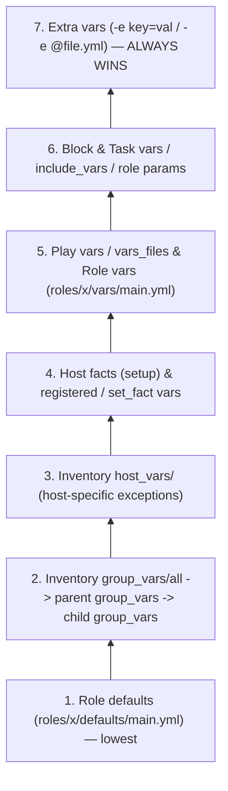

# 4.5 Ansible inventory: hosts, groups, dynamic inventory and variables

| | |
|---|---|
| Level | Intermediate |
| Priority tier | 0 |
| Lab venue | Control node with ansible-core; 3+ targets or `local` connections; optional GCP/AWS credentials |
| Part | Part 4: Automation and infrastructure as code |
| Status | Drafted, labs **untested** |

## Why this matters for AI infrastructure

The inventory is the model of your fleet: which machines exist, what role each plays (login, compute, storage, BMC, switch), which rack and fabric rail they sit on, what hardware they carry (GPU count and model, NIC type), and which environment they belong to. Every playbook is only as good as that model. A clean inventory lets you roll a driver update across "all H100 nodes in rack 3 of cluster B" with one `--limit`; a messy one produces wrong NCCL settings on the wrong hardware. For large clusters the inventory should be **generated** from a source of truth (NetBox, a CMDB, cloud APIs, Terraform state, Slurm, or BCM) so it never drifts from reality.

## Prerequisites and outcomes

Needs 4.3 and 4.4. After this chapter you can:

- Write inventories in INI and YAML with groups, children, host and group variables, and ranges.
- Select hosts with patterns, `--limit`, `--list-hosts`; understand `all`, `ungrouped`, implicit `localhost`.
- Organise `group_vars/` and `host_vars/` directories for multiple environments and keep secrets separate.
- Use dynamic inventory plugins (constructed, cloud, Kubernetes, script) and write a simple custom inventory plugin or script; use `add_host` and `group_by` at runtime.
- Reason about variable precedence and merge behaviour, and debug "which value won?".
- Design inventory for GPU clusters: role groups, hardware-trait groups, rack/fabric groups, BMC addressing.

## 1. Inventory formats

### INI

```ini
# inventories/prod/hosts.ini
mgmt01 ansible_host=10.1.0.2

[login]
login01 ansible_host=10.1.1.5

[gpu_h100]
gpu[001:032] ansible_user=automation              # range: gpu001 ... gpu032
gpu033 gpu_count=4                                # a node with a different build

[gpu_a100]
dgx-a100-[01:08].mgmt.example.com

[gpu:children]                                    # group of groups
gpu_h100
gpu_a100

[slurm_controller]
slurmctl01

[cluster:children]
login
gpu
slurm_controller

[gpu:vars]                                        # group variables inline
nvidia_driver_branch=550
ansible_python_interpreter=/usr/bin/python3
```

INI quirks: values on host lines are parsed as Python literals loosely (strings with spaces need quotes); `[group:children]` and `[group:vars]` are special suffixes; ranges support alpha (`[a:f]`) and zero-padded numeric ranges; hosts can appear in several groups.

### YAML

```yaml
# inventories/prod/hosts.yml
all:
  vars:
    ansible_user: automation
    ansible_python_interpreter: /usr/bin/python3
  children:
    login:
      hosts:
        login01: { ansible_host: 10.1.1.5 }
    gpu:
      vars:
        nvidia_driver_branch: 550
      children:
        gpu_h100:
          hosts:
            gpu001: { ansible_host: 10.1.10.1, rack: r01 }
            gpu002: { ansible_host: 10.1.10.2, rack: r01 }
        gpu_a100:
          hosts:
            dgx-a100-01: { ansible_host: 10.1.20.1, rack: r09 }
    slurm_controller:
      hosts:
        slurmctl01:
```

YAML is better for structured variables (lists and dicts as host variables) and for generated output; INI is quicker to type for small static fleets. Many teams keep only **hosts and group membership** in the inventory file and put variables in `group_vars`/`host_vars` directories.

### Special groups, names and connection variables

- `all` contains every host; `ungrouped` contains hosts in no other group; `localhost` is implicit (connection `local`) and not part of `all` unless defined explicitly.
- **Host aliases and why `127.0.0.1:2222` + `127.0.0.1:2200` collapses to one host (`AUR` Chapter 4 `Example 4-5`):** The name in the inventory (`inventory_hostname`) can differ from the network address (`ansible_host`); use stable logical names plus `ansible_host` for addresses. In *Ansible: Up and Running* Chapter 4, the authors demonstrate a subtle trap when managing three local Vagrant VMs (`vagrant1` on port `2222`, `vagrant2` on port `2200`, and `vagrant3` on port `2201`): if you write `127.0.0.1:2222`, `127.0.0.1:2200`, and `127.0.0.1:2201` in your inventory without aliases, Ansible uses the hostname (`127.0.0.1`) as the unique dictionary key for the host—so all three lines overwrite the same `127.0.0.1` entry and `ansible vagrant -m ping` pings **only one machine** (`127.0.0.1` on port `2201`). Giving each VM a distinct logical alias (`vagrant1 ansible_port=2222`, `vagrant2 ansible_port=2200`, `vagrant3 ansible_port=2201` with `[vagrant:vars] ansible_host=127.0.0.1`, or defining `Host vagrant*` in `~/.ssh/config`) ensures Ansible tracks all three hosts separately.
- **Numbered and alphabetic host ranges ("Pets versus Cattle", `AUR` Chapter 4):** Rather than naming servers like pets (`frankfurt.example.com`, `helsinki.example.com`), scale-out fleets use numbered or alphabetic ranges (`web[01:20].example.com` or `web-[a:t].example.com`, and `gpu[001:032]`), where leading zeros in `[001:032]` are preserved automatically (`gpu001`..`gpu032`).
- **Behavioral inventory connection variables (`AUR` Chapter 4 Table 4-1):** `ansible_host`, `ansible_port`, `ansible_user`, `ansible_connection` (`ssh`, `local`, `docker`, `winrm`, `network_cli`, `httpapi`, `kubectl`), `ansible_ssh_private_key_file`, `ansible_ssh_common_args` (ProxyJump), `ansible_become`, `ansible_become_method`, `ansible_become_user`, `ansible_python_interpreter`, and **`ansible_shell_type`** (Ansible assumes `/bin/sh` Bourne syntax by default; if the remote user's default login shell is `csh` or `fish`, set `ansible_shell_type=csh` or `fish` so Ansible formats environment-variable exports and command wrappers appropriately). Passwords belong in Vault or a secrets lookup, never plaintext in inventory.
- Naming rules: group names should use letters, digits and underscores (hyphens produce warnings); avoid names that collide with variables or keywords.

Inspect your model:

```bash
ansible-inventory -i inventories/prod --graph          # tree of groups/hosts
ansible-inventory -i inventories/prod --graph --vars   # include variables
ansible-inventory -i inventories/prod --host gpu001    # fully merged variables for one host
ansible-inventory -i inventories/prod --list --yaml    # whole inventory as data
ansible gpu_h100 -i inventories/prod --list-hosts      # who would a pattern match
```

## 2. Host patterns

| Pattern | Meaning |
|---|---|
| `all` or `*` | Every host |
| `gpu` | Group |
| `gpu:login` | Union |
| `gpu:&rack_r01` | Intersection |
| `gpu:!gpu_a100` | Exclusion |
| `gpu00*` | Wildcard |
| `~gpu0(0[1-9]\|1[0-6])` | Regex |
| `gpu[0:2]` | Group subscript (first three hosts) |
| `gpu001,gpu002` | Explicit list (commas or colons) |
| `@retry.txt` | Hosts listed in a file |

`--limit` (or `-l`) applies an extra pattern on top of the play's `hosts:`. Ordering and sorting: `ansible-playbook --limit @failed_hosts.txt` reruns only failures from a previous run (enable retry files or capture failures). `order: sorted|reverse_sorted|reverse_inventory|shuffle` on a play controls processing order (shuffle spreads risk and load).

## 3. Variables: group_vars, host_vars, and layout

```text
inventories/
├── prod/
│   ├── hosts.yml
│   ├── group_vars/
│   │   ├── all/
│   │   │   ├── main.yml            # non-secret defaults for all hosts in prod
│   │   │   └── vault.yml           # encrypted secrets (4.12)
│   │   ├── gpu/
│   │   │   └── main.yml            # driver, CUDA, NCCL defaults
│   │   ├── gpu_h100.yml            # single-file form also works
│   │   └── slurm_controller.yml
│   └── host_vars/
│       └── gpu033.yml              # one-off exceptions
├── staging/
│   ├── hosts.yml
│   └── group_vars/ ...
└── shared_vars/                    # optional; load with vars_files or include_vars
```

Rules of thumb:

- Ansible loads `group_vars/` and `host_vars/` **adjacent to the inventory file or directory** (and adjacent to the playbook). Files can be `name.yml` or a directory `name/` containing multiple files (merged alphabetically, allowing `main.yml` plus `vault.yml`).
- One inventory directory per environment (`prod`, `staging`, `lab`) with its own variable tree, selected with `-i inventories/prod`; **never** use different branches per environment (4.1).
- Keep variables **close to the group that owns them**: hardware traits on hardware groups, role settings on role groups, cluster-wide settings on `all`. Avoid host-level overrides except for true exceptions; every host_var is a snowflake.
- **Prefix variable names with the role** (`nvidia_driver_branch`, `slurm_cluster_name`) to avoid collisions and to make precedence debuggable.
- Separate secrets into encrypted files or an external secret store (4.12); reference them by name from plain variables (`slurm_db_password: "{{ vault_slurm_db_password }}"`) so grepping shows where secrets are used.
- Use `ansible-inventory --host` to see the merged result; use `debug: var=hostvars[inventory_hostname]` to inspect inside a play.

### Variable precedence (summary)

Ansible has about 22 precedence levels. The practical order (lowest to highest):

1. Command-line **values** such as `-u` (not `-e`) and role **defaults** (`roles/x/defaults/main.yml`: designed to be overridden)
2. Inventory file or script group vars; `group_vars/all`; `group_vars/<group>` (parent groups before child groups; same level alphabetical, then `ansible_group_priority`)
3. Inventory/playbook-adjacent `host_vars`; inventory host vars
4. Host facts and `set_fact`/registered vars (facts rank among play-level vars)
5. Play `vars`, `vars_files`, `vars_prompt`, role `vars/` (**higher than inventory**, so avoid putting overridable settings in role `vars/`)
6. Block and task `vars`, `include_vars`, `set_fact`, registered variables, role parameters
7. **Extra vars `-e`**: always win

Practical consequences: put defaults in role `defaults/`, environment values in `group_vars`, per-host exceptions in `host_vars`, and use `-e` only for one-off overrides and CI parameters. The same variable defined in two sibling groups is a conflict resolved by group order (use `ansible_group_priority` or restructure). By default dictionaries are **replaced, not merged** across layers; set `hash_behaviour = merge` (discouraged, global side effects) or use the `combine` filter explicitly: `{{ base_cfg | combine(env_cfg, recursive=True) }}`.



## 4. Runtime grouping: add_host and group_by

Inventory can change during a run:

```yaml
- name: Build dynamic groups from facts
  hosts: all
  gather_facts: true
  tasks:
    - name: Group by GPU model detected on the host
      ansible.builtin.group_by:
        key: "gpu_model_{{ gpu_model | default('none') | lower | replace(' ', '_') }}"
        parents: gpu_by_model

- name: Act only on H100 nodes
  hosts: gpu_model_h100
  tasks:
    - ansible.builtin.debug: msg="H100 here"

- name: Create a host from provisioning output
  hosts: localhost
  tasks:
    - ansible.builtin.add_host:
        name: "{{ new_vm_ip }}"
        groups: new_nodes
        ansible_user: automation
```

`group_by` is the standard way to branch plays on facts (OS family, GPU model); `add_host` is used right after provisioning a VM so the following play can configure it. Both affect only the current run; `meta: refresh_inventory` re-reads inventory sources mid-run.

## 5. Dynamic inventory

Static files go stale. **Inventory plugins** build inventory from authoritative sources at runtime; you point Ansible at a small YAML config file whose name ends in the plugin's required suffix.

```yaml
# inventories/gcp/gcp.gcp_compute.yml
plugin: google.cloud.gcp_compute
projects: [my-ai-project]
zones: [us-central1-a, us-central1-b]
auth_kind: application                   # use ADC / workload identity, not key files
filters:
  - labels.env = prod
  - status = RUNNING
hostnames: [name]
compose:
  ansible_host: networkInterfaces[0].networkIP
keyed_groups:
  - key: labels.role                     # creates groups role_gpu, role_login ...
    prefix: role
  - key: zone
    prefix: zone
groups:
  gpu_a3: "machineType.endswith('a3-highgpu-8g')"
```

```yaml
# aws_ec2.yml
plugin: amazon.aws.aws_ec2
regions: [us-east-1]
filters: { instance-state-name: running, "tag:Env": prod }
keyed_groups:
  - { key: tags.Role, prefix: role }
  - { key: instance_type, prefix: type }
compose:
  ansible_host: private_ip_address
```

Other common plugins: `kubernetes.core.k8s` (pods/nodes), `community.docker.docker_containers`, `ansible.builtin.constructed` (derive groups/vars from existing hosts' variables), `ansible.builtin.yaml`/`ini`/`script`/`host_list`/`auto`, `netbox.netbox.nb_inventory` (NetBox as source of truth: sites, racks, roles, tags, custom fields), VMware, Azure, OpenStack, Terraform state (`cloud.terraform.terraform_state`), Foreman. Check with `ansible-doc -t inventory -l`.

Key plugin features:

- **`keyed_groups`** build groups from attributes (tags, labels, zone, instance type), **`groups`** from Jinja conditions, **`compose`** computed variables (including `ansible_host`), **`filters`** server-side selection to keep large queries fast, **`cache`** (`cache: true`, `cache_plugin: jsonfile`, `cache_timeout: 300`) to avoid API calls on every command.
- **Combining sources**: `-i inventories/prod` can be a *directory* mixing static files and plugin configs; Ansible merges all of them. A common pattern is static inventory for on-prem plus cloud plugin for burst capacity, and a `constructed` plugin to derive uniform groups (`gpu`, `login`) regardless of source.
- **Authentication**: use workload identity/instance profiles/environment credentials; keep plugin configs free of secrets.

### Script and custom plugins

A legacy **inventory script** is any executable that prints JSON for `--list` and `--host <name>`; it is simple but unmaintained-by-convention. The recommended extension point is an **inventory plugin** (a Python class subclassing `BaseInventoryPlugin`, optionally `Constructable` and `Cacheable`) shipped in a collection.

```python
#!/usr/bin/env python3
# inventory/slurm_inventory.py: minimal dynamic inventory script from `sinfo`
import json, subprocess, sys

def build():
    out = subprocess.run(["sinfo", "-N", "-h", "-o", "%N|%P|%G"], capture_output=True, text=True, check=True).stdout
    inv = {"_meta": {"hostvars": {}}, "all": {"children": ["slurm_nodes"]}, "slurm_nodes": {"hosts": []}}
    for line in out.splitlines():
        node, part, gres = line.split("|")
        part = part.rstrip("*")
        inv["slurm_nodes"]["hosts"].append(node)
        inv.setdefault(f"part_{part}", {"hosts": []})["hosts"].append(node)
        inv["_meta"]["hostvars"][node] = {"slurm_partition": part, "slurm_gres": gres}
    return inv

if __name__ == "__main__":
    if len(sys.argv) > 1 and sys.argv[1] == "--list":
        print(json.dumps(build()))
    elif len(sys.argv) > 2 and sys.argv[1] == "--host":
        print(json.dumps({}))                 # hostvars already supplied via _meta (fast path)
    else:
        sys.exit(1)
```

Including `_meta.hostvars` makes Ansible skip the per-host `--host` call (a major performance difference for large inventories). Scripts must be executable (`chmod +x`) and deterministic, return quickly, never print anything else on stdout, and handle API failures with non-zero exit.

In *Ansible: Up and Running* Chapter 4 (`Example 4-12 vagrant.py` and multi-cloud inventory directories), the authors walk through building a complete dynamic inventory script and combining multiple inventory sources in one directory:
- **How `vagrant.py` implements `--list` and `--host` (`Example 4-12`):**
  1. `list_running_hosts()` executes `vagrant status --machine-readable` via `subprocess.check_output` and splits each comma-separated line `(timestamp, host, key, value) = line.split(',')[:4]`, collecting `host` whenever `key == 'state' and value == 'running'` (`{"vagrant": ["vagrant1", "vagrant2", "vagrant3"]}`).
  2. `get_host_details(host)` executes `vagrant ssh-config <host>`, parses the OpenSSH stanza using `paramiko.SSHConfig()`, and maps `c['hostname']` -> `ansible_host`, `int(c['port'])` -> `ansible_port`, `c['user']` -> `ansible_user`, and `c['identityfile'][0]` -> `ansible_private_key_file` (tested in `code/part04/ansible_inventory_model_lab.py`).
- **Breaking the inventory into multiple sources in a single directory (`inventory/`):** If you set `inventory = inventory` in `ansible.cfg` where `inventory/` is a directory containing `vagrant.py`, `aws_ec2.yml` (`plugin: aws_ec2`), `gcp.yml` (`plugin: gcp_compute`), `azure_rm.yml` (`plugin: azure_rm`, `plain_host_names: true`), `group_vars/`, and `host_vars/`, Ansible automatically executes and merges **every** static file, dynamic script, and inventory plugin inside that directory into a single unified inventory.

### Source of truth for GPU fleets

Large AI clusters keep truth in **NetBox/Nautobot** (devices, interfaces, IPs, racks, cables, tags), in **BCM/Base Command Manager** (node categories and provisioning data), in the **scheduler** (Slurm node definitions), or in **cloud/Terraform state**. Generating Ansible inventory from that source eliminates the "inventory says gpu77 exists but it was RMA'd" problem and enables cabling-aware automation (which rail does each NIC connect to). Treat the inventory source like code: reviewed changes, validation (unique names, required fields), and tests that fail the build if a host lacks a role or rack.

## 6. Designing inventory for GPU clusters

Model three orthogonal axes using groups so playbooks can target any slice:

| Axis | Example groups | Used for |
|---|---|---|
| **Role** | `login`, `gpu`, `slurm_controller`, `slurm_db`, `storage_client`, `monitoring`, `bmc`, `switch_leaf`, `switch_spine` | What software/config the host runs |
| **Hardware trait** | `gpu_h100`, `gpu_a100`, `gpu_gb200`, `nic_cx7`, `nic_bf3`, `cpu_amd`, `cpu_intel` | Driver branch, NCCL tuning, kernel params |
| **Location/topology** | `site_dc1`, `pod_a`, `rack_r07`, `rail_0` ... `rail_7`, `fabric_ib1` | Rolling update batches, topology-aware Slurm config, failure domains |
| **Lifecycle** | `canary`, `maint_window_sat`, `retired` | Safe rollout and exclusions |

Variables then follow the groups: `group_vars/gpu_h100.yml` sets `gpu_clocks`, `nccl_env`, `nvidia_driver_branch`; `group_vars/rack_r07.yml` sets rack-specific values; BMC credentials and addresses live in a `bmc` group using `ansible_connection: local`/`httpapi` or the `redfish` modules with `baseuri: "{{ bmc_address }}"`.

Per-host data to keep: `ansible_host`, `bmc_address`, `rack`, `u_position`, `gpu_count`, `ib_hcas` (list of HCA device names), `mgmt_mac`, `serial_number`, `asset_tag`. Validate with an argument-spec or assert play (`assert: that: [ rack is defined, gpu_count | int > 0 ]`) at the start of every run.

Scale considerations: with thousands of hosts, avoid per-host `--host` script calls (use `_meta`), use `keyed_groups` and caching, split into several inventory sources, raise `forks`, and use `strategy: free`/`serial` deliberately (4.14). Use `ansible_group_priority` and consistent naming to avoid ambiguity when a host belongs to many groups.

## 7. Debugging inventory and variable problems

| Symptom | Likely cause | Check |
|---|---|---|
| "no hosts matched" | Pattern typo, empty group, wrong inventory path, `--limit` too narrow | `--list-hosts`, `ansible-inventory --graph` |
| Variable has the wrong value | Precedence: role `vars/` or `-e` overrides; sibling groups conflict | `ansible-inventory --host`, `debug: var=...`, `-vvv`; search all layers with `grep -r` |
| Variable undefined for some hosts | Defined on a group the host isn't in, loaded from adjacent dir of wrong inventory | `--graph --vars`, check `group_vars` placement beside the inventory in use |
| `group_vars` ignored | File not next to inventory/playbook, wrong name (`gpu.yaml` vs group `gpu-nodes`), invalid group name chars | Name must match group exactly |
| Dict overrides lose keys | Dicts replaced not merged | Use `combine(recursive=True)` |
| Dynamic inventory slow | No `_meta`, no cache, large unfiltered queries | Add cache, filters, `_meta` |
| Plugin not used | Config filename doesn't end with required suffix; plugin not enabled in `ansible.cfg` (`enable_plugins`) | `ansible-inventory -vvv`, `ansible-doc -t inventory <name>` |
| Wrong host connection | `ansible_host` missing/incorrect; bastion args | `ansible -m debug -a var=ansible_host`, `-vvvv` |

## 8. Lab

First, run the self-checking Python lab (`code/part04/ansible_inventory_model_lab.py`) locally. It verifies zero-padded numeric (`gpu[001:004]`) and alphabetic (`web-[a:d].example.com`) inventory range expansion (`expand_inventory_range`, `AUR` Ch. 4), variable precedence resolution across `role_defaults -> group_vars -> host_vars -> role_vars -> extra_vars` and dictionary replacement vs `combine(recursive=True)` (`resolve_variable_precedence`), and `vagrant.py` dynamic inventory parsing (`vagrant status --machine-readable` + `_meta.hostvars`, `parse_vagrant_machine_readable_inventory`, `AUR` Ch. 4).

```bash
python3 code/part04/ansible_inventory_model_lab.py
```

Next, on a control node with `ansible-core` (all interactive shell steps below are `untested here`), work through these exercises:

1. **Static inventory**: build a lab inventory in INI and again in YAML with `login`, `gpu_h100`, `gpu_a100`, `gpu` (children), `slurm_controller`; use ranges; inspect with `--graph`, `--list`, `--host`.
2. **Patterns**: practise union, intersection, exclusion, regex and subscripts with `--list-hosts`; create a canary group and show a rolling plan that targets `canary` first.
3. **Variables and precedence**: define the same variable at role defaults, `group_vars/all`, a parent group, a child group, `host_vars`, play `vars`, and `-e`; print the value with `debug` at each step and predict the winner before running; reproduce the dict replacement problem and fix with `combine`.
4. **Layout**: restructure into `inventories/prod` and `inventories/staging` with separate `group_vars`; verify that `-i inventories/staging` never sees prod values; add an encrypted `vault.yml` placeholder file.
5. **Runtime groups**: use `group_by` on a fact/variable and `add_host` after "provisioning" a container; confirm later plays see them.
6. **Constructed plugin**: write a `constructed.yml` that creates groups from variables such as `rack` and `gpu_count`; add `compose` to derive `ansible_host`.
7. **Cloud plugin**: configure the GCP or AWS inventory plugin for labelled instances with `keyed_groups`, `filters`, and caching; compare runtime with and without cache.
8. **Custom inventory**: implement the script above against a fake `sinfo` or a JSON file; add `_meta` and measure speed on 5,000 synthetic hosts with and without it; then port to a minimal inventory plugin (optional).
9. **Validation**: write an assert play that fails when any GPU host lacks `rack`, `bmc_address` or `gpu_count`; run it in CI.
10. **NetBox (optional)**: stand up NetBox in Docker, add devices and tags, and drive Ansible with the `nb_inventory` plugin.
11. **Clean up.**

## 9. Common mistakes

- Giant flat inventories with variables repeated on every host; host_vars sprawl.
- Variables placed in role `vars/` (hard to override) or abuse of `-e` to "fix" precedence problems.
- Shared secrets in plaintext inventory files; ansible_password in vars.
- Branch-per-environment instead of inventory-directory-per-environment.
- Relying on group order to resolve conflicts silently; hosts belonging to groups with conflicting values.
- Static inventories that no one updates after RMAs and expansions; dynamic inventory with no cache hammering the API.
- Group names with hyphens or spaces; names colliding with variables.
- Expecting `localhost` in `all`; forgetting `connection: local` semantics.
- Forgetting that dictionaries replace rather than merge.
- No validation of required host data, so playbooks fail halfway across the fleet.

## 10. Interview angles

- "How do you structure inventory for multiple environments and a few thousand GPU nodes?"
- "Explain Ansible variable precedence; where would you put defaults, environment config, per-host overrides, secrets?"
- "Static versus dynamic inventory; how would you source it from NetBox or a cloud?"
- "What are `keyed_groups`, `compose`, `constructed`? When `group_by` versus `add_host`?"
- "How do you debug which value of a variable is used?"
- "How would you roll a change out to one rack at a time using inventory?" (rack groups, `serial`, `--limit`.)
- "How do you keep secrets out of inventory?"

## Exercises

1. **INI vs. YAML Inventories, Host Aliases (`127.0.0.1:2222` Collision), Behavioral Connection Variables, and Ranges (`AUR` Chapter 4):** Using `expand_inventory_range()` in `code/part04/ansible_inventory_model.py`, explain: (a) why listing `127.0.0.1:2222`, `127.0.0.1:2200`, and `127.0.0.1:2201` without aliases collapses to a single host in Ansible (`Example 4-5`) and how `vagrant1..3` aliases + `ansible_host` solve it; (b) how zero-padded numeric (`gpu[001:032]`) and alphabetic (`web-[a:t]`) ranges work; and (c) the purpose of `ansible_connection`, `ansible_shell_type`, and implicit `localhost`.
2. **Host Patterns, Subscripts (`gpu[0:2]`), `@retry.txt` Files, and Play Execution Order:** Explain how `--limit` combines with a play's `hosts:` pattern, how `gpu:&rack_r01` (intersection), `gpu:!gpu_a100` (exclusion), `gpu[0:2]` (group slice), and `--limit @failed_hosts.txt` work, and when to use `order: sorted` vs `order: shuffle` on a play.
3. **`group_vars/` and `host_vars/` Multi-Environment Layouts, Variable Precedence, and Dictionary Replacement vs. `combine` (`AUR` Chapter 4):** Using `resolve_variable_precedence()` in `code/part04/ansible_inventory_model.py`, explain: (a) how splitting `group_vars/prod/` into a directory containing `main.yml` and `vault.yml` (or `db` and `rabbitmq` in `AUR` Ch. 4) works; (b) why role `defaults/main.yml` vs role `vars/main.yml` behave differently relative to inventory `group_vars/`; and (c) why overriding a dictionary in `host_vars/` wipes out sibling keys unless merged with `combine(recursive=True)`.
4. **Runtime Grouping (`group_by` and `add_host`) and `meta: refresh_inventory` (`AUR` Chapter 4):** Contrast `ansible.builtin.group_by` (partitioning existing hosts into dynamic groups like `Ubuntu` or `gpu_model_h100` based on gathered facts) with `ansible.builtin.add_host` (registering a newly provisioned VM IP into an in-memory group during a run) and `meta: refresh_inventory`.
5. **Dynamic Inventory Plugins (`gcp_compute`, `aws_ec2`, `nb_inventory`, `constructed`) and Custom Inventory Scripts (`vagrant.py` / `slurm_inventory.py`, `AUR` Chapter 4):** Using `parse_vagrant_machine_readable_inventory()`, explain: (a) how `keyed_groups`, `groups`, `compose`, `filters`, and `cache` work in cloud/NetBox inventory plugins; and (b) the JSON contract for dynamic inventory scripts (`--list` vs `--host <name>`) and why including `_meta.hostvars` is essential on a 5,000-node cluster.
6. **Four-Axis GPU Cluster Inventory Design (Role, Hardware Trait, Topology, Lifecycle) and CI Inventory Validation:** Design an inventory group hierarchy for a 512-GPU cluster spanning H100 and GB200 nodes across 16 racks with out-of-band Redfish BMCs, and write an `assert` task that validates required per-host metadata (`rack`, `bmc_address`, `gpu_count`, `ib_hcas`) before any disruptive role executes.

## Checkpoint questions (20)

<details>
<summary>1. Compare INI and YAML inventory files, and explain why listing `127.0.0.1:2222` and `127.0.0.1:2200` in an inventory without aliases fails (`AUR` Chapter 4).</summary>

- **INI vs YAML:** INI is compact for simple host lists, `[group:children]`, and `[group:vars]`; YAML (`all: children: ... hosts: ...`) is cleaner for deeply nested group hierarchies and structured host variables (lists/dicts), and is trivial to emit from generators.
- **The `127.0.0.1:2222` trap (`AUR` Ch. 4 `Example 4-5`):** In `host:port` shorthand, Ansible uses the hostname portion (`127.0.0.1`) as the unique identifier (`inventory_hostname`) in its host dictionary. Listing `127.0.0.1:2222`, `127.0.0.1:2200`, and `127.0.0.1:2201` causes each line to overwrite the same `127.0.0.1` host entry, leaving only port `2201`. Always define a distinct logical alias (`vagrant1 ansible_port=2222`, `vagrant2 ansible_port=2200`) with `ansible_host=127.0.0.1`.
</details>

<details>
<summary>2. How do special groups (`all`, `ungrouped`), implicit `localhost`, and numeric/alphabetic ranges (`gpu[001:032]`, `web-[a:t]`) work?</summary>

- **`all` and `ungrouped`:** Every defined host belongs to `all`; any host that does not belong to at least one user-defined group belongs to `ungrouped`.
- **Implicit `localhost`:** If `localhost` is not explicitly listed in the inventory, Ansible still allows `hosts: localhost` by creating an implicit `localhost` entry with `ansible_connection=local` and the control node's Python interpreter—**but implicit `localhost` is NOT included when a play targets `hosts: all`**.
- **Ranges:** `gpu[001:032]` expands to `gpu001` through `gpu032` (preserving leading zero padding), and `web-[a:t].example.com` expands alphabetically from `web-a` to `web-t`.
</details>

<details>
<summary>3. What are the main Behavioral Inventory Connection Variables, and when do you need `ansible_shell_type` (`AUR` Chapter 4)?</summary>

- **`ansible_host`**: IP address or DNS name to connect to when different from `inventory_hostname`.
- **`ansible_port`**, **`ansible_user`**, **`ansible_ssh_private_key_file`**, **`ansible_ssh_common_args`** (`ProxyJump`).
- **`ansible_connection`**: transport plugin (`ssh`, `local`, `docker`, `winrm`, `network_cli`, `httpapi`, `kubectl`).
- **`ansible_become`**, **`ansible_become_user`**, **`ansible_become_method`**, **`ansible_python_interpreter`**.
- **`ansible_shell_type`:** By default, Ansible formats remote command wrappers for Bourne shell (`/bin/sh`). If the remote automation user's default login shell is `csh` or `fish`, command execution fails unless you set **`ansible_shell_type=csh`** or **`fish`**.
</details>

<details>
<summary>4. How do `ansible-inventory --graph`, `--list`, `--host <name>`, and `ansible <pattern> --list-hosts` help you inspect and debug an inventory?</summary>

- **`ansible-inventory -i inv --graph`** (add `--vars` to include variables): prints a visual ASCII tree of all groups, child groups, and member hosts.
- **`ansible-inventory -i inv --host gpu001`**: computes and prints the **final merged variable dictionary** for `gpu001` after resolving all group and host precedence layers.
- **`ansible-inventory -i inv --list --yaml`**: dumps the entire compiled inventory in YAML (or JSON without `--yaml`).
- **`ansible 'gpu:&rack_r01' -i inv --list-hosts`**: lists the exact hosts that a pattern + `--limit` will target without connecting to any machine.
</details>

<details>
<summary>5. How does Ansible load `group_vars/` and `host_vars/`, and why is turning `group_vars/<group>` into a directory useful (`AUR` Chapter 4)?</summary>

Ansible automatically searches for `group_vars/` and `host_vars/` directories **adjacent to the inventory file/directory** (and adjacent to the playbook). Each group `gpu` can be either a single file (`group_vars/gpu.yml`) or a **directory (`group_vars/gpu/`)** containing multiple YAML files (`main.yml`, `vault.yml`, or `db.yml` and `rabbitmq.yml` as in `AUR` Chapter 4)—Ansible loads all files in the directory in alphabetical order, letting you keep plaintext parameters in `main.yml` and Ansible-Vault-encrypted secrets in `vault.yml` without mixing them in one file.
</details>

<details>
<summary>6. Summarize Ansible's Variable Precedence order from lowest to highest, and explain the trap between Role `defaults/` and Role `vars/`.</summary>

From **lowest to highest** precedence:
1. **Role `defaults` (`roles/x/defaults/main.yml`)** — lowest precedence, intended to be overridden by inventory.
2. **Inventory `group_vars/all`** -> **parent `group_vars`** -> **child `group_vars`** (ties broken alphabetically or by `ansible_group_priority`).
3. **Inventory `host_vars/<host>`**.
4. **Host facts (`setup`)**.
5. **Play `vars:` / `vars_files:`** and **Role `vars` (`roles/x/vars/main.yml`)**.
6. **Block / Task `vars:`**, **`include_vars`**, **`set_fact` / `register`**, and **role parameters**.
7. **Extra vars (`-e key=val` or `-e @file.yml`)** — **highest precedence; always wins**.
**Trap:** Because Role `vars/main.yml` (Level 5) ranks **higher than all inventory `group_vars` and `host_vars`** (Levels 2–3), any variable placed in `roles/x/vars/main.yml` cannot be overridden by your environment inventory. Always put configurable role variables in `roles/x/defaults/main.yml`.
</details>

<details>
<summary>7. What happens when both `group_vars/gpu.yml` and `host_vars/gpu033.yml` define a dictionary variable `nccl_env`, and how do you merge them instead?</summary>

By default (`hash_behaviour = replace`), Ansible **completely replaces** dictionaries across precedence layers rather than deep-merging them—so if `group_vars/gpu.yml` defines `nccl_env: {debug: INFO, ib_hca: mlx5_0}` and `host_vars/gpu033.yml` defines `nccl_env: {debug: WARN}`, `gpu033` **loses the `ib_hca` key**. Instead of enabling the deprecated global `hash_behaviour = merge` setting, name the layers distinctly (`nccl_env_defaults`, `nccl_env_override`) and merge them explicitly with the **`combine` filter**: `{{ nccl_env_defaults | combine(nccl_env_override, recursive=True) }}`.
</details>

<details>
<summary>8. How does `ansible_group_priority` resolve conflicts when a host belongs to two sibling groups at the same hierarchy depth?</summary>

When a host belongs to both `gpu_h100` and `rack_r01` (two sibling groups at the same parent depth) and both groups define the same variable, Ansible merges sibling groups **in alphabetical order by group name** (`rack_r01` overwrites `gpu_h100` because `'r' > 'g'`). Setting **`ansible_group_priority: 10`** (default is `1`) inside `group_vars/gpu_h100.yml` gives `gpu_h100` higher priority than `rack_r01` without relying on alphabetical naming tricks.
</details>

<details>
<summary>9. Contrast `ansible.builtin.group_by` and `ansible.builtin.add_host`, and explain when to use `meta: refresh_inventory` (`AUR` Chapter 4).</summary>

- **`group_by`**: runs against existing hosts in a play and groups them dynamically in memory based on gathered facts or variables (e.g., `group_by: key="gpu_model_{{ gpu_model }}"` or `key="{{ ansible_facts.distribution }}"` in `AUR` Ch. 4 `Example 4-13`), so a subsequent play in the same playbook can target `hosts: Ubuntu` or `hosts: gpu_model_h100`.
- **`add_host`**: runs on `localhost` after a cloud/VM provisioning task to **insert a brand-new host** (`name: "{{ new_vm_ip }}"`, `groups: new_nodes`) into the in-memory inventory for the remainder of the playbook run.
- **`meta: refresh_inventory`**: forces Ansible to re-execute dynamic inventory plugins/scripts mid-playbook so newly created cloud instances are discovered from the cloud API.
</details>

<details>
<summary>10. How do Dynamic Inventory Plugins (`gcp_compute`, `aws_ec2`, `azure_rm`, `k8s`, `nb_inventory`) work, and why do their config files require specific filename suffixes?</summary>

Inventory plugins read a small declarative YAML file (for example, `prod.gcp_compute.yml`, `aws_ec2.yml`, `azure_rm.yml`, or `netbox.yml`) and query the provider's API at runtime. Ansible's `auto` inventory plugin identifies which plugin should parse a YAML file by inspecting the **`plugin:` key** and checking that the filename ends with one of that plugin's required suffixes (such as `.gcp_compute.yml` or `aws_ec2.yml`, documented in `ansible-doc -t inventory <plugin>`).
</details>

<details>
<summary>11. What do `filters`, `keyed_groups`, `groups`, `compose`, and `cache` do inside an Inventory Plugin configuration?</summary>

- **`filters`**: server-side API query filters (`status = RUNNING`, `labels.env = prod`) so the cloud API only returns relevant instances.
- **`keyed_groups`**: automatically constructs Ansible groups from host attribute values (`key: labels.role, prefix: role` creates `role_gpu`, `role_login`).
- **`groups`**: creates groups based on Jinja2 boolean conditions (`gpu_a3: "machineType.endswith('a3-highgpu-8g')"`).
- **`compose`**: computes per-host variables from API attributes (`ansible_host: networkInterfaces[0].networkIP`).
- **`cache: true` (`cache_plugin: jsonfile`, `cache_timeout: 300`)**: caches API responses on disk so running ten `ansible` commands in a row does not hit cloud rate limits or wait on API pagination ten times.
</details>

<details>
<summary>12. What is the `ansible.builtin.constructed` inventory plugin, and how does passing a directory to `-i inventories/prod` combine multiple inventory sources (`AUR` Chapter 4)?</summary>

When `-i inventories/prod` points to a **directory**, Ansible loads and merges every static file (`.ini`, `.yml`), dynamic script (`vagrant.py`), and plugin config (`aws_ec2.yml`, `gcp.yml`) in that directory in alphabetical order. Placing a `99-constructed.yml` (`plugin: ansible.builtin.constructed`) file at the end of the directory lets you synthesize unified groups (`groups: { is_h100: "gpu_model == 'H100'" }`) and `keyed_groups` across **all** already-loaded hosts, whether a host came from bare-metal NetBox, Slurm, or a cloud burst provider.
</details>

<details>
<summary>13. What is the CLI contract for a Dynamic Inventory Script (`vagrant.py` / `slurm_inventory.py`), and why is `_meta.hostvars` critical at scale (`AUR` Chapter 4)?</summary>

An executable dynamic inventory script must support two flags:
1. **`--list`**: prints a JSON object mapping group names to host lists (`{"vagrant": {"hosts": ["vagrant1", "vagrant2"]}, "_meta": {"hostvars": {...}}}`).
2. **`--host <hostname>`**: prints a JSON dictionary of variables for `<hostname>`.
In early Ansible versions without `_meta`, if `--list` returned 2,000 hosts, Ansible invoked `./script.py --host <node>` **2,000 separate times** sequentially. Returning all host variables inside **`"_meta": {"hostvars": { ... }}`** during `--list` tells Ansible to skip all per-host `--host` calls, reducing inventory load time from minutes to milliseconds.
</details>

<details>
<summary>14. In `AUR` Chapter 4 (`Example 4-12`), how does `vagrant.py` discover running VMs and extract their SSH connection details?</summary>

1. To implement `--list`, `vagrant.py` runs **`vagrant status --machine-readable`** via `subprocess.check_output`, splits each CSV line `(timestamp, host, key, value) = line.split(',')[:4]`, and collects every `host` where `key == 'state'` and `value == 'running'`.
2. To extract host variables, it runs **`vagrant ssh-config <host>`**, parses the OpenSSH config block with **`paramiko.SSHConfig()`**, and maps `hostname` -> `ansible_host`, `int(port)` -> `ansible_port`, `user` -> `ansible_user`, and `identityfile[0]` -> `ansible_private_key_file`.
</details>

<details>
<summary>15. What are the four orthogonal group axes for designing a production GPU cluster inventory?</summary>

1. **Role (`what software runs`):** `login`, `gpu`, `slurm_controller`, `slurm_db`, `storage_client`, `monitoring`, `bmc`, `switch_leaf`, `switch_spine`.
2. **Hardware trait (`what drivers/tunings apply`):** `gpu_h100`, `gpu_a100`, `gpu_gb200`, `nic_cx7`, `nic_bf3`, `cpu_amd`, `cpu_intel`.
3. **Location / Topology (`failure domains & fabric rails`):** `site_dc1`, `pod_a`, `rack_r07`, `rail_0..7`, `nvlink_domain_01`.
4. **Lifecycle (`rollout gating`):** `canary`, `maint_window_sat`, `draining`, `retired`.
Combining these axes with intersection patterns (`ansible-playbook driver.yml --limit 'gpu_h100:&rack_r07:!retired'`) lets operators target any slice of the AI factory precisely.
</details>

<details>
<summary>16. What authoritative Sources of Truth (`SoT`) should drive inventory in a large AI factory?</summary>

1. **NetBox / Nautobot (`netbox.netbox.nb_inventory`):** Authoritative DCIM/IPAM for bare-metal servers, racks, U-positions, MACs, IP addresses, BMC interfaces, and switch port cabling.
2. **NVIDIA Base Command Manager (`BCM`):** Authoritative node categories, software images, and hardware state on BCM-managed clusters.
3. **Cloud APIs / Terraform State (`gcp_compute`, `aws_ec2`, `cloud.terraform.terraform_state`):** Authoritative for cloud GPU VMs and GKE/EKS node pools.
4. **Slurm (`sinfo`):** Authoritative for scheduler partition membership and active/drained state.
</details>

<details>
<summary>17. How do you model Out-of-Band BMCs (`Redfish`) in an Ansible inventory alongside the host OS nodes?</summary>

Either:
- Store `bmc_address: 10.2.10.1` as a host variable on `gpu001` and run Redfish modules with **`delegate_to: localhost`** (`community.general.redfish_command` / `redfish_info` using `baseuri: "{{ bmc_address }}"`), or
- Define a dedicated `[bmc]` group (`gpu001-bmc ansible_host=10.2.10.1`) with `[bmc:vars] ansible_connection=local` so playbooks targeting `hosts: bmc` execute Redfish HTTPS calls directly from the control node without attempting to SSH into the BMC.
</details>

<details>
<summary>18. Why should you keep separate inventory directories per environment (`inventories/prod`, `inventories/staging`) instead of mixing environments in one file or using Git branches?</summary>

When `prod` and `staging` hosts live in the same inventory file, running a playbook against `hosts: all` or `hosts: gpu` without `--limit` **mutates both staging and production simultaneously**, and `group_vars/all` applies to both. Keeping **`inventories/prod/`** and **`inventories/staging/`** in separate directories (within the same `main` Git branch) physically isolates their host lists and `group_vars/` trees so `-i inventories/staging` can never touch a production host or read a production secret.
</details>

<details>
<summary>19. Why should group names use only letters, digits, and underscores (avoiding hyphens `-`), and why prefix variable names with the role/group name?</summary>

In Jinja2 and Python expressions (`groups.gpu_h100`), a hyphen in a group name (`gpu-h100`) is parsed as the **subtraction operator (`gpu - h100`)**, causing syntax errors or `ansible-inventory` warnings unless bracket notation `groups['gpu-h100']` is used everywhere. Prefixing variable names (`slurm_cluster_name`, `nvidia_driver_branch` instead of generic `name` or `version`) prevents silent variable collisions when a host belongs to 10 different groups and roles.
</details>

<details>
<summary>20. How do you validate inventory completeness in CI before any playbook touches the cluster?</summary>

Run two fast checks in CI on every PR touching `inventories/`:
1. `ansible-inventory -i inventories/prod --list > /dev/null` (verifying YAML/INI syntax and plugin schemas).
2. A pre-flight validation play (`gather_facts: false`, `--check`) using **`ansible.builtin.assert`** (`that: [ansible_host is defined, rack is defined, bmc_address is defined, gpu_count | int in [4, 8]]`) so a missing rack tag or typo in `host_vars` fails the PR in 2 seconds rather than failing halfway through a 500-node rollout.
</details>

## Sources and review notes

- **Sources read in full:**
  - `ansible-up-and-running-3rd-edition` — Bas Meijer, Lorin Hochstein & René Moser, *Ansible: Up and Running*, 3rd ed., **Chapter 4: Inventory: Describing Your Servers** (read in full: simple inventory files and implicit `localhost`, behavioral inventory connection parameters `ansible_host`/`ansible_port`/`ansible_user`/`ansible_private_key_file`/`ansible_connection`/`ansible_shell_type`/`ansible_python_interpreter`, why `127.0.0.1:2222` + `127.0.0.1:2200` fails without aliases `Example 4-5` and `~/.ssh/config` wildcard aliases, groups and `[group:vars]`/`[group:children]`, `group_vars/` and `host_vars/` files and subdirectories `group_vars/production/db` and `rabbitmq`, numbered and alphabetic host ranges `web[01:20]` and `web-[a:t]` "Pets vs Cattle", dynamic inventory plugins `aws_ec2`/`gcp_compute`/`azure_rm`, dynamic inventory script interface `vagrant.py` `--list` and `--host` using `vagrant status --machine-readable` and `paramiko.SSHConfig` `Example 4-12`, multi-source inventory directories, and runtime `add_host` and `group_by` `Example 4-13`).
- **Run here:** `python3 code/part04/ansible_inventory_model_lab.py` (3 passed, 0 failed).
- **Explicitly labelled inferences:** The `expand_inventory_range`, `resolve_variable_precedence`, and `parse_vagrant_machine_readable_inventory` models in `code/part04/ansible_inventory_model.py`, the `slurm_inventory.py` `sinfo` script, and the 4-axis GPU cluster inventory taxonomy (`google.cloud.gcp_compute`, `amazon.aws.aws_ec2`, `netbox.netbox.nb_inventory`, `cloud.terraform.terraform_state`) are the author's constructions applying *Ansible: Up and Running* Chapter 4 to AI factory fleets (plus original study items 21, 22, 23, 24, 25, 26, 27, 28, 29, 30, 31, 32, 33, 34, and 35).
- **Not verified on live hardware:** Live `ansible-inventory`, `sinfo`, `gcp_compute`, `aws_ec2`, and `nb_inventory` commands (`10.1.0.2`, `10.1.1.5`, `10.1.10.1..2`, `10.1.20.1`, `gpu[001:032]`, `dgx-a100-[01:08]`, `550`, `22` precedence levels, `2200`, `2201`, `2222`, `5432`) are marked (`untested here`) where not executed by `ansible_inventory_model_lab.py`.
