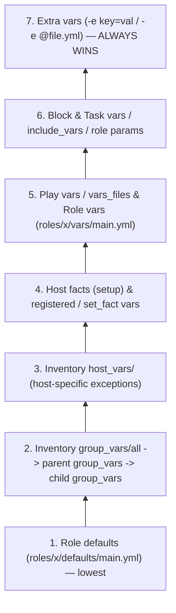

# 4.5 Ansible inventory: hosts, groups, dynamic inventory and variables

| | |
|---|---|
| Level | Intermediate |
| Priority tier | 0 |
| Lab venue | Control node with ansible-core; 3+ targets or `local` connections; optional GCP/AWS credentials |
| Part | Part 4: Automation and infrastructure as code |
| Status | Drafted, labs **untested** |

## Why this matters for AI infrastructure

Picture a driver update that must reach every H100 node in rack 3 of cluster B, and nothing else. Your inventory decides whether that is one command or a risky guess. The inventory is the model of your fleet. It records which machines exist and what role each one plays, such as login, compute, storage, BMC or switch. It also records the rack and fabric rail of each machine, the hardware it carries, and the environment it belongs to. Hardware means the GPU count and model and the NIC type.

Every playbook is only as good as that model. A clean inventory lets you roll that driver update out with one `--limit`. A messy one sends the wrong NCCL settings to the wrong hardware. For a large cluster, generate the inventory from a source of truth such as NetBox, a CMDB, cloud APIs, Terraform state, Slurm or BCM. A generated inventory does not drift from the fleet it describes.

Picture the morning after a rack is re-cabled, and two nodes have swapped places in the switch. An inventory written by hand still shows the old mapping, so the next run aims a driver change at the wrong machines and nobody notices until a health check fails. A generated inventory reflects the new cabling after its next sync, and the run lands on the right hardware. The difference is not about clever tooling. It is about who keeps the list true.

## Prerequisites and outcomes

You need 4.3 and 4.4 before this chapter. When you finish it, you will be able to:

- Write inventories in INI and YAML with groups, children, host and group variables, and ranges.
- Select hosts with patterns, `--limit` and `--list-hosts`, and explain what `all`, `ungrouped` and an implicit `localhost` mean.
- Organise `group_vars/` and `host_vars/` directories for several environments, and keep secrets separate.
- Use dynamic inventory plugins (constructed, cloud, Kubernetes and script), and write a simple custom inventory plugin or script. You can also use `add_host` and `group_by` at runtime.
- Reason about variable precedence and merge behaviour, and debug the question "which value won?".
- Design inventory for GPU clusters with role groups, hardware-trait groups, rack and fabric groups, and BMC addressing.

## 1. Inventory formats

You inherit a repository whose hosts file is in INI format, and a colleague's branch adds a second inventory in YAML. Ansible reads both and merges them, but the two formats follow slightly different rules. This section puts them side by side, so you can read either one without guessing what it means. Once you can read both, the merged result stops being a surprise.

Ansible reads its inventory in a few formats. INI is a flat list of hosts with bracketed group names. The example below shows a small GPU fleet written that way.

### INI

```ini
# inventories/prod/hosts.ini
mgmt01 ansible_host=10.1.0.2

[login]
login01 ansible_host=10.1.1.5

[gpu_h100]
gpu[001:032] ansible_user=automation              # range: gpu001 ... gpu032
gpu033 gpu_count=4                                # a node with a different build

[gpu_a100]
dgx-a100-[01:08].mgmt.example.com

[gpu:children]                                    # group of groups
gpu_h100
gpu_a100

[slurm_controller]
slurmctl01

[cluster:children]
login
gpu
slurm_controller

[gpu:vars]                                        # group variables inline
nvidia_driver_branch=550
ansible_python_interpreter=/usr/bin/python3
```

Read each INI host line as one row in a spreadsheet. The first word is the row's name, and every `key=value` pair after it is a column for that row. The section headers in square brackets start a new table, and the group name tells Ansible which hosts belong to it.

The INI format has a few quirks you will hit early. Values on host lines are parsed as Python literals, loosely, so a string with spaces needs quotes. Because each value is read on its own, one host line can hold a number and a piece of text side by side, and a quoted value keeps its spaces. `[group:children]` and `[group:vars]` are special suffixes. Ranges support letters, as in `[a:f]`, as well as zero-padded numbers. A host can also appear in several groups.

### YAML

```yaml
# inventories/prod/hosts.yml
all:
  vars:
    ansible_user: automation
    ansible_python_interpreter: /usr/bin/python3
  children:
    login:
      hosts:
        login01: { ansible_host: 10.1.1.5 }
    gpu:
      vars:
        nvidia_driver_branch: 550
      children:
        gpu_h100:
          hosts:
            gpu001: { ansible_host: 10.1.10.1, rack: r01 }
            gpu002: { ansible_host: 10.1.10.2, rack: r01 }
        gpu_a100:
          hosts:
            dgx-a100-01: { ansible_host: 10.1.20.1, rack: r09 }
    slurm_controller:
      hosts:
        slurmctl01:
```

Look at the YAML example as a tree. The `all` key is the trunk, and each `children` key opens a branch. The `gpu` branch holds its own `vars`, which apply to everything beneath it, and two child branches for the two GPU models. Each leaf is a host, and the braces on a host line hold that host's own values. Reading the tree from the top shows you which settings a host inherits before you read any host line.

Choose YAML when your variables are structured, such as lists and dicts stored on a host, or when a generator writes the file. Choose INI for a small, static fleet, since it is quicker to type. Many teams keep only **hosts and group membership** in the inventory file. They put the variables in `group_vars` and `host_vars` directories instead.

### Special groups, names and connection variables

`all` contains every host. `ungrouped` contains the hosts that belong to no other group. `localhost` is implicit, with the connection `local`, and it is not part of `all` unless you define it explicitly.

Give each host a stable logical name, and put its network address in `ansible_host`. The name in the inventory, `inventory_hostname`, can differ from that address. The trap appears when several machines share one address. A lab with three local Vagrant VMs shows this trap. The first is `vagrant1` on port `2222`, the second is `vagrant2` on port `2200`, and the third is `vagrant3` on port `2201`. If you list `127.0.0.1:2222`, `127.0.0.1:2200` and `127.0.0.1:2201` without aliases, Ansible uses the hostname `127.0.0.1` as the unique dictionary key for the host. All three lines then overwrite the same entry. As a result, `ansible vagrant -m ping` pings only one machine, `127.0.0.1` on port `2201`. The file looks full of hosts, yet only one entry survives. Count the lines that `--list-hosts` prints for the group. A count smaller than the number of machines you started is the first sign of this trap.

Give each VM its own alias to fix this. You can write `vagrant1 ansible_port=2222`, `vagrant2 ansible_port=2200` and `vagrant3 ansible_port=2201` with `[vagrant:vars] ansible_host=127.0.0.1`. You can also define `Host vagrant*` in `~/.ssh/config`. Either way, Ansible tracks all three hosts separately.

Think of a pet as a server you name and nurse back to health by hand, and of cattle as a herd where each member is numbered and replaceable. A GPU fleet is cattle. Nobody names node 17, and a failed node gets swapped for a spare with the next number. Ranges come from the pets-versus-cattle idea in *Ansible: Up and Running*, chapter 4. You name pets one at a time, such as `frankfurt.example.com` and `helsinki.example.com`. A scale-out fleet works better with numbered or alphabetic ranges, such as `web[01:20].example.com`, `web-[a:t].example.com` and `gpu[001:032]`. The leading zeros in `[001:032]` are kept automatically, so the range gives you `gpu001` through `gpu032`.

Think of each connection variable as one line on a delivery slip. The slip tells the courier where to go, who signs for the parcel and which door to use. Behavioral connection variables tell Ansible how to reach each host. The ones you will set most often are `ansible_host`, `ansible_port`, `ansible_user` and `ansible_connection`. The last one takes values such as `ssh`, `local`, `docker`, `winrm`, `network_cli`, `httpapi` and `kubectl`. Others cover the key file (`ansible_ssh_private_key_file`), a jump host (`ansible_ssh_common_args` for ProxyJump), privilege escalation (`ansible_become`, `ansible_become_method`, `ansible_become_user`) and the remote Python (`ansible_python_interpreter`).

Ansible assumes Bourne shell syntax (`/bin/sh`) by default. If the remote user's login shell is `csh` or `fish`, set `ansible_shell_type=csh` or `ansible_shell_type=fish`. Ansible then formats environment-variable exports and command wrappers for that shell. Keep passwords in Vault or a secrets lookup, never in plaintext inventory.

Name groups with letters, digits and underscores, because hyphens produce warnings. The reason is that a group name becomes part of a variable name, and a hyphen reads like a minus sign in an expression. Avoid group names that collide with variables or keywords, since a group called `gpu` next to a variable called `gpu` makes every later reference harder to read.

Before you trust the inventory, look at what Ansible built. These commands show the group tree, the merged variables and the hosts that a pattern matches.

```bash
ansible-inventory -i inventories/prod --graph          # tree of groups/hosts
ansible-inventory -i inventories/prod --graph --vars   # include variables
ansible-inventory -i inventories/prod --host gpu001    # fully merged variables for one host
ansible-inventory -i inventories/prod --list --yaml    # whole inventory as data
ansible gpu_h100 -i inventories/prod --list-hosts      # who would a pattern match
```

Run `--graph` first to check the shape, then `--host` to see the final variables for one machine. The graph answers the question "where did this host land?", and it prints the tree without any variable values, so it stays short. The `--host` output answers the next question, "what value does this host end up with?", and it shows the result after every layer has been merged. The `--list --yaml` command is the one to save for a review, because it dumps the whole inventory as data that a diff tool can compare.

## 2. Host patterns

An engineer needs to restart the Slurm daemon on every GPU node except the one under repair. Typing the names by hand invites a typo, and a missed node is hard to notice. A host pattern expresses the same selection in one short string. It is also checked against the inventory before anything runs, so you can see the matched hosts first.

Suppose you want to target only the GPU hosts in rack r01. A host pattern lets you say that in one short string. Think of a pattern as a filter on a contact list. The simplest filter is a group name, which returns everyone in that group. The rest of the table adds operators on top. A colon joins two selections, an `&` keeps only what two selections share, and a `!` removes a group from the result. Each row shows one operator, and you can combine them in a single string.

| Pattern | Meaning |
|---|---|
| `all` or `*` | Every host |
| `gpu` | Group |
| `gpu:login` | Union |
| `gpu:&rack_r01` | Intersection |
| `gpu:!gpu_a100` | Exclusion |
| `gpu00*` | Wildcard |
| `~gpu0(0[1-9]\|1[0-6])` | Regex |
| `gpu[0:2]` | Group subscript (first three hosts) |
| `gpu001,gpu002` | Explicit list (commas or colons) |
| `@retry.txt` | Hosts listed in a file |

Picture a driver rollout over the whole GPU group. The `hosts: gpu` line sets the widest scope, and the operator then types `--limit gpu_h100` to shrink that scope to one hardware family for a first pass. The `--limit` option (or `-l`) adds one more pattern on top of the play's `hosts:` line, so it narrows what the play touches. It never widens the play, so a host outside the play's `hosts:` line stays out of the run even when `--limit` names it. After a partial failure, `ansible-playbook --limit @failed_hosts.txt` reruns only the failed hosts. That works only if you enabled retry files or captured the failures. The `order` key on a play controls processing order, with the values `sorted`, `reverse_sorted`, `reverse_inventory` or `shuffle`. Shuffle spreads risk and load.

Before a rolling change, decide the order and make sure failures are captured, so a rerun can target them. Think of the failure list as the sign-in sheet for a workshop. If you did not collect the sheet, you have no way to tell who attended, and the rerun has to start from the full roster again. Choose the order on purpose as well. `sorted` gives the same sequence every time, which makes a log easy to compare with the last run. `shuffle` spreads the risk, so one bad rack does not always come first.

## 3. Variables: group_vars, host_vars, and layout

A new cluster needs a different NTP server than the old one. If that value lives inside a playbook, every change means editing code, and two clusters drift apart. Variables kept in inventory files let one playbook serve both clusters. Each cluster's values sit next to its hosts, where a reviewer can see them.

Think of the inventory directory as a folder for one building. The hosts file is the floor plan, and `group_vars` and `host_vars` are the room labels and fittings. A single room label can serve every room on a floor, and a fitting placed in one room affects only that room. Variables live beside the inventory, in `group_vars` and `host_vars` directories. The tree below keeps production and staging apart, and each one has its own variable tree.

```text
inventories/
├── prod/
│   ├── hosts.yml
│   ├── group_vars/
│   │   ├── all/
│   │   │   ├── main.yml            # non-secret defaults for all hosts in prod
│   │   │   └── vault.yml           # encrypted secrets (4.12)
│   │   ├── gpu/
│   │   │   └── main.yml            # driver, CUDA, NCCL defaults
│   │   ├── gpu_h100.yml            # single-file form also works
│   │   └── slurm_controller.yml
│   └── host_vars/
│       └── gpu033.yml              # one-off exceptions
├── staging/
│   ├── hosts.yml
│   └── group_vars/ ...
└── shared_vars/                    # optional; load with vars_files or include_vars
```

Ansible looks for `group_vars/` and `host_vars/` next to the inventory file or directory, and next to the playbook. Each entry can be a single `name.yml` file or a directory `name/` that holds several files. Those files merge in alphabetical order, so `main.yml` and `vault.yml` can sit side by side.

Picture a staging run that accidentally sends a production NCCL setting to a test cluster. The fix starts with the directory layout, because each environment has its own tree and a run can only read the one it points at. Give each environment its own inventory directory, such as `prod`, `staging` or `lab`, with its own variable tree. Select one with `-i inventories/prod`. Never use separate Git branches for environments, as chapter 4.1 covers.

Keep each variable close to the group that owns it, the way a label belongs on the shelf it describes. Hardware traits belong on hardware groups, role settings on role groups and cluster-wide settings on `all`. A reader then asks one question, "which group owns this?", and the answer tells them where the value lives. Avoid host-level overrides except for true exceptions. Every `host_vars` entry makes that host a snowflake, a one-off that nobody else shares.

Prefix each variable with its role, such as `nvidia_driver_branch` or `slurm_cluster_name`. Picture a generic name such as `version` that a Slurm role and a driver role both set. When a host belongs to both, one value silently wins, and the other role breaks without a clear message. The prefix tells you which role owns the name, so the collision is visible in the file. It also makes precedence easier to debug.

Keep secrets in encrypted files or an external secret store (see 4.12). Refer to them from plain variables by name, such as `slurm_db_password: "{{ vault_slurm_db_password }}"`. The plain file then holds only a pointer, so a reader can see that a password exists and where it comes from, without seeing its value. A grep then shows where each secret is used, which makes rotation a search instead of a guess.

To check the merged result, run `ansible-inventory --host`. Inside a play, `debug: var=hostvars[inventory_hostname]` shows the same data. Use the first command from your workstation before a run, and use the second when you are already inside a play and want to see what the current host sees at that point in time.

### Variable precedence (summary)

Think of precedence as a stack of transparent sheets. Where the top sheet has writing, you read that value. Where it is blank, the sheet below shows through. A variable in a more specific place is written on a higher sheet, so it overrides the general value underneath. The list below is the stack, from the bottom sheet to the top.

Picture a driver branch that you set to `550` in a group, then find an older value in a job. Before you can say which value is right, you need the rule. Ansible has about 22 precedence levels, which is more than anyone should keep in their head. The practical order, from lowest to highest, is this:

1. Command-line values such as `-u` (not `-e`), and role defaults in `roles/x/defaults/main.yml`, which are designed to be overridden.
2. Group variables from an inventory file or script, `group_vars/all` and `group_vars/<group>`. Parent groups come before child groups. Groups at the same level sort alphabetically, and then by `ansible_group_priority`.
3. `host_vars` next to the inventory or playbook, and inventory host variables.
4. Host facts, along with `set_fact` and registered variables. Facts rank among play-level variables.
5. Play `vars`, `vars_files`, `vars_prompt` and role `vars/`. These rank above inventory, so keep overridable settings out of role `vars/`.
6. Block and task `vars`, `include_vars`, `set_fact`, registered variables and role parameters.
7. Extra vars passed with `-e` always win.

Here is how the stack plays out in a real run. Suppose a role default sets an older driver branch, and the `gpu_h100` group sets `550`. A `host_vars` file for one node sets nothing. That node gets `550`, because the group layer sits above the role default. Now add `-e nvidia_driver_branch` with a newer value on the command line. Every host gets that newer value, because extra vars sit at the top of the stack.

In practice, the order gives you a simple rule. Put defaults in role `defaults/`, environment values in `group_vars` and per-host exceptions in `host_vars`. Save `-e` for one-off overrides and CI parameters. A variable defined in two sibling groups is a conflict, and group order decides the winner. Set `ansible_group_priority` or restructure the groups to remove that guesswork.

Dictionaries deserve their own warning, because they behave differently from single values. Picture a base NCCL config with three keys, and a host override with one key. The override does not add to the base. It takes the whole place of the base dictionary, so two of the three keys disappear. By default, dictionaries are replaced across layers, not merged. You could set `hash_behaviour = merge`, but that is discouraged because it has global side effects. Use the `combine` filter explicitly instead: `{{ base_cfg | combine(env_cfg, recursive=True) }}`.

The diagram below shows the same order.



Decide which group owns each variable before you write it. A quick test helps. Ask whether the value would still be true if the host were moved to a different rack, and if the answer is no, the value belongs on a rack group or a host, not on a hardware group.

## 4. Runtime grouping: add_host and group_by

A cloud job creates three new VMs in the middle of a play. The next task needs those machines in a group, so it can configure them. The inventory was read at the start of the run, so it does not know about them yet. Runtime grouping lets a play add hosts and groups while it runs, so the rest of the play can address the new machines by name.

Think of runtime grouping as sticky notes added to a whiteboard during a meeting. The board started with a fixed list, and the notes add names that the rest of the meeting can use. Sometimes the inventory has to change while a playbook runs. A provisioning play may create a VM that the next play must configure right away. A fact check may reveal which GPU model a host carries. The example below shows how Ansible handles both cases.

```yaml
- name: Build dynamic groups from facts
  hosts: all
  gather_facts: true
  tasks:
    - name: Group by GPU model detected on the host
      ansible.builtin.group_by:
        key: "gpu_model_{{ gpu_model | default('none') | lower | replace(' ', '_') }}"
        parents: gpu_by_model

- name: Act only on H100 nodes
  hosts: gpu_model_h100
  tasks:
    - ansible.builtin.debug: msg="H100 here"

- name: Create a host from provisioning output
  hosts: localhost
  tasks:
    - ansible.builtin.add_host:
        name: "{{ new_vm_ip }}"
        groups: new_nodes
        ansible_user: automation
```

Walk through the first play as Ansible runs it. It gathers facts from every host, then for each host it computes the group name from `gpu_model`, lowercases it and replaces spaces with underscores. A host with an H100 model lands in `gpu_model_h100`, and a host with no model lands in a group called `gpu_model_none`. The second play then reads that group by name. The third play adds a host with `add_host`, which does not contact the new machine. It only records the name, the group and the user in memory, so a later play can reach it.

Use `group_by` to branch plays on facts, such as the OS family or the GPU model. Use `add_host` right after provisioning a VM, so that the following play can configure it. Both change only the current run. If you need Ansible to re-read the inventory sources partway through a run, use `meta: refresh_inventory`. Use `group_by` for hosts that already exist, and `add_host` for hosts that are new.

## 5. Dynamic inventory

Think of a static inventory file as a printed phone directory. It is accurate on the day it was printed, and every change after that makes it a little less useful. Nodes come and go with autoscaling and repair cycles. A static list of hosts can be stale within a day. A dynamic inventory asks the cloud, or a source of truth, for the current list every time you run. The list is then always as fresh as the system that owns it, and the work moves from keeping a file correct to keeping the source correct.

Static files go stale. Inventory plugins avoid that by building the inventory from an authoritative source at run time. Picture a plugin as a clerk who looks up the current roster each time you ask, instead of reading from a copy in your drawer. The config file tells the clerk which system to ask and which records to keep. You point Ansible at a small YAML config file, and the file name must end with the plugin's required suffix. The first file below configures the GCP plugin, and the second configures the AWS plugin.

```yaml
# inventories/gcp/gcp.gcp_compute.yml
plugin: google.cloud.gcp_compute
projects: [my-ai-project]
zones: [us-central1-a, us-central1-b]
auth_kind: application                   # use ADC / workload identity, not key files
filters:
  - labels.env = prod
  - status = RUNNING
hostnames: [name]
compose:
  ansible_host: networkInterfaces[0].networkIP
keyed_groups:
  - key: labels.role                     # creates groups role_gpu, role_login ...
    prefix: role
  - key: zone
    prefix: zone
groups:
  gpu_a3: "machineType.endswith('a3-highgpu-8g')"
```

```yaml
# aws_ec2.yml
plugin: amazon.aws.aws_ec2
regions: [us-east-1]
filters: { instance-state-name: running, "tag:Env": prod }
keyed_groups:
  - { key: tags.Role, prefix: role }
  - { key: instance_type, prefix: type }
compose:
  ansible_host: private_ip_address
```

The plugin list can look long, so group it by purpose. Some plugins read a cloud provider, some read a container platform, and some build groups from data you already have. `ansible.builtin.constructed` is the last kind, and it needs no cloud account at all. Other plugins you will meet include `kubernetes.core.k8s` for pods and nodes, `community.docker.docker_containers`, and `ansible.builtin.constructed`, which derives groups and variables from the variables of existing hosts. You will also find `ansible.builtin.yaml`, `ansible.builtin.ini`, `ansible.builtin.script`, `ansible.builtin.host_list` and `ansible.builtin.auto`. For NetBox as your source of truth, use `netbox.netbox.nb_inventory`, which reads sites, racks, roles, tags and custom fields. Other plugins cover VMware, Azure, OpenStack, Terraform state (`cloud.terraform.terraform_state`) and Foreman. Run `ansible-doc -t inventory -l` to list what your installation provides.

Five plugin settings matter most, and the table lists them. Read the GCP example above with the table in mind. `filters` narrows the query on the server side, `keyed_groups` and `groups` turn the returned attributes into groups, and `compose` sets `ansible_host` from the network interface. The table is a lookup, so return to it whenever a config file needs one of these five jobs done.

| Setting | What it does |
|---|---|
| `keyed_groups` | Builds groups from attributes such as tags, labels, zone or instance type |
| `groups` | Builds groups from Jinja conditions |
| `compose` | Computes variables, including `ansible_host` |
| `filters` | Makes the server return fewer items, which keeps large queries fast |
| `cache` | Keeps API responses on disk, so repeated commands do not call the API each time |

To turn caching on, set `cache: true`, `cache_plugin: jsonfile` and `cache_timeout: 300`.

You can combine sources. Picture a cluster that runs most of its GPUs on premises and rents extra capacity from a cloud during peaks. `-i inventories/prod` can point at a directory that mixes static files and plugin configs, and Ansible merges them into one list the playbooks can target. A common pattern pairs a static inventory for on-prem hardware with a cloud plugin for burst capacity. A `constructed` plugin can then derive uniform groups, such as `gpu` and `login`, whatever the source. For authentication, use workload identity, instance profiles or environment credentials. Keep plugin configs free of secrets.

### Script and custom plugins

Think of an inventory script as a handmade roster that you assemble on demand. It runs, prints JSON, and Ansible reads the output. An inventory script is the older way to build a dynamic inventory. It is any executable that prints JSON for `--list` and `--host <name>`. It is simple, but it is unmaintained by convention. The recommended extension point is an inventory plugin: a Python class that subclasses `BaseInventoryPlugin`, optionally `Constructable` and `Cacheable`, shipped inside a collection.

The script below builds a Slurm inventory from the output of `sinfo`.

```python
#!/usr/bin/env python3
# inventory/slurm_inventory.py: minimal dynamic inventory script from `sinfo`
import json, subprocess, sys

def build():
    out = subprocess.run(["sinfo", "-N", "-h", "-o", "%N|%P|%G"], capture_output=True, text=True, check=True).stdout
    inv = {"_meta": {"hostvars": {}}, "all": {"children": ["slurm_nodes"]}, "slurm_nodes": {"hosts": []}}
    for line in out.splitlines():
        node, part, gres = line.split("|")
        part = part.rstrip("*")
        inv["slurm_nodes"]["hosts"].append(node)
        inv.setdefault(f"part_{part}", {"hosts": []})["hosts"].append(node)
        inv["_meta"]["hostvars"][node] = {"slurm_partition": part, "slurm_gres": gres}
    return inv

if __name__ == "__main__":
    if len(sys.argv) > 1 and sys.argv[1] == "--list":
        print(json.dumps(build()))
    elif len(sys.argv) > 2 and sys.argv[1] == "--host":
        print(json.dumps({}))                 # hostvars already supplied via _meta (fast path)
    else:
        sys.exit(1)
```

Here is what the script does when Ansible runs it with `--list`. It asks `sinfo` for three fields per node, the node name, the partition and the GRES string. For each line, it adds the node to the `slurm_nodes` group and to a `part_` group named after its partition, then stores the two values in `_meta`. The `rstrip("*")` call removes the star that Slurm adds to the default partition name, so `part_gpu` does not appear as `part_gpu*`.

The `_meta.hostvars` key matters for speed. It lets Ansible skip the per-host `--host` call, which makes a major difference on a large inventory. Picture the difference between reading a full card catalogue once and walking to the shelf for every single book. Your script must be executable (`chmod +x`), deterministic and quick. Deterministic means the same API state gives the same output, so two runs can be compared line by line. It must never print anything else on stdout, and it must exit non-zero when an API call fails.

A complete dynamic inventory example is the `vagrant.py` script. Vagrant is a tool that starts local virtual machines, so this script turns a laptop's running VMs into an inventory. It is a good model for any script, because it shows the two calls every script must answer. You can also combine several inventory sources in one directory.

Walk through the `--list` step in order. First, `list_running_hosts()` asks Vagrant for the status of every machine. Each output line is a comma-separated record, and the function keeps only the records that report a running state. The `--list` answer then names those machines. In the `--list` step, `list_running_hosts()` runs `vagrant status --machine-readable` through `subprocess.check_output`. It splits each comma-separated line with `(timestamp, host, key, value) = line.split(',')[:4]`, and it keeps every `host` where `key == 'state' and value == 'running'`. The result looks like `{"vagrant": ["vagrant1", "vagrant2", "vagrant3"]}`.

The second step fills in the connection details. Think of it as asking each machine for its address card. For each host, `get_host_details(host)` runs `vagrant ssh-config <host>` and parses the OpenSSH block with `paramiko.SSHConfig()`. It maps `c['hostname']` to `ansible_host`, `int(c['port'])` to `ansible_port`, `c['user']` to `ansible_user`, and `c['identityfile'][0]` to `ansible_private_key_file`. The lab file `code/part04/ansible_inventory_model_lab.py` tests this logic.

Set `inventory = inventory` in `ansible.cfg`, where `inventory/` is a directory. That single line makes the directory the default source, so a team member does not need to remember a `-i` flag on every command. Suppose that directory holds `vagrant.py`, `aws_ec2.yml` (`plugin: aws_ec2`), `gcp.yml` (`plugin: gcp_compute`), `azure_rm.yml` (`plugin: azure_rm`, `plain_host_names: true`), `group_vars/` and `host_vars/`. Ansible then runs and merges **every** static file, dynamic script and inventory plugin in that directory into one unified inventory.

### Source of truth for GPU fleets

Ask who owns the list of machines. If the answer is a spreadsheet that nobody updates, the inventory will lie to you, and every run will miss the hosts that were added last month. Picture a node that was pulled for RMA last week. The spreadsheet still lists it as healthy, so a driver rollout sends it a job it cannot run. A source of truth, such as a DCIM or CMDB system, is the place where the list should come from. Point the inventory at it, and the automation inherits its accuracy.

Think of a source of truth as the one ledger that the accountant trusts, with every other list copied from it. Large AI clusters keep their truth in several places, and each place owns a different slice of the picture. NetBox or Nautobot holds devices, interfaces, IPs, racks, cables and tags. NVIDIA Base Command Manager (BCM) holds node categories and provisioning data. The scheduler holds Slurm node definitions, and cloud or Terraform state holds the cloud side. Generating your inventory from one of these sources removes the problem where the inventory says `gpu77` exists but it was RMA'd. It also enables cabling-aware automation, such as checking which rail each NIC connects to.

Treat the inventory source as code. Review its changes, validate it for unique names and required fields, and write tests that fail the build when a host lacks a role or rack. A generator that quietly writes an empty rack field produces a file that looks fine, and the test is the only thing that catches it before the rollout.

Generate the inventory from a source of truth, and test it like code.

## 6. Designing inventory for GPU clusters

Picture a new engineer on the first day of a cluster rebuild. They open the inventory, look for the H100 driver value, and need to know within a minute whether it lives on the hardware group or on the rack. A GPU rack usually holds three kinds of machines: compute nodes, login nodes and storage gateways. Each kind needs different variables, and some values are shared across all of them. A good layout makes that difference visible in the directory structure. A new engineer should be able to find the right value in one place, without searching every file.

Model the cluster along independent axes with groups, so that a playbook can target any slice of the cluster. Think of each axis as a separate question. What does the host run? What hardware does it carry? Where is it physically? Where is it in its change cycle? A host answers all four questions at once, and the groups let a playbook ask any one of them, or several together. The table lists the axes with example groups and what each one is used for.

| Axis | Example groups | Used for |
|---|---|---|
| **Role** | `login`, `gpu`, `slurm_controller`, `slurm_db`, `storage_client`, `monitoring`, `bmc`, `switch_leaf`, `switch_spine` | What software/config the host runs |
| **Hardware trait** | `gpu_h100`, `gpu_a100`, `gpu_gb200`, `nic_cx7`, `nic_bf3`, `cpu_amd`, `cpu_intel` | Driver branch, NCCL tuning, kernel params |
| **Location/topology** | `site_dc1`, `pod_a`, `rack_r07`, `rail_0` ... `rail_7`, `fabric_ib1` | Rolling update batches, topology-aware Slurm config, failure domains |
| **Lifecycle** | `canary`, `maint_window_sat`, `retired` | Safe rollout and exclusions |

Variables then follow the groups, so you set each value once per group. The file `group_vars/gpu_h100.yml` sets `gpu_clocks`, `nccl_env` and `nvidia_driver_branch` for H100 hosts. The file `group_vars/rack_r07.yml` sets values for rack r07 alone. Think of the rack group as the room a set of machines shares, with its own power feed and its own switch. A value that describes the room belongs there, and a value that describes the chip belongs on the chip's group. BMC credentials and addresses live in a `bmc` group. Those hosts connect with `ansible_connection: local` or `httpapi`, or through the `redfish` modules with `baseuri: "{{ bmc_address }}"`.

Think of these values as the label on each machine. Each label answers a question that someone will ask during an incident, such as which rack, which BMC address or which serial number. As you build the inventory, keep these values for each host: `ansible_host`, `bmc_address`, `rack`, `u_position`, `gpu_count`, `ib_hcas`, `mgmt_mac`, `serial_number` and `asset_tag`. The `ib_hcas` value is a list of HCA device names. Check them at the start of every run with an argument spec or an assert play, such as `assert: that: [ rack is defined, gpu_count | int > 0 ]`.

A small cluster forgives a messy layout, because a person can keep the whole fleet in mind. At thousands of hosts, scale starts to matter, and each shortcut that was harmless at fifty hosts becomes a slow run. Avoid per-host `--host` script calls by returning `_meta`. Use `keyed_groups` and caching, split the inventory into several sources, and raise `forks`. Choose `strategy: free` or `serial` on purpose, as chapter 4.14 covers. When a host belongs to many groups, set `ansible_group_priority` and use consistent names, so the result stays unambiguous.

Settle the group axes first, so that every playbook can target the same slices. A driver playbook, a Slurm playbook and a firmware playbook then all use the same names, and a rollout to rack r07 means the same set of hosts in each of them. Without that agreement, each team invents its own names, and a rack that one playbook calls `r07` another playbook calls `rack7`.

## 7. Debugging inventory and variable problems

Picture a playbook that reports the NCCL setting it expects, while the task output shows a different one. You have checked the group file twice, and it looks right. Before you touch anything else, you need a method. A variable shows the value you expected in the playbook, but a task uses another value. The cause is almost always precedence. A variable set in a more specific place overrides the one you were reading. The steps below show you how to find which layer won, and they start with the cheapest check.

When an inventory goes wrong, the usual symptom is a playbook that runs against the wrong hosts or uses the wrong value. Find the symptom in the left column, then run the check beside it.

| Symptom | Likely cause | Check |
|---|---|---|
| "no hosts matched" | Pattern typo, empty group, wrong inventory path, `--limit` too narrow | `--list-hosts`, `ansible-inventory --graph` |
| Variable has the wrong value | Precedence: role `vars/` or `-e` overrides; sibling groups conflict | `ansible-inventory --host`, `debug: var=...`, `-vvv`; search all layers with `grep -r` |
| Variable undefined for some hosts | Defined on a group the host isn't in, loaded from adjacent dir of wrong inventory | `--graph --vars`, check `group_vars` placement beside the inventory in use |
| `group_vars` ignored | File not next to inventory/playbook, wrong name (`gpu.yaml` vs group `gpu-nodes`), invalid group name chars | Name must match group exactly |
| Dict overrides lose keys | Dicts replaced not merged | Use `combine(recursive=True)` |
| Dynamic inventory slow | No `_meta`, no cache, large unfiltered queries | Add cache, filters, `_meta` |
| Plugin not used | Config filename doesn't end with required suffix; plugin not enabled in `ansible.cfg` (`enable_plugins`) | `ansible-inventory -vvv`, `ansible-doc -t inventory <name>` |
| Wrong host connection | `ansible_host` missing/incorrect; bastion args | `ansible -m debug -a var=ansible_host`, `-vvvv` |

Start with `ansible-inventory`, since it shows the same merged view that Ansible uses. Then work through the symptoms that match what you see. Think of the table as a symptom checker. Each row starts from what you observe, and the middle column names the usual cause, so the check in the last column is the next thing to run.

When a variable has the wrong value, check each precedence layer in order before you edit anything. Work from the bottom of the stack upward. Find the lowest layer that holds the value you expected, then look at each layer above it until you find the one that replaced it. That layer is the one to change, and editing any other layer changes nothing.

## 8. Lab

Start with the self-checking Python lab. Think of it as a set of small machines that each test one idea from this chapter. It checks three things. The `expand_inventory_range` function covers zero-padded numeric ranges, such as `gpu[001:004]`, and alphabetic ranges, such as `web-[a:d].example.com`, as *Ansible: Up and Running*, chapter 4, describes them. The `resolve_variable_precedence` function covers precedence across `role_defaults -> group_vars -> host_vars -> role_vars -> extra_vars`, and it shows that dictionary replacement differs from `combine(recursive=True)`. The `parse_vagrant_machine_readable_inventory` function parses `vagrant status --machine-readable` output and builds `_meta.hostvars`, following the vagrant.py example in chapter 4.

Run the lab with this command.

```bash
python3 code/part04/ansible_inventory_model_lab.py
```

Think of the exercises below as a rehearsal on a control node with `ansible-core`. Each one starts from a small inventory you build yourself, so a mistake costs nothing. The interactive shell steps below have not been run, so treat your first pass as the real test.

1. Build a lab inventory in INI and again in YAML, with `login`, `gpu_h100`, `gpu_a100`, `gpu` with its child groups, and `slurm_controller`. Use ranges. Then inspect it with `--graph`, `--list` and `--host`.
2. Practise union, intersection, exclusion, regex and subscripts with `--list-hosts`. Then create a canary group and show a rolling plan that targets `canary` first.
3. Define the same variable at role defaults, `group_vars/all`, a parent group, a child group, `host_vars`, play `vars` and `-e`. Print the value with `debug` at each step, and predict the winner before you run. Then reproduce the dictionary replacement problem, and fix it with `combine`.
4. Restructure the inventory into `inventories/prod` and `inventories/staging`, each with its own `group_vars`. Verify that `-i inventories/staging` never sees prod values. Add an encrypted `vault.yml` placeholder file.
5. Use `group_by` on a fact or variable, and use `add_host` after you provision a container. Then confirm that later plays can see them.
6. Write a `constructed.yml` that creates groups from variables such as `rack` and `gpu_count`. Add `compose` to derive `ansible_host`.
7. Configure the GCP or AWS inventory plugin for labelled instances, using `keyed_groups`, `filters` and caching. Compare the runtime with and without the cache.
8. Implement the script above against a fake `sinfo`, or against a JSON file. Add `_meta`, then measure the speed on 5,000 synthetic hosts, with and without it. If you want, port the script to a minimal inventory plugin.
9. Write an assert play that fails when any GPU host lacks `rack`, `bmc_address` or `gpu_count`. Run it in CI.
10. Optionally, stand up NetBox in Docker, add devices and tags, and drive Ansible with the `nb_inventory` plugin.
11. Clean up when you finish.

## 9. Common mistakes

Inventory mistakes are quiet. A host is missing from the list, so a change skips it, and the run still reports success. Picture a green dashboard after a rollout, and one rack that never received the new driver. Nothing failed, because nothing was asked to run there. The habit that prevents this is to count the hosts that a run targets before you start it. Read this list with one question in mind: which host did this miss?

Most inventory trouble comes from a few habits. Here is the shortlist.

- A giant flat inventory repeats the same variables on every host, so `host_vars` sprawls.
- Variables placed in role `vars/` are hard to override, and people reach for `-e` to patch precedence problems.
- Plaintext secrets in inventory files, or `ansible_password` in vars, leak to everyone who can read the repository.
- A branch per environment, instead of an inventory directory per environment, lets environments drift apart.
- Static inventories that nobody updates after RMAs and expansions go stale, and a dynamic inventory with no cache hammers the API.

A few smaller errors recur as well. Group names with hyphens or spaces cause warnings, and so do names that collide with variables. Some people expect `localhost` to be part of `all`, but it is implicit and is not. Dictionaries replace rather than merge across layers, which surprises almost everyone once. Without validation of required host data, a playbook can fail halfway across the fleet.

Each item on the list is a habit you can check on a single afternoon. Read the list once, then walk through your own inventory and look for each item. Check your inventory against this list before the first fleet-wide change.

## 10. Interview angles

Interviewers ask inventory questions to find out whether you have run a real fleet. Strong answers name the layout, the precedence rules and the failure modes, not only the syntax.

Use these questions to check how well you can explain the chapter out loud.

- "How do you structure inventory for multiple environments and a few thousand GPU nodes?"
- "Explain Ansible variable precedence. Where would you put defaults, environment config, per-host overrides and secrets?"
- "Static versus dynamic inventory: how would you source it from NetBox or a cloud?"
- "What are `keyed_groups`, `compose`, `constructed`? When `group_by` versus `add_host`?"
- "How do you debug which value of a variable is used?"
- "How would you roll a change out to one rack at a time using inventory?" The answer uses rack groups, `serial` and `--limit`.
- "How do you keep secrets out of inventory?"

## Exercises

1. Three Vagrant machines answer on `127.0.0.1`, on ports `2222`, `2200` and `2201`. The inventory lists them by address only, and the group shows just one host. Why do the three lines collapse into one entry? Which function, `expand_inventory_range()` in `code/part04/ansible_inventory_model.py`, lets you check this? How do aliases and `ansible_host` split the entry back into three hosts?
2. A colleague writes `gpu[001:032]` and asks how many hosts it makes. What is the first name in that range? Does the leading zero survive the expansion? Next, a second colleague writes `web-[a:t]`. Which letters does it cover? Finally, what is the implicit `localhost`, and why does it stay out of `all`?
3. A play says `hosts: gpu`, and you run it with `--limit`. Which hosts does the run touch when both patterns apply? Does `--limit` ever widen the play? What does `gpu:&rack_r01` select? What does `gpu:!gpu_a100` select?
4. A rolling change failed on four hosts. What does `--limit @failed_hosts.txt` do on the rerun? What must you have captured before the failure for that file to exist? When does `order: sorted` suit a play better than `order: shuffle`?
5. An operator sets a value in `group_vars/` and it has no effect on one role. Which file in that role holds the value, `defaults/main.yml` or `vars/main.yml`? Which layer sits higher in the precedence stack? Run `resolve_variable_precedence()` in `code/part04/ansible_inventory_model.py` to confirm your answer. Which of the two files can an operator override?
6. A `host_vars/` file overrides one key of a dictionary, and the sibling keys vanish from that host. Why does the whole dictionary get replaced? How would `combine(recursive=True)` keep the sibling keys?
7. Your `group_vars/prod/` file mixes plain settings with encrypted passwords. Why would you split it into a directory with `main.yml` and `vault.yml`, as *Ansible: Up and Running*, chapter 4, does? In what order does Ansible merge the files in that directory?
8. A provisioning play has just created a VM that the next play must configure. Which module fits that VM, `ansible.builtin.group_by` or `ansible.builtin.add_host`? Why does `ansible.builtin.group_by` not fit it? Where in the run would `meta: refresh_inventory` help?
9. Your team tags GPU instances with a `role` label, and the inventory comes from a `gcp_compute` or `aws_ec2` plugin. Which plugin setting, `keyed_groups` or `groups`, turns that label into groups? What does `cache` save you when you run ten commands in a row?
10. Your custom inventory script must answer `--list` and `--host <name>`. Which JSON shape does `--list` print? What does `--host <name>` print? Use `parse_vagrant_machine_readable_inventory()` to check your output. Why does `_meta.hostvars` matter on a 5,000-node cluster?
11. A cluster has 512 GPUs, with H100 and GB200 nodes spread across 16 racks, and each node has a Redfish BMC. Which group names would you use for role, hardware and rack? Where does the BMC address live?
12. A disruptive role is about to run on every GPU host. Which four host values, `rack`, `bmc_address`, `gpu_count` and `ib_hcas`, should an `assert` task check first? Where in the play should that task sit?

## Checkpoint questions (20)

<details>
<summary>1. Compare INI and YAML inventory files, and explain why listing `127.0.0.1:2222` and `127.0.0.1:2200` in an inventory without aliases fails (*Ansible: Up and Running* Chapter 4).</summary>

- **INI vs YAML:** INI is compact for simple host lists, `[group:children]`, and `[group:vars]`. YAML (`all: children: ... hosts: ...`) is cleaner for deeply nested group hierarchies and structured host variables, such as lists and dicts. It is also easy to produce from a generator.
- **The `127.0.0.1:2222` trap:** In `host:port` shorthand, Ansible uses the hostname part, `127.0.0.1`, as the unique identifier (`inventory_hostname`) in its host dictionary. So `127.0.0.1:2222`, `127.0.0.1:2200` and `127.0.0.1:2201` each overwrite the same `127.0.0.1` entry, and only port `2201` survives. Always give each machine a distinct logical alias. For example, use `vagrant1 ansible_port=2222` and `vagrant2 ansible_port=2200`, with `ansible_host=127.0.0.1`.
</details>

<details>
<summary>2. How do special groups (`all`, `ungrouped`), implicit `localhost`, and numeric/alphabetic ranges (`gpu[001:032]`, `web-[a:t]`) work?</summary>

- **`all` and `ungrouped`:** Every defined host belongs to `all`. A host that is not in at least one user-defined group belongs to `ungrouped`.
- **Implicit `localhost`:** If `localhost` is not listed in your inventory, Ansible still accepts `hosts: localhost`. It creates an implicit `localhost` entry with `ansible_connection=local` and the control node's Python interpreter. Implicit `localhost` is NOT included when a play targets `hosts: all`.
- **Ranges:** `gpu[001:032]` expands to `gpu001` through `gpu032`, and it keeps the leading zero padding. `web-[a:t].example.com` expands alphabetically, from `web-a` to `web-t`.
</details>

<details>
<summary>3. What are the main Behavioral Inventory Connection Variables, and when do you need `ansible_shell_type` (*Ansible: Up and Running* Chapter 4)?</summary>

- **`ansible_host`**: the IP address or DNS name to connect to, when it differs from `inventory_hostname`.
- **`ansible_port`**, **`ansible_user`**, **`ansible_ssh_private_key_file`**, and **`ansible_ssh_common_args`**, which is where you put `ProxyJump`.
- **`ansible_connection`**: the transport plugin, such as `ssh`, `local`, `docker`, `winrm`, `network_cli`, `httpapi` or `kubectl`.
- **`ansible_become`**, **`ansible_become_user`**, **`ansible_become_method`**, and **`ansible_python_interpreter`**.
- **`ansible_shell_type`**: By default, Ansible formats remote command wrappers for the Bourne shell, `/bin/sh`. If the remote automation user's default login shell is `csh` or `fish`, command execution fails. Set `ansible_shell_type=csh` or `ansible_shell_type=fish` to fix that.
</details>

<details>
<summary>4. How do `ansible-inventory --graph`, `--list`, `--host <name>`, and `ansible <pattern> --list-hosts` help you inspect and debug an inventory?</summary>

- **`ansible-inventory -i inv --graph`**: prints a visual ASCII tree of all groups, child groups, and member hosts. Add `--vars` if you also want the variables.
- **`ansible-inventory -i inv --host gpu001`**: computes and prints the final merged variable dictionary for `gpu001`, after Ansible resolves every group and host precedence layer.
- **`ansible-inventory -i inv --list --yaml`**: dumps the entire compiled inventory in YAML. Without `--yaml`, the output is JSON.
- **`ansible 'gpu:&rack_r01' -i inv --list-hosts`**: lists the exact hosts that a pattern and `--limit` will target. It does not connect to any machine.
</details>

<details>
<summary>5. How does Ansible load `group_vars/` and `host_vars/`, and why is turning `group_vars/<group>` into a directory useful (*Ansible: Up and Running* Chapter 4)?</summary>

Ansible looks for `group_vars/` and `host_vars/` directories next to the inventory file or directory, and next to the playbook. A group such as `gpu` can use a single file, `group_vars/gpu.yml`, or a directory, `group_vars/gpu/`, that holds several YAML files. Those files can be `main.yml` and `vault.yml`, or `db.yml` and `rabbitmq.yml` as in *Ansible: Up and Running* Chapter 4. Ansible loads every file in the directory in alphabetical order. That lets you keep plaintext parameters in `main.yml` and Ansible-Vault-encrypted secrets in `vault.yml`, without mixing them in one file.
</details>

<details>
<summary>6. Summarize Ansible's Variable Precedence order from lowest to highest, and explain the trap between Role `defaults/` and Role `vars/`.</summary>

From **lowest to highest** precedence:
1. **Role `defaults` (`roles/x/defaults/main.yml`)**: the lowest precedence, meant to be overridden by inventory.
2. **Inventory `group_vars/all`**, then **parent `group_vars`**, then **child `group_vars`**. Ties are broken alphabetically or by `ansible_group_priority`.
3. **Inventory `host_vars/<host>`**.
4. **Host facts (`setup`)**.
5. **Play `vars:` / `vars_files:`** and **Role `vars` (`roles/x/vars/main.yml`)**.
6. **Block / Task `vars:`**, **`include_vars`**, **`set_fact` / `register`**, and **role parameters**.
7. **Extra vars (`-e key=val` or `-e @file.yml`)**: the highest precedence, and they always win.

The trap is between role `defaults/` and role `vars/`. Role `vars/main.yml` sits at level 5, above all inventory `group_vars` and `host_vars`, which sit at levels 2 and 3. So a variable placed in `roles/x/vars/main.yml` cannot be overridden by your environment inventory. Always put configurable role variables in `roles/x/defaults/main.yml`.
</details>

<details>
<summary>7. What happens when both `group_vars/gpu.yml` and `host_vars/gpu033.yml` define a dictionary variable `nccl_env`, and how do you merge them instead?</summary>

By default (`hash_behaviour = replace`), Ansible **completely replaces** a dictionary when a higher precedence layer defines it. It does not deep-merge the two. Suppose `group_vars/gpu.yml` defines `nccl_env: {debug: INFO, ib_hca: mlx5_0}`, and `host_vars/gpu033.yml` defines `nccl_env: {debug: WARN}`. Then `gpu033` **loses the `ib_hca` key**. Instead of turning on the deprecated global `hash_behaviour = merge` setting, give the layers distinct names, such as `nccl_env_defaults` and `nccl_env_override`. Then merge them on purpose with the **`combine` filter**: `{{ nccl_env_defaults | combine(nccl_env_override, recursive=True) }}`.
</details>

<details>
<summary>8. How does `ansible_group_priority` resolve conflicts when a host belongs to two sibling groups at the same hierarchy depth?</summary>

Suppose a host belongs to both `gpu_h100` and `rack_r01`. These are sibling groups at the same parent depth, and both define the same variable. Ansible merges sibling groups in alphabetical order by group name. So `rack_r01` overwrites `gpu_h100`, because `'r' > 'g'`. If you want `gpu_h100` to win, set **`ansible_group_priority: 10`** inside `group_vars/gpu_h100.yml`. The default is `1`. This gives `gpu_h100` higher priority without relying on alphabetical naming tricks.
</details>

<details>
<summary>9. Contrast `ansible.builtin.group_by` and `ansible.builtin.add_host`, and explain when to use `meta: refresh_inventory` (*Ansible: Up and Running* Chapter 4).</summary>

- **`group_by`**: runs against existing hosts in a play. It groups them dynamically, in memory, based on gathered facts or variables. For example, `group_by: key="gpu_model_{{ gpu_model }}"` or `key="{{ ansible_facts.distribution }}"` A later play in the same playbook can then target `hosts: Ubuntu` or `hosts: gpu_model_h100`.
- **`add_host`**: runs on `localhost` after a cloud or VM provisioning task. It inserts a brand-new host into the in-memory inventory for the rest of the run. For example, `name: "{{ new_vm_ip }}"` with `groups: new_nodes`.
- **`meta: refresh_inventory`**: forces Ansible to run the dynamic inventory plugins or scripts again, in the middle of a playbook. Use it when new cloud instances must be discovered from the cloud API.
</details>

<details>
<summary>10. How do Dynamic Inventory Plugins (`gcp_compute`, `aws_ec2`, `azure_rm`, `k8s`, `nb_inventory`) work, and why do their config files require specific filename suffixes?</summary>

Inventory plugins read a small declarative YAML file, such as `prod.gcp_compute.yml`, `aws_ec2.yml`, `azure_rm.yml` or `netbox.yml`. Then they query the provider's API at runtime. Ansible's `auto` inventory plugin decides which plugin should parse a YAML file. It checks the **`plugin:` key**, and it checks that the filename ends with one of that plugin's required suffixes, such as `.gcp_compute.yml` or `aws_ec2.yml`. You can find those suffixes with `ansible-doc -t inventory <plugin>`.
</details>

<details>
<summary>11. What do `filters`, `keyed_groups`, `groups`, `compose`, and `cache` do inside an Inventory Plugin configuration?</summary>

- **`filters`**: server-side API query filters, such as `status = RUNNING` or `labels.env = prod`. The cloud API then returns only the relevant instances.
- **`keyed_groups`**: builds Ansible groups from host attribute values. For example, `key: labels.role, prefix: role` creates `role_gpu` and `role_login`.
- **`groups`**: creates groups from Jinja2 boolean conditions, such as `gpu_a3: "machineType.endswith('a3-highgpu-8g')"`.
- **`compose`**: computes per-host variables from API attributes, such as `ansible_host: networkInterfaces[0].networkIP`.
- **`cache: true`**, with `cache_plugin: jsonfile` and `cache_timeout: 300`: stores API responses on disk. Running ten `ansible` commands in a row then does not hit cloud rate limits, or wait through API pagination, ten times.
</details>

<details>
<summary>12. What is the `ansible.builtin.constructed` inventory plugin, and how does passing a directory to `-i inventories/prod` combine multiple inventory sources (*Ansible: Up and Running* Chapter 4)?</summary>

When `-i inventories/prod` points to a directory, Ansible loads and merges every static file (`.ini`, `.yml`), every dynamic script (`vagrant.py`), and every plugin config (`aws_ec2.yml`, `gcp.yml`), in alphabetical order. Place a `99-constructed.yml` file at the end of that directory. It contains `plugin: ansible.builtin.constructed`. That file lets you synthesize unified groups, such as `groups: { is_h100: "gpu_model == 'H100'" }`, and `keyed_groups`. It works across all the hosts already loaded, whether a host came from bare-metal NetBox, Slurm or a cloud burst provider.
</details>

<details>
<summary>13. What is the CLI contract for a Dynamic Inventory Script (`vagrant.py` / `slurm_inventory.py`), and why is `_meta.hostvars` critical at scale (*Ansible: Up and Running* Chapter 4)?</summary>

An executable dynamic inventory script must support two flags:
1. **`--list`** prints a JSON object that maps group names to host lists. For example: `{"vagrant": {"hosts": ["vagrant1", "vagrant2"]}, "_meta": {"hostvars": {...}}}`.
2. **`--host <hostname>`** prints a JSON dictionary of variables for `<hostname>`.

In early Ansible versions, without `_meta`, a `--list` that returned 2,000 hosts made Ansible run `./script.py --host <node>` 2,000 separate times, one after another. If you return all host variables inside **`"_meta": {"hostvars": { ... }}`** during `--list`, Ansible skips every per-host `--host` call. That cuts inventory load time from minutes to milliseconds.
</details>

<details>
<summary>14. How does the `vagrant.py` dynamic inventory script discover running VMs and extract their SSH connection details?</summary>

1. To implement `--list`, `vagrant.py` runs **`vagrant status --machine-readable`** through `subprocess.check_output`. It then splits each CSV line with `(timestamp, host, key, value) = line.split(',')[:4]`. It collects every `host` where `key == 'state'` and `value == 'running'`.
2. To extract host variables, it runs **`vagrant ssh-config <host>`**. It parses the OpenSSH config block with **`paramiko.SSHConfig()`**. Then it maps `hostname` to `ansible_host`, `int(port)` to `ansible_port`, `user` to `ansible_user`, and `identityfile[0]` to `ansible_private_key_file`.
</details>

<details>
<summary>15. What are the four orthogonal group axes for designing a production GPU cluster inventory?</summary>

1. **Role:** what software runs. The groups are `login`, `gpu`, `slurm_controller`, `slurm_db`, `storage_client`, `monitoring`, `bmc`, `switch_leaf` and `switch_spine`.
2. **Hardware trait:** what drivers and tunings apply. The groups are `gpu_h100`, `gpu_a100`, `gpu_gb200`, `nic_cx7`, `nic_bf3`, `cpu_amd` and `cpu_intel`.
3. **Location / topology:** the failure domains & fabric rails. The groups are `site_dc1`, `pod_a`, `rack_r07`, `rail_0..7` and `nvlink_domain_01`.
4. **Lifecycle:** rollout gating. The groups are `canary`, `maint_window_sat`, `draining` and `retired`.

Combine these axes with intersection patterns, such as `ansible-playbook driver.yml --limit 'gpu_h100:&rack_r07:!retired'`. Then you can target any slice of the AI factory precisely.
</details>

<details>
<summary>16. What authoritative Sources of Truth (SoT) should drive inventory in a large AI factory?</summary>

1. **NetBox / Nautobot (`netbox.netbox.nb_inventory`):** the authoritative DCIM/IPAM for bare-metal servers, racks, U-positions, MACs, IP addresses, BMC interfaces and switch port cabling.
2. **NVIDIA Base Command Manager (BCM):** the authoritative source for node categories, software images and hardware state on BCM-managed clusters.
3. **Cloud APIs / Terraform State (`gcp_compute`, `aws_ec2`, `cloud.terraform.terraform_state`):** the authoritative source for cloud GPU VMs and GKE/EKS node pools.
4. **Slurm (`sinfo`):** the authoritative source for scheduler partition membership and active or drained state.
</details>

<details>
<summary>17. How do you model Out-of-Band BMCs (`Redfish`) in an Ansible inventory alongside the host OS nodes?</summary>

You have two options.
- Store `bmc_address: 10.2.10.1` as a host variable on `gpu001`. Then run Redfish modules with **`delegate_to: localhost`**. Use `community.general.redfish_command` or `redfish_info`, with `baseuri: "{{ bmc_address }}"`.
- Or define a dedicated `[bmc]` group, such as `gpu001-bmc ansible_host=10.2.10.1`. Add `[bmc:vars] ansible_connection=local`. Then playbooks that target `hosts: bmc` make the Redfish HTTPS calls directly from the control node. They never try to SSH into the BMC.
</details>

<details>
<summary>18. Why should you keep separate inventory directories per environment (`inventories/prod`, `inventories/staging`) instead of mixing environments in one file or using Git branches?</summary>

Suppose `prod` and `staging` hosts live in the same inventory file. A playbook that targets `hosts: all` or `hosts: gpu` without `--limit` then changes both staging and production at the same time. `group_vars/all` applies to both as well. Keep **`inventories/prod/`** and **`inventories/staging/`** in separate directories, on the same `main` Git branch. Those directories physically isolate their host lists and `group_vars/` trees. So `-i inventories/staging` can never touch a production host or read a production secret.
</details>

<details>
<summary>19. Why should group names use only letters, digits, and underscores (avoiding hyphens `-`), and why prefix variable names with the role/group name?</summary>

In Jinja2 and Python expressions, such as `groups.gpu_h100`, a hyphen is the subtraction operator. So `gpu-h100` is read as `gpu - h100`. That causes syntax errors or `ansible-inventory` warnings, unless you write `groups['gpu-h100']` with bracket notation everywhere. Prefix your variable names, such as `slurm_cluster_name` or `nvidia_driver_branch`, instead of generic names like `name` or `version`. The prefixes prevent silent variable collisions when a host belongs to 10 different groups and roles.
</details>

<details>
<summary>20. How do you validate inventory completeness in CI before any playbook touches the cluster?</summary>

Run two fast checks in CI on every PR that touches `inventories/`.
1. `ansible-inventory -i inventories/prod --list > /dev/null` checks the YAML or INI syntax and the plugin schemas.
2. A pre-flight play, with `gather_facts: false` and `--check`, uses **`ansible.builtin.assert`** with `that: [ansible_host is defined, rack is defined, bmc_address is defined, gpu_count | int in [4, 8]]`. If a rack tag is missing, or `host_vars` has a typo, the PR fails in 2 seconds. It does not fail halfway through a 500-node rollout.
</details>

## Sources and review notes

- **Sources read in full:**
  - `ansible-up-and-running-3rd-edition` — Bas Meijer, Lorin Hochstein & René Moser, *Ansible: Up and Running*, 3rd ed., **Chapter 4: Inventory: Describing Your Servers** (read in full: simple inventory files and implicit `localhost`, behavioral inventory connection parameters `ansible_host`/`ansible_port`/`ansible_user`/`ansible_private_key_file`/`ansible_connection`/`ansible_shell_type`/`ansible_python_interpreter`, why `127.0.0.1:2222` + `127.0.0.1:2200` fails without aliases `Example 4-5` and `~/.ssh/config` wildcard aliases, groups and `[group:vars]`/`[group:children]`, `group_vars/` and `host_vars/` files and subdirectories `group_vars/production/db` and `rabbitmq`, numbered and alphabetic host ranges `web[01:20]` and `web-[a:t]` "Pets vs Cattle", dynamic inventory plugins `aws_ec2`/`gcp_compute`/`azure_rm`, dynamic inventory script interface `vagrant.py` `--list` and `--host` using `vagrant status --machine-readable` and `paramiko.SSHConfig` `Example 4-12`, multi-source inventory directories, and runtime `add_host` and `group_by` `Example 4-13`).
- **Run here:** `python3 code/part04/ansible_inventory_model_lab.py` (3 passed, 0 failed).
- **Explicitly labelled inferences:** The `expand_inventory_range`, `resolve_variable_precedence`, and `parse_vagrant_machine_readable_inventory` models in `code/part04/ansible_inventory_model.py`, the `slurm_inventory.py` `sinfo` script, and the 4-axis GPU cluster inventory taxonomy (`google.cloud.gcp_compute`, `amazon.aws.aws_ec2`, `netbox.netbox.nb_inventory`, `cloud.terraform.terraform_state`) are the author's constructions applying *Ansible: Up and Running* Chapter 4 to AI factory fleets (plus original study items 21, 22, 23, 24, 25, 26, 27, 28, 29, 30, 31, 32, 33, 34, and 35).
- **Not verified on live hardware:** Live `ansible-inventory`, `sinfo`, `gcp_compute`, `aws_ec2`, and `nb_inventory` commands (`10.1.0.2`, `10.1.1.5`, `10.1.10.1..2`, `10.1.20.1`, `gpu[001:032]`, `dgx-a100-[01:08]`, `550`, `22` precedence levels, `2200`, `2201`, `2222`, `5432`) are marked as not run in this chapter where `ansible_inventory_model_lab.py` does not execute them.
