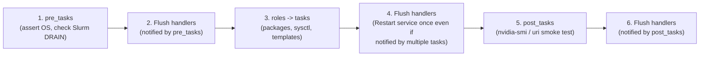

# 4.6 Ansible playbooks: tasks, modules, idempotency and check mode

| | |
|---|---|
| Level | Intermediate |
| Priority tier | 0 |
| Lab venue | ansible-core on the control node; 2 to 3 Linux targets (containers with sshd are fine for most modules) |
| Part | Part 4: Automation and infrastructure as code |
| Status | Drafted, labs **untested** |

## Why this matters for AI infrastructure

Suppose a driver update has to reach every node in your fleet on the same day. Logging in to each server by hand is slow, and it is easy to miss one. A playbook is the unit of operational change on a fleet. It can install a driver, set kernel parameters, deploy a Slurm configuration, rotate a certificate, or drain and patch a node.

A well-written playbook reads like a runbook. It is safe to run twice, it shows you the diff before it changes anything, and it stops at the first sign of trouble. A badly written one is a shell script in YAML. It always reports "changed", it cannot be dry-run, and it breaks differently on every host.

Below you will see how a playbook is laid out and which module families you will reach for most. You will also see how idempotency works in practice. Last come the controls that make a fleet change safe: check mode, diff, tags, limits and serial.

## Prerequisites and outcomes

This chapter assumes 4.3 to 4.5. When you finish it, you will be able to:

- Write multi-play playbooks, and set play keywords such as `hosts`, `become`, `serial` and `strategy`.
- Pick the right module for packages, services, files, users, kernel parameters and mounts, and explain how each one stays idempotent.
- Make `command` and `shell` tasks safe with `creates`, `removes`, `changed_when` and `failed_when`.
- Use `--check` and `--diff`, and understand where they stop being reliable.
- Control a run with tags, `--limit`, `serial`, `async` and `poll`, `run_once` and `delegate_to`.
- Read play recaps and exit codes, and design runs that work well in CI.

## 1. Playbook anatomy

A playbook looks intimidating the first time you open it, but its shape is simple. It is a list of plays. Each play names the hosts it targets and lists the work for them.

```yaml
# site.yml
- name: Baseline configuration for all cluster nodes     # play 1
  hosts: cluster
  become: true
  gather_facts: true
  any_errors_fatal: false
  max_fail_percentage: 10
  serial: "20%"                                            # batch rolling execution
  vars:
    ntp_servers: [0.pool.ntp.org, 1.pool.ntp.org]
  pre_tasks:
    - name: Assert supported OS
      ansible.builtin.assert:
        that: ansible_facts['os_family'] in ['Debian', 'RedHat']
        fail_msg: "Unsupported OS {{ ansible_facts['os_family'] }}"
  roles:
    - role: common                                         # roles run after pre_tasks (4.11)
  tasks:
    - name: Install baseline packages
      ansible.builtin.package:
        name: [chrony, rsync, htop, tmux]
        state: present
      tags: [packages]
  post_tasks:
    - name: Record run
      ansible.builtin.copy:
        content: "configured {{ ansible_date_time.iso8601 }} by {{ lookup('env', 'USER') }}\n"
        dest: /etc/ansible-last-run
        mode: "0644"
  handlers:
    - name: Restart chrony
      ansible.builtin.service: { name: chronyd, state: restarted }

- name: Slurm controller only                              # play 2
  hosts: slurm_controller
  become: true
  tasks: [ ... ]
```

Each play runs its phases in a fixed order. `pre_tasks` come first, and then Ansible flushes the handlers that those tasks notified. Next come `roles` and `tasks`, followed by another flush. `post_tasks` run after that, and a final flush picks up anything they notified. Plays run in file order, and each one covers all of its hosts. A later play can use facts that an earlier play gathered.

Use separate plays when different host groups need different steps. A play can also act as a **gate**: it checks the state of the world before the destructive play runs.

The diagram shows the same sequence. Each flush step is where notified handlers run.



### Walkthrough from *Ansible: Up and Running* Chapter 3: `webservers-tls.yml`

In *Ansible: Up and Running* chapter 3, the authors build a complete playbook, `webservers-tls.yml`. It configures NGINX with TLS and then verifies the deployment. The walkthrough covers `Examples 3-1` to `3-10`, and the authors describe seven idiomatic playbook patterns in it. Five of them are worth seeing up close.

The first pattern is an executable playbook. Add `#!/usr/bin/env ansible-playbook` as line 1 of `webservers-tls.yml`, then run `chmod +x webservers-tls.yml`. After that you can run `./webservers-tls.yml` directly, as you would a shell script. If `cowsay` is installed on the control node, Ansible draws play headers as ASCII art cows. You can customize that with `cow_selection = random`, or turn it off with `nocows = 1` in `ansible.cfg`.

The second pattern sets play-level `vars:` and uses the `file` module for directories and symlinks. The variables name the TLS directory, the key and certificate file names, the NGINX config path and the server name. The play creates `/etc/nginx/ssl/` with `file: path={{ tls_dir }} state=directory mode='0750'`. It enables the site with a symbolic link, using `file: src={{ conf_file }} dest=/etc/nginx/sites-enabled/default state=link`. The `state: absent` setting removes a symlink or a file.

The third pattern uploads files in a loop. The playbook first generates a self-signed certificate on the control node with `openssl req -x509 -nodes -days 3650 -newkey rsa:2048 -subj /CN=localhost -keyout files/nginx.key -out files/nginx.crt`. One task then uploads both files with `copy: src={{ item }} dest={{ tls_dir }} mode='0600'` and `loop: ["{{ key_file }}", "{{ cert_file }}"]`. The `copy` module searches the `files/` directory next to the playbook automatically, just as `template` searches `templates/`.

The fourth pattern is handler deduplication. Four tasks all carry `notify: Restart nginx`: `Copy TLS files`, `Manage nginx config template`, `Enable configuration` and `Install home page`. Even if all four report `changed` on the first run, Ansible deduplicates the notifications. It runs the `Restart nginx` handler once, at the end of the `tasks` phase and before `post_tasks`. On the second run, when all four tasks report `ok`, the handler runs zero times. This behaviour is tested in `code/part04/ansible_playbook_execution_lab.py`.

The fifth pattern is an embedded HTTP smoke test. At the end of the play, a verification task queries the new HTTPS endpoint from the control node:

```yaml
- name: Test it! https://localhost:8443/index.html
  delegate_to: localhost
  become: false
  uri:
    url: 'https://localhost:8443/index.html'
    validate_certs: false
    return_content: true
  register: this
  failed_when: "'Running on ' not in this.content"
  tags:
    - test
```

The `uri` module makes the request, and `register` saves the result. `failed_when` fails the task when the page does not contain `Running on `. The `tags` setting lets you run this check on its own.

### Task anatomy and common keywords

Every task has the same shape, and the keywords below are the ones you will set most often. Always name a task. The name is what appears in the log and in the documentation.

```yaml
- name: Ensure the DCGM exporter is running            # always name tasks: it is the log and the documentation
  ansible.builtin.systemd_service:                      # FQCN of the module
    name: dcgm-exporter
    state: started
    enabled: true
    daemon_reload: true
  become: true                                          # privilege escalation for this task
  when: "'gpu' in group_names"                          # conditional (Jinja expression, no braces)
  register: dcgm_result                                 # save the module's return dict
  notify: Restart dcgm-exporter                         # trigger a handler if changed
  tags: [monitoring, dcgm]
  retries: 5                                            # with until: retry loops
  delay: 10
  until: dcgm_result is succeeded
  ignore_errors: false
  changed_when: false                                   # override what counts as a change
  failed_when: dcgm_result.rc not in [0, 3]             # override what counts as failure
  delegate_to: localhost                                # run the task elsewhere for this host's context
  run_once: false
  throttle: 5                                           # at most 5 hosts concurrently on this task
  timeout: 120                                          # per-task timeout (seconds)
  no_log: false                                         # true for secrets
  environment: { HTTP_PROXY: "{{ proxy }}" }
  vars: { x: 1 }                                        # task-scoped variables
  check_mode: false                                     # force run (or skip) even in check mode
  diff: true                                            # show diffs for this task
```

Most keywords can be set at the play, block or task level, and they pass down to the levels below. Examples include `become`, `environment`, `tags`, `when`, `vars` and `ignore_errors`. Run `ansible-doc -t keyword -l` to see the full list. Name tasks as desired states, such as "Ensure X is Y", rather than as actions.

## 2. Idempotency, the heart of playbooks

A playbook that is safe to run twice is one you can rerun after a half-finished change without fear. That property has a name: idempotency. A module is idempotent when running it again with the same arguments changes nothing. It gets there by comparing the desired state with the actual state before it acts. Does the package exist? Is the file content identical? Does the line already exist? Only when the answer is no does the module make a change.

Your job in a playbook is to keep that property intact. Start by reaching for the declarative module that manages the thing you care about. Use `package`, `service`, `user`, `file`, `template`, `lineinfile`, `sysctl`, `mount`, `cron`, `git`, `get_url` and `unarchive` before you reach for `command` or `shell`.

Describe the final state, not the steps. Use `state: present`, `absent`, `started`, `latest` or `directory`, and avoid toggles.

When you do need `command` or `shell`, add a guard. `creates:` skips the task if a path already exists. `removes:` skips it if the path is missing. You can also run a `stat` or check task first and gate the step with `when`, or compute `changed_when` from the command's output.

Keep timestamps, random values and `ansible_date_time` out of rendered content. A file that changes on every run reports `changed` every time, and it triggers its handlers every time too.

Prefer `state: present` over `state: latest` when you want reproducible results. Save `latest` for a patch play where you mean it. Otherwise pin versions, for example `name: "nvidia-driver-550=550.90.07-1"`.

Finally, test the property itself. Run the playbook twice. The second recap must show `changed=0`. Molecule automates this check, as covered in 4.13.

Three tasks below apply those rules.

```yaml
- name: Create the scratch dir once
  ansible.builtin.command: mkdir -p /scratch
  args: { creates: /scratch }                 # skipped if /scratch exists (still, `file` is better)

- name: Read the current DCGM profiling mode (read-only, never "changed")
  ansible.builtin.command: dcgmi profile --status
  register: prof
  changed_when: false
  failed_when: prof.rc != 0 and 'not supported' not in prof.stderr

- name: Enable MIG only if currently disabled
  ansible.builtin.command: nvidia-smi -i 0 -mig 1
  when: "'Disabled' in mig_state.stdout"
  register: mig_set
  changed_when: "'Enabled' in mig_set.stdout"
```

The first task still uses `command`, so it needs a guard. The `file` module would be cleaner. The second task is a read-only probe that never reports `changed`. The third changes the MIG mode only when it is currently disabled.

If a module can express the state you want, use the module. Keep `command` for the cases where none can.

## 3. Module families you will use daily

To find a module, run `ansible-doc -l | grep -i <topic>`, or read the examples at the end of `ansible-doc ansible.builtin.copy`. The module index for each collection works too.

### Packages and repositories

| Module | Notes |
|---|---|
| `ansible.builtin.package` | Generic; uses the right backend. Package names often differ between distros, so use `when` or vars per OS family |
| `ansible.builtin.apt`, `dnf`/`yum`, `zypper` | Backend-specific: `update_cache`, `cache_valid_time`, `autoremove`, `install_recommends`, `lock_timeout`, `allow_downgrade` |
| `ansible.builtin.apt_repository`, `ansible.builtin.deb822_repository`, `ansible.builtin.yum_repository`, `ansible.builtin.apt_key` (deprecated; use keyrings with `get_url`) | Add NVIDIA CUDA / Docker / Kubernetes repositories securely with signed-by keyrings |
| `ansible.builtin.pip` | Use `virtualenv:` and pinned versions; avoid system Python |
| `ansible.builtin.dpkg_selections`, `ansible.builtin.package_facts` | Hold package versions (e.g. kernel, driver) and inspect installed packages |

The task below uses `dpkg_selections` to hold the driver and kernel packages on Debian-family hosts.

```yaml
- name: Hold the NVIDIA driver and kernel to avoid surprise upgrades
  ansible.builtin.dpkg_selections:
    name: "{{ item }}"
    selection: hold
  loop: [nvidia-driver-550, linux-image-generic]
  when: ansible_facts['os_family'] == 'Debian'
```

### Files, templates and content

`ansible.builtin.file` sets the state of a path to `file`, `directory`, `link`, `absent` or `touch`, along with owner, group, mode and recurse. `copy` places a static file or inline `content:`, and it accepts `backup`, `validate`, `force` and `remote_src`. `template` renders Jinja2 (see 4.4). `lineinfile` ensures one line is present. Pair it with `regexp` and `backrefs`, and be careful, because a regex can match several lines or none.

`blockinfile` manages a block between markers. `replace` rewrites text across a whole file with a regex. `stat` and `find` inspect files, `fetch` pulls them back, and `synchronize` wraps rsync. `unarchive` extracts archives, and `get_url` downloads with `checksum:`. `uri` calls HTTP APIs. `assemble` concatenates fragments, such as a `conf.d` directory. `ini_file` comes from community.general, and `slurp` and `tempfile` round out the group.

Two examples follow: a hardening drop-in, and a checksum-verified download.

```yaml
- name: Install sshd hardening drop-in
  ansible.builtin.copy:
    dest: /etc/ssh/sshd_config.d/10-hardening.conf
    content: |
      PermitRootLogin no
      PasswordAuthentication no
    owner: root
    group: root
    mode: "0644"
    validate: "sshd -t -f %s"        # NOTE: validating a drop-in standalone may need the main config; test carefully
  notify: Reload sshd

- name: Download a release with checksum verification
  ansible.builtin.get_url:
    url: "https://example.com/tool-{{ tool_version }}.tar.gz"
    dest: "/opt/dl/tool-{{ tool_version }}.tar.gz"
    checksum: "sha256:{{ tool_sha256 }}"
    mode: "0644"
```

Test the `validate` line carefully, because a drop-in run on its own may need the main configuration.

### Users, groups, SSH, sudo

Users, groups and SSH keys have their own modules: `user`, `group`, `authorized_key` from ansible.posix, and `known_hosts`. For sudo, `ansible.builtin.lineinfile` with `validate: visudo -cf %s` works, but a drop-in file in `/etc/sudoers.d/` is the better choice. When you manage many users, loop over a data structure instead of writing one task per user.

### Services and boot

`service` and `systemd_service` manage a service's state, with `daemon_reload`, `masked`, `enabled` and `state`. `ansible.builtin.reboot` reboots a host and waits for it, using `reboot_timeout` and `test_command`. `wait_for` waits for a port, a file or a regex match, and `wait_for_connection` sits beside it.

Kernel and system settings have modules too. Use `ansible.posix.sysctl` to persist kernel parameters, `ansible.posix.mount` for mounts and `community.general.modprobe` to load kernel modules. The table below lists the rest.

| Module | What it manages |
|---|---|
| `community.general.kernel_blacklist` | Blacklisted kernel modules |
| `community.general.timezone`, `ansible.builtin.hostname` | Time zone and host name |
| `ansible.builtin.cron`, `ansible.posix.at` | Scheduled jobs |
| `community.general.alternatives` | Alternative command links |
| `ansible.posix.firewalld`, `community.general.ufw` | Firewall rules |
| `ansible.posix.seboolean`, `ansible.posix.selinux` | SELinux settings |

You set all of these kernel parameters with one loop.

```yaml
- name: Kernel parameters for training nodes
  ansible.posix.sysctl:
    name: "{{ item.key }}"
    value: "{{ item.value }}"
    sysctl_file: /etc/sysctl.d/90-ai.conf
    state: present
    reload: true
  loop: "{{ sysctl_settings | dict2items }}"
  vars:
    sysctl_settings:
      vm.swappiness: 1
      net.core.rmem_max: 268435456
      net.core.wmem_max: 268435456
      net.ipv4.tcp_congestion_control: bbr
      kernel.numa_balancing: 0
```

All the settings go to `/etc/sysctl.d/90-ai.conf`, so they persist across reboots.

### Information, control flow and debugging

Some modules gather information, control the flow of a run, or help you debug one. The table groups them by job.

| Job | Modules |
|---|---|
| Collect facts | `setup`, `gather_facts` |
| Handle values and checks | `set_fact`, `debug`, `assert`, `fail`, `pause` |
| Steer the run | `meta` (`flush_handlers`, `end_play`, `end_host`, `refresh_inventory`, `clear_facts`) |
| Reuse tasks | `include_tasks`, `import_tasks`, `include_role`, `import_role`, `include_vars` |
| Change the inventory or run commands | `add_host`, `group_by`, `command`, `shell`, `raw`, `script`, `expect` |
| Wait | `wait_for`, `async_status` |

### Platform and domain modules relevant to this handbook

This handbook leans on collections for platforms and domains. `kubernetes.core` covers k8s and Helm, and `community.docker` covers containers. `community.general` holds many system and tool modules. The network modules appear in 4.16. `community.crypto` handles certificates, and the cloud collections are `amazon.aws`, `google.cloud` and `azure.azcollection`. BMC power, boot, firmware and inventory come from `community.general.redfish_*`, which Part 7 covers.

GPU automation covers drivers, Fabric Manager, DCGM and the container toolkit. It is built from package, service, template and command modules, plus NVIDIA roles. See 4.17 for those roles.

Look for a built-in module first, and add a collection only when you cannot do the job with the built-in set.

## 4. command, shell, script, raw: when and how

Suppose a playbook needs to run something that no module handles. The module you pick decides what the task can do and how safely it can run again. The table compares the four options.

| Module | Shell features | Use |
|---|---|---|
| `command` | No (no pipes, redirects, `$VAR`, globs) | Default for running an executable; arguments are split safely |
| `shell` | Yes (`/bin/sh -c`) | Pipes, redirects, loops; quote variables with `\| quote` |
| `script` | Runs a local script remotely | Bigger logic that is hard in modules; make idempotent with `creates` |
| `raw` | Raw SSH; no Python needed | Bootstrap Python; network gear |

Only `shell` accepts pipes, redirects and loops. `command` is the default, because it runs an executable without any shell features.

When a module exists, use it. When you must run a command, make the task describe its effect on state. Guard it with `creates`, `removes` or `when`, and set `changed_when` and `failed_when` from the command's actual output or exit code. Never rely on stdout parsing without checking `rc`.

Be careful with `shell` when you interpolate variables. Unquoted input can become an injection risk, so pass each value through `"{{ var | quote }}"`. Here is a read-only probe that counts the visible GPUs.

```yaml
- name: Count visible GPUs
  ansible.builtin.shell: nvidia-smi -L | wc -l
  args: { executable: /bin/bash }
  register: gpu_count
  changed_when: false                       # read-only: never reports changed
  failed_when: gpu_count.rc != 0 or (gpu_count.stdout | int) != expected_gpus
  check_mode: false                         # run even under --check (safe, read-only)
```

The probe reads only, so `changed_when: false` keeps it from reporting a change. `check_mode: false` lets it run even under `--check`. It fails when the command exits non-zero or when the count differs from `expected_gpus`.

A pipe can hide failures. `set -o pipefail` only works in bash, so the probe needs `executable: /bin/bash` and `set -o pipefail;`. If that gets fragile, keep the probe simple or split it into a module call plus Jinja filters.

## 5. Check mode and diff

Before a playbook touches a GPU fleet, you want to see what it would change. `ansible-playbook --check` (`-C`) asks the modules to report what they would change, without changing anything. `--diff` (`-D`) adds the before and after content for files and templates. Together they act as the fleet's "terraform plan". You can run both at once:

```bash
ansible-playbook site.yml --check --diff --limit gpu001
```

The preview has limits, so read the rules below before you rely on it.

Most core modules support check mode. `command`, `shell` and `raw` skip in check mode, though, unless they have `creates` or `removes`. You can set `check_mode: false` to run them anyway, but only do that for read-only commands. Modules that do not support check mode are skipped with a note.

Tasks that depend on the real effects of earlier tasks are the tricky ones. Installing a package and then configuring its file is one example. Such tasks can fail or mispredict in check mode. Mitigate them with `when: not ansible_check_mode` or `ignore_errors: "{{ ansible_check_mode }}"`, and design the playbook so that reads, such as `stat` and probes, set `check_mode: false`.

`--diff` can leak secrets. Set `diff: false` on any task that renders secrets. Treat check mode as a risk reducer, not as proof that a change is safe. Follow it with a canary application and verification.

Scheduled `--check` runs also detect drift. A run that exits non-zero or reports `changed>0` reveals manual changes, as described in 4.2. Use the `--check --diff` output as evidence in pull requests.

You can also override the mode for a single task. `check_mode: true` forces a dry run for that task, even in a real run, which helps when you want to preview a risky step. `check_mode: false` forces execution in check mode, which suits probes.

Keep the skipped tasks in mind when you read a clean check run. A skipped task has not been previewed at all.

## 6. Controlling execution

Most runs do not need to touch the whole fleet, and most playbooks contain tasks you do not want to repeat every time. The flags below let you choose the hosts, choose the tasks, and inspect a run before it happens.

### Targeting and iteration

```bash
ansible-playbook site.yml --limit 'gpu_h100:&rack_r01'        # slice of the fleet
ansible-playbook site.yml --tags packages,monitoring          # only tagged tasks
ansible-playbook site.yml --skip-tags slow
ansible-playbook site.yml --start-at-task "Install baseline packages"
ansible-playbook site.yml --step                               # confirm each task interactively
ansible-playbook site.yml --list-tasks --list-tags --list-hosts
ansible-playbook site.yml -e "nvidia_driver_branch=555" -e @extra.yml
ansible-playbook site.yml --syntax-check
ansible-playbook site.yml -f 50 -vv
```

The `--step` flag makes you confirm each task, and the `--list-*` flags show what a run would touch. Tags are set with `tags:` on tasks, blocks, plays, roles and imports. Two special tags behave differently. `always` runs unless you pass `--skip-tags always`, and `never` runs only when you request it. Use a small, consistent tag vocabulary such as `packages`, `config`, `services`, `firewall` and `monitoring`. Tags are a convenience, not a safety mechanism, because a tagged partial run skips dependencies and can leave nodes half-configured.

### Batching, strategies and failure semantics

The play below puts the batching and failure settings in one place, with a comment on each line.

```yaml
- hosts: gpu
  serial: [1, "10%", "25%"]       # first batch 1 host (canary), then 10%, then 25% for the rest
  max_fail_percentage: 5          # abort the play if >5% of a batch fails
  any_errors_fatal: true          # one failure stops all hosts (use for dangerous steps)
  strategy: linear                # default: each task completes on all batch hosts before the next
  order: shuffle
```

`serial` limits how many hosts are in play at once. It accepts integers, percentages or a list that grows, and it is the foundation of rolling upgrades and canaries. The default strategy is `linear`, where each task finishes on all batch hosts before the next task starts. `strategy: free` lets each host run ahead on its own. That is faster for independent tasks, but it is unsuitable when later tasks depend on all hosts finishing. `host_pinned` and `debug` are variations on these strategies.

`throttle: N` caps concurrency for one specific task, such as a package-mirror load, regardless of forks. `run_once: true` runs a task on one host in the batch. Combine it with `delegate_to` for specific delegation, and use `delegate_facts` carefully.

`delegate_to` runs a task on another host while it keeps using the current host's variables. You might call a load balancer API to drain a node, update DNS, or talk to a BMC from a bastion. `delegate_to: localhost` is the common case. Keep in mind that connection variables come from the delegated host, and `become` may differ.

`async: 3600` with `poll: 0` fires a long task in the background, and you check on it later with `async_status`. `poll: 15` waits while it polls. This helps with firmware flashes, large package installs and avoiding SSH timeouts.

`any_errors_fatal`, `max_fail_percentage`, `ignore_errors`, `ignore_unreachable` and `force_handlers` are failure policy knobs. By default, a failed host is removed from the rest of the play. Handlers do not run for failed hosts unless you set `force_handlers: true`.

Timeouts come in three forms: `timeout:` on tasks, the `timeout` setting in `ansible.cfg` for the SSH connection, and `async` for long operations. A hung command without a timeout blocks the run.

### Exit codes and recap

`ansible-playbook` exits with 0 on success and 1 for a generic error. Exit code 2 means one or more hosts failed, and 3 means one or more hosts were unreachable. Exit code 4 means a parse error, and 5 means bad or incomplete options. Exit code 99 means the run was interrupted, and 250 means an unexpected error.

In CI, treat any non-zero exit as a failure. For drift detection, parse the recap and look at the `changed=` counts, or use `ANSIBLE_STDOUT_CALLBACK=json` or `ansible.posix.json` for machine-readable output.

```text
PLAY RECAP
gpu001 : ok=12 changed=3 unreachable=0 failed=0 skipped=2 rescued=0 ignored=0
gpu002 : ok=12 changed=3 unreachable=0 failed=1 skipped=2 rescued=0 ignored=0   <- failure
```

In this recap, `gpu002` reports one failed task, and that line is marked.

## 7. Worked example: a safe driver-parameter rollout

Changing a driver parameter on every GPU node at once gives you no checkpoint along the way. This worked example applies the change in small batches and validates each node as it goes.

```yaml
- name: Apply GPU node tuning with canary and validation
  hosts: gpu
  become: true
  serial: [1, "10%", "100%"]
  max_fail_percentage: 5
  vars:
    expected_gpus: 8
  pre_tasks:
    - name: Verify node is drained (Slurm) before changing kernel settings
      ansible.builtin.command: "scontrol show node {{ inventory_hostname }}"
      delegate_to: "{{ groups['slurm_controller'][0] }}"
      register: node_state
      changed_when: false
      check_mode: false
      failed_when: "'DRAIN' not in node_state.stdout"
  tasks:
    - name: Persist kernel settings
      ansible.posix.sysctl:
        name: vm.swappiness
        value: "1"
        sysctl_file: /etc/sysctl.d/90-ai.conf
        reload: true
    - name: Install nvidia-persistenced unit override
      ansible.builtin.template:
        src: nvidia-persistenced.override.conf.j2
        dest: /etc/systemd/system/nvidia-persistenced.service.d/override.conf
        mode: "0644"
      notify: Restart persistenced
  post_tasks:
    - name: Validate GPUs are healthy
      ansible.builtin.command: nvidia-smi --query-gpu=index --format=csv,noheader
      register: smi
      changed_when: false
      failed_when: (smi.stdout_lines | length) != expected_gpus
  handlers:
    - name: Restart persistenced
      ansible.builtin.systemd_service:
        name: nvidia-persistenced
        state: restarted
        daemon_reload: true
```

Start with the check run: `--check --diff --limit gpu001`. Then run the real play with the canary batch. Because of `max_fail_percentage`, a validation failure stops the play before the 10% batch. Resume the Slurm nodes in a separate, explicit play once validation has passed.

## 8. Lab

Start with the self-checking Python lab. You run it on your own machine before you touch any hosts. It checks the order in which a play runs its phases (`pre_tasks -> roles -> tasks -> post_tasks`), and it checks handler deduplication with `simulate_play_execution_and_handlers`, as covered in *Ansible: Up and Running*, Chapter 3. It also checks the `command` and `shell` idempotency guards: `creates`, `--check` mode against `check_mode: false`, and `changed_when: false` in `evaluate_command_task_guards`. Last, it checks the progressive batch calculation for `serial: [1, '20%', '100%']` in `compute_serial_batches`.

```bash
python3 code/part04/ansible_playbook_execution_lab.py
```

Next, work through these exercises on a control node with 2 or 3 Linux targets. The interactive shell steps below have not been run.

1. Build a multi-play playbook. Create `site.yml` with `pre_tasks`, `roles` (empty), `tasks`, `post_tasks` and handlers. Then use `debug` tasks and `--list-tasks` to watch the order of execution.
2. Take a tour of the modules. Give each of `package`, `service`, `user`, `file`, `copy` and `template` one task. Add `lineinfile`, `get_url` with a checksum, and `sysctl`. Run the playbook twice. The second run should confirm `changed=0`.
3. Make the playbook idempotent. Start from a naive playbook that uses `shell: echo "x" >> file` and `command: useradd`. Refactor those into `lineinfile` and `user`. For the one command that remains, add `creates`, `changed_when` and `failed_when`.
4. Check and diff. Run `--check --diff` on a templated file change. Show a `command` task being skipped, and mark a read-only probe with `check_mode: false`. Then demonstrate a dependent task failing in check mode, and fix it with `when: not ansible_check_mode`.
5. Fall into the idempotency trap on purpose. Put `{{ ansible_date_time.iso8601 }}` into a template, and watch every run report a change and trigger handlers. Then remove it.
6. Control execution. Use `--tags/--skip-tags`, `--limit`, `--start-at-task` and `--step`. Add `always` and `never` tags. Try `serial: [1, 50%, 100%]` on 6 hosts, and print the batch composition with `ansible_play_batch`.
7. Test the failure policy. Make one host fail on purpose. Compare `any_errors_fatal`, `max_fail_percentage`, `ignore_errors` and `force_handlers`. Record each exit code with `echo $?`.
8. Try delegation and async. Use `delegate_to: localhost` to write per-host results to the control node. Run a 60-second command with `async/poll`, then run it again with `poll: 0` plus `async_status`.
9. Build a retry. Write a task that polls a service with `until/retries/delay`. Stop the service to see the retry output.
10. Run a canary rollout. Implement the worked example against containers. Inject a validation failure on the canary, and confirm that the play halts.
11. Lint the playbook. Run `ansible-lint`, and fix the FQCN, naming, `command-instead-of-module`, `no-changed-when` and `risky-file-permissions` findings.
12. Clean up.

## 9. Common mistakes

Most playbook failures trace back to a short list of habits. Check each of these against your own playbooks.

- Missing task names make the log unreadable, and so do names that describe commands instead of desired state.
- Using `shell` or `command` for things a module already does is a common mistake. So is leaving out `changed_when`, which makes the recap lie. Ignoring `rc` is another.
- Using `state: latest` in routine runs causes unplanned upgrades. Leaving driver versions unpinned has a similar effect.
- Sprinkling `ignore_errors: true` through a playbook silences problems instead of handling them.
- Templates that are not idempotent, such as ones with timestamps or random values, are a common mistake. So are handler storms.
- Assuming check mode is a perfect prediction is a mistake, and so is leaking secrets through `--diff`.
- Running against `all` with no `--limit` or `serial`, and having no canary, is risky.
- Using tags as the safety mechanism and skipping prerequisite tasks.
- Using `lineinfile` with a loose regex can rewrite lines you did not intend to change. Editing files that should be fully templated or drop-ins is another.
- Not setting modes explicitly is a trap, because of YAML octal pitfalls. Quote the modes, such as `"0644"`.
- Long-running tasks without `async` or timeouts are a problem, because SSH timeouts can kill firmware updates.
- Relying on task order across plays without verifying dependencies.

## 10. Interview angles

- "How do you make a playbook idempotent? What breaks idempotency?"
- "Explain check mode and its limits. How would you do a safe production change? Cover check and diff, a canary via `serial`, validation, and `max_fail_percentage`."
- "`command` vs `shell` vs `raw` vs `script`?"
- "How do you perform a rolling update across 500 nodes with a canary?"
- "What does `delegate_to` do and when do you use `run_once`?"
- "How do you handle long-running tasks and SSH timeouts? Point to async and poll."
- "What do `changed_when` and `failed_when` do?"
- "Tags: how do you use them and what are the risks?"
- "How do you know the playbook is safe to rerun? A second run should show `changed=0`, and a Molecule idempotence test can check it too."

## Exercises

1. Use `simulate_play_execution_and_handlers()` in `code/part04/ansible_playbook_execution.py` to trace the order of `pre_tasks`, `roles`, `tasks` and `post_tasks`. Handler flushes sit between them, as *Ansible: Up and Running*, Chapter 3, describes. Then explain why four tasks that notify `Restart nginx` in `webservers-tls.yml` cause only one restart.
2. Pick three modules from this chapter, for example `file`, `lineinfile` and `sysctl`. For each one, explain how it checks the current state before it acts.
3. A GPU node picked up a new driver during a routine run. Explain why `selection: hold` in `dpkg_selections` and a pinned version with `state: present` prevent that, and why `state: latest` does not.
4. A task puts `{{ ansible_date_time.iso8601 }}` into a config template. Explain why every run then reports `changed`, and why handlers fire each time. Use `evaluate_command_task_guards()` to check your answer.
5. A `shell` task pipes `nvidia-smi` into `wc`. Explain how `set -o pipefail` with `executable: /bin/bash` stops the pipe from hiding a failure. Then say what `changed_when: false` adds for a read-only probe.
6. Explain why `command` and `shell` tasks without `creates` or `removes` are skipped under `--check`. Then say why a read-only probe such as `nvidia-smi -L` sets `check_mode: false`.
7. A task renders a secret into a file. Explain why it needs `diff: false` and `no_log: true`.
8. Use `compute_serial_batches()` to trace `serial: [1, "10%", "100%"]`. Then explain how `max_fail_percentage: 5` stops the rollout after a bad canary.
9. Contrast `strategy: linear` with `strategy: free`. Then say what `throttle: 5` caps that `forks` does not.
10. Explain what `delegate_to` does when a task drains a node on the Slurm controller. Then explain how `async: 3600` with `poll: 0` differs from `poll: 15`.
11. Trace the worked example in Section 7 from start to finish. Follow the pre-task that checks the Slurm node for `DRAIN`, then the `sysctl` change, then the handler that restarts `nvidia-persistenced`, and last the post-task that checks the GPU count.
12. List what `ansible-playbook` exit codes 0, 1, 2 and 3 mean, and say how you would use them in CI.

## Checkpoint questions (20)

<details>
<summary>1. What is the exact execution order of phases within an Ansible play (`pre_tasks`, `roles`, `tasks`, `post_tasks`, and `handlers`)?</summary>

Within one play, Ansible runs the phases in a fixed sequence that you can count on:
1. Fact gathering, using `setup`, when `gather_facts: true` is set.
2. `pre_tasks`, for example asserting the OS family, checking that the node is `DRAIN`ed in Slurm, or taking the node out of a load balancer.
3. Flushing the handlers that `pre_tasks` notified.
4. `roles`, as listed under `roles:`.
5. `tasks`, as listed under `tasks:`.
6. Flushing the handlers that `roles` and `tasks` notified.
7. `post_tasks`, for example running `nvidia-smi` or `uri` smoke tests and returning the node to service.
8. Flushing the handlers that `post_tasks` notified.

If you need pending handlers to run right before a phase ends, put `meta: flush_handlers` inside that phase.
</details>

<details>
<summary>2. How does Handler deduplication and ordering work when multiple tasks notify the same handler (*Ansible: Up and Running*, Chapter 3)?</summary>

A handler runs only when the task that notifies it reports `changed: true`. In `webservers-tls.yml`, four tasks notify `Restart nginx`: `Copy TLS files`, `Manage nginx config template`, `Enable configuration` and `Install home page`. If all four report `changed` and all specify `notify: Restart nginx`, Ansible deduplicates the notifications. It then runs `Restart nginx` only once, at the end of the phase. When several different handlers are notified, they run in the order they appear in the `handlers:` section, not in the order the tasks notified them. By default, a host that fails a later task in the play has its pending handlers skipped, unless `force_handlers: true` is set.
</details>

<details>
<summary>3. What makes a task idempotent, and why does putting `{{ ansible_date_time.iso8601 }}` inside a template break idempotency?</summary>

A task is idempotent when a second run against a host that is already in the desired state makes zero changes. It reports `ok` and `changed=0`. A template that embeds a dynamic timestamp (`{{ ansible_date_time.iso8601 }}`) or a random value breaks this. If you run the playbook again, the rendered file differs on every single run. As a result, `template` overwrites the file and reports `changed=1` on every run. That ruins `--check` drift detection, and it can trigger service-restart handler storms across the fleet on every run.
</details>

<details>
<summary>4. Why should GPU node playbooks use `state: present` with pinned versions and `dpkg_selections` (`hold`) instead of `state: latest`?</summary>

`state: latest` on `package` or `apt` upgrades a package whenever the upstream repositories publish a new version. A routine configuration playbook can therefore unexpectedly upgrade the Linux kernel or the NVIDIA driver (`nvidia-driver-550`) on a subset of nodes. That breaks kernel-module ABI matching across a multi-node training job. Always use `state: present` with pinned version strings, such as `nvidia-driver-550=550.90.07-1`. Lock critical packages with `ansible.builtin.dpkg_selections`, using `selection: hold`, or with `yum versionlock` on RHEL.
</details>

<details>
<summary>5. In *Ansible: Up and Running*, Chapter 3's `webservers-tls.yml`, how does `ansible.builtin.file` create directories and symlinks, and where do `copy` and `template` look for source files?</summary>

- `ansible.builtin.file` with `state: directory` (`path: /etc/nginx/ssl/`, `mode: '0750'`) creates the directory tree, like `mkdir -p`. With `state: link` (`src: /etc/nginx/sites-available/default`, `dest: /etc/nginx/sites-enabled/default`), it creates a symbolic link, like `ln -s`. With `state: absent`, it removes a file, a symlink or a directory tree.
- For relative `src:` paths, `ansible.builtin.copy` searches the `files/` subdirectory next to the playbook or role. `ansible.builtin.template` searches the `templates/` subdirectory instead.
</details>

<details>
<summary>6. Compare `lineinfile`, `blockinfile`, `assemble`, and `template`—when should you avoid `lineinfile`?</summary>

- `template`: Use it whenever you own the whole file or a `.d/` drop-in. It renders the complete file deterministically from Git, so no unmanaged lines can linger (`WISB == WIRI`).
- `blockinfile`: This inserts or updates a multi-line block between the `# BEGIN ANSIBLE MANAGED BLOCK` and `# END ANSIBLE MANAGED BLOCK` markers in a shared file.
- `lineinfile`: This makes sure a single line that matches `regexp:` is present or absent. Avoid it on complex structured configs, and where a drop-in directory such as `/etc/ssh/sshd_config.d/` or `/etc/sysctl.d/` exists. A loose `regexp` can accidentally rewrite the wrong line or append duplicate entries.
- `assemble`: This concatenates several fragment files from a directory into one target file.
</details>

<details>
<summary>7. How does `ansible.posix.sysctl` manage kernel parameters idempotently?</summary>

`ansible.posix.sysctl` reads the live value under `/proc/sys/`, and it also checks the target `sysctl_file`. With `name: vm.swappiness`, `value: "1"`, `sysctl_file: /etc/sysctl.d/90-ai.conf`, `state: present` and `reload: true`, it changes something only if either value differs. When that happens, it updates `/etc/sysctl.d/90-ai.conf` and runs `sysctl -p /etc/sysctl.d/90-ai.conf` to apply the setting in memory.
</details>

<details>
<summary>8. How do you make `command` and `shell` tasks idempotent and safe using `creates`, `removes`, `changed_when`, `failed_when`, and `pipefail`?</summary>

1. `args: { creates: /path/to/file }` skips the command if `/path/to/file` already exists on the target. `removes:` works the other way. It skips the command if the path does *not* exist.
2. `changed_when:` overrides when the task reports `CHANGED`. For read-only probes, such as `dcgmi profile --status` and `scontrol show node`, set `changed_when: false`. For state-toggling commands, such as `nvidia-smi -i 0 -mig 1`, evaluate stdout instead: `changed_when: "'Enabled' in mig_set.stdout"`.
3. `failed_when:` overrides how failure is detected, for example `failed_when: prof.rc != 0 and 'not supported' not in prof.stderr`.
4. Shell pipes need care. In `/bin/sh`, `cmd1 | cmd2` returns only the exit code of `cmd2`, which hides failures in `cmd1`. Set `args: { executable: /bin/bash }` and start the command with `set -o pipefail;`. Always sanitize variables too, with `{{ var | quote }}`.
</details>

<details>
<summary>9. How do `--check`, `--diff`, and the per-task `check_mode:` keyword interact?</summary>

When you run `ansible-playbook site.yml --check --diff`, declarative modules such as `package`, `file`, `template`, `service` and `sysctl` simulate their work. They print unified before and after file diffs through `--diff`.

The `command`, `shell` and `raw` tasks are skipped in `--check` mode. The exception is a task that specifies `creates:` or `removes:`, or that sets `check_mode: false`.

So a read-only inspection task, such as `command: scontrol show node ...` or `stat`, must set `check_mode: false` and `changed_when: false` when later `when:` conditions in a `--check` run need its registered output. Then the task executes during `--check`. Setting `check_mode: true` on a task does the reverse. It forces that one task to run in dry-run mode, even during a real playbook run.
</details>

<details>
<summary>10. How do `until`, `retries`, and `delay` work on a task waiting for a service or daemon to converge?</summary>

```yaml
- name: Wait for DCGM exporter metrics endpoint
  ansible.builtin.uri:
    url: http://127.0.0.1:9400/metrics
  register: dcgm_http
  retries: 6
  delay: 5
  until: dcgm_http.status == 200
```

Ansible runs the module and stores the result in `dcgm_http`. It then evaluates the `until:` Jinja2 expression. If the expression is `False`, Ansible waits `delay` seconds, which is `5`s here, and tries again. It retries up to `retries` times, which means `6` attempts, before it marks the task as failed.
</details>

<details>
<summary>11. How do Tags (`--tags`, `--skip-tags`, `always`, `never`) work, and why are tags NOT a safety boundary?</summary>

Attaching `tags: [packages, monitoring]` to a task, role or block lets you run only the matching tasks, with `--tags monitoring`. You can also skip them, with `--skip-tags slow`.

- `always` tag: A task tagged `tags: [always]` runs on every invocation, whatever `--tags` you pass. You can exclude it explicitly with `--skip-tags always`. This suits pre-flight assertions or setting critical facts.
- `never` tag: A task tagged `tags: [never, debug_dump]` is skipped on normal runs. It runs only when you request it, with `--tags debug_dump` or `--tags never`.

Tags are not a safety boundary. Running `--tags config` skips prerequisite `packages` or `pre_tasks` drain checks, unless those checks are tagged `always`. The config can then reach an undrained node, or a node that is missing the binary.
</details>

<details>
<summary>12. How does progressive batching with `serial: [1, "10%", "100%"]` and `max_fail_percentage: 5` work?</summary>

When a play sets `serial: [1, "10%", "100%"]` and `max_fail_percentage: 5`, the batches run in order.

1. Batch 1 is the canary. Ansible runs the entire play (`pre_tasks` -> `roles` -> `tasks` -> `handlers` -> `post_tasks`) on 1 host first. If that host fails, the failure rate is $100\% > 5\%$, so Ansible aborts the entire play before it touches any other host.
2. Batch 2 is the next 10% of the group. If the canary succeeds, Ansible runs the entire play on that batch. If more than 5% of that batch fails, the play aborts.
3. Batch 3 covers the remaining hosts in batches of 100%. If the last list entry is `"25%"`, Ansible runs repeating 25% batches until all hosts finish. Inside the play, `ansible_play_batch` lists the hosts active in the current batch.
</details>

<details>
<summary>13. Compare `any_errors_fatal: true`, `max_fail_percentage`, `ignore_errors: true`, and `ignore_unreachable: true`.</summary>

- Default behavior: When a task fails on `gpu002`, `gpu002` is dropped from the rest of the play. All other hosts keep running.
- `any_errors_fatal: true`: If any single host fails any task, Ansible aborts the play across all hosts, right after the current task finishes.
- `max_fail_percentage: N`: This aborts the play if more than `N%` of the hosts in the current `serial` batch fail.
- `ignore_errors: true`: The failure is marked `ignored=1`, and later tasks keep running on that same host. Use `block`/`rescue` or a specific `failed_when` instead of blanket `ignore_errors`.
- `ignore_unreachable: true`: The play keeps running tasks even if the SSH connection to the host timed out.
</details>

<details>
<summary>14. Contrast `strategy: linear`, `strategy: free`, `strategy: host_pinned`, and the task-level `throttle` keyword.</summary>

- `strategy: linear` (default): Execution runs in lockstep. Every host in the batch must finish Task 1 before any host starts Task 2.
- `strategy: free`: Each host races through the task list without waiting for slower hosts on earlier tasks. This is faster when one host has a slow disk or network. It is unsafe if Task 3 depends on Task 2 finishing on all nodes.
- `strategy: host_pinned`: This works like `free`. Once a worker fork starts a host, it stays pinned to that host until the host finishes the entire play.
- `throttle: 5`, used as a task or block keyword: This caps concurrency for that task at `5` hosts at a time, even when the global `forks = 50` setting allows more. It stops 50 GPU nodes from saturating an internal artifact server or license server during a heavy download task.
</details>

<details>
<summary>15. How do `delegate_to` and `run_once: true` work together, and how does `delegate_to` resolve variables vs. connection settings?</summary>

- `delegate_to: <target_host>` runs the task on `<target_host>`. Examples are `delegate_to: localhost`, or `delegate_to: "{{ groups['slurm_controller'][0] }}"` to run `scontrol show node {{ inventory_hostname }}`. Jinja2 variables such as `{{ inventory_hostname }}` and `{{ ansible_host }}` are still evaluated from the point of view of the original loop host. Connection settings, however, such as `ansible_host`, `ansible_user` and `become`, apply to the delegated host.
- `run_once: true` runs the task once per batch, on the first host in the batch or on the `delegate_to` target, instead of once per host in the group. This suits database schema migrations or cluster-wide API calls. Pair it with `delegate_facts: true` if facts should attach to the delegated host.
</details>

<details>
<summary>16. How do `async` and `poll` work in a playbook task, and how do you check on a fire-and-forget (`poll: 0`) task later?</summary>

- Polling mode, with `async: 3600` and `poll: 15`: The task launches in a background daemon on the target host, with a 1-hour maximum runtime. Ansible reconnects over SSH every 15 seconds to check completion. This prevents firewall or SSH `ServerAliveInterval` idle disconnects during long driver builds or firmware flashes.
- Fire-and-forget mode, with `async: 3600` and `poll: 0`: Ansible starts the background job, registers the job handle as `register: fw_job`, and moves on to the next task without waiting. Later in the play, wait for completion with `ansible.builtin.async_status`:
  `async_status: { jid: "{{ fw_job.ansible_job_id }}" }` with `register: job_res`, `until: job_res.finished`, `retries: 120`, `delay: 10`.
</details>

<details>
<summary>17. What are the standard `ansible-playbook` POSIX exit codes (`0`, `1`, `2`, `3`, `4`, `5`, `99`, `250`)?</summary>

- `0`: All hosts succeeded (`failed=0` and `unreachable=0`).
- `1`: A generic or fatal error.
- `2`: One or more hosts had failed tasks (`failed > 0`).
- `3`: One or more hosts were unreachable (`unreachable > 0`).
- `4`: A parser or syntax error in the playbook or inventory.
- `5`: Bad or incomplete CLI options.
- `99`: The user interrupted the run (`Ctrl-C` / `SIGINT`).
- `250`: An unexpected internal exception.
</details>

<details>
<summary>18. How do `--start-at-task` and `--step` help during interactive playbook development and recovery?</summary>

- `--start-at-task "Install nvidia-persistenced unit override"`: This skips all earlier tasks and begins execution at the named task.
- `--step`: This prompts you before every task with `Perform task: ... (N)o/(y)es/(c)ontinue:`. An operator can step through a new playbook task by task on a test node, and type `c` once confident.
</details>

<details>
<summary>19. How do `ansible.builtin.get_url` (`checksum:`) and `ansible.builtin.uri` improve security and verification in playbooks (*Ansible: Up and Running*, Chapter 3)?</summary>

- `get_url` with `checksum: "sha256:{{ tool_sha256 }}"`: Before downloading, `get_url` checks whether the destination file already exists with that exact SHA-256 digest. If it does, the download is skipped, so the task stays idempotent. After downloading, it verifies the SHA-256 digest before it moves the file into place. That protects you from corrupted downloads and tampered upstream binaries.
- `uri` with `return_content: true`: This makes native HTTP and HTTPS REST API calls and health checks, such as `status_code: 200` and `failed_when: "'Running on ' not in this.content"`, without shelling out to `curl`.
</details>

<details>
<summary>20. What `ansible-lint` rules catch the most common playbook bugs in CI?</summary>

1. `fqcn[action-core]` enforces fully qualified module names, such as `ansible.builtin.copy` instead of `copy`.
2. `name[missing]` and `name[casing]` require descriptive task names on every task.
3. `command-instead-of-module` flags `command` or `shell` calls that run `apt`, `systemctl`, `git`, `mkdir`, `chmod`, `curl` or `rsync` when a native module exists.
4. `no-changed-when` flags `command` or `shell` tasks that lack `creates:`, `removes:` or `changed_when:`.
5. `risky-file-permissions` flags `copy`, `template` or `file` tasks that omit an explicit `mode:`. Without one, the mode depends on the target's ambient `umask`.
6. `risky-shell-pipe` flags `shell` tasks that use `|` without `set -o pipefail`.
</details>

## Sources and review notes

- **Sources read in full:**
  - `ansible-up-and-running-3rd-edition` — Bas Meijer, Lorin Hochstein & René Moser, *Ansible: Up and Running*, 3rd ed., **Chapter 3: Playbooks: A Beginning** (read in full: executable playbook shebang `#!/usr/bin/env ansible-playbook`, `cowsay` / `cow_selection`, play-level `vars:`, `package` `update_cache: true`, `file` `state: directory` and `state: link` symlinks, `copy` with `loop:` from `files/`, `template` from `templates/`, `notify: Restart nginx` handler deduplication, and `uri` smoke-test verification with `return_content: true`, `register: this`, `failed_when:`, and `tags: [test]`).
- **Run here:** `python3 code/part04/ansible_playbook_execution_lab.py` (3 passed, 0 failed).
- **Explicitly labelled inferences:** The `simulate_play_execution_and_handlers`, `evaluate_command_task_guards`, and `compute_serial_batches` models in `code/part04/ansible_playbook_execution.py` and the Section 7 GPU driver-parameter rollout playbook are the author's constructions applying *Ansible: Up and Running* Chapter 3 and Ansible playbook execution semantics to GPU fleets (plus original study items 21, 22, 23, 24, 25, 26, 27, 28, 29, 30, 31, 32, 33, 34, and 35).
- **Not verified on live hardware:** Live `ansible-playbook`, `scontrol`, `dcgmi`, and `nvidia-smi` commands (`20%`, `10%`, `25%`, `550.90.07-1`, `268435456`, `0644`, `0600`, `0750`, `3600`s, exit codes `0..250`) are marked (`untested here`) where not executed by `ansible_playbook_execution_lab.py`.
