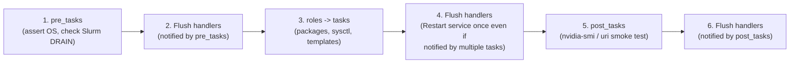

# 4.6 Ansible playbooks: tasks, modules, idempotency and check mode

| | |
|---|---|
| Level | Intermediate |
| Priority tier | 0 |
| Lab venue | ansible-core on the control node; 2 to 3 Linux targets (containers with sshd are fine for most modules) |
| Part | Part 4: Automation and infrastructure as code |
| Status | Drafted, labs **untested** |

## Why this matters for AI infrastructure

Playbooks are the unit of operational change on a fleet: install a driver, set kernel parameters, deploy a Slurm configuration, rotate a certificate, drain and patch a node. Written well they are readable runbooks that are safe to run twice, show you the diff before changing anything, and stop at the first sign of trouble. Written badly they are shell scripts in YAML that always report "changed", cannot be dry-run, and break differently on every host. This chapter teaches playbook anatomy, the module families you will use constantly, the mechanics of idempotency, and the operational controls (check mode, diff, tags, limits, serial) that make fleet changes safe.

## Prerequisites and outcomes

Needs 4.3 to 4.5. After this chapter you can:

- Write multi-play playbooks with play keywords (`hosts`, `become`, `gather_facts`, `vars`, `serial`, `strategy`, `any_errors_fatal`, `max_fail_percentage`) and task keywords.
- Choose the right module for packages, services, files, users, kernel parameters, mounts, cron/systemd timers, downloads, archives, Git, and system commands; explain how each achieves idempotency.
- Make `command`/`shell` tasks safe with `creates`, `removes`, `changed_when`, `failed_when`, and guards.
- Use `--check`, `--diff`, `check_mode:`, `diff:` and understand their limits.
- Control execution with tags, `--limit`, `--start-at-task`, `--step`, `serial`, `strategy`, `async`/`poll`, `run_once`, `delegate_to`, `throttle`.
- Read play recaps and exit codes and design CI-friendly runs.

## 1. Playbook anatomy

```yaml
# site.yml
- name: Baseline configuration for all cluster nodes     # play 1
  hosts: cluster
  become: true
  gather_facts: true
  any_errors_fatal: false
  max_fail_percentage: 10
  serial: "20%"                                            # batch rolling execution
  vars:
    ntp_servers: [0.pool.ntp.org, 1.pool.ntp.org]
  pre_tasks:
    - name: Assert supported OS
      ansible.builtin.assert:
        that: ansible_facts['os_family'] in ['Debian', 'RedHat']
        fail_msg: "Unsupported OS {{ ansible_facts['os_family'] }}"
  roles:
    - role: common                                         # roles run after pre_tasks (4.11)
  tasks:
    - name: Install baseline packages
      ansible.builtin.package:
        name: [chrony, rsync, htop, tmux]
        state: present
      tags: [packages]
  post_tasks:
    - name: Record run
      ansible.builtin.copy:
        content: "configured {{ ansible_date_time.iso8601 }} by {{ lookup('env', 'USER') }}\n"
        dest: /etc/ansible-last-run
        mode: "0644"
  handlers:
    - name: Restart chrony
      ansible.builtin.service: { name: chronyd, state: restarted }

- name: Slurm controller only                              # play 2
  hosts: slurm_controller
  become: true
  tasks: [ ... ]
```

Order within a play: `pre_tasks` → handlers flushed → `roles` → `tasks` → handlers flushed → `post_tasks` → handlers. Plays run in file order, each across all its hosts; later plays can use facts gathered earlier. Use multiple plays when different host groups need different steps, or when you want a **gate** (a play that validates the world before the destructive one).



### Walkthrough from *Ansible: Up and Running* Chapter 3: `webservers-tls.yml`

In *Ansible: Up and Running* Chapter 3 (`Examples 3-1` to `3-10`), the authors build a complete playbook `webservers-tls.yml` that configures NGINX with TLS and verifies the deployment—demonstrating seven idiomatic playbook patterns:
1. **Executable playbook shebang (`#!/usr/bin/env ansible-playbook`):** Adding `#!/usr/bin/env ansible-playbook` as line 1 of `webservers-tls.yml` and running `chmod +x webservers-tls.yml` lets you execute `./webservers-tls.yml` directly like a shell script. (And if `cowsay` is installed on the control node, Ansible renders play headers as ASCII art cows—customizable via `cow_selection = random` or disabled via `nocows = 1` in `ansible.cfg`.)
2. **Play-level `vars:` and directory/symlink state (`file`):** Defines `tls_dir: /etc/nginx/ssl/`, `key_file: nginx.key`, `cert_file: nginx.crt`, `conf_file: /etc/nginx/sites-available/default`, and `server_name: localhost`. It creates `/etc/nginx/ssl/` with `file: path={{ tls_dir }} state=directory mode='0750'` and enables the site by creating a **symbolic link** with `file: src={{ conf_file }} dest=/etc/nginx/sites-enabled/default state=link` (`state: absent` removes a symlink or file).
3. **Looping file uploads (`copy` with `loop:`):** Generates a self-signed certificate locally (`openssl req -x509 -nodes -days 3650 -newkey rsa:2048 -subj /CN=localhost -keyout files/nginx.key -out files/nginx.crt`) and uploads both files in one task using `copy: src={{ item }} dest={{ tls_dir }} mode='0600'` with `loop: ["{{ key_file }}", "{{ cert_file }}"]` ( note that `copy` automatically searches the `files/` subdirectory adjacent to the playbook, just as `template` automatically searches `templates/`).
4. **Handler deduplication (`notify: Restart nginx`):** Four separate tasks (`Copy TLS files`, `Manage nginx config template`, `Enable configuration`, `Install home page`) all attach `notify: Restart nginx`. Even if all four tasks report `changed` during the first run, Ansible **deduplicates notifications and runs the `Restart nginx` handler only once** at the end of the `tasks` phase (before `post_tasks`), and **zero times** on the second run when all tasks report `ok` (tested in `code/part04/ansible_playbook_execution_lab.py`).
5. **Embedded HTTP smoke test (`uri` + `register` + `failed_when` + `tags`):** At the end of the play, a verification task queries the newly configured HTTPS endpoint from the control node:
   ```yaml
   - name: Test it! https://localhost:8443/index.html
     delegate_to: localhost
     become: false
     uri:
       url: 'https://localhost:8443/index.html'
       validate_certs: false
       return_content: true
     register: this
     failed_when: "'Running on ' not in this.content"
     tags:
       - test
   ```

### Task anatomy and common keywords

```yaml
- name: Ensure the DCGM exporter is running            # always name tasks: it is the log and the documentation
  ansible.builtin.systemd_service:                      # FQCN of the module
    name: dcgm-exporter
    state: started
    enabled: true
    daemon_reload: true
  become: true                                          # privilege escalation for this task
  when: "'gpu' in group_names"                          # conditional (Jinja expression, no braces)
  register: dcgm_result                                 # save the module's return dict
  notify: Restart dcgm-exporter                         # trigger a handler if changed
  tags: [monitoring, dcgm]
  retries: 5                                            # with until: retry loops
  delay: 10
  until: dcgm_result is succeeded
  ignore_errors: false
  changed_when: false                                   # override what counts as a change
  failed_when: dcgm_result.rc not in [0, 3]             # override what counts as failure
  delegate_to: localhost                                # run the task elsewhere for this host's context
  run_once: false
  throttle: 5                                           # at most 5 hosts concurrently on this task
  timeout: 120                                          # per-task timeout (seconds)
  no_log: false                                         # true for secrets
  environment: { HTTP_PROXY: "{{ proxy }}" }
  vars: { x: 1 }                                        # task-scoped variables
  check_mode: false                                     # force run (or skip) even in check mode
  diff: true                                            # show diffs for this task
```

Keyword scoping: most keywords can be set at play, block or task level and inherit downward (`become`, `environment`, `tags`, `when`, `vars`, `ignore_errors`...). Read `ansible-doc -t keyword -l`. Task names should read as desired states ("Ensure X is Y"), not actions.

## 2. Idempotency, the heart of playbooks

A module is idempotent when running it again with the same arguments changes nothing. It achieves this by **comparing desired and actual state** (does the package exist? is the file content identical? does the line exist?) before acting. Your job in a playbook is to preserve that property:

- Use the **declarative module** for the thing you are managing (`package`, `service`, `user`, `file`, `template`, `lineinfile`, `sysctl`, `mount`, `cron`, `git`, `get_url`, `unarchive`) rather than `command`/`shell`.
- Express **final state**, not actions (`state: present`/`absent`/`started`/`latest`/`directory`), and avoid toggles.
- For `command`/`shell` use guards: `creates:` (skip if the path exists), `removes:` (skip if the path is missing), a preceding `stat` or check task with `when`, or `changed_when` computed from output.
- Do not use timestamps, random values or `ansible_date_time` in rendered content (the file changes every run, so every run reports `changed` and triggers handlers).
- Prefer `state: present` over `state: latest` for reproducibility, using `latest` only deliberately in a patch play (and pinning versions otherwise: `name: "nvidia-driver-550=550.90.07-1"`).
- Test idempotency: run the playbook twice; the second recap must show `changed=0`. Molecule automates this check (4.13).

```yaml
- name: Create the scratch dir once
  ansible.builtin.command: mkdir -p /scratch
  args: { creates: /scratch }                 # skipped if /scratch exists (still, `file` is better)

- name: Read the current DCGM profiling mode (read-only, never "changed")
  ansible.builtin.command: dcgmi profile --status
  register: prof
  changed_when: false
  failed_when: prof.rc != 0 and 'not supported' not in prof.stderr

- name: Enable MIG only if currently disabled
  ansible.builtin.command: nvidia-smi -i 0 -mig 1
  when: "'Disabled' in mig_state.stdout"
  register: mig_set
  changed_when: "'Enabled' in mig_set.stdout"
```

## 3. Module families you will use daily

Find modules with `ansible-doc -l | grep -i <topic>`, `ansible-doc ansible.builtin.copy` (examples at the end), or the module index per collection. The list below is a practical map.

### Packages and repositories

| Module | Notes |
|---|---|
| `ansible.builtin.package` | Generic; uses the right backend. Package names often differ between distros, so use `when` or vars per OS family |
| `ansible.builtin.apt`, `dnf`/`yum`, `zypper` | Backend-specific: `update_cache`, `cache_valid_time`, `autoremove`, `install_recommends`, `lock_timeout`, `allow_downgrade` |
| `ansible.builtin.apt_repository`, `ansible.builtin.deb822_repository`, `ansible.builtin.yum_repository`, `ansible.builtin.apt_key` (deprecated; use keyrings with `get_url`) | Add NVIDIA CUDA / Docker / Kubernetes repositories securely with signed-by keyrings |
| `ansible.builtin.pip` | Use `virtualenv:` and pinned versions; avoid system Python |
| `ansible.builtin.dpkg_selections`, `ansible.builtin.package_facts` | Hold package versions (e.g. kernel, driver) and inspect installed packages |

```yaml
- name: Hold the NVIDIA driver and kernel to avoid surprise upgrades
  ansible.builtin.dpkg_selections:
    name: "{{ item }}"
    selection: hold
  loop: [nvidia-driver-550, linux-image-generic]
  when: ansible_facts['os_family'] == 'Debian'
```

### Files, templates and content

`ansible.builtin.file` (state: file/directory/link/absent/touch; owner/group/mode; recurse), `copy` (static file or inline `content:`; `backup`, `validate`, `force`, `remote_src`), `template` (Jinja2 rendering, 4.4), `lineinfile` (ensure one line; use `regexp` and `backrefs`; careful, regexes can match multiple lines or none), `blockinfile` (managed block with markers), `replace` (regex over file), `stat` (inspect files), `find`, `fetch` (pull files back), `synchronize` (rsync wrapper), `unarchive`, `get_url` (with `checksum:`), `uri` (call HTTP APIs), `assemble` (concatenate fragments, e.g. `conf.d`), `ini_file` (community.general), `slurp`, `tempfile`.

```yaml
- name: Install sshd hardening drop-in
  ansible.builtin.copy:
    dest: /etc/ssh/sshd_config.d/10-hardening.conf
    content: |
      PermitRootLogin no
      PasswordAuthentication no
    owner: root
    group: root
    mode: "0644"
    validate: "sshd -t -f %s"        # NOTE: validating a drop-in standalone may need the main config; test carefully
  notify: Reload sshd

- name: Download a release with checksum verification
  ansible.builtin.get_url:
    url: "https://example.com/tool-{{ tool_version }}.tar.gz"
    dest: "/opt/dl/tool-{{ tool_version }}.tar.gz"
    checksum: "sha256:{{ tool_sha256 }}"
    mode: "0644"
```

### Users, groups, SSH, sudo

`user`, `group`, `authorized_key` (ansible.posix), `known_hosts`, `ansible.builtin.lineinfile` with `validate: visudo -cf %s` for sudoers or, better, a drop-in file in `/etc/sudoers.d/`. For many users iterate over a data structure.

### Services and boot

`service`, `systemd_service` (daemon_reload, masked, enabled, state), `ansible.builtin.reboot` (reboot and wait; `reboot_timeout`, `test_command`), `wait_for` (port/file/regex), `wait_for_connection`, `ansible.posix.sysctl` (persist kernel parameters with `sysctl_file`, `reload`), `ansible.posix.mount`, `community.general.modprobe` (kernel modules), `community.general.kernel_blacklist`, `community.general.timezone`, `ansible.builtin.hostname`, `ansible.builtin.cron`, `ansible.posix.at`, `community.general.alternatives`, `ansible.posix.firewalld`, `community.general.ufw`, `ansible.posix.seboolean`, `ansible.posix.selinux`.

```yaml
- name: Kernel parameters for training nodes
  ansible.posix.sysctl:
    name: "{{ item.key }}"
    value: "{{ item.value }}"
    sysctl_file: /etc/sysctl.d/90-ai.conf
    state: present
    reload: true
  loop: "{{ sysctl_settings | dict2items }}"
  vars:
    sysctl_settings:
      vm.swappiness: 1
      net.core.rmem_max: 268435456
      net.core.wmem_max: 268435456
      net.ipv4.tcp_congestion_control: bbr
      kernel.numa_balancing: 0
```

### Information, control flow and debugging

`setup`, `gather_facts`, `set_fact`, `debug`, `assert`, `fail`, `meta` (`flush_handlers`, `end_play`, `end_host`, `refresh_inventory`, `clear_facts`), `pause`, `include_tasks`/`import_tasks`, `include_role`/`import_role`, `include_vars`, `add_host`, `group_by`, `wait_for`, `command`, `shell`, `raw`, `script`, `expect`, `async_status`.

### Platform/domain modules relevant to this handbook

Collections: `kubernetes.core` (k8s, helm), `community.docker`, `community.general` (many system and tool modules), `ansible.netcommon`/`cisco.*`/`arista.eos`/`nvidia.nvue`-style network modules (4.16), `community.crypto` (certificates), `community.postgresql`/`mysql`, `amazon.aws`, `google.cloud`, `azure.azcollection`, `community.hashi_vault`, `community.general.redfish_*` (BMC power, boot, firmware, inventory) (Part 7), `ansible.windows`. GPU-specific automation (drivers, Fabric Manager, DCGM, container toolkit) is built from package/service/template/command modules plus NVIDIA roles (4.17).

## 4. command, shell, script, raw: when and how

| Module | Shell features | Use |
|---|---|---|
| `command` | No (no pipes, redirects, `$VAR`, globs) | Default for running an executable; arguments are split safely |
| `shell` | Yes (`/bin/sh -c`) | Pipes, redirects, loops; quote variables with `\| quote` |
| `script` | Runs a local script remotely | Bigger logic that is hard in modules; make idempotent with `creates` |
| `raw` | Raw SSH; no Python needed | Bootstrap Python; network gear |

Guidelines: if a module exists, use it; when you must run commands, **make the task describe its effect on state**: guard with `creates`/`removes`/`when`, set `changed_when` and `failed_when` from the command's actual output/exit code, and never rely on stdout parsing without checking `rc`. Treat `shell` with interpolated variables as an injection risk: `"{{ var | quote }}"`. Example for a read-only probe:

```yaml
- name: Count visible GPUs
  ansible.builtin.shell: nvidia-smi -L | wc -l
  args: { executable: /bin/bash }
  register: gpu_count
  changed_when: false                       # read-only: never reports changed
  failed_when: gpu_count.rc != 0 or (gpu_count.stdout | int) != expected_gpus
  check_mode: false                         # run even under --check (safe, read-only)
```

Pipes hide failures (`set -o pipefail` requires bash: use `executable: /bin/bash` and `set -o pipefail;`), so keep probes simple or split into a module call plus Jinja filters.

## 5. Check mode and diff

`ansible-playbook --check` (`-C`) asks modules to report what they would change without changing it; `--diff` (`-D`) additionally shows before/after content for files and templates. Together they are the fleet's "terraform plan".

```bash
ansible-playbook site.yml --check --diff --limit gpu001
```

Behaviour and limits:

- Most core modules support check mode. `command`/`shell`/`raw` **skip** in check mode unless they have `creates`/`removes`, or you set `check_mode: false` (run anyway; only do this for read-only commands). Modules that do not support it are skipped with a note.
- Tasks that depend on earlier tasks' real effects (installing a package then configuring its file) can fail or mispredict in check mode; mitigate with `when: not ansible_check_mode` or `ignore_errors: "{{ ansible_check_mode }}"` for such tasks, and design playbooks where reads (`stat`, probes) are `check_mode: false`.
- `--diff` can leak secrets in diffs: set `diff: false` on tasks that render secrets.
- Treat check mode as a risk reducer, not a proof; follow with canary application and verification.
- **Drift detection**: scheduled `--check` runs that exit non-zero or report `changed>0` reveal manual changes (4.2). Use `--check --diff` output as evidence in pull requests.

Per-task overrides: `check_mode: true` forces a dry-run for one task even in a real run (useful to preview a risky step); `check_mode: false` forces execution in check mode (probes).

## 6. Controlling execution

### Targeting and iteration

```bash
ansible-playbook site.yml --limit 'gpu_h100:&rack_r01'        # slice of the fleet
ansible-playbook site.yml --tags packages,monitoring          # only tagged tasks
ansible-playbook site.yml --skip-tags slow
ansible-playbook site.yml --start-at-task "Install baseline packages"
ansible-playbook site.yml --step                               # confirm each task interactively
ansible-playbook site.yml --list-tasks --list-tags --list-hosts
ansible-playbook site.yml -e "nvidia_driver_branch=555" -e @extra.yml
ansible-playbook site.yml --syntax-check
ansible-playbook site.yml -f 50 -vv
```

Tags: `tags:` on tasks/blocks/plays/roles/imports; special tags `always` (runs unless `--skip-tags always`) and `never` (runs only if requested). Use a small consistent tag vocabulary (`packages`, `config`, `services`, `firewall`, `monitoring`), because tags are a convenience, not a safety mechanism: tagged partial runs skip dependencies and can leave nodes half-configured.

### Batching, strategies and failure semantics

```yaml
- hosts: gpu
  serial: [1, "10%", "25%"]       # first batch 1 host (canary), then 10%, then 25% for the rest
  max_fail_percentage: 5          # abort the play if >5% of a batch fails
  any_errors_fatal: true          # one failure stops all hosts (use for dangerous steps)
  strategy: linear                # default: each task completes on all batch hosts before the next
  order: shuffle
```

- **`serial`** limits how many hosts are in play at once (integers, percentages or a list that grows): the foundation of rolling upgrades and canaries.
- **`strategy: free`** lets each host run ahead independently (faster for independent tasks; unsuitable when later tasks depend on all hosts finishing); `host_pinned` and `debug` are variations.
- **`throttle: N`** caps concurrency for a specific task (e.g. package-mirror load) regardless of forks.
- **`run_once: true`** executes a task on one host in the batch (with `delegate_to` for specific delegation); combine with `delegate_facts` carefully.
- **`delegate_to`**: run on another host while using the current host's variables (call a load balancer API to drain a node, update DNS, talk to a BMC from a bastion): `delegate_to: localhost` is the common case. Note that with `delegate_to`, connection variables come from the delegated host; `become` may differ.
- **`async` and `poll`**: `async: 3600` + `poll: 0` fires a long task in the background (check later with `async_status`); `poll: 15` waits while polling. Useful for firmware flashes, large package installs and avoiding SSH timeouts.
- **`any_errors_fatal`, `max_fail_percentage`, `ignore_errors`, `ignore_unreachable`, `force_handlers`**: failure policy knobs. By default a failed host is removed from the remaining play; handlers do not run for failed hosts unless `force_handlers: true`.
- **Timeouts**: `timeout:` on tasks, `ansible.cfg` `timeout` (SSH connect), and `async` for long operations; a hung command without a timeout blocks the run.

### Exit codes and recap

`ansible-playbook` exits 0 on success; 1 for generic error; 2 if one or more hosts failed; 3 if one or more hosts were unreachable; 4 for parse errors; 5 for bad or incomplete options; 99 interrupted; 250 unexpected error. In CI treat non-zero as failure; for drift detection parse the recap (`changed=` counts) or use `ANSIBLE_STDOUT_CALLBACK=json`/`ansible.posix.json` for machine-readable output.

```text
PLAY RECAP
gpu001 : ok=12 changed=3 unreachable=0 failed=0 skipped=2 rescued=0 ignored=0
gpu002 : ok=12 changed=3 unreachable=0 failed=1 skipped=2 rescued=0 ignored=0   <- failure
```

## 7. Worked example: a safe driver-parameter rollout

```yaml
- name: Apply GPU node tuning with canary and validation
  hosts: gpu
  become: true
  serial: [1, "10%", "100%"]
  max_fail_percentage: 5
  vars:
    expected_gpus: 8
  pre_tasks:
    - name: Verify node is drained (Slurm) before changing kernel settings
      ansible.builtin.command: "scontrol show node {{ inventory_hostname }}"
      delegate_to: "{{ groups['slurm_controller'][0] }}"
      register: node_state
      changed_when: false
      check_mode: false
      failed_when: "'DRAIN' not in node_state.stdout"
  tasks:
    - name: Persist kernel settings
      ansible.posix.sysctl:
        name: vm.swappiness
        value: "1"
        sysctl_file: /etc/sysctl.d/90-ai.conf
        reload: true
    - name: Install nvidia-persistenced unit override
      ansible.builtin.template:
        src: nvidia-persistenced.override.conf.j2
        dest: /etc/systemd/system/nvidia-persistenced.service.d/override.conf
        mode: "0644"
      notify: Restart persistenced
  post_tasks:
    - name: Validate GPUs are healthy
      ansible.builtin.command: nvidia-smi --query-gpu=index --format=csv,noheader
      register: smi
      changed_when: false
      failed_when: (smi.stdout_lines | length) != expected_gpus
  handlers:
    - name: Restart persistenced
      ansible.builtin.systemd_service:
        name: nvidia-persistenced
        state: restarted
        daemon_reload: true
```

Run: `--check --diff --limit gpu001` first; then the real run with the canary batch; the validation failure stops the play before the 10% batch (`max_fail_percentage`). Resume Slurm nodes in a separate, explicit play after validation.

## 8. Lab

First, run the self-checking Python lab (`code/part04/ansible_playbook_execution_lab.py`) locally. It verifies play phase execution order (`pre_tasks -> roles -> tasks -> post_tasks`) and handler deduplication (`simulate_play_execution_and_handlers`, `AUR` Ch. 3), `command`/`shell` idempotency guards (`creates`, `--check` mode vs `check_mode: false`, and `changed_when: false` in `evaluate_command_task_guards`), and progressive `serial: [1, '20%', '100%']` batch calculation (`compute_serial_batches`).

```bash
python3 code/part04/ansible_playbook_execution_lab.py
```

Next, on a control node with 2–3 Linux targets (all interactive shell steps below are `untested here`), work through these exercises:

1. **Multi-play playbook**: create `site.yml` with `pre_tasks`, `roles` (empty), `tasks`, `post_tasks`, handlers; observe execution order using `debug` tasks and `--list-tasks`.
2. **Modules tour**: with one task each, use `package`, `service`, `user`, `file`, `copy`, `lineinfile`, `blockinfile`, `template`, `stat`, `get_url` (with checksum), `unarchive`, `sysctl`, `cron`, `wait_for`; run twice and confirm `changed=0` the second time.
3. **Make it idempotent**: take a naive playbook using `shell: echo "x" >> file` and `command: useradd`; refactor into `lineinfile`/`user`; for one remaining command use `creates`, `changed_when`, `failed_when`.
4. **Check and diff**: run `--check --diff` on a templated file change; show a `command` task being skipped; mark a read-only probe `check_mode: false`; demonstrate a dependent task failing in check mode and fix with `when: not ansible_check_mode`.
5. **Idempotency trap**: put `{{ ansible_date_time.iso8601 }}` into a template and watch every run report changed and trigger handlers; remove it.
6. **Execution control**: use `--tags/--skip-tags`, `--limit`, `--start-at-task`, `--step`; add `always` and `never` tags; try `serial: [1, 50%, 100%]` on 6 hosts and print the batch composition with `ansible_play_batch`.
7. **Failure policy**: make one host fail intentionally; compare `any_errors_fatal`, `max_fail_percentage`, `ignore_errors`, `force_handlers`; record exit codes with `echo $?`.
8. **Delegation and async**: use `delegate_to: localhost` to write per-host results to the control node; run a 60-second command with `async/poll` and with `poll: 0` plus `async_status`.
9. **Retries**: write a task polling a service with `until/retries/delay`; stop the service to see the retry output.
10. **Canary rollout**: implement the worked example against containers; inject a validation failure on the canary and confirm the play halts.
11. **Lint**: run `ansible-lint` and fix FQCN, naming, `command-instead-of-module`, `no-changed-when`, and `risky-file-permissions` findings.
12. **Clean up.**

## 9. Common mistakes

- Missing task names (the log becomes unreadable) or names that describe commands instead of desired state.
- `shell`/`command` for things modules do; missing `changed_when` so the recap lies; ignoring `rc`.
- `state: latest` in routine runs (unplanned upgrades); unpinned driver versions.
- `ignore_errors: true` sprinkled to silence problems instead of handling them.
- Non-idempotent templates (timestamps, random values) and handler storms.
- Assuming check mode is a perfect prediction; leaking secrets via `--diff`.
- Running against `all` with no `--limit` or `serial`; no canary.
- Overusing tags as the safety mechanism, skipping prerequisite tasks.
- Using `lineinfile` with a loose regex that rewrites unintended lines; editing files that should be fully templated or drop-ins.
- Not setting modes explicitly (YAML octal pitfalls: quote modes, `"0644"`).
- Long-running tasks without `async` or timeouts; SSH timeouts killing firmware updates.
- Relying on task order across plays without verifying dependencies.

## 10. Interview angles

- "How do you make a playbook idempotent? What breaks idempotency?"
- "Explain check mode and its limits. How would you do a safe production change?" (check/diff, canary via `serial`, validation, `max_fail_percentage`.)
- "`command` vs `shell` vs `raw` vs `script`?"
- "How do you perform a rolling update across 500 nodes with a canary?"
- "What does `delegate_to` do and when do you use `run_once`?"
- "How do you handle long-running tasks and SSH timeouts?" (async/poll.)
- "What do `changed_when` and `failed_when` do?"
- "Tags: how do you use them and what are the risks?"
- "How do you know the playbook is safe to rerun?" (second run `changed=0`, Molecule idempotence test.)

## Exercises

1. **Playbook Anatomy, Phase Execution Order (`pre_tasks` -> `roles` -> `tasks` -> `post_tasks`), and Handler Deduplication (`AUR` Chapter 3):** Using `simulate_play_execution_and_handlers()` in `code/part04/ansible_playbook_execution.py`, trace the exact order in which `pre_tasks`, `roles`, `tasks`, `post_tasks`, and their handler flushes execute, and explain why four tasks notifying `Restart nginx` in `webservers-tls.yml` trigger only a single restart.
2. **Core Module Families (`package`, `dpkg_selections`, `file`, `copy`, `template`, `lineinfile`, `get_url`, `sysctl`, `systemd_service`, `uri`):** Explain how each module checks current state before acting, why `dpkg_selections` (`selection: hold` on `nvidia-driver-550` and `linux-image-generic`) and `state: present` with pinned versions beat `state: latest` on GPU nodes, and how `webservers-tls.yml` uses `file: state=link` and `uri: return_content=true` with `failed_when`.
3. **Preserving Idempotency and Guarding `command` / `shell` Tasks (`creates`, `removes`, `changed_when`, `failed_when`):** Using `evaluate_command_task_guards()` in `code/part04/ansible_playbook_execution.py`, explain: (a) why embedding `{{ ansible_date_time.iso8601 }}` in a config template breaks idempotency and triggers handler storms; and (b) how `creates:`, `changed_when: false`, `failed_when:`, and `set -o pipefail` (with `executable: /bin/bash`) make `command`/`shell` tasks safe.
4. **Check Mode (`--check`), Unified Diffs (`--diff`), and Per-Task `check_mode:` / `diff:` Overrides:** Explain why `command`/`shell` tasks without `creates`/`removes` are skipped under `--check`, why read-only pre-flight probes (`scontrol show node`, `nvidia-smi -L`) must set `check_mode: false` and `changed_when: false`, how dependent tasks behave in check mode, and why secret tasks must set `diff: false` and `no_log: true`.
5. **Execution Controls: Tags (`always`, `never`), `serial: [1, '10%', '100%']`, `strategy: linear` vs. `free`, `throttle`, `delegate_to`, `run_once`, and `async`/`poll`:** Using `compute_serial_batches()` in `code/part04/ansible_playbook_execution.py`, trace how `serial: [1, "10%", "100%"]` and `max_fail_percentage: 5` implement a progressive canary rollout, contrast `strategy: linear` with `strategy: free` and `throttle: 5`, and explain how `delegate_to` and `async: 3600` + `poll: 0`/`15` work.
6. **End-to-End Safe GPU Parameter Rollout and `ansible-playbook` Exit Codes:** Trace the Section 7 worked example (`pre_tasks` checking Slurm `DRAIN` via `delegate_to: "{{ groups['slurm_controller'][0] }}"`, `tasks` applying `sysctl` and `nvidia-persistenced` override, `handlers` restarting `nvidia-persistenced` with `daemon_reload: true`, and `post_tasks` verifying `nvidia-smi` GPU count), and list the meaning of `ansible-playbook` exit codes `0`, `1`, `2`, `3`, `4`, `5`, and `99`.

## Checkpoint questions (20)

<details>
<summary>1. What is the exact execution order of phases within an Ansible play (`pre_tasks`, `roles`, `tasks`, `post_tasks`, and `handlers`)?</summary>

Within a single play, Ansible executes phases in this strict sequence:
1. Fact gathering (`setup`, if `gather_facts: true`).
2. **`pre_tasks`** (e.g., asserting OS family, verifying the node is `DRAIN`ed in Slurm, or taking the node out of a load balancer).
3. **Flush handlers** notified by `pre_tasks`.
4. **`roles`** listed under `roles:`.
5. **`tasks`** listed under `tasks:`.
6. **Flush handlers** notified by `roles` and `tasks`.
7. **`post_tasks`** (e.g., running `nvidia-smi` or `uri` smoke tests and returning the node to service).
8. **Flush handlers** notified by `post_tasks`.
Use `meta: flush_handlers` inside a phase if you need pending handlers to run immediately before the phase ends.
</details>

<details>
<summary>2. How does Handler deduplication and ordering work when multiple tasks notify the same handler (`AUR` Chapter 3)?</summary>

A handler is triggered **only when the notifying task reports `changed: true`**. If four tasks in `webservers-tls.yml` (`Copy TLS files`, `Manage nginx config template`, `Enable configuration`, `Install home page`) all report `changed` and all specify `notify: Restart nginx`, Ansible **deduplicates the notifications and runs `Restart nginx` only once** at the end of the phase. If multiple *different* handlers are notified, they execute in the **order they are defined in the `handlers:` section**, not the order in which tasks notified them. By default, if a host fails a later task in the play, its pending handlers are skipped unless **`force_handlers: true`** is set.
</details>

<details>
<summary>3. What makes a task idempotent, and why does putting `{{ ansible_date_time.iso8601 }}` inside a template break idempotency?</summary>

A task is **idempotent** when running it a second time against a host that is already in the desired state makes **zero changes** and reports `ok` (`changed=0`). If a template embeds a dynamic timestamp (`{{ ansible_date_time.iso8601 }}`) or random value, the rendered file content differs on every single playbook run—causing `template` to overwrite the file, report `changed=1` on every run, ruin `--check` drift detection, and trigger service-restart **handler storms** across the fleet on every run.
</details>

<details>
<summary>4. Why should GPU node playbooks use `state: present` with pinned versions and `dpkg_selections` (`hold`) instead of `state: latest`?</summary>

Using `state: latest` on `package` or `apt` upgrades packages whenever upstream repositories publish a new version—meaning running a routine configuration playbook can unexpectedly upgrade the Linux kernel or NVIDIA driver (`nvidia-driver-550`) on a subset of nodes, breaking kernel-module ABI matching across a multi-node training job. Always use **`state: present`** with pinned version strings (`nvidia-driver-550=550.90.07-1`) and lock critical packages with **`ansible.builtin.dpkg_selections`** (`selection: hold`, or `yum versionlock` on RHEL).
</details>

<details>
<summary>5. In `AUR` Chapter 3's `webservers-tls.yml`, how does `ansible.builtin.file` create directories and symlinks, and where do `copy` and `template` look for source files?</summary>

- **`ansible.builtin.file`:** Setting `state: directory` (`path: /etc/nginx/ssl/`, `mode: '0750'`) creates the directory tree (`mkdir -p`); setting **`state: link`** (`src: /etc/nginx/sites-available/default`, `dest: /etc/nginx/sites-enabled/default`) creates a symbolic link (`ln -s`); setting `state: absent` removes a file, symlink, or directory tree.
- **Relative search paths:** `ansible.builtin.copy` automatically searches for relative `src:` files inside the **`files/`** subdirectory adjacent to the playbook (or role), and `ansible.builtin.template` automatically searches inside the **`templates/`** subdirectory.
</details>

<details>
<summary>6. Compare `lineinfile`, `blockinfile`, `assemble`, and `template`—when should you avoid `lineinfile`?</summary>

- **`template` (preferred whenever you own the whole file or a `.d/` drop-in):** Renders the complete file deterministically from Git so no unmanaged lines can linger (`WISB == WIRI`).
- **`blockinfile`:** Inserts/updates a multi-line block surrounded by `# BEGIN ANSIBLE MANAGED BLOCK` / `# END ANSIBLE MANAGED BLOCK` markers in a shared file.
- **`lineinfile`:** Ensures a single line matching `regexp:` is present or absent. Avoid `lineinfile` on complex structured configs (or when a drop-in directory like `/etc/ssh/sshd_config.d/` or `/etc/sysctl.d/` exists), because a loose `regexp` can accidentally rewrite the wrong line or append duplicate entries.
- **`assemble`:** Concatenates multiple fragment files from a directory into a single target file.
</details>

<details>
<summary>7. How does `ansible.posix.sysctl` manage kernel parameters idempotently?</summary>

`ansible.posix.sysctl` (`name: vm.swappiness`, `value: "1"`, `sysctl_file: /etc/sysctl.d/90-ai.conf`, `state: present`, `reload: true`) both reads the live `/proc/sys/` value and checks the target `sysctl_file`: only if either differs does it update `/etc/sysctl.d/90-ai.conf` and run `sysctl -p /etc/sysctl.d/90-ai.conf` to apply the setting in memory.
</details>

<details>
<summary>8. How do you make `command` and `shell` tasks idempotent and safe using `creates`, `removes`, `changed_when`, `failed_when`, and `pipefail`?</summary>

1. **`args: { creates: /path/to/file }`:** Skips executing the command if `/path/to/file` already exists on the target (`removes:` skips if the path does *not* exist).
2. **`changed_when:`:** Overrides when the task reports `CHANGED`. For read-only probes (`dcgmi profile --status`, `scontrol show node`), set **`changed_when: false`**; for state-toggling commands (`nvidia-smi -i 0 -mig 1`), evaluate stdout (`changed_when: "'Enabled' in mig_set.stdout"`).
3. **`failed_when:`:** Overrides failure detection (`failed_when: prof.rc != 0 and 'not supported' not in prof.stderr`).
4. **Shell pipes:** In `/bin/sh`, `cmd1 | cmd2` returns the exit code of `cmd2` only, hiding failures in `cmd1`. Set `args: { executable: /bin/bash }` and start the command with **`set -o pipefail;`** (and always sanitize variables with `{{ var | quote }}`).
</details>

<details>
<summary>9. How do `--check`, `--diff`, and the per-task `check_mode:` keyword interact?</summary>

When you run `ansible-playbook site.yml --check --diff`:
- Declarative modules (`package`, `file`, `template`, `service`, `sysctl`) simulate execution and print unified before/after file diffs (`--diff`).
- **`command`, `shell`, and `raw` tasks are skipped** in `--check` mode unless they specify `creates:`/`removes:` **or** set **`check_mode: false`** on the task.
- Therefore, any read-only inspection task (`command: scontrol show node ...` or `stat`) whose registered output is needed by later `when:` conditions during a `--check` run **must set `check_mode: false` and `changed_when: false`** so it executes during `--check`. Conversely, setting `check_mode: true` on a task forces that single task to run in dry-run mode even during a real playbook run.
</details>

<details>
<summary>10. How do `until`, `retries`, and `delay` work on a task waiting for a service or daemon to converge?</summary>

```yaml
- name: Wait for DCGM exporter metrics endpoint
  ansible.builtin.uri:
    url: http://127.0.0.1:9400/metrics
  register: dcgm_http
  retries: 6
  delay: 5
  until: dcgm_http.status == 200
```
Ansible executes the module, stores the result in `dcgm_http`, and evaluates the **`until:`** Jinja2 expression; if `False`, it sleeps `delay` seconds (`5`s) and retries up to `retries` times (`6` attempts) before marking the task failed.
</details>

<details>
<summary>11. How do Tags (`--tags`, `--skip-tags`, `always`, `never`) work, and why are tags NOT a safety boundary?</summary>

Attaching `tags: [packages, monitoring]` to a task/role/block lets you run only matching tasks (`--tags monitoring`) or skip them (`--skip-tags slow`).
- **`always` tag:** A task tagged `tags: [always]` runs on every invocation regardless of `--tags`, unless explicitly excluded with `--skip-tags always` (useful for pre-flight assertions or setting critical facts).
- **`never` tag:** A task tagged `tags: [never, debug_dump]` is skipped on normal runs and executes **only** when explicitly requested via `--tags debug_dump` (or `--tags never`).
**Why tags are not a safety boundary:** Running `--tags config` skips prerequisite `packages` or `pre_tasks` drain checks unless those checks are tagged `always`, which can push config to an undrained node or a node missing the binary.
</details>

<details>
<summary>12. How does progressive batching with `serial: [1, "10%", "100%"]` and `max_fail_percentage: 5` work?</summary>

When a play sets `serial: [1, "10%", "100%"]` and `max_fail_percentage: 5`:
1. **Batch 1 (Canary):** Ansible runs the entire play (`pre_tasks` -> `roles` -> `tasks` -> `handlers` -> `post_tasks`) on **1 single host** first. If that 1 host fails ($100\% > 5\%$), Ansible **aborts the entire play immediately** before touching any other host.
2. **Batch 2 (10%):** If the canary succeeds, Ansible runs the entire play on the next **10% of the group**. If more than 5% of that batch fails, the play aborts.
3. **Batch 3 (100%):** Remaining hosts run in batches of 100% (or if the last list entry is `"25%"`, in repeating 25% batches until all hosts finish). Inside the play, `ansible_play_batch` lists the hosts active in the current batch.
</details>

<details>
<summary>13. Compare `any_errors_fatal: true`, `max_fail_percentage`, `ignore_errors: true`, and `ignore_unreachable: true`.</summary>

- **Default behavior:** When a task fails on `gpu002`, `gpu002` is dropped from the rest of the play while all other hosts continue running.
- **`any_errors_fatal: true`:** If **any single host** fails any task, Ansible aborts the play across **all hosts** immediately after finishing the current task.
- **`max_fail_percentage: N`:** Aborts the play if more than `N%` of the hosts in the current `serial` batch fail.
- **`ignore_errors: true`:** Marks the task failure as `ignored=1` and continues running subsequent tasks on that same host (use `block`/`rescue` or specific `failed_when` instead of blanket `ignore_errors`).
- **`ignore_unreachable: true`:** Continues running subsequent tasks even if SSH connection to the host timed out.
</details>

<details>
<summary>14. Contrast `strategy: linear`, `strategy: free`, `strategy: host_pinned`, and the task-level `throttle` keyword.</summary>

- **`strategy: linear` (default):** Lockstep execution—every host in the batch must finish Task 1 before *any* host starts Task 2.
- **`strategy: free`:** Each host races through the play's task list as fast as it can without waiting for slower hosts on earlier tasks (faster when one host has a slow disk/network, but unsafe if Task 3 depends on Task 2 having completed on all nodes).
- **`strategy: host_pinned`:** Like `free`, except once a worker fork starts a host, it stays pinned to that host until the host finishes the entire play.
- **`throttle: 5` (task/block keyword):** Caps concurrency for that specific task to at most `5` hosts at a time even when global `forks = 50` (preventing 50 GPU nodes from saturating an internal artifact server or license server on a heavy download task).
</details>

<details>
<summary>15. How do `delegate_to` and `run_once: true` work together, and how does `delegate_to` resolve variables vs. connection settings?</summary>

- **`delegate_to: <target_host>`:** Executes the task on `<target_host>` (for example, `delegate_to: localhost` or `delegate_to: "{{ groups['slurm_controller'][0] }}"` to run `scontrol show node {{ inventory_hostname }}`), while **still evaluating Jinja2 variables (`{{ inventory_hostname }}`, `{{ ansible_host }}`) from the perspective of the original loop host**. Connection settings (`ansible_host`, `ansible_user`, `become`), however, apply to the delegated host.
- **`run_once: true`:** Runs the task only once per batch (on the first host in the batch, or on the `delegate_to` target) instead of repeating it once per host in the group (ideal for database schema migrations or cluster-wide API calls; pair with `delegate_facts: true` if facts should attach to the delegated host).
</details>

<details>
<summary>16. How do `async` and `poll` work in a playbook task, and how do you check on a fire-and-forget (`poll: 0`) task later?</summary>

- **Polling mode (`async: 3600`, `poll: 15`):** Launches the task in a background daemon on the target host with a 1-hour maximum runtime and reconnects over SSH every 15 seconds to check completion—preventing firewall or SSH `ServerAliveInterval` idle disconnects during long driver builds or firmware flashes.
- **Fire-and-forget mode (`async: 3600`, `poll: 0`):** Starts the background job on the target, registers the job handle (`register: fw_job`), and **immediately proceeds to the next task** without waiting. Later in the play, wait for completion using **`ansible.builtin.async_status`**:
  `async_status: { jid: "{{ fw_job.ansible_job_id }}" }` with `register: job_res`, `until: job_res.finished`, `retries: 120`, `delay: 10`.
</details>

<details>
<summary>17. What are the standard `ansible-playbook` POSIX exit codes (`0`, `1`, `2`, `3`, `4`, `5`, `99`, `250`)?</summary>

- **`0`**: All hosts succeeded (`failed=0` and `unreachable=0`).
- **`1`**: Generic / fatal error.
- **`2`**: One or more hosts had **failed** tasks (`failed > 0`).
- **`3`**: One or more hosts were **unreachable** (`unreachable > 0`).
- **`4`**: Parser / syntax error in playbook or inventory.
- **`5`**: Bad or incomplete CLI options.
- **`99`**: User interrupted execution (`Ctrl-C` / `SIGINT`).
- **`250`**: Unexpected internal exception.
</details>

<details>
<summary>18. How do `--start-at-task` and `--step` help during interactive playbook development and recovery?</summary>

- **`--start-at-task "Install nvidia-persistenced unit override"`:** Skips all earlier tasks in the playbook and begins execution directly at the named task.
- **`--step`:** Prompts interactively before every task (`Perform task: ... (N)o/(y)es/(c)ontinue:`), allowing an operator to step through a new playbook task-by-task on a test node and type `c` once confident.
</details>

<details>
<summary>19. How do `ansible.builtin.get_url` (`checksum:`) and `ansible.builtin.uri` improve security and verification in playbooks (`AUR` Chapter 3)?</summary>

- **`get_url` with `checksum: "sha256:{{ tool_sha256 }}"`:** Before downloading, `get_url` checks if the destination file already exists with that exact SHA-256 digest (skipping the download idempotently if so), and after downloading, verifies the SHA-256 digest before moving the file into place—protecting against corrupted downloads and tampered upstream binaries.
- **`uri` (`return_content: true`):** Performs native HTTP/HTTPS REST API calls and health checks (`status_code: 200`, `failed_when: "'Running on ' not in this.content"`) without shelling out to `curl`.
</details>

<details>
<summary>20. What `ansible-lint` rules catch the most common playbook bugs in CI?</summary>

1. **`fqcn[action-core]`**: Enforces fully qualified module names (`ansible.builtin.copy` instead of `copy`).
2. **`name[missing]` / `name[casing]`**: Requires descriptive task names on every task.
3. **`command-instead-of-module`**: Flags `command`/`shell` calls invoking `apt`, `systemctl`, `git`, `mkdir`, `chmod`, `curl`, or `rsync` when native modules exist.
4. **`no-changed-when`**: Flags `command`/`shell` tasks missing `creates:`, `removes:`, or `changed_when:`.
5. **`risky-file-permissions`**: Flags `copy`, `template`, or `file` tasks that omit explicit `mode:` (which would otherwise depend on the target's ambient `umask`).
6. **`risky-shell-pipe`**: Flags `shell` tasks using `|` without `set -o pipefail`.
</details>

## Sources and review notes

- **Sources read in full:**
  - `ansible-up-and-running-3rd-edition` — Bas Meijer, Lorin Hochstein & René Moser, *Ansible: Up and Running*, 3rd ed., **Chapter 3: Playbooks: A Beginning** (read in full: executable playbook shebang `#!/usr/bin/env ansible-playbook`, `cowsay` / `cow_selection`, play-level `vars:`, `package` `update_cache: true`, `file` `state: directory` and `state: link` symlinks, `copy` with `loop:` from `files/`, `template` from `templates/`, `notify: Restart nginx` handler deduplication, and `uri` smoke-test verification with `return_content: true`, `register: this`, `failed_when:`, and `tags: [test]`).
- **Run here:** `python3 code/part04/ansible_playbook_execution_lab.py` (3 passed, 0 failed).
- **Explicitly labelled inferences:** The `simulate_play_execution_and_handlers`, `evaluate_command_task_guards`, and `compute_serial_batches` models in `code/part04/ansible_playbook_execution.py` and the Section 7 GPU driver-parameter rollout playbook are the author's constructions applying *Ansible: Up and Running* Chapter 3 and Ansible playbook execution semantics to GPU fleets (plus original study items 21, 22, 23, 24, 25, 26, 27, 28, 29, 30, 31, 32, 33, 34, and 35).
- **Not verified on live hardware:** Live `ansible-playbook`, `scontrol`, `dcgmi`, and `nvidia-smi` commands (`20%`, `10%`, `25%`, `550.90.07-1`, `268435456`, `0644`, `0600`, `0750`, `3600`s, exit codes `0..250`) are marked (`untested here`) where not executed by `ansible_playbook_execution_lab.py`.
