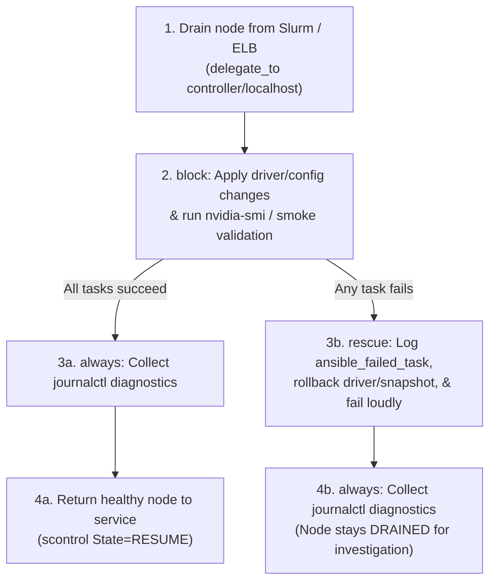

# 4.8 Ansible handlers, conditionals, loops, blocks and error handling

| | |
|---|---|
| Level | Intermediate |
| Priority tier | 0 |
| Lab venue | ansible-core; 2 to 3 Linux targets (containers with systemd or VMs) |
| Part | Part 4: Automation and infrastructure as code |
| Status | Drafted, labs **untested** |

## Why this matters for AI infrastructure

Picture a fleet change that goes wrong halfway. A config file changes on a GPU node, a later step fails, and the node is left half-configured. Real fleet changes are not straight lines. A service should restart only if its file actually changed. A GPU task should run only on nodes that have a GPU. A node should be drained before you change it, and if the driver install fails, the node must be left in a known state with a clear message.

Ansible's control-flow features turn a list of tasks into a reliable procedure. These features are handlers, `when`, loops, `block`/`rescue`/`always`, failure keywords and retries. Subtle bugs also hide in them. Handlers that never fire, conditions that evaluate strings instead of booleans, rescue blocks that hide errors and loops that quietly skip are all easy to write and hard to spot.

## Prerequisites and outcomes

This chapter builds on 4.6 and 4.7. By the end, you will be able to:

- Use handlers correctly, including `notify`, `listen`, flushing, ordering and behaviour on failure, and avoid restart storms.
- Write robust conditionals with facts, registered results and type-safe tests.
- Use loops (`loop`, `until`, `loop_control`), including nested data, with correct `register` handling.
- Structure error handling with `block`/`rescue`/`always`, `failed_when`, `changed_when`, `ignore_errors`, `any_errors_fatal`, `max_fail_percentage`, `meta: end_host`, and `assert`/`fail`.
- Choose between `import_*` (static) and `include_*` (dynamic) for tasks and roles.
- Implement drain, change, validate and return-to-service flows, and safe rolling updates.

## 1. Handlers

Suppose you update the DCGM exporter configuration on a GPU node. The service has to restart before it can read the new file. Restarting it on every run, though, is unnecessary. A handler solves this. A handler is a task that runs only when another task reports `changed`. It also runs once per play, at the end of the current section, even when many tasks notify it.

```yaml
- hosts: gpu
  become: true
  tasks:
    - name: Configure DCGM exporter options
      ansible.builtin.template:
        src: dcgm-exporter.env.j2
        dest: /etc/default/dcgm-exporter
        mode: "0644"
      notify:
        - Restart dcgm-exporter
        - Record config change

    - name: Install exporter unit file
      ansible.builtin.copy:
        src: dcgm-exporter.service
        dest: /etc/systemd/system/dcgm-exporter.service
        mode: "0644"
      notify: Reload systemd and restart dcgm-exporter

    - name: Make sure it is running (idempotent, independent of handlers)
      ansible.builtin.systemd_service:
        name: dcgm-exporter
        state: started
        enabled: true

  handlers:
    - name: Restart dcgm-exporter
      ansible.builtin.systemd_service:
        name: dcgm-exporter
        state: restarted
      listen: "Reload systemd and restart dcgm-exporter"       # topics: several handlers can listen to one name
    - name: Record config change
      ansible.builtin.lineinfile:
        path: /var/log/config-changes.log
        line: "{{ ansible_date_time.iso8601 }} dcgm-exporter configuration changed"
        create: true
```

The third task does not depend on the handlers. It makes sure the service runs whatever happens to them.

Handler names must be unique within a play. A `notify` can point to a handler name or to a `listen` topic string. A topic lets one notification trigger several handlers, so roles and playbooks can hook into each other without depending on each other's names.

Handlers run at the end of each of the `pre_tasks`, `roles/tasks` and `post_tasks` sections. To force one earlier, use `- ansible.builtin.meta: flush_handlers`. You might do this to restart a service before a task that depends on its new config. Handlers run in the order they are defined in the handlers section, not in the order they were notified.

A task notifies only when it reports `changed`. Skipped tasks and `ok` tasks notify nothing. Here is the trap. A first run changes the file, but a later task fails before the handler runs. On the next run, the file is already correct, so nothing changes and the handler does not run. The service stays on the old config. You have three ways out. Set `force_handlers: true` on the play to run notified handlers even after failures. Add an idempotent state task that compares the running config with the desired one, next to the handler. Or run `meta: flush_handlers` right after the config task.

Handler execution is tracked per host.

Handlers can also notify other handlers, since 2.x, and they may use `when`. *Ansible: Up and Running*, Chapter 11, covers both patterns in `Examples 11-27` to `11-30`. The first is handler chaining. In an `ssl` role, `Copy SSL certs` notifies `check nginx configuration`, which notifies `restart nginx`, which notifies `after config check`. The second is `listen:` topic fan-out. With `listen: Ssl_certs_changed`, one topic triggers `check nginx configuration`, `restart nginx` and `after config check` in handler definition order. No task has to name those handlers directly, so roles stay loosely coupled.

Avoid restart storms. Reload rather than restart when you can. Use `serial` so restarts do not happen everywhere at once. Use `throttle` for services with expensive restarts. Make sure the notifying task is idempotent, because a template with a changing timestamp notifies on every run.

Handlers in roles live in `roles/x/handlers/main.yml`. The play and the other roles can see them.

The flowchart below shows the drain, change and return sequence that section 6 builds in code.



For each handler, check that the task notifying it reports `changed` only when something real has changed.

## 2. Conditionals: when

Not every host should run every task. A driver install belongs on GPU hosts, not on every machine in the inventory. The `when:` keyword makes that decision for each host. It takes a Jinja2 expression, written without the `{{ }}` wrapper, and evaluates it per host. If the expression is false, the task is skipped.

```yaml
- name: Install NVIDIA driver on GPU hosts
  ansible.builtin.package:
    name: "nvidia-driver-{{ nvidia_driver_branch }}"
  when:
    - "'gpu' in group_names"                                  # list items are ANDed
    - ansible_facts['os_family'] == 'Debian'
    - gpu_count | default(0) | int > 0

- name: Run only on old kernels
  ansible.builtin.debug: msg="upgrade me"
  when: ansible_facts['kernel'] is version('5.15', '<')

- name: React to a previous task
  ansible.builtin.command: /usr/local/bin/post-install.sh
  when: driver_install is changed and driver_install is not failed

- name: OR conditions
  ansible.builtin.debug: msg="x"
  when: (a == 1) or (b == 2)
```

The first task needs all three of its conditions to hold. The last one uses `or`, so its two parts sit in parentheses.

Items in a `when:` list are ANDed, so you need every item to be true. When you need an `or`, write it as one expression with parentheses.

Strings cause the most trouble. `when: some_flag` is truthy for a boolean true, but it is also truthy for a non-empty string such as `"false"`. That happens with `-e flag=false` on the command line, because the value arrives as a string. Use `when: some_flag | bool` for values that might be strings, such as `"yes"` or `"False"`. Compare numbers with `| int`, as in `when: (count | int) > 4`.

Tests on registered results read close to plain English. The list includes `is succeeded`, `is failed`, `is changed`, `is skipped`, `is defined`, `result.rc == 0`, `'text' in result.stdout`, `result.stdout is search('regex')` and `result.stdout_lines | length > 0`.

A skipped task still leaves its registered variable behind. That variable has `skipped: true` and no `stdout`. Guard it with `when: res is defined and res.stdout is defined`.

Conditions are checked before the task runs. With `loop`, they are checked for each item, and `item` is available inside the check.

The `when` keyword behaves differently on imports and includes. On `import_tasks`, the condition is copied to every imported task, which makes it static. On `include_tasks`, the condition controls whether the include happens at all, which makes it dynamic. On a `block`, the condition applies to every task inside it.

Common predicates include `ansible_check_mode`, `ansible_run_tags`, and `inventory_hostname == groups['x'][0]`, which means the first host in a group.

For emptiness checks, avoid `when: result.stdout` when the key may be missing. Use `| length > 0` instead.

When you write a condition, check the real type of its value, because a string and a boolean behave differently.

## 3. Loops

Installing packages one call at a time repeats work that a single call could do. You can avoid that waste by passing a list, and loops handle the cases where each item needs its own call.

```yaml
- name: Install packages one transaction (preferred where the module accepts a list)
  ansible.builtin.package: { name: [chrony, tmux, htop], state: present }

- name: Loop where each item needs a separate call
  ansible.builtin.template:
    src: "{{ item }}.conf.j2"
    dest: "/etc/{{ item }}.conf"
    mode: "0644"
  loop: [chrony, rsyslog, logrotate]

- name: Loop over a list of dicts with a short label
  ansible.builtin.user:
    name: "{{ item.name }}"
    groups: "{{ item.groups }}"
  loop: "{{ team_users }}"
  loop_control:
    label: "{{ item.name }}"
    index_var: i
    pause: 1                      # seconds between items

- name: Poll until healthy (retry loop)
  ansible.builtin.uri:
    url: "http://{{ inventory_hostname }}:9400/metrics"
    status_code: 200
  register: probe
  until: probe.status == 200
  retries: 12
  delay: 10
```

The first task passes the whole package list in one transaction, which is the preferred form where the module accepts a list. The second repeats a template for each item. The third loops over a list of dicts and labels each item with a short name. The last task retries until the metrics endpoint returns 200.

The `loop:` keyword replaces most of the older `with_*` forms. Filters such as `dict2items`, `subelements`, `product`, `zip` and `flatten` reshape data for a loop. Older code still uses `with_fileglob` (`keys/*.pub`), `with_lines` (`cat files/turing.txt`), `with_first_found` (`~/.ssh/id_ed25519.pub`, `id_rsa.pub`), `with_dict` (`ansible_enp0s8.ipv4`), `with_nested` and `with_subelements`. *Ansible: Up and Running*, Chapter 10, Table 10-4, lists them.

You can also write your own Jinja2 filter plugins. Put them in `filter_plugins/` next to your playbook, and put custom lookup plugins in `lookup_plugins/`. *Ansible: Up and Running*, Chapter 10, gives an example. Its file `filter_plugins/surround_by_quotes.py` defines `class FilterModule:` with a `surround_by_quotes(a_list)` method. With that filter, `ALLOWED_HOSTS = [{{ domains | surround_by_quotes | join(", ") }}]` renders `["www.example.com", "example.com"]`. The code is tested in `code/part04/ansible_control_flow_lab.py`.

A task that uses both `loop` and `register` stores its output in `register.results`, a list of per-item results. Each entry is the return value for one item, and it includes `item`. You can aggregate that list with `results | map(attribute='rc')`, or pick out the failures with `results | selectattr('failed')`.

`until` reruns the task until its condition holds or the retries run out. `delay` sets the seconds between attempts. When you combine `until` with `loop`, each item gets its own retry sequence. Retry only a read or a probe, or another idempotent operation. Never retry a non-idempotent write.

Loops over thousands of items are slow, because each item means one module call per host. Where you can, push the iteration into the module by passing a list, into a template, or into a single script or module.

Nested loops need their own variable names. Set `loop_control: loop_var: outer_item` on the outer loop to avoid name clashes. A common case is `loop_var: vhost` when `vhost-tasks.yml` is included inside a loop over virtual hosts, and that file loops over `logs`, `public_http`, `public_https` and `includes`. *Ansible: Up and Running*, Chapter 10, shows this in `Example 10-23`. When an included task file also loops, rename the outer `item`.

Loops across hosts that depend on each other are a different case. When each node of a quorum must upgrade one at a time, use `serial: 1` at the play level rather than a loop.

Before you write a loop over many items, check whether the module can take the whole list in one call.

## 4. Error handling

### Default behaviour

Suppose a task fails on one host while the rest of the play is still running. By default, that host leaves the rest of the play, and the other hosts carry on. The exception is when `any_errors_fatal` or `max_fail_percentage` stops the play. The play recap reports `failed`, and the exit code is non-zero (2). `unreachable` hosts behave similarly, but the recap counts them separately, with exit 3.

### Overriding judgement

Sometimes Ansible's verdict is wrong. `grep` returns 1 when nothing matches, and in that case that is not an error. The examples below replace a blanket decision with a narrow rule.

```yaml
- name: Grep returns 1 when no match: not an error
  ansible.builtin.command: grep -q 'Xid' /var/log/kern.log
  register: xid
  failed_when: xid.rc not in [0, 1]
  changed_when: false

- name: Command whose stderr indicates a problem despite rc=0
  ansible.builtin.command: some-tool --check
  register: out
  failed_when: "'ERROR' in out.stdout or out.rc != 0"

- name: Best-effort cleanup
  ansible.builtin.file: { path: /tmp/stale, state: absent }
  ignore_errors: true                        # continue after failure but record it (visible as 'ignored' in recap)
  # ignore_unreachable: true                 # for unreachable hosts
```

The first example accepts exit codes 0 and 1, and it never reports a change. The second fails when the output contains `ERROR`, even if the exit code is 0. The last example, with `ignore_errors`, continues after a failure but still records it, so it shows as 'ignored' in the recap. `ignore_errors` is a blunt tool, so prefer a precise `failed_when` that names the acceptable cases.

### Blocks: rescue and always

A driver upgrade can fail after the new package is already in place. The node then needs a rollback, a clear message and diagnostics. A `block` with `rescue` and `always` covers all three.

A **block** groups tasks so they can share keywords such as `when`, `become`, `tags`, `vars` and `environment`. It also gives you structured error handling, much like try, except and finally.

```yaml
- name: Upgrade driver with automatic rollback
  block:
    - name: Install new driver
      ansible.builtin.apt:
        name: "nvidia-driver-{{ new_branch }}"
        state: present
      register: install

    - name: Reload kernel module
      ansible.builtin.command: /usr/local/bin/reload-nvidia.sh

    - name: Verify GPUs
      ansible.builtin.command: nvidia-smi -L
      register: smi
      failed_when: (smi.stdout_lines | length) != expected_gpus
      changed_when: false

  rescue:                                           # runs if any task in block fails
    - name: Record what failed
      ansible.builtin.debug:
        msg: "Failed task: {{ ansible_failed_task.name }}; result: {{ ansible_failed_result | default({}) }}"
    - name: Roll back to the previous driver
      ansible.builtin.apt:
        name: "nvidia-driver-{{ old_branch }}"
        state: present
        allow_downgrade: true
    - name: Keep node out of service and fail the host loudly
      ansible.builtin.fail:
        msg: "Driver upgrade failed on {{ inventory_hostname }}; rolled back; node left drained"

  always:                                           # runs regardless
    - name: Collect diagnostics
      ansible.builtin.shell: "journalctl -k --since '-10min' | tail -n 200"
      register: kernel_tail
      changed_when: false
      failed_when: false
```

The `rescue` section runs only if a task in the block fails. Here it logs the failed task, rolls back to the previous driver and fails the host with a clear message. The `always` section runs in every case, and it collects kernel log diagnostics.

If `rescue` finishes without failing, Ansible marks the host **recovered**. It treats the block as handled and carries on, and the recap shows `rescued`. To keep the failure visible, re-raise it with `fail`, as the example does.

Inside `rescue`, `ansible_failed_task` and `ansible_failed_result` tell you what broke. Handlers inside a block still run at the end of their section. `always` runs even after `rescue`. Blocks can nest, and variables registered inside a block remain available afterwards.

A `rescue` that swallows errors is a common cause of runs that look green but leave the system broken. For fleet changes, log the failure, send an alert and usually stop the run.

### Stopping the play and fleet-level policies

A single flaky host should not halt a whole fleet. One dangerous global step, though, should stop everything at once. The keywords and tasks below set those policies.

```yaml
- hosts: gpu
  any_errors_fatal: true            # any failure aborts all hosts immediately (use for dangerous global steps)
  max_fail_percentage: 5            # tolerate small failure rates per batch
  serial: 10
  tasks:
    - ansible.builtin.meta: end_host           # stop processing this host without failure
      when: skip_this_host | default(false)
    - ansible.builtin.meta: end_play           # end the play for everyone (not a failure)
      when: dry_run_only | default(false)
    - ansible.builtin.assert:
        that:
          - expected_gpus is defined
          - expected_gpus | int > 0
        fail_msg: "Set expected_gpus for {{ inventory_hostname }}"
        success_msg: "Inputs OK"
    - ansible.builtin.fail:
        msg: "Refusing to run in production without change ticket"
      when: env == 'prod' and change_ticket is not defined
```

`assert` checks preconditions at the start, so a run fails early and clearly. `fail` is for an explicit stop. `meta: end_host`, `meta: end_play` and `meta: end_batch` exit cleanly, and `meta: clear_host_errors` resets failed hosts, which is rare.

For fleet changes, the order of defence is this. Validate the inputs with `assert`. Canary the change with `serial`. Check health after the change. Limit failures with `max_fail_percentage` or `any_errors_fatal`. Roll back in `rescue`, and then alert.

The toolkit from 4.6 adds `force_handlers`, `ignore_unreachable`, a `timeout` on tasks, and `async` for long steps.

### Retries and eventual consistency

Services take time to come up after a start or a reboot, so the playbook has to wait for them. Use `wait_for`, `uri` with `until`, `ansible.builtin.wait_for_connection` after reboots, and `ansible.builtin.reboot` with `reboot_timeout`. Never replace verification with `pause: seconds=60`. Poll the condition you care about instead, such as a port that is open, GPUs that are visible, a node that is `idle` in Slurm, or a Kubernetes node that is `Ready`. Let the playbook wait for the condition itself, not for a guessed number of seconds.

## 5. Imports versus includes

Ansible can pull tasks or roles into a play in two ways. An import is read at parse time, while an include is read when execution reaches it. The table shows what that difference changes.

| | `import_tasks` / `import_role` / `import_playbook` | `include_tasks` / `include_role` |
|---|---|---|
| Processing | **Static**, at parse time | **Dynamic**, at runtime when reached |
| `--list-tasks`, `--tags`, `--start-at-task` | Fully visible and usable | Included tasks not listed; tags apply to the include itself unless `apply:` |
| Loops on the statement | Not supported | Supported (include once per item) |
| Variables in the filename | Limited (known at parse time) | Fully dynamic (`"{{ ansible_facts['os_family'] }}.yml"`) |
| `when` | Applied to every imported task | Applied to the include; included tasks inherit it |
| Handlers | Visible at parse time | Handlers inside included files are visible only after inclusion |

Prefer an import for fixed structure, because tags, `--list-tasks` and lint then behave cleanly. Choose an include when the choice depends on runtime data, such as OS-specific task files, loops over items or conditional roles. When you need tags to flow into an include, use `apply: { tags: [x] }`. Roles are the main reuse unit, which you will meet again in 4.11.

Choose an import by default, and switch to an include only when runtime data forces your hand.

## 6. Patterns for operational flows

### Drain → change → validate → return

Taking a GPU node out of service is a sequence. You drain it, wait for its jobs to finish, change it, check it, and only then return it to service. The play below does that in batches that start at one node.

```yaml
- name: Safe GPU node maintenance
  hosts: gpu
  serial: [1, "10%", "25%"]
  max_fail_percentage: 5
  any_errors_fatal: false
  tasks:
    - name: Drain from Slurm
      ansible.builtin.command: >
        scontrol update NodeName={{ inventory_hostname }} State=DRAIN Reason="ansible maintenance {{ lookup('env','USER') }}"
      delegate_to: "{{ groups['slurm_controller'][0] }}"
      changed_when: true
    - name: Wait until no jobs remain
      ansible.builtin.command: "squeue -h -w {{ inventory_hostname }} -o %i"
      delegate_to: "{{ groups['slurm_controller'][0] }}"
      register: jobs
      until: jobs.stdout == ""
      retries: 120
      delay: 30
      changed_when: false

    - block:
        - ansible.builtin.include_role: { name: gpu_node, tasks_from: apply_changes }
        - name: Validate
          ansible.builtin.include_role: { name: gpu_node, tasks_from: validate }
      rescue:
        - ansible.builtin.fail:
            msg: "Maintenance failed on {{ inventory_hostname }}; node left DRAINED for investigation"
      # no 'always: resume' on purpose: only a healthy node returns to service

    - name: Return to service
      ansible.builtin.command: "scontrol update NodeName={{ inventory_hostname }} State=RESUME"
      delegate_to: "{{ groups['slurm_controller'][0] }}"
      changed_when: true
```

The failure path leaves the node drained, which is the safe default. Success explicitly resumes the node. The canary batch has size 1, and the waiting step polls the actual state instead of pausing for a fixed time.

The same shape fits Kubernetes, with `kubectl drain` and uncordon, and load-balancer rotation, with `delegate_to: localhost` calling an API.

### Idempotent restart-if-needed

Handlers can miss a restart after an earlier failure. This task checks the running service instead of trusting a notification.

```yaml
- name: Detect whether the running service uses the new config
  ansible.builtin.command: systemctl show -p ActiveEnterTimestampMonotonic dcgm-exporter
  register: started
  changed_when: false
# compare with config mtime (stat) to decide on restart: avoids missed restarts after earlier failures
```

When handler semantics are not enough, because a partial failure leaves services stale, replace handler-only logic with state checks. You can also run `meta: flush_handlers` immediately after the config change.

### Waiting for the world

A reboot can look finished before the GPUs are ready.

```yaml
- name: Reboot and wait for GPUs
  ansible.builtin.reboot:
    reboot_timeout: 1800
    post_reboot_delay: 30
    test_command: nvidia-smi -L
```

What matters here is `test_command`. It checks the GPUs rather than trusting that the reboot finished.

After any reboot, test the thing you need, such as the GPUs, before you return the node to service.

## 7. Debugging control flow

Control-flow bugs rarely announce themselves. A handler silently does not run, or a task silently skips. Start from the symptom in the table, then check the likely cause.

| Symptom | Likely cause | Fix |
|---|---|---|
| Handler never ran | Task did not report changed; earlier failure aborted before handler; handler name typo (silently ignored in older versions; newer versions error) | `-v` to see `changed`; `force_handlers`; `flush_handlers` |
| Handler ran every time | Task not idempotent (timestamps, `command` without `changed_when`) | Fix the source of changes |
| Task skipped unexpectedly | `when` evaluated false (string vs bool), loop item missing, wrong group | `-vv` shows `false_condition`; `debug` the variables |
| Condition error `The conditional check failed` | Undefined variable, wrong type | `default()`, `is defined`, casts |
| `rescue` ran but play is green | Rescue handled the failure | Re-raise with `fail`; check `rescued` count in recap |
| Loop result weird | `register` in loop gives `results` list | Use `results \| map(...)` |
| Retries did not stop | `until` condition never true; stale variable | Print `register` each attempt (`-v`), fix condition |
| Included tasks not tagged | Dynamic include ignoring tags | Use `import_tasks` or `apply:` |

When a task is skipped unexpectedly, run it with `-vv`, because that output shows `false_condition`. The `debug` strategy goes further. Set `strategy: debug`, or `ANSIBLE_STRATEGY=debug`, and Ansible drops into an interactive debugger when a task fails. From there you can run `p task_vars`, `p result._result`, `task.args`, `redo`, `continue` and `quit`. You can also use `ansible-playbook -vv`, `--step` and `--start-at-task`. See 4.10 for more.

Start with `-vv` on the failing run, because it shows which condition turned a task off.

## 8. Lab

Start on your own machine. Run the self-checking Python lab, `code/part04/ansible_control_flow_lab.py`, before you touch any hosts. It checks *Ansible: Up and Running* Chapter 10's custom `FilterModule` (`surround_by_quotes`). It also checks Chapter 11's handler `listen:` topic fan-out, and the "lost handler after failure" case, comparing it with `force_handlers: true` (`simulate_handler_listen_and_failure_loss`). Last, it runs the `block`/`rescue`/`always` GPU node maintenance flow (`simulate_block_rescue_always_maintenance`).

```bash
python3 code/part04/ansible_control_flow_lab.py
```

Next, move to a control node with 2–3 Linux targets. All interactive shell steps below are `untested here`. Work through these exercises:

1. Test handlers. Notify a restart from two tasks, and verify that only one restart happens. Use `listen` topics. Then reproduce the "handler lost after failure" case by failing a later task. Fix it once with `force_handlers` and once with `meta: flush_handlers`.
2. Break a restart storm. Make a template non-idempotent by adding a timestamp, and watch the service restart on every run. Then fix it.
3. Test conditionals. Gate tasks by group membership, OS family, facts and registered results. Reproduce the string-boolean bug using `-e flag=false`, and fix it with `| bool`.
4. Test loops. Create users from a list of dicts with `loop_control.label`. Register the loop results and summarise the failures. Implement `until` polling on a flaky service. Then compare the run time of a loop with the run time of a list-argument `package` task.
5. Check failure semantics. Write tasks whose `rc` of 1 is acceptable, as `grep` produces, and handle them with `failed_when`. Compare `ignore_errors` with `failed_when`. Then check the recap and the exit codes.
6. Test `block`, `rescue` and `always`. Implement the driver upgrade with rollback against a fake installer script that fails on one host. Make the `rescue` re-raise the failure, and then verify the `always` diagnostics.
7. Test fleet policies. Use `serial`, `max_fail_percentage` and `any_errors_fatal` on six hosts with injected failures. Document when the play aborts in each case.
8. Compare imports and includes. Restructure your tasks into separate files. Compare `--list-tasks`, `--tags` and loops between `import_tasks` and `include_tasks`. Then use `apply: tags`.
9. Run the drain flow. Simulate Slurm with scripts, or use a real Slurm lab. Run the drain, change, validate and resume play with an injected validation failure, and confirm that the node stays drained.
10. Use the debugger. Trigger a failure under `strategy: debug`, inspect `task_vars`, fix a variable, and then `redo` the task.
11. Clean up when you are done.

## 9. Common mistakes

You might expect handlers to run when the notifying task did not change, or after a failed play. That is a common mistake. So is writing `when: "{{ var }}"`, which puts templating inside a conditional and invites string-boolean confusion. Leaving out `changed_when` on commands that notify handlers is another, because the command then always reports `changed`.

Using `ignore_errors: true` as a default is a mistake, and so is a rescue block that swallows failures. Loops of single-item package installs, and heavy loops over many hosts and items, waste time. Using `pause` instead of polling a real condition is also a mistake.

Mixing `include_*` with expectations about tags or `--list-tasks` causes surprises. Returning drained nodes to service in an `always:` section, whatever the validation result, is dangerous. Assuming `serial` guards against every failure, without `max_fail_percentage` and validation steps, is a mistake. Forgetting that registered variables from skipped tasks lack fields is also a mistake. Using `any_errors_fatal` everywhere lets a single flaky host halt the fleet, and using it nowhere lets a bad change spread.

Check each of these before you ship a playbook that touches a fleet.

## 10. Interview angles

Use these questions to test yourself. Answer each one in your own words before you check the section that covers it.

- "How do handlers work? When do they not run? How would you guarantee a restart after a partial failure?"
- "Explain `block`, `rescue`, `always` and how a rescued failure is reported."
- "`failed_when`/`changed_when` vs `ignore_errors`."
- "Static vs dynamic includes: differences and consequences for tags and `--list-tasks`."
- "How do you perform a rolling update with a canary and automatic stop on failure?"
- "How do you wait for a node to rejoin the cluster after reboot?"
- "What causes a handler to run on every run?"
- "How do you debug a playbook that skips a task?"

## Exercises

Work through these exercises in order. Each one names the function or playbook you will use.

1. Start with handlers, `listen:` topics and the lost-handler-after-failure trap, which *Ansible: Up and Running* covers in Chapter 11. Using `simulate_handler_listen_and_failure_loss()` in `code/part04/ansible_control_flow.py`, explain two things. First, explain how `listen: "Reload systemd and restart dcgm-exporter"` or `listen: Ssl_certs_changed` lets several handlers subscribe to one topic, and in what order they run. Second, explain why a failure in Task 3, after Task 1 modified a config file, stops the handler from running on both Run 1 and Run 2. Then explain how `force_handlers: true`, `meta: flush_handlers` or idempotent state checks solve it.
2. Move on to conditionals. Explain why the list items in `when:` are ANDed. Explain why `-e flag=false` on the command line evaluates to `True` under `when: flag` unless you pipe it through `| bool`. Also explain how `version('5.15', '<')` compares kernel versions. Then show how to guard a `when:` check on a registered variable whose task might have been skipped, using `res is not skipped`.
3. Next, cover loops, nested `loop_var` and custom filter plugins, which *Ansible: Up and Running* covers in Chapter 10. Using `FilterModule.surround_by_quotes()` in `code/part04/ansible_control_flow.py`, explain three things. First, how a custom filter plugin in `filter_plugins/surround_by_quotes.py` works. Second, how `register` behaves inside a loop, which gives you a `results` list. Third, why nested `include_tasks` loops must set `loop_control: { loop_var: vhost }`, so that the inner `item` does not overwrite the outer one.
4. Work through error handling with `failed_when`, `changed_when` and `ignore_errors`, and the `block`/`rescue`/`always` rollbacks in *Ansible: Up and Running*, Chapter 10. Using `simulate_block_rescue_always_maintenance()` in `code/part04/ansible_control_flow.py`, trace the execution. Follow the `block`. Then follow the `rescue`, which logs `ansible_failed_task.name` and `ansible_failed_result`, rolls back the driver or VM snapshot, and re-raises the failure with `fail`. Then follow the `always`, which collects `journalctl -k` diagnostics. Finally, explain why `scontrol State=RESUME` must **not** be placed inside `always:` for GPU node maintenance.
5. Next, you compare static and dynamic imports. The pairs are `import_tasks` with `include_tasks`, and `import_role` with `include_role`, which *Ansible: Up and Running* covers in Chapters 10 and 11. Compare parse-time preprocessing with runtime execution across `--list-tasks`, `--tags` (with `apply: { tags: [...] }`), `--start-at-task`, `loop:` support and dynamic filenames such as `"{{ ansible_facts['os_family'] }}.yml"`.
6. Finish with delegation patterns and rolling GPU node maintenance, which *Ansible: Up and Running* covers in Chapter 11. Trace the Section 6 maintenance playbook. Follow `serial: [1, "10%", "25%"]`, `max_fail_percentage: 5`, the `scontrol State=DRAIN` and `squeue` polling through `delegate_to: "{{ groups['slurm_controller'][0] }}"`, the `block` and `rescue`, the `reboot` with `test_command: nvidia-smi -L`, and `scontrol State=RESUME`. Then show how Chapter 11 uses `delegate_to: localhost` with `run_once: true` to download a binary through a proxy once, before it is distributed to air-gapped servers.

## Checkpoint questions (20)

<details>
<summary>1. Why does a handler get "lost" if a subsequent task fails during Run 1, and why doesn't simply re-running the playbook in Run 2 trigger the handler?</summary>

Suppose Task 1 (`template: dest=/etc/default/dcgm-exporter`) changes the file on `gpu01` and notifies `Restart dcgm-exporter`. Then Task 2 fails on `gpu01`.
- **On Run 1:** `gpu01` fails in Task 2, before the end-of-section handler flush. Ansible drops `gpu01` and skips its pending handlers, so `dcgm-exporter` keeps running with the old configuration in memory.
- **On Run 2, after you fix Task 2:** Task 1 compares the template with `/etc/default/dcgm-exporter`. The file on disk already matches from Run 1, so Task 1 reports `ok` with `changed=false`. The handler is not notified on Run 2 either.

Fix this with `force_handlers: true` on the play, with `meta: flush_handlers` right after the critical config tasks, or with an idempotent task that checks the service uptime against the config file `mtime`.
</details>

<details>
<summary>2. How does the `listen:` keyword on handlers decouple notifications across roles and tasks (*Ansible: Up and Running*, Chapter 11)?</summary>

Instead of a task naming three separate handlers in `notify:`, the handlers can subscribe to a shared topic. Each one sets `listen: "Reload systemd and restart dcgm-exporter"`, or `listen: Ssl_certs_changed` as in *Ansible: Up and Running*, Chapter 11. Handlers can even come from different roles. When a task notifies that topic string, every handler listening to it runs, in the order the handlers are defined in the play.
</details>

<details>
<summary>3. Why does passing `-e some_flag=false` on the command line cause `when: some_flag` to evaluate to `True`?</summary>

Extra variables passed as `key=value` on the command line, such as `-e some_flag=false`, arrive as strings, not YAML booleans. The JSON form, `-e '{"some_flag": false}'`, keeps a real boolean. In Python and Jinja2, any non-empty string counts as true, and that includes `"false"`, `"no"` and `"0"`. So `when: some_flag` treats the string as true. Whenever a variable might arrive as a string, from `-e`, an environment lookup or an INI inventory, write `when: some_flag | bool`.
</details>

<details>
<summary>4. How are multiple items in a `when:` list combined, and how do you safely check a registered variable from a task that might have been skipped?</summary>

- **List items in `when:`** are combined with logical **`AND`**:
  ```yaml
  when:
    - "'gpu' in group_names"
    - ansible_facts['os_family'] == 'Debian'
  ```
- **Skipped registered variable:** A skipped task still gets its `register:` variable, but that variable is `{"changed": false, "skipped": true}`, with no `stdout`, `stderr` or `rc` keys. Reading `res.stdout` directly raises an `UndefinedError`. Guard it with `when: res is not skipped and 'text' in res.stdout`, or with `res.stdout is defined`.
</details>

<details>
<summary>5. How does `register` work when combined with `loop:`, and how do you inspect per-item failures?</summary>

When a task uses both `loop:` and `register: loop_reg`, Ansible stores a dictionary with a `results` list, at `loop_reg.results`. Each element is the return dictionary for one iteration, and it includes `"item": <loop_item>`. To pull out the exit codes, use `{{ loop_reg.results | map(attribute='rc') | list }}`. To see only the failed items, use `{{ loop_reg.results | selectattr('failed', 'defined') | selectattr('failed') | list }}`.
</details>

<details>
<summary>6. Why do nested `include_tasks` loops overwrite `{{ item }}`, and how does `loop_control: { loop_var: ... }` fix it (*Ansible: Up and Running*, Chapter 10)?</summary>

By default, each `loop:` puts its current element in a variable called `item`. Suppose a playbook loops over `[vhost1, vhost2]` and calls `include_tasks: vhost-tasks.yml`. If that file also loops, over `[logs, public_http, public_https]`, the inner loop overwrites `item` and hides the outer virtual host dictionary. Setting `loop_control: { loop_var: vhost }` on the outer `include_tasks` loop renames the outer variable to `vhost`. Then `{{ vhost.domain }}` and the inner `{{ item }}` never collide.
</details>

<details>
<summary>7. How do you write a custom Jinja2 Filter Plugin (`filter_plugins/surround_by_quotes.py`) in Ansible (*Ansible: Up and Running*, Chapter 10)?</summary>

Create a Python file inside a `filter_plugins/` directory next to your playbook, or inside a role or collection. In that file, define a class named `FilterModule` with a `filters(self)` method. The method returns a dictionary that maps filter names to functions. *Ansible: Up and Running*, Chapter 10, `Example 10-11`, shows the pattern:
```python
class FilterModule:
    @staticmethod
    def surround_by_quotes(a_list):
        return ['"%s"' % x for x in a_list]

    def filters(self):
        return {'surround_by_quotes': self.surround_by_quotes}
```
Playbooks and templates can then pipe any list into `{{ domains | surround_by_quotes | join(', ') }}`.
</details>

<details>
<summary>8. In *Ansible: Up and Running*, Chapter 10, how does `changed_when` make modules like `django_manage` or `command` report accurate change status?</summary>

Some commands and framework wrappers exit with `rc=0` whether they created new state or did nothing. Take `django_manage` with `command="createdb --noinput"`, or `scontrol`. By inspecting the registered output (`register: result`), you can tell a first run from a second one. Set `changed_when: "'Creating tables' in result.out"`, and the task reports `changed` only when tables were actually created. On later idempotent runs, it reports `ok`.
</details>

<details>
<summary>9. How do `block`, `rescue`, and `always` work, and what special variables are available inside `rescue:`?</summary>

- **`block:`** groups tasks that share keywords, such as `when`, `become` and `tags`. It works like a `try` clause.
- **`rescue:`** runs only if a task inside `block:` fails. Two special variables are available inside it: `ansible_failed_task`, the task object that failed (`{{ ansible_failed_task.name }}`), and `ansible_failed_result`, the full return dictionary of that task (`rc`, `stdout`, `stderr`, `msg`).
- **`always:`** runs after `block:` every time, and after `rescue:` if `rescue:` ran. It works like `finally:`.
</details>

<details>
<summary>10. Why does a play report `failed=0` (`rescued=1`) when a `rescue:` block finishes normally, and how do you keep the host marked as failed after rolling back?</summary>

When every task in `rescue:` succeeds, Ansible counts the error as recovered. The recap shows `rescued=1, failed=0`, the exit code is 0, and the play carries on along that host. In a fleet upgrade, where `rescue:` rolled back a broken driver, carrying on or returning a green exit code is dangerous. Instead, end the `rescue:` block with an explicit **`ansible.builtin.fail`** task, such as `msg: "Driver upgrade failed on {{ inventory_hostname }}; rolled back; node left drained"`. The rollback still runs, `always:` still collects logs, and the host stays marked as failed.
</details>

<details>
<summary>11. Why did *Ansible: Up and Running*, Chapter 10's web-app example put "Re-add server to load balancer" in `always:`, whereas our GPU node maintenance playbook puts `scontrol State=RESUME` AFTER the `block`/`rescue`?</summary>

- In *Ansible: Up and Running*, Chapter 10 (`Example 10-29`), the `rescue:` block reverted the VM to a known-good pre-upgrade snapshot, `cs_vmsnapshot: state=revert`. The web server was therefore healthy again before `always:` re-added it to the load balancer.
- A bare-metal GPU node cannot be reverted with a hypervisor snapshot. If a failed driver or firmware update, or a failed `nvidia-smi` validation, put the node back into Slurm with `State=RESUME` in `always:`, it would become a "black hole" node. It would crash every multi-node training job scheduled onto it. So on GPU nodes, `rescue:` leaves the node `DRAIN`ed and fails, and `State=RESUME` runs only after the `block` succeeds.
</details>

<details>
<summary>12. Compare `meta: end_host`, `meta: end_play`, `meta: end_batch`, and `meta: clear_host_errors`.</summary>

- **`meta: end_host`** cleanly stops the play for this one host, when a `when:` triggers it. The host is not marked as failed or skipped in the recap.
- **`meta: end_batch`** ends the current `serial` batch early and moves on to the next batch.
- **`meta: end_play`** ends the play for all hosts at once, with exit code `0`.
- **`meta: clear_host_errors`** clears the failed state of hosts, so later plays can target them.
</details>

<details>
<summary>13. Contrast Static `import_tasks` / `import_role` with Dynamic `include_tasks` / `include_role`.</summary>

The two kinds differ in when they are processed, and that changes how tags, loops and conditions behave.

| Feature | `import_tasks` / `import_role` (Static) | `include_tasks` / `include_role` (Dynamic) |
|---|---|---|
| **When processed** | Pre-processed once at **playbook parse time** | Processed dynamically at **runtime** as execution reaches it |
| **`--list-tasks` & `--start-at-task`** | Imported tasks are visible in `--list-tasks` and targetable | Hidden until runtime |
| **`when:` behaviour** | Copied onto **every** individual task inside the imported file | Evaluated once on the `include_*` statement itself to decide whether to load the file |
| **`tags:` behaviour** | Copied onto **every** task inside the imported file | Tags on `include_*` only select the include step itself (use `apply: { tags: [...] }` to push tags to inner tasks) |
| **Loops (`loop:`) & fact-based filenames** | **Cannot** use `loop:` or fact variables in the filename | **Supports `loop:`** and runtime filenames (`"{{ ansible_facts['os_family'] }}.yml"`) |
</details>

<details>
<summary>14. How do you pass tags down to every task inside a dynamic `include_tasks` or `include_role` call?</summary>

Put the **`apply:`** keyword inside the `include_tasks` or `include_role` arguments. Tag the include statement itself as well, or tag it `always`:
```yaml
- name: Dynamically include GPU validation tasks
  ansible.builtin.include_tasks:
    file: validate_gpu.yml
    apply:
      tags: [validate]
  tags: [validate]
```
</details>

<details>
<summary>15. How do you wait for a Slurm node to finish running jobs before starting disruptive maintenance in Ansible?</summary>

First set the node to `DRAIN`, with `scontrol update NodeName={{ inventory_hostname }} State=DRAIN Reason="..."` delegated to `groups['slurm_controller'][0]`. This stops new jobs from starting on the node, while active jobs keep running until they finish. Then poll `squeue` with **`until:`**:
```yaml
- name: Wait until all Slurm jobs drain from node
  ansible.builtin.command: "squeue -h -w {{ inventory_hostname }} -o %i"
  delegate_to: "{{ groups['slurm_controller'][0] }}"
  register: active_jobs
  until: active_jobs.stdout == ""
  retries: 120
  delay: 30
  changed_when: false
```
</details>

<details>
<summary>16. How does `ansible.builtin.reboot` verify that a GPU node is truly ready after a kernel or driver reboot?</summary>

By default, `reboot` reconnects over SSH and runs `whoami`. That succeeds as soon as `sshd` starts, which can happen before the NVIDIA kernel modules or the PCIe bus have finished initializing. Add `test_command: nvidia-smi -L`, along with `reboot_timeout: 1800` and `post_reboot_delay: 30` for long server BIOS POST times. Then `reboot` keeps polling until `nvidia-smi -L` exits `0` on the rebooted host.
</details>

<details>
<summary>17. In *Ansible: Up and Running*, Chapter 11, how do `delegate_to: localhost` and `run_once: true` solve downloading artifacts onto servers that have no internet access?</summary>

Suppose the target servers sit in an isolated data-center VLAN with no internet access. The control node or a bastion can reach external mirrors through an HTTP proxy. A task with `delegate_to: localhost` and `run_once: true`, plus `become: false` and `environment: { https_proxy: ... }`, downloads the binary once onto the control node, with `get_url: url=... dest=/tmp/goss`. The very next task uses `copy: src=/tmp/goss dest=/usr/local/bin/goss mode='0755'` to send it over SSH to all target hosts.
</details>

<details>
<summary>18. Why should you never replace `wait_for` or `until` polling with a fixed `pause: { seconds: 60 }`?</summary>

A fixed `pause: { seconds: 60 }` is both too slow and too fragile. If a service restarts in 2 seconds, the playbook wastes 58 seconds doing nothing. If a heavy node or a cold cache takes 65 seconds to start, the playbook moves on at 60 seconds and fails. Poll the real readiness condition instead. Use `wait_for` to check for an open TCP port, a file, or a regex in a log, or use `uri` or `command` with `until:`, `retries:` and `delay:`.
</details>

<details>
<summary>19. How does the interactive `debug` strategy (`strategy: debug` or `ANSIBLE_STRATEGY=debug`) work when a task fails?</summary>

When a play sets `strategy: debug`, or `ANSIBLE_STRATEGY=debug` is set, Ansible pauses as soon as a task fails. It opens an interactive `(debug)` prompt on the control node. The same applies when `debugger: on_failed` is set on a play, block or task. From the prompt, you can inspect the failure and the variables, for example with `p result._result`, `p task.args` or `p task_vars['nvidia_driver_branch']`. You can also change arguments or variables in memory, such as `task.args['name'] = 'chrony'`. Then type **`redo`** to run the task again on the spot, or **`continue`** or **`quit`**.
</details>

<details>
<summary>20. Summarize the six layers of defense in a production-grade fleet rollout playbook.</summary>

1. **Pre-flight `assert` gates (`pre_tasks`):** Check the required variables, the supported OS and hardware, and the change ticket before you touch any host.
2. **Progressive batching (`serial: [1, "10%", "25%"]`):** Test a 1-node canary first, before you expand the batch size.
3. **Scheduler or load-balancer drain (`scontrol State=DRAIN` with a `squeue` poll):** Evacuate workloads gracefully before you change the node.
4. **Structured `block` / `rescue` / `always`:** Roll back on failure, collect `journalctl` diagnostics in `always`, and leave failed nodes `DRAIN`ed.
5. **Active post-change validation (`nvidia-smi`, DCGM, NCCL):** Prove that the hardware and services are healthy before you run `State=RESUME`.
6. **Fleet circuit breaker (`max_fail_percentage: 5`):** Stop the line automatically if batch failures exceed the threshold.
</details>

## Sources and review notes

- **Sources read in full:**
  - `ansible-up-and-running-3rd-edition` — Bas Meijer, Lorin Hochstein & René Moser, *Ansible: Up and Running*, 3rd ed., **Chapter 10: Making Playbooks Appear More Complex** (read in full: `changed_when` and `failed_when` on `django_manage`, custom filter plugins `FilterModule.surround_by_quotes` in `filter_plugins/surround_by_quotes.py`, filepath filters `basename`/`dirname`/`expanduser`/`realpath`, lookups `file`/`pipe`/`env`/`password`/`csvfile`/`dig`/`redis`, looping constructs `loop`/`with_items`/`with_lines`/`with_fileglob`/`with_dict`/`with_subelements`, `include_tasks` with `loop_control: { loop_var: vhost }`, `block`/`rescue`/`always` in `app-upgrade.yml` with `cs_loadbalancer_rule_member` and `cs_vmsnapshot`, and `ansible-vault` `encrypt`/`decrypt`/`view`/`edit`/`rekey` and `vault_identity_list`) and **Chapter 11: Execution Strategies and Flow Control** (read in full: `linear` vs `free` vs `debug` strategies, host patterns, `delegate_to` with Nagios/ELB and `run_once: true` proxy downloads, `import_tasks`/`include_tasks` and `import_playbook`, and handler chaining and `listen: Ssl_certs_changed` topic fan-out).
- **Run here:** `python3 code/part04/ansible_control_flow_lab.py` (3 passed, 0 failed).
- **Explicitly labelled inferences:** The `simulate_handler_listen_and_failure_loss` and `simulate_block_rescue_always_maintenance` models in `code/part04/ansible_control_flow.py` and the Section 4 & 6 GPU driver rollback (`systemd_service`) and Slurm drain/validate/resume (`scontrol update`, `squeue -w`) playbooks are the author's constructions applying *Ansible: Up and Running* Chapters 10 & 11 to GPU cluster operations (plus original study items 21, 22, 23, 24, 25, 26, 27, 28, 29, 30, 31, 32, 33, 34, and 35).
- **Not verified on live hardware:** Live `ansible-playbook`, `scontrol`, `squeue`, `systemctl`, and `reboot` commands (`5.15`, `9400`, `1800`s, `120` retries, `10.0.2.2`, `10.0.2.15`, `192.168.33.10`, `6379`) are marked (`untested here`) where not executed by `ansible_control_flow_lab.py`.
