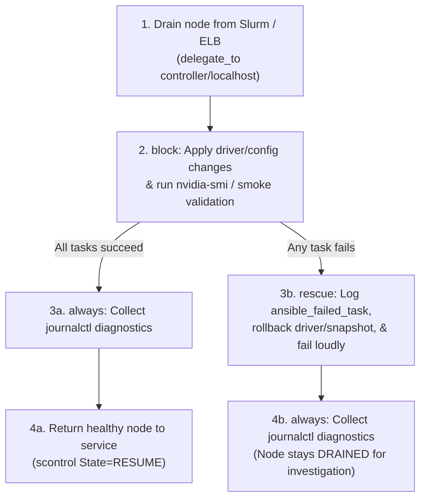

# 4.8 Ansible handlers, conditionals, loops, blocks and error handling

| | |
|---|---|
| Level | Intermediate |
| Priority tier | 0 |
| Lab venue | ansible-core; 2 to 3 Linux targets (containers with systemd or VMs) |
| Part | Part 4: Automation and infrastructure as code |
| Status | Drafted, labs **untested** |

## Why this matters for AI infrastructure

Real fleet changes are not straight lines. A configuration change must restart a service only if the file actually changed; only on nodes that have a GPU; only after the node is drained; and if the driver install fails the node must be left in a known state with a clear message, not half-configured. Ansible's control-flow features (handlers, `when`, loops, `block`/`rescue`/`always`, failure keywords, retries) are what turn a list of tasks into a reliable procedure. They are also where subtle bugs live: handlers that never fire, conditions that evaluate strings instead of booleans, rescue blocks that hide errors, loops that quietly skip.

## Prerequisites and outcomes

Needs 4.6 and 4.7. After this chapter you can:

- Use handlers correctly (`notify`, `listen`, flushing, ordering, behaviour on failure) and avoid restart storms.
- Write robust conditionals with facts, registered results and type-safe tests.
- Use loops (`loop`, `until`, `loop_control`), including nested data, with correct `register` handling.
- Structure error handling with `block`/`rescue`/`always`, `failed_when`, `changed_when`, `ignore_errors`, `any_errors_fatal`, `max_fail_percentage`, `meta: end_host`, and `assert`/`fail`.
- Choose between `import_*` (static) and `include_*` (dynamic) for tasks and roles.
- Implement drain → change → validate → return-to-service flows and safe rolling updates.

## 1. Handlers

A **handler** is a task that runs only when notified by another task that reported `changed`, and runs **once** per play, at the end of the current section, even if notified many times. They exist to restart or reload services only when configuration changed.

```yaml
- hosts: gpu
  become: true
  tasks:
    - name: Configure DCGM exporter options
      ansible.builtin.template:
        src: dcgm-exporter.env.j2
        dest: /etc/default/dcgm-exporter
        mode: "0644"
      notify:
        - Restart dcgm-exporter
        - Record config change

    - name: Install exporter unit file
      ansible.builtin.copy:
        src: dcgm-exporter.service
        dest: /etc/systemd/system/dcgm-exporter.service
        mode: "0644"
      notify: Reload systemd and restart dcgm-exporter

    - name: Make sure it is running (idempotent, independent of handlers)
      ansible.builtin.systemd_service:
        name: dcgm-exporter
        state: started
        enabled: true

  handlers:
    - name: Restart dcgm-exporter
      ansible.builtin.systemd_service:
        name: dcgm-exporter
        state: restarted
      listen: "Reload systemd and restart dcgm-exporter"       # topics: several handlers can listen to one name
    - name: Record config change
      ansible.builtin.lineinfile:
        path: /var/log/config-changes.log
        line: "{{ ansible_date_time.iso8601 }} dcgm-exporter configuration changed"
        create: true
```

Semantics to know:

- **Names and `listen`**: `notify` can reference a handler name or a `listen` topic string; handler names must be unique per play; the `listen` mechanism lets one notification trigger several handlers (and lets roles and playbooks hook each other without name coupling).
- **When do they run?** At the end of each of: `pre_tasks`, `roles/tasks`, `post_tasks` sections. Force earlier execution with `- ansible.builtin.meta: flush_handlers` (for example restart a service before a task that depends on the new config).
- **Handlers run in the order defined in the handlers section**, not the order notified.
- **Changed, not "ran"**: a task notifies only if it reports `changed`; skipped or ok tasks do not. If the first run changed the file but a later task failed before the handler ran, **the handler will not run on the next execution** (the file is already correct, so nothing is changed): the service stays on an old config. Mitigations: `force_handlers: true` on the play (run notified handlers even after failures), or design the restart as an idempotent state task (compare running config with desired) in addition to the handler, or `meta: flush_handlers` right after the config task.
- **Per host**: handler execution is tracked per host.
- **Handlers can notify other handlers** (since 2.x) and may use `when`. In *Ansible: Up and Running* Chapter 11 (`Examples 11-27` to `11-30`), the authors demonstrate both **handler chaining** (where `Copy SSL certs` in an `ssl` role notifies `check nginx configuration`, which in turn notifies `restart nginx`, which notifies `after config check`) and **`listen:` topic fan-out** (`listen: Ssl_certs_changed`, allowing one notification topic to trigger `check nginx configuration`, `restart nginx`, and `after config check` in handler definition order without tight name coupling across roles).
- **Avoid restart storms**: reload rather than restart when possible; use `serial` so restarts do not happen everywhere at once; `throttle` for services with expensive restarts; ensure the notifying task is idempotent (a template with a changing timestamp notifies every run).
- Handlers in roles live in `roles/x/handlers/main.yml`; they are visible to the play and to other roles.



## 2. Conditionals: when

`when:` is a Jinja2 **expression** (no `{{ }}` wrapper) evaluated per host; the task is skipped if it is false.

```yaml
- name: Install NVIDIA driver on GPU hosts
  ansible.builtin.package:
    name: "nvidia-driver-{{ nvidia_driver_branch }}"
  when:
    - "'gpu' in group_names"                                  # list items are ANDed
    - ansible_facts['os_family'] == 'Debian'
    - gpu_count | default(0) | int > 0

- name: Run only on old kernels
  ansible.builtin.debug: msg="upgrade me"
  when: ansible_facts['kernel'] is version('5.15', '<')

- name: React to a previous task
  ansible.builtin.command: /usr/local/bin/post-install.sh
  when: driver_install is changed and driver_install is not failed

- name: OR conditions
  ansible.builtin.debug: msg="x"
  when: (a == 1) or (b == 2)
```

Rules and gotchas:

- Multiple list items are ANDed. Use parentheses with `or`.
- **Booleans vs strings**: `when: some_flag` is truthy for a boolean true or a non-empty string such as `"false"`. Use `when: some_flag | bool` for values that might be strings (`"yes"`, `"False"`, `-e flag=false` from the command line comes as a string). Compare numbers with `| int`: `when: (count | int) > 4`.
- **Tests on registered results**: `is succeeded`, `is failed`, `is changed`, `is skipped`, `is defined`, `result.rc == 0`, `'text' in result.stdout`, `result.stdout is search('regex')`, `result.stdout_lines | length > 0`.
- **A skipped task's registered variable** exists with `skipped: true` and no `stdout`; guard with `when: res is defined and res.stdout is defined`.
- **Conditions evaluate before the task, but per item in loops**: `when` with `loop` is evaluated for each item; `item` is available.
- **Conditionals on imports vs includes**: `when` on `import_tasks` applies the condition to each imported task (static), while on `include_tasks` it controls whether the include happens (dynamic). On `block`, the condition applies to every task in the block.
- `ansible_check_mode`, `ansible_run_tags`, and `inventory_hostname == groups['x'][0]` ("first host in group") are common predicates.
- Avoid `when: result.stdout` for emptiness checks on missing keys; use `| length > 0`.

## 3. Loops

```yaml
- name: Install packages one transaction (preferred where the module accepts a list)
  ansible.builtin.package: { name: [chrony, tmux, htop], state: present }

- name: Loop where each item needs a separate call
  ansible.builtin.template:
    src: "{{ item }}.conf.j2"
    dest: "/etc/{{ item }}.conf"
    mode: "0644"
  loop: [chrony, rsyslog, logrotate]

- name: Loop over a list of dicts with a short label
  ansible.builtin.user:
    name: "{{ item.name }}"
    groups: "{{ item.groups }}"
  loop: "{{ team_users }}"
  loop_control:
    label: "{{ item.name }}"
    index_var: i
    pause: 1                      # seconds between items

- name: Poll until healthy (retry loop)
  ansible.builtin.uri:
    url: "http://{{ inventory_hostname }}:9400/metrics"
    status_code: 200
  register: probe
  until: probe.status == 200
  retries: 12
  delay: 10
```

- `loop:` replaces most `with_*` forms; transform data with filters (`dict2items`, `subelements`, `product`, `zip`, `flatten`); `with_fileglob` (`keys/*.pub`), `with_lines` (`cat files/turing.txt`), `with_first_found` (`~/.ssh/id_ed25519.pub`, `id_rsa.pub`), `with_dict` (`ansible_enp0s8.ipv4`), `with_nested`, and `with_subelements` still appear in older code (`AUR` Chapter 10 Table 10-4). You can also write custom Jinja2 filter plugins in `filter_plugins/` next to your playbook—such as `AUR` Chapter 10's `filter_plugins/surround_by_quotes.py` (`class FilterModule:` defining `surround_by_quotes(a_list)` so `ALLOWED_HOSTS = [{{ domains | surround_by_quotes | join(", ") }}]` renders `["www.example.com", "example.com"]`, tested in `code/part04/ansible_control_flow_lab.py`)—and custom lookup plugins in `lookup_plugins/`.
- A task with `loop` and `register` stores `register.results`, a list of per-item results (each including `item`). Aggregate with `results | map(attribute='rc')`, `results | selectattr('failed')`.
- `until` re-runs the task until the condition holds or retries are exhausted; `delay` seconds between attempts; combined with `loop` each item has its own retry sequence. Retry a **read/probe** or an idempotent operation, never a non-idempotent write.
- Loops over thousands of items are slow (one module invocation per item per host); push iteration into the module (lists), into a template, or into a single script/module where possible.
- `loop_control: loop_var: outer_item` (or `loop_var: vhost` when `vhost-tasks.yml` is included inside a loop over virtual hosts and itself loops over `logs`, `public_http`, `public_https`, `includes`, `AUR` Chapter 10 `Example 10-23`) avoids name clashes in nested includes (when an included task file also loops, rename `item`).
- **Loop across hosts with serial dependencies** (e.g., upgrade one node of a quorum at a time) uses `serial: 1` at the play level rather than a loop.

## 4. Error handling

### Default behaviour

A failed task on a host removes that host from the remainder of the play; other hosts continue (unless `any_errors_fatal` / `max_fail_percentage` stops the play). The play recap reports `failed` and the exit code is non-zero (2). `unreachable` hosts are similar but counted separately (exit 3).

### Overriding judgement

```yaml
- name: Grep returns 1 when no match: not an error
  ansible.builtin.command: grep -q 'Xid' /var/log/kern.log
  register: xid
  failed_when: xid.rc not in [0, 1]
  changed_when: false

- name: Command whose stderr indicates a problem despite rc=0
  ansible.builtin.command: some-tool --check
  register: out
  failed_when: "'ERROR' in out.stdout or out.rc != 0"

- name: Best-effort cleanup
  ansible.builtin.file: { path: /tmp/stale, state: absent }
  ignore_errors: true                        # continue after failure but record it (visible as 'ignored' in recap)
  # ignore_unreachable: true                 # for unreachable hosts
```

`ignore_errors` is a blunt tool: prefer a precise `failed_when` that names the acceptable cases.

### Blocks: rescue and always

A **block** groups tasks to share keywords (`when`, `become`, `tags`, `vars`, `environment`) and provides structured error handling like try/except/finally.

```yaml
- name: Upgrade driver with automatic rollback
  block:
    - name: Install new driver
      ansible.builtin.apt:
        name: "nvidia-driver-{{ new_branch }}"
        state: present
      register: install

    - name: Reload kernel module
      ansible.builtin.command: /usr/local/bin/reload-nvidia.sh

    - name: Verify GPUs
      ansible.builtin.command: nvidia-smi -L
      register: smi
      failed_when: (smi.stdout_lines | length) != expected_gpus
      changed_when: false

  rescue:                                           # runs if any task in block fails
    - name: Record what failed
      ansible.builtin.debug:
        msg: "Failed task: {{ ansible_failed_task.name }}; result: {{ ansible_failed_result | default({}) }}"
    - name: Roll back to the previous driver
      ansible.builtin.apt:
        name: "nvidia-driver-{{ old_branch }}"
        state: present
        allow_downgrade: true
    - name: Keep node out of service and fail the host loudly
      ansible.builtin.fail:
        msg: "Driver upgrade failed on {{ inventory_hostname }}; rolled back; node left drained"

  always:                                           # runs regardless
    - name: Collect diagnostics
      ansible.builtin.shell: "journalctl -k --since '-10min' | tail -n 200"
      register: kernel_tail
      changed_when: false
      failed_when: false
```

Notes: if `rescue` completes without failing, the host is **recovered**: Ansible treats the block as handled and continues (recap shows `rescued`); to keep the failure visible re-raise with `fail` as above. `ansible_failed_task` and `ansible_failed_result` are available in `rescue`. Handlers inside a block still run at section ends; `always` runs even after `rescue`. Blocks nest. Variables registered inside survive afterwards. A `rescue` that silently swallows errors is a common source of "green but broken" runs: log, alert and (for fleet changes) usually stop.

### Stopping the play and fleet-level policies

```yaml
- hosts: gpu
  any_errors_fatal: true            # any failure aborts all hosts immediately (use for dangerous global steps)
  max_fail_percentage: 5            # tolerate small failure rates per batch
  serial: 10
  tasks:
    - ansible.builtin.meta: end_host           # stop processing this host without failure
      when: skip_this_host | default(false)
    - ansible.builtin.meta: end_play           # end the play for everyone (not a failure)
      when: dry_run_only | default(false)
    - ansible.builtin.assert:
        that:
          - expected_gpus is defined
          - expected_gpus | int > 0
        fail_msg: "Set expected_gpus for {{ inventory_hostname }}"
        success_msg: "Inputs OK"
    - ansible.builtin.fail:
        msg: "Refusing to run in production without change ticket"
      when: env == 'prod' and change_ticket is not defined
```

- `assert` for preconditions at the start (fail early and clearly), `fail` for explicit stops, `meta: end_host`/`end_play`/`end_batch` to exit cleanly, `meta: clear_host_errors` to reset failed hosts (rare).
- **Order of defence for fleet changes**: validate inputs (assert) → canary via `serial` → health validation after change → `max_fail_percentage`/`any_errors_fatal` → rescue with rollback → alert.
- `force_handlers`, `ignore_unreachable`, `timeout` on tasks, and `async` for long steps complete the toolkit (4.6).

### Retries and eventual consistency

Services take time: use `wait_for`, `uri` with `until`, `ansible.builtin.wait_for_connection` after reboots, `ansible.builtin.reboot` with `reboot_timeout`. Never replace verification with `pause: seconds=60`; poll the condition you care about (port open, GPUs visible, node `idle` in Slurm, Kubernetes node `Ready`).

## 5. Imports versus includes

| | `import_tasks` / `import_role` / `import_playbook` | `include_tasks` / `include_role` |
|---|---|---|
| Processing | **Static**, at parse time | **Dynamic**, at runtime when reached |
| `--list-tasks`, `--tags`, `--start-at-task` | Fully visible and usable | Included tasks not listed; tags apply to the include itself unless `apply:` |
| Loops on the statement | Not supported | Supported (include once per item) |
| Variables in the filename | Limited (known at parse time) | Fully dynamic (`"{{ ansible_facts['os_family'] }}.yml"`) |
| `when` | Applied to every imported task | Applied to the include; included tasks inherit it |
| Handlers | Visible at parse time | Handlers inside included files are visible only after inclusion |

Guidance: prefer **import** for fixed structure (clean tags/list-tasks/lint), **include** when the choice depends on runtime data (OS-specific task files, loops over items, conditional roles). Use `apply: { tags: [x] }` when you need tags to flow into includes. Roles are the main reuse unit (4.11).

## 6. Patterns for operational flows

### Drain → change → validate → return

```yaml
- name: Safe GPU node maintenance
  hosts: gpu
  serial: [1, "10%", "25%"]
  max_fail_percentage: 5
  any_errors_fatal: false
  tasks:
    - name: Drain from Slurm
      ansible.builtin.command: >
        scontrol update NodeName={{ inventory_hostname }} State=DRAIN Reason="ansible maintenance {{ lookup('env','USER') }}"
      delegate_to: "{{ groups['slurm_controller'][0] }}"
      changed_when: true
    - name: Wait until no jobs remain
      ansible.builtin.command: "squeue -h -w {{ inventory_hostname }} -o %i"
      delegate_to: "{{ groups['slurm_controller'][0] }}"
      register: jobs
      until: jobs.stdout == ""
      retries: 120
      delay: 30
      changed_when: false

    - block:
        - ansible.builtin.include_role: { name: gpu_node, tasks_from: apply_changes }
        - name: Validate
          ansible.builtin.include_role: { name: gpu_node, tasks_from: validate }
      rescue:
        - ansible.builtin.fail:
            msg: "Maintenance failed on {{ inventory_hostname }}; node left DRAINED for investigation"
      # no 'always: resume' on purpose: only a healthy node returns to service

    - name: Return to service
      ansible.builtin.command: "scontrol update NodeName={{ inventory_hostname }} State=RESUME"
      delegate_to: "{{ groups['slurm_controller'][0] }}"
      changed_when: true
```

Principles encoded here: the failure path leaves the node drained (safe default), success explicitly resumes, the canary batch is size 1, and waiting polls actual state. The same shape fits Kubernetes (`kubectl drain`, uncordon) and load-balancer rotation (`delegate_to: localhost` calling an API).

### Idempotent restart-if-needed

```yaml
- name: Detect whether the running service uses the new config
  ansible.builtin.command: systemctl show -p ActiveEnterTimestampMonotonic dcgm-exporter
  register: started
  changed_when: false
# compare with config mtime (stat) to decide on restart: avoids missed restarts after earlier failures
```

When handler semantics are insufficient (partial failure leaves services stale), replace handler-only logic with state checks or run `meta: flush_handlers` immediately after the config change.

### Waiting for the world

```yaml
- name: Reboot and wait for GPUs
  ansible.builtin.reboot:
    reboot_timeout: 1800
    post_reboot_delay: 30
    test_command: nvidia-smi -L
```

## 7. Debugging control flow

| Symptom | Likely cause | Fix |
|---|---|---|
| Handler never ran | Task did not report changed; earlier failure aborted before handler; handler name typo (silently ignored in older versions; newer versions error) | `-v` to see `changed`; `force_handlers`; `flush_handlers` |
| Handler ran every time | Task not idempotent (timestamps, `command` without `changed_when`) | Fix the source of changes |
| Task skipped unexpectedly | `when` evaluated false (string vs bool), loop item missing, wrong group | `-vv` shows `false_condition`; `debug` the variables |
| Condition error `The conditional check failed` | Undefined variable, wrong type | `default()`, `is defined`, casts |
| `rescue` ran but play is green | Rescue handled the failure | Re-raise with `fail`; check `rescued` count in recap |
| Loop result weird | `register` in loop gives `results` list | Use `results \| map(...)` |
| Retries did not stop | `until` condition never true; stale variable | Print `register` each attempt (`-v`), fix condition |
| Included tasks not tagged | Dynamic include ignoring tags | Use `import_tasks` or `apply:` |

Use `ansible-playbook -vv`, `--step`, `--start-at-task`, and the `debug` strategy (`strategy: debug`, or `ANSIBLE_STRATEGY=debug`) which drops into an interactive debugger on failure (`p task_vars`, `p result._result`, `task.args`, `redo`, `continue`, `quit`); see 4.10.

## 8. Lab

First, run the self-checking Python lab (`code/part04/ansible_control_flow_lab.py`) locally. It verifies *Ansible: Up and Running* Chapter 10's custom `FilterModule` (`surround_by_quotes`), Chapter 11's handler `listen:` topic fan-out and the "lost handler after failure" scenario versus `force_handlers: true` (`simulate_handler_listen_and_failure_loss`), and the `block`/`rescue`/`always` GPU node maintenance flow (`simulate_block_rescue_always_maintenance`).

```bash
python3 code/part04/ansible_control_flow_lab.py
```

Next, on a control node with 2–3 Linux targets (all interactive shell steps below are `untested here`), work through these exercises:

1. **Handlers**: notify a restart from two tasks and verify one restart; use `listen` topics; reproduce the "handler lost after failure" scenario (fail a later task), then fix with `force_handlers` and with `meta: flush_handlers`.
2. **Restart storm**: make a template non-idempotent (timestamp) and observe constant restarts; fix.
3. **Conditionals**: gate tasks by group membership, OS family, facts and registered results; reproduce the string-boolean bug using `-e flag=false`; fix with `| bool`.
4. **Loops**: create users from a list of dicts with `loop_control.label`; register loop results and summarise failures; implement `until` polling on a flaky service; compare loop vs list-argument `package` run time.
5. **Failure semantics**: write tasks whose `rc` is 1 acceptably (grep) with `failed_when`; compare `ignore_errors` and `failed_when`; check the recap and exit codes.
6. **Block/rescue/always**: implement the driver upgrade with rollback against a fake installer script that fails on one host; make the rescue re-raise; verify the `always` diagnostics.
7. **Fleet policies**: use `serial`, `max_fail_percentage`, `any_errors_fatal` on six hosts with injected failures; document when the play aborts in each case.
8. **Import vs include**: restructure tasks into files; compare `--list-tasks`, `--tags`, and loops with `import_tasks` vs `include_tasks`; use `apply: tags`.
9. **Drain flow**: simulate Slurm with scripts or use a real Slurm lab; run the drain → change → validate → resume play with an injected validation failure and confirm the node stays drained.
10. **Debugger**: trigger a failure under `strategy: debug`, inspect `task_vars`, fix a variable and `redo`.
11. **Clean up.**

## 9. Common mistakes

- Expecting handlers to run when the notifying task did not change, or after a failed play.
- Using `when: "{{ var }}"` (templating inside conditionals) and string-boolean confusion.
- `ignore_errors: true` as a default; rescue blocks that swallow failures.
- No `changed_when` on commands that notify handlers (or always `changed`).
- Loops of single-item package installs; heavy loops over many hosts and items.
- `pause` instead of polling a real condition.
- Mixing `include_*` and tags/`--list-tasks` expectations.
- Returning drained nodes to service in an `always:` section regardless of validation.
- Assuming `serial` guards against every failure without `max_fail_percentage` and validation steps.
- Forgetting that registered variables from skipped tasks lack fields.
- Using `any_errors_fatal` everywhere (a single flaky host halts the fleet) or nowhere (a bad change spreads).

## 10. Interview angles

- "How do handlers work? When do they not run? How would you guarantee a restart after a partial failure?"
- "Explain `block`, `rescue`, `always` and how a rescued failure is reported."
- "`failed_when`/`changed_when` vs `ignore_errors`."
- "Static vs dynamic includes: differences and consequences for tags and `--list-tasks`."
- "How do you perform a rolling update with a canary and automatic stop on failure?"
- "How do you wait for a node to rejoin the cluster after reboot?"
- "What causes a handler to run on every run?"
- "How do you debug a playbook that skips a task?"

## Exercises

1. **Handlers, `listen:` Topics, and the Lost-Handler-After-Failure Trap (`AUR` Chapter 11):** Using `simulate_handler_listen_and_failure_loss()` in `code/part04/ansible_control_flow.py`, explain: (a) how `listen: "Reload systemd and restart dcgm-exporter"` or `listen: Ssl_certs_changed` lets multiple handlers subscribe to a single topic and in what order they run; and (b) why a failure in Task 3 after Task 1 modified a config file prevents the handler from running on **both** Run 1 and Run 2, and how `force_handlers: true`, `meta: flush_handlers`, or idempotent state checks solve it.
2. **Conditionals (`when:`), Boolean-vs-String Traps (`-e flag=false`), and Skipped `register` Variables:** (a) Explain why `when:` list items are ANDed, why `-e flag=false` on the command line evaluates to `True` under `when: flag` unless piped through `| bool`, and how `version('5.15', '<')` compares kernel versions; (b) show how to guard a `when:` check on a registered variable whose task might have been skipped (`res is not skipped`).
3. **Loops (`loop`, `until`/`retries`/`delay`, `loop_control`), Nested `loop_var`, and Custom Filter Plugins (`FilterModule`, `AUR` Chapter 10):** Using `FilterModule.surround_by_quotes()` in `code/part04/ansible_control_flow.py`, explain: (a) how a custom filter plugin in `filter_plugins/surround_by_quotes.py` works; (b) how `register` behaves inside a loop (`results` list); and (c) why nested `include_tasks` loops must set `loop_control: { loop_var: vhost }` so the outer `item` is not overwritten by the inner `item`.
4. **Error Handling (`failed_when`, `changed_when`, `ignore_errors`) and `block` / `rescue` / `always` Rollbacks (`AUR` Chapter 10):** Using `simulate_block_rescue_always_maintenance()` in `code/part04/ansible_control_flow.py`, trace the execution of `block`, `rescue` (logging `ansible_failed_task.name` and `ansible_failed_result`, rolling back the driver or VM snapshot, and re-raising with `fail`), and `always` (collecting `journalctl -k` diagnostics), and explain why `scontrol State=RESUME` must **not** be placed inside `always:` for GPU node maintenance.
5. **Static `import_*` vs. Dynamic `include_*` (`import_tasks` vs. `include_tasks`, `import_role` vs. `include_role`, `AUR` Chapters 10 & 11):** Compare parse-time preprocessing (`import_*`) with runtime execution (`include_*`) across `--list-tasks`, `--tags` (`apply: { tags: [...] }`), `--start-at-task`, `loop:` support, and dynamic filenames (`"{{ ansible_facts['os_family'] }}.yml"`).
6. **Delegation Patterns (`delegate_to` + `run_once`) and End-to-End Rolling GPU Node Maintenance (`AUR` Chapter 11):** Trace the Section 6 maintenance playbook (`serial: [1, "10%", "25%"]`, `max_fail_percentage: 5`, `scontrol State=DRAIN` and `squeue` polling via `delegate_to: "{{ groups['slurm_controller'][0] }}"`, `block`/`rescue`, `reboot` with `test_command: nvidia-smi -L`, and `scontrol State=RESUME`), and show how `AUR` Chapter 11 uses `delegate_to: localhost` with `run_once: true` to download a binary via proxy once before distributing it to air-gapped servers.

## Checkpoint questions (20)

<details>
<summary>1. Why does a handler get "lost" if a subsequent task fails during Run 1, and why doesn't simply re-running the playbook in Run 2 trigger the handler?</summary>

Suppose Task 1 (`template: dest=/etc/default/dcgm-exporter`) changes the file on `gpu01` and notifies `Restart dcgm-exporter`, and then Task 2 fails on `gpu01`:
- **On Run 1:** Because `gpu01` failed in Task 2 before the end-of-section handler flush, Ansible drops `gpu01` and **skips its pending handlers** (`dcgm-exporter` keeps running with the old configuration in memory).
- **On Run 2 (after fixing Task 2):** Task 1 compares the template against `/etc/default/dcgm-exporter`, sees that the file on disk **already matches** (from Run 1), reports `ok` (`changed=false`), and therefore **does not notify the handler on Run 2 either**.
Fix this by setting **`force_handlers: true`** on the play, calling **`meta: flush_handlers`** immediately after critical config tasks, or adding an idempotent task that checks service uptime against config file `mtime`.
</details>

<details>
<summary>2. How does the `listen:` keyword on handlers decouple notifications across roles and tasks (`AUR` Chapter 11)?</summary>

Instead of a task hardcoding the exact names of three separate handlers in `notify:`, multiple handlers (even across different roles) can subscribe to a shared topic string via **`listen: "Reload systemd and restart dcgm-exporter"`** (or `listen: Ssl_certs_changed` in `AUR` Chapter 11). When a task notifies that topic string, **every handler listening to that topic** is scheduled and executed in the order the handlers are defined in the play.
</details>

<details>
<summary>3. Why does passing `-e some_flag=false` on the command line cause `when: some_flag` to evaluate to `True`?</summary>

Extra variables passed as `key=value` on the CLI (`-e some_flag=false`) are parsed as **strings** (`"false"`), not YAML booleans (unlike `-e '{"some_flag": false}'` JSON syntax). In Python and Jinja2, **any non-empty string—including `"false"`, `"no"`, and `"0"`—is truthy**. Always write **`when: some_flag | bool`** whenever a variable might arrive as a string from `-e`, environment lookups, or INI inventories.
</details>

<details>
<summary>4. How are multiple items in a `when:` list combined, and how do you safely check a registered variable from a task that might have been skipped?</summary>

- **List items in `when:`** are combined with logical **`AND`**:
  ```yaml
  when:
    - "'gpu' in group_names"
    - ansible_facts['os_family'] == 'Debian'
  ```
- **Skipped registered variable:** When a task is skipped because its `when:` was false, its `register:` variable still exists as `{"changed": false, "skipped": true}` **without `stdout`, `stderr`, or `rc` keys**. Referencing `res.stdout` directly raises an `UndefinedError`; always guard with **`when: res is not skipped and 'text' in res.stdout`** (or `res.stdout is defined`).
</details>

<details>
<summary>5. How does `register` work when combined with `loop:`, and how do you inspect per-item failures?</summary>

When a task uses both `loop:` and `register: loop_reg`, Ansible stores a dictionary containing a **`results` list** (`loop_reg.results`), where each element is the return dictionary for one loop iteration and includes `"item": <loop_item>`. You can extract exit codes with `{{ loop_reg.results | map(attribute='rc') | list }}` or filter failed items with `{{ loop_reg.results | selectattr('failed', 'defined') | selectattr('failed') | list }}`.
</details>

<details>
<summary>6. Why do nested `include_tasks` loops overwrite `{{ item }}`, and how does `loop_control: { loop_var: ... }` fix it (`AUR` Chapter 10)?</summary>

By default, every `loop:` binds its current element to the variable name **`item`**. If Playbook A loops over `[vhost1, vhost2]` and calls `include_tasks: vhost-tasks.yml`, and `vhost-tasks.yml` itself has a task that loops over `[logs, public_http, public_https]`, the inner loop **overwrites `item`**, hiding the outer virtual host dictionary. Setting **`loop_control: { loop_var: vhost }`** on the outer `include_tasks` loop renames the outer variable to `{{ vhost }}` so `{{ vhost.domain }}` and inner `{{ item }}` never collide.
</details>

<details>
<summary>7. How do you write a custom Jinja2 Filter Plugin (`filter_plugins/surround_by_quotes.py`) in Ansible (`AUR` Chapter 10)?</summary>

Create a Python file inside a **`filter_plugins/`** directory adjacent to your playbook (or inside a role/collection) that defines a class named **`FilterModule`** with a **`filters(self)`** method returning a `{filter_name: callable}` dictionary (`AUR` Chapter 10 `Example 10-11`):
```python
class FilterModule:
    @staticmethod
    def surround_by_quotes(a_list):
        return ['"%s"' % x for x in a_list]

    def filters(self):
        return {'surround_by_quotes': self.surround_by_quotes}
```
Playbooks and templates can then pipe any list into `{{ domains | surround_by_quotes | join(', ') }}`.
</details>

<details>
<summary>8. In `AUR` Chapter 10, how does `changed_when` make modules like `django_manage` or `command` report accurate change status?</summary>

Some commands or framework wrappers (such as `django_manage: command="createdb --noinput"` or `scontrol`) exit with `rc=0` whether they created new state or did nothing. By inspecting the registered output (`register: result`) on a first run versus a second run and setting **`changed_when: "'Creating tables' in result.out"`**, the task reports `changed` only when tables were actually created and `ok` on subsequent idempotent runs.
</details>

<details>
<summary>9. How do `block`, `rescue`, and `always` work, and what special variables are available inside `rescue:`?</summary>

- **`block:`**: groups tasks that share keywords (`when`, `become`, `tags`) and acts like a `try` clause.
- **`rescue:`**: executes **only if a task inside `block:` fails**. Inside `rescue:`, Ansible exposes two special magic variables:
  1. **`ansible_failed_task`**: the task object that failed (`{{ ansible_failed_task.name }}`).
  2. **`ansible_failed_result`**: the full return dictionary of that failed task (`rc`, `stdout`, `stderr`, `msg`).
- **`always:`**: executes unconditionally after `block:` (and after `rescue:` if `rescue:` ran), just like `finally:`.
</details>

<details>
<summary>10. Why does a play report `failed=0` (`rescued=1`) when a `rescue:` block finishes normally, and how do you keep the host marked as failed after rolling back?</summary>

If all tasks inside the `rescue:` section succeed, Ansible considers the error **successfully recovered** (`rescued=1, failed=0` in the `PLAY RECAP`, exit code `0`) and **continues executing the rest of the play on that host**. In a fleet upgrade where `rescue:` rolled back a broken driver, continuing the play or returning a green CI exit code is dangerous—end the `rescue:` block with an explicit **`ansible.builtin.fail`** task (`msg: "Driver upgrade failed on {{ inventory_hostname }}; rolled back; node left drained"`) so the rollback runs, `always:` collects logs, and the host is still marked failed.
</details>

<details>
<summary>11. Why did `AUR` Chapter 10's web-app example put "Re-add server to load balancer" in `always:`, whereas our GPU node maintenance playbook puts `scontrol State=RESUME` AFTER the `block`/`rescue`?</summary>

- In `AUR` Chapter 10 (`Example 10-29`), the `rescue:` block reverted the VM to a **known-good pre-upgrade VM snapshot (`cs_vmsnapshot: state=revert`)**, guaranteeing the web server was healthy again before `always:` re-added it to the load balancer.
- On a **bare-metal GPU node**, a failed driver/firmware update or failed `nvidia-smi` validation cannot be reverted by a hypervisor snapshot, and putting a broken GPU node back into Slurm (`State=RESUME` in `always:`) would turn it into a **"black hole" node** that immediately crashes every multi-node training job scheduled onto it. Therefore, on GPU nodes, `rescue:` leaves the node **`DRAIN`ed** and fails, and `State=RESUME` runs **only after the `block` succeeds**.
</details>

<details>
<summary>12. Compare `meta: end_host`, `meta: end_play`, `meta: end_batch`, and `meta: clear_host_errors`.</summary>

- **`meta: end_host`**: cleanly stops processing the current play for **this specific host** (when triggered by `when:`) without marking the host as failed or skipped in the recap.
- **`meta: end_batch`**: ends the current `serial` batch early and moves to the next batch.
- **`meta: end_play`**: cleanly terminates the current play for **all hosts** immediately with exit code `0`.
- **`meta: clear_host_errors`**: clears the failed state of hosts so subsequent plays can target them.
</details>

<details>
<summary>13. Contrast Static `import_tasks` / `import_role` with Dynamic `include_tasks` / `include_role`.</summary>

| Feature | `import_tasks` / `import_role` (Static) | `include_tasks` / `include_role` (Dynamic) |
|---|---|---|
| **When processed** | Pre-processed once at **playbook parse time** | Processed dynamically at **runtime** as execution reaches it |
| **`--list-tasks` & `--start-at-task`** | Imported tasks are visible in `--list-tasks` and targetable | Hidden until runtime |
| **`when:` behaviour** | Copied onto **every** individual task inside the imported file | Evaluated once on the `include_*` statement itself to decide whether to load the file |
| **`tags:` behaviour** | Copied onto **every** task inside the imported file | Tags on `include_*` only select the include step itself (use `apply: { tags: [...] }` to push tags to inner tasks) |
| **Loops (`loop:`) & fact-based filenames** | **Cannot** use `loop:` or fact variables in the filename | **Supports `loop:`** and runtime filenames (`"{{ ansible_facts['os_family'] }}.yml"`) |
</details>

<details>
<summary>14. How do you pass tags down to every task inside a dynamic `include_tasks` or `include_role` call?</summary>

Use the **`apply:`** keyword inside the `include_tasks` / `include_role` arguments while also tagging the include statement itself (or tagging `always` on the include):
```yaml
- name: Dynamically include GPU validation tasks
  ansible.builtin.include_tasks:
    file: validate_gpu.yml
    apply:
      tags: [validate]
  tags: [validate]
```
</details>

<details>
<summary>15. How do you wait for a Slurm node to finish running jobs before starting disruptive maintenance in Ansible?</summary>

First set the node state to `DRAIN` (`scontrol update NodeName={{ inventory_hostname }} State=DRAIN Reason="..."` delegated to `groups['slurm_controller'][0]`), which prevents new jobs from starting on the node while letting active jobs finish. Then poll `squeue` using **`until:`**:
```yaml
- name: Wait until all Slurm jobs drain from node
  ansible.builtin.command: "squeue -h -w {{ inventory_hostname }} -o %i"
  delegate_to: "{{ groups['slurm_controller'][0] }}"
  register: active_jobs
  until: active_jobs.stdout == ""
  retries: 120
  delay: 30
  changed_when: false
```
</details>

<details>
<summary>16. How does `ansible.builtin.reboot` verify that a GPU node is truly ready after a kernel or driver reboot?</summary>

By default, `reboot` reconnects over SSH and runs `whoami`—which succeeds as soon as `sshd` starts, sometimes before the NVIDIA kernel modules or PCIe bus have finished initializing. Setting **`test_command: nvidia-smi -L`** (alongside `reboot_timeout: 1800` and `post_reboot_delay: 30` for long server BIOS POST times) forces `reboot` to keep polling until `nvidia-smi -L` exits `0` on the rebooted host.
</details>

<details>
<summary>17. In `AUR` Chapter 11, how do `delegate_to: localhost` and `run_once: true` solve downloading artifacts onto servers that have no internet access?</summary>

When target servers sit in an isolated data-center VLAN without internet access while the control node (or bastion) can reach external mirrors via an HTTP proxy, a task with **`delegate_to: localhost`** and **`run_once: true`** (plus `become: false` and `environment: { https_proxy: ... }`) downloads the binary (`get_url: url=... dest=/tmp/goss`) **once onto the control node**, and the very next task uses `copy: src=/tmp/goss dest=/usr/local/bin/goss mode='0755'` to distribute it over SSH to all target hosts.
</details>

<details>
<summary>18. Why should you never replace `wait_for` or `until` polling with a fixed `pause: { seconds: 60 }`?</summary>

A fixed `pause: { seconds: 60 }` is **both too slow and too fragile**: when a service restarts in 2 seconds, the playbook wastes 58 seconds doing nothing; when a heavy node or cold cache takes 65 seconds to start, the playbook proceeds at 60 seconds and fails. Always poll the actual readiness condition with **`wait_for`** (TCP port open, file present, or regex in log) or **`uri` / `command` with `until:` + `retries:` + `delay:`**.
</details>

<details>
<summary>19. How does the interactive `debug` strategy (`strategy: debug` or `ANSIBLE_STRATEGY=debug`) work when a task fails?</summary>

When a play sets `strategy: debug` (or `debugger: on_failed` on a play/block/task), Ansible pauses immediately whenever a task fails and opens an interactive `(debug)` prompt on the control node. From that prompt, you can inspect the exact failure and variables (`p result._result`, `p task.args`, `p task_vars['nvidia_driver_branch']`), modify arguments or variables live in memory (`task.args['name'] = 'chrony'`), and type **`redo`** to re-run the task on the spot or **`continue`** / **`quit`**.
</details>

<details>
<summary>20. Summarize the six layers of defense in a production-grade fleet rollout playbook.</summary>

1. **Pre-flight `assert` gates (`pre_tasks`):** Verify required variables, supported OS/hardware, and change-ticket presence before touching any host.
2. **Progressive batching (`serial: [1, "10%", "25%"]`):** Test a 1-node canary first before expanding batch size.
3. **Scheduler / Load-Balancer drain (`scontrol State=DRAIN` + `squeue` poll):** Evacuate workloads gracefully before mutating the node.
4. **Structured `block` / `rescue` / `always`:** Roll back on failure, collect `journalctl` diagnostics in `always`, and leave failed nodes `DRAIN`ed.
5. **Active post-change validation (`nvidia-smi`, DCGM, NCCL):** Prove hardware and service health before running `State=RESUME`.
6. **Fleet circuit breaker (`max_fail_percentage: 5`):** Automatically stop the line if batch failures exceed the threshold.
</details>

## Sources and review notes

- **Sources read in full:**
  - `ansible-up-and-running-3rd-edition` — Bas Meijer, Lorin Hochstein & René Moser, *Ansible: Up and Running*, 3rd ed., **Chapter 10: Making Playbooks Appear More Complex** (read in full: `changed_when` and `failed_when` on `django_manage`, custom filter plugins `FilterModule.surround_by_quotes` in `filter_plugins/surround_by_quotes.py`, filepath filters `basename`/`dirname`/`expanduser`/`realpath`, lookups `file`/`pipe`/`env`/`password`/`csvfile`/`dig`/`redis`, looping constructs `loop`/`with_items`/`with_lines`/`with_fileglob`/`with_dict`/`with_subelements`, `include_tasks` with `loop_control: { loop_var: vhost }`, `block`/`rescue`/`always` in `app-upgrade.yml` with `cs_loadbalancer_rule_member` and `cs_vmsnapshot`, and `ansible-vault` `encrypt`/`decrypt`/`view`/`edit`/`rekey` and `vault_identity_list`) and **Chapter 11: Execution Strategies and Flow Control** (read in full: `linear` vs `free` vs `debug` strategies, host patterns, `delegate_to` with Nagios/ELB and `run_once: true` proxy downloads, `import_tasks`/`include_tasks` and `import_playbook`, and handler chaining and `listen: Ssl_certs_changed` topic fan-out).
- **Run here:** `python3 code/part04/ansible_control_flow_lab.py` (3 passed, 0 failed).
- **Explicitly labelled inferences:** The `simulate_handler_listen_and_failure_loss` and `simulate_block_rescue_always_maintenance` models in `code/part04/ansible_control_flow.py` and the Section 4 & 6 GPU driver rollback (`systemd_service`) and Slurm drain/validate/resume (`scontrol update`, `squeue -w`) playbooks are the author's constructions applying *Ansible: Up and Running* Chapters 10 & 11 to GPU cluster operations (plus original study items 21, 22, 23, 24, 25, 26, 27, 28, 29, 30, 31, 32, 33, 34, and 35).
- **Not verified on live hardware:** Live `ansible-playbook`, `scontrol`, `squeue`, `systemctl`, and `reboot` commands (`5.15`, `9400`, `1800`s, `120` retries, `10.0.2.2`, `10.0.2.15`, `192.168.33.10`, `6379`) are marked (`untested here`) where not executed by `ansible_control_flow_lab.py`.
