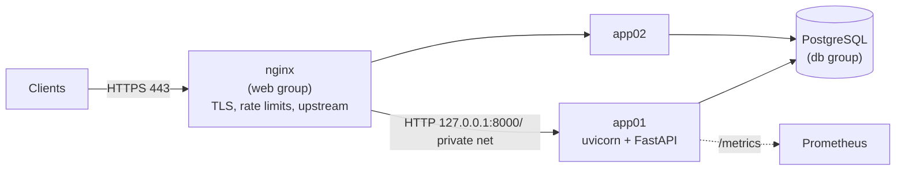

# 4.9 A real playbook end to end: deploying an application

| | |
|---|---|
| Level | Intermediate |
| Priority tier | 0 |
| Lab venue | ansible-core; 1 to 3 Ubuntu 22.04/24.04 VMs (Vagrant, Multipass or cloud) |
| Part | Part 4: Automation and infrastructure as code |
| Status | Drafted, labs **untested** |

## Why this matters for AI infrastructure

The previous chapters introduced pieces; real work is composing them into something that deploys a service repeatably. The pattern in this chapter (user and directories, virtual environment, application release, configuration from templates, systemd service, reverse proxy with TLS, database, firewall, health checks, rolling update) is the same whether the payload is an internal inventory API, a model-serving gateway, an Alertmanager webhook receiver, or the Slurm accounting stack. Working through one complete deployment also exposes the operational concerns that matter on a cluster: zero-downtime releases, rollback, secrets, verification and idempotency.

## Prerequisites and outcomes

Needs 4.3 to 4.8. After this chapter you can:

- Lay out an Ansible project (inventory, group_vars, playbooks, roles-ready structure, `requirements.yml`, `ansible.cfg`).
- Build a full deployment playbook: OS baseline, database, application release with a virtualenv, systemd unit, nginx reverse proxy with TLS, firewall, log rotation, monitoring hooks.
- Deploy releases into versioned directories with an atomic `current` symlink swap, keep N releases, and roll back.
- Perform rolling updates with `serial`, load balancer drain via `delegate_to`, health checks and automatic stop.
- Verify the result (assertions, `uri`, smoke tests) and prove idempotency.
- Compare a host-based deployment with a container-based one (Docker Compose via Ansible) and know when each fits.

## 1. Target architecture



Hosts: `web01` (nginx), `app01`, `app02` (the service), `db01` (PostgreSQL). On a small lab you can place everything on one VM; the playbook is organised by group so it scales.

## 2. Project layout

```text
fleetapp-deploy/
├── ansible.cfg
├── requirements.yml                  # collections: community.postgresql, ansible.posix, community.general, community.crypto
├── inventories/
│   └── lab/
│       ├── hosts.yml
│       └── group_vars/
│           ├── all.yml               # app name, user, paths, versions
│           ├── web.yml
│           ├── app.yml
│           ├── db.yml
│           └── vault.yml             # encrypted: db password, secret keys (4.12)
├── playbooks/
│   ├── site.yml                      # imports the below
│   ├── baseline.yml
│   ├── database.yml
│   ├── app.yml
│   ├── web.yml
│   └── verify.yml
└── templates/
    ├── app.env.j2
    ├── fleetapp.service.j2
    ├── nginx-site.conf.j2
    └── pg_hba_snippet.j2
```

`site.yml` composes plays in dependency order and can be run in parts (`--tags db`, `-l app`):

```yaml
# playbooks/site.yml
- import_playbook: baseline.yml
- import_playbook: database.yml
- import_playbook: app.yml
- import_playbook: web.yml
- import_playbook: verify.yml
```

(After 4.11 these plays become roles; keeping them as plain plays first makes the flow easy to follow.)

## 3. Variables

```yaml
# inventories/lab/group_vars/all.yml
app_name: fleetapp
app_user: fleetapp
app_group: fleetapp
app_root: /opt/fleetapp
app_releases_dir: "{{ app_root }}/releases"
app_current: "{{ app_root }}/current"
app_keep_releases: 5
app_repo: https://git.example.com/platform/fleetapp.git
app_version: v1.4.2                       # tag or commit SHA: pin, do not track a branch
app_port: 8000
app_workers: 4
python_version_min: "3.10"
db_name: fleetapp
db_user: fleetapp
db_host: "{{ hostvars[groups['db'][0]]['ansible_host'] }}"
nginx_server_name: fleet.lab.example.com
```

Secrets live in `vault.yml` (encrypted) and are referenced indirectly (`db_password: "{{ vault_db_password }}"`), see 4.12.

## 4. The baseline and database plays

```yaml
# playbooks/baseline.yml
- name: OS baseline
  hosts: all
  become: true
  tags: [baseline]
  tasks:
    - name: Update apt cache
      ansible.builtin.apt: { update_cache: true, cache_valid_time: 3600 }
      when: ansible_facts['os_family'] == 'Debian'

    - name: Baseline packages
      ansible.builtin.package:
        name: [ca-certificates, curl, git, chrony, ufw, acl, python3-venv, python3-pip, rsync]
        state: present

    - name: Time sync enabled
      ansible.builtin.service: { name: chrony, state: started, enabled: true }

    - name: Set timezone to UTC
      community.general.timezone: { name: UTC }

    - name: Journald persistent storage
      ansible.builtin.file: { path: /var/log/journal, state: directory, mode: "2755" }
      notify: Restart journald

  handlers:
    - name: Restart journald
      ansible.builtin.service: { name: systemd-journald, state: restarted }
```

```yaml
# playbooks/database.yml
- name: PostgreSQL
  hosts: db
  become: true
  tags: [db]
  vars:
    pg_version: "16"
  tasks:
    - name: Install PostgreSQL and psycopg for Ansible
      ansible.builtin.apt:
        name: ["postgresql-{{ pg_version }}", python3-psycopg2]
        state: present

    - name: Listen on the private interface only
      ansible.builtin.lineinfile:
        path: "/etc/postgresql/{{ pg_version }}/main/postgresql.conf"
        regexp: '^#?listen_addresses'
        line: "listen_addresses = 'localhost,{{ ansible_host }}'"
      notify: Restart postgresql

    - name: Allow app hosts to connect with SCRAM
      ansible.builtin.lineinfile:
        path: "/etc/postgresql/{{ pg_version }}/main/pg_hba.conf"
        line: "host {{ db_name }} {{ db_user }} {{ hostvars[item]['ansible_host'] }}/32 scram-sha-256"
        insertafter: EOF
      loop: "{{ groups['app'] }}"
      notify: Reload postgresql

    - ansible.builtin.meta: flush_handlers

    - name: Create database role
      become_user: postgres
      community.postgresql.postgresql_user:
        name: "{{ db_user }}"
        password: "{{ db_password }}"
        encrypted: true
      no_log: true

    - name: Create database
      become_user: postgres
      community.postgresql.postgresql_db:
        name: "{{ db_name }}"
        owner: "{{ db_user }}"
        encoding: UTF8

    - name: Firewall: allow Postgres only from app hosts
      community.general.ufw:
        rule: allow
        proto: tcp
        port: "5432"
        src: "{{ hostvars[item]['ansible_host'] }}"
      loop: "{{ groups['app'] }}"

  handlers:
    - { name: Restart postgresql, ansible.builtin.service: { name: postgresql, state: restarted } }
    - { name: Reload postgresql,  ansible.builtin.service: { name: postgresql, state: reloaded } }
```

Notes: `become_user: postgres` needs the `acl` package for unprivileged-user temp files; `no_log: true` hides the password in output; real databases also need backups, WAL archiving and monitoring (outside this chapter's scope).

## 5. The application play: release directories and an atomic switch

A release-directory layout gives instant rollback and zero-downtime swaps:

```text
/opt/fleetapp/
├── releases/
│   ├── v1.4.1/            (previous)
│   │   ├── src/
│   │   └── venv/
│   └── v1.4.2/            (new)
├── shared/                (persistent data/config shared across releases)
└── current -> releases/v1.4.2
```

```yaml
# playbooks/app.yml
- name: Deploy application
  hosts: app
  become: true
  serial: "{{ rollout_serial | default(1) }}"       # one app host at a time
  max_fail_percentage: 0
  tags: [app]
  vars:
    release_dir: "{{ app_releases_dir }}/{{ app_version }}"
  pre_tasks:
    - name: Require a pinned version
      ansible.builtin.assert:
        that: app_version is match('^v[0-9]+\.[0-9]+\.[0-9]+$') or app_version is match('^[0-9a-f]{7,40}$')
        fail_msg: "app_version must be a tag or commit SHA, not a branch"

    - name: Take host out of the load balancer
      ansible.builtin.file:
        path: "/var/www/lb-drain/{{ inventory_hostname }}"      # simple demo of a drain flag; use your LB's API in real life
        state: touch
        mode: "0644"
      delegate_to: "{{ groups['web'][0] }}"
      changed_when: false

    - name: Wait for in-flight requests to finish
      ansible.builtin.pause: { seconds: 5 }                      # better: poll the app's active-connections metric

  tasks:
    - name: Application group and user
      ansible.builtin.group: { name: "{{ app_group }}", system: true }
    - ansible.builtin.user:
        name: "{{ app_user }}"
        group: "{{ app_group }}"
        system: true
        shell: /usr/sbin/nologin
        home: "{{ app_root }}"
        create_home: false

    - name: Directory skeleton
      ansible.builtin.file:
        path: "{{ item }}"
        state: directory
        owner: "{{ app_user }}"
        group: "{{ app_group }}"
        mode: "0755"
      loop: ["{{ app_root }}", "{{ app_releases_dir }}", "{{ app_root }}/shared", "{{ app_root }}/shared/logs"]

    - name: Fetch the release (pinned version)
      ansible.builtin.git:
        repo: "{{ app_repo }}"
        dest: "{{ release_dir }}/src"
        version: "{{ app_version }}"
        force: false
        depth: 1
      become_user: "{{ app_user }}"
      register: fetched

    - name: Create virtualenv and install pinned dependencies
      ansible.builtin.pip:
        requirements: "{{ release_dir }}/src/requirements.lock"
        virtualenv: "{{ release_dir }}/venv"
        virtualenv_command: python3 -m venv
      become_user: "{{ app_user }}"

    - name: Application environment file (secrets, mode 0600)
      ansible.builtin.template:
        src: app.env.j2
        dest: "{{ app_root }}/shared/fleetapp.env"
        owner: "{{ app_user }}"
        group: "{{ app_group }}"
        mode: "0600"
      no_log: true
      notify: Restart fleetapp

    - name: Run database migrations once per rollout (first host only)
      ansible.builtin.command:
        cmd: "{{ release_dir }}/venv/bin/alembic upgrade head"
        chdir: "{{ release_dir }}/src"
      environment:
        FLEET_DB_URL: "postgresql://{{ db_user }}:{{ db_password }}@{{ db_host }}/{{ db_name }}"
      become_user: "{{ app_user }}"
      run_once: true
      changed_when: "'Running upgrade' in migrate.stderr"
      register: migrate
      no_log: true

    - name: systemd unit
      ansible.builtin.template:
        src: fleetapp.service.j2
        dest: /etc/systemd/system/fleetapp.service
        mode: "0644"
      notify: Reload systemd and restart fleetapp

    - name: Atomically switch the current symlink
      ansible.builtin.file:
        src: "{{ release_dir }}"
        dest: "{{ app_current }}"
        state: link
        force: true
      notify: Restart fleetapp
      register: switched

    - ansible.builtin.meta: flush_handlers

    - name: Wait for the app to answer locally
      ansible.builtin.uri:
        url: "http://127.0.0.1:{{ app_port }}/readyz"
        status_code: 200
      register: ready
      until: ready.status == 200
      retries: 20
      delay: 3

    - name: Prune old releases (keep N)
      ansible.builtin.shell: |
        set -o pipefail
        ls -1dt {{ app_releases_dir }}/*/ | tail -n +{{ app_keep_releases + 1 }} | xargs -r rm -rf
      args: { executable: /bin/bash }
      changed_when: false

  post_tasks:
    - name: Put host back in the load balancer
      ansible.builtin.file:
        path: "/var/www/lb-drain/{{ inventory_hostname }}"
        state: absent
      delegate_to: "{{ groups['web'][0] }}"

  handlers:
    - name: Reload systemd and restart fleetapp
      ansible.builtin.systemd_service: { name: fleetapp, state: restarted, daemon_reload: true, enabled: true }
      listen: Restart fleetapp
    - name: Restart fleetapp
      ansible.builtin.systemd_service: { name: fleetapp, state: restarted, enabled: true }
```

(In the sketch two handlers share a `listen` topic; keep only one in real code to avoid double restarts. Package names, file paths and the drain mechanism are examples to adapt.)

Template for the unit:

```jinja
# {{ ansible_managed }}
[Unit]
Description=Fleet API
After=network-online.target
Wants=network-online.target

[Service]
User={{ app_user }}
Group={{ app_group }}
WorkingDirectory={{ app_current }}/src
EnvironmentFile={{ app_root }}/shared/fleetapp.env
ExecStart={{ app_current }}/venv/bin/uvicorn fleet.main:app --host 127.0.0.1 --port {{ app_port }} --workers {{ app_workers }} --proxy-headers --timeout-graceful-shutdown 25
Restart=on-failure
RestartSec=3
TimeoutStopSec=30
NoNewPrivileges=yes
ProtectSystem=strict
ProtectHome=yes
PrivateTmp=yes
ReadWritePaths={{ app_root }}/shared
LimitNOFILE=65536

[Install]
WantedBy=multi-user.target
```

and the environment file template (`app.env.j2`):

```jinja
FLEET_DB_URL=postgresql://{{ db_user }}:{{ db_password }}@{{ db_host }}/{{ db_name }}
FLEET_ENV={{ env_name | default('lab') }}
FLEET_SECRET_KEY={{ vault_secret_key }}
```

Release strategy points:

- **Pin versions** (tag or SHA); building dependencies from a lock file inside the release directory means the old release's venv stays intact for rollback.
- **Rollback** is changing `app_version` back (re-run), or manually repointing `current` and restarting; because old releases are retained, no rebuild is needed: `ansible-playbook playbooks/app.yml -e app_version=v1.4.1`.
- **Database migrations** must be backward compatible with the previous release during a rolling update (expand/contract): run migrations once, then roll code.
- **Systemd hardening** (`NoNewPrivileges`, `ProtectSystem`, `PrivateTmp`) reduces blast radius; adjust for needed write paths.
- Prefer building artefacts in CI (wheel/container) and having Ansible *deploy* an artefact over cloning source and installing on every host (reproducibility, speed, supply-chain control): `get_url` from an artefact repository with a checksum, or `pip` from an internal index with hashes.

## 6. The web tier: nginx, TLS and rate limiting

```yaml
# playbooks/web.yml
- name: Reverse proxy
  hosts: web
  become: true
  tags: [web]
  tasks:
    - ansible.builtin.package: { name: [nginx, ssl-cert], state: present }

    - name: Site configuration
      ansible.builtin.template:
        src: nginx-site.conf.j2
        dest: /etc/nginx/sites-available/{{ app_name }}.conf
        mode: "0644"
        validate: "nginx -t -c /etc/nginx/nginx.conf"      # NOTE: validating a fragment this way tests the whole config including the *old* file; use a staged-include approach or validate after placing with a rollback (see text)
      notify: Reload nginx

    - name: Enable site
      ansible.builtin.file:
        src: /etc/nginx/sites-available/{{ app_name }}.conf
        dest: /etc/nginx/sites-enabled/{{ app_name }}.conf
        state: link
      notify: Reload nginx

    - name: Disable default site
      ansible.builtin.file: { path: /etc/nginx/sites-enabled/default, state: absent }
      notify: Reload nginx

    - ansible.builtin.service: { name: nginx, state: started, enabled: true }

    - name: Firewall rules (HTTP/HTTPS/SSH)
      community.general.ufw: { rule: allow, port: "{{ item }}", proto: tcp }
      loop: ["22", "80", "443"]
    - community.general.ufw: { state: enabled, policy: deny }

  handlers:
    - { name: Reload nginx, ansible.builtin.service: { name: nginx, state: reloaded } }
```

```jinja
# nginx-site.conf.j2
upstream {{ app_name }} {

    server {{ hostvars[h]['ansible_host'] }}:{{ app_port }} max_fails=2 fail_timeout=10s;

    keepalive 32;
}
limit_req_zone $binary_remote_addr zone=api:10m rate=20r/s;

server {
    listen 80;
    server_name {{ nginx_server_name }};
    return 301 https://$host$request_uri;
}
server {
    listen 443 ssl http2;
    server_name {{ nginx_server_name }};
    ssl_certificate     /etc/ssl/{{ app_name }}/fullchain.pem;
    ssl_certificate_key /etc/ssl/{{ app_name }}/privkey.pem;
    ssl_protocols TLSv1.2 TLSv1.3;
    add_header Strict-Transport-Security "max-age=31536000" always;

    location / {
        limit_req zone=api burst=40 nodelay;
        proxy_pass http://{{ app_name }};
        proxy_http_version 1.1;
        proxy_set_header Connection "";
        proxy_set_header Host $host;
        proxy_set_header X-Forwarded-For $proxy_add_x_forwarded_for;
        proxy_set_header X-Forwarded-Proto $scheme;
        proxy_read_timeout 300s;
        proxy_buffering off;             # streaming responses (SSE) pass through
    }
    location = /healthz { access_log off; return 200 "ok\n"; }
}
```

Practical notes: the Jinja braces in nginx variables (`$host`) are fine because nginx uses `$`, not `{{ }}`; the example uses an `upstream` generated from inventory so adding an app host updates nginx on the next run. In the lab generate a self-signed certificate with `community.crypto` modules (`openssl_privatekey`, `openssl_csr`, `x509_certificate`) or use an internal CA/ACME client (`certbot`, `acme.sh`, `community.crypto.acme_certificate`) in production. Validate a new nginx config **before** it replaces the live one: render to a staging path, run `nginx -t` against a copy of the full config that includes it, or use the template's `validate` with a wrapper script that builds a temporary config tree; at minimum, apply with `notify: Reload nginx` (a failed reload keeps the old workers serving).

## 7. Verification play

```yaml
# playbooks/verify.yml
- name: End-to-end verification
  hosts: web
  gather_facts: false
  tags: [verify]
  tasks:
    - name: HTTPS endpoint answers
      ansible.builtin.uri:
        url: "https://{{ nginx_server_name }}/readyz"
        validate_certs: false          # lab only; production verifies against your CA bundle
        return_content: true
        status_code: 200
      register: https
      delegate_to: localhost
      retries: 10
      delay: 3
      until: https.status == 200

    - name: Version served matches what we deployed
      ansible.builtin.assert:
        that: (https.json.version | default('')) == app_version | regex_replace('^v', '')
        fail_msg: "Served {{ https.json.version | default('unknown') }}, expected {{ app_version }}"

    - name: Every app node reports ready (direct)
      ansible.builtin.uri:
        url: "http://{{ hostvars[item]['ansible_host'] }}:{{ app_port }}/readyz"
      loop: "{{ groups['app'] }}"
      delegate_to: "{{ groups['web'][0] }}"
```

Verification complements module idempotency: modules verify *state*, `uri`/`assert` verify *behaviour*.

## 8. Idempotency and safety checks

```bash
ansible-playbook playbooks/site.yml --syntax-check
ansible-lint playbooks/
ansible-playbook playbooks/site.yml --check --diff          # preview (expect some tasks to fail/skip in check mode on first install)
ansible-playbook playbooks/site.yml                         # real run
ansible-playbook playbooks/site.yml                         # second run: expect changed=0 except intentional tasks
ansible-playbook playbooks/app.yml -e app_version=v1.4.3 --limit app01     # canary release to one host
ansible-playbook playbooks/app.yml -e app_version=v1.4.1                  # rollback
```

If a second run shows `changed` tasks, fix them (common culprits: `command` tasks without `changed_when`, `lineinfile` regex mismatch, `git` with `force`, templates containing timestamps, repo clones on moving branches, package updates with `state: latest`).

## 9. A container-based variant

When the application ships as an image, Ansible's job shrinks to host prerequisites plus declarative container state:

```yaml
- name: Deploy containerised app
  hosts: app
  become: true
  tasks:
    - name: Install Docker engine (distribution/official repo; see Part 11 for GPU runtimes)
      ansible.builtin.package: { name: docker.io, state: present }
    - ansible.builtin.service: { name: docker, state: started, enabled: true }
    - name: Registry login (token from vault)
      community.docker.docker_login:
        registry_url: registry.example.com
        username: "{{ registry_user }}"
        password: "{{ vault_registry_token }}"
      no_log: true
    - name: Run the app container (pinned by digest)
      community.docker.docker_container:
        name: fleetapp
        image: "registry.example.com/platform/fleetapp@sha256:{{ app_image_digest }}"
        state: started
        restart_policy: unless-stopped
        published_ports: ["127.0.0.1:{{ app_port }}:8000"]
        env_file: "{{ app_root }}/shared/fleetapp.env"
        healthcheck:
          test: ["CMD", "python", "-c", "import urllib.request; urllib.request.urlopen('http://127.0.0.1:8000/healthz')"]
          interval: 10s
          retries: 3
        memory: 1g
        read_only: true
        cap_drop: [ALL]
        security_opts: ["no-new-privileges:true"]
        pull: true
```

For fleets of containers, Kubernetes (Part 5) replaces this; Ansible remains useful for the node layer (container runtime, GPU drivers, kubelet prerequisites) and for bootstrapping clusters (Kubespray). Compose files can be deployed with `community.docker.docker_compose_v2`.

## 10. Troubleshooting a failed deploy

| Symptom | Check |
|---|---|
| Service fails to start | `journalctl -u fleetapp -n 100 --no-pager`, `systemctl status`, run the `ExecStart` manually as the app user, verify the env file mode and variables |
| 502/504 from nginx | `curl` the upstream directly; `nginx -t`; `ss -ltnp` on the app host; firewall rules (`ufw status`); SELinux/AppArmor denials |
| Migrations failed mid-way | Make migrations transactional/backward compatible; fix forward; use `run_once` and a lock; keep a pre-migration backup |
| Different results per host | Unpinned dependencies, drift in packages; compare `pip freeze` and `ansible-inventory --host` data |
| Playbook slow | Fact gathering, repeated `apt` updates, `git clone` per host (use artefacts), `forks`, pipelining |
| Handler restarted too often | Non-idempotent templates; two handlers on one topic |
| Rolling update killed traffic | LB not drained; app not gracefully shutting down; readiness check missing; `serial` too large |

## 11. Lab (untested)

1. **Scaffold the project** with the layout above; write `ansible.cfg`, `requirements.yml`, inventory (3 or 4 hosts).
2. **Baseline and DB**: run `baseline.yml` and `database.yml`; connect with `psql` from an app host; verify firewall and `pg_hba` entries; second-run idempotency.
3. **App play**: use a tiny sample FastAPI app (3.7) in a Git repo with `requirements.lock`; deploy v1.0.0; inspect the release layout; break `/readyz` to confirm the play fails before putting the host back in rotation.
4. **Rolling release**: bump to v1.0.1 with `serial: 1`; hit the load balancer in a loop (`while true; do curl -s ...; done`) and prove zero failed requests; then increase `serial` and show errors when draining is skipped.
5. **Rollback**: deploy v1.0.2 with a bug; roll back with `-e app_version=v1.0.1`; measure time.
6. **Nginx and TLS**: generate a self-signed cert with `community.crypto`, deploy, test `curl --cacert`; add a bad config and observe `validate`/reload behaviour; implement staged validation.
7. **Secrets**: move DB password and secret key to a vaulted file (4.12) and confirm `no_log` hides them, `--diff` does not print them, and file modes are `0600`.
8. **Verification and chaos**: run `verify.yml`; stop one app node and confirm nginx routes around it; stop the DB and see readiness fail.
9. **Idempotency audit**: run twice, fix every spurious change; run `ansible-lint`.
10. **Container variant**: deploy the same service as a container with `docker_container`; compare rollout speed, rollback, and config handling with the venv approach.
11. **Clean up** VMs.

Mark tested only after execution.

## 12. Common mistakes

- Deploying from a moving branch; unpinned dependencies; building on every host from source.
- Overwriting the live release directory in place (no atomic switch, no rollback).
- Restarting all app hosts at once; no drain, readiness gate or `serial`.
- Secrets in templates rendered with `--diff` on; env files with loose modes.
- Running migrations from every host or in a way that is incompatible with the old code during rollout.
- Validating nginx/sudoers/sshd configs only after replacing them.
- Treating a green recap as proof the service works; no verification step.
- Firewalls opened to the world instead of source-restricted rules; databases listening on all interfaces.
- Using a play that works only on first run (non-idempotent shell commands).
- Not testing rollback until it is needed.

## 13. Interview angles

- "Walk me through deploying a Python service with Ansible with zero downtime."  (release dirs, symlink swap, drain, serial, readiness, rollback.)
- "How do you handle database migrations in a rolling deployment?" (expand/contract, once-only execution.)
- "How do you roll back?" (old releases retained, version pin, symlink.)
- "Where do secrets go and how do you stop them leaking?" 
- "How do you verify a deployment worked beyond module success?" 
- "Ansible-built venv vs containers: trade-offs?" 
- "What would you change to run this on 500 hosts?" (artefacts, forks/pipelining, roles, AAP, batches, LB API.)

## 14. Checkpoint questions (30)

1. What is a release directory layout for? **A:** Atomic switches and instant rollback.
2. How is the switch performed? **A:** Repoint the `current` symlink.
3. Why pin app versions? **A:** Reproducible deployments and rollbacks.
4. Why run migrations once? **A:** Avoid concurrent/duplicate schema changes.
5. Migration compatibility rule? **A:** Backward compatible with the old release during rollout.
6. Why `serial: 1`? **A:** Keep capacity and limit blast radius.
7. Why drain before restart? **A:** Avoid dropping in-flight requests.
8. What does `no_log` do? **A:** Hides sensitive task data from output.
9. Why `0600` env files? **A:** Protect secrets from other users.
10. What does `NoNewPrivileges` do? **A:** Prevents privilege gain via setuid.
11. What does `flush_handlers` here ensure? **A:** Service restarts before readiness checks.
12. Why `until` on readiness? **A:** The service needs time to start.
13. Why `validate` on templates? **A:** Catch invalid configs before install.
14. How do you generate an nginx upstream from inventory? **A:** Loop over `groups['app']`.
15. What disables proxy buffering for SSE? **A:** `proxy_buffering off`.
16. Why restrict `listen_addresses`? **A:** Reduce exposure.
17. What does `become_user: postgres` require? **A:** `acl` for temp files (or similar).
18. Which module hosts containers? **A:** `community.docker.docker_container`.
19. Why pin images by digest? **A:** Immutability.
20. Where should artefacts be built? **A:** In CI, not on every host.
21. How do you prove idempotency? **A:** Second run shows `changed=0`.
22. What verifies behaviour not state? **A:** `uri` + `assert` smoke tests.
23. Why delegate the LB drain to another host? **A:** The LB is a different machine.
24. How to rollback quickly? **A:** Re-run with previous `app_version`.
25. Why keep N releases? **A:** Rollback without rebuilding.
26. Why `ufw` rules with sources? **A:** Least exposure.
27. What breaks idempotency in `git` tasks? **A:** Moving branches/`force`.
28. How do you handle certs in prod? **A:** Internal CA/ACME with automated renewal.
29. Why `ProtectSystem=strict`? **A:** Read-only OS paths for the service.
30. What replaces this at scale? **A:** Containers/Kubernetes, roles, AAP.

## 15. Sources and review notes

**Written in original words.** Principal sources:

- Rene Moser and Lorin Hochstein, *Ansible: Up and Running*, 3rd edition (chapter 6 on deploying a complete application with a multi-tier playbook, and chapter 7 on Docker with Ansible).
- Ansible, nginx, PostgreSQL, systemd and Docker documentation.
- The deployment design (release directories, drain, verification) is the author's synthesis and uses an invented service name.

**Flagged for verification before publishing:** package names and PostgreSQL paths per distro version, `community.postgresql`/`community.docker`/`community.general` module options, nginx `validate:` behaviour, `ufw` interactions with Docker, systemd hardening directives for your distro, and every code listing; all labs are **untested**.
