# 4.9 A real playbook end to end: deploying an application

| | |
|---|---|
| Level | Intermediate |
| Priority tier | 0 |
| Lab venue | ansible-core; 1 to 3 Ubuntu 22.04/24.04 VMs (Vagrant, Multipass or cloud) |
| Part | Part 4: Automation and infrastructure as code |
| Status | Drafted, labs **untested** |

## Why this matters for AI infrastructure

The earlier chapters introduced the pieces. Real work means putting them together so that a service deploys the same way every time. Picture the first time a service you own goes out to users. Someone copies files by hand, restarts a process from memory, and forgets the firewall rule. Two weeks later a second server is added, and nobody can say for certain how the first one was set up. A playbook fixes that by writing the steps down once, in order, so the next server gets exactly the same treatment.

The pattern in this chapter follows one fixed order: user and directories, virtual environment, application release, configuration from templates, systemd service, reverse proxy with TLS, database, firewall, health checks and rolling update. A virtual environment is an isolated folder of Python packages, so one app's libraries do not clash with another's. TLS (Transport Layer Security) is the encryption that makes a web address start with `https`. The order stays the same whether the payload is an internal inventory API, a model-serving gateway, an Alertmanager webhook receiver or the Slurm accounting stack. Working through one complete deployment also shows the concerns that matter on a cluster. Those are zero-downtime releases, rollback, secrets, verification and idempotency. Each one is a question a real outage forces you to answer, and this chapter answers them in code.

## Prerequisites and outcomes

Read 4.3 to 4.8 first. When you finish this chapter, you will be able to do the following:

- Lay out an Ansible project with an inventory, `group_vars`, playbooks, `requirements.yml` and `ansible.cfg`.
- Build a full deployment playbook for the OS baseline, the database, the application, an nginx reverse proxy with TLS, and the firewall.
- Deploy releases into versioned directories with an atomic `current` symlink swap, keep the last few releases and roll back.
- Perform rolling updates with `serial`, drain the load balancer through `delegate_to`, and stop automatically on a failed health check.
- Verify the result with assertions and smoke tests, and prove idempotency.
- Compare a host-based deployment with a container-based one, and know when each one fits.

If any of these outcomes is new to you, go back to 4.3 to 4.8 before you start the build.

## 1. Target architecture

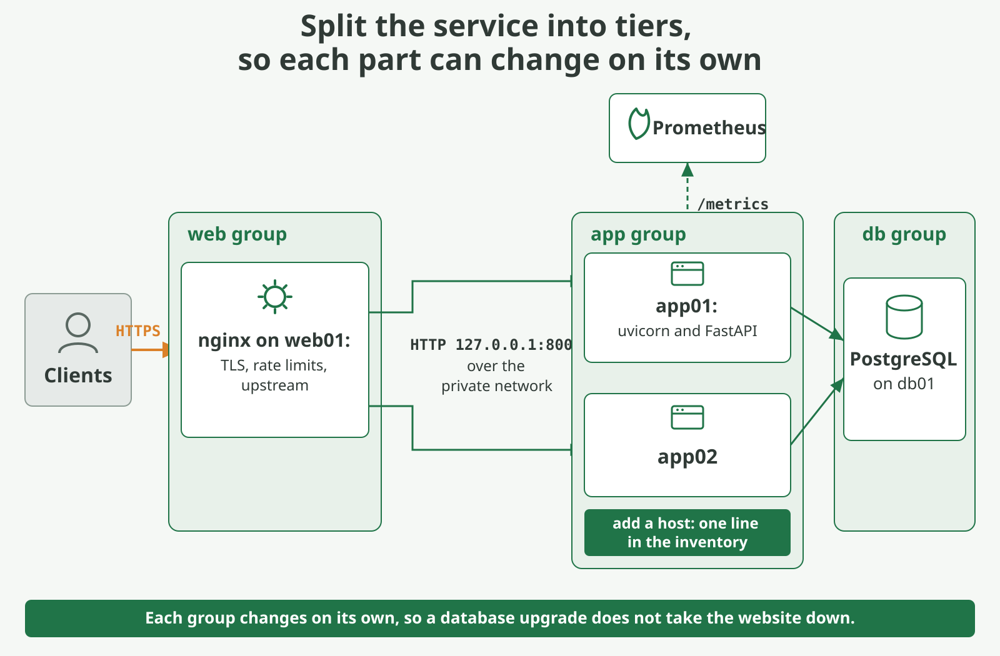

*Figure 4.9.1. Clients reach nginx over HTTPS, which forwards to two app hosts that share a PostgreSQL database, and Prometheus scrapes the app metrics.*

A small team wants to deploy a web application to two servers. The question is more than how to copy the code. The team also needs to switch versions safely, roll back when something goes wrong, and prove that the new version works. The target architecture is the picture that answers those questions before a single task is written. Drawing the picture first is cheap. Discovering a missing piece after the first production release is not.

Consider what happens when one machine runs everything. A single failure takes the whole service down, and a change to one part forces you to touch the rest. A database upgrade, for example, could knock out the website at the same time. The layout below splits the service into groups of hosts, so each part can change on its own. A group is a named set of hosts in the inventory, and the playbook addresses each part by its group name.

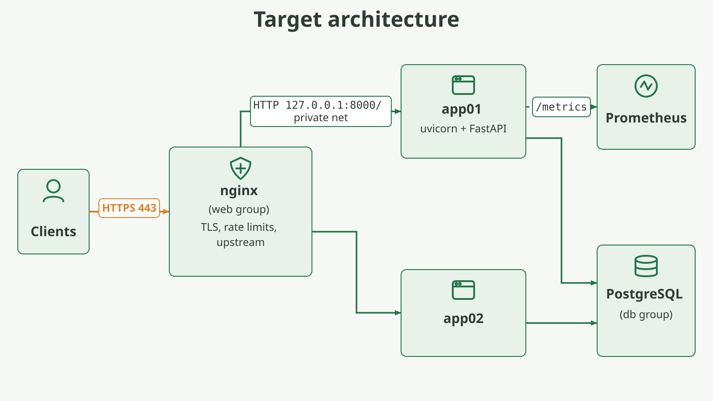

*Figure 4.9.2. Target architecture, as a diagram.*

Clients reach nginx on `web01` over HTTPS. nginx forwards each request to `app01` or `app02` on the private network. Both app hosts read from PostgreSQL on `db01`, and `app01` exposes `/metrics` to Prometheus. Follow one request through the picture. It arrives at the edge, nginx opens it, picks an app host, and the app asks the database for data. The answer travels the same road in reverse. Each hop is a place where a failure can happen, and each one has its own check later in the chapter.

The web host runs nginx. `app01` and `app02` run the service, and `db01` runs PostgreSQL. On a small lab, you can place everything on one VM. The playbook is organised by group, so it scales when you add hosts. Adding a third app host means adding one line to the inventory, and the web tier picks it up on its next run.

### Why production deployment is harder than `runserver` (*Ansible: Up and Running*, Chapters 6 and 7, `mezzanine.yml`)

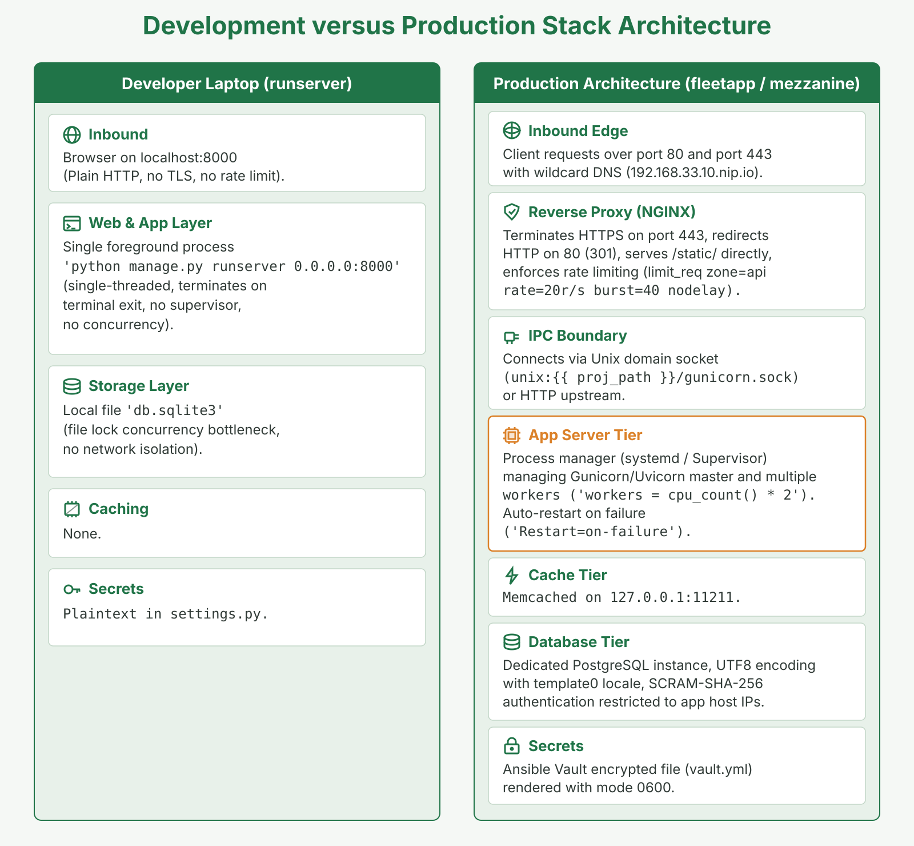

*Figure 4.0.0. Production separates edge TLS termination, multi-worker process supervision, and networked database concurrency that runserver compresses into a single local process.*

On a laptop, `runserver` starts the app and you see it working in a browser. Production has more moving parts. A process manager keeps the app alive, a reverse proxy takes the user's traffic, a database must already exist, and real users will not wait while you fix a mistake. The sections that follow explain how each part is added, and why it has to be there. Think of `runserver` as a test kitchen with one cook who also takes the orders. A restaurant needs a host at the door, a line of cooks and a pantry that stays stocked, even when the cook goes home.

In *Ansible: Up and Running*, Chapters 6 and 7, Bas Meijer, Lorin Hochstein and René Moser compare a Python web application on a developer laptop with the same application in production. Their example is Mezzanine 4.3.1 on Django 1.11.29. Mezzanine is a content management system built on Django, which is a Python web framework.

On a laptop, `python manage.py runserver 0.0.0.0:8000` runs a single-threaded foreground HTTP server. Single-threaded means it handles one request at a time, and foreground means it stops when you close the terminal. It uses a local SQLite file (`db.sqlite3`), which is a database stored in one file, and it has no TLS, no process supervision and no concurrency.

Production splits the stack into separate components. NGINX sits at the edge, terminates HTTPS on 443, redirects HTTP on 80 and serves `/static` files directly. Terminating HTTPS means NGINX does the encryption work, so the app behind it can speak plain HTTP. Behind it, an application server listens on a local Unix socket. A Unix socket is a connection point on the same machine, which is faster and more private than a network port. Gunicorn 20.1.0 handles WSGI (PEP 3333), which is the standard interface between Python web servers and Python apps, and Uvicorn handles ASGI, the newer async version of that interface. The socket is `unix:{{ proj_path }}/gunicorn.sock`, and `gunicorn.conf.py.j2` sets `workers = cpu_count() * 2`. A worker is one process that answers requests, so a machine with more CPU cores can answer more requests at once.

A process supervisor, either systemd or Supervisor, manages the process. It starts the app at boot, and it restarts the app if the process crashes. Supervisor reads `/etc/supervisor/conf.d/mezzanine.conf`, and you apply changes with `supervisorctl reread && supervisorctl update`. The first command re-reads the config file, and the second starts or restarts the programs whose settings changed.

The database is PostgreSQL, accessed through psycopg2, which is the Python driver that lets the app talk to PostgreSQL. It needs an explicit encoding, `UTF8`, and an explicit locale. An encoding decides how characters are stored as bytes, and a locale decides rules such as how text is sorted. The locale is `LC_CTYPE='en_US.UTF-8'` and `LC_COLLATE='en_US.UTF-8'`, and setting it requires `template='template0'` on `postgresql_db`. The template is the blueprint the new database is copied from, and `template0` is the clean blueprint that accepts a custom locale. Last, Memcached on `127.0.0.1:11211` handles caching. A cache keeps the answers to common questions in memory, so the database is not asked the same thing again and again.

The key lessons from `mezzanine.yml` come from *Ansible: Up and Running*, Chapter 7, Examples 7-1 to 7-28. Each lesson below began as a real failure on a real host, so it is worth reading each one as a warning.

1. Some Python packages, including psycopg2, Pillow and cryptography, are built from source during install. That build fails unless the OS `-dev` or `-devel` libraries (`libpq-dev`, `libjpeg-dev`, `libssl-dev`, `libffi-dev`, `python3-dev`) and `locales` are installed first. Install them with `apt`, and use `apt-cache policy libssl-dev` to look up the package.
2. Rather than copying your personal SSH private key onto target servers, enable SSH agent forwarding in `ansible.cfg` with `[ssh_connection] ssh_args = -o ForwardAgent=yes`, and run `ssh-add -L`. Then run the git task as the unprivileged user with `become: false`: `git: repo=git@github.com:ansiblebook/mezzanine_example.git dest={{ proj_path }} accept_hostkey=true`.
3. Keep credentials such as `db_pass`, `secret_key`, `admin_pass` and API tokens in `vars_files: [secrets.yml]`. Commit that file only as an encrypted Ansible Vault file or as a `secrets.yml.example` template. File modes can be quoted octal, such as `mode: '0750'`, or symbolic, such as `mode: 'u=rw,g=r,o=r'`. With symbolic modes, include `=` when you set exact permissions.
4. Use idempotent framework modules for management commands. `django_manage: command=migrate` and `command=collectstatic` are safe to repeat. A raw `createdb` command fails the second time with `CommandError: Database already created`.

Pass variables to helper scripts with the task `environment:` keyword, as in `script: scripts/setsite.py` with `environment: { PATH: "{{ venv_path }}/bin", PROJECT_DIR: "{{ proj_path }}", WEBSITE_DOMAIN: "{{ live_hostname }}" }`. The helper script then reads those values from its environment, so no secret or path has to be typed into the script file. Schedule periodic jobs with `ansible.builtin.cron`, for example `name: "poll twitter", minute: "*/5", user: "{{ user }}", job: "{{ manage }} poll_twitter"`. The `*/5` in the minute field means every five minutes.
5. TLS certificates and Django or FastAPI `Host`-header validation need a domain name rather than a bare IP, so the chapter uses wildcard DNS. The `Host` header is the line in each web request that names the site the visitor wanted, and the app checks it. A certificate is also issued for a name, not for a raw address. The name `192.168.33.10.nip.io` resolves to `192.168.33.10` with no custom DNS server, because the nip.io service answers any name that embeds an address. Setting `ALLOWED_HOSTS = ["192.168.33.10.nip.io", "www.192.168.33.10.nip.io"]` makes the application accept it.

If DNS rebinding protection blocks `nip.io`, add `192.168.33.10 192.168.33.10.nip.io` to `/etc/hosts`. The hosts file is a local lookup table that your machine checks before it asks any DNS server. If the browser returns `400 Bad Request`, the `Host` header did not match `ALLOWED_HOSTS`. Read that error as "the app does not know this name", and the fix is on the list of names, not in the server.

Choose the hostname first, because TLS and host checks both depend on it. Changing the name later means reissuing the certificate and updating the allowed list, so decide it before you build anything else.

## 2. Project layout

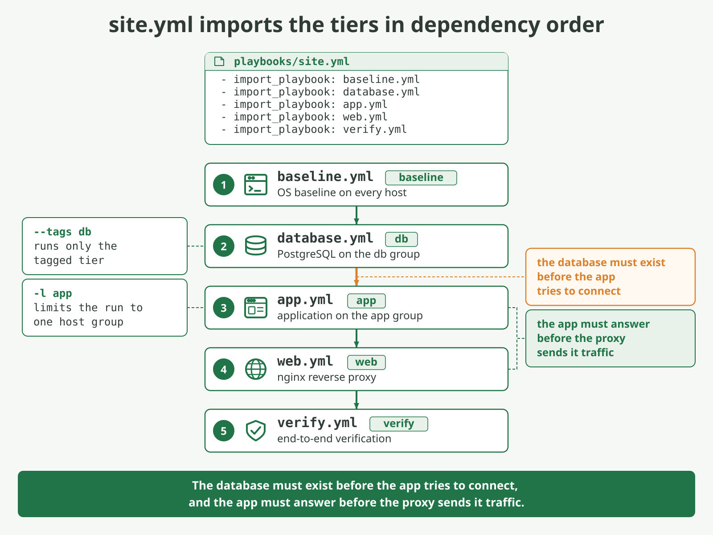

*Figure 4.9.3. The site playbook imports five tier playbooks in dependency order, so each tier is ready before the next one depends on it.*

A playbook project grows quickly. Within a month it has inventories, roles, templates and secrets. A predictable layout means a new engineer knows where to look, and CI knows what to lint. CI is the automated checker that runs on every change before it is merged. The layout below is the one the rest of this chapter uses, so keep it in mind as you read each play.

The tree below shows where each file lives. Keeping each tier in its own file lets you run one tier at a time. A tier is one layer of the stack, such as the database or the web proxy. When only the database has changed, you do not want to rerun the web tier and risk a restart you did not need.

```text
fleetapp-deploy/
├── ansible.cfg
├── requirements.yml                  # collections: community.postgresql, ansible.posix, community.general, community.crypto
├── inventories/
│   └── lab/
│       ├── hosts.yml
│       └── group_vars/
│           ├── all.yml               # app name, user, paths, versions
│           ├── web.yml
│           ├── app.yml
│           ├── db.yml
│           └── vault.yml             # encrypted: db password, secret keys (4.12)
├── playbooks/
│   ├── site.yml                      # imports the below
│   ├── baseline.yml
│   ├── database.yml
│   ├── app.yml
│   ├── web.yml
│   └── verify.yml
└── templates/
    ├── app.env.j2
    ├── fleetapp.service.j2
    ├── nginx-site.conf.j2
    └── pg_hba_snippet.j2
```

`site.yml` composes the plays in dependency order. You can run it in parts with `--tags db` or `-l app`. The tag runs only the plays marked with that label, and `-l` limits the run to one host group. Dependency order matters here. The database must exist before the app tries to connect, and the app must answer before the proxy sends it traffic. So the imports list the tiers in the order they depend on each other.

```yaml
# playbooks/site.yml
- import_playbook: baseline.yml
- import_playbook: database.yml
- import_playbook: app.yml
- import_playbook: web.yml
- import_playbook: verify.yml
```

Because each line is an import, Ansible reads all five files before the run starts, so a typo in any of them shows up immediately. After 4.11, these plays become roles. Keeping them as plain plays first makes the flow easier to follow, because you can read the whole deployment in one pass before you learn how to package it.

## 3. Variables

A deploy is only as reproducible as its inputs. The variables in this section are the knobs you turn for each environment: the version, the port, the domain name. Keeping them in one place means a production run and a staging run differ only in those knobs, which is what makes a staging test meaningful. If staging and production were written in two different files, a test on staging would prove very little about production. A shared file makes the test honest.

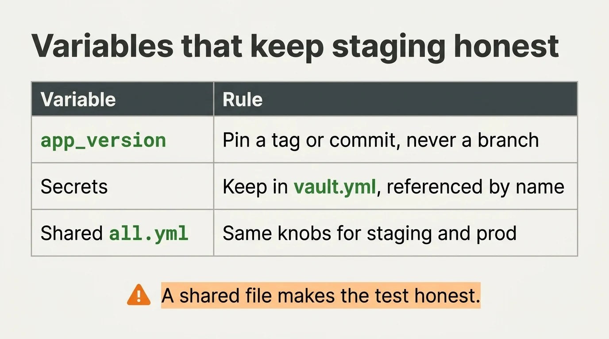
*Figure 4.9.V. Shared variables make a staging test meaningful for production.*


Every shared value sits in one file, so you change it once. The file below is read by every play, so a change to the version or the port reaches the whole deployment on the next run:

```yaml
# inventories/lab/group_vars/all.yml
app_name: fleetapp
app_user: fleetapp
app_group: fleetapp
app_root: /opt/fleetapp
app_releases_dir: "{{ app_root }}/releases"
app_current: "{{ app_root }}/current"
app_keep_releases: 5
app_repo: https://git.example.com/platform/fleetapp.git
app_version: v1.4.2                       # tag or commit SHA: pin, do not track a branch
app_port: 8000
app_workers: 4
python_version_min: "3.10"
db_name: fleetapp
db_user: fleetapp
db_host: "{{ hostvars[groups['db'][0]]['ansible_host'] }}"
nginx_server_name: fleet.lab.example.com
```

Keep secrets out of this file. They live in `vault.yml`, which is encrypted, and this file refers to them indirectly, as in `db_password: "{{ vault_db_password }}"`. The reason is that this file is readable by the whole team, and a password written here would be visible in every copy of the repository. The encrypted file holds the real values, and this file only points to them. See 4.12 for how that works.

Look at the `app_version` line. It is a pinned tag, and a comment says to pin rather than track a branch. That single line decides what code reaches the users, so it is worth a second look every time you change it.

## 4. The baseline and database plays

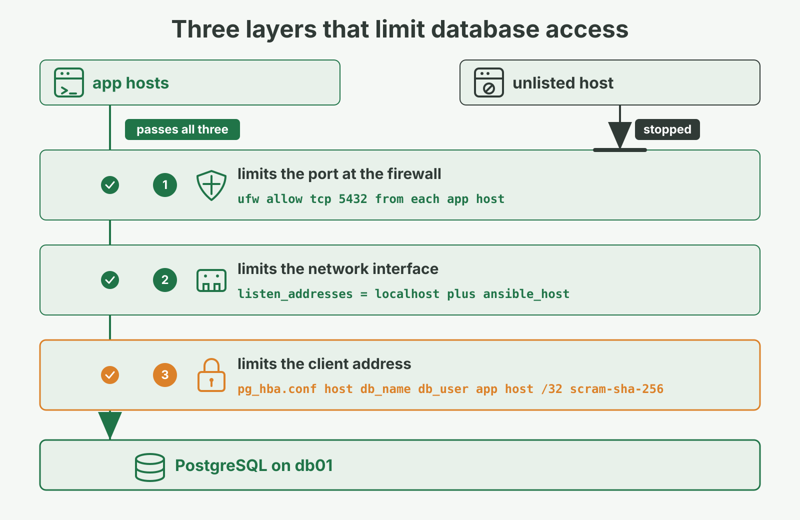

*Figure 4.9.4. Interface, client address and firewall port are three separate limits, and an unlisted host is stopped by them.*

Before the application can run, the server needs a database and a few packages. The baseline and database plays prepare that ground. They run first, so the application play never starts on a half-prepared machine, and a failure here stops the deploy before any user traffic is touched. Think of building a house. The plumbing and wiring go in before anyone moves in, and an inspector checks them before the walls close.

Two plays come first. The baseline play runs on every host and prepares the operating system. The database play runs on the `db` group and sets up PostgreSQL, so only the app hosts can reach it. Read the code first, then the notes that follow it. The baseline play is short and repeats the same kind of work on every host, so the same checks can run everywhere. The database play is longer because it sets up three things in order: the engine, the network rules and the account.

```yaml
# playbooks/baseline.yml
- name: OS baseline
  hosts: all
  become: true
  tags: [baseline]
  tasks:
    - name: Update apt cache
      ansible.builtin.apt: { update_cache: true, cache_valid_time: 3600 }
      when: ansible_facts['os_family'] == 'Debian'

    - name: Baseline packages
      ansible.builtin.package:
        name: [ca-certificates, curl, git, chrony, ufw, acl, python3-venv, python3-pip, rsync]
        state: present

    - name: Time sync enabled
      ansible.builtin.service: { name: chrony, state: started, enabled: true }

    - name: Set timezone to UTC
      community.general.timezone: { name: UTC }

    - name: Journald persistent storage
      ansible.builtin.file: { path: /var/log/journal, state: directory, mode: "2755" }
      notify: Restart journald

  handlers:
    - name: Restart journald
      ansible.builtin.service: { name: systemd-journald, state: restarted }
```

```yaml
# playbooks/database.yml
- name: PostgreSQL
  hosts: db
  become: true
  tags: [db]
  vars:
    pg_version: "16"
  tasks:
    - name: Install PostgreSQL and psycopg for Ansible
      ansible.builtin.apt:
        name: ["postgresql-{{ pg_version }}", python3-psycopg2]
        state: present

    - name: Listen on the private interface only
      ansible.builtin.lineinfile:
        path: "/etc/postgresql/{{ pg_version }}/main/postgresql.conf"
        regexp: '^#?listen_addresses'
        line: "listen_addresses = 'localhost,{{ ansible_host }}'"
      notify: Restart postgresql

    - name: Allow app hosts to connect with SCRAM
      ansible.builtin.lineinfile:
        path: "/etc/postgresql/{{ pg_version }}/main/pg_hba.conf"
        line: "host {{ db_name }} {{ db_user }} {{ hostvars[item]['ansible_host'] }}/32 scram-sha-256"
        insertafter: EOF
      loop: "{{ groups['app'] }}"
      notify: Reload postgresql

    - ansible.builtin.meta: flush_handlers

    - name: Create database role
      become_user: postgres
      community.postgresql.postgresql_user:
        name: "{{ db_user }}"
        password: "{{ db_password }}"
        encrypted: true
      no_log: true

    - name: Create database
      become_user: postgres
      community.postgresql.postgresql_db:
        name: "{{ db_name }}"
        owner: "{{ db_user }}"
        encoding: UTF8

    - name: Firewall: allow Postgres only from app hosts
      community.general.ufw:
        rule: allow
        proto: tcp
        port: "5432"
        src: "{{ hostvars[item]['ansible_host'] }}"
      loop: "{{ groups['app'] }}"

  handlers:
    - { name: Restart postgresql, ansible.builtin.service: { name: postgresql, state: restarted } }
    - { name: Reload postgresql,  ansible.builtin.service: { name: postgresql, state: reloaded } }
```

Two details in these plays need your attention. `become_user: postgres` needs the `acl` package for the temporary files that the unprivileged user reads. Ansible copies a small program to the host, and the `postgres` user has to be able to read it, so the ACL (access control list) grants that permission. `no_log: true` hides the password in the output, so a reader of the run log never sees it. Real databases also need backups, WAL archiving (a continuous record of changes that makes point-in-time recovery possible) and monitoring, which are outside this chapter's scope. A deployment that protects the code but not the data has missed the part that matters most in an incident.

## 5. The application play: release directories and an atomic switch

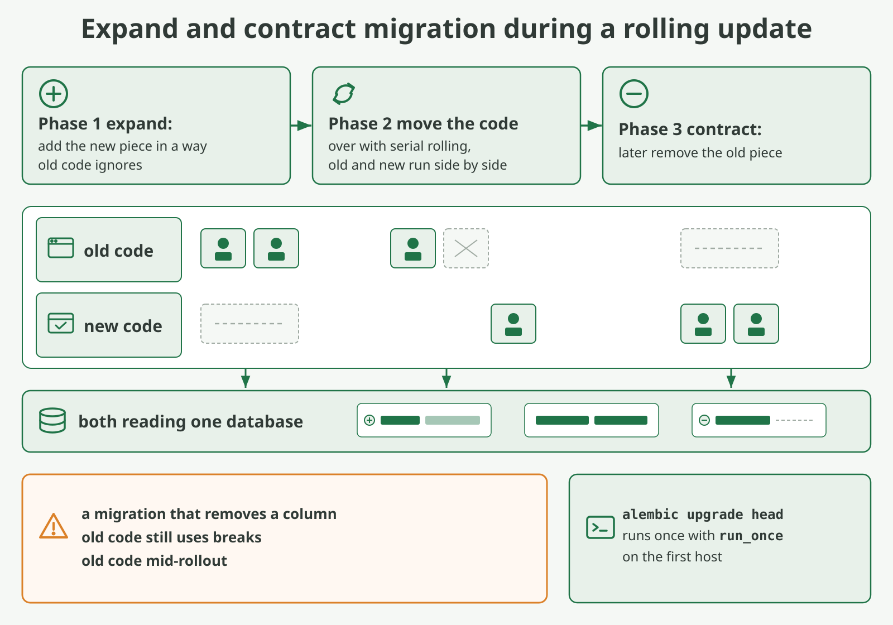

*Figure 4.9.5. Migrations must stay compatible with the previous release because old and new code run together during a rolling update.*

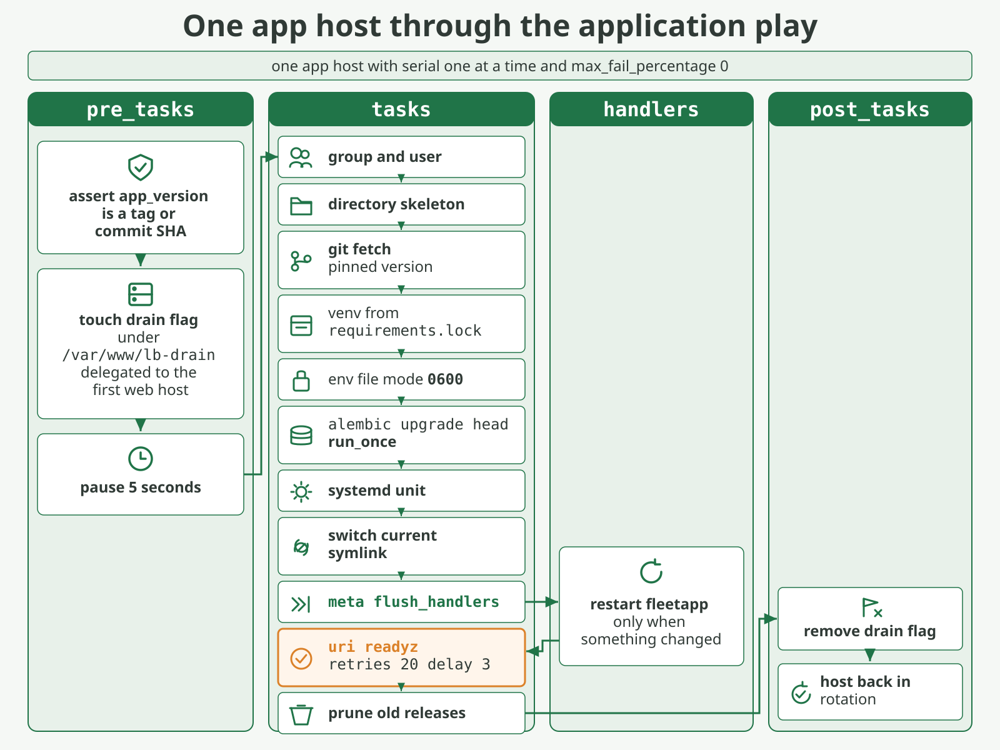

*Figure 4.9.6. The host is drained first, built and switched next, and returned to rotation only after the readiness check passes.*

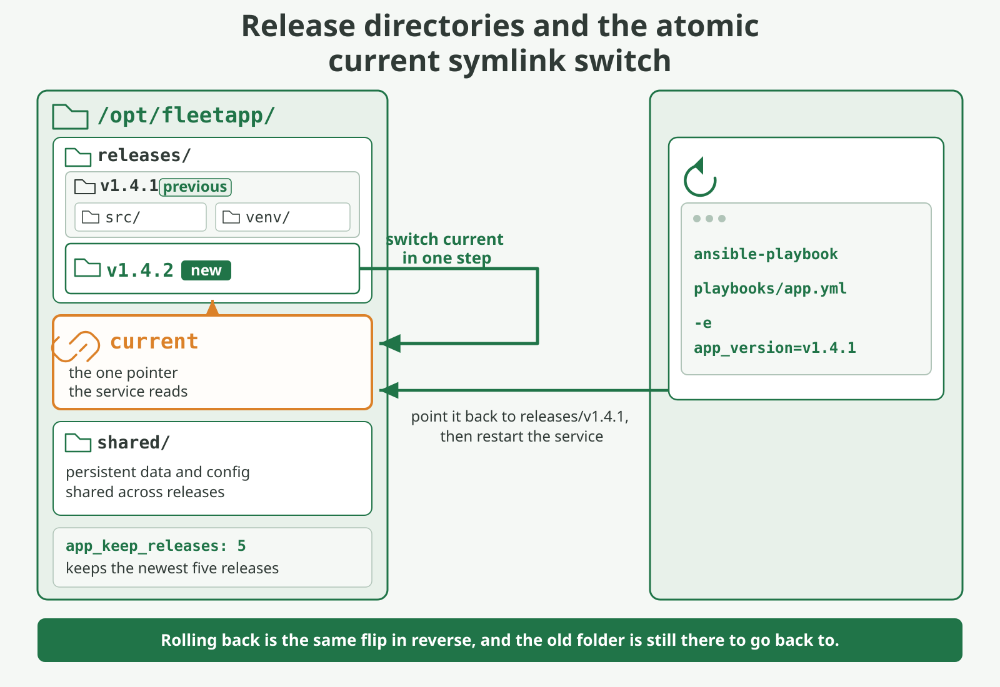

*Figure 4.9.7. Each release gets its own folder and a current symlink points at the live one, so switching or rolling back is a single pointer change.*

A deploy that copies new files over the old ones leaves a half-updated app for a few seconds, and a crash in that window is hard to explain. The release-directory pattern avoids the problem. Each version lives in its own folder, and a symbolic link flips from the old folder to the new one in a single step. A symbolic link is a named pointer to a folder, and changing the pointer is a single quick operation. Rolling back is the same flip in reverse, and the old folder is still there to go back to.

Suppose a new release misbehaves right after a rollout. With a release-directory layout, you point `current` back at the old release and restart the service, and nothing has to be rebuilt. Each release gets its own directory, and `current` points at the one that is live. The `shared` folder holds the things that must survive every release, such as logs and the environment file, so they are not lost when an old release is deleted:

```text
/opt/fleetapp/
├── releases/
│   ├── v1.4.1/            (previous)
│   │   ├── src/
│   │   └── venv/
│   └── v1.4.2/            (new)
├── shared/                (persistent data/config shared across releases)
└── current -> releases/v1.4.2
```

The application play below builds the new release beside the old one, switches the link and then checks the app. Read the play in four stages. The `pre_tasks` take the host out of the load balancer, so no user request reaches it while it changes. The `tasks` build the new folder, write its config and switch the pointer. The `post_tasks` put the host back into rotation. The `handlers` restart the service only when something it reads has changed.

```yaml
# playbooks/app.yml
- name: Deploy application
  hosts: app
  become: true
  serial: "{{ rollout_serial | default(1) }}"       # one app host at a time
  max_fail_percentage: 0
  tags: [app]
  vars:
    release_dir: "{{ app_releases_dir }}/{{ app_version }}"
  pre_tasks:
    - name: Require a pinned version
      ansible.builtin.assert:
        that: app_version is match('^v[0-9]+\.[0-9]+\.[0-9]+$') or app_version is match('^[0-9a-f]{7,40}$')
        fail_msg: "app_version must be a tag or commit SHA, not a branch"

    - name: Take host out of the load balancer
      ansible.builtin.file:
        path: "/var/www/lb-drain/{{ inventory_hostname }}"      # simple demo of a drain flag; use your LB's API in real life
        state: touch
        mode: "0644"
      delegate_to: "{{ groups['web'][0] }}"
      changed_when: false

    - name: Wait for in-flight requests to finish
      ansible.builtin.pause: { seconds: 5 }                      # better: poll the app's active-connections metric

  tasks:
    - name: Application group and user
      ansible.builtin.group: { name: "{{ app_group }}", system: true }
    - ansible.builtin.user:
        name: "{{ app_user }}"
        group: "{{ app_group }}"
        system: true
        shell: /usr/sbin/nologin
        home: "{{ app_root }}"
        create_home: false

    - name: Directory skeleton
      ansible.builtin.file:
        path: "{{ item }}"
        state: directory
        owner: "{{ app_user }}"
        group: "{{ app_group }}"
        mode: "0755"
      loop: ["{{ app_root }}", "{{ app_releases_dir }}", "{{ app_root }}/shared", "{{ app_root }}/shared/logs"]

    - name: Fetch the release (pinned version)
      ansible.builtin.git:
        repo: "{{ app_repo }}"
        dest: "{{ release_dir }}/src"
        version: "{{ app_version }}"
        force: false
        depth: 1
      become_user: "{{ app_user }}"
      register: fetched

    - name: Create virtualenv and install pinned dependencies
      ansible.builtin.pip:
        requirements: "{{ release_dir }}/src/requirements.lock"
        virtualenv: "{{ release_dir }}/venv"
        virtualenv_command: python3 -m venv
      become_user: "{{ app_user }}"

    - name: Application environment file (secrets, mode 0600)
      ansible.builtin.template:
        src: app.env.j2
        dest: "{{ app_root }}/shared/fleetapp.env"
        owner: "{{ app_user }}"
        group: "{{ app_group }}"
        mode: "0600"
      no_log: true
      notify: Restart fleetapp

    - name: Run database migrations once per rollout (first host only)
      ansible.builtin.command:
        cmd: "{{ release_dir }}/venv/bin/alembic upgrade head"
        chdir: "{{ release_dir }}/src"
      environment:
        FLEET_DB_URL: "postgresql://{{ db_user }}:{{ db_password }}@{{ db_host }}/{{ db_name }}"
      become_user: "{{ app_user }}"
      run_once: true
      changed_when: "'Running upgrade' in migrate.stderr"
      register: migrate
      no_log: true

    - name: systemd unit
      ansible.builtin.template:
        src: fleetapp.service.j2
        dest: /etc/systemd/system/fleetapp.service
        mode: "0644"
      notify: Reload systemd and restart fleetapp

    - name: Atomically switch the current symlink
      ansible.builtin.file:
        src: "{{ release_dir }}"
        dest: "{{ app_current }}"
        state: link
        force: true
      notify: Restart fleetapp
      register: switched

    - ansible.builtin.meta: flush_handlers

    - name: Wait for the app to answer locally
      ansible.builtin.uri:
        url: "http://127.0.0.1:{{ app_port }}/readyz"
        status_code: 200
      register: ready
      until: ready.status == 200
      retries: 20
      delay: 3

    - name: Prune old releases (keep N)
      ansible.builtin.shell: |
        set -o pipefail
        ls -1dt {{ app_releases_dir }}/*/ | tail -n +{{ app_keep_releases + 1 }} | xargs -r rm -rf
      args: { executable: /bin/bash }
      changed_when: false

  post_tasks:
    - name: Put host back in the load balancer
      ansible.builtin.file:
        path: "/var/www/lb-drain/{{ inventory_hostname }}"
        state: absent
      delegate_to: "{{ groups['web'][0] }}"

  handlers:
    - name: Reload systemd and restart fleetapp
      ansible.builtin.systemd_service: { name: fleetapp, state: restarted, daemon_reload: true, enabled: true }
      listen: Restart fleetapp
    - name: Restart fleetapp
      ansible.builtin.systemd_service: { name: fleetapp, state: restarted, enabled: true }
```

In the sketch, two handlers share a `listen` topic. Keep only one of them in real code, or you get double restarts, because both handlers would fire on the same notification. The package names, file paths and drain mechanism are examples to adapt. The drain in this sketch uses a simple flag file, which a load balancer might read. Your load balancer may use an API instead, and the idea stays the same. The host must stop receiving new requests before its service changes.

The systemd unit comes from a template. Its `ExecStart` line runs uvicorn from the venv inside the current release. Systemd is the service manager that starts and watches the app, and `ExecStart` is the command it runs. Notice that the path goes through `current`, not through the release folder. That is what makes the symlink switch take effect on the next restart.

```jinja
# {{ ansible_managed }}
[Unit]
Description=Fleet API
After=network-online.target
Wants=network-online.target

[Service]
User={{ app_user }}
Group={{ app_group }}
WorkingDirectory={{ app_current }}/src
EnvironmentFile={{ app_root }}/shared/fleetapp.env
ExecStart={{ app_current }}/venv/bin/uvicorn fleet.main:app --host 127.0.0.1 --port {{ app_port }} --workers {{ app_workers }} --proxy-headers --timeout-graceful-shutdown 25
Restart=on-failure
RestartSec=3
TimeoutStopSec=30
NoNewPrivileges=yes
ProtectSystem=strict
ProtectHome=yes
PrivateTmp=yes
ReadWritePaths={{ app_root }}/shared
LimitNOFILE=65536

[Install]
WantedBy=multi-user.target
```

The environment file template, `app.env.j2`, comes next:

```jinja
FLEET_DB_URL=postgresql://{{ db_user }}:{{ db_password }}@{{ db_host }}/{{ db_name }}
FLEET_ENV={{ env_name | default('lab') }}
FLEET_SECRET_KEY={{ vault_secret_key }}
```

Four release habits follow from this design. Pin each release to a tag or commit SHA. Build the dependencies from a lock file inside the release directory, so the old release's venv stays intact for rollback. A lock file records the exact version of every package, so the same install gives the same result on every host. Rollback means setting `app_version` back and running the play again, or repointing `current` by hand and restarting. Because old releases stay on disk, no rebuild is needed: `ansible-playbook playbooks/app.yml -e app_version=v1.4.1`. The command takes the old folder that is still on disk and points the fleet back at it, so the rollback is as fast as the restart.

Database migrations must also stay backward compatible with the previous release during a rolling update. During a rolling update, old and new code run side by side for a short time, and both read the same database. A migration that removes a column the old code still uses would break the old code mid-rollout. The expand/contract pattern avoids that. You first add the new piece in a way the old code ignores, then move the code over, and only later remove the old piece. Checkpoint question 7 at the end of this chapter covers this in more detail.

The systemd unit also limits the damage a compromised process can do. `NoNewPrivileges=yes` stops the process and its children from gaining new privileges, for example through a setuid binary or a binary with file capabilities. In plain terms, a setuid program such as `sudo` gains root rights whenever someone runs it. This setting blocks that jump for the service and for anything the service starts, so a compromised app cannot simply run a privileged helper to escalate. `ProtectSystem` and `PrivateTmp` restrict where the process can write. Adjust them for any write paths your app needs, and check the logs after the first run if the service fails to write something it needs.

Finally, prefer building artefacts in CI, as a wheel or a container, and let Ansible deploy the artefact. An artefact is the built package itself, such as a wheel (a ready-to-install Python package file) or a container image. Building it once in CI means every host installs the same bytes, instead of each host compiling its own copy. That is more reproducible and faster than cloning source and installing on every host, and it gives you control over the supply chain, which is the path from source code to the running machine. You can fetch an artefact with `get_url` from an artefact repository with a checksum, or install with `pip` from an internal index with hashes. A checksum lets the playbook confirm the file is the one that was built.

Choose the artefact route before your first production release, so every host installs the same build.

## 6. The web tier: nginx, TLS and rate limiting

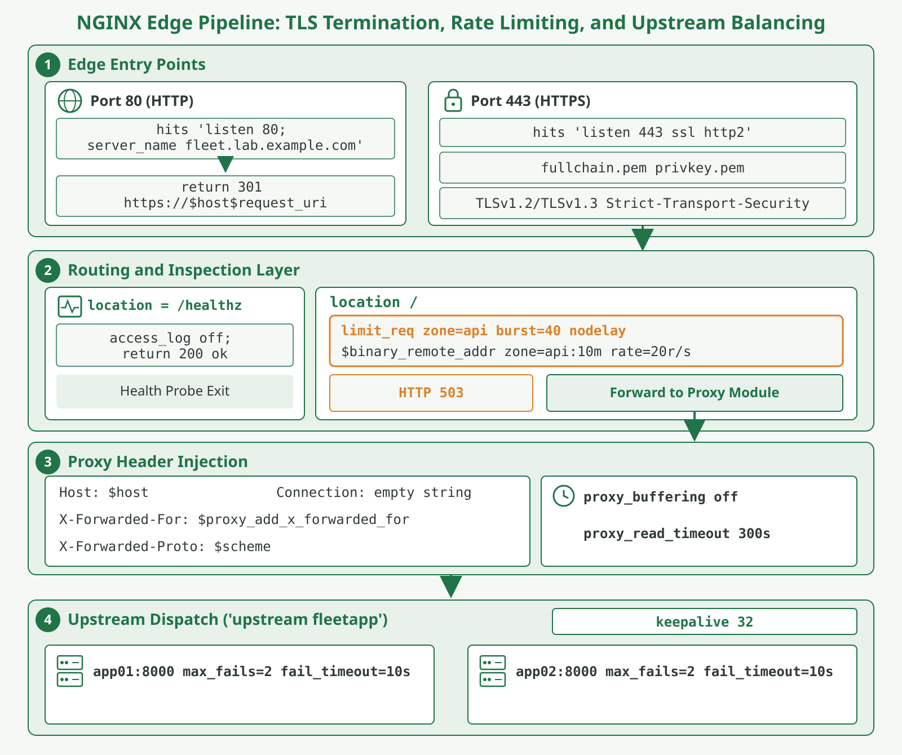

*Figure 4.0.0. Inbound traffic is redirected or decrypted at the edge, passed through a token bucket rate limiter, and load-balanced across healthy application servers.*

Users reach the application through nginx. TLS encrypts their traffic on the way in, and rate limiting protects the app from a burst of requests from one client. A burst can come from a script that retries too fast, or from one client hammering a single endpoint. This section configures both, and it explains why each setting is there, so you can change one without breaking the other.

The web tier turns nginx into the public entry point. The play installs the packages, renders the site file from a template, enables the site and turns off the default site. Enabling a site here means creating a link from one folder to another, so nginx reads the file. It also opens ports 22, 80 and 443, and then enables the firewall with a deny default. Port 22 is for SSH, so you can still log in. Ports 80 and 443 are the web. A deny default means that anything not explicitly allowed is blocked.

```yaml
# playbooks/web.yml
- name: Reverse proxy
  hosts: web
  become: true
  tags: [web]
  tasks:
    - ansible.builtin.package: { name: [nginx, ssl-cert], state: present }

    - name: Site configuration
      ansible.builtin.template:
        src: nginx-site.conf.j2
        dest: /etc/nginx/sites-available/{{ app_name }}.conf
        mode: "0644"
        validate: "nginx -t -c /etc/nginx/nginx.conf"      # NOTE: validating a fragment this way tests the whole config including the *old* file; use a staged-include approach or validate after placing with a rollback (see text)
      notify: Reload nginx

    - name: Enable site
      ansible.builtin.file:
        src: /etc/nginx/sites-available/{{ app_name }}.conf
        dest: /etc/nginx/sites-enabled/{{ app_name }}.conf
        state: link
      notify: Reload nginx

    - name: Disable default site
      ansible.builtin.file: { path: /etc/nginx/sites-enabled/default, state: absent }
      notify: Reload nginx

    - ansible.builtin.service: { name: nginx, state: started, enabled: true }

    - name: Firewall rules (HTTP/HTTPS/SSH)
      community.general.ufw: { rule: allow, port: "{{ item }}", proto: tcp }
      loop: ["22", "80", "443"]
    - community.general.ufw: { state: enabled, policy: deny }

  handlers:
    - { name: Reload nginx, ansible.builtin.service: { name: nginx, state: reloaded } }
```

The site file is a Jinja template. Read it with the play above in mind. The first block is the upstream, which is nginx's name for the list of app servers it may send requests to. The loop writes one `server` line for each app host, in sorted order. The second block redirects plain HTTP to HTTPS, so no visitor stays on the unencrypted path. The third block is the real site. It serves HTTPS, applies the rate limit, and passes each request to the upstream with the headers the app needs to know who the visitor was.

```jinja
# nginx-site.conf.j2
upstream {{ app_name }} {

    server {{ hostvars[h]['ansible_host'] }}:{{ app_port }} max_fails=2 fail_timeout=10s;

    keepalive 32;
}
limit_req_zone $binary_remote_addr zone=api:10m rate=20r/s;

server {
    listen 80;
    server_name {{ nginx_server_name }};
    return 301 https://$host$request_uri;
}
server {
    listen 443 ssl http2;
    server_name {{ nginx_server_name }};
    ssl_certificate     /etc/ssl/{{ app_name }}/fullchain.pem;
    ssl_certificate_key /etc/ssl/{{ app_name }}/privkey.pem;
    ssl_protocols TLSv1.2 TLSv1.3;
    add_header Strict-Transport-Security "max-age=31536000" always;

    location / {
        limit_req zone=api burst=40 nodelay;
        proxy_pass http://{{ app_name }};
        proxy_http_version 1.1;
        proxy_set_header Connection "";
        proxy_set_header Host $host;
        proxy_set_header X-Forwarded-For $proxy_add_x_forwarded_for;
        proxy_set_header X-Forwarded-Proto $scheme;
        proxy_read_timeout 300s;
        proxy_buffering off;             # streaming responses (SSE) pass through
    }
    location = /healthz { access_log off; return 200 "ok\n"; }
}
```

Jinja braces and nginx variables do not clash here. nginx uses `$host`, not `{{ }}`. The `upstream` block is generated from the inventory, so adding an app host updates nginx on the next run. For the lab, generate a self-signed certificate with the `community.crypto` modules (`openssl_privatekey`, `openssl_csr`, `x509_certificate`). In production, use an internal CA or an ACME client (`certbot`, `acme.sh`, `community.crypto.acme_certificate`) instead.

Validate a new nginx config before it replaces the live one. You can render to a staging path, run `nginx -t` against a copy of the full config that includes it, or use the template's `validate` with a wrapper script that builds a temporary config tree. A staging path is a separate file where the new config is written first, so the live file is untouched while you check it. At a minimum, apply the change with `notify: Reload nginx`. A reload asks nginx to reread its config without dropping open connections, and a failed reload keeps the old workers serving traffic. That safety net is the reason a reload is preferred over a restart here.

Stage and validate every nginx change before you reload it.

## 7. Verification play

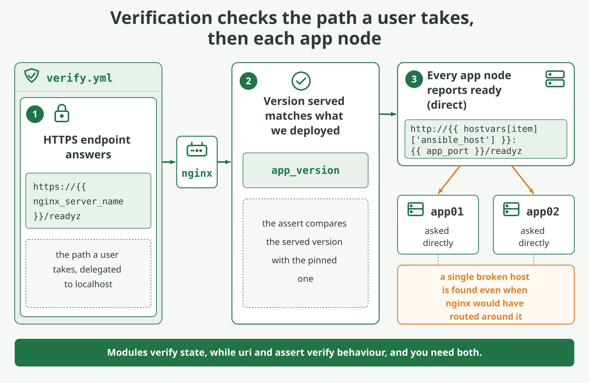

*Figure 4.9.8. The verification play tests the public HTTPS path first, checks the served version, and then asks each app node directly.*

A green deploy is not proof that users can use the app. The verification play asks the application directly, through the same path users take, and it fails the run if the answer is wrong. It is the last check before the deploy counts as done. Think of a restaurant that checks the dish before it leaves the kitchen. A chef who trusts the recipe card alone can still send out a plate with the wrong sauce.

Verification checks behaviour, not just state. The play below asks the live endpoints whether they answer, and whether they serve the version you deployed. The first check goes through the public name and the proxy, which is the path a user takes. The second makes sure the version string matches the one you pinned. The third asks each app host directly, so a single broken host is found even when nginx would have routed around it.

```yaml
# playbooks/verify.yml
- name: End-to-end verification
  hosts: web
  gather_facts: false
  tags: [verify]
  tasks:
    - name: HTTPS endpoint answers
      ansible.builtin.uri:
        url: "https://{{ nginx_server_name }}/readyz"
        validate_certs: false          # lab only; production verifies against your CA bundle
        return_content: true
        status_code: 200
      register: https
      delegate_to: localhost
      retries: 10
      delay: 3
      until: https.status == 200

    - name: Version served matches what we deployed
      ansible.builtin.assert:
        that: (https.json.version | default('')) == app_version | regex_replace('^v', '')
        fail_msg: "Served {{ https.json.version | default('unknown') }}, expected {{ app_version }}"

    - name: Every app node reports ready (direct)
      ansible.builtin.uri:
        url: "http://{{ hostvars[item]['ansible_host'] }}:{{ app_port }}/readyz"
      loop: "{{ groups['app'] }}"
      delegate_to: "{{ groups['web'][0] }}"
```

Module idempotency and verification work as a pair. Modules verify state, while `uri` and `assert` verify behaviour, and you need both. A module can confirm that a file is in place, but only a request through the real path can confirm that the page loads. Each one catches a failure the other misses.

## 8. Idempotency and safety checks

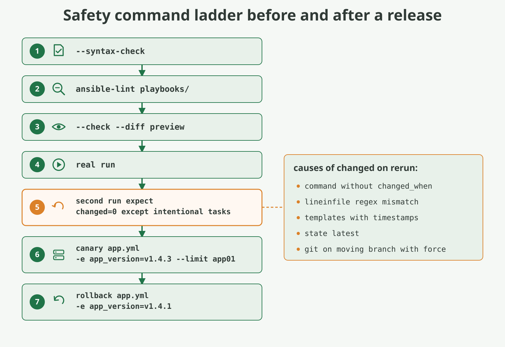

*Figure 4.9.9. A quiet second run is what lets you trust a loud first run.*

A deploy that is safe to run twice is a deploy you can retry in the middle of the night without fear. Idempotent means that running the same playbook again changes nothing once the system already matches it. This section lists the checks that keep the playbook safe on a second run, and the ones that stop it before it damages anything that is already working.

Work through these commands in order. The first ones check the code, and the last two prove a canary release and a rollback. A canary release sends the new version to one host first, so a bad release harms one host rather than the whole fleet. The rollback command then shows that returning to the old version is one short command.

```bash
ansible-playbook playbooks/site.yml --syntax-check
ansible-lint playbooks/
ansible-playbook playbooks/site.yml --check --diff          # preview (expect some tasks to fail/skip in check mode on first install)
ansible-playbook playbooks/site.yml                         # real run
ansible-playbook playbooks/site.yml                         # second run: expect changed=0 except intentional tasks
ansible-playbook playbooks/app.yml -e app_version=v1.4.3 --limit app01     # canary release to one host
ansible-playbook playbooks/app.yml -e app_version=v1.4.1                  # rollback
```

A second run that reports `changed` tasks means something is not idempotent. Look for `command` tasks without `changed_when`, `lineinfile` regex mismatches, templates that contain timestamps, and package updates with `state: latest`. Repo clones on a moving branch, and `git` with `force`, cause the same symptom. Each of these makes the playbook do work on every run, which hides real changes in the noise. A quiet second run is what lets you trust a loud first run. Fix each one before you trust the playbook.

## 9. A container-based variant

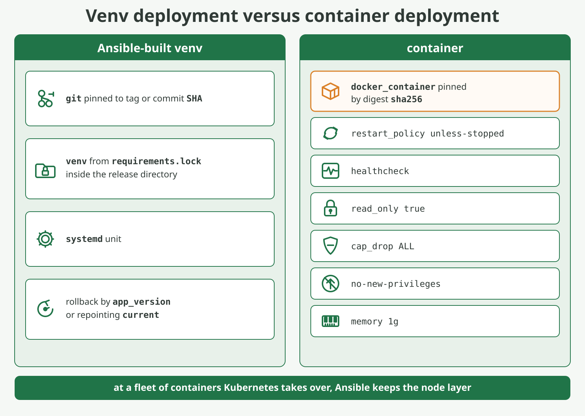

*Figure 4.9.10. A digest names the exact image, while a tag can be moved to a different image later.*

If the application ships as an image, Ansible has less to do. An image is a packaged snapshot of the app and its libraries, and a container is a running copy of that image. Ansible installs the host prerequisites and then declares the container state. It says what should be running, and Docker works out the rest:

```yaml
- name: Deploy containerised app
  hosts: app
  become: true
  tasks:
    - name: Install Docker engine (distribution/official repo; see Part 11 for GPU runtimes)
      ansible.builtin.package: { name: docker.io, state: present }
    - ansible.builtin.service: { name: docker, state: started, enabled: true }
    - name: Registry login (token from vault)
      community.docker.docker_login:
        registry_url: registry.example.com
        username: "{{ registry_user }}"
        password: "{{ vault_registry_token }}"
      no_log: true
    - name: Run the app container (pinned by digest)
      community.docker.docker_container:
        name: fleetapp
        image: "registry.example.com/platform/fleetapp@sha256:{{ app_image_digest }}"
        state: started
        restart_policy: unless-stopped
        published_ports: ["127.0.0.1:{{ app_port }}:8000"]
        env_file: "{{ app_root }}/shared/fleetapp.env"
        healthcheck:
          test: ["CMD", "python", "-c", "import urllib.request; urllib.request.urlopen('http://127.0.0.1:8000/healthz')"]
          interval: 10s
          retries: 3
        memory: 1g
        read_only: true
        cap_drop: [ALL]
        security_opts: ["no-new-privileges:true"]
        pull: true
```

Pinning the image by digest means you name its exact fingerprint, the `sha256` value, rather than a tag like `latest`. A tag can be moved to point at a different image later, but a digest cannot. The `read_only` and `cap_drop` settings shrink what the container can do if it is ever compromised. Read-only means its filesystem cannot be written, and `cap_drop: [ALL]` removes the special Linux privileges it would otherwise hold.

Once you run a fleet of containers, Kubernetes (Part 5) takes over this job. Kubernetes is a system that keeps a set of containers running across many machines and replaces the ones that fail. Ansible still helps with the node layer, such as the container runtime, GPU drivers and kubelet prerequisites, and with bootstrapping clusters through Kubespray. Kubelet is the agent that runs on each Kubernetes node, and Kubespray is an Ansible project that builds whole clusters. You can also deploy Compose files with `community.docker.docker_compose_v2`. Compose is Docker's format for describing several containers that work together.

## 10. Troubleshooting a failed deploy

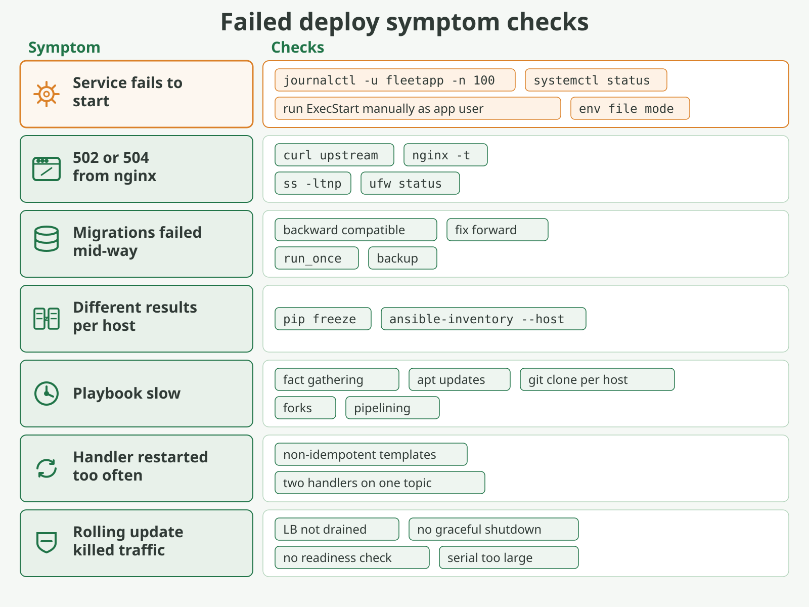

*Figure 4.9.11. Match the symptom, run its checks in order, and collect evidence before changing anything.*

A deploy fails halfway through. Some hosts run the new version, some still run the old one, and the site is up but slow. Troubleshooting starts by finding which step stopped and what state it left behind. Only then should you decide whether to roll forward or roll back. Rolling forward means fixing the problem and continuing. Rolling back means returning to the old version. The state tells you which one is safer.

When a deploy fails, find the symptom in the left column and work through the checks in its row. Each row covers one symptom and the places to look for it. The checks are ordered from the most likely cause to the least likely, so the first one often finds the problem.

| Symptom | Check |
|---|---|
| Service fails to start | `journalctl -u fleetapp -n 100 --no-pager`, `systemctl status`, run the `ExecStart` manually as the app user, verify the env file mode and variables |
| 502/504 from nginx | `curl` the upstream directly; `nginx -t`; `ss -ltnp` on the app host; firewall rules (`ufw status`); SELinux/AppArmor denials |
| Migrations failed mid-way | Make migrations transactional/backward compatible; fix forward; use `run_once` and a lock; keep a pre-migration backup |
| Different results per host | Unpinned dependencies, drift in packages; compare `pip freeze` and `ansible-inventory --host` data |
| Playbook slow | Fact gathering, repeated `apt` updates, `git clone` per host (use artefacts), `forks`, pipelining |
| Handler restarted too often | Non-idempotent templates; two handlers on one topic |
| Rolling update killed traffic | LB not drained; app not gracefully shutting down; readiness check missing; `serial` too large |

Start with the row that matches what you see, and run its checks before you change anything else. Changing things while you investigate can hide the very state you need to read. Collect the evidence first, then act.

## 11. Lab

Start with the self-checking Python lab. You can run it on your own machine. It needs no servers, so it is a safe way to confirm that the release logic behaves as the chapter describes:

```bash
python3 code/part04/ansible_app_deployment_lab.py
```

The lab checks three things. It verifies that a semantic tag or commit SHA passes version pinning (`validate_pinned_version`). A semantic tag is a version label such as `v1.4.2`, and a commit SHA is the unique id of one commit. It exercises the versioned release directory manager (`AtomicReleaseDeployer`), which switches the `current` symlink atomically, keeps N releases while pruning older ones, and rolls back instantly. It also checks the Gunicorn multiprocessing configuration rendering (`render_gunicorn_conf`), which is covered in *Ansible: Up and Running*, Chapter 7.

Next, on 1 to 3 Ubuntu VMs, work through these exercises. Each exercise builds on the one before it, so the project you scaffold in the first one is reused throughout. The interactive shell steps below have not been run, so expect to adjust paths and names for your own machines.

1. Scaffold the project with the layout above. Write `ansible.cfg` and `requirements.yml`, and build an inventory of 3 or 4 hosts.
2. Run `baseline.yml` and `database.yml`. Connect with `psql` from an app host, verify the firewall and `pg_hba` entries, and check that a second run is idempotent.
3. Use a tiny sample FastAPI app (3.7) in a Git repo with `requirements.lock`. Deploy v1.0.0 and inspect the release layout. Then break `/readyz` and confirm the play fails before the host goes back into rotation.
4. Bump the release to v1.0.1 with `serial: 1`. Hit the load balancer in a loop (`while true; do curl -s ...; done`) and prove there are zero failed requests. Then increase `serial` and show the errors that appear when draining is skipped.
5. Deploy v1.0.2 with a bug, then roll back with `-e app_version=v1.0.1`. Measure how long the rollback takes.
6. Generate a self-signed certificate with `community.crypto` and deploy it. Test it with `curl --cacert`. Add a bad config and observe how `validate` and the reload behave, then implement staged validation.
7. Move the database password and secret key into a vaulted file (4.12). Confirm that `no_log` hides them, that `--diff` does not print them, and that the file modes are `0600`.
8. Run `verify.yml`. Stop one app node and confirm that nginx routes around it. Then stop the database and see readiness fail.
9. Run the playbooks twice, and fix every change you did not expect. Then run `ansible-lint`.
10. Deploy the same service as a container with `docker_container`. Compare rollout speed, rollback and config handling with the venv approach.
11. Clean up the VMs.

Work through them in order, since the later exercises reuse the project you scaffold first.

## 12. Common mistakes

Deploy mistakes tend to be ordering mistakes. A switch before the check, a restart before the config is written, or a secret in a template that anyone with read access can open. Walk through the list against your own play and ask what runs first. Most of the mistakes below are not exotic. They are ordinary steps placed in the wrong sequence, and a careful reading of the order catches them.

Watch for these mistakes when you write or review a deployment playbook:

- Deploying from a moving branch, using unpinned dependencies, or building on every host from source.
- Overwriting the live release directory in place, which removes the atomic switch and the rollback.
- Restarting all app hosts at once, with no drain, readiness gate or `serial`.
- Putting secrets into templates rendered with `--diff` on, or leaving env files with loose modes.
- Running migrations from every host, or in a way that breaks the old code during rollout.
- Validating nginx, sudoers or sshd configs only after you have replaced them.
- Treating a green recap as proof the service works, with no verification step.
- Opening firewalls to the world instead of using source-restricted rules, or letting databases listen on all interfaces.
- Writing a play that works only on the first run because it uses non-idempotent shell commands.
- Not testing rollback until it is needed.

Go through this list against your own playbook before the first production rollout. A short walk through the list with a colleague often finds one more issue than reading it alone.

## 13. Interview angles

Deployment questions test whether you understand rollback as well as rollout. Explain how you would undo the change, not only how you would make it. A good answer names the old release, the pointer that switches back to it, and the check that proves the rollback worked.

- "Walk me through deploying a Python service with Ansible with zero downtime." Your answer should cover release directories, the symlink swap, the drain, `serial`, readiness and rollback.
- "How do you handle database migrations in a rolling deployment?" Cover expand/contract and once-only execution.
- "How do you roll back?" Cover retained old releases, the version pin and the symlink.
- "Where do secrets go and how do you stop them leaking?"
- "How do you verify a deployment worked beyond module success?"
- "What are the trade-offs between an Ansible-built venv and containers?"
- "What would you change to run this on 500 hosts?" Cover artefacts, forks and pipelining, roles, AAP, batches and the load balancer API.

## Exercises

1. A teammate asks why production needs NGINX, a process supervisor and PostgreSQL when `runserver` works on a laptop. Which component answers each need? Check your answer against *Ansible: Up and Running*, Chapters 6 and 7.
2. A new engineer wonders why `site.yml` imports five files. Why does the order of the imports matter? What does `import_playbook` do before the run starts?
3. The database play fails with a permission error on `become_user: postgres`. Which package is missing on Ubuntu or Debian? Why does the postgres user need read access to a temporary file?
4. A new database fails when you set a custom locale. Why does `template='template0'` solve it? Which template does the default database copy from?
5. Three settings all limit database access: `listen_addresses`, `pg_hba.conf` and `ufw`. Which one limits the network interface? Which one limits the client address? Which one limits the port at the firewall?
6. An engineer sets `app_version: main` in `all.yml`. What does `validate_pinned_version()` do with that value? Why must `app_version` be a tag or commit SHA? Check the function in `code/part04/ansible_app_deployment.py`.
7. The `current` link points at `v1.4.2`, and that release is broken. How do you roll back with `-e app_version=v1.4.1` and no rebuild? Which shell line keeps the newest five releases and deletes the rest?
8. Your migration runs on every app host at once. Why does `run_once: true` prevent a race? Why must the migration follow the expand/contract pattern during a rolling deploy?
9. A teammate removes `meta: flush_handlers` from `app.yml`. What would the readiness check test instead? Why could the host return to the load balancer too early?
10. Your fleetapp unit uses `ProtectSystem=strict`. Which kind of attack does it limit? What does `ReadWritePaths={{ app_root }}/shared` add back?
11. A new app host joins the inventory. How does nginx learn about it? Why does `proxy_read_timeout 300s` matter for streaming responses?
12. A visitor opens `192.168.33.10.nip.io` and gets `400 Bad Request`. Which setting caused it? How does `verify.yml` prove the behaviour beyond module state?
13. Your team is deciding between the virtualenv deployment in Section 5 and the container deployment in Section 9. Compare them on native build dependencies, digest pinning and dropped capabilities. At what point would you move from Ansible-managed containers to Kubernetes?

## Checkpoint questions (20)

<details>
<summary>1. In *Ansible: Up and Running* Chapters 6 and 7, what five gaps make a development server (`runserver` + SQLite) unsuitable for production, and what replaces each?</summary>

1. **Foreground single process.** Gunicorn (`workers = cpu_count() * 2`) or Uvicorn replaces it. A systemd or Supervisor unit runs it in the background and restarts it after a crash.
2. **No TLS or static-file offloading.** NGINX takes over. It terminates HTTPS on `443`, redirects HTTP on `80` with `301`, applies rate limiting with `limit_req_zone`, and serves `/static/`.
3. **Local file-locked SQLite database.** PostgreSQL replaces it, managed with `community.postgresql.postgresql_db` and `postgresql_user`.
4. **No caching layer.** Memcached or Redis fills that role.
5. **Hardcoded localhost and debug secrets.** Templated files take over, `local_settings.py.j2` and `fleetapp.env` (`mode: "0600"`), and Ansible Vault (`secrets.yml`) supplies the values.
</details>

<details>
<summary>2. How does the Release Directory + `current` Symlink layout (`/opt/fleetapp/{releases,shared,current}`) enable atomic switches and instant rollbacks?</summary>

Each deployment checks out the code and builds an isolated virtualenv in `/opt/fleetapp/releases/<version>/`. While that happens, the service keeps serving traffic from the previous release through `/opt/fleetapp/current`. Only after the new virtualenv and migrations succeed does Ansible repoint the `/opt/fleetapp/current` symlink (`state: link, force: true`) to `releases/<version>` and restart the service. The last `app_keep_releases: 5` directories stay on disk, so a rollback (`-e app_version=v1.4.1`) just repoints `current` and restarts the service. That takes seconds, with no downloads and no compilation.
</details>

<details>
<summary>3. Why must `app_version` be pinned to an immutable Git tag (`v1.4.2`) or commit SHA rather than a branch name (`main`)?</summary>

If `app_version` is a moving branch like `main`, running the playbook at different times deploys different commits to different servers in the same fleet. A new app node added a week later would get different code, and rolling back by re-running the playbook would not work. The check `app_version is match('^v[0-9]+\\.[0-9]+\\.[0-9]+$') or app_version is match('^[0-9a-f]{7,40}$')` in `pre_tasks` makes sure every host runs the exact same immutable code.
</details>

<details>
<summary>4. How does SSH Agent Forwarding (`ForwardAgent=yes`) let target hosts clone private Git repositories without storing SSH private keys on the servers (*Ansible: Up and Running*, Chapter 7)?</summary>

Load your deployment key into your local `ssh-agent`, and set `ssh_args = -o ForwardAgent=yes` under `[ssh_connection]` in `ansible.cfg`. OpenSSH then forwards a Unix socket back to your control node's agent for the length of the Ansible session. When the unprivileged `git` task (`become: false`) runs on the target host (`repo: git@github.com:...`, `accept_hostkey: true`), the remote `git` client authenticates through the forwarded socket. The private key never touches the target server's disk.
</details>

<details>
<summary>5. Why does `become_user: postgres` require the `acl` package on Ubuntu/Debian, and why did *Ansible: Up and Running*, Chapter 7, specify `template: template0` on `postgresql_db`?</summary>

- **Why `acl` is required for `become_user: postgres`:** When Ansible switches from `root` to an unprivileged user such as `postgres` or `fleetapp`, the temporary module script in `~/.ansible/tmp/` must be readable by that user. It should not be world-readable (`0777`). With the **`acl` package (`setfacl`)** installed, Ansible grants read and execute ACLs to `postgres` on that file.
- **Why `template: template0`:** The default `template1` database has a fixed locale and encoding. Setting a custom `encoding: UTF8`, `lc_collate: 'en_US.UTF-8'` and `lc_ctype: 'en_US.UTF-8'` on `postgresql_db` means the new database must be cloned from the clean **`template0`** template.
</details>

<details>
<summary>6. How do you lock down PostgreSQL network exposure in `database.yml`?</summary>

Use three layers of control:
1. **`postgresql.conf` (`listen_addresses`):** Bind only to `'localhost,{{ ansible_host }}'`, the private management or app VLAN IP, rather than `'*'`.
2. **`pg_hba.conf` (`scram-sha-256`):** Allow only the specific database, user and `/32` address of each host in `groups['app']`, using `scram-sha-256` password authentication. Never use `trust` or `md5`.
3. **Host firewall (`ufw` / `nftables`):** Allow TCP port `5432` **only** from `src: "{{ hostvars[item]['ansible_host'] }}"`, for each `item` in `groups['app']`.
</details>

<details>
<summary>7. Why must database migrations (`alembic upgrade head` or `django_manage: command=migrate`) use `run_once: true` and follow the Expand/Contract pattern?</summary>

- **`run_once: true`:** If 10 app servers ran `alembic upgrade head` at the same time, they would race for DDL table locks and could corrupt the migration state. With `run_once: true`, the migration runs once, on the first host.
- **Expand/Contract pattern:** During a rolling update (`serial: 1`), `app01` runs the new release `v1.4.2` while `app02` still serves live traffic on the old release `v1.4.1`, both against the **same database**. So any migration applied before the rollout must be **backward-compatible with `v1.4.1`**. In the expand step, you add a nullable column or a new table in `v1.4.2`. In the contract step, you drop the old column in a later release, `v1.4.3`, once every `v1.4.1` instance is gone.
</details>

<details>
<summary>8. In `app.yml`, why is `- ansible.builtin.meta: flush_handlers` placed immediately after switching the `current` symlink and BEFORE the `uri` `/readyz` check?</summary>

Handlers such as `Restart fleetapp` normally wait until the very end of the `tasks:` section. Without `meta: flush_handlers` before `Wait for the app to answer locally` (`uri: url=http://127.0.0.1:8000/readyz`), the readiness check would test the **old running `fleetapp` process**. That happens before systemd restarts `fleetapp` onto the new `current` symlink. The host would then go back into the load balancer before the restart. `meta: flush_handlers` forces the restart to run right away, so `/readyz` checks the newly started release before `post_tasks` undrains the host.
</details>

<details>
<summary>9. How does the `shell` release-pruning task (`ls -1dt ... | tail -n +6 | xargs -r rm -rf`) work safely?</summary>

- `ls -1dt {{ app_releases_dir }}/*/` lists the release directories newest first (`-t`), one per line (`-1d`).
- `tail -n +{{ app_keep_releases + 1 }}` (for example `tail -n +6` when `app_keep_releases: 5`) skips the five newest releases and outputs only the sixth and older directories.
- `xargs -r rm -rf` deletes those old directories. The `-r` flag, also known as `--no-run-if-empty`, means `rm` does not run at all when there are fewer than six releases.
</details>

<details>
<summary>10. What do the systemd security-hardening directives in `fleetapp.service.j2` protect against?</summary>

- **`User=fleetapp` / `Group=fleetapp`** (a system account with `/usr/sbin/nologin`): the service runs without root privileges.
- **`NoNewPrivileges=yes`**: the process and any children it forks can never gain new privileges by running `setuid` or `setgid` binaries or binaries with file capabilities.
- **`ProtectSystem=strict`**: the whole file system is mounted read-only inside the service's mount namespace, except `/dev`, `/proc`, `/sys` and the paths listed in `ReadWritePaths`.
- **`ProtectHome=yes`**: `/home`, `/root` and `/run/user` are made inaccessible.
- **`PrivateTmp=yes`**: the service gets its own `/tmp` and `/var/tmp`, which are deleted when the service stops.
- **`ReadWritePaths={{ app_root }}/shared`**: this carves out the only directory the service may write to.
</details>

<details>
<summary>11. How does `nginx-site.conf.j2` configure upstream failover, rate limiting, and SSE/LLM streaming support?</summary>

- **Dynamic upstream and passive health checks:** The template loops over `groups['app'] | sort` and emits `server <ip>:8000 max_fails=2 fail_timeout=10s;`, with `keepalive 32;`. NGINX then routes around an unresponsive app node within seconds.
- **Rate limiting:** `limit_req_zone $binary_remote_addr zone=api:10m rate=20r/s;` and `limit_req zone=api burst=40 nodelay;` protect the backend from request floods, per client IP.
- **Streaming and SSE passthrough:** `proxy_http_version 1.1;`, `proxy_set_header Connection "";`, `proxy_buffering off;` and `proxy_read_timeout 300s;` let Server-Sent Events and streaming LLM responses flush token by token. NGINX does not buffer them or close slow generation streams.
</details>

<details>
<summary>12. Why is `validate: "nginx -t -c /etc/nginx/nginx.conf"` on a site fragment (`/etc/nginx/sites-available/fleetapp.conf`) a subtle trap, and how do you handle NGINX config changes safely?</summary>

When Ansible runs `validate:` on a `template`, it renders the new file to a temporary path, `/tmp/ansible.xyz`, which `%s` refers to. If `validate:` runs `nginx -t -c /etc/nginx/nginx.conf` without `%s`, `nginx -t` checks the **old** `/etc/nginx/sites-enabled/fleetapp.conf` that is on disk, not the new temporary file. If you pass `nginx -t -c %s` on a `server { ... }` fragment, the check fails, because the fragment has no top-level `events {}` or `http {}` blocks. In practice, either validate the full `nginx.conf` template, use a staging wrapper script, or rely on **`notify: Reload nginx`** (`systemctl reload nginx`). NGINX validates its configuration before it reloads, and it **keeps the existing worker processes serving traffic if the new config has a syntax error**.
</details>

<details>
<summary>13. What is `nip.io`, and why did *Ansible: Up and Running*, Chapter 7, encounter a `400 Bad Request` error when testing `mezzanine.yml`?</summary>

- **`nip.io` (and `sslip.io`):** This is a free wildcard DNS service. Any hostname of the form `<ip>.nip.io` or `www.<ip>.nip.io`, such as `192.168.33.10.nip.io`, resolves to that IP, here `192.168.33.10`. You can test virtual-host routing and TLS certificates on local Vagrant or lab IPs without running a DNS server.
- **`400 Bad Request` (`ALLOWED_HOSTS`):** Django, and FastAPI's `TrustedHostMiddleware`, reject any HTTP request whose `Host:` header is not in `ALLOWED_HOSTS`, with `HTTP 400 Bad Request`. That protects against HTTP Host-header poisoning attacks. Adding `192.168.33.10.nip.io` to `domains` in `local_settings.py.j2` fixed the `400` error.
</details>

<details>
<summary>14. Why do you need a separate `verify.yml` play when all tasks in `database.yml`, `app.yml`, and `web.yml` already reported `ok` or `changed`?</summary>

Configuration modules only prove **static file and process state**. For example, they show that `/etc/nginx/sites-enabled/fleetapp.conf` exists and that `nginx` is running. They do **not** prove that NGINX can reach `app01:8000` through the firewall, that `app01` can authenticate to `db01:5432`, or that the running process serves the newly deployed `v1.4.2`. `verify.yml` runs end-to-end `uri` and `assert` checks against `https://{{ nginx_server_name }}/readyz` and against every backend node, so it verifies **live system behavior**.
</details>

<details>
<summary>15. Compare the Host Virtualenv deployment (Section 5) with the Containerized deployment (`community.docker.docker_container`, Section 9).</summary>

- **Host virtualenv (`git` + `pip` + `systemd`):** There is no container runtime overhead, and you can inspect the code directly on the host. However, every target host must install native C compilers and `-dev` headers (`libpq-dev`) and build wheels, or pull from an internal wheelhouse. OS library drift between hosts can cause differences.
- **Containerized (`community.docker.docker_container` pinned by `@sha256:...`):** The image is built and scanned **once in CI**. Target hosts need only Docker or containerd. Rollouts and rollbacks pull an immutable digest, and the container runs with `read_only: true`, `cap_drop: [ALL]` and `memory: 1g` isolation.
</details>

<details>
<summary>16. What causes a second run of `ansible-playbook playbooks/site.yml` to report `changed > 0`, and how do you make it 100% idempotent?</summary>

These are the common culprits when you audit the second run:
1. `pre_tasks` touch or remove a drain file (`/var/www/lb-drain/{{ inventory_hostname }}`) on every run. Add `changed_when: false` to the transient drain toggles, or gate the deploy tasks on whether `app_version` differs from the current symlink target.
2. The `git` task tracks a moving branch, or sets `force: true`. Pin `version: v1.4.2` and set `force: false`.
3. `command: alembic upgrade head` always reports `changed`. Set `changed_when: "'Running upgrade' in migrate.stderr"`.
4. The `shell` release pruner always reports `changed`. Set `changed_when: false`, or register the removed directories.
</details>

<details>
<summary>17. Why is cloning source code and running `pip install` on 500 production hosts an anti-pattern at scale, and what should replace it?</summary>

When 500 hosts clone the repo and run `pip install` at the same time, they hammer your Git server and PyPI mirror. Each host spends minutes of CPU time, needs compilers on production servers, and risks partial network failures in the middle of a rollout. At scale, **build the artifact once in CI**. Use a container image pushed to a private registry and deployed by digest, a pre-built virtualenv archive, PEX or wheelhouse fetched with `get_url` and `checksum: "sha256:..."`, or a golden VM image. Then use Ansible only to distribute and activate the pre-built artifact.
</details>

<details>
<summary>18. How do you troubleshoot a `502 Bad Gateway` vs. a `504 Gateway Timeout` from NGINX after deploying the application?</summary>

- **`502 Bad Gateway`:** NGINX could not open a TCP or Unix-socket connection to the upstream. The cause may be that `uvicorn` or `gunicorn` is not running, crashed on startup, or listens on `127.0.0.1:8000` instead of the private IP `{{ ansible_host }}:8000` that NGINX dials. A firewall rule in `ufw` or an SELinux denial can also block the connection. Check `systemctl status fleetapp`, `journalctl -u fleetapp -n 100` and `ss -ltnp | grep 8000` on the app host.
- **`504 Gateway Timeout`:** NGINX connected to the upstream, but the app took longer than `proxy_read_timeout` to respond. For example, the app may be stuck behind a deadlocked database migration, or the firewall may block PostgreSQL port `5432`.
</details>

<details>
<summary>19. How do you protect secrets (`db_password`, `vault_secret_key`, `vault_registry_token`) across `database.yml`, `app.yml`, and `web.yml`?</summary>

1. Store every secret in an **Ansible-Vault-encrypted file** (`inventories/lab/group_vars/vault.yml`), or fetch it from HashiCorp Vault or a cloud secret manager. Refer to it indirectly from the plaintext `all.yml`, as in `db_password: "{{ vault_db_password }}"`.
2. Add **`no_log: true`** to every task that consumes a secret, and **`diff: false`** on `template`. These tasks include `postgresql_user`, `app.env.j2`, `alembic upgrade head` and `docker_login`.
3. Set **`mode: "0600"`** and `owner: "{{ app_user }}"` on `fleetapp.env`.
</details>

<details>
<summary>20. How does `playbooks/site.yml` use `import_playbook` and tags so operators can run either the full stack or a single tier?</summary>

`playbooks/site.yml` composes the tier playbooks statically, in dependency order: `import_playbook: baseline.yml`, `database.yml`, `app.yml`, `web.yml` and `verify.yml`. Each tier play sets a play-level tag, such as `tags: [baseline]`, `tags: [db]`, `tags: [app]`, `tags: [web]` or `tags: [verify]`. An operator can provision a brand-new environment end to end with `ansible-playbook playbooks/site.yml`. To roll out a quick application release and verify it, run `ansible-playbook playbooks/site.yml --tags app,verify`, which takes about 15 seconds.
</details>

## Sources and review notes

- **Sources read in full:**
  - `ansible-up-and-running-3rd-edition` — Bas Meijer, Lorin Hochstein & René Moser, *Ansible: Up and Running*, 3rd ed., **Chapter 6: Introducing Mezzanine: Our Test Application** (read in full: development `manage.py runserver` + SQLite vs production multi-tier stack with NGINX TLS/static files, Gunicorn WSGI over Unix socket, Supervisor process management, PostgreSQL, and Memcached) and **Chapter 7: Complex Playbooks** (read in full: complete `mezzanine.yml` playbook, `vars:` and `vars_files: [secrets.yml]`, native C `-dev` apt packages, `git` with SSH agent forwarding `ForwardAgent=yes` and `accept_hostkey: true`, `pip` virtualenv, `postgresql_user` and `postgresql_db` with `become_user: postgres` and `template0`/`UTF8` locale settings, `local_settings.py.j2` `ALLOWED_HOSTS`, `django_manage` `migrate`/`collectstatic`, `script: scripts/setsite.py` with `environment:`, `gunicorn.conf.py.j2` `workers = cpu_count() * 2`, `supervisor.conf.j2`, `openssl req` with `creates:`/`chdir:`, `cron` `*/5` job, symbolic file modes `'u=rw,g=r,o=r'`, and `192.168.33.10.nip.io` wildcard DNS and `400 Bad Request` troubleshooting).
- **Run here:** `python3 code/part04/ansible_app_deployment_lab.py` (3 passed, 0 failed).
- **Explicitly labelled inferences:** The `validate_pinned_version`, `AtomicReleaseDeployer`, and `render_gunicorn_conf` models in `code/part04/ansible_app_deployment.py` and the `fleetapp` FastAPI + systemd + PostgreSQL + NGINX release-directory playbooks (`baseline.yml`, `database.yml`, `app.yml`, `web.yml`, `verify.yml`) are the author's constructions modernizing *Ansible: Up and Running* Chapters 6 & 7 for FastAPI/Uvicorn and containerized infrastructure services (plus original study items 21, 22, 23, 24, 25, 26, 27, 28, 29, and 30).
- **Not verified on live hardware:** Live `ansible-playbook`, `postgresql`, `alembic`, `systemctl`, `nginx`, `ufw`, and `docker_container` runs (`v1.4.1..v1.4.3`, `8000`, `5432`, `443`, `2755`, `0755`, `0644`, `0600`, `65536`, `192.168.33.10.nip.io`) are marked as not run in this chapter where `ansible_app_deployment_lab.py` does not execute them.
