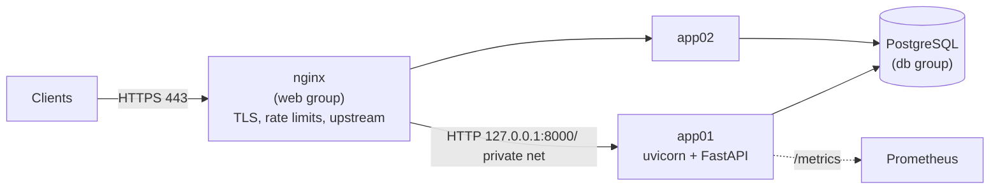

# 4.9 A real playbook end to end: deploying an application

| | |
|---|---|
| Level | Intermediate |
| Priority tier | 0 |
| Lab venue | ansible-core; 1 to 3 Ubuntu 22.04/24.04 VMs (Vagrant, Multipass or cloud) |
| Part | Part 4: Automation and infrastructure as code |
| Status | Drafted, labs **untested** |

## Why this matters for AI infrastructure

The previous chapters introduced pieces; real work is composing them into something that deploys a service repeatably. The pattern in this chapter (user and directories, virtual environment, application release, configuration from templates, systemd service, reverse proxy with TLS, database, firewall, health checks, rolling update) is the same whether the payload is an internal inventory API, a model-serving gateway, an Alertmanager webhook receiver, or the Slurm accounting stack. Working through one complete deployment also exposes the operational concerns that matter on a cluster: zero-downtime releases, rollback, secrets, verification and idempotency.

## Prerequisites and outcomes

Needs 4.3 to 4.8. After this chapter you can:

- Lay out an Ansible project (inventory, group_vars, playbooks, roles-ready structure, `requirements.yml`, `ansible.cfg`).
- Build a full deployment playbook: OS baseline, database, application release with a virtualenv, systemd unit, nginx reverse proxy with TLS, firewall, log rotation, monitoring hooks.
- Deploy releases into versioned directories with an atomic `current` symlink swap, keep N releases, and roll back.
- Perform rolling updates with `serial`, load balancer drain via `delegate_to`, health checks and automatic stop.
- Verify the result (assertions, `uri`, smoke tests) and prove idempotency.
- Compare a host-based deployment with a container-based one (Docker Compose via Ansible) and know when each fits.

## 1. Target architecture



Hosts: `web01` (nginx), `app01`, `app02` (the service), `db01` (PostgreSQL). On a small lab you can place everything on one VM; the playbook is organised by group so it scales.

### Why production deployment is harder than `runserver` (`AUR` Chapters 6 & 7 `mezzanine.yml`)

In *Ansible: Up and Running* Chapters 6 and 7, Bas Meijer, Lorin Hochstein, and René Moser contrast running a Python web application (`Mezzanine` `4.3.1` / `Django` `1.11.29`) on a developer laptop against deploying it to production:
- **Development vs. production stack (`AUR` Chapter 6):** On a laptop, `python manage.py runserver 0.0.0.0:8000` runs a single-threaded foreground HTTP server backed by a local **SQLite** file (`db.sqlite3`) with no TLS, no process supervision, and no concurrency. In production, the stack splits into dedicated components: (1) **NGINX** at the edge terminating HTTPS (`443`), redirecting HTTP (`80`), and serving `/static` files directly; (2) an application server (**Gunicorn** `20.1.0` for WSGI PEP 3333 or **Uvicorn** for ASGI) listening on a local Unix socket (`unix:{{ proj_path }}/gunicorn.sock` with `workers = cpu_count() * 2` in `gunicorn.conf.py.j2`) and managed by a process supervisor (**systemd** or **Supervisor** `/etc/supervisor/conf.d/mezzanine.conf` with `supervisorctl reread && supervisorctl update`); (3) **PostgreSQL** (`psycopg2`) with explicit character encoding (`UTF8`) and locale (`LC_CTYPE='en_US.UTF-8'`, `LC_COLLATE='en_US.UTF-8'`, requiring `template='template0'` on `postgresql_db`); and (4) **Memcached** (`127.0.0.1:11211`) for caching.
- **Key lessons from `mezzanine.yml` (`AUR` Chapter 7 `Examples 7-1` to `7-28`):**
  1. **Native C header prerequisites for Python packages:** Installing Python packages from source wheels (`psycopg2`, `Pillow`, `cryptography`) fails unless the OS `-dev` / `-devel` libraries (`libpq-dev`, `libjpeg-dev`, `libssl-dev`, `libffi-dev`, `python3-dev`) and `locales` are installed via `apt` first (`apt-cache policy libssl-dev`).
  2. **Checking out private Git repositories via SSH Agent Forwarding:** Rather than copying your personal SSH private key onto target servers, enable SSH agent forwarding in `ansible.cfg` (`[ssh_connection] ssh_args = -o ForwardAgent=yes` and `ssh-add -L`) and run `git: repo=git@github.com:ansiblebook/mezzanine_example.git dest={{ proj_path }} accept_hostkey=true` as the unprivileged user (`become: false`).
  3. **Separating `secrets.yml` and symbolic file modes:** Keep credentials (`db_pass`, `secret_key`, `admin_pass`, API tokens) in `vars_files: [secrets.yml]` (committed only as an encrypted Ansible Vault file or `secrets.yml.example` template). When setting file permissions on `file`, `copy`, or `template`, you can use quoted octal (`mode: '0750'`, `mode: '0640'`) or symbolic modes (`mode: 'u=rw,g=r,o=r'`—remembering to include `=` when specifying exact symbolic permissions).
  4. **Running framework management commands (`django_manage`), custom scripts (`script` with `environment:`), and `cron` jobs:** Use idempotent framework modules (`django_manage: command=migrate` and `command=collectstatic`, noting that running a raw `createdb` command twice fails with `CommandError: Database already created`), pass environment variables to helper scripts via the task `environment:` keyword (`script: scripts/setsite.py` with `environment: { PATH: "{{ venv_path }}/bin", PROJECT_DIR: "{{ proj_path }}", WEBSITE_DOMAIN: "{{ live_hostname }}" }`), and schedule periodic tasks with `ansible.builtin.cron` (`name: "poll twitter", minute: "*/5", user: "{{ user }}", job: "{{ manage }} poll_twitter"`).
  5. **Wildcard DNS (`nip.io`) and `ALLOWED_HOSTS` (`400 Bad Request`):** Because TLS certificates and Django/FastAPI `Host`-header validation (`ALLOWED_HOSTS = ["192.168.33.10.nip.io", "www.192.168.33.10.nip.io"]`) require a domain name rather than a bare IP, **`192.168.33.10.nip.io`** resolves automatically to `192.168.33.10` without configuring a custom DNS server (and if DNS rebinding protection blocks `nip.io`, add `192.168.33.10 192.168.33.10.nip.io` to `/etc/hosts`; if the browser returns `400 Bad Request`, the `Host` header did not match `ALLOWED_HOSTS`).

## 2. Project layout

```text
fleetapp-deploy/
├── ansible.cfg
├── requirements.yml                  # collections: community.postgresql, ansible.posix, community.general, community.crypto
├── inventories/
│   └── lab/
│       ├── hosts.yml
│       └── group_vars/
│           ├── all.yml               # app name, user, paths, versions
│           ├── web.yml
│           ├── app.yml
│           ├── db.yml
│           └── vault.yml             # encrypted: db password, secret keys (4.12)
├── playbooks/
│   ├── site.yml                      # imports the below
│   ├── baseline.yml
│   ├── database.yml
│   ├── app.yml
│   ├── web.yml
│   └── verify.yml
└── templates/
    ├── app.env.j2
    ├── fleetapp.service.j2
    ├── nginx-site.conf.j2
    └── pg_hba_snippet.j2
```

`site.yml` composes plays in dependency order and can be run in parts (`--tags db`, `-l app`):

```yaml
# playbooks/site.yml
- import_playbook: baseline.yml
- import_playbook: database.yml
- import_playbook: app.yml
- import_playbook: web.yml
- import_playbook: verify.yml
```

(After 4.11 these plays become roles; keeping them as plain plays first makes the flow easy to follow.)

## 3. Variables

```yaml
# inventories/lab/group_vars/all.yml
app_name: fleetapp
app_user: fleetapp
app_group: fleetapp
app_root: /opt/fleetapp
app_releases_dir: "{{ app_root }}/releases"
app_current: "{{ app_root }}/current"
app_keep_releases: 5
app_repo: https://git.example.com/platform/fleetapp.git
app_version: v1.4.2                       # tag or commit SHA: pin, do not track a branch
app_port: 8000
app_workers: 4
python_version_min: "3.10"
db_name: fleetapp
db_user: fleetapp
db_host: "{{ hostvars[groups['db'][0]]['ansible_host'] }}"
nginx_server_name: fleet.lab.example.com
```

Secrets live in `vault.yml` (encrypted) and are referenced indirectly (`db_password: "{{ vault_db_password }}"`), see 4.12.

## 4. The baseline and database plays

```yaml
# playbooks/baseline.yml
- name: OS baseline
  hosts: all
  become: true
  tags: [baseline]
  tasks:
    - name: Update apt cache
      ansible.builtin.apt: { update_cache: true, cache_valid_time: 3600 }
      when: ansible_facts['os_family'] == 'Debian'

    - name: Baseline packages
      ansible.builtin.package:
        name: [ca-certificates, curl, git, chrony, ufw, acl, python3-venv, python3-pip, rsync]
        state: present

    - name: Time sync enabled
      ansible.builtin.service: { name: chrony, state: started, enabled: true }

    - name: Set timezone to UTC
      community.general.timezone: { name: UTC }

    - name: Journald persistent storage
      ansible.builtin.file: { path: /var/log/journal, state: directory, mode: "2755" }
      notify: Restart journald

  handlers:
    - name: Restart journald
      ansible.builtin.service: { name: systemd-journald, state: restarted }
```

```yaml
# playbooks/database.yml
- name: PostgreSQL
  hosts: db
  become: true
  tags: [db]
  vars:
    pg_version: "16"
  tasks:
    - name: Install PostgreSQL and psycopg for Ansible
      ansible.builtin.apt:
        name: ["postgresql-{{ pg_version }}", python3-psycopg2]
        state: present

    - name: Listen on the private interface only
      ansible.builtin.lineinfile:
        path: "/etc/postgresql/{{ pg_version }}/main/postgresql.conf"
        regexp: '^#?listen_addresses'
        line: "listen_addresses = 'localhost,{{ ansible_host }}'"
      notify: Restart postgresql

    - name: Allow app hosts to connect with SCRAM
      ansible.builtin.lineinfile:
        path: "/etc/postgresql/{{ pg_version }}/main/pg_hba.conf"
        line: "host {{ db_name }} {{ db_user }} {{ hostvars[item]['ansible_host'] }}/32 scram-sha-256"
        insertafter: EOF
      loop: "{{ groups['app'] }}"
      notify: Reload postgresql

    - ansible.builtin.meta: flush_handlers

    - name: Create database role
      become_user: postgres
      community.postgresql.postgresql_user:
        name: "{{ db_user }}"
        password: "{{ db_password }}"
        encrypted: true
      no_log: true

    - name: Create database
      become_user: postgres
      community.postgresql.postgresql_db:
        name: "{{ db_name }}"
        owner: "{{ db_user }}"
        encoding: UTF8

    - name: Firewall: allow Postgres only from app hosts
      community.general.ufw:
        rule: allow
        proto: tcp
        port: "5432"
        src: "{{ hostvars[item]['ansible_host'] }}"
      loop: "{{ groups['app'] }}"

  handlers:
    - { name: Restart postgresql, ansible.builtin.service: { name: postgresql, state: restarted } }
    - { name: Reload postgresql,  ansible.builtin.service: { name: postgresql, state: reloaded } }
```

Notes: `become_user: postgres` needs the `acl` package for unprivileged-user temp files; `no_log: true` hides the password in output; real databases also need backups, WAL archiving and monitoring (outside this chapter's scope).

## 5. The application play: release directories and an atomic switch

A release-directory layout gives instant rollback and zero-downtime swaps:

```text
/opt/fleetapp/
├── releases/
│   ├── v1.4.1/            (previous)
│   │   ├── src/
│   │   └── venv/
│   └── v1.4.2/            (new)
├── shared/                (persistent data/config shared across releases)
└── current -> releases/v1.4.2
```

```yaml
# playbooks/app.yml
- name: Deploy application
  hosts: app
  become: true
  serial: "{{ rollout_serial | default(1) }}"       # one app host at a time
  max_fail_percentage: 0
  tags: [app]
  vars:
    release_dir: "{{ app_releases_dir }}/{{ app_version }}"
  pre_tasks:
    - name: Require a pinned version
      ansible.builtin.assert:
        that: app_version is match('^v[0-9]+\.[0-9]+\.[0-9]+$') or app_version is match('^[0-9a-f]{7,40}$')
        fail_msg: "app_version must be a tag or commit SHA, not a branch"

    - name: Take host out of the load balancer
      ansible.builtin.file:
        path: "/var/www/lb-drain/{{ inventory_hostname }}"      # simple demo of a drain flag; use your LB's API in real life
        state: touch
        mode: "0644"
      delegate_to: "{{ groups['web'][0] }}"
      changed_when: false

    - name: Wait for in-flight requests to finish
      ansible.builtin.pause: { seconds: 5 }                      # better: poll the app's active-connections metric

  tasks:
    - name: Application group and user
      ansible.builtin.group: { name: "{{ app_group }}", system: true }
    - ansible.builtin.user:
        name: "{{ app_user }}"
        group: "{{ app_group }}"
        system: true
        shell: /usr/sbin/nologin
        home: "{{ app_root }}"
        create_home: false

    - name: Directory skeleton
      ansible.builtin.file:
        path: "{{ item }}"
        state: directory
        owner: "{{ app_user }}"
        group: "{{ app_group }}"
        mode: "0755"
      loop: ["{{ app_root }}", "{{ app_releases_dir }}", "{{ app_root }}/shared", "{{ app_root }}/shared/logs"]

    - name: Fetch the release (pinned version)
      ansible.builtin.git:
        repo: "{{ app_repo }}"
        dest: "{{ release_dir }}/src"
        version: "{{ app_version }}"
        force: false
        depth: 1
      become_user: "{{ app_user }}"
      register: fetched

    - name: Create virtualenv and install pinned dependencies
      ansible.builtin.pip:
        requirements: "{{ release_dir }}/src/requirements.lock"
        virtualenv: "{{ release_dir }}/venv"
        virtualenv_command: python3 -m venv
      become_user: "{{ app_user }}"

    - name: Application environment file (secrets, mode 0600)
      ansible.builtin.template:
        src: app.env.j2
        dest: "{{ app_root }}/shared/fleetapp.env"
        owner: "{{ app_user }}"
        group: "{{ app_group }}"
        mode: "0600"
      no_log: true
      notify: Restart fleetapp

    - name: Run database migrations once per rollout (first host only)
      ansible.builtin.command:
        cmd: "{{ release_dir }}/venv/bin/alembic upgrade head"
        chdir: "{{ release_dir }}/src"
      environment:
        FLEET_DB_URL: "postgresql://{{ db_user }}:{{ db_password }}@{{ db_host }}/{{ db_name }}"
      become_user: "{{ app_user }}"
      run_once: true
      changed_when: "'Running upgrade' in migrate.stderr"
      register: migrate
      no_log: true

    - name: systemd unit
      ansible.builtin.template:
        src: fleetapp.service.j2
        dest: /etc/systemd/system/fleetapp.service
        mode: "0644"
      notify: Reload systemd and restart fleetapp

    - name: Atomically switch the current symlink
      ansible.builtin.file:
        src: "{{ release_dir }}"
        dest: "{{ app_current }}"
        state: link
        force: true
      notify: Restart fleetapp
      register: switched

    - ansible.builtin.meta: flush_handlers

    - name: Wait for the app to answer locally
      ansible.builtin.uri:
        url: "http://127.0.0.1:{{ app_port }}/readyz"
        status_code: 200
      register: ready
      until: ready.status == 200
      retries: 20
      delay: 3

    - name: Prune old releases (keep N)
      ansible.builtin.shell: |
        set -o pipefail
        ls -1dt {{ app_releases_dir }}/*/ | tail -n +{{ app_keep_releases + 1 }} | xargs -r rm -rf
      args: { executable: /bin/bash }
      changed_when: false

  post_tasks:
    - name: Put host back in the load balancer
      ansible.builtin.file:
        path: "/var/www/lb-drain/{{ inventory_hostname }}"
        state: absent
      delegate_to: "{{ groups['web'][0] }}"

  handlers:
    - name: Reload systemd and restart fleetapp
      ansible.builtin.systemd_service: { name: fleetapp, state: restarted, daemon_reload: true, enabled: true }
      listen: Restart fleetapp
    - name: Restart fleetapp
      ansible.builtin.systemd_service: { name: fleetapp, state: restarted, enabled: true }
```

(In the sketch two handlers share a `listen` topic; keep only one in real code to avoid double restarts. Package names, file paths and the drain mechanism are examples to adapt.)

Template for the unit:

```jinja
# {{ ansible_managed }}
[Unit]
Description=Fleet API
After=network-online.target
Wants=network-online.target

[Service]
User={{ app_user }}
Group={{ app_group }}
WorkingDirectory={{ app_current }}/src
EnvironmentFile={{ app_root }}/shared/fleetapp.env
ExecStart={{ app_current }}/venv/bin/uvicorn fleet.main:app --host 127.0.0.1 --port {{ app_port }} --workers {{ app_workers }} --proxy-headers --timeout-graceful-shutdown 25
Restart=on-failure
RestartSec=3
TimeoutStopSec=30
NoNewPrivileges=yes
ProtectSystem=strict
ProtectHome=yes
PrivateTmp=yes
ReadWritePaths={{ app_root }}/shared
LimitNOFILE=65536

[Install]
WantedBy=multi-user.target
```

and the environment file template (`app.env.j2`):

```jinja
FLEET_DB_URL=postgresql://{{ db_user }}:{{ db_password }}@{{ db_host }}/{{ db_name }}
FLEET_ENV={{ env_name | default('lab') }}
FLEET_SECRET_KEY={{ vault_secret_key }}
```

Release strategy points:

- **Pin versions** (tag or SHA); building dependencies from a lock file inside the release directory means the old release's venv stays intact for rollback.
- **Rollback** is changing `app_version` back (re-run), or manually repointing `current` and restarting; because old releases are retained, no rebuild is needed: `ansible-playbook playbooks/app.yml -e app_version=v1.4.1`.
- **Database migrations** must be backward compatible with the previous release during a rolling update (expand/contract): run migrations once, then roll code.
- **Systemd hardening** (`NoNewPrivileges`, `ProtectSystem`, `PrivateTmp`) reduces blast radius; adjust for needed write paths.
- Prefer building artefacts in CI (wheel/container) and having Ansible *deploy* an artefact over cloning source and installing on every host (reproducibility, speed, supply-chain control): `get_url` from an artefact repository with a checksum, or `pip` from an internal index with hashes.

## 6. The web tier: nginx, TLS and rate limiting

```yaml
# playbooks/web.yml
- name: Reverse proxy
  hosts: web
  become: true
  tags: [web]
  tasks:
    - ansible.builtin.package: { name: [nginx, ssl-cert], state: present }

    - name: Site configuration
      ansible.builtin.template:
        src: nginx-site.conf.j2
        dest: /etc/nginx/sites-available/{{ app_name }}.conf
        mode: "0644"
        validate: "nginx -t -c /etc/nginx/nginx.conf"      # NOTE: validating a fragment this way tests the whole config including the *old* file; use a staged-include approach or validate after placing with a rollback (see text)
      notify: Reload nginx

    - name: Enable site
      ansible.builtin.file:
        src: /etc/nginx/sites-available/{{ app_name }}.conf
        dest: /etc/nginx/sites-enabled/{{ app_name }}.conf
        state: link
      notify: Reload nginx

    - name: Disable default site
      ansible.builtin.file: { path: /etc/nginx/sites-enabled/default, state: absent }
      notify: Reload nginx

    - ansible.builtin.service: { name: nginx, state: started, enabled: true }

    - name: Firewall rules (HTTP/HTTPS/SSH)
      community.general.ufw: { rule: allow, port: "{{ item }}", proto: tcp }
      loop: ["22", "80", "443"]
    - community.general.ufw: { state: enabled, policy: deny }

  handlers:
    - { name: Reload nginx, ansible.builtin.service: { name: nginx, state: reloaded } }
```

```jinja
# nginx-site.conf.j2
upstream {{ app_name }} {

    server {{ hostvars[h]['ansible_host'] }}:{{ app_port }} max_fails=2 fail_timeout=10s;

    keepalive 32;
}
limit_req_zone $binary_remote_addr zone=api:10m rate=20r/s;

server {
    listen 80;
    server_name {{ nginx_server_name }};
    return 301 https://$host$request_uri;
}
server {
    listen 443 ssl http2;
    server_name {{ nginx_server_name }};
    ssl_certificate     /etc/ssl/{{ app_name }}/fullchain.pem;
    ssl_certificate_key /etc/ssl/{{ app_name }}/privkey.pem;
    ssl_protocols TLSv1.2 TLSv1.3;
    add_header Strict-Transport-Security "max-age=31536000" always;

    location / {
        limit_req zone=api burst=40 nodelay;
        proxy_pass http://{{ app_name }};
        proxy_http_version 1.1;
        proxy_set_header Connection "";
        proxy_set_header Host $host;
        proxy_set_header X-Forwarded-For $proxy_add_x_forwarded_for;
        proxy_set_header X-Forwarded-Proto $scheme;
        proxy_read_timeout 300s;
        proxy_buffering off;             # streaming responses (SSE) pass through
    }
    location = /healthz { access_log off; return 200 "ok\n"; }
}
```

Practical notes: the Jinja braces in nginx variables (`$host`) are fine because nginx uses `$`, not `{{ }}`; the example uses an `upstream` generated from inventory so adding an app host updates nginx on the next run. In the lab generate a self-signed certificate with `community.crypto` modules (`openssl_privatekey`, `openssl_csr`, `x509_certificate`) or use an internal CA/ACME client (`certbot`, `acme.sh`, `community.crypto.acme_certificate`) in production. Validate a new nginx config **before** it replaces the live one: render to a staging path, run `nginx -t` against a copy of the full config that includes it, or use the template's `validate` with a wrapper script that builds a temporary config tree; at minimum, apply with `notify: Reload nginx` (a failed reload keeps the old workers serving).

## 7. Verification play

```yaml
# playbooks/verify.yml
- name: End-to-end verification
  hosts: web
  gather_facts: false
  tags: [verify]
  tasks:
    - name: HTTPS endpoint answers
      ansible.builtin.uri:
        url: "https://{{ nginx_server_name }}/readyz"
        validate_certs: false          # lab only; production verifies against your CA bundle
        return_content: true
        status_code: 200
      register: https
      delegate_to: localhost
      retries: 10
      delay: 3
      until: https.status == 200

    - name: Version served matches what we deployed
      ansible.builtin.assert:
        that: (https.json.version | default('')) == app_version | regex_replace('^v', '')
        fail_msg: "Served {{ https.json.version | default('unknown') }}, expected {{ app_version }}"

    - name: Every app node reports ready (direct)
      ansible.builtin.uri:
        url: "http://{{ hostvars[item]['ansible_host'] }}:{{ app_port }}/readyz"
      loop: "{{ groups['app'] }}"
      delegate_to: "{{ groups['web'][0] }}"
```

Verification complements module idempotency: modules verify *state*, `uri`/`assert` verify *behaviour*.

## 8. Idempotency and safety checks

```bash
ansible-playbook playbooks/site.yml --syntax-check
ansible-lint playbooks/
ansible-playbook playbooks/site.yml --check --diff          # preview (expect some tasks to fail/skip in check mode on first install)
ansible-playbook playbooks/site.yml                         # real run
ansible-playbook playbooks/site.yml                         # second run: expect changed=0 except intentional tasks
ansible-playbook playbooks/app.yml -e app_version=v1.4.3 --limit app01     # canary release to one host
ansible-playbook playbooks/app.yml -e app_version=v1.4.1                  # rollback
```

If a second run shows `changed` tasks, fix them (common culprits: `command` tasks without `changed_when`, `lineinfile` regex mismatch, `git` with `force`, templates containing timestamps, repo clones on moving branches, package updates with `state: latest`).

## 9. A container-based variant

When the application ships as an image, Ansible's job shrinks to host prerequisites plus declarative container state:

```yaml
- name: Deploy containerised app
  hosts: app
  become: true
  tasks:
    - name: Install Docker engine (distribution/official repo; see Part 11 for GPU runtimes)
      ansible.builtin.package: { name: docker.io, state: present }
    - ansible.builtin.service: { name: docker, state: started, enabled: true }
    - name: Registry login (token from vault)
      community.docker.docker_login:
        registry_url: registry.example.com
        username: "{{ registry_user }}"
        password: "{{ vault_registry_token }}"
      no_log: true
    - name: Run the app container (pinned by digest)
      community.docker.docker_container:
        name: fleetapp
        image: "registry.example.com/platform/fleetapp@sha256:{{ app_image_digest }}"
        state: started
        restart_policy: unless-stopped
        published_ports: ["127.0.0.1:{{ app_port }}:8000"]
        env_file: "{{ app_root }}/shared/fleetapp.env"
        healthcheck:
          test: ["CMD", "python", "-c", "import urllib.request; urllib.request.urlopen('http://127.0.0.1:8000/healthz')"]
          interval: 10s
          retries: 3
        memory: 1g
        read_only: true
        cap_drop: [ALL]
        security_opts: ["no-new-privileges:true"]
        pull: true
```

For fleets of containers, Kubernetes (Part 5) replaces this; Ansible remains useful for the node layer (container runtime, GPU drivers, kubelet prerequisites) and for bootstrapping clusters (Kubespray). Compose files can be deployed with `community.docker.docker_compose_v2`.

## 10. Troubleshooting a failed deploy

| Symptom | Check |
|---|---|
| Service fails to start | `journalctl -u fleetapp -n 100 --no-pager`, `systemctl status`, run the `ExecStart` manually as the app user, verify the env file mode and variables |
| 502/504 from nginx | `curl` the upstream directly; `nginx -t`; `ss -ltnp` on the app host; firewall rules (`ufw status`); SELinux/AppArmor denials |
| Migrations failed mid-way | Make migrations transactional/backward compatible; fix forward; use `run_once` and a lock; keep a pre-migration backup |
| Different results per host | Unpinned dependencies, drift in packages; compare `pip freeze` and `ansible-inventory --host` data |
| Playbook slow | Fact gathering, repeated `apt` updates, `git clone` per host (use artefacts), `forks`, pipelining |
| Handler restarted too often | Non-idempotent templates; two handlers on one topic |
| Rolling update killed traffic | LB not drained; app not gracefully shutting down; readiness check missing; `serial` too large |

## 11. Lab

First, run the self-checking Python lab (`code/part04/ansible_app_deployment_lab.py`) locally. It verifies semantic tag and commit SHA version pinning (`validate_pinned_version`), the versioned release directory manager (`AtomicReleaseDeployer`: atomic `current` symlink switch, retaining `N` releases while pruning older ones, and instant rollback), and Gunicorn multiprocessing configuration rendering (`render_gunicorn_conf`, `AUR` Ch. 7).

```bash
python3 code/part04/ansible_app_deployment_lab.py
```

Next, on 1–3 Ubuntu VMs (all interactive shell steps below are `untested here`), work through these exercises:

1. **Scaffold the project** with the layout above; write `ansible.cfg`, `requirements.yml`, inventory (3 or 4 hosts).
2. **Baseline and DB**: run `baseline.yml` and `database.yml`; connect with `psql` from an app host; verify firewall and `pg_hba` entries; second-run idempotency.
3. **App play**: use a tiny sample FastAPI app (3.7) in a Git repo with `requirements.lock`; deploy v1.0.0; inspect the release layout; break `/readyz` to confirm the play fails before putting the host back in rotation.
4. **Rolling release**: bump to v1.0.1 with `serial: 1`; hit the load balancer in a loop (`while true; do curl -s ...; done`) and prove zero failed requests; then increase `serial` and show errors when draining is skipped.
5. **Rollback**: deploy v1.0.2 with a bug; roll back with `-e app_version=v1.0.1`; measure time.
6. **Nginx and TLS**: generate a self-signed cert with `community.crypto`, deploy, test `curl --cacert`; add a bad config and observe `validate`/reload behaviour; implement staged validation.
7. **Secrets**: move DB password and secret key to a vaulted file (4.12) and confirm `no_log` hides them, `--diff` does not print them, and file modes are `0600`.
8. **Verification and chaos**: run `verify.yml`; stop one app node and confirm nginx routes around it; stop the DB and see readiness fail.
9. **Idempotency audit**: run twice, fix every spurious change; run `ansible-lint`.
10. **Container variant**: deploy the same service as a container with `docker_container`; compare rollout speed, rollback, and config handling with the venv approach.
11. **Clean up** VMs.

## 12. Common mistakes

- Deploying from a moving branch; unpinned dependencies; building on every host from source.
- Overwriting the live release directory in place (no atomic switch, no rollback).
- Restarting all app hosts at once; no drain, readiness gate or `serial`.
- Secrets in templates rendered with `--diff` on; env files with loose modes.
- Running migrations from every host or in a way that is incompatible with the old code during rollout.
- Validating nginx/sudoers/sshd configs only after replacing them.
- Treating a green recap as proof the service works; no verification step.
- Firewalls opened to the world instead of source-restricted rules; databases listening on all interfaces.
- Using a play that works only on first run (non-idempotent shell commands).
- Not testing rollback until it is needed.

## 13. Interview angles

- "Walk me through deploying a Python service with Ansible with zero downtime." (release dirs, symlink swap, drain, serial, readiness, rollback.)
- "How do you handle database migrations in a rolling deployment?" (expand/contract, once-only execution.)
- "How do you roll back?" (old releases retained, version pin, symlink.)
- "Where do secrets go and how do you stop them leaking?"
- "How do you verify a deployment worked beyond module success?"
- "Ansible-built venv vs containers: trade-offs?"
- "What would you change to run this on 500 hosts?" (artefacts, forks/pipelining, roles, AAP, batches, LB API.)

## Exercises

1. **Development vs. Production Architecture and Multi-Play Decomposition (`site.yml`, `AUR` Chapters 6 & 7):** (a) Contrast running `manage.py runserver` or `uvicorn --reload` on a laptop with a production multi-tier deployment (NGINX TLS/rate-limiting + Gunicorn/Uvicorn under systemd/Supervisor + PostgreSQL + Memcached); (b) explain why `site.yml` splits the deployment into `baseline.yml`, `database.yml`, `app.yml`, `web.yml`, and `verify.yml` imported via `import_playbook`.
2. **PostgreSQL Provisioning, `become_user: postgres`, `pg_hba.conf` SCRAM-SHA-256, and UFW Source Filtering (`AUR` Chapter 7):** Trace `database.yml`, explaining: (a) why `become_user: postgres` requires the `acl` package on Ubuntu/Debian; (b) why `AUR` Chapter 7 passes `encoding='UTF8'`, `lc_ctype='en_US.UTF-8'`, `lc_collate='en_US.UTF-8'`, and `template='template0'` to `postgresql_db`; and (c) how `listen_addresses`, `pg_hba.conf` (`scram-sha-256`), and `ufw` (`src: "{{ hostvars[item]['ansible_host'] }}"`) restrict database access to the `app` group only.
3. **Versioned Release Directories (`/opt/fleetapp/releases/<version>`), Atomic `current` Symlink Swaps, and Instant Rollback:** Using `validate_pinned_version()` and `AtomicReleaseDeployer` in `code/part04/ansible_app_deployment.py`, explain: (a) why `app_version` must be a tag or commit SHA rather than `main`; (b) how building each release in its own `/opt/fleetapp/releases/v1.4.2/{src,venv}` directory and atomically switching `/opt/fleetapp/current` enables 5-second rollbacks (`-e app_version=v1.4.1`) without rebuilding; and (c) how old releases are pruned while keeping the last `N=5`.
4. **Zero-Downtime Rolling Updates (`serial: 1`), Expand/Contract Migrations (`run_once: true`), and `systemd` Hardening:** Trace the execution of `app.yml`: (a) why `alembic upgrade head` uses `run_once: true` and why schema migrations must follow the **expand/contract** pattern during a rolling deploy; (b) why `meta: flush_handlers` must run *before* the `uri` `/readyz` polling loop and `post_tasks` load-balancer undrain; and (c) what `NoNewPrivileges=yes`, `ProtectSystem=strict`, `ProtectHome=yes`, `PrivateTmp=yes`, and `ReadWritePaths={{ app_root }}/shared` enforce in `fleetapp.service.j2`.
5. **NGINX Reverse Proxy Generation (`upstream`, TLS, `limit_req_zone`, `proxy_buffering off`), `nip.io`, and End-to-End Verification (`verify.yml`, `AUR` Chapter 7):** (a) Explain how `nginx-site.conf.j2` generates the `upstream` block from `groups['app']`, why `proxy_buffering off` and `proxy_read_timeout 300s` matter for streaming AI/SSE gateways, and how `192.168.33.10.nip.io` and `ALLOWED_HOSTS` work in `AUR` Chapter 7; (b) explain how `verify.yml` proves behavioral correctness beyond module state.
6. **Host Virtualenv vs. Container Deployment (`community.docker.docker_container` Pinned by Digest):** Compare the Section 5 host virtualenv deployment (`git` + `pip` + `systemd`) with the Section 9 containerized deployment (`community.docker.docker_container` pinned by `@sha256:{{ app_image_digest }}` with `read_only: true`, `cap_drop: [ALL]`, `security_opts: ["no-new-privileges:true"]`, and `memory: 1g`), and explain when to transition from Ansible-managed containers to Kubernetes.

## Checkpoint questions (20)

<details>
<summary>1. In *Ansible: Up and Running* Chapters 6 and 7, what five gaps make a development server (`runserver` + SQLite) unsuitable for production, and what replaces each?</summary>

1. **Foreground single process** -> Replaced by **Gunicorn (`workers = cpu_count() * 2`)** or **Uvicorn** managed as a background daemon by **systemd** or **Supervisor** with automatic restart on crash.
2. **No TLS or static-file offloading** -> Replaced by **NGINX** terminating HTTPS (`443`), redirecting HTTP (`80 -> 301`), rate-limiting (`limit_req_zone`), and serving `/static/`.
3. **Local file-locked SQLite database** -> Replaced by **PostgreSQL** (`community.postgresql.postgresql_db` / `postgresql_user`).
4. **No caching layer** -> Replaced by **Memcached** or **Redis**.
5. **Hardcoded localhost & debug secrets** -> Replaced by templated `local_settings.py.j2` / `fleetapp.env` (`mode: "0600"`) populated from Ansible Vault (`secrets.yml`).
</details>

<details>
<summary>2. How does the Release Directory + `current` Symlink layout (`/opt/fleetapp/{releases,shared,current}`) enable atomic switches and instant rollbacks?</summary>

Each deployment checks out code and builds an isolated virtualenv inside `/opt/fleetapp/releases/<version>/` while the running service continues serving traffic from the previous `/opt/fleetapp/releases/<old_version>/` via `/opt/fleetapp/current`. Only after the new virtualenv and migrations succeed does Ansible atomically repoint the **`/opt/fleetapp/current` symlink** (`state: link, force: true`) to `releases/<version>` and restart the service. Because the last `app_keep_releases: 5` directories remain intact on disk, rolling back (`-e app_version=v1.4.1`) simply repoints `current` and restarts the service in seconds with zero network downloads or compilation.
</details>

<details>
<summary>3. Why must `app_version` be pinned to an immutable Git tag (`v1.4.2`) or commit SHA rather than a branch name (`main`)?</summary>

If `app_version` is set to a moving branch like `main`, running the playbook at different times (or scaling out a new app node a week later) deploys different commits to different servers in the same fleet, and rolling back by re-running the playbook is impossible. Enforcing `app_version is match('^v[0-9]+\\.[0-9]+\\.[0-9]+$') or app_version is match('^[0-9a-f]{7,40}$')` in `pre_tasks` guarantees every host runs the exact same immutable code.
</details>

<details>
<summary>4. How does SSH Agent Forwarding (`ForwardAgent=yes`) let target hosts clone private Git repositories without storing SSH private keys on the servers (`AUR` Chapter 7)?</summary>

When you load your deployment SSH key into your local `ssh-agent` (`ssh-add -L`) and set `ssh_args = -o ForwardAgent=yes` in `[ssh_connection]` in `ansible.cfg`, OpenSSH forwards a Unix socket back to your control node's agent for the duration of the Ansible session. When the unprivileged `git` task (`become: false`) runs on the target host (`repo: git@github.com:...`, `accept_hostkey: true`), the remote `git` client authenticates using the forwarded agent socket without the private key ever touching the target server's disk.
</details>

<details>
<summary>5. Why does `become_user: postgres` require the `acl` package on Ubuntu/Debian, and why did `AUR` Chapter 7 specify `template: template0` on `postgresql_db`?</summary>

- **Why `acl` is required for `become_user: postgres`:** When Ansible switches from `root` to an unprivileged user (`postgres` or `fleetapp`), the temporary module script in `~/.ansible/tmp/` must be readable by `postgres` without making it world-readable (`0777`) to every user on the system. When the **`acl` package (`setfacl`)** is installed, Ansible grants read/execute ACLs specifically to `postgres` on the temporary file securely.
- **Why `template: template0`:** In PostgreSQL, the default `template1` database has a fixed locale/encoding; specifying custom `encoding: UTF8`, `lc_collate: 'en_US.UTF-8'`, and `lc_ctype: 'en_US.UTF-8'` on `postgresql_db` requires cloning from the clean **`template0`** template.
</details>

<details>
<summary>6. How do you lock down PostgreSQL network exposure in `database.yml`?</summary>

Apply three defense-in-depth controls:
1. **`postgresql.conf` (`listen_addresses`):** Bind only to `'localhost,{{ ansible_host }}'` (the private management/app VLAN IP), not `'*'`.
2. **`pg_hba.conf` (`scram-sha-256`):** Allow only the specific database, user, and `/32` IP addresses of `groups['app']` using `scram-sha-256` password authentication (never `trust` or `md5`).
3. **Host firewall (`ufw` / `nftables`):** Allow TCP port `5432` **only** from `src: "{{ hostvars[item]['ansible_host'] }}"` for `item` in `groups['app']`.
</details>

<details>
<summary>7. Why must database migrations (`alembic upgrade head` or `django_manage: command=migrate`) use `run_once: true` and follow the Expand/Contract pattern?</summary>

- **`run_once: true`:** If 10 app servers ran `alembic upgrade head` simultaneously, they would race on DDL table locks or corrupt migration state; `run_once: true` runs the schema migration once on the first host.
- **Expand/Contract pattern:** During a rolling update (`serial: 1`), `app01` is running new release `v1.4.2` while `app02` is still serving live traffic on old release `v1.4.1` against the **same database**. Therefore, any migration applied before the rollout must be **backward-compatible with `v1.4.1`** (e.g., *Expand*: add a nullable column or new table in `v1.4.2`; *Contract*: drop the old column only in a later release `v1.4.3` after all `v1.4.1` instances are gone).
</details>

<details>
<summary>8. In `app.yml`, why is `- ansible.builtin.meta: flush_handlers` placed immediately after switching the `current` symlink and BEFORE the `uri` `/readyz` check?</summary>

Normally, handlers (`Restart fleetapp`) do not run until the **very end of the `tasks:` section**. If `meta: flush_handlers` were omitted before the `Wait for the app to answer locally` (`uri: url=http://127.0.0.1:8000/readyz`) task, the `uri` readiness check would test the **old running `fleetapp` process** *before* `systemd` ever restarted `fleetapp` onto the new `current` symlink, and the host would be put back into the load balancer *before* the restart happened. `meta: flush_handlers` forces the restart to happen immediately so `/readyz` verifies the newly started release before `post_tasks` undrains the host.
</details>

<details>
<summary>9. How does the `shell` release-pruning task (`ls -1dt ... | tail -n +6 | xargs -r rm -rf`) work safely?</summary>

- `ls -1dt {{ app_releases_dir }}/*/` lists release directories sorted newest-first (`-t`), one per line (`-1d`).
- `tail -n +{{ app_keep_releases + 1 }}` (e.g., `tail -n +6` when `app_keep_releases: 5`) skips the 5 newest releases and outputs only the 6th and older directories.
- `xargs -r rm -rf` deletes those old directories (`-r` / `--no-run-if-empty` ensures `rm` is not invoked at all when fewer than 6 releases exist).
</details>

<details>
<summary>10. What do the systemd security-hardening directives in `fleetapp.service.j2` protect against?</summary>

- **`User=fleetapp` / `Group=fleetapp`** (system account with `/usr/sbin/nologin`): runs the service without root privileges.
- **`NoNewPrivileges=yes`**: prevents the process and any children it forks from ever gaining new privileges via `setuid`/`setgid` binaries.
- **`ProtectSystem=strict`**: mounts the entire OS filesystem (`/usr`, `/boot`, `/etc`) **read-only** inside the service's mount namespace.
- **`ProtectHome=yes`**: makes `/home`, `/root`, and `/run/user` inaccessible.
- **`PrivateTmp=yes`**: gives the service an isolated `/tmp` and `/var/tmp` deleted on service stop.
- **`ReadWritePaths={{ app_root }}/shared`**: carves out the einzige directory the service is allowed to write to.
</details>

<details>
<summary>11. How does `nginx-site.conf.j2` configure upstream failover, rate limiting, and SSE/LLM streaming support?</summary>

- **Dynamic upstream & passive health checks:** Loops over `groups['app'] | sort` to emit `server <ip>:8000 max_fails=2 fail_timeout=10s;` with `keepalive 32;` so NGINX automatically routes around an unresponsive app node within seconds.
- **Rate limiting:** `limit_req_zone $binary_remote_addr zone=api:10m rate=20r/s;` and `limit_req zone=api burst=40 nodelay;` protect the backend from request floods per client IP.
- **Streaming / SSE passthrough:** `proxy_http_version 1.1;`, `proxy_set_header Connection "";`, `proxy_buffering off;`, and `proxy_read_timeout 300s;` ensure Server-Sent Events and streaming LLM responses flush token-by-token without NGINX buffering or closing slow generation streams.
</details>

<details>
<summary>12. Why is `validate: "nginx -t -c /etc/nginx/nginx.conf"` on a site fragment (`/etc/nginx/sites-available/fleetapp.conf`) a subtle trap, and how do you handle NGINX config changes safely?</summary>

When Ansible runs `validate:` on `template`, it renders the new file to a temporary path `/tmp/ansible.xyz` (`%s`). If `validate:` runs `nginx -t -c /etc/nginx/nginx.conf` without `%s`, `nginx -t` validates the **old** `/etc/nginx/sites-enabled/fleetapp.conf` currently on disk, not the new temporary file. And if you pass `nginx -t -c %s` on a `server { ... }` fragment, `nginx -t` fails because the fragment lacks top-level `events {}` and `http {}` blocks. In practice, either validate the full `nginx.conf` template, use a staging wrapper script, or rely on **`notify: Reload nginx`** (`systemctl reload nginx`), because NGINX validates its configuration before reloading and **keeps existing worker processes serving traffic if the new config has a syntax error**.
</details>

<details>
<summary>13. What is `nip.io`, and why did `AUR` Chapter 7 encounter a `400 Bad Request` error when testing `mezzanine.yml`?</summary>

- **`nip.io` (and `sslip.io`):** A free wildcard DNS service where any hostname of the form `<ip>.nip.io` or `www.<ip>.nip.io` (`192.168.33.10.nip.io`) resolves to `<ip>` (`192.168.33.10`), letting you test virtual-host routing and TLS certificates on local Vagrant/lab IPs without running a DNS server.
- **`400 Bad Request` (`ALLOWED_HOSTS`):** Django (and FastAPI `TrustedHostMiddleware`) rejects any HTTP request whose `Host:` header is not listed in `ALLOWED_HOSTS` with `HTTP 400 Bad Request` to prevent HTTP Host-header poisoning attacks. Adding `192.168.33.10.nip.io` to `domains` in `local_settings.py.j2` fixed the `400` error.
</details>

<details>
<summary>14. Why do you need a separate `verify.yml` play when all tasks in `database.yml`, `app.yml`, and `web.yml` already reported `ok` or `changed`?</summary>

Configuration modules only prove **static file and process state** ("the file `/etc/nginx/sites-enabled/fleetapp.conf` exists and `nginx` is running"). They do **not** prove that NGINX can reach `app01:8000` through the firewall, that `app01` can authenticate to `db01:5432`, or that the running process is serving the newly deployed version `v1.4.2`. `verify.yml` runs end-to-end `uri` and `assert` checks against `https://{{ nginx_server_name }}/readyz` and every backend node to verify **live system behavior**.
</details>

<details>
<summary>15. Compare the Host Virtualenv deployment (Section 5) with the Containerized deployment (`community.docker.docker_container`, Section 9).</summary>

- **Host virtualenv (`git` + `pip` + `systemd`):** Zero container runtime overhead; easy to inspect directly on the host; however, every target host must install native C compilers/`-dev` headers (`libpq-dev`) and build wheels (or pull from an internal wheelhouse), and OS library drift across hosts can cause differences.
- **Containerized (`community.docker.docker_container` pinned by `@sha256:...`):** The image is built and scanned **once in CI**; target hosts need only Docker/containerd; rollouts and rollbacks pull an immutable digest with `read_only: true`, `cap_drop: [ALL]`, and `memory: 1g` isolation.
</details>

<details>
<summary>16. What causes a second run of `ansible-playbook playbooks/site.yml` to report `changed > 0`, and how do you make it 100% idempotent?</summary>

Common culprits when auditing the second run:
1. `pre_tasks` touching/removing a drain file (`/var/www/lb-drain/{{ inventory_hostname }}`) on every run -> add `changed_when: false` to transient drain toggles or gate the deploy tasks on whether `app_version` differs from the current symlink target.
2. `git` task tracking a moving branch or setting `force: true` -> pin `version: v1.4.2` and `force: false`.
3. `command: alembic upgrade head` always reporting `changed` -> set `changed_when: "'Running upgrade' in migrate.stderr"`.
4. `shell` release pruner always reporting `changed` -> set `changed_when: false` (or register removed directories).
</details>

<details>
<summary>17. Why is cloning source code and running `pip install` on 500 production hosts an anti-pattern at scale, and what should replace it?</summary>

Having 500 hosts simultaneously `git clone` and `pip install` hammers your Git server and PyPI mirror, takes minutes of CPU time per host, requires compilers on production servers, and risks partial network failures mid-rollout. At scale, **build the artifact once in CI**—either a container image pushed to a private registry (deployed by digest), a pre-built virtualenv archive/PEX/wheelhouse fetched via `get_url` with `checksum: "sha256:..."`, or a golden VM image—and use Ansible purely to distribute and activate the pre-built artifact.
</details>

<details>
<summary>18. How do you troubleshoot a `502 Bad Gateway` vs. a `504 Gateway Timeout` from NGINX after deploying the application?</summary>

- **`502 Bad Gateway`:** NGINX could not establish a TCP/Unix-socket connection to the upstream (`uvicorn`/`gunicorn` is not running, crashed on startup, is listening on `127.0.0.1:8000` instead of the private IP `{{ ansible_host }}:8000` that NGINX dials, or is blocked by `ufw` / SELinux). Check `systemctl status fleetapp`, `journalctl -u fleetapp -n 100`, and `ss -ltnp | grep 8000` on the app host.
- **`504 Gateway Timeout`:** NGINX connected to the upstream, but the app took longer than `proxy_read_timeout` to respond (e.g., the app is hung waiting on a deadlocked database migration or an unreachably firewalled PostgreSQL port `5432`).
</details>

<details>
<summary>19. How do you protect secrets (`db_password`, `vault_secret_key`, `vault_registry_token`) across `database.yml`, `app.yml`, and `web.yml`?</summary>

1. Store all secret values in an **Ansible-Vault-encrypted file** (`inventories/lab/group_vars/vault.yml`) or fetch them from HashiCorp Vault / cloud secret managers, referenced indirectly in plaintext `all.yml` (`db_password: "{{ vault_db_password }}"`).
2. Add **`no_log: true`** (and **`diff: false`** on `template`) to every task that consumes a secret (`postgresql_user`, `app.env.j2`, `alembic upgrade head`, `docker_login`).
3. Set **`mode: "0600"`** and `owner: "{{ app_user }}"` on `fleetapp.env`.
</details>

<details>
<summary>20. How does `playbooks/site.yml` use `import_playbook` and tags so operators can run either the full stack or a single tier?</summary>

`playbooks/site.yml` statically composes the tier playbooks in dependency order (`import_playbook: baseline.yml`, `database.yml`, `app.yml`, `web.yml`, `verify.yml`), and each tier play sets a play-level tag (`tags: [baseline]`, `tags: [db]`, `tags: [app]`, `tags: [web]`, `tags: [verify]`). An operator can provision a brand-new environment end-to-end with `ansible-playbook playbooks/site.yml`, or roll out a fast application code release + verification in 15 seconds with `ansible-playbook playbooks/site.yml --tags app,verify`.
</details>

## Sources and review notes

- **Sources read in full:**
  - `ansible-up-and-running-3rd-edition` — Bas Meijer, Lorin Hochstein & René Moser, *Ansible: Up and Running*, 3rd ed., **Chapter 6: Introducing Mezzanine: Our Test Application** (read in full: development `manage.py runserver` + SQLite vs production multi-tier stack with NGINX TLS/static files, Gunicorn WSGI over Unix socket, Supervisor process management, PostgreSQL, and Memcached) and **Chapter 7: Complex Playbooks** (read in full: complete `mezzanine.yml` playbook, `vars:` and `vars_files: [secrets.yml]`, native C `-dev` apt packages, `git` with SSH agent forwarding `ForwardAgent=yes` and `accept_hostkey: true`, `pip` virtualenv, `postgresql_user` and `postgresql_db` with `become_user: postgres` and `template0`/`UTF8` locale settings, `local_settings.py.j2` `ALLOWED_HOSTS`, `django_manage` `migrate`/`collectstatic`, `script: scripts/setsite.py` with `environment:`, `gunicorn.conf.py.j2` `workers = cpu_count() * 2`, `supervisor.conf.j2`, `openssl req` with `creates:`/`chdir:`, `cron` `*/5` job, symbolic file modes `'u=rw,g=r,o=r'`, and `192.168.33.10.nip.io` wildcard DNS and `400 Bad Request` troubleshooting).
- **Run here:** `python3 code/part04/ansible_app_deployment_lab.py` (3 passed, 0 failed).
- **Explicitly labelled inferences:** The `validate_pinned_version`, `AtomicReleaseDeployer`, and `render_gunicorn_conf` models in `code/part04/ansible_app_deployment.py` and the `fleetapp` FastAPI + systemd + PostgreSQL + NGINX release-directory playbooks (`baseline.yml`, `database.yml`, `app.yml`, `web.yml`, `verify.yml`) are the author's constructions modernizing *Ansible: Up and Running* Chapters 6 & 7 for FastAPI/Uvicorn and containerized infrastructure services (plus original study items 21, 22, 23, 24, 25, 26, 27, 28, 29, and 30).
- **Not verified on live hardware:** Live `ansible-playbook`, `postgresql`, `alembic`, `systemctl`, `nginx`, `ufw`, and `docker_container` runs (`v1.4.1..v1.4.3`, `8000`, `5432`, `443`, `2755`, `0755`, `0644`, `0600`, `65536`, `192.168.33.10.nip.io`) are marked (`untested here`) where not executed by `ansible_app_deployment_lab.py`.
