# 4.10 Debugging Ansible playbooks

| | |
|---|---|
| Level | Intermediate |
| Priority tier | 0 |
| Lab venue | ansible-core; 2 to 3 Linux targets |
| Part | Part 4: Automation and infrastructure as code |
| Status | Drafted, labs **untested** |

## Why this matters for AI infrastructure

Picture a rollout that has been running for twenty minutes. The first few dozen nodes came back green, and then one node stops with a message you have never seen before. The rest of the fleet is waiting in the queue. Nobody in the room wants to rerun the whole playbook, because nobody knows yet whether a rerun will repeat the damage or fix it. Automation failures tend to arrive at the worst moments. A driver rollout stops halfway through 200 GPU nodes. A maintenance window has a deadline. Or the run happens in CI, where there is no person sitting at a terminal to attach a debugger.

In each case, fast diagnosis decides how the day goes. Think of a doctor facing a patient who has just collapsed. The doctor checks whether the patient can breathe before anything else, because every other check depends on that. The equivalent questions in Ansible come in a fixed order. Does the file parse? Can we connect? Can we become the right user? Do the variables hold the values we expect? Does the application itself work? Asking them in order saves hours. It also keeps you away from two dangerous reflexes. The first is "just rerun it," which can repeat half-finished changes on hosts that were already partly updated. The second is "just add `ignore_errors`," which hides the failure rather than explaining it. The layers below give you that order, with the exact tool for each one.

## Prerequisites and outcomes

This chapter builds on 4.3 to 4.9. By the end, you will be able to:

- Read an Ansible error message and tell which layer failed, in seconds.
- Use verbosity from `-v` to `-vvvv`, and the `debug` and `assert` modules, to see what Ansible sees.
- Use `--step`, `--start-at-task` and `--check --diff` to run only the part you are investigating.
- Turn on the interactive debugger with `strategy: debug` or the `debugger:` keyword.
- Diagnose SSH and connection, privilege, Python interpreter, module argument, variable, template and YAML problems.
- Reproduce a failing module by hand on the target, keeping its remote files with `ANSIBLE_KEEP_REMOTE_FILES`.
- Profile slow runs and find the expensive tasks and the fact gathering.
- Build habits that prevent bugs: lint, syntax check, dry run, small steps and canaries.

## 1. A layered method

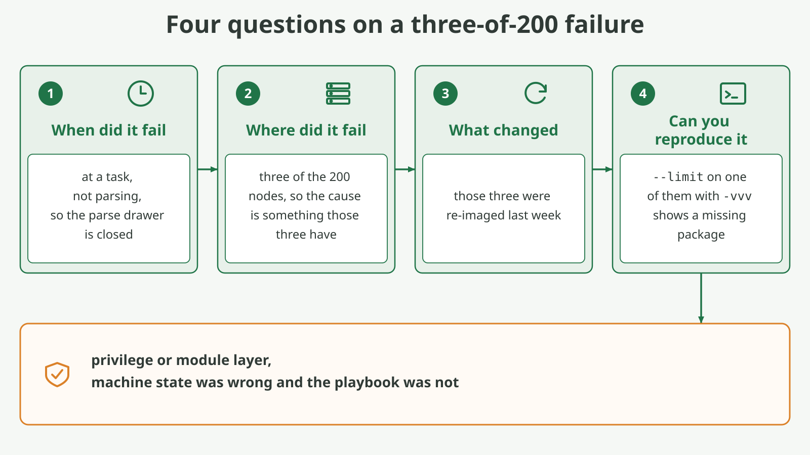

*Figure 4.10.1. Comparing a failing host with a passing one points to machine state rather than the playbook.*

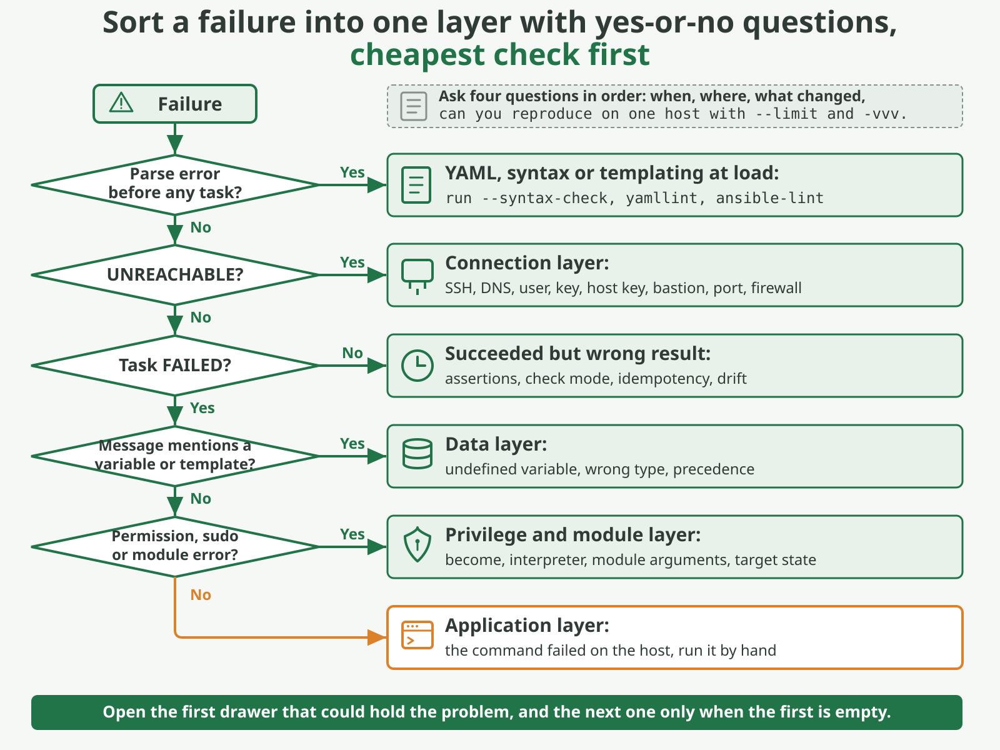

*Figure 4.10.2. A flowchart sorts a playbook failure into a layer by asking yes or no questions in order, starting with the parse check and ending at the application.*

A playbook fails at 4 PM on a Friday. The error message is long, and it points at a task you did not write. Debugging goes faster when you work through layers, starting with the cheapest question: does the file even parse? Each layer below rules out one class of problem before you move to the next, so you never fix the wrong thing first.

Your playbook fails with a long message that does not say much. Where do you look first? The flowchart below sorts the failure into a layer, so you check the most likely cause before anything else. Read it from the top, and let each yes or no send you one step closer to the layer.

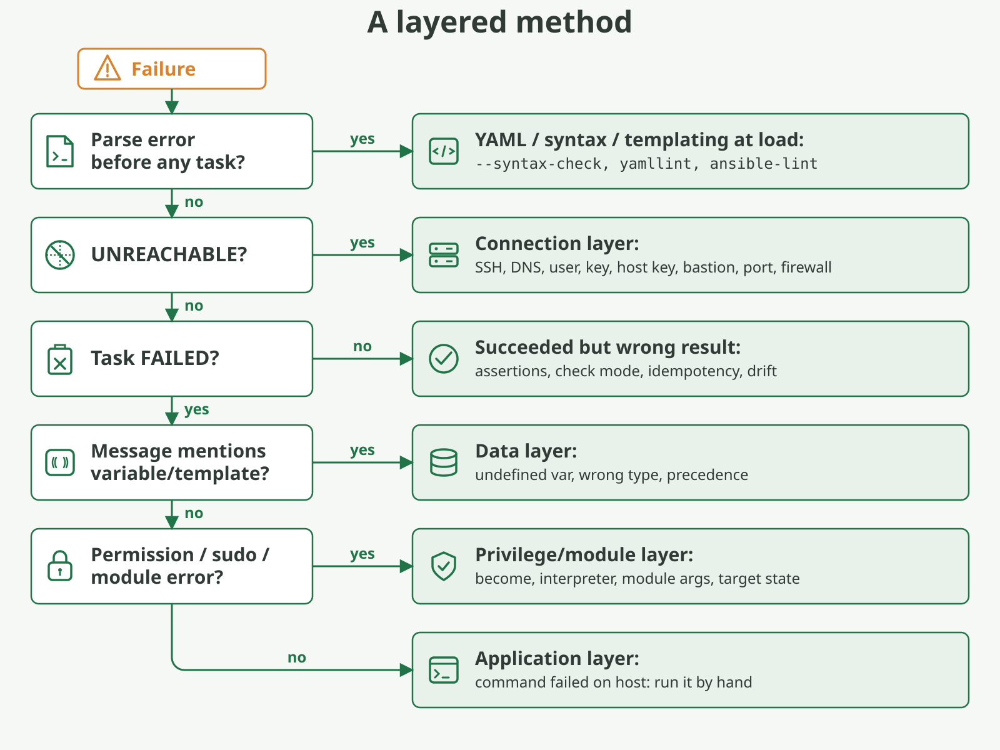

*Figure 4.10.3. A layered method, as a diagram.*

Think of the flowchart as a set of drawers. You open the first drawer that could hold your problem, and you open the next one only when the first is empty. The first question is about parsing, because a file that does not parse never runs a single task. Every later question would be asking about a playbook that Ansible never managed to load. The connection question comes next. A host you cannot reach cannot tell you anything, and its error hides the real state of the machine. The data and privilege questions follow. The application layer comes last. It is the layer people blame first, and it is the least often the real cause, because a command that fails on the host usually fails for a reason that the earlier layers would have shown you.

Four questions help you narrow the search, and you should ask them in order. **When** did it fail: before tasks, at a task, in a handler, or after? **Where** did it fail: on all hosts, some hosts, or one? **What changed** since the last good run: code, inventory, versions or target state? **Can you reproduce it** on one host, using `--limit` and `-vvv`? Differences between failing and passing hosts give the most useful clue. Compare the OS version, Python, facts, variables and network path. Before you change anything, put one failing host next to one passing host.

Here is how the four questions work on a realistic case. Suppose a driver task fails on only three of the 200 nodes. The *when* answer is that it failed at a task, not during parsing, so the first drawer is closed. The *where* answer is three hosts, which tells you the cause is probably something those three have and the others lack. The *what changed* answer is that those three were re-imaged last week. When you reproduce on one of them with `--limit` and `-vvv`, the output shows a missing package, and the failure belongs to the privilege or module layer. The playbook was never wrong. The machine state was, and the flowchart got you there without a guess.

## 2. Verbosity and output

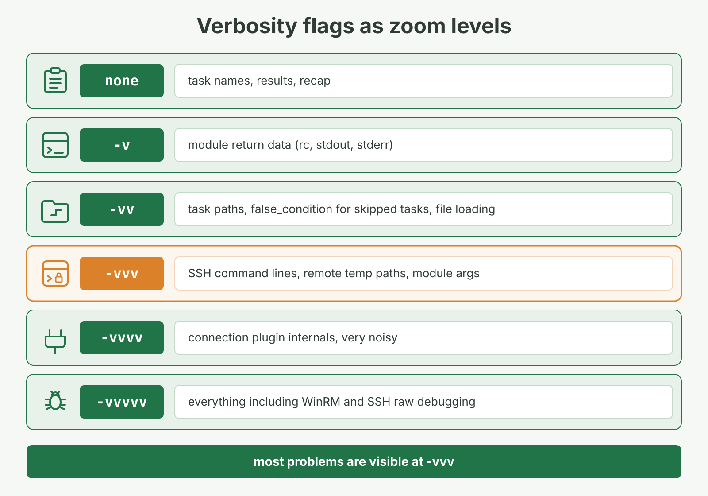

*Figure 4.10.4. Start at the default level and add one v at a time, because most problems are visible at three v.*

The default output shows that a task failed, but not why. Verbosity flags reveal more of the run. You choose how much to read based on how stuck you are, starting small and adding detail only when the smaller view leaves a question open.

Imagine a task that fails on one host out of twenty. The default output says the task failed, and that is all it says. It does not show the command Ansible tried, the text the remote program printed, or the value of a variable that the task used. You can think of the verbosity flags as zoom levels on a map. At the default level you see the country outline. Each extra `v` brings in another layer of roads, then towns, then individual buildings. You do not need the street view for every problem, so you start at the default and move down one level when the view leaves a question open. The flags below add detail one level at a time, so pick the level that answers your question.

| Flag | Shows |
|---|---|
| (none) | Task names, results, recap |
| `-v` | Module return data (registered values, `rc`, `stdout`, `stderr`) |
| `-vv` | Adds task paths and `false_condition` for skipped tasks, file loading |
| `-vvv` | Adds connection details: SSH command lines, remote temp paths, module args |
| `-vvvv` | Adds connection plugin internals (SSH debug), plugin loading; very noisy |
| `-vvvvv` | Everything including WinRM/SSH raw debugging |

A few `ansible.cfg` settings make the output easier to read.

```ini
[defaults]
stdout_callback = yaml
callbacks_enabled = timer, profile_tasks, profile_roles
display_skipped_hosts = false
log_path = ansible.log
```

A callback is the part of Ansible that decides how results are printed. The default callback prints each result on one line, which is fine for a short result and hard to read for a long one. Here is why the settings above help. The `yaml` callback shows multi-line values clearly. A stack trace or a long `stdout` block stays readable, and you do not have to decode `\n` sequences by eye. Newer releases use `result_format = yaml` with the default callback, which gives you the same benefit without changing the printer. The `callbacks_enabled` line adds timing, so every run tells you how long each task took. Hiding skipped hosts shortens the output, which matters when a 200-node run prints a line for every host. The log file keeps a persistent record after the terminal scrolls away. The record may also hold secrets, because Ansible writes what it printed, so mark any task that handles a password with `no_log`.

In a CI pipeline, the terminal is a log file, and colour codes turn into noise. Set `ANSIBLE_NOCOLOR=1` in CI logs to keep the text clean. A person reads a text log, but a script reads a JSON log. For machine-readable output, use `ANSIBLE_STDOUT_CALLBACK=json` or `ansible.posix.json`, which print one JSON document at the end of the run. A script can then load that document and count the failures without any text matching. You can also use `ansible.posix.jsonl`, which writes one JSON object per event, or send events to a log pipeline that your team already watches.

Choose the verbosity level by the question you are asking. Use `-vvv` when you want the SSH command line or the module arguments, because those show what Ansible tried to do on the wire. Use `-vvvv` only for connection internals, because the output at that level is very long and most problems are visible at `-vvv`.

## 3. The `debug` and `assert` modules

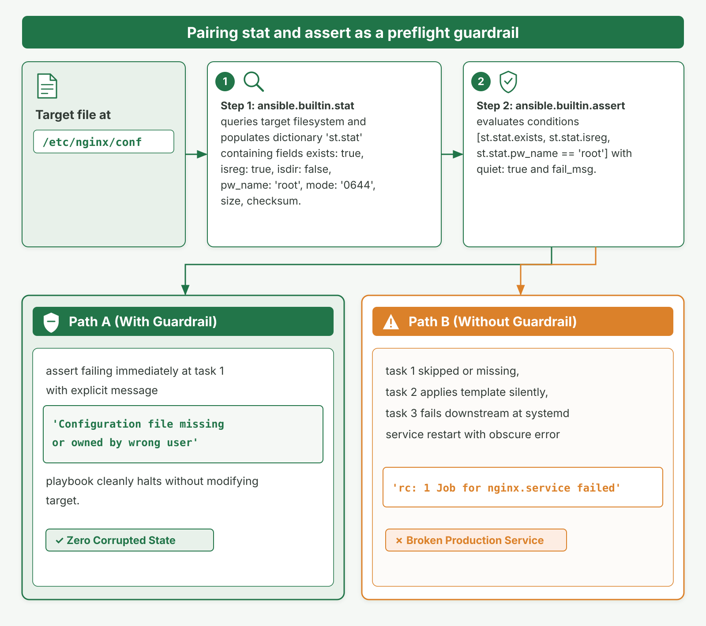

*Figure 4.0.0. Pairing stat and assert creates a preflight guardrail that halts the play immediately with an explicit error message instead of failing downstream during service startup.*

A variable is not what you expected, so you ask the run to print it. The `debug` module prints values, and `assert` stops the run with a clear message when a condition is false. Both turn a silent wrong value into a visible fact you can act on.

Sometimes the quickest fix is to look at what Ansible actually sees. A value that looks right in your YAML can arrive as something else once it is templated. The `debug` and `assert` modules let you print the value and stop the run early when it is wrong.

```yaml
- name: Look at a variable
  ansible.builtin.debug:
    var: nccl_env                               # prints name and value; no braces needed

- name: Look at an expression
  ansible.builtin.debug:
    msg: "{{ inventory_hostname }} has {{ gpu_count | default('unset') }} GPUs in groups {{ group_names }}"
  verbosity: 1                                  # only shown with -v or more: leave in the code safely

- name: Dump all variables for one host (careful: secrets)
  ansible.builtin.debug:
    var: hostvars[inventory_hostname]
  when: inventory_hostname == 'gpu001' and debug_dump | default(false)

- name: Fail early with a useful message
  ansible.builtin.assert:
    that:
      - gpu_count is defined
      - gpu_count | int in [4, 8]
    fail_msg: "gpu_count must be 4 or 8 for {{ inventory_hostname }}, got {{ gpu_count | default('undefined') }}"
    quiet: true
```

The `debug` module prints values after templating, which means after Jinja has filled in the braces. That timing is the reason it is so useful. Suppose you pass `-e gpu_count=8` on the command line and then compare it with a number in a `when:` test. Looking at your YAML tells you nothing about whether the value arrived as a number or as the text `"8"`. The `debug` module shows you what the task received, so a typing problem becomes visible. The same is true for a string `"False"` where you expected a boolean. Because that string is not empty, it counts as true in a plain `when:` test, and the task runs when you meant it to be skipped. Use `verbosity:` to keep helpful diagnostics in the code permanently, because they stay silent on normal runs and appear only when someone asks for more output. For structured output, pass the value through `to_nice_json` or `to_nice_yaml`, which turns a dictionary into a readable block. Never leave debug output of secrets in committed code or CI logs.

The `assert` module is the other half of the pair. Where `debug` shows you a value, `assert` checks a condition and stops the run with your own message when the condition is false. Put it at the top of a role, where a missing variable would otherwise surface far away as a template error. Pair `ansible.builtin.stat` with `ansible.builtin.assert` when the task depends on a file. `stat` looks at the filesystem and reports what it finds. Registering `stat: path=/etc/nginx/conf` into `st` returns a `st.stat` dictionary, which is a set of facts about that path. The fields you will assert on most are `exists`, `isdir`, `isreg`, `mode`, `pw_name`, `size` and `checksum`, which is a SHA-1 fingerprint of the file's contents. Checkpoint question 5 lists them all. You can assert on them directly, as in `assert: { that: [st.stat.exists, st.stat.isdir, st.stat.pw_name == 'root'] }`.

Put the `stat` and `assert` pair in front of any task that depends on the file, so a bad state fails with a clear message. Without the pair, a missing config file usually shows up three tasks later, as a service that refuses to start. With the pair, the run stops at the exact line that found the problem, and the message says which file was wrong and what value it had.

## 4. Controlling the run while investigating

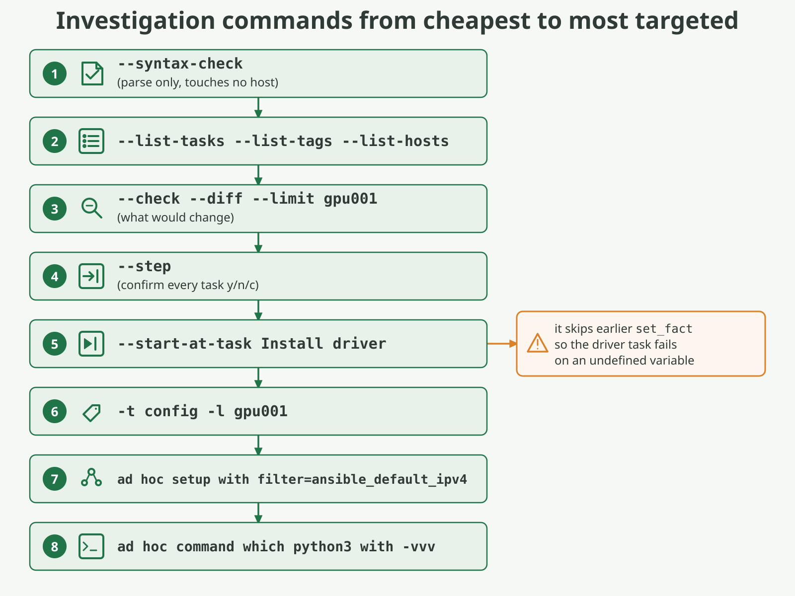

*Figure 4.10.5. Start-at-task skips the earlier tasks, so a variable they set may be undefined and cause a misleading error.*

Sometimes you want to stop at one task, run only the failing part, or step through each task and decide what happens next. The controls below narrow the run to the spot where the problem lives, so the rest of the fleet is not touched while you look.

You do not always need to run a whole playbook to learn what it will do. Ansible has flags that stop, list or limit the run, so you can see the effect before anything changes on a host.

```bash
ansible-playbook site.yml --syntax-check                    # parse only
ansible-playbook site.yml --list-tasks --list-tags --list-hosts
ansible-playbook site.yml --check --diff --limit gpu001     # what would change
ansible-playbook site.yml --step                            # confirm every task (y/n/c)
ansible-playbook site.yml --start-at-task "Install driver"  # resume mid-playbook (skips earlier tasks and their set_fact)
ansible-playbook site.yml --limit @site.retry               # rerun only failed hosts (enable retry files or write failures yourself)
ansible-playbook site.yml -t config -l gpu001               # one tag on one host
ansible-playbook site.yml -e debug_dump=true -vv
ansible gpu001 -m ansible.builtin.setup -a 'filter=ansible_default_ipv4'      # inspect facts
ansible gpu001 -m ansible.builtin.command -a 'which python3' -vvv            # test connectivity & interpreter
```

Each line answers one question, from a syntax check to a connectivity test. Read the list from the top, because the early lines cost almost nothing and they rule out the cheapest mistakes. A syntax check touches no host at all. A `--list-tasks` run shows you what the playbook would do without doing it. A `--check --diff` run goes further and reports what would change on the host you named, still without changing it. When you are ready to act, `--limit` keeps the blast radius small, so one host gets the change while the rest of the fleet waits.

The `--step` flag is useful when you do not yet trust the order of a playbook. Ansible pauses before each task and asks what to do, and you answer yes, no or continue. It is slow, but it gives you a chance to stop before a task that you suspect is dangerous. The `-e debug_dump=true` line pairs with the `debug` task from section 3, so you can switch on a dump only when you need it. The last two lines are the ad hoc commands. They run one module against one host, which is the fastest way to ask a single question, such as "what is this host's default address?" or "which Python does this host use?"

Be careful with `--start-at-task` and tags, though. They skip the earlier tasks, and those tasks may have set facts or variables that later tasks need. Picture a `set_fact` near the top of a play that computes the GPU driver branch. If you start the run at the driver task, that `set_fact` never executes, and the driver task fails on an undefined variable. The error looks real, but it comes from your shortcut and not from the host. To avoid that, reproduce the problem with only the context it needs, such as a `set_fact` in a scratch play or the `-e` values.

### The interactive debugger

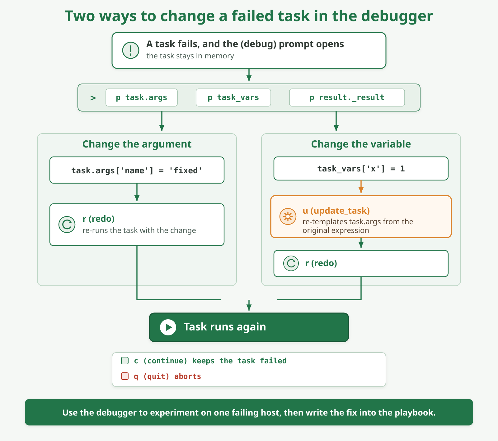

*Figure 4.10.6. In the task debugger you can edit the rendered arguments and redo, or edit a variable, update the task, and then redo.*

The debugger pauses a failing task and gives you a prompt, where you can inspect variables and retry. It is a live look at the moment the task broke. Use it when the output alone does not explain the failure, and close it once you have the answer.

Think of it as a freeze-frame. The run stops at the exact task that failed, with the task's arguments and variables still in memory, and it waits for you. Nothing is rolled back, so the host stays in the state the failed task left it. You can read the values, change one of them, and try the task again, all while the rest of the play waits. The debugger is a way to experiment on one host, and it is not a way to keep a broken play running.

Ansible has a built-in task debugger. It runs when a task fails, or on every task if you ask for it. It is modelled on `pdb`, which is the Python debugger, so the commands feel familiar if you have used it before. You can set it on a play, a block or a single task. The `strategy: debug` line makes the whole play use the debugger strategy, while the `debugger:` keyword is narrower, and it applies only where you put it.

```yaml
- hosts: gpu
  strategy: debug            # the play's tasks drop into the debugger on failure
  debugger: on_failed        # also per play/block/task: always, never, on_failed, on_unreachable, on_skipped
  tasks:
    - name: Something fragile
      ansible.builtin.command: /bin/false
      debugger: on_failed
```

You can also turn it on without editing any playbook, with `ANSIBLE_ENABLE_TASK_DEBUGGER=True ansible-playbook site.yml`. Once the prompt opens, you work with the commands in this table.

| Command | Action |
|---|---|
| `p task`, `p task.args`, `p task_vars`, `p task_vars['hostvars']`, `p result._result` | Print task, arguments, variables, result |
| `task.args['name'] = 'fixed'` | Modify arguments |
| `task_vars['x'] = 1` + `update_task` | Change variables and re-template the task |
| `redo` (`r`) | Re-run the task with the modifications |
| `continue` (`c`) | Continue the play (task stays failed) |
| `quit` (`q`) | Abort |

Use the debugger to experiment on one failing host, then write the fix into the playbook. It does not work in non-interactive CI.

## 5. Classifying common failures

Failures come in layers, and each layer leaves its own signature. An unreachable host is a connection problem, a missing variable is a templating problem, and a permission error is a privilege problem. Naming the layer first saves the time you would otherwise spend applying the wrong fix.

Consider a plumber who is called to a house with no water. A plumber who opens the wall first and finds no pipe has wasted an hour. The better habit is to check the meter outside, then the valve, then the pipe. Error messages work the same way. The text of an error tells you where the run was when it broke, and that tells you which layer to inspect. An error that appears before any task runs points at the file. An error that says `UNREACHABLE` points at the path to the host. An error that appears inside a task, with a `FAILED` status, points at the task's arguments, the privilege it ran with, or the command it ran on the host.

An error message appears in your terminal, and the next step depends on which layer produced it. The tables below pair common messages with what they mean and how to fix them. Find the table for the layer where the failure happened, then match the message to a row. If no row matches, go back to the flowchart in section 1 and ask the four questions again.

### Parse and templating errors before execution

These errors stop the run before any task starts, so no host is touched. That is good news, because nothing has changed yet and you can fix the file and try again at no cost. Look at the line Ansible reports, and remember that the real mistake is often on the line before it. YAML reads a file top to bottom, and a missing quote on one line can leave the parser confused about the line after it. Reporting that confusion on the next line is the parser doing its best. A quick way to check is `yamllint` on the file, which points at the spot where the structure first went wrong.

| Message | Meaning | Fix |
|---|---|---|
| `ERROR: Syntax Error while loading YAML` / `mapping values are not allowed here` | Bad YAML: unquoted colon, indentation, tab | Quote strings; `yamllint`; check the line shown (the real error is often the line before) |
| `found unacceptable key (unhashable type)` | A value like `{{ var }}` unquoted at start of a line is parsed as a mapping | Quote: `"{{ var }}"` |
| `ERROR: 'xxx' is not a valid attribute for a Task` | Misspelled keyword or module argument at wrong indentation | Check module/keyword names (`ansible-doc -t keyword -l`) |
| `couldn't resolve module/action 'foo'` | Module/collection not installed or not FQCN-resolvable | `ansible-galaxy collection list`; install; use FQCN |
| `The task includes an option with an undefined variable` | A variable is undefined at templating time | `default()`, `is defined`, check precedence/scope/typos |
| `template error while templating string: unexpected '}'` | Unbalanced braces/quotes in Jinja | Reproduce in a `debug` task; use `` for literal braces |
| `AnsibleUndefinedVariable: 'dict object' has no attribute 'x'` | Wrong key or the object is a different shape than assumed | `debug: var=` the parent; `default({})` chains |
| `conditional check failed` / `Conditional result was derived from a non-boolean` | `when:` evaluated a string/undefined | Cast with `\| bool`; fix expression |

### Connection layer (UNREACHABLE)

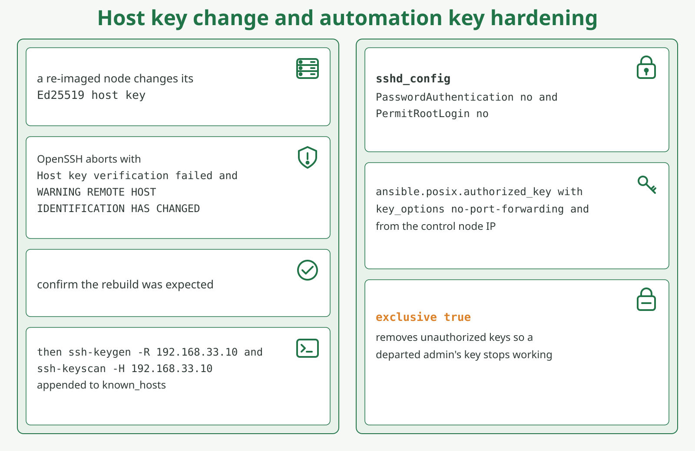

*Figure 4.10.7. Replace a host key only after confirming the rebuild, and use exclusive true so old keys are removed.*

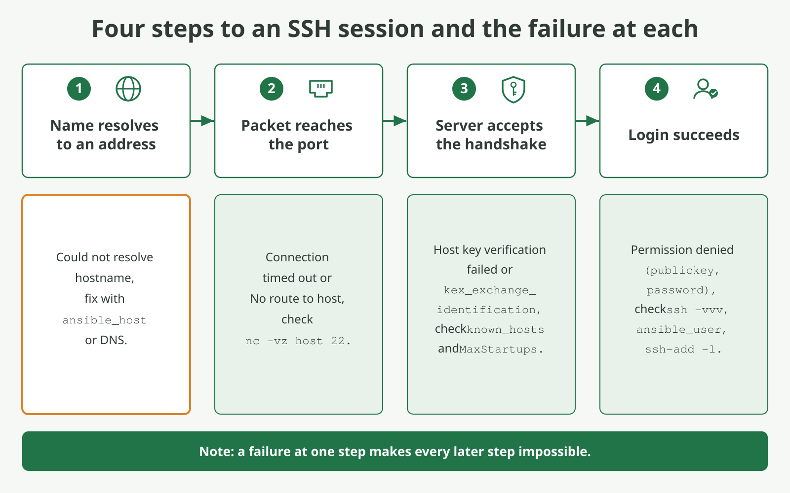

*Figure 4.10.8. A login error tells you nothing if the network step before it is still failing.*

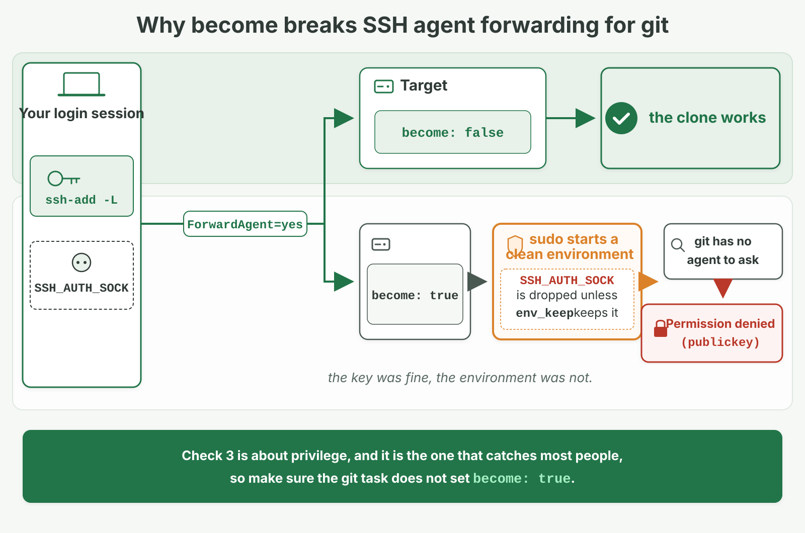

*Figure 4.10.9. The forwarded SSH agent works only without become, because sudo starts a clean environment that drops the SSH_AUTH_SOCK variable.*

The task never reached the host. The question is whether Ansible can open an SSH session as the user it expects, and the checks below answer that one step at a time, from the network up to the login. SSH is the secure shell, the encrypted remote login that Ansible uses by default. Each step builds on the one before. First the name must resolve to an address. Then a packet must reach the port. Then the server must accept the handshake, and finally the login must succeed. A failure at one step makes every later step impossible, so a login error tells you nothing if the network is still down.

When a host is `UNREACHABLE`, Ansible never got a working SSH session. Think of it as a phone call that never connects. Maybe the number is wrong, maybe the line is down, or maybe someone answers and then refuses to let you in. The table lists the usual symptoms, and each one points at a different cause. Start with the symptom you see, not with a guess at the cause. The table tells you which step failed, and each step has its own check.

| Symptom | Cause | Check |
|---|---|---|
| `Permission denied (publickey,password)` | Wrong user/key, key not authorised, agent has too many keys (`Too many authentication failures`) | `ssh -vvv user@host`; `ansible_user`; `IdentitiesOnly=yes`; `ssh-add -l` |
| `Host key verification failed` | New/changed key | Investigate; fix `known_hosts`; do not disable globally |
| `Connection timed out` / `No route to host` | Network, firewall, wrong IP | `nc -vz host 22` (or `nc hostname 2222` to read the `SSH-2.0-OpenSSH_...` banner), route, bastion `ProxyJump`, tcpwrappers (`/etc/hosts.allow`), SELinux |
| `Could not resolve hostname` | DNS | Use `ansible_host`, fix DNS/`/etc/hosts` |
| `Connection closed by remote host` / `kex_exchange_identification` | sshd rate limits (`MaxStartups`), fail2ban banning the control node | Lower `forks`, raise MaxStartups, whitelist controller |
| Hangs for a long time then fails | Reverse DNS delays (`UseDNS`), unreachable sudo prompts, `-k` password prompts | `timeout`, disable `UseDNS`, check prompts with `-vvvv` |
| `Failed to create temporary directory` | Home not writable, full disk, `noexec` mount on tmp, `remote_tmp` | Set `remote_tmp`, check `df`, mount options |
| `Shared connection to host closed` with output truncated | Output after SSH closed; tty issues | Pipelining, `-o ControlPersist`, check `requiretty` |

Some SSH problems come up again and again. The first is a changed host key. A host key is the fingerprint a server presents so that your client knows it is talking to the same machine as before. Your client saves that fingerprint in `known_hosts` the first time it connects. Picture a receptionist who has your photo on file. When a stranger arrives wearing the same name badge, the receptionist should stop and ask questions. That is the protection working, not a bug. When a lab VM (`192.168.33.10`) is destroyed and recreated, or a bare-metal GPU node is re-imaged, its Ed25519 host key changes. OpenSSH then aborts with `Host key verification failed`, and the warning `WARNING: REMOTE HOST IDENTIFICATION HAS CHANGED` appears. The safe move is to confirm that the rebuild was expected, then replace the old entry. Remove the stale key entry, then record the new host key cleanly:

```bash
ssh-keygen -R 192.168.33.10
ssh-keyscan -H 192.168.33.10 >> ~/.ssh/known_hosts
```

The second is hardening. Hardening means making a host harder to misuse. Think of it as changing the locks on a building so that only the people with the right keys can enter, and only through the right door. On production hosts, enforce `PasswordAuthentication no` and `PermitRootLogin no` in `/etc/ssh/sshd_config`. The first setting turns off password logins, so a guessed password cannot open the host. The second stops anyone from logging in directly as root. Deploy the automation SSH public keys with `ansible.posix.authorized_key`, which adds a key to the list of keys the host trusts. Use **`key_options: 'no-port-forwarding,from="93.184.216.34"'`** to limit the key to connections from the control node or bastion IP, and to turn off SSH port forwarding. A bastion is a jump host, a single machine that sits between your network and the private ones, and every login goes through it. Port forwarding lets a connection tunnel through the host to somewhere else, which an automation key has no reason to do. Add **`exclusive: true`** so that any unauthorized keys are removed from `~/.ssh/authorized_keys`. Without that flag, an old key from a departed admin keeps working quietly, because the task only adds keys and never removes them.

The third is agent forwarding on `git` tasks. An SSH agent is a small program on your laptop that holds your private key, so the key never has to be copied to a server. Agent forwarding lets a remote host ask your agent to sign a request on its behalf. That is how a remote host can clone a private repository without storing a key of its own. If a `git` task on a remote host fails with `Permission denied (publickey)` while cloning a private repository (`git@github.com:...`), work through three checks. Check 1 is `ssh-add -L`, which confirms that your key is loaded in the local agent. Check 2 confirms that `ForwardAgent=yes` is active, which you see in the `SSH: EXEC` line of `ansible web -vvv -m ping`. Check 3 is about privilege, and it is the one that catches most people. Make sure the `git` task does **not** set `become: true`. Here is why. The forwarded agent socket is a path that exists only in your login session, and it is passed through an environment variable called `SSH_AUTH_SOCK`. When `sudo` starts a command as root, it builds a fresh, clean environment, and that variable is dropped unless `sudoers` keeps it through `env_keep`. The `git` process then has no agent to ask, and the clone fails with a message that looks like a key problem. The key was fine. The environment was not. Check (3) is the one people miss most often, so check it early.

### Privilege and module layer

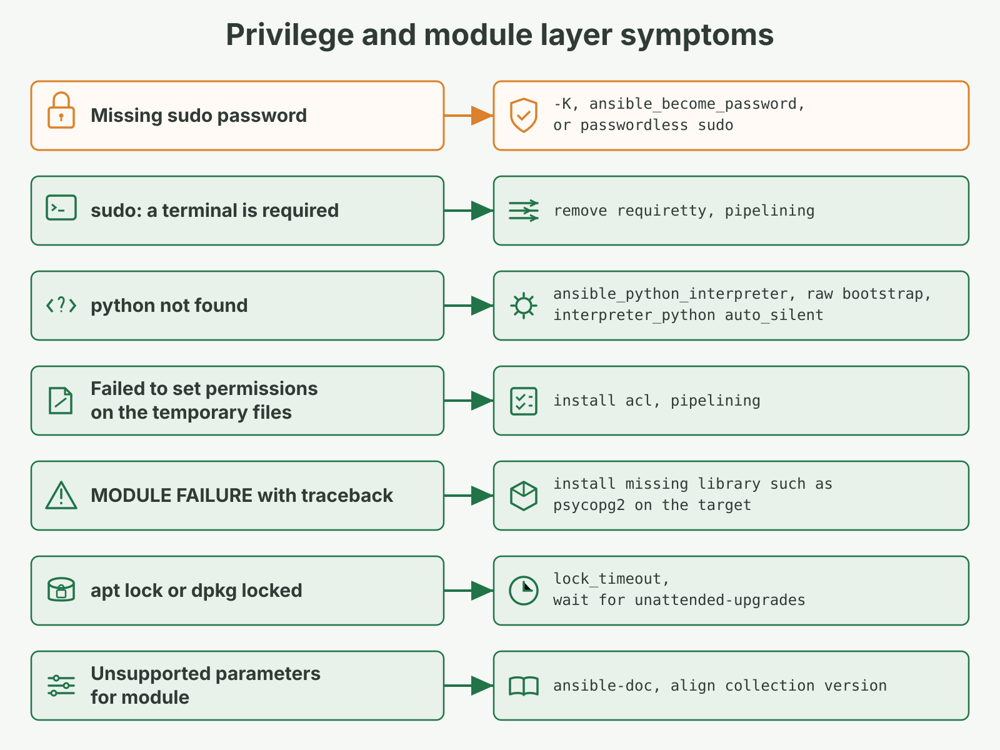

*Figure 4.10.10. Check privilege first, because it is a more common cause than a module problem.*

The connection worked, but the task could not do its job. Picture a delivery driver who reaches the building but has no key to the loading dock. The driver got there, and the door still stays shut. The usual causes are missing root rights, which is the key to the dock, or a module that depends on a package the target does not have yet, which is a tool the driver forgot to bring. Ansible's `become` setting is the way a task asks for root rights, usually through `sudo`. Check the privilege first, because it is the more common of the two. If the privilege is right, the module itself is the next suspect.

| Symptom | Cause | Fix |
|---|---|---|
| `Missing sudo password` | sudo requires password | `-K`/`ansible_become_password`, or passwordless sudo for the automation user |
| `sudo: a terminal is required` / `no tty present` | `requiretty` or missing tty | Remove `requiretty` for the user; enable pipelining |
| `/bin/sh: 1: /usr/bin/python: not found` or module needs Python | No/wrong interpreter | `ansible_python_interpreter`, bootstrap with `raw`, `interpreter_python=auto_silent` |
| `Failed to set permissions on the temporary files` | become to unprivileged user without ACL support | Install `acl`, use `pipelining`, or `allow_world_readable_tmpfiles` (understand the security impact) |
| `MODULE FAILURE` with a Python traceback | Module bug, missing target library (e.g. `psycopg2`, `docker` SDK), version mismatch | Read the traceback; install the dependency on the *target* (or the controller for local modules); upgrade collection |
| Module works with `command` but not the dedicated module | Different environment, locale, PATH, SELinux | `environment:`, `-vvv` to see env, run manually |
| `apt` lock / `dpkg` locked | Another package process running (unattended-upgrades) | `lock_timeout`, wait, disable the competing job |
| `Unsupported parameters for (module) module: foo` | Argument name wrong or from a newer collection | `ansible-doc <module>`; align collection version |

### Application layer

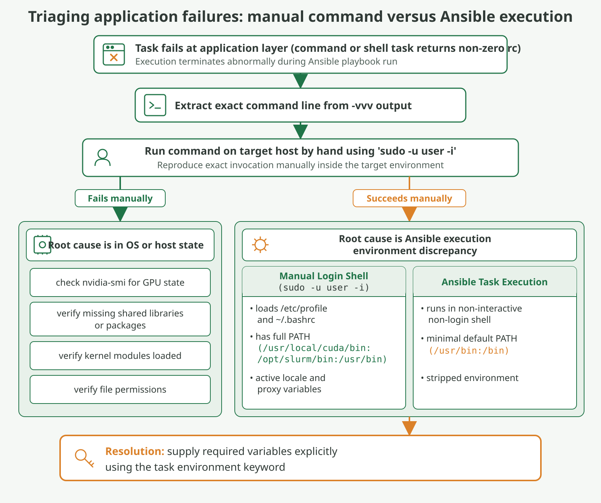

*Figure 4.0.0. Testing a failing command manually with sudo -u user -i isolates whether the failure stems from host state or from environment discrepancies such as minimal PATH in Ansible non-login shells.*

The task succeeded, but the service it started is still broken. Ansible reports on the module, not on the application, so you check the application directly. A green recap only means the module did its job. Think of a mechanic who replaces a part and marks the job as done. The work order is closed, but the car still makes the noise. The module ran correctly, and the application underneath it did not behave.

Suppose a `command` or `shell` task fails. Copy the exact command from the `-vvv` output, then run it on the host as the same user, in the same environment and working directory. You can do that with `sudo -u user -i`, which starts a login shell as that user, so the environment matches what the task saw. Most problems at this layer are plain command problems, such as a wrong `PATH`, a missing package, a kernel module that is not loaded, or a GPU in a bad state. A quick check with `nvidia-smi` shows whether the GPU answers at all. When a failure does not match any row above, run the command by hand and see whether it fails the same way. If it fails by hand, the bug is in the command or the host. If it works by hand but fails under Ansible, go back to the environment checks from section 5, because the difference is in what the task received.

## 6. Reproducing a module run by hand

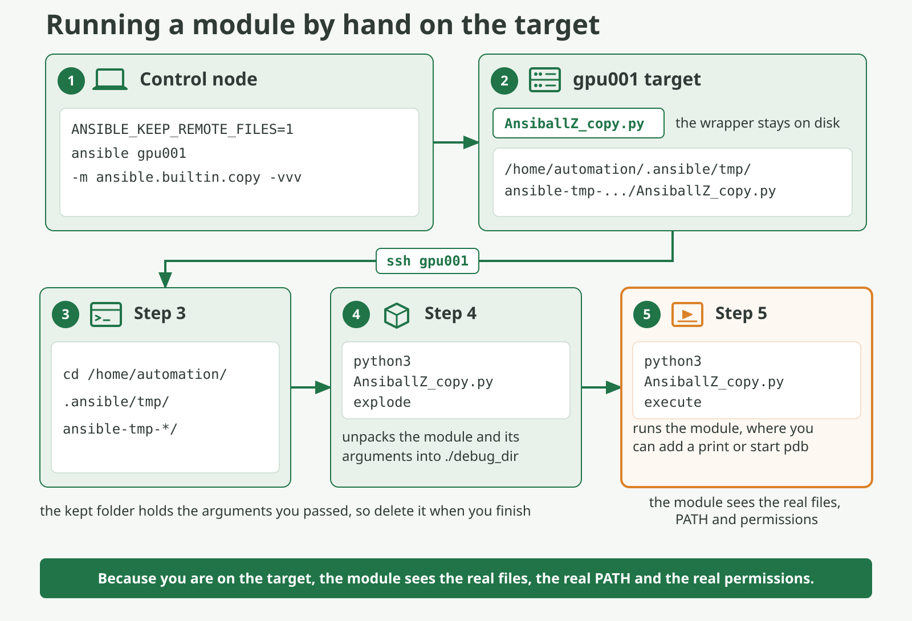

*Figure 4.10.11. Keeping the module wrapper on the target lets you unpack it and run it by hand, where you can see what the module actually saw.*

When a module fails in a way the logs do not explain, you can run the same code yourself on the target. Reproducing it removes Ansible from the picture and shows what the module actually saw on that machine, which is often the missing piece. It is a bit like taking an engine out of a car and running it on a test bench. The engine is the same engine, but now you can see the gauges, and nothing else in the car is in the way.

Ansible does not send your module as plain Python. It packs the module and its arguments into a self-contained bundle, which Ansible calls an AnsiballZ wrapper, and then runs that bundle on the target. The wrapper is a zip file with a small Python header. Normally Ansible deletes the wrapper when the task ends, so you never see it. A module fails with a traceback you cannot explain from the controller side. Run the module on the target yourself, where you can add prints or step through it. Setting `ANSIBLE_KEEP_REMOTE_FILES=1` keeps the module wrapper on the target, and the output shows where it lives.

```bash
ANSIBLE_KEEP_REMOTE_FILES=1 ansible gpu001 -m ansible.builtin.copy -a "src=./x dest=/tmp/x" -vvv
# the output shows the remote path: /home/automation/.ansible/tmp/ansible-tmp-.../AnsiballZ_copy.py
ssh gpu001
cd /home/automation/.ansible/tmp/ansible-tmp-*/
python3 AnsiballZ_copy.py explode     # unpack the module and its arguments (args file) into ./debug_dir
python3 AnsiballZ_copy.py execute     # run it with a debugger or modify the source
```

Walk through what happened in the commands above. The first command runs the copy module on `gpu001` and keeps the wrapper on disk, and `-vvv` prints the remote path where it landed. You log in to the host and change into that folder. The `explode` step unpacks the bundle into a readable folder, so you can see the module's Python source and the JSON file that holds its arguments. The `execute` step runs the module the same way Ansible would, which is the moment to add a `print` or to start `pdb`, the Python debugger. Because you are on the target, the module sees the real files, the real `PATH` and the real permissions, so a difference from the controller shows up immediately.

This works for any module, and it lets you add `print` statements or run under `pdb` on the target. For `ansible-playbook`, set the same environment variable, and use `-vvvv` to see how Ansible invoked SSH. For a custom module, pass a JSON args file directly, as in `python mymodule.py args.json`. See 4.15. Clean up the kept files afterwards. The wrapper holds the arguments you passed, and on a host that handles secrets those arguments may include a password, so delete the folder when you finish.

## 7. Debugging variables and templates

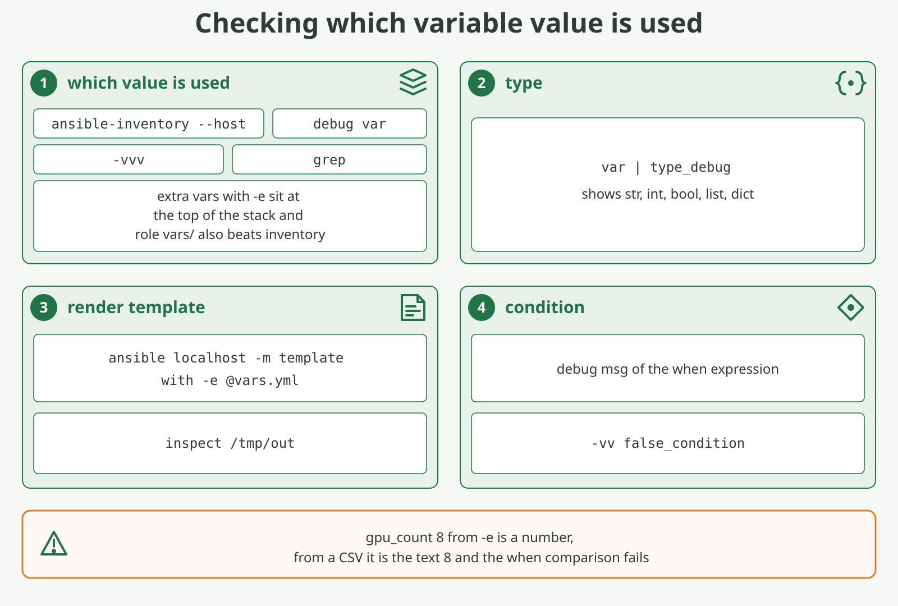

*Figure 4.10.12. A value that arrives as text instead of a number breaks a comparison even though the code did not change.*

Most playbook bugs are variable bugs in disguise. A value is missing, a type is wrong, or a template renders something unexpected. Print the value before you change the logic. Guessing at the logic is how a small bug turns into a larger one. A common story goes like this. Someone writes `when: gpu_count > 4` and passes `-e gpu_count=8` on the command line. The test seems to pass, and the run looks fine. Later someone passes the value from a CSV file, which arrives as the text `"8"`. Now the same comparison receives text, and the `when:` line fails with a type error that points at the condition and says nothing about the CSV file. The code did not change. The type of the value did, and a `type_debug` check would have shown it right away.

A variable can hold one value in one place and a different one somewhere else. Ansible has many places where a variable can be defined, and it picks one of them by a precedence order. A value in an inventory file is one place, and a value in a role's `defaults/` folder is another. The checks below show which value wins, how a template renders, and what type the value has.

- **Which value is used?** Run `ansible-inventory --host`, add a `debug: var=...` task, use `-vvv`, and run a repo-wide `grep`. Remember the precedence rules from 4.5. `-e` and role `vars/` override most things, and dictionaries replace.
- **Render a template locally.** Run `ansible localhost -m ansible.builtin.template -a "src=x.j2 dest=/tmp/out" -e @vars.yml`, then inspect `/tmp/out`. Or use `ansible all -m debug -a "msg={{ lookup('template', 'x.j2') }}"` to render with host context.
- **Inspect types** with `{{ var | type_debug }}`. It shows `str`, `int`, `bool`, `list`, `dict` or `AnsibleUnsafeText`.
- **Check that facts exist** with `ansible host -m setup -a filter=ansible_distribution*`.
- **Conditions.** Add a `debug` task that prints the expression you use in `when:`, such as `msg: "{{ (gpu_count | int) > 4 }}"`. With `-vv`, skipped tasks print their `false_condition`.
- **Loops.** Print `item` by temporarily removing the `loop_control: label` setting. Then `register` the loop and print `results`.
- **Idempotency problems.** Run the playbook twice with `--diff -v`, and find the task that changes. For `lineinfile`, check the regex against the file. For `template`, read the diff. For `command`, add `changed_when`.

When two layers disagree, the `-e` and role `vars/` layers usually win, so check them first. Extra variables passed with `-e` sit at the top of the stack, and they override almost everything else. Think of them as a note taped to the front of a binder. You read the note before you read the pages underneath it. Role `vars/` sits high too, so a value there can quietly beat the value you set in the inventory. If you find a mismatch, you have a clear starting point. Find the layer that won, decide whether that is the layer you meant to win, and then fix the one that should lose.

## 8. Performance debugging

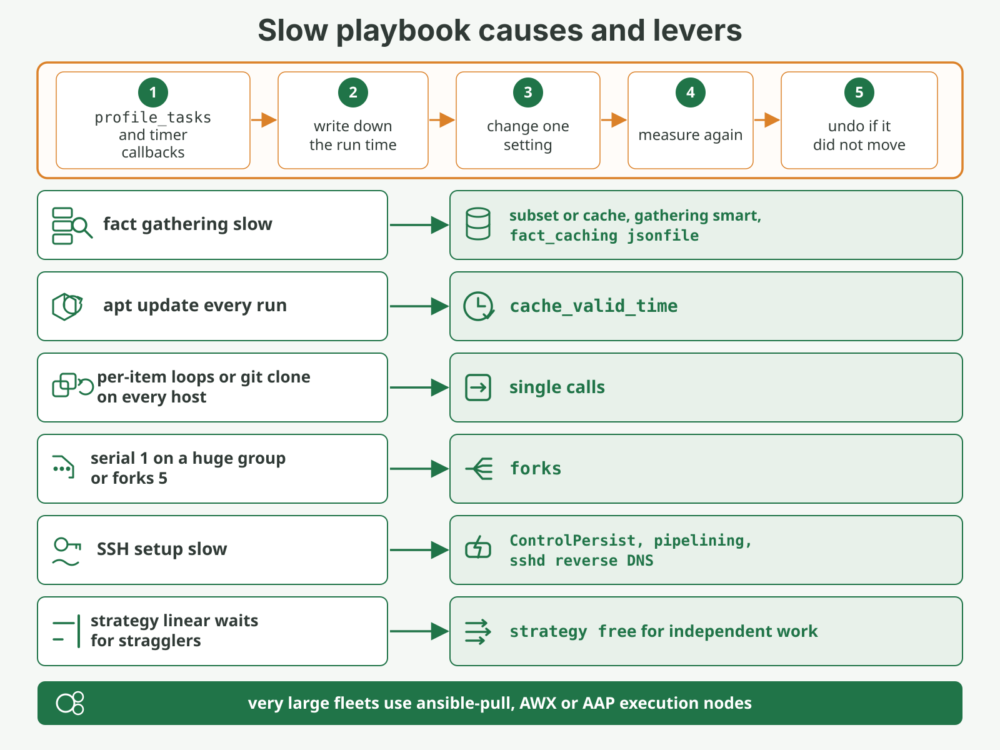

*Figure 4.10.13. Measure where the time goes before tuning, because a setting that speeds up the wrong part changes nothing.*

A playbook that used to finish quickly now takes far longer. Performance debugging asks where the time goes: in fact gathering, in connections, or in one slow task. The timings tell you which lever to pull, and they stop you tuning settings that were never the bottleneck.

A slow playbook costs you time on every change you test. You run it, wait, fix something, and run it again. Multiply that loop by a whole team and a whole week, and a few wasted minutes per run become a real cost. Measure where the time goes before you tune anything. It is tempting to raise `forks` because it sounds like it should help, but a setting that speeds up the wrong part of the run changes nothing you can see. The timing callbacks show you the real leader board first, and then you choose one lever. These settings turn on the timing callbacks and tune the connection.

```ini
[defaults]
callbacks_enabled = timer, profile_tasks, profile_roles
forks = 50
gathering = smart
fact_caching = jsonfile
[ssh_connection]
pipelining = True
ssh_args = -o ControlMaster=auto -o ControlPersist=120s
```

`profile_tasks` prints the slowest tasks and their cumulative time. The word "cumulative" is worth a closer look. The list adds up the time each task spent, so a task that runs once per host and takes a few seconds each time can rise above a single slow step. Read the list with that in mind, and compare the top entries with the rest of the run. Slow runs usually have one of a few causes. Each cause below has a recognisable shape in the timing output, so match the shape before you reach for a fix.

- Fact gathering is slow. A subset or a cache reduces it.
- `apt update` runs every time. `cache_valid_time` addresses that.
- Per-item loops should be single calls, or a `git clone` runs on every host.
- `serial: 1` runs over a huge group, or `forks=5` limits parallelism.
- SSH setup is slow because there is no `ControlPersist`, or sshd does reverse DNS.
- `strategy: linear` waits on stragglers, where `strategy: free` suits independent work.

A poor network or an overloaded control node adds more delay. The control node is the machine where you run `ansible-playbook`, and it does the work of opening connections, rendering templates and collecting results. If that machine is short of CPU or memory, every task waits on it, and no change to the playbook will help until the machine itself has room.

For very large fleets, consider pull mode with `ansible-pull`, AWX or AAP execution nodes (see 4.14), or splitting the inventory into parallel jobs. In pull mode each host fetches its own playbook and applies it locally, so the central machine stops being the bottleneck. Measure before and after each change. Write down the time of the run before you touch anything, change one setting, and measure again. If the number did not move, undo the change, because a setting you cannot justify is one more thing to debug later.

## 9. Debugging at scale and in CI

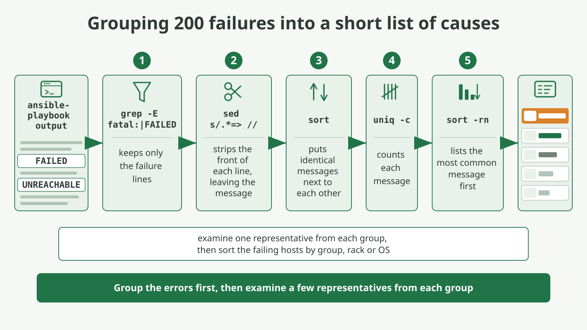

*Figure 4.10.14. A short shell pipeline groups many failure lines by message and ranks the most common message first.*

A failure on one host out of two hundred is hard to see in a long run log. At scale you need summaries, retries and logs that a machine can search, not a person scrolling through thousands of lines. The habits below make a failure visible even when it is rare.

When a fleet run fails on many hosts, reading each error one at a time wastes your time. Imagine forty failed hosts, each with its own long traceback. Most of those tracebacks are probably the same message repeated, and the few that differ are the ones that matter. Group the errors first, then examine a few representatives from each group. The same approach works for the CI logs that a pipeline produces. A pipeline writes a log for every run, so the failure you need is often in a file that nobody has opened, and a search over those files is faster than scrolling through them.

The grouping command below does that in one pipeline. Read it from left to right. `grep` keeps only the lines that mention a fatal error or a failed task. `sed` strips the front part of each line, so only the message remains. `sort` puts identical messages next to each other, and `uniq -c` counts them. The last `sort -rn` lists the most common message first.

- Group the failures by error message with `ansible-playbook ... 2>&1 | grep -E "fatal:|FAILED" | sed 's/.*=> //' | sort | uniq -c | sort -rn`. Then examine one representative from each group. Sort the failing hosts by group, rack or OS to find the common factor.
- Persist logs with run IDs. Attach the `--check --diff` output to pull requests, and fail CI on a non-zero exit code while printing the recap.
- In CI, use `--diff` carefully, because it can expose secrets. Set `ANSIBLE_FORCE_COLOR=1` for readable logs, and `ANSIBLE_STDOUT_CALLBACK=yaml`. Keep a way to reproduce locally, using the same container image or execution environment (see 4.15) and the same inventory.
- For rolling updates, make the playbook fail early and safely, with a canary and `max_fail_percentage`. A broken change then never reaches the whole fleet. Debugging a failed canary costs far less than debugging 200 failures.
- Reproduce the problem on a disposable host, such as a Vagrant box, a container or a cloud VM, when the production host cannot be touched. Molecule scenarios (4.13) can capture those reproductions as tests.

Make the playbook stop at the canary, so that you keep a failure small. A canary is a small group of hosts that goes first, named after the canary that miners once carried down a shaft to warn them about bad air. If the canary group fails, the run stops, and the rest of the fleet keeps its old state. The canary group is the cheapest place to learn a lesson, so choose hosts that look like the rest of the fleet. A canary that differs from the others teaches you nothing about them.

## 10. Prevention habits

The best debugging session is the one you never need. These habits catch most failures before a run reaches production, and each one is cheap compared with an outage at 4 PM. Think of them as the checks a pilot runs before takeoff. Nobody expects an engine to fail on a calm day, but the checklist exists because the cost of one missed item is high, and the checklist costs almost nothing.

Many of these bugs can be caught before a run starts. The habits below move the checks earlier, so a problem shows up on your laptop instead of on a production host. Each habit also has a reason behind it. Lint catches the mistakes that look harmless until a later version of Ansible reads them differently. A canary and `--check --diff` show you the change before it lands. Pinned versions mean that a fleet built today behaves the same as one built next month.

1. Run `ansible-lint` and `yamllint` in pre-commit and CI, and always run `--syntax-check`.
2. Keep playbooks small, and test one change per run on a canary.
3. Name every task, use `assert` for preconditions, and avoid cleverness in Jinja.
4. Run `--check --diff` before real runs, and add verification tasks after changes.
5. Pin the versions of ansible-core, collections and target packages.
6. Keep `command` and `shell` tasks rare and guarded, and be explicit about `changed_when` and `failed_when`.
7. Avoid `ignore_errors`, and use a targeted `failed_when` instead.
8. When you find a bug, write the failing case as a Molecule test (4.13).

Start with the first habit, because it runs before any host is touched.

## 11. Lab

Start with the self-checking Python lab, which runs on your own machine. It checks the 5-layer error classifier and a simulated debugger session, so you can confirm the logic before you touch a real host. Think of it as a flight simulator. You learn the controls on the ground, where a wrong move costs nothing, and then you move to the real aircraft.

Run the lab locally with this command. It checks `classify_ansible_failure_layer`, the classifier that sorts failures into five layers: parse and syntax, connection `UNREACHABLE`, data and template, privilege and module, and application command. Each layer is a function of the message text, so the same message always lands in the same drawer. It also checks `InteractiveTaskDebuggerSession`, a simulator of the task debugger. The simulator inspects a failed task, updates `task_vars` with `update_task`, and re-runs the task with `redo`. It draws on chapter 8 of *Ansible: Up and Running*.

```bash
python3 code/part04/ansible_debugging_toolkit_lab.py
```

Next, use a control node with 2 or 3 Linux targets. The interactive shell steps below have not been run, so confirm the results yourself. Each exercise gives you one situation, and the question that follows it is the one to answer. Work through these exercises in order, because later ones reuse the hosts that the earlier ones set up.

1. You have five broken playbooks, each with one mistake: an unquoted `{{ var }}`, a tab, an undefined variable, a misspelled module argument and a missing collection. Which error text does each one produce? Which layer does each error belong to?
2. You run one failing task at four verbosity levels. What does each level add to the output? Which level first shows the SSH command?
3. On a test VM, you set a user in the inventory that does not exist. Which `UNREACHABLE` message appears? How do you fix the inventory correctly? Repeat the test with a removed key and then with a blocked port 22.
4. On a test VM, you remove passwordless sudo, then add `requiretty` for that user. Which message appears for each change? Which fix removes each one?
5. On a host with no Python, which message does Ansible print? Which variable tells Ansible where the interpreter lives?
6. A task fails because of a typo in a variable name. Which `task_vars` change lets `redo` succeed without editing the file? Then turn on `ANSIBLE_ENABLE_TASK_DEBUGGER` and ask whether the play behaves the same way.
7. You run with `ANSIBLE_KEEP_REMOTE_FILES=1` on one host. Where does the wrapper land on the target? After you explode it and run it by hand, which folder do you delete?
8. The same variable is set in five layers. Which command shows the winning value? Which filter prints its type?
9. A playbook has three tasks that change the host on every run. Which double run with `--diff` reveals them? Which change makes each task report the truth?
10. A slow playbook takes too long on every change, and your goal is to cut its time by 50%. Which output from `profile_tasks` names the slowest task? Which two changes, caching and pipelining, would you try first? Which of `forks` and loop consolidation would you try next?
11. For the last failure you debugged, what was the symptom, the layer, the root cause, the fix and the prevention? Write those five lines in a note.
12. When you finish, which test hosts need cleaning up so they match where you started?

## 12. Common mistakes

Debugging mistakes waste time more often than they cause outages. The usual ones are changing several things at once, and disabling a check to make an error go away. Each one hides the cause you are looking for.

Most of these mistakes feel like progress when you make them. Each one hides the real failure, or makes the next failure harder to find. Take `ignore_errors: true` as an example. The run turns green, the team goes home, and the broken step is still broken. The next person to run the playbook meets a stranger failure in a later task, one that has nothing to do with the original problem. The fix looked clean, but it moved the error somewhere harder to see.

Changing several things at once is another trap. Suppose you change the user, the key and the port in one go, and the connection works. You now have three edits and one result, and you cannot tell which edit fixed the problem. If the connection breaks again next month, you have no idea which setting to look at first. Change one thing, run the check, and record the result.

- Rerunning blindly, or adding `ignore_errors: true`, instead of understanding the failure.
- Debugging at `-vvvv` everywhere, which drowns you in output, or never going above the default level.
- Using `--start-at-task` without the facts and variables from the tasks it skipped.
- Not comparing a failing host with a healthy one.
- Disabling host key checking or sudo safeguards to "get it working".
- Leaving debug output that shows secrets in committed playbooks or CI logs.
- Debugging on production hosts instead of reproducing the problem on a disposable one.
- Treating every error as an Ansible problem, when the cause is the underlying command, package or kernel state.
- Not recording the fix as a lint rule, assertion or test.

The fix for most of these is to slow down and compare the failing host with a healthy one. Two hosts that run the same playbook and differ in one place are the clearest teacher you will get. Put them side by side, list every difference you can find, and test the differences one at a time. The first difference that breaks the failing host is usually the cause.

## 13. Interview angles

Interviewers want a method, not a lucky guess. A candidate who says "I would check the logs" has said very little. A candidate who says "I would first find which layer failed, then compare a failing host with a healthy one, then reproduce on one host" has shown how they think. Describe the layers you check, in order, and how you confirm each one before you move on.

These questions are worth practising out loud. Speaking the answer aloud shows whether you can explain the reasoning, and that is what the interviewer is listening for. Each one comes with the key points an answer should cover, so use them as a checklist after you have given your own answer.

- "A playbook works on most hosts but fails on a few. How do you debug?" Compare facts, variables, OS and network path. Run `-vvv` on one host, and reproduce the failure manually.
- "What does each verbosity level add? How do you get the SSH command and module arguments?"
- "How do you run a module by hand on the target?" Use `ANSIBLE_KEEP_REMOTE_FILES`, then `explode` and `execute`.
- "What is the task debugger and when do you use it?"
- "A deployment is slow. How do you find out why and speed it up?"
- "How do you find which layer a failure belongs to?"
- "What do you do when a playbook partially applies changes to 50 nodes and fails?" Rerun it idempotently, limit it to the failed hosts, use a canary, and plan a rescue or rollback.

## Exercises

Each exercise uses a debugging tool from this chapter. Work through them in order, and run them on a disposable host, so that a mistake costs you nothing. If you get stuck, go back to the section that covers the tool.

1. A teammate pastes seven common error messages into a chat. Which layer does each message belong to? Use `classify_ansible_failure_layer()` in `code/part04/ansible_debugging_toolkit.py` to check your answers. The five layers come from *Ansible: Up and Running*, chapter 8.
2. You want to know how much detail each flag adds. What does `-v` add to the output? What does `-vvvv` add beyond `-vvv`?
3. A Slurm node will not start unless `/etc/slurm/slurm.conf` exists as a regular file. Which `stat` task on that path feeds an `assert` with `quiet: true` that checks `exists`, `isreg` and `size`?
4. The same file must belong to the user `slurm` and carry the mode `0644`. Which two extra checks would you add to that `assert`?
5. A `debug` task has `verbosity: 1`. What does that setting do during a normal run? What does `{{ var | type_debug }}` tell you that a plain print does not?
6. In the task debugger, what changes when you edit `task.args['name']` instead of `task_vars['ntp_pkg']`? Which sequence of `u` and `r` makes the second change take effect? Use `InteractiveTaskDebuggerSession` in `code/part04/ansible_debugging_toolkit.py` to show it.
7. Which five values does the `debugger:` keyword accept? How does `ANSIBLE_ENABLE_TASK_DEBUGGER` differ from setting the keyword in a playbook?
8. After you re-image a GPU node, SSH prints `WARNING: REMOTE HOST IDENTIFICATION HAS CHANGED`. How do `ssh-keygen -R` and `ssh-keyscan` resolve it safely?
9. An automation key must work from one bastion address only. How does `authorized_key` with `exclusive: true` harden that access? What does `key_options` add on top of that?
10. A remote `git` task fails with `Permission denied (publickey)` even though agent forwarding is on. Why does `become: true` on that task cause the failure?
11. A GPU node keeps its `AnsiballZ_*.py` wrapper because you set `ANSIBLE_KEEP_REMOTE_FILES=1`. How do you unpack it with `explode`? How do you run it under `python3` as the target user?
12. A playbook is slow, and you want the slowest task named for you. How does `profile_tasks` find it? Which two speedups would you try first?
13. A 200-node run leaves many `FAILED` and `UNREACHABLE` lines in its log. Which shell pipeline counts those reasons and ranks them from most common to least?

## Checkpoint questions (20)

<details>
<summary>1. What are the five diagnostic layers when an Ansible playbook fails, and how do you distinguish them in seconds?</summary>

1. **Parse / Syntax Layer.** It fails before any task starts. Look for bad YAML indentation, tabs, an unquoted `{{ var }}` at the start of a line, misspelled task keywords, or missing collections. The checks are `--syntax-check`, `yamllint` and `ansible-lint`.
2. **Connection Layer (`UNREACHABLE`).** Look for an SSH timeout, a DNS failure, a wrong `ansible_user` or key, a changed host key, a `MaxStartups` rate limit, or an unmounted or full `remote_tmp`.
3. **Data / Template Layer (`FAILED` before the module runs on the target).** Look for `AnsibleUndefinedVariable`, the wrong variable precedence, a `when:` string-versus-boolean error, or unbalanced Jinja braces.
4. **Privilege / Module Layer (`FAILED` during the wrapper invocation).** Look for `Missing sudo password`, `requiretty`, a missing `/usr/bin/python3`, a missing `acl` for `become_user`, or a `MODULE FAILURE` traceback caused by a missing target Python library such as `psycopg2`.
5. **Application / Command Layer (`FAILED` with a non-zero `rc`).** The module ran. The underlying package manager, service or CLI command, such as `nvidia-smi` or `nginx -t`, rejected the state change.
</details>

<details>
<summary>2. What specific diagnostic detail does each verbosity flag (`-v`, `-vv`, `-vvv`, `-vvvv`) add (*Ansible: Up and Running*, chapter 8)?</summary>

- **`-v`** prints the **module return dictionary** (`stdout`, `stderr`, `rc`, `msg`, `changed`) for each task.
- **`-vv`** adds the **file path and line number** of every task and handler, the variable files that load, and the exact **`false_condition`** expression that caused a task to be skipped.
- **`-vvv`** adds the **SSH connection commands** (`SSH: EXEC ssh ...`), the remote temporary directory paths (`~/.ansible/tmp/.../AnsiballZ_*.py`), and the exact **invocation arguments** passed into each module.
- **`-vvvv`** passes `-vvv` to the underlying `ssh` client. It prints the full SSH key exchange, cipher, `ProxyJump` and authentication debug traces.
</details>

<details>
<summary>3. How do you make Ansible output human-readable for multi-line `stdout`/`stderr` tracebacks, and how do you log runs to a file (*Ansible: Up and Running*, chapter 8)?</summary>

Set **`stdout_callback = yaml`** in `[defaults]` in `ansible.cfg`. Newer `ansible-core` releases can use `result_format = yaml` under the `default` callback instead, and `stdout_callback = debug` also works. Multi-line `stdout` and Python tracebacks then render with real line breaks, not escaped `\n` strings. To keep a copy on disk, set **`log_path = ./ansible.log`**. Set `no_log: true` on any task that handles secrets, so the credentials are not written to `ansible.log`.
</details>

<details>
<summary>4. How do `verbosity: 1` on `ansible.builtin.debug` and `quiet: true` on `ansible.builtin.assert` keep production playbooks clean?</summary>

- **`verbosity: 1`** on a `debug` task hides its output during a normal run. The output appears only when you pass `-v` or a higher level. You can leave diagnostic probes in your playbooks permanently without cluttering routine logs.
- **`quiet: true`** on an `assert` task hides the verbose `"msg": "All assertions passed"` banner on every host. The task still fails with `fail_msg` whenever an assertion fails.
</details>

<details>
<summary>5. What fields does `ansible.builtin.stat` return, and how do you use them with `assert`?</summary>

Registering `stat: { path: /etc/nginx/conf }` into `st` fills `st.stat` with these fields:
- **`exists`** (`bool`) tells you whether the path exists at all. Always check `st.stat.exists` first.
- **File type booleans:** **`isdir`**, **`isreg`** (regular file), **`islnk`** (symlink, plus `lnk_source`), **`isblk`**, **`ischr`**, **`isfifo`** and **`issock`**.
- **Ownership and permissions:** **`uid`**, **`gid`**, **`pw_name`** (owner username), **`gr_name`** (group name), **`mode`** (octal string such as `'0755'`), and `rusr`, `wusr` and `xusr`.
- **Size, timestamps and integrity:** **`size`**, **`atime`**, **`mtime`**, **`ctime`**, and **`checksum`** (SHA-1).
</details>

<details>
<summary>6. How do you enable the interactive Ansible Task Debugger, and what are its five trigger modes (*Ansible: Up and Running*, chapter 8)?</summary>

You can enable the debugger with `strategy: debug`, with the `debugger:` keyword on a play, role, block or individual task, or with `enable_task_debugger = True` in `ansible.cfg`. You can also set the environment variable **`ANSIBLE_ENABLE_TASK_DEBUGGER=True`**. The five `debugger:` values are:
1. **`on_failed`**: drop into the debugger whenever a task fails.
2. **`on_unreachable`**: drop into the debugger when a host is `UNREACHABLE`.
3. **`on_skipped`**: drop into the debugger when a task is skipped.
4. **`always`**: pause in the debugger before and after every task.
5. **`never`**: disable the debugger for this scope, even when it is enabled globally.
</details>

<details>
<summary>7. Inside the interactive `(debug)` prompt, what is the difference between changing `task.args[key]` and changing `task_vars[key]`?</summary>

- **`p task`, `p task.args`, `p task_vars`, and `p result._result`** show the task name, the module arguments, the variables and the failure dictionary.
- **`task.args['name'] = 'chrony'`, followed by `r` (`redo`),** overwrites the module argument that is already rendered, then re-runs the task right away.
- **`task_vars['pkg'] = 'chrony'`, or `vars['pkg'] = 'chrony'`, followed by `u` (`update_task`) and `r` (`redo`),** changes the variable in context. Then `update_task` re-templates `task.args` from the original `{{ pkg }}` expression before the task runs again.
</details>

<details>
<summary>8. What is the danger of using `--start-at-task` or `--tags` while debugging a failing playbook?</summary>

Starting in the middle of a playbook, with `--start-at-task "Configure Slurm"` or `--tags slurm_conf`, skips every earlier task in the play. Suppose an earlier task used `register`, `set_fact` or `include_vars` to compute a variable that `"Configure Slurm"` needs. The task then fails with a misleading `AnsibleUndefinedVariable` error that would never appear in a full run. Make sure `gather_facts: true` runs, or fact caching is enabled, and tag the essential variable-setup tasks with `tags: [always]`.
</details>

<details>
<summary>9. How do you reproduce and debug a failing Ansible module directly on the target host (`ANSIBLE_KEEP_REMOTE_FILES=1` and `AnsiballZ`)?</summary>

1. Run the failing task with **`ANSIBLE_KEEP_REMOTE_FILES=1`** and **`-vvv`**: `ANSIBLE_KEEP_REMOTE_FILES=1 ansible gpu001 -m ansible.builtin.apt -a "name=chrony" -vvv`
2. Copy the remote path printed in the `-vvv` output, `~/.ansible/tmp/ansible-tmp-.../AnsiballZ_apt.py`, then SSH into `gpu001`.
3. Run **`python3 AnsiballZ_apt.py explode`**. It unpacks the self-contained zip bundle into `./debug_dir/`, which holds the readable Python module script and the JSON `args` file.
4. Inspect or edit `./debug_dir/`, then run **`python3 AnsiballZ_apt.py execute`**, or run it under `python3 -m pdb`, to see the exact local exception. When you finish, delete the temp directory.
</details>

<details>
<summary>10. What causes `ERROR: found unacceptable key (unhashable type)` versus `mapping values are not allowed here` when parsing a playbook?</summary>

- **`found unacceptable key (unhashable type)`** happens when an unquoted value starts with `{{ var }}`, as in `dest: {{ my_path }}/file.conf`. YAML reads the `{` at the start of the value as a flow mapping, and it treats `{{ my_path }}` as a nested dictionary key. A dictionary cannot be a key, so the parse fails. Quote the whole value, as in `dest: "{{ my_path }}/file.conf"`.
- **`mapping values are not allowed here`** happens when an unquoted string contains a colon followed by a space, as in `msg: Failed: check logs`, or when a line has wrong indentation after a key. Quote the string, as in `msg: "Failed: check logs"`.
</details>

<details>
<summary>11. Why does an SSH connection fail with `Too many authentication failures` even when the right SSH key is present, and how do you fix it?</summary>

If your local `ssh-agent` holds six or more SSH keys, as `ssh-add -l` shows, OpenSSH offers each key in the agent one at a time before it tries the `-i` identity file set for the host. The remote `sshd` has a `MaxAuthTries` limit, whose default is `6`. Once you exceed it, the server disconnects with `Too many authentication failures`. Add **`-o IdentitiesOnly=yes`** to `ssh_args` in `ansible.cfg`, or to `~/.ssh/config`. Then SSH offers only the key configured for that host.
</details>

<details>
<summary>12. In *Ansible: Up and Running*, chapter 8, why did the `git` task fail with `Permission denied (publickey)` on the remote host when SSH agent forwarding was configured, and what are the three checks?</summary>

When a remote host clones a private repository (`git@github.com:...`) through SSH agent forwarding, check three things:
1. Run `ssh-add -L` on the control node to confirm that your private key is loaded into `ssh-agent`. macOS and Linux agents can lose keys after a reboot.
2. Run `ansible web -vvv -m ping` to confirm that `-o ForwardAgent=yes` is passed to `ssh`.
3. Make sure the `git` task runs as the connected SSH user, with `become: false`, rather than with `become: true` as `root`. `sudo` clears `SSH_AUTH_SOCK` by default, unless `Defaults env_keep += "SSH_AUTH_SOCK"` is set in `/etc/sudoers`.
</details>

<details>
<summary>13. How do `key_options` and `exclusive: true` on `ansible.posix.authorized_key` secure automation SSH keys (*Ansible: Up and Running*, chapter 8)?</summary>

- **`key_options: 'no-port-forwarding,from="93.184.216.34"'`** adds OpenSSH restrictions in front of the public key in `~/.ssh/authorized_keys`. `sshd` then accepts that key only when the TCP connection comes from the control node or bastion IP, `93.184.216.34`, and it refuses port-forwarding requests.
- **`exclusive: true`** removes every other public key from `~/.ssh/authorized_keys` that the task does not manage. This revokes any leftover manual keys or keys from departed admins.
</details>

<details>
<summary>14. What causes `Failed to create temporary directory` or `Permission denied` when executing modules on a hardened Linux node?</summary>

1. The automation user's home directory is missing, full (check with `df -h` and `df -i`), or read-only.
2. `/tmp`, or the user's home filesystem, is mounted with the **`noexec`** mount option. That stops `/usr/bin/python3` or the script wrappers from running out of `remote_tmp`.

To fix it, set `remote_tmp = /var/tmp/.ansible-${USER}/tmp`, or another writable and executable path, under `[defaults]` in `ansible.cfg`.
</details>

<details>
<summary>15. Why does a command succeed when you run it interactively over SSH (`ssh gpu01 nvidia-smi`), yet fail inside an Ansible `command` or module task?</summary>

An interactive SSH login shell reads `/etc/profile`, `~/.bash_profile` and `~/.bashrc`. These files often add `/usr/local/cuda/bin` or `/opt/slurm/bin` to `PATH`, load environment modules, or set proxy and locale variables. Ansible runs modules in a non-interactive, non-login shell with a minimal default `PATH` of `/usr/bin:/bin`. Use absolute binary paths, such as `/usr/local/cuda/bin/nvcc`. Or pass the variables explicitly with **`environment: { PATH: "/usr/local/cuda/bin:{{ ansible_env.PATH }}" }`** on the task or the play.
</details>

<details>
<summary>16. How does the `type_debug` filter help diagnose mysterious `when:` or template failures?</summary>

Print **`debug: { msg: "{{ my_var | type_debug }}" }`** to see the exact Python type of `my_var` at run time. It shows whether `gpu_count` is a `str` (`"8"`) instead of an `int` (`8`), whether `enabled` is the string `"False"` instead of the boolean `False`, or whether a string is wrapped as `AnsibleUnsafeText`.
</details>

<details>
<summary>17. How do `timer`, `profile_tasks` and `profile_roles` in `ansible.cfg` pinpoint why a playbook is slow?</summary>

Set `callbacks_enabled = timer, profile_tasks, profile_roles` in `[defaults]` in `ansible.cfg`. Then the run prints the timestamp and the elapsed wall-clock seconds after every task. At the end of the run, it prints a sorted leaderboard of the top 20 slowest tasks and roles. That leaderboard shows at a glance whether the time goes to `Gathering Facts`, `apt update`, a slow `loop:`, or an SSH connection that is not multiplexed.
</details>

<details>
<summary>18. What causes `kex_exchange_identification: Connection closed by remote host` when running Ansible with `forks = 100` through a bastion host?</summary>

When 100 Ansible worker forks open SSH connections at the same moment, through one bastion or jump host, or to one target through `delegate_to`, the bastion's OpenSSH daemon can hit its **`MaxStartups`** limit. The default is `10:30:100`. Once 10 concurrent handshakes are in flight, the daemon starts randomly dropping unauthenticated connections. `fail2ban` can cause the same error. Enable `ControlPersist` multiplexing, raise `MaxStartups 100:30:200` and `MaxSessions 100` in the bastion's `/etc/ssh/sshd_config`, or cap the concurrency with `forks` or `throttle`.
</details>

<details>
<summary>19. How do you triage a playbook failure when 40 out of 500 GPU nodes fail during a fleet run?</summary>

Do not read 40 tracebacks one by one. Group the failures by their error message, and then by inventory topology.
1. Extract and count the unique failure messages: `grep -E "fatal:|FAILED" ansible.log | sed 's/.*=> //' | sort | uniq -c | sort -rn`.
2. Intersect the failing host list with your inventory groups, such as `rack_*`, `gpu_*` and the OS kernel version. For example, this shows whether all 40 nodes share one ToR switch, one rack PDU, one NFS mount or one Ubuntu kernel version.
3. Reproduce the problem on one representative failing host with `--limit <host> -vvv`.
</details>

<details>
<summary>20. What should you do before closing an incident caused by an Ansible playbook bug?</summary>

Turn the failure into an automated guardrail, so the same bug cannot reach the fleet again.
1. If a variable was missing or malformed, add an **`ansible.builtin.assert`** task in `pre_tasks`, or in `meta/argument_specs.yml`.
2. If the bug was a syntax or module anti-pattern, enable the matching **`ansible-lint`** rule in CI.
3. If the bug was a host-state or idempotency regression, add the reproduction case to the role's **Molecule and Testinfra** test suite, using `molecule converge && molecule idempotence && molecule verify`.
</details>

## Sources and review notes

- **Sources read in full:**
  - `ansible-up-and-running-3rd-edition` — Bas Meijer, Lorin Hochstein & René Moser, *Ansible: Up and Running*, 3rd ed., **Chapter 8: Debugging Ansible Playbooks** (read in full: human-friendly `stdout_callback = yaml` / `debug` output, `-v` through `-vvvv` SSH debug traces, `log_path`, common SSH challenges `PasswordAuthentication no`, `Host key verification failed` resolved with `ssh-keygen -R` and `ssh-keyscan`, `nc hostname 2222` banner checks, bastion `ProxyJump`, `authorized_key` with `key_options` and `exclusive: true`, SSH agent forwarding on `git` tasks, the `debug` module, the interactive Ansible Task Debugger `debugger: always|on_failed|on_unreachable|on_skipped` and debugger commands `p task`/`p task.args`/`p result`/`p vars`/`update_task`/`redo`/`continue`/`quit`, testing before execution `--syntax-check`/`--list-tasks`/`--list-hosts`/`--check -D`/`--step`/`--start-at-task`/`tags`, and `assert` with `stat` module return values `Table 8-3`).
- **Run here:** `python3 code/part04/ansible_debugging_toolkit_lab.py` (2 passed, 0 failed).
- **Explicitly labelled inferences:** The `classify_ansible_failure_layer` and `InteractiveTaskDebuggerSession` models in `code/part04/ansible_debugging_toolkit.py` and the 5-layer diagnostic flowchart are the author's constructions synthesizing *Ansible: Up and Running* Chapter 8 and production GPU fleet troubleshooting (plus original study items 21, 22, 23, 24, 25, 26, 27, 28, 29, and 30).
- **Not verified on live hardware:** Live `ansible`, `ansible-playbook`, `ssh-keygen`, `ssh-keyscan`, `nc`, and `AnsiballZ_*.py explode/execute` commands (`200` GPU nodes, `50` forks, `120s` ControlPersist, `192.168.33.10`, `192.168.56.10`, `93.184.216.34`, `2222`) are marked as not run in this chapter where `ansible_debugging_toolkit_lab.py` does not execute them.
