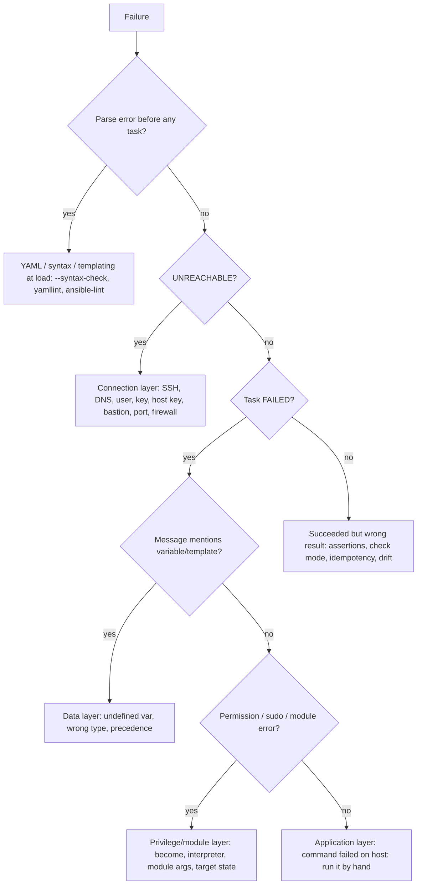

# 4.10 Debugging Ansible playbooks

| | |
|---|---|
| Level | Intermediate |
| Priority tier | 0 |
| Lab venue | ansible-core; 2 to 3 Linux targets |
| Part | Part 4: Automation and infrastructure as code |
| Status | Drafted, labs **untested** |

## Why this matters for AI infrastructure

Automation failures happen at the worst moments: halfway through a driver rollout across 200 GPU nodes, during a maintenance window with a deadline, or in CI where you cannot attach a debugger. Being fast at diagnosis (is it the connection, privileges, a variable, a template, the module, or the target?) saves hours and prevents the dangerous reflex of "just rerun it" or "just add `ignore_errors`". This chapter gives a layered method and the exact tools for each layer.

## Prerequisites and outcomes

Needs 4.3 to 4.9. After this chapter you can:

- Read an Ansible error message and classify the failure layer in seconds.
- Use verbosity (`-v` to `-vvvv`), `debug`, `assert`, `--step`, `--start-at-task`, `--check --diff`, and the interactive debugger (`strategy: debug` / `debugger:` keyword).
- Diagnose SSH/connection, privilege, Python interpreter, module argument, variable, template and YAML problems.
- Reproduce a failing module by hand on the target (keeping remote files with `ANSIBLE_KEEP_REMOTE_FILES`).
- Profile slow runs and find the expensive tasks and fact gathering.
- Build habits that prevent bugs: lint, syntax check, dry run, small steps, canaries.

## 1. A layered method



Questions to ask in order: **When** did it fail (before tasks, at a task, in a handler, after)? **Where** (which hosts: all, some, one)? **What changed** since the last good run (code, inventory, versions, target state)? **Can I reproduce on one host** (`--limit`, `-vvv`)? Differences between failing and passing hosts are the most informative clue (OS version, Python, facts, variables, network path).

## 2. Verbosity and output

| Flag | Shows |
|---|---|
| (none) | Task names, results, recap |
| `-v` | Module return data (registered values, `rc`, `stdout`, `stderr`) |
| `-vv` | Adds task paths and `false_condition` for skipped tasks, file loading |
| `-vvv` | Adds connection details: SSH command lines, remote temp paths, module args |
| `-vvvv` | Adds connection plugin internals (SSH debug), plugin loading; very noisy |
| `-vvvvv` | Everything including WinRM/SSH raw debugging |

Practical output settings in `ansible.cfg`: `stdout_callback = yaml` (readable multi-line values; in newer releases use `result_format = yaml` with the default callback), `callbacks_enabled = timer, profile_tasks, profile_roles`, `display_skipped_hosts = false` to declutter, `log_path = ansible.log` (a persistent log, remember it may contain secrets unless `no_log` is used), `ANSIBLE_NOCOLOR=1` in CI logs. For machine-readable analysis use `ANSIBLE_STDOUT_CALLBACK=json` or `ansible.posix.json` (single JSON at the end), `ansible.posix.jsonl`, or send events to a log pipeline.

## 3. The `debug` and `assert` modules

```yaml
- name: Look at a variable
  ansible.builtin.debug:
    var: nccl_env                               # prints name and value; no braces needed

- name: Look at an expression
  ansible.builtin.debug:
    msg: "{{ inventory_hostname }} has {{ gpu_count | default('unset') }} GPUs in groups {{ group_names }}"
  verbosity: 1                                  # only shown with -v or more: leave in the code safely

- name: Dump all variables for one host (careful: secrets)
  ansible.builtin.debug:
    var: hostvars[inventory_hostname]
  when: inventory_hostname == 'gpu001' and debug_dump | default(false)

- name: Fail early with a useful message
  ansible.builtin.assert:
    that:
      - gpu_count is defined
      - gpu_count | int in [4, 8]
    fail_msg: "gpu_count must be 4 or 8 for {{ inventory_hostname }}, got {{ gpu_count | default('undefined') }}"
    quiet: true
```

Tips: `debug` prints values after templating, so it reveals typing issues (a string `"False"` versus boolean). Use `verbosity:` to keep helpful diagnostics in code permanently. For structured output use `| to_nice_json`/`to_nice_yaml`. Do not leave debug output of secrets in committed code or CI logs.

## 4. Controlling the run while investigating

```bash
ansible-playbook site.yml --syntax-check                    # parse only
ansible-playbook site.yml --list-tasks --list-tags --list-hosts
ansible-playbook site.yml --check --diff --limit gpu001     # what would change
ansible-playbook site.yml --step                            # confirm every task (y/n/c)
ansible-playbook site.yml --start-at-task "Install driver"  # resume mid-playbook (skips earlier tasks and their set_fact)
ansible-playbook site.yml --limit @site.retry               # rerun only failed hosts (enable retry files or write failures yourself)
ansible-playbook site.yml -t config -l gpu001               # one tag on one host
ansible-playbook site.yml -e debug_dump=true -vv
ansible gpu001 -m ansible.builtin.setup -a 'filter=ansible_default_ipv4'      # inspect facts
ansible gpu001 -m ansible.builtin.command -a 'which python3' -vvv            # test connectivity & interpreter
```

Caveat: `--start-at-task` and tags skip earlier tasks that may have set facts or variables later tasks need, producing misleading failures; reproduce with the minimum necessary context (`set_fact` in a scratch play, `-e` values).

### The interactive debugger

Ansible has a built-in task debugger invoked on failure (or always), modelled on `pdb`:

```yaml
- hosts: gpu
  strategy: debug            # the play's tasks drop into the debugger on failure
  debugger: on_failed        # also per play/block/task: always, never, on_failed, on_unreachable, on_skipped
  tasks:
    - name: Something fragile
      ansible.builtin.command: /bin/false
      debugger: on_failed
```

or without editing playbooks: `ANSIBLE_ENABLE_TASK_DEBUGGER=True ansible-playbook site.yml`. At the prompt:

| Command | Action |
|---|---|
| `p task`, `p task.args`, `p task_vars`, `p task_vars['hostvars']`, `p result._result` | Print task, arguments, variables, result |
| `task.args['name'] = 'fixed'` | Modify arguments |
| `task_vars['x'] = 1` + `update_task` | Change variables and re-template the task |
| `redo` (`r`) | Re-run the task with the modifications |
| `continue` (`c`) | Continue the play (task stays failed) |
| `quit` (`q`) | Abort |

Use it to experiment on one failing host interactively; then encode the fix in the playbook. It does not work in non-interactive CI.

## 5. Classifying common failures

### Parse and templating errors before execution

| Message | Meaning | Fix |
|---|---|---|
| `ERROR! Syntax Error while loading YAML` / `mapping values are not allowed here` | Bad YAML: unquoted colon, indentation, tab | Quote strings; `yamllint`; check the line shown (the real error is often the line before) |
| `found unacceptable key (unhashable type)` | A value like `{{ var }}` unquoted at start of a line is parsed as a mapping | Quote: `"{{ var }}"` |
| `ERROR! 'xxx' is not a valid attribute for a Task` | Misspelled keyword or module argument at wrong indentation | Check module/keyword names (`ansible-doc -t keyword -l`) |
| `couldn't resolve module/action 'foo'` | Module/collection not installed or not FQCN-resolvable | `ansible-galaxy collection list`; install; use FQCN |
| `The task includes an option with an undefined variable` | A variable is undefined at templating time | `default()`, `is defined`, check precedence/scope/typos |
| `template error while templating string: unexpected '}'` | Unbalanced braces/quotes in Jinja | Reproduce in a `debug` task; use `` for literal braces |
| `AnsibleUndefinedVariable: 'dict object' has no attribute 'x'` | Wrong key or the object is a different shape than assumed | `debug: var=` the parent; `default({})` chains |
| `conditional check failed` / `Conditional result was derived from a non-boolean` | `when:` evaluated a string/undefined | Cast with `\| bool`; fix expression |

### Connection layer (UNREACHABLE)

| Symptom | Cause | Check |
|---|---|---|
| `Permission denied (publickey,password)` | Wrong user/key, key not authorised, agent has too many keys (`Too many authentication failures`) | `ssh -vvv user@host`; `ansible_user`; `IdentitiesOnly=yes`; `ssh-add -l` |
| `Host key verification failed` | New/changed key | Investigate; fix `known_hosts`; do not disable globally |
| `Connection timed out` / `No route to host` | Network, firewall, wrong IP | `nc -vz host 22`, route, bastion `ProxyJump` |
| `Could not resolve hostname` | DNS | Use `ansible_host`, fix DNS/`/etc/hosts` |
| `Connection closed by remote host` / `kex_exchange_identification` | sshd rate limits (`MaxStartups`), fail2ban banning the control node | Lower `forks`, raise MaxStartups, whitelist controller |
| Hangs for a long time then fails | Reverse DNS delays (`UseDNS`), unreachable sudo prompts, `-k` password prompts | `timeout`, disable `UseDNS`, check prompts with `-vvvv` |
| `Failed to create temporary directory` | Home not writable, full disk, `noexec` mount on tmp, `remote_tmp` | Set `remote_tmp`, check `df`, mount options |
| `Shared connection to host closed` with output truncated | Output after SSH closed; tty issues | Pipelining, `-o ControlPersist`, check `requiretty` |

### Privilege and module layer

| Symptom | Cause | Fix |
|---|---|---|
| `Missing sudo password` | sudo requires password | `-K`/`ansible_become_password`, or passwordless sudo for the automation user |
| `sudo: a terminal is required` / `no tty present` | `requiretty` or missing tty | Remove `requiretty` for the user; enable pipelining |
| `/bin/sh: 1: /usr/bin/python: not found` or module needs Python | No/wrong interpreter | `ansible_python_interpreter`, bootstrap with `raw`, `interpreter_python=auto_silent` |
| `Failed to set permissions on the temporary files` | become to unprivileged user without ACL support | Install `acl`, use `pipelining`, or `allow_world_readable_tmpfiles` (understand the security impact) |
| `MODULE FAILURE` with a Python traceback | Module bug, missing target library (e.g. `psycopg2`, `docker` SDK), version mismatch | Read the traceback; install the dependency on the *target* (or the controller for local modules); upgrade collection |
| Module works with `command` but not the dedicated module | Different environment, locale, PATH, SELinux | `environment:`, `-vvv` to see env, run manually |
| `apt` lock / `dpkg` locked | Another package process running (unattended-upgrades) | `lock_timeout`, wait, disable the competing job |
| `Unsupported parameters for (module) module: foo` | Argument name wrong or from a newer collection | `ansible-doc <module>`; align collection version |

### Application layer

If a `command`/`shell` task fails, copy the exact command from `-vvv` output and run it on the host **as the same user, environment and working directory** (`sudo -u user -i`). Most "Ansible problems" at this layer are plain command problems (PATH, locale, missing package, kernel module not loaded, GPU in a bad state).

## 6. Reproducing a module run by hand

```bash
ANSIBLE_KEEP_REMOTE_FILES=1 ansible gpu001 -m ansible.builtin.copy -a "src=./x dest=/tmp/x" -vvv
# the output shows the remote path: /home/automation/.ansible/tmp/ansible-tmp-.../AnsiballZ_copy.py
ssh gpu001
cd /home/automation/.ansible/tmp/ansible-tmp-*/
python3 AnsiballZ_copy.py explode     # unpack the module and its arguments (args file) into ./debug_dir
python3 AnsiballZ_copy.py execute     # run it with a debugger or modify the source
```

This works for any module and lets you add `print` statements or run under `pdb` on the target. Clean up the kept files afterwards. For `ansible-playbook`, set the same env var; use `-vvvv` if you need to see how Ansible invoked SSH. For custom modules, a JSON args file can be passed directly (`python mymodule.py args.json`, 4.15).

## 7. Debugging variables and templates

- **Which value is used?** `ansible-inventory --host`, `debug: var=...`, `-vvv`, and a repo-wide `grep`. Remember precedence (4.5): `-e` and role `vars/` override most things; dictionaries replace.
- **Render a template locally**: `ansible localhost -m ansible.builtin.template -a "src=x.j2 dest=/tmp/out" -e @vars.yml` then inspect `/tmp/out`; or use `ansible all -m debug -a "msg={{ lookup('template', 'x.j2') }}"` with host context.
- **Inspect types** with `{{ var | type_debug }}` (shows `str`, `int`, `bool`, `list`, `dict`, `AnsibleUnsafeText`).
- **Check facts exist**: `ansible host -m setup -a filter=ansible_distribution*`.
- **Conditions**: add a `debug` task that prints the expression you use in `when:` (`msg: "{{ (gpu_count | int) > 4 }}"`); `-vv` prints `false_condition` for skipped tasks.
- **Loops**: print `item` with `loop_control: label` removed temporarily; `register` and print `results`.
- **Idempotency problems**: run twice with `--diff -v` and examine which task changes; for `lineinfile` check the regex against the file, for `template` look at the diff, for `command` add `changed_when`.

## 8. Performance debugging

```ini
[defaults]
callbacks_enabled = timer, profile_tasks, profile_roles
forks = 50
gathering = smart
fact_caching = jsonfile
[ssh_connection]
pipelining = True
ssh_args = -o ControlMaster=auto -o ControlPersist=120s
```

`profile_tasks` prints the slowest tasks and cumulative time; typical culprits: fact gathering (reduce subset or cache), `apt update` on every run (`cache_valid_time`), per-item loops that should be single calls, `git clone` per host, serial execution (`serial: 1` over a huge group), slow SSH setup (no ControlPersist), reverse DNS in sshd, single `forks=5`, `strategy: linear` waiting on stragglers (`strategy: free` for independent work), low-quality network or overloaded control node. For very large fleets consider pull mode (`ansible-pull`), AWX/AAP execution nodes (4.14), or splitting inventory into parallel jobs. Measure before and after each change.

## 9. Debugging at scale and in CI

- Failures across many hosts: group by error message (`ansible-playbook ... 2>&1 | grep -E "fatal:|FAILED" | sed 's/.*=> //' | sort | uniq -c | sort -rn`), then examine representatives; sort failing hosts by group/rack/OS to find the common factor.
- Persist logs with run ids; attach the `--check --diff` output to pull requests; fail CI on non-zero exit and print the recap.
- In CI use `--diff` carefully (secrets), `ANSIBLE_FORCE_COLOR=1` for readable logs, and `ANSIBLE_STDOUT_CALLBACK=yaml`. Keep a way to reproduce locally: the same container image/execution environment (4.15) and the same inventory.
- For rolling updates, make the playbook fail **early and safely** (canary, `max_fail_percentage`) so a broken change does not reach the fleet; debugging a failed canary is far cheaper than debugging 200 failures.
- Reproduce on a disposable host (Vagrant, container, cloud VM) when the production host cannot be touched; Molecule scenarios (4.13) capture such reproductions as tests.

## 10. Prevention habits

1. `ansible-lint` and `yamllint` in pre-commit and CI; `--syntax-check` always.
2. Small playbooks, small steps; one change per run on a canary.
3. Name every task; use `assert` for preconditions; avoid cleverness in Jinja.
4. `--check --diff` before real runs; verification tasks after changes.
5. Pin versions of ansible-core, collections and target packages.
6. Keep `command`/`shell` tasks rare, guarded, and explicit about `changed_when`/`failed_when`.
7. Avoid `ignore_errors`; use targeted `failed_when`.
8. Write the failing case as a Molecule test when a bug is found (4.13).

## 11. Lab (untested)

1. **Break it on purpose**: create playbooks with (a) an unquoted `{{ var }}`, (b) a tab, (c) an undefined variable, (d) a misspelled module argument, (e) a missing collection; for each, record the error text and classify the layer.
2. **Verbosity ladder**: run one failing task at `-v`, `-vv`, `-vvv`, `-vvvv`; list what extra information each level adds (SSH command, remote tmp path, module args).
3. **Connection faults**: change the user, remove the key, change the port, block port 22 with a firewall rule, change the host key; reproduce each `UNREACHABLE` message and fix it correctly.
4. **Privilege faults**: remove passwordless sudo, add `requiretty`, make `/tmp` `noexec`; observe messages and fixes.
5. **Interpreter faults**: use a host without Python, with only Python 2 (if available) or a wrong `ansible_python_interpreter`.
6. **Interactive debugger**: fail a task due to a typo in a variable; fix `task_vars` and `redo`; also use `ANSIBLE_ENABLE_TASK_DEBUGGER`.
7. **Keep remote files**: run with `ANSIBLE_KEEP_REMOTE_FILES=1`, explode the module, edit it, execute by hand; clean up.
8. **Variable archaeology**: plant the same variable in five layers; find the winner with `ansible-inventory --host`, `debug`, and `grep`; print `type_debug`.
9. **Idempotency hunt**: take a playbook with three non-idempotent tasks; find them using a double run with `--diff`; fix each.
10. **Profile**: enable `profile_tasks`; make a slow playbook; reduce its time by 50% using caching, pipelining, `forks` and loop consolidation.
11. **Postmortem template**: for the last failure you debugged, write a five-line note: symptom, layer, root cause, fix, prevention (lint rule, assertion or test).
12. **Clean up.**

Mark tested only after execution.

## 12. Common mistakes

- Rerunning blindly or adding `ignore_errors: true` instead of understanding the failure.
- Debugging at `-vvvv` everywhere (drowning in output) or never going above default.
- Using `--start-at-task` without the facts/variables from skipped tasks.
- Not comparing a failing host to a healthy one.
- Disabling host key checking or sudo safeguards to "get it working".
- Leaving debug output (secrets) in committed playbooks or CI logs.
- Debugging on production hosts instead of reproducing on a disposable one.
- Treating every error as an Ansible problem when the underlying command, package or kernel state is at fault.
- Not recording the fix as a lint rule, assertion or test.

## 13. Interview angles

- "A playbook works on most hosts but fails on a few. How do you debug?" (compare facts/vars/OS/network; `-vvv` on one host; reproduce manually.)
- "What does each verbosity level add? How do you get the SSH command and module arguments?" 
- "How do you run a module by hand on the target?" (`ANSIBLE_KEEP_REMOTE_FILES`, `explode`/`execute`.)
- "What is the task debugger and when do you use it?" 
- "A deployment is slow. How do you find out why and speed it up?" 
- "How do you find which layer a failure belongs to?" 
- "What do you do when a playbook partially applies changes to 50 nodes and fails?" (idempotent rerun, limit to failed hosts, canary, rescue/rollback.)

## 14. Checkpoint questions (30)

1. What does `-v` add? **A:** Module return data.
2. What does `-vvv` add? **A:** Connection details, remote paths, module args.
3. Which flag parses without running? **A:** `--syntax-check`.
4. How list matching hosts/tasks? **A:** `--list-hosts`, `--list-tasks`.
5. What does `--step` do? **A:** Prompts before each task.
6. Danger of `--start-at-task`? **A:** Skips tasks that set needed facts/vars.
7. What does `debug: var=x` print? **A:** Name and templated value.
8. What does `verbosity:` on debug do? **A:** Only prints at that `-v` level or more.
9. What does `assert` do? **A:** Fails with a message if conditions are false.
10. How enable the debugger? **A:** `strategy: debug`, `debugger:` keyword, or `ANSIBLE_ENABLE_TASK_DEBUGGER`.
11. Debugger command to rerun a task? **A:** `redo`.
12. What does `p task_vars` show? **A:** Variables for the current task.
13. UNREACHABLE means? **A:** Could not connect/authenticate (connection layer).
14. FAILED means? **A:** Task ran and returned failure.
15. Cause of "Missing sudo password"? **A:** sudo requires a password.
16. What does `requiretty` break? **A:** Non-tty sudo (needs pipelining or removal).
17. Fix for "Failed to create temporary directory"? **A:** Writable `remote_tmp`, disk/mount checks.
18. Which var keeps remote module files? **A:** `ANSIBLE_KEEP_REMOTE_FILES=1`.
19. How explode a module? **A:** `python AnsiballZ_x.py explode`.
20. Filter showing a value's type? **A:** `type_debug`.
21. What does `profile_tasks` show? **A:** Per-task timing.
22. Top performance fixes? **A:** Pipelining, ControlPersist, forks, fact caching.
23. What does `strategy: free` do? **A:** Hosts proceed independently.
24. Why a double run with `--diff`? **A:** Find non-idempotent tasks.
25. How render a template locally? **A:** `template` module against localhost with vars.
26. Why compare failing and passing hosts? **A:** Reveals the differentiating factor.
27. What is `false_condition`? **A:** Shows which `when` expression skipped the task (`-vv`).
28. What does `no_log` interfere with? **A:** Debugging (hides output); disable temporarily with care.
29. Why avoid `ignore_errors` as a fix? **A:** Hides failures and creates drift.
30. How find common factor across failed hosts? **A:** Group errors by message, then by group/rack/OS.

## 15. Sources and review notes

**Written in original words.** Principal sources:

- Rene Moser and Lorin Hochstein, *Ansible: Up and Running*, 3rd edition (chapter 8 on debugging Ansible playbooks: error messages, debug, assert, `--step`, `--check`, `--start-at-task`, SSH problems, keeping remote files).
- Ansible documentation: debugging tasks, `ansible.cfg` callbacks, `ansible-doc`, connection troubleshooting.
- Examples are the author's constructions.

**Flagged for verification before publishing:** callback and `result_format` settings by ansible-core version, debugger command names, `AnsiballZ` explode/execute behaviour for the version in use, and every command listing; all labs are **untested**.
