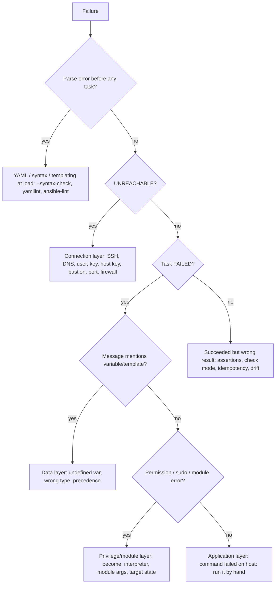

# 4.10 Debugging Ansible playbooks

| | |
|---|---|
| Level | Intermediate |
| Priority tier | 0 |
| Lab venue | ansible-core; 2 to 3 Linux targets |
| Part | Part 4: Automation and infrastructure as code |
| Status | Drafted, labs **untested** |

## Why this matters for AI infrastructure

Automation failures happen at the worst moments: halfway through a driver rollout across 200 GPU nodes, during a maintenance window with a deadline, or in CI where you cannot attach a debugger. Being fast at diagnosis (is it the connection, privileges, a variable, a template, the module, or the target?) saves hours and prevents the dangerous reflex of "just rerun it" or "just add `ignore_errors`". This chapter gives a layered method and the exact tools for each layer.

## Prerequisites and outcomes

Needs 4.3 to 4.9. After this chapter you can:

- Read an Ansible error message and classify the failure layer in seconds.
- Use verbosity (`-v` to `-vvvv`), `debug`, `assert`, `--step`, `--start-at-task`, `--check --diff`, and the interactive debugger (`strategy: debug` / `debugger:` keyword).
- Diagnose SSH/connection, privilege, Python interpreter, module argument, variable, template and YAML problems.
- Reproduce a failing module by hand on the target (keeping remote files with `ANSIBLE_KEEP_REMOTE_FILES`).
- Profile slow runs and find the expensive tasks and fact gathering.
- Build habits that prevent bugs: lint, syntax check, dry run, small steps, canaries.

## 1. A layered method



Questions to ask in order: **When** did it fail (before tasks, at a task, in a handler, after)? **Where** (which hosts: all, some, one)? **What changed** since the last good run (code, inventory, versions, target state)? **Can I reproduce on one host** (`--limit`, `-vvv`)? Differences between failing and passing hosts are the most informative clue (OS version, Python, facts, variables, network path).

## 2. Verbosity and output

| Flag | Shows |
|---|---|
| (none) | Task names, results, recap |
| `-v` | Module return data (registered values, `rc`, `stdout`, `stderr`) |
| `-vv` | Adds task paths and `false_condition` for skipped tasks, file loading |
| `-vvv` | Adds connection details: SSH command lines, remote temp paths, module args |
| `-vvvv` | Adds connection plugin internals (SSH debug), plugin loading; very noisy |
| `-vvvvv` | Everything including WinRM/SSH raw debugging |

Practical output settings in `ansible.cfg`: `stdout_callback = yaml` (readable multi-line values; in newer releases use `result_format = yaml` with the default callback), `callbacks_enabled = timer, profile_tasks, profile_roles`, `display_skipped_hosts = false` to declutter, `log_path = ansible.log` (a persistent log, remember it may contain secrets unless `no_log` is used), `ANSIBLE_NOCOLOR=1` in CI logs. For machine-readable analysis use `ANSIBLE_STDOUT_CALLBACK=json` or `ansible.posix.json` (single JSON at the end), `ansible.posix.jsonl`, or send events to a log pipeline.

## 3. The `debug` and `assert` modules

```yaml
- name: Look at a variable
  ansible.builtin.debug:
    var: nccl_env                               # prints name and value; no braces needed

- name: Look at an expression
  ansible.builtin.debug:
    msg: "{{ inventory_hostname }} has {{ gpu_count | default('unset') }} GPUs in groups {{ group_names }}"
  verbosity: 1                                  # only shown with -v or more: leave in the code safely

- name: Dump all variables for one host (careful: secrets)
  ansible.builtin.debug:
    var: hostvars[inventory_hostname]
  when: inventory_hostname == 'gpu001' and debug_dump | default(false)

- name: Fail early with a useful message
  ansible.builtin.assert:
    that:
      - gpu_count is defined
      - gpu_count | int in [4, 8]
    fail_msg: "gpu_count must be 4 or 8 for {{ inventory_hostname }}, got {{ gpu_count | default('undefined') }}"
    quiet: true
```

Tips: `debug` prints values after templating, so it reveals typing issues (a string `"False"` versus boolean). Use `verbosity:` to keep helpful diagnostics in code permanently. For structured output use `| to_nice_json`/`to_nice_yaml`. Do not leave debug output of secrets in committed code or CI logs.

In *Ansible: Up and Running* Chapter 8 (`Table 8-3`), the authors pair `ansible.builtin.stat` with `ansible.builtin.assert` to verify filesystem invariants before or after tasks execute: registering `stat: path=/etc/nginx/conf` into `st` returns a `st.stat` dictionary containing **`exists`** (boolean), **`isdir`** (directory), **`isreg`** (regular file), **`islnk`** (symlink), **`isblk`** (block device), **`isfifo`** (named pipe), **`issock`** (Unix socket), **`uid`** / **`gid`**, **`pw_name`** / **`gr_name`** (owner/group names), **`mode`** (octal string like `'0755'`), **`rusr`/`wusr`/`xusr`**, **`size`**, **`atime`/`mtime`/`ctime`**, and **`checksum`** (SHA-1) / **`md5`**, which you can assert directly with `assert: { that: [st.stat.exists, st.stat.isdir, st.stat.pw_name == 'root'] }`.

## 4. Controlling the run while investigating

```bash
ansible-playbook site.yml --syntax-check                    # parse only
ansible-playbook site.yml --list-tasks --list-tags --list-hosts
ansible-playbook site.yml --check --diff --limit gpu001     # what would change
ansible-playbook site.yml --step                            # confirm every task (y/n/c)
ansible-playbook site.yml --start-at-task "Install driver"  # resume mid-playbook (skips earlier tasks and their set_fact)
ansible-playbook site.yml --limit @site.retry               # rerun only failed hosts (enable retry files or write failures yourself)
ansible-playbook site.yml -t config -l gpu001               # one tag on one host
ansible-playbook site.yml -e debug_dump=true -vv
ansible gpu001 -m ansible.builtin.setup -a 'filter=ansible_default_ipv4'      # inspect facts
ansible gpu001 -m ansible.builtin.command -a 'which python3' -vvv            # test connectivity & interpreter
```

Caveat: `--start-at-task` and tags skip earlier tasks that may have set facts or variables later tasks need, producing misleading failures; reproduce with the minimum necessary context (`set_fact` in a scratch play, `-e` values).

### The interactive debugger

Ansible has a built-in task debugger invoked on failure (or always), modelled on `pdb`:

```yaml
- hosts: gpu
  strategy: debug            # the play's tasks drop into the debugger on failure
  debugger: on_failed        # also per play/block/task: always, never, on_failed, on_unreachable, on_skipped
  tasks:
    - name: Something fragile
      ansible.builtin.command: /bin/false
      debugger: on_failed
```

or without editing playbooks: `ANSIBLE_ENABLE_TASK_DEBUGGER=True ansible-playbook site.yml`. At the prompt:

| Command | Action |
|---|---|
| `p task`, `p task.args`, `p task_vars`, `p task_vars['hostvars']`, `p result._result` | Print task, arguments, variables, result |
| `task.args['name'] = 'fixed'` | Modify arguments |
| `task_vars['x'] = 1` + `update_task` | Change variables and re-template the task |
| `redo` (`r`) | Re-run the task with the modifications |
| `continue` (`c`) | Continue the play (task stays failed) |
| `quit` (`q`) | Abort |

Use it to experiment on one failing host interactively; then encode the fix in the playbook. It does not work in non-interactive CI.

## 5. Classifying common failures

### Parse and templating errors before execution

| Message | Meaning | Fix |
|---|---|---|
| `ERROR: Syntax Error while loading YAML` / `mapping values are not allowed here` | Bad YAML: unquoted colon, indentation, tab | Quote strings; `yamllint`; check the line shown (the real error is often the line before) |
| `found unacceptable key (unhashable type)` | A value like `{{ var }}` unquoted at start of a line is parsed as a mapping | Quote: `"{{ var }}"` |
| `ERROR: 'xxx' is not a valid attribute for a Task` | Misspelled keyword or module argument at wrong indentation | Check module/keyword names (`ansible-doc -t keyword -l`) |
| `couldn't resolve module/action 'foo'` | Module/collection not installed or not FQCN-resolvable | `ansible-galaxy collection list`; install; use FQCN |
| `The task includes an option with an undefined variable` | A variable is undefined at templating time | `default()`, `is defined`, check precedence/scope/typos |
| `template error while templating string: unexpected '}'` | Unbalanced braces/quotes in Jinja | Reproduce in a `debug` task; use `` for literal braces |
| `AnsibleUndefinedVariable: 'dict object' has no attribute 'x'` | Wrong key or the object is a different shape than assumed | `debug: var=` the parent; `default({})` chains |
| `conditional check failed` / `Conditional result was derived from a non-boolean` | `when:` evaluated a string/undefined | Cast with `\| bool`; fix expression |

### Connection layer (UNREACHABLE)

| Symptom | Cause | Check |
|---|---|---|
| `Permission denied (publickey,password)` | Wrong user/key, key not authorised, agent has too many keys (`Too many authentication failures`) | `ssh -vvv user@host`; `ansible_user`; `IdentitiesOnly=yes`; `ssh-add -l` |
| `Host key verification failed` | New/changed key | Investigate; fix `known_hosts`; do not disable globally |
| `Connection timed out` / `No route to host` | Network, firewall, wrong IP | `nc -vz host 22` (or `nc hostname 2222` to read the `SSH-2.0-OpenSSH_...` banner), route, bastion `ProxyJump`, tcpwrappers (`/etc/hosts.allow`), SELinux |
| `Could not resolve hostname` | DNS | Use `ansible_host`, fix DNS/`/etc/hosts` |
| `Connection closed by remote host` / `kex_exchange_identification` | sshd rate limits (`MaxStartups`), fail2ban banning the control node | Lower `forks`, raise MaxStartups, whitelist controller |
| Hangs for a long time then fails | Reverse DNS delays (`UseDNS`), unreachable sudo prompts, `-k` password prompts | `timeout`, disable `UseDNS`, check prompts with `-vvvv` |
| `Failed to create temporary directory` | Home not writable, full disk, `noexec` mount on tmp, `remote_tmp` | Set `remote_tmp`, check `df`, mount options |
| `Shared connection to host closed` with output truncated | Output after SSH closed; tty issues | Pipelining, `-o ControlPersist`, check `requiretty` |

Also from *Ansible: Up and Running* Chapter 8 (*Common SSH Challenges*):
- **Fixing `WARNING: REMOTE HOST IDENTIFICATION HAS CHANGED` safely:** When a lab VM (`192.168.33.10`) is destroyed and recreated (or a bare-metal GPU node is re-imaged), its Ed25519 host key changes and OpenSSH aborts with `Host key verification failed`. Remove the stale key entry and record the new host key cleanly with:
  ```bash
  ssh-keygen -R 192.168.33.10
  ssh-keyscan -H 192.168.33.10 >> ~/.ssh/known_hosts
  ```
- **Hardening `sshd` and `authorized_keys` (`key_options` and `exclusive: true`):** On production hosts, enforce `PasswordAuthentication no` and `PermitRootLogin no` in `/etc/ssh/sshd_config`, and deploy automation SSH public keys with `ansible.posix.authorized_key` using **`key_options: 'no-port-forwarding,from="93.184.216.34"'`** (restricting the key to connections originating from the control node / bastion IP and disabling SSH port forwarding) and **`exclusive: true`** (removing any unauthorized keys from `~/.ssh/authorized_keys`).
- **Debugging SSH Agent Forwarding on `git` tasks:** If a `git` task on a remote host fails with `Permission denied (publickey)` when cloning a private repository (`git@github.com:...`), verify that (1) your key is loaded in the local agent (`ssh-add -L`), (2) `ForwardAgent=yes` is active (`ansible web -vvv -m ping` shows `-o ForwardAgent=yes` in the `SSH: EXEC` line), and (3) the `git` task does **not** set `become: true` (or preserves `SSH_AUTH_SOCK` in `sudoers` `env_keep`), because `sudo` strips `SSH_AUTH_SOCK` by default.

### Privilege and module layer

| Symptom | Cause | Fix |
|---|---|---|
| `Missing sudo password` | sudo requires password | `-K`/`ansible_become_password`, or passwordless sudo for the automation user |
| `sudo: a terminal is required` / `no tty present` | `requiretty` or missing tty | Remove `requiretty` for the user; enable pipelining |
| `/bin/sh: 1: /usr/bin/python: not found` or module needs Python | No/wrong interpreter | `ansible_python_interpreter`, bootstrap with `raw`, `interpreter_python=auto_silent` |
| `Failed to set permissions on the temporary files` | become to unprivileged user without ACL support | Install `acl`, use `pipelining`, or `allow_world_readable_tmpfiles` (understand the security impact) |
| `MODULE FAILURE` with a Python traceback | Module bug, missing target library (e.g. `psycopg2`, `docker` SDK), version mismatch | Read the traceback; install the dependency on the *target* (or the controller for local modules); upgrade collection |
| Module works with `command` but not the dedicated module | Different environment, locale, PATH, SELinux | `environment:`, `-vvv` to see env, run manually |
| `apt` lock / `dpkg` locked | Another package process running (unattended-upgrades) | `lock_timeout`, wait, disable the competing job |
| `Unsupported parameters for (module) module: foo` | Argument name wrong or from a newer collection | `ansible-doc <module>`; align collection version |

### Application layer

If a `command`/`shell` task fails, copy the exact command from `-vvv` output and run it on the host **as the same user, environment and working directory** (`sudo -u user -i`). Most "Ansible problems" at this layer are plain command problems (PATH, locale, missing package, kernel module not loaded, GPU in a bad state).

## 6. Reproducing a module run by hand

```bash
ANSIBLE_KEEP_REMOTE_FILES=1 ansible gpu001 -m ansible.builtin.copy -a "src=./x dest=/tmp/x" -vvv
# the output shows the remote path: /home/automation/.ansible/tmp/ansible-tmp-.../AnsiballZ_copy.py
ssh gpu001
cd /home/automation/.ansible/tmp/ansible-tmp-*/
python3 AnsiballZ_copy.py explode     # unpack the module and its arguments (args file) into ./debug_dir
python3 AnsiballZ_copy.py execute     # run it with a debugger or modify the source
```

This works for any module and lets you add `print` statements or run under `pdb` on the target. Clean up the kept files afterwards. For `ansible-playbook`, set the same env var; use `-vvvv` if you need to see how Ansible invoked SSH. For custom modules, a JSON args file can be passed directly (`python mymodule.py args.json`, 4.15).

## 7. Debugging variables and templates

- **Which value is used?** `ansible-inventory --host`, `debug: var=...`, `-vvv`, and a repo-wide `grep`. Remember precedence (4.5): `-e` and role `vars/` override most things; dictionaries replace.
- **Render a template locally**: `ansible localhost -m ansible.builtin.template -a "src=x.j2 dest=/tmp/out" -e @vars.yml` then inspect `/tmp/out`; or use `ansible all -m debug -a "msg={{ lookup('template', 'x.j2') }}"` with host context.
- **Inspect types** with `{{ var | type_debug }}` (shows `str`, `int`, `bool`, `list`, `dict`, `AnsibleUnsafeText`).
- **Check facts exist**: `ansible host -m setup -a filter=ansible_distribution*`.
- **Conditions**: add a `debug` task that prints the expression you use in `when:` (`msg: "{{ (gpu_count | int) > 4 }}"`); `-vv` prints `false_condition` for skipped tasks.
- **Loops**: print `item` with `loop_control: label` removed temporarily; `register` and print `results`.
- **Idempotency problems**: run twice with `--diff -v` and examine which task changes; for `lineinfile` check the regex against the file, for `template` look at the diff, for `command` add `changed_when`.

## 8. Performance debugging

```ini
[defaults]
callbacks_enabled = timer, profile_tasks, profile_roles
forks = 50
gathering = smart
fact_caching = jsonfile
[ssh_connection]
pipelining = True
ssh_args = -o ControlMaster=auto -o ControlPersist=120s
```

`profile_tasks` prints the slowest tasks and cumulative time; typical culprits: fact gathering (reduce subset or cache), `apt update` on every run (`cache_valid_time`), per-item loops that should be single calls, `git clone` per host, serial execution (`serial: 1` over a huge group), slow SSH setup (no ControlPersist), reverse DNS in sshd, single `forks=5`, `strategy: linear` waiting on stragglers (`strategy: free` for independent work), low-quality network or overloaded control node. For very large fleets consider pull mode (`ansible-pull`), AWX/AAP execution nodes (4.14), or splitting inventory into parallel jobs. Measure before and after each change.

## 9. Debugging at scale and in CI

- Failures across many hosts: group by error message (`ansible-playbook ... 2>&1 | grep -E "fatal:|FAILED" | sed 's/.*=> //' | sort | uniq -c | sort -rn`), then examine representatives; sort failing hosts by group/rack/OS to find the common factor.
- Persist logs with run ids; attach the `--check --diff` output to pull requests; fail CI on non-zero exit and print the recap.
- In CI use `--diff` carefully (secrets), `ANSIBLE_FORCE_COLOR=1` for readable logs, and `ANSIBLE_STDOUT_CALLBACK=yaml`. Keep a way to reproduce locally: the same container image/execution environment (4.15) and the same inventory.
- For rolling updates, make the playbook fail **early and safely** (canary, `max_fail_percentage`) so a broken change does not reach the fleet; debugging a failed canary is far cheaper than debugging 200 failures.
- Reproduce on a disposable host (Vagrant, container, cloud VM) when the production host cannot be touched; Molecule scenarios (4.13) capture such reproductions as tests.

## 10. Prevention habits

1. `ansible-lint` and `yamllint` in pre-commit and CI; `--syntax-check` always.
2. Small playbooks, small steps; one change per run on a canary.
3. Name every task; use `assert` for preconditions; avoid cleverness in Jinja.
4. `--check --diff` before real runs; verification tasks after changes.
5. Pin versions of ansible-core, collections and target packages.
6. Keep `command`/`shell` tasks rare, guarded, and explicit about `changed_when`/`failed_when`.
7. Avoid `ignore_errors`; use targeted `failed_when`.
8. Write the failing case as a Molecule test when a bug is found (4.13).

## 11. Lab

First, run the self-checking Python lab (`code/part04/ansible_debugging_toolkit_lab.py`) locally. It verifies the 5-layer Ansible error classifier (`classify_ansible_failure_layer`: parse/syntax, connection `UNREACHABLE`, data/template, privilege/module, and application command) and the interactive Task Debugger session simulator (`InteractiveTaskDebuggerSession`: inspecting a failed task, updating `task_vars` + `update_task`, and re-running with `redo`, `AUR` Ch. 8).

```bash
python3 code/part04/ansible_debugging_toolkit_lab.py
```

Next, on a control node with 2–3 Linux targets (all interactive shell steps below are `untested here`), work through these exercises:

1. **Break it on purpose**: create playbooks with (a) an unquoted `{{ var }}`, (b) a tab, (c) an undefined variable, (d) a misspelled module argument, (e) a missing collection; for each, record the error text and classify the layer.
2. **Verbosity ladder**: run one failing task at `-v`, `-vv`, `-vvv`, `-vvvv`; list what extra information each level adds (SSH command, remote tmp path, module args).
3. **Connection faults**: change the user, remove the key, change the port, block port 22 with a firewall rule, change the host key; reproduce each `UNREACHABLE` message and fix it correctly.
4. **Privilege faults**: remove passwordless sudo, add `requiretty`, make `/tmp` `noexec`; observe messages and fixes.
5. **Interpreter faults**: use a host without Python, with only Python 2 (if available) or a wrong `ansible_python_interpreter`.
6. **Interactive debugger**: fail a task due to a typo in a variable; fix `task_vars` and `redo`; also use `ANSIBLE_ENABLE_TASK_DEBUGGER`.
7. **Keep remote files**: run with `ANSIBLE_KEEP_REMOTE_FILES=1`, explode the module, edit it, execute by hand; clean up.
8. **Variable archaeology**: plant the same variable in five layers; find the winner with `ansible-inventory --host`, `debug`, and `grep`; print `type_debug`.
9. **Idempotency hunt**: take a playbook with three non-idempotent tasks; find them using a double run with `--diff`; fix each.
10. **Profile**: enable `profile_tasks`; make a slow playbook; reduce its time by 50% using caching, pipelining, `forks` and loop consolidation.
11. **Postmortem template**: for the last failure you debugged, write a five-line note: symptom, layer, root cause, fix, prevention (lint rule, assertion or test).
12. **Clean up.**

## 12. Common mistakes

- Rerunning blindly or adding `ignore_errors: true` instead of understanding the failure.
- Debugging at `-vvvv` everywhere (drowning in output) or never going above default.
- Using `--start-at-task` without the facts/variables from skipped tasks.
- Not comparing a failing host to a healthy one.
- Disabling host key checking or sudo safeguards to "get it working".
- Leaving debug output (secrets) in committed playbooks or CI logs.
- Debugging on production hosts instead of reproducing on a disposable one.
- Treating every error as an Ansible problem when the underlying command, package or kernel state is at fault.
- Not recording the fix as a lint rule, assertion or test.

## 13. Interview angles

- "A playbook works on most hosts but fails on a few. How do you debug?" (compare facts/vars/OS/network; `-vvv` on one host; reproduce manually.)
- "What does each verbosity level add? How do you get the SSH command and module arguments?"
- "How do you run a module by hand on the target?" (`ANSIBLE_KEEP_REMOTE_FILES`, `explode`/`execute`.)
- "What is the task debugger and when do you use it?"
- "A deployment is slow. How do you find out why and speed it up?"
- "How do you find which layer a failure belongs to?"
- "What do you do when a playbook partially applies changes to 50 nodes and fails?" (idempotent rerun, limit to failed hosts, canary, rescue/rollback.)

## Exercises

1. **The 5-Layer Failure Classification Method and Verbosity Ladder (`-v` to `-vvvvv`, `AUR` Chapter 8):** Using `classify_ansible_failure_layer()` in `code/part04/ansible_debugging_toolkit.py`, classify seven common error messages into their exact layer (Parse/Syntax, Connection `UNREACHABLE`, Data/Template, Privilege/Module, Application Command), and state what `-v`, `-vv`, `-vvv`, and `-vvvv` add to the output.
2. **Proactive Verification with `debug`, `assert`, `type_debug`, and `stat` Return Values (`AUR` Chapter 8 Table 8-3):** Write a task pair that runs `ansible.builtin.stat` on `/etc/slurm/slurm.conf` and uses `ansible.builtin.assert` (`quiet: true`) to verify `exists`, `isreg`, `pw_name == 'slurm'`, `mode == '0644'`, and non-zero `size`, and explain how `verbosity: 1` on `debug` and `{{ var | type_debug }}` work.
3. **Interactive Task Debugger (`strategy: debug` / `debugger: on_failed` / `ANSIBLE_ENABLE_TASK_DEBUGGER`, `AUR` Chapter 8 Table 8-2):** Using `InteractiveTaskDebuggerSession` in `code/part04/ansible_debugging_toolkit.py`, explain the difference between modifying `task.args['name'] = 'chrony'` directly versus modifying `task_vars['ntp_pkg'] = 'chrony'` followed by `update_task` (`u`) and `redo` (`r`), and list the five `debugger:` trigger values.
4. **Diagnosing SSH, Bastion, Host-Key, and Agent-Forwarding Failures (`AUR` Chapter 8):** (a) Explain how to resolve `WARNING: REMOTE HOST IDENTIFICATION HAS CHANGED` safely using `ssh-keygen -R` and `ssh-keyscan`, and how `authorized_key` `key_options: 'no-port-forwarding,from="..."'` and `exclusive: true` harden SSH access; (b) explain why a remote `git` task using SSH agent forwarding fails with `Permission denied (publickey)` when `become: true` is active on the task.
5. **Reproducing a Module Execution Manually on the Target (`ANSIBLE_KEEP_REMOTE_FILES=1` and `AnsiballZ` `explode` / `execute`):** Walk through the exact commands to keep the temporary `AnsiballZ_*.py` wrapper on a target GPU node, unpack the module source and `args` JSON file with `explode`, and execute it under `python3` or `pdb` as the target user.
6. **Performance Profiling (`profile_tasks`, `profile_roles`, `timer`) and Fleet Error Triage at Scale:** (a) Explain how `callbacks_enabled = timer, profile_tasks, profile_roles` identifies playbook bottlenecks and list the six highest-impact speedups; (b) show the shell pipeline used to aggregate and rank `FAILED`/`UNREACHABLE` reasons across a 200-node run.

## Checkpoint questions (20)

<details>
<summary>1. What are the five diagnostic layers when an Ansible playbook fails, and how do you distinguish them in seconds?</summary>

1. **Parse / Syntax Layer (fails before any task starts):** Bad YAML indentation, tabs, unquoted `{{ var }}` at line start, misspelled task keywords, or missing collections (`--syntax-check`, `yamllint`, `ansible-lint`).
2. **Connection Layer (`UNREACHABLE`):** SSH timeout, DNS failure, wrong `ansible_user` or key, changed host key, `MaxStartups` rate limit, or unmounted/full `remote_tmp`.
3. **Data / Template Layer (`FAILED` before module runs on target):** `AnsibleUndefinedVariable`, wrong variable precedence, `when:` string-vs-boolean error, or unbalanced Jinja braces.
4. **Privilege / Module Layer (`FAILED` during wrapper invocation):** `Missing sudo password`, `requiretty`, missing `/usr/bin/python3`, missing `acl` for `become_user`, or `MODULE FAILURE` traceback from a missing target Python library (`psycopg2`).
5. **Application / Command Layer (`FAILED` with non-zero `rc`):** The module ran, and the underlying OS package manager, service, or CLI command (`nvidia-smi`, `nginx -t`) rejected the state change.
</details>

<details>
<summary>2. What specific diagnostic detail does each verbosity flag (`-v`, `-vv`, `-vvv`, `-vvvv`) add (`AUR` Chapter 8)?</summary>

- **`-v`**: Prints the **module return dictionary** (`stdout`, `stderr`, `rc`, `msg`, `changed`) for each task.
- **`-vv`**: Adds the **file path and line number** of every task/handler, loaded variable files, and the exact **`false_condition`** expression that caused a task to be skipped.
- **`-vvv`**: Adds **SSH connection commands** (`SSH: EXEC ssh ...`), remote temporary directory paths (`~/.ansible/tmp/.../AnsiballZ_*.py`), and the exact **invocation arguments** passed into each module.
- **`-vvvv`**: Passes `-vvv` to the underlying `ssh` client, printing full SSH key-exchange, cipher, `ProxyJump`, and authentication debug traces.
</details>

<details>
<summary>3. How do you make Ansible output human-readable for multi-line `stdout`/`stderr` tracebacks, and how do you log runs to a file (`AUR` Chapter 8)?</summary>

Set **`stdout_callback = yaml`** (or `result_format = yaml` under the `default` callback in newer `ansible-core` releases, or `stdout_callback = debug`) in `[defaults]` in `ansible.cfg` so multi-line `stdout` and Python tracebacks render with real line breaks instead of escaped `\n` strings. Set **`log_path = ./ansible.log`** to persist output to disk (remembering to set `no_log: true` on secret tasks so credentials are not written to `ansible.log`).
</details>

<details>
<summary>4. How do `verbosity: 1` on `ansible.builtin.debug` and `quiet: true` on `ansible.builtin.assert` keep production playbooks clean?</summary>

- Setting **`verbosity: 1`** on a `debug` task suppresses its output during normal runs and prints it **only when `-v` (or higher)** is passed on the command line—letting you leave diagnostic probes permanently in your playbooks without cluttering routine logs.
- Setting **`quiet: true`** on an `assert` task suppresses the verbose `"msg": "All assertions passed"` banner on every host while still failing with `fail_msg` whenever an assertion fails.
</details>

<details>
<summary>5. In `AUR` Chapter 8 (`Table 8-3`), what fields does `ansible.builtin.stat` return, and how do you use them with `assert`?</summary>

Registering `stat: { path: /etc/nginx/conf }` into `st` populates `st.stat` with:
- **`exists`** (`bool`): whether the path exists at all (always check `st.stat.exists` first).
- **File type booleans:** **`isdir`**, **`isreg`** (regular file), **`islnk`** (symlink, plus `lnk_source`), **`isblk`**, **`ischr`**, **`isfifo`**, **`issock`**.
- **Ownership & permissions:** **`uid`**, **`gid`**, **`pw_name`** (owner username), **`gr_name`** (group name), **`mode`** (octal string such as `'0755'`), and `rusr`/`wusr`/`xusr`.
- **Size, timestamps & integrity:** **`size`**, **`atime`**, **`mtime`**, **`ctime`**, and **`checksum`** (SHA-1).
</details>

<details>
<summary>6. How do you enable the interactive Ansible Task Debugger, and what are its five trigger modes (`AUR` Chapter 8)?</summary>

Enable the debugger via `strategy: debug`, the `debugger:` keyword (on a play, role, block, or individual task), `enable_task_debugger = True` in `ansible.cfg`, or the environment variable **`ANSIBLE_ENABLE_TASK_DEBUGGER=True`**. The five `debugger:` values are:
1. **`on_failed`**: drop into the debugger whenever a task fails.
2. **`on_unreachable`**: drop into the debugger when a host is `UNREACHABLE`.
3. **`on_skipped`**: drop into the debugger when a task is skipped.
4. **`always`**: pause in the debugger before/after every task.
5. **`never`**: disable the debugger on this scope even if enabled globally.
</details>

<details>
<summary>7. Inside the interactive `(debug)` prompt, what is the difference between changing `task.args[key]` and changing `task_vars[key]` (`AUR` Chapter 8 Table 8-2)?</summary>

- **`p task`, `p task.args`, `p task_vars`, `p result._result`**: inspect the task name, module arguments, variables, and failure dictionary.
- **`task.args['name'] = 'chrony'` followed by `r` (`redo`)**: directly overwrites the already-rendered module argument and re-runs the task immediately.
- **`task_vars['pkg'] = 'chrony'` (or `vars['pkg'] = 'chrony'`) followed by `u` (`update_task`) and `r` (`redo`)**: updates the variable in context and calls **`update_task`** to **re-template `task.args` from the original `{{ pkg }}` expression** before re-running the task.
</details>

<details>
<summary>8. What is the danger of using `--start-at-task` or `--tags` while debugging a failing playbook?</summary>

Jumping directly into the middle of a playbook with `--start-at-task "Configure Slurm"` or `--tags slurm_conf` **skips all earlier tasks** in the play. If an earlier task used `register` or `set_fact` (or `include_vars`) to compute a variable consumed by `"Configure Slurm"`, the task will fail with a misleading `AnsibleUndefinedVariable` error that would never occur in a full run. Always ensure `gather_facts: true` runs (or fact caching is enabled) and tag essential variable-setup tasks with `tags: [always]`.
</details>

<details>
<summary>9. How do you reproduce and debug a failing Ansible module directly on the target host (`ANSIBLE_KEEP_REMOTE_FILES=1` and `AnsiballZ`)?</summary>

1. Run the failing task with **`ANSIBLE_KEEP_REMOTE_FILES=1`** and **`-vvv`**:
   `ANSIBLE_KEEP_REMOTE_FILES=1 ansible gpu001 -m ansible.builtin.apt -a "name=chrony" -vvv`
2. Copy the remote path printed in the `-vvv` output (`~/.ansible/tmp/ansible-tmp-.../AnsiballZ_apt.py`) and SSH into `gpu001`.
3. Run **`python3 AnsiballZ_apt.py explode`**, which unpacks the self-contained zip bundle into `./debug_dir/` containing the readable Python module script and the JSON `args` file.
4. Inspect or edit `./debug_dir/` and run **`python3 AnsiballZ_apt.py execute`** (or run under `python3 -m pdb`) to see the exact local exception, then delete the temp directory when finished.
</details>

<details>
<summary>10. What causes `ERROR: found unacceptable key (unhashable type)` vs. `mapping values are not allowed here` when parsing a playbook?</summary>

- **`found unacceptable key (unhashable type)`:** An unquoted value starts with `{{ var }}` (e.g., `dest: {{ my_path }}/file.conf`). YAML sees `{` at the start of the value, parses `{{ my_path }}` as a nested dictionary key inside a flow mapping, and fails because a dictionary is unhashable. Fix: quote the entire value (`dest: "{{ my_path }}/file.conf"`).
- **`mapping values are not allowed here`:** An unquoted string contains a colon followed by a space (`: `)—for example, `msg: Failed: check logs`—or a line has wrong indentation after a key. Fix: quote the string (`msg: "Failed: check logs"`).
</details>

<details>
<summary>11. Why does an SSH connection fail with `Too many authentication failures` even when the right SSH key is present, and how do you fix it?</summary>

If your local `ssh-agent` holds 6 or more SSH keys (`ssh-add -l`), OpenSSH offers every key in the agent one by one before trying the `-i` identity file specified for the host—exceeding the remote `sshd`'s `MaxAuthTries` limit (default `6`) and disconnecting with `Too many authentication failures`. Fix it by adding **`-o IdentitiesOnly=yes`** to `ssh_args` in `ansible.cfg` (or in `~/.ssh/config`) so SSH offers only the specific key configured for that host.
</details>

<details>
<summary>12. In `AUR` Chapter 8, why did the `git` task fail with `Permission denied (publickey)` on the remote host when SSH agent forwarding was configured, and what are the three checks?</summary>

When cloning a private repo (`git@github.com:...`) on a remote host via SSH agent forwarding:
1. Check `ssh-add -L` on the control node to ensure your private key is actually loaded into `ssh-agent` (macOS/Linux agents can lose keys after reboot).
2. Check `ansible web -vvv -m ping` to confirm `-o ForwardAgent=yes` is passed to `ssh`.
3. Ensure the `git` task runs as the **connected SSH user (`become: false`)** rather than `become: true` (`root`), because `sudo` clears the `SSH_AUTH_SOCK` environment variable by default (unless `Defaults env_keep += "SSH_AUTH_SOCK"` is configured in `/etc/sudoers`).
</details>

<details>
<summary>13. How do `key_options` and `exclusive: true` on `ansible.posix.authorized_key` secure automation SSH keys (`AUR` Chapter 8)?</summary>

- **`key_options: 'no-port-forwarding,from="93.184.216.34"'`**: prefixes the public key in `~/.ssh/authorized_keys` with OpenSSH restrictions so `sshd` only accepts that key when the TCP connection originates from the control node / bastion IP (`93.184.216.34`) and refuses port-forwarding requests.
- **`exclusive: true`**: removes all other public keys from `~/.ssh/authorized_keys` that are not explicitly managed by the task, revoking any lingering manual or departed-admin keys.
</details>

<details>
<summary>14. What causes `Failed to create temporary directory` or `Permission denied` when executing modules on a hardened Linux node?</summary>

1. The automation user's home directory is missing, full (`df -h`, `df -i`), or read-only.
2. `/tmp` or the user's home filesystem is mounted with the **`noexec`** mount option, preventing `/usr/bin/python3` or script wrappers from executing out of `remote_tmp`.
Fix it by setting `remote_tmp = /var/tmp/.ansible-${USER}/tmp` (or another writable, executable path) under `[defaults]` in `ansible.cfg`.
</details>

<details>
<summary>15. Why does a command succeed when you run it interactively over SSH (`ssh gpu01 nvidia-smi`), yet fail inside an Ansible `command` or module task?</summary>

Interactive SSH login shells source `/etc/profile`, `~/.bash_profile`, and `~/.bashrc` (which often prepend `/usr/local/cuda/bin` or `/opt/slurm/bin` to `PATH`, load environment modules, or set proxy/locale variables). Ansible executes modules in a **non-interactive, non-login shell** with a minimal default `PATH` (`/usr/bin:/bin`). Always use absolute binary paths (`/usr/local/cuda/bin/nvcc`) or pass explicit environment variables on the task/play via **`environment: { PATH: "/usr/local/cuda/bin:{{ ansible_env.PATH }}" }`**.
</details>

<details>
<summary>16. How does the `type_debug` filter help diagnose mysterious `when:` or template failures?</summary>

Printing **`debug: { msg: "{{ my_var | type_debug }}" }`** reveals the exact runtime Python type of `my_var`—instantly showing whether `gpu_count` is a `str` (`"8"`) instead of an `int` (`8`), whether `enabled` is `"False"` (`str`) instead of `False` (`bool`), or whether a string is wrapped as `AnsibleUnsafeText`.
</details>

<details>
<summary>17. How do `timer`, `profile_tasks`, and `profile_roles` in `ansible.cfg` pinpoint why a playbook is slow?</summary>

Enabling `callbacks_enabled = timer, profile_tasks, profile_roles` in `[defaults]` in `ansible.cfg`:
- Prints the timestamp and **elapsed wall-clock seconds** after every individual task as the playbook runs.
- Prints a **sorted leaderboard of the top 20 slowest tasks (and roles)** at the end of the playbook run, showing immediately whether time is being spent in `Gathering Facts`, `apt update`, a slow `loop:`, or an un-multiplexed SSH connection.
</details>

<details>
<summary>18. What causes `kex_exchange_identification: Connection closed by remote host` when running Ansible with `forks = 100` through a bastion host?</summary>

When 100 Ansible worker forks simultaneously open SSH connections through a single bastion/jump host (or to a single target via `delegate_to`), the bastion's OpenSSH daemon hits **`MaxStartups`** (default `10:30:100`, which starts randomly dropping unauthenticated connections once 10 concurrent handshakes are in flight) or triggers `fail2ban`. Fix it by enabling `ControlPersist` multiplexing, raising `MaxStartups 100:30:200` and `MaxSessions 100` in the bastion's `/etc/ssh/sshd_config`, or capping concurrency with `forks` / `throttle`.
</details>

<details>
<summary>19. How do you triage a playbook failure when 40 out of 500 GPU nodes fail during a fleet run?</summary>

Never inspect 40 tracebacks one by one. Group the failures by their error message and by inventory topology:
1. Extract and count unique failure messages: `grep -E "fatal:|FAILED" ansible.log | sed 's/.*=> //' | sort | uniq -c | sort -rn`.
2. Intersect the failing host list with your inventory groups (`rack_*`, `gpu_*`, OS kernel version) to see if all 40 failing nodes share a single ToR switch, rack PDU, NFS mount, or Ubuntu kernel version.
3. Reproduce on **one** representative failing host with `--limit <host> -vvv`.
</details>

<details>
<summary>20. What should you do before closing an incident caused by an Ansible playbook bug?</summary>

Convert the failure into an automated guardrail so the same bug can never reach the fleet again:
1. If it was a missing or malformed variable, add an **`ansible.builtin.assert`** task in `pre_tasks` (or `meta/argument_specs.yml`).
2. If it was a syntax/module anti-pattern, enable the corresponding **`ansible-lint`** rule in CI.
3. If it was a host-state or idempotency regression, add the reproduction case to the role's **Molecule + Testinfra** test suite (`molecule converge && molecule idempotence && molecule verify`).
</details>

## Sources and review notes

- **Sources read in full:**
  - `ansible-up-and-running-3rd-edition` — Bas Meijer, Lorin Hochstein & René Moser, *Ansible: Up and Running*, 3rd ed., **Chapter 8: Debugging Ansible Playbooks** (read in full: human-friendly `stdout_callback = yaml` / `debug` output, `-v` through `-vvvv` SSH debug traces, `log_path`, common SSH challenges `PasswordAuthentication no`, `Host key verification failed` resolved with `ssh-keygen -R` and `ssh-keyscan`, `nc hostname 2222` banner checks, bastion `ProxyJump`, `authorized_key` with `key_options` and `exclusive: true`, SSH agent forwarding on `git` tasks, the `debug` module, the interactive Ansible Task Debugger `debugger: always|on_failed|on_unreachable|on_skipped` and debugger commands `p task`/`p task.args`/`p result`/`p vars`/`update_task`/`redo`/`continue`/`quit`, testing before execution `--syntax-check`/`--list-tasks`/`--list-hosts`/`--check -D`/`--step`/`--start-at-task`/`tags`, and `assert` with `stat` module return values `Table 8-3`).
- **Run here:** `python3 code/part04/ansible_debugging_toolkit_lab.py` (2 passed, 0 failed).
- **Explicitly labelled inferences:** The `classify_ansible_failure_layer` and `InteractiveTaskDebuggerSession` models in `code/part04/ansible_debugging_toolkit.py` and the 5-layer diagnostic flowchart are the author's constructions synthesizing *Ansible: Up and Running* Chapter 8 and production GPU fleet troubleshooting (plus original study items 21, 22, 23, 24, 25, 26, 27, 28, 29, and 30).
- **Not verified on live hardware:** Live `ansible`, `ansible-playbook`, `ssh-keygen`, `ssh-keyscan`, `nc`, and `AnsiballZ_*.py explode/execute` commands (`200` GPU nodes, `50` forks, `120s` ControlPersist, `192.168.33.10`, `192.168.56.10`, `93.184.216.34`, `2222`) are marked (`untested here`) where not executed by `ansible_debugging_toolkit_lab.py`.
