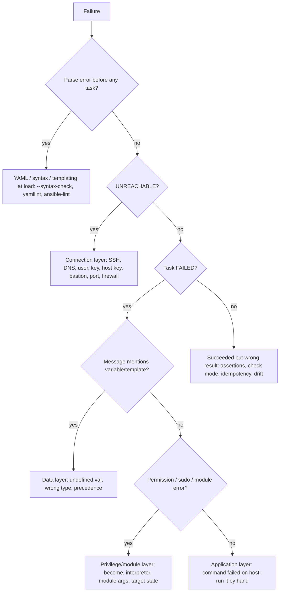

# 4.10 Debugging Ansible playbooks

| | |
|---|---|
| Level | Intermediate |
| Priority tier | 0 |
| Lab venue | ansible-core; 2 to 3 Linux targets |
| Part | Part 4: Automation and infrastructure as code |
| Status | Drafted, labs **untested** |

## Why this matters for AI infrastructure

Automation failures tend to arrive at the worst moments. A driver rollout stops halfway through 200 GPU nodes. A maintenance window has a deadline. Or the run happens in CI, where you cannot attach a debugger. In each case, fast diagnosis decides how the day goes. Ask first whether the problem is the connection, the privileges, a variable, a template, the module or the target. That question saves hours, and it keeps you away from the dangerous reflex of "just rerun it" or "just add `ignore_errors`". This chapter gives you a layered method, with the exact tools for each layer.

## Prerequisites and outcomes

This chapter builds on 4.3 to 4.9. By the end, you will be able to:

- Read an Ansible error message and tell which layer failed, in seconds.
- Use verbosity from `-v` to `-vvvv`, and the `debug` and `assert` modules, to see what Ansible sees.
- Use `--step`, `--start-at-task` and `--check --diff` to run only the part you are investigating.
- Turn on the interactive debugger with `strategy: debug` or the `debugger:` keyword.
- Diagnose SSH and connection, privilege, Python interpreter, module argument, variable, template and YAML problems.
- Reproduce a failing module by hand on the target, keeping its remote files with `ANSIBLE_KEEP_REMOTE_FILES`.
- Profile slow runs and find the expensive tasks and the fact gathering.
- Build habits that prevent bugs: lint, syntax check, dry run, small steps and canaries.

## 1. A layered method

Your playbook fails with a long message that does not say much. Where do you look first? The flowchart below sorts the failure into a layer, so you check the most likely cause before anything else. Read it from the top, and let each yes or no send you one step closer to the layer.



Four questions help you narrow the search, and you should ask them in order. **When** did it fail: before tasks, at a task, in a handler, or after? **Where** did it fail: on all hosts, some hosts, or one? **What changed** since the last good run: code, inventory, versions or target state? **Can you reproduce it** on one host, using `--limit` and `-vvv`? Differences between failing and passing hosts give the most useful clue. Compare the OS version, Python, facts, variables and network path. Before you change anything, put one failing host next to one passing host.

## 2. Verbosity and output

A task fails, and the default output shows only its name and result. The flags below add detail one level at a time, so pick the level that answers your question.

| Flag | Shows |
|---|---|
| (none) | Task names, results, recap |
| `-v` | Module return data (registered values, `rc`, `stdout`, `stderr`) |
| `-vv` | Adds task paths and `false_condition` for skipped tasks, file loading |
| `-vvv` | Adds connection details: SSH command lines, remote temp paths, module args |
| `-vvvv` | Adds connection plugin internals (SSH debug), plugin loading; very noisy |
| `-vvvvv` | Everything including WinRM/SSH raw debugging |

A few `ansible.cfg` settings make the output easier to read.

```ini
[defaults]
stdout_callback = yaml
callbacks_enabled = timer, profile_tasks, profile_roles
display_skipped_hosts = false
log_path = ansible.log
```

The `yaml` callback shows multi-line values clearly, and newer releases use `result_format = yaml` with the default callback. The `callbacks_enabled` line adds timing. Hiding skipped hosts shortens the output. The log file keeps a persistent record, which may hold secrets unless `no_log` is used.

Set `ANSIBLE_NOCOLOR=1` in CI logs. For machine-readable output, use `ANSIBLE_STDOUT_CALLBACK=json` or `ansible.posix.json`, which print one JSON document at the end. You can also use `ansible.posix.jsonl`, or send events to a log pipeline.

Use `-vvv` for the SSH command line or module arguments, and `-vvvv` only for connection internals.

## 3. The `debug` and `assert` modules

Sometimes the quickest fix is to look at what Ansible actually sees. A value that looks right in your YAML can arrive as something else once it is templated. The `debug` and `assert` modules let you print the value and stop the run early when it is wrong.

```yaml
- name: Look at a variable
  ansible.builtin.debug:
    var: nccl_env                               # prints name and value; no braces needed

- name: Look at an expression
  ansible.builtin.debug:
    msg: "{{ inventory_hostname }} has {{ gpu_count | default('unset') }} GPUs in groups {{ group_names }}"
  verbosity: 1                                  # only shown with -v or more: leave in the code safely

- name: Dump all variables for one host (careful: secrets)
  ansible.builtin.debug:
    var: hostvars[inventory_hostname]
  when: inventory_hostname == 'gpu001' and debug_dump | default(false)

- name: Fail early with a useful message
  ansible.builtin.assert:
    that:
      - gpu_count is defined
      - gpu_count | int in [4, 8]
    fail_msg: "gpu_count must be 4 or 8 for {{ inventory_hostname }}, got {{ gpu_count | default('undefined') }}"
    quiet: true
```

The `debug` module prints values after templating. That is why it reveals typing problems, such as a string `"False"` where you expected a boolean. Use `verbosity:` to keep helpful diagnostics in the code permanently, because they stay silent on normal runs. For structured output, pass the value through `to_nice_json` or `to_nice_yaml`. Never leave debug output of secrets in committed code or CI logs.

Pair `ansible.builtin.stat` with `ansible.builtin.assert`. You use them to verify filesystem state before or after a task runs. Registering `stat: path=/etc/nginx/conf` into `st` returns a `st.stat` dictionary. The fields you will assert on most are `exists`, `isdir`, `isreg`, `mode`, `pw_name`, `size` and `checksum`, which is a SHA-1. Checkpoint question 5 lists them all. You can assert on them directly, as in `assert: { that: [st.stat.exists, st.stat.isdir, st.stat.pw_name == 'root'] }`.

Put the `stat` and `assert` pair in front of any task that depends on the file, so a bad state fails with a clear message.

## 4. Controlling the run while investigating

You do not always need to run a whole playbook to learn what it will do. Ansible has flags that stop, list or limit the run, so you can see the effect before anything changes on a host.

```bash
ansible-playbook site.yml --syntax-check                    # parse only
ansible-playbook site.yml --list-tasks --list-tags --list-hosts
ansible-playbook site.yml --check --diff --limit gpu001     # what would change
ansible-playbook site.yml --step                            # confirm every task (y/n/c)
ansible-playbook site.yml --start-at-task "Install driver"  # resume mid-playbook (skips earlier tasks and their set_fact)
ansible-playbook site.yml --limit @site.retry               # rerun only failed hosts (enable retry files or write failures yourself)
ansible-playbook site.yml -t config -l gpu001               # one tag on one host
ansible-playbook site.yml -e debug_dump=true -vv
ansible gpu001 -m ansible.builtin.setup -a 'filter=ansible_default_ipv4'      # inspect facts
ansible gpu001 -m ansible.builtin.command -a 'which python3' -vvv            # test connectivity & interpreter
```

Each line answers one question, from a syntax check to a connectivity test. Be careful with `--start-at-task` and tags, though. They skip the earlier tasks, and those tasks may have set facts or variables that later tasks need. The result is a failure that looks real but is not. To avoid that, reproduce the problem with only the context it needs, such as a `set_fact` in a scratch play or the `-e` values.

### The interactive debugger

Ansible has a built-in task debugger. It runs when a task fails, or on every task if you ask for it. It is modelled on `pdb`, and you can set it on a play, a block or a single task.

```yaml
- hosts: gpu
  strategy: debug            # the play's tasks drop into the debugger on failure
  debugger: on_failed        # also per play/block/task: always, never, on_failed, on_unreachable, on_skipped
  tasks:
    - name: Something fragile
      ansible.builtin.command: /bin/false
      debugger: on_failed
```

You can also turn it on without editing any playbook, with `ANSIBLE_ENABLE_TASK_DEBUGGER=True ansible-playbook site.yml`. Once the prompt opens, you work with the commands in this table.

| Command | Action |
|---|---|
| `p task`, `p task.args`, `p task_vars`, `p task_vars['hostvars']`, `p result._result` | Print task, arguments, variables, result |
| `task.args['name'] = 'fixed'` | Modify arguments |
| `task_vars['x'] = 1` + `update_task` | Change variables and re-template the task |
| `redo` (`r`) | Re-run the task with the modifications |
| `continue` (`c`) | Continue the play (task stays failed) |
| `quit` (`q`) | Abort |

Use the debugger to experiment on one failing host, then write the fix into the playbook. It does not work in non-interactive CI.

## 5. Classifying common failures

An error message appears in your terminal, and the next step depends on which layer produced it. The tables below pair common messages with what they mean and how to fix them. Find the table for the layer where the failure happened, then match the message to a row.

### Parse and templating errors before execution

These errors stop the run before any task starts, so no host is touched. Look at the line Ansible reports, and remember that the real mistake is often on the line before it. That is where you should look first.

| Message | Meaning | Fix |
|---|---|---|
| `ERROR: Syntax Error while loading YAML` / `mapping values are not allowed here` | Bad YAML: unquoted colon, indentation, tab | Quote strings; `yamllint`; check the line shown (the real error is often the line before) |
| `found unacceptable key (unhashable type)` | A value like `{{ var }}` unquoted at start of a line is parsed as a mapping | Quote: `"{{ var }}"` |
| `ERROR: 'xxx' is not a valid attribute for a Task` | Misspelled keyword or module argument at wrong indentation | Check module/keyword names (`ansible-doc -t keyword -l`) |
| `couldn't resolve module/action 'foo'` | Module/collection not installed or not FQCN-resolvable | `ansible-galaxy collection list`; install; use FQCN |
| `The task includes an option with an undefined variable` | A variable is undefined at templating time | `default()`, `is defined`, check precedence/scope/typos |
| `template error while templating string: unexpected '}'` | Unbalanced braces/quotes in Jinja | Reproduce in a `debug` task; use `` for literal braces |
| `AnsibleUndefinedVariable: 'dict object' has no attribute 'x'` | Wrong key or the object is a different shape than assumed | `debug: var=` the parent; `default({})` chains |
| `conditional check failed` / `Conditional result was derived from a non-boolean` | `when:` evaluated a string/undefined | Cast with `\| bool`; fix expression |

### Connection layer (UNREACHABLE)

When a host is `UNREACHABLE`, Ansible never got a working SSH session. The table lists the usual symptoms, and each one points at a different cause. Start with the symptom you see, not with a guess at the cause.

| Symptom | Cause | Check |
|---|---|---|
| `Permission denied (publickey,password)` | Wrong user/key, key not authorised, agent has too many keys (`Too many authentication failures`) | `ssh -vvv user@host`; `ansible_user`; `IdentitiesOnly=yes`; `ssh-add -l` |
| `Host key verification failed` | New/changed key | Investigate; fix `known_hosts`; do not disable globally |
| `Connection timed out` / `No route to host` | Network, firewall, wrong IP | `nc -vz host 22` (or `nc hostname 2222` to read the `SSH-2.0-OpenSSH_...` banner), route, bastion `ProxyJump`, tcpwrappers (`/etc/hosts.allow`), SELinux |
| `Could not resolve hostname` | DNS | Use `ansible_host`, fix DNS/`/etc/hosts` |
| `Connection closed by remote host` / `kex_exchange_identification` | sshd rate limits (`MaxStartups`), fail2ban banning the control node | Lower `forks`, raise MaxStartups, whitelist controller |
| Hangs for a long time then fails | Reverse DNS delays (`UseDNS`), unreachable sudo prompts, `-k` password prompts | `timeout`, disable `UseDNS`, check prompts with `-vvvv` |
| `Failed to create temporary directory` | Home not writable, full disk, `noexec` mount on tmp, `remote_tmp` | Set `remote_tmp`, check `df`, mount options |
| `Shared connection to host closed` with output truncated | Output after SSH closed; tty issues | Pipelining, `-o ControlPersist`, check `requiretty` |

Some SSH problems come up again and again. The first is a changed host key. When a lab VM (`192.168.33.10`) is destroyed and recreated, or a bare-metal GPU node is re-imaged, its Ed25519 host key changes. OpenSSH then aborts with `Host key verification failed`, and the warning `WARNING: REMOTE HOST IDENTIFICATION HAS CHANGED` appears. Remove the stale key entry, then record the new host key cleanly:

```bash
ssh-keygen -R 192.168.33.10
ssh-keyscan -H 192.168.33.10 >> ~/.ssh/known_hosts
```

The second is hardening. On production hosts, enforce `PasswordAuthentication no` and `PermitRootLogin no` in `/etc/ssh/sshd_config`. Deploy the automation SSH public keys with `ansible.posix.authorized_key`. Use **`key_options: 'no-port-forwarding,from="93.184.216.34"'`** to limit the key to connections from the control node or bastion IP, and to turn off SSH port forwarding. Add **`exclusive: true`** so that any unauthorized keys are removed from `~/.ssh/authorized_keys`.

The third is agent forwarding on `git` tasks. If a `git` task on a remote host fails with `Permission denied (publickey)` while cloning a private repository (`git@github.com:...`), work through three checks. Check 1 is `ssh-add -L`, which confirms that your key is loaded in the local agent. Check 2 confirms that `ForwardAgent=yes` is active, which you see in the `SSH: EXEC` line of `ansible web -vvv -m ping`. Check 3 is about privilege: make sure the `git` task does **not** set `become: true`. Otherwise, `sudo` strips `SSH_AUTH_SOCK` unless `sudoers` keeps it through `env_keep`. Check (3) is the one people miss most often, so check it early.

### Privilege and module layer

| Symptom | Cause | Fix |
|---|---|---|
| `Missing sudo password` | sudo requires password | `-K`/`ansible_become_password`, or passwordless sudo for the automation user |
| `sudo: a terminal is required` / `no tty present` | `requiretty` or missing tty | Remove `requiretty` for the user; enable pipelining |
| `/bin/sh: 1: /usr/bin/python: not found` or module needs Python | No/wrong interpreter | `ansible_python_interpreter`, bootstrap with `raw`, `interpreter_python=auto_silent` |
| `Failed to set permissions on the temporary files` | become to unprivileged user without ACL support | Install `acl`, use `pipelining`, or `allow_world_readable_tmpfiles` (understand the security impact) |
| `MODULE FAILURE` with a Python traceback | Module bug, missing target library (e.g. `psycopg2`, `docker` SDK), version mismatch | Read the traceback; install the dependency on the *target* (or the controller for local modules); upgrade collection |
| Module works with `command` but not the dedicated module | Different environment, locale, PATH, SELinux | `environment:`, `-vvv` to see env, run manually |
| `apt` lock / `dpkg` locked | Another package process running (unattended-upgrades) | `lock_timeout`, wait, disable the competing job |
| `Unsupported parameters for (module) module: foo` | Argument name wrong or from a newer collection | `ansible-doc <module>`; align collection version |

### Application layer

Suppose a `command` or `shell` task fails. Copy the exact command from the `-vvv` output, then run it on the host as the same user, in the same environment and working directory. You can do that with `sudo -u user -i`. Most problems at this layer are plain command problems, such as a wrong `PATH`, a missing package, a kernel module that is not loaded, or a GPU in a bad state. When a failure does not match any row above, run the command by hand and see whether it fails the same way.

## 6. Reproducing a module run by hand

A module fails with a traceback you cannot explain from the controller side. Run the module on the target yourself, where you can add prints or step through it. Setting `ANSIBLE_KEEP_REMOTE_FILES=1` keeps the module wrapper on the target, and the output shows where it lives.

```bash
ANSIBLE_KEEP_REMOTE_FILES=1 ansible gpu001 -m ansible.builtin.copy -a "src=./x dest=/tmp/x" -vvv
# the output shows the remote path: /home/automation/.ansible/tmp/ansible-tmp-.../AnsiballZ_copy.py
ssh gpu001
cd /home/automation/.ansible/tmp/ansible-tmp-*/
python3 AnsiballZ_copy.py explode     # unpack the module and its arguments (args file) into ./debug_dir
python3 AnsiballZ_copy.py execute     # run it with a debugger or modify the source
```

This works for any module, and it lets you add `print` statements or run under `pdb` on the target. For `ansible-playbook`, set the same environment variable, and use `-vvvv` to see how Ansible invoked SSH. For a custom module, pass a JSON args file directly, as in `python mymodule.py args.json`. See 4.15. Clean up the kept files afterwards.

## 7. Debugging variables and templates

A variable can hold one value in one place and a different one somewhere else. The checks below show which value wins, how a template renders, and what type the value has.

- **Which value is used?** Run `ansible-inventory --host`, add a `debug: var=...` task, use `-vvv`, and run a repo-wide `grep`. Remember the precedence rules from 4.5. `-e` and role `vars/` override most things, and dictionaries replace.
- **Render a template locally.** Run `ansible localhost -m ansible.builtin.template -a "src=x.j2 dest=/tmp/out" -e @vars.yml`, then inspect `/tmp/out`. Or use `ansible all -m debug -a "msg={{ lookup('template', 'x.j2') }}"` to render with host context.
- **Inspect types** with `{{ var | type_debug }}`. It shows `str`, `int`, `bool`, `list`, `dict` or `AnsibleUnsafeText`.
- **Check that facts exist** with `ansible host -m setup -a filter=ansible_distribution*`.
- **Conditions.** Add a `debug` task that prints the expression you use in `when:`, such as `msg: "{{ (gpu_count | int) > 4 }}"`. With `-vv`, skipped tasks print their `false_condition`.
- **Loops.** Print `item` by temporarily removing the `loop_control: label` setting. Then `register` the loop and print `results`.
- **Idempotency problems.** Run the playbook twice with `--diff -v`, and find the task that changes. For `lineinfile`, check the regex against the file. For `template`, read the diff. For `command`, add `changed_when`.

When two layers disagree, the `-e` and role `vars/` layers usually win, so check them first. If you find a mismatch, you have a clear starting point.

## 8. Performance debugging

A slow playbook costs you time on every change you test. Measure where the time goes before you tune anything. These settings turn on the timing callbacks and tune the connection.

```ini
[defaults]
callbacks_enabled = timer, profile_tasks, profile_roles
forks = 50
gathering = smart
fact_caching = jsonfile
[ssh_connection]
pipelining = True
ssh_args = -o ControlMaster=auto -o ControlPersist=120s
```

`profile_tasks` prints the slowest tasks and their cumulative time. Slow runs usually have one of a few causes.

- Fact gathering is slow. A subset or a cache reduces it.
- `apt update` runs every time. `cache_valid_time` addresses that.
- Per-item loops should be single calls, or a `git clone` runs on every host.
- `serial: 1` runs over a huge group, or `forks=5` limits parallelism.
- SSH setup is slow because there is no `ControlPersist`, or sshd does reverse DNS.
- `strategy: linear` waits on stragglers, where `strategy: free` suits independent work.

A poor network or an overloaded control node adds more delay.

For very large fleets, consider pull mode with `ansible-pull`, AWX or AAP execution nodes (see 4.14), or splitting the inventory into parallel jobs. Measure before and after each change.

## 9. Debugging at scale and in CI

When a fleet run fails on many hosts, reading each error one at a time wastes your time. Group the errors first, then examine a few representatives from each group. The same approach works for the CI logs that a pipeline produces.

- Group the failures by error message with `ansible-playbook ... 2>&1 | grep -E "fatal:|FAILED" | sed 's/.*=> //' | sort | uniq -c | sort -rn`. Then examine one representative from each group. Sort the failing hosts by group, rack or OS to find the common factor.
- Persist logs with run IDs. Attach the `--check --diff` output to pull requests, and fail CI on a non-zero exit code while printing the recap.
- In CI, use `--diff` carefully, because it can expose secrets. Set `ANSIBLE_FORCE_COLOR=1` for readable logs, and `ANSIBLE_STDOUT_CALLBACK=yaml`. Keep a way to reproduce locally, using the same container image or execution environment (see 4.15) and the same inventory.
- For rolling updates, make the playbook fail early and safely, with a canary and `max_fail_percentage`. A broken change then never reaches the whole fleet. Debugging a failed canary costs far less than debugging 200 failures.
- Reproduce the problem on a disposable host, such as a Vagrant box, a container or a cloud VM, when the production host cannot be touched. Molecule scenarios (4.13) can capture those reproductions as tests.

Make the playbook stop at the canary, so that you keep a failure small.

## 10. Prevention habits

Many of these bugs can be caught before a run starts. The habits below move the checks earlier.

1. Run `ansible-lint` and `yamllint` in pre-commit and CI, and always run `--syntax-check`.
2. Keep playbooks small, and test one change per run on a canary.
3. Name every task, use `assert` for preconditions, and avoid cleverness in Jinja.
4. Run `--check --diff` before real runs, and add verification tasks after changes.
5. Pin the versions of ansible-core, collections and target packages.
6. Keep `command` and `shell` tasks rare and guarded, and be explicit about `changed_when` and `failed_when`.
7. Avoid `ignore_errors`, and use a targeted `failed_when` instead.
8. When you find a bug, write the failing case as a Molecule test (4.13).

Start with the first habit, because it runs before any host is touched.

## 11. Lab

Start with the self-checking Python lab, which runs on your own machine. It checks the 5-layer error classifier and a simulated debugger session, so you can confirm the logic before you touch a real host.

Run the lab locally with this command. It checks `classify_ansible_failure_layer`, the classifier that sorts failures into five layers: parse and syntax, connection `UNREACHABLE`, data and template, privilege and module, and application command. It also checks `InteractiveTaskDebuggerSession`, a simulator of the task debugger. The simulator inspects a failed task, updates `task_vars` with `update_task`, and re-runs the task with `redo`. It draws on chapter 8 of *Ansible: Up and Running*.

```bash
python3 code/part04/ansible_debugging_toolkit_lab.py
```

Next, use a control node with 2 or 3 Linux targets. The interactive shell steps below have not been run, so confirm the results yourself. Work through these exercises in order.

1. Break it on purpose. Create playbooks with an unquoted `{{ var }}`, a tab, an undefined variable, a misspelled module argument and a missing collection. For each one, record the error text and classify its layer.
2. Climb the verbosity ladder. Run one failing task at `-v`, `-vv`, `-vvv` and `-vvvv`. List what each level adds, such as the SSH command, the remote temp path and the module arguments.
3. Trigger connection faults. Change the user, remove the key, change the port, block port 22 with a firewall rule, and change the host key. Reproduce each `UNREACHABLE` message, then fix it correctly.
4. Trigger privilege faults. Remove passwordless sudo, add `requiretty`, and make `/tmp` `noexec`. Observe the messages, then apply the fixes.
5. Trigger interpreter faults. Use a host without Python, or one with only Python 2 if you have it, or set a wrong `ansible_python_interpreter`.
6. Use the interactive debugger. Fail a task because of a typo in a variable. Fix `task_vars` and `redo`, then try `ANSIBLE_ENABLE_TASK_DEBUGGER` as well.
7. Keep the remote files. Run with `ANSIBLE_KEEP_REMOTE_FILES=1`, explode the module, edit it, and execute it by hand. Clean up afterwards.
8. Hunt the variable. Plant the same variable in five layers, then find the winner with `ansible-inventory --host`, `debug` and `grep`. Print its `type_debug`.
9. Hunt the idempotency problems. Take a playbook with three non-idempotent tasks. Find them with a double run using `--diff`, and fix each one.
10. Profile the run. Enable `profile_tasks` and make a slow playbook. Cut its time by 50% using caching, pipelining, `forks` and loop consolidation.
11. Write a postmortem. For the last failure you debugged, write a five-line note: symptom, layer, root cause, fix, and prevention, such as a lint rule, an assertion or a test.
12. Clean up when you finish, so the test hosts are left as you found them.

## 12. Common mistakes

Most of these mistakes feel like progress when you make them. Each one hides the real failure, or makes the next failure harder to find.

- Rerunning blindly, or adding `ignore_errors: true`, instead of understanding the failure.
- Debugging at `-vvvv` everywhere, which drowns you in output, or never going above the default level.
- Using `--start-at-task` without the facts and variables from the tasks it skipped.
- Not comparing a failing host with a healthy one.
- Disabling host key checking or sudo safeguards to "get it working".
- Leaving debug output that shows secrets in committed playbooks or CI logs.
- Debugging on production hosts instead of reproducing the problem on a disposable one.
- Treating every error as an Ansible problem, when the cause is the underlying command, package or kernel state.
- Not recording the fix as a lint rule, assertion or test.

The fix for most of these is to slow down and compare the failing host with a healthy one.

## 13. Interview angles

These questions are worth practising out loud. Each one comes with the key points an answer should cover.

- "A playbook works on most hosts but fails on a few. How do you debug?" Compare facts, variables, OS and network path. Run `-vvv` on one host, and reproduce the failure manually.
- "What does each verbosity level add? How do you get the SSH command and module arguments?"
- "How do you run a module by hand on the target?" Use `ANSIBLE_KEEP_REMOTE_FILES`, then `explode` and `execute`.
- "What is the task debugger and when do you use it?"
- "A deployment is slow. How do you find out why and speed it up?"
- "How do you find which layer a failure belongs to?"
- "What do you do when a playbook partially applies changes to 50 nodes and fails?" Rerun it idempotently, limit it to the failed hosts, use a canary, and plan a rescue or rollback.

## Exercises

Each exercise uses a debugging tool from this chapter. Work through them in order, and run them on a disposable host, so that a mistake costs you nothing. If you get stuck, go back to the section that covers the tool.

1. Use `classify_ansible_failure_layer()` in `code/part04/ansible_debugging_toolkit.py` on seven common error messages. Sort each one into its layer. The five layers come from *Ansible: Up and Running*, chapter 8.
2. State what `-v`, `-vv`, `-vvv` and `-vvvv` each add to the output.
3. Write a task pair that runs `ansible.builtin.stat` on `/etc/slurm/slurm.conf`. Then add an `assert` with `quiet: true` that checks `exists`, `isreg` and `size`.
4. Extend that assert to check the owner and the mode. Use `pw_name == 'slurm'` and `mode == '0644'`.
5. Explain what `verbosity: 1` on a `debug` task does, and what `{{ var | type_debug }}` tells you.
6. In the task debugger, explain the difference between `task.args['name'] = 'chrony'` and `task_vars['ntp_pkg'] = 'chrony'` followed by `u` and `r`. Use `InteractiveTaskDebuggerSession` in `code/part04/ansible_debugging_toolkit.py` to show it.
7. List the five values the `debugger:` keyword accepts, and say how `ANSIBLE_ENABLE_TASK_DEBUGGER` differs from setting the keyword.
8. After you re-image a GPU node, SSH says `WARNING: REMOTE HOST IDENTIFICATION HAS CHANGED`. Explain how to resolve it safely with `ssh-keygen -R` and `ssh-keyscan`.
9. Explain how `authorized_key` with `exclusive: true` hardens SSH access. Then explain what `key_options` adds.
10. A remote `git` task fails with `Permission denied (publickey)` although agent forwarding is on. Explain why `become: true` on the task causes that.
11. Keep the temporary `AnsiballZ_*.py` wrapper on a GPU node with `ANSIBLE_KEEP_REMOTE_FILES=1`. Then unpack it with `explode` and run it under `python3` as the target user.
12. Explain how `profile_tasks` finds a slow task, and name two speedups that you would try first.
13. Show a shell pipeline that counts the `FAILED` and `UNREACHABLE` reasons from a 200-node run and ranks them.

## Checkpoint questions (20)

<details>
<summary>1. What are the five diagnostic layers when an Ansible playbook fails, and how do you distinguish them in seconds?</summary>

1. **Parse / Syntax Layer.** It fails before any task starts. Look for bad YAML indentation, tabs, an unquoted `{{ var }}` at the start of a line, misspelled task keywords, or missing collections. The checks are `--syntax-check`, `yamllint` and `ansible-lint`.
2. **Connection Layer (`UNREACHABLE`).** Look for an SSH timeout, a DNS failure, a wrong `ansible_user` or key, a changed host key, a `MaxStartups` rate limit, or an unmounted or full `remote_tmp`.
3. **Data / Template Layer (`FAILED` before the module runs on the target).** Look for `AnsibleUndefinedVariable`, the wrong variable precedence, a `when:` string-versus-boolean error, or unbalanced Jinja braces.
4. **Privilege / Module Layer (`FAILED` during the wrapper invocation).** Look for `Missing sudo password`, `requiretty`, a missing `/usr/bin/python3`, a missing `acl` for `become_user`, or a `MODULE FAILURE` traceback caused by a missing target Python library such as `psycopg2`.
5. **Application / Command Layer (`FAILED` with a non-zero `rc`).** The module ran. The underlying package manager, service or CLI command, such as `nvidia-smi` or `nginx -t`, rejected the state change.
</details>

<details>
<summary>2. What specific diagnostic detail does each verbosity flag (`-v`, `-vv`, `-vvv`, `-vvvv`) add (*Ansible: Up and Running*, chapter 8)?</summary>

- **`-v`** prints the **module return dictionary** (`stdout`, `stderr`, `rc`, `msg`, `changed`) for each task.
- **`-vv`** adds the **file path and line number** of every task and handler, the variable files that load, and the exact **`false_condition`** expression that caused a task to be skipped.
- **`-vvv`** adds the **SSH connection commands** (`SSH: EXEC ssh ...`), the remote temporary directory paths (`~/.ansible/tmp/.../AnsiballZ_*.py`), and the exact **invocation arguments** passed into each module.
- **`-vvvv`** passes `-vvv` to the underlying `ssh` client. It prints the full SSH key exchange, cipher, `ProxyJump` and authentication debug traces.
</details>

<details>
<summary>3. How do you make Ansible output human-readable for multi-line `stdout`/`stderr` tracebacks, and how do you log runs to a file (*Ansible: Up and Running*, chapter 8)?</summary>

Set **`stdout_callback = yaml`** in `[defaults]` in `ansible.cfg`. Newer `ansible-core` releases can use `result_format = yaml` under the `default` callback instead, and `stdout_callback = debug` also works. Multi-line `stdout` and Python tracebacks then render with real line breaks, not escaped `\n` strings. To keep a copy on disk, set **`log_path = ./ansible.log`**. Set `no_log: true` on any task that handles secrets, so the credentials are not written to `ansible.log`.
</details>

<details>
<summary>4. How do `verbosity: 1` on `ansible.builtin.debug` and `quiet: true` on `ansible.builtin.assert` keep production playbooks clean?</summary>

- **`verbosity: 1`** on a `debug` task hides its output during a normal run. The output appears only when you pass `-v` or a higher level. You can leave diagnostic probes in your playbooks permanently without cluttering routine logs.
- **`quiet: true`** on an `assert` task hides the verbose `"msg": "All assertions passed"` banner on every host. The task still fails with `fail_msg` whenever an assertion fails.
</details>

<details>
<summary>5. What fields does `ansible.builtin.stat` return, and how do you use them with `assert`?</summary>

Registering `stat: { path: /etc/nginx/conf }` into `st` fills `st.stat` with these fields:
- **`exists`** (`bool`) tells you whether the path exists at all. Always check `st.stat.exists` first.
- **File type booleans:** **`isdir`**, **`isreg`** (regular file), **`islnk`** (symlink, plus `lnk_source`), **`isblk`**, **`ischr`**, **`isfifo`** and **`issock`**.
- **Ownership and permissions:** **`uid`**, **`gid`**, **`pw_name`** (owner username), **`gr_name`** (group name), **`mode`** (octal string such as `'0755'`), and `rusr`, `wusr` and `xusr`.
- **Size, timestamps and integrity:** **`size`**, **`atime`**, **`mtime`**, **`ctime`**, and **`checksum`** (SHA-1).
</details>

<details>
<summary>6. How do you enable the interactive Ansible Task Debugger, and what are its five trigger modes (*Ansible: Up and Running*, chapter 8)?</summary>

You can enable the debugger with `strategy: debug`, with the `debugger:` keyword on a play, role, block or individual task, or with `enable_task_debugger = True` in `ansible.cfg`. You can also set the environment variable **`ANSIBLE_ENABLE_TASK_DEBUGGER=True`**. The five `debugger:` values are:
1. **`on_failed`**: drop into the debugger whenever a task fails.
2. **`on_unreachable`**: drop into the debugger when a host is `UNREACHABLE`.
3. **`on_skipped`**: drop into the debugger when a task is skipped.
4. **`always`**: pause in the debugger before and after every task.
5. **`never`**: disable the debugger for this scope, even when it is enabled globally.
</details>

<details>
<summary>7. Inside the interactive `(debug)` prompt, what is the difference between changing `task.args[key]` and changing `task_vars[key]`?</summary>

- **`p task`, `p task.args`, `p task_vars`, and `p result._result`** show the task name, the module arguments, the variables and the failure dictionary.
- **`task.args['name'] = 'chrony'`, followed by `r` (`redo`),** overwrites the module argument that is already rendered, then re-runs the task right away.
- **`task_vars['pkg'] = 'chrony'`, or `vars['pkg'] = 'chrony'`, followed by `u` (`update_task`) and `r` (`redo`),** changes the variable in context. Then `update_task` re-templates `task.args` from the original `{{ pkg }}` expression before the task runs again.
</details>

<details>
<summary>8. What is the danger of using `--start-at-task` or `--tags` while debugging a failing playbook?</summary>

Starting in the middle of a playbook, with `--start-at-task "Configure Slurm"` or `--tags slurm_conf`, skips every earlier task in the play. Suppose an earlier task used `register`, `set_fact` or `include_vars` to compute a variable that `"Configure Slurm"` needs. The task then fails with a misleading `AnsibleUndefinedVariable` error that would never appear in a full run. Make sure `gather_facts: true` runs, or fact caching is enabled, and tag the essential variable-setup tasks with `tags: [always]`.
</details>

<details>
<summary>9. How do you reproduce and debug a failing Ansible module directly on the target host (`ANSIBLE_KEEP_REMOTE_FILES=1` and `AnsiballZ`)?</summary>

1. Run the failing task with **`ANSIBLE_KEEP_REMOTE_FILES=1`** and **`-vvv`**: `ANSIBLE_KEEP_REMOTE_FILES=1 ansible gpu001 -m ansible.builtin.apt -a "name=chrony" -vvv`
2. Copy the remote path printed in the `-vvv` output, `~/.ansible/tmp/ansible-tmp-.../AnsiballZ_apt.py`, then SSH into `gpu001`.
3. Run **`python3 AnsiballZ_apt.py explode`**. It unpacks the self-contained zip bundle into `./debug_dir/`, which holds the readable Python module script and the JSON `args` file.
4. Inspect or edit `./debug_dir/`, then run **`python3 AnsiballZ_apt.py execute`**, or run it under `python3 -m pdb`, to see the exact local exception. When you finish, delete the temp directory.
</details>

<details>
<summary>10. What causes `ERROR: found unacceptable key (unhashable type)` versus `mapping values are not allowed here` when parsing a playbook?</summary>

- **`found unacceptable key (unhashable type)`** happens when an unquoted value starts with `{{ var }}`, as in `dest: {{ my_path }}/file.conf`. YAML reads the `{` at the start of the value as a flow mapping, and it treats `{{ my_path }}` as a nested dictionary key. A dictionary cannot be a key, so the parse fails. Quote the whole value, as in `dest: "{{ my_path }}/file.conf"`.
- **`mapping values are not allowed here`** happens when an unquoted string contains a colon followed by a space, as in `msg: Failed: check logs`, or when a line has wrong indentation after a key. Quote the string, as in `msg: "Failed: check logs"`.
</details>

<details>
<summary>11. Why does an SSH connection fail with `Too many authentication failures` even when the right SSH key is present, and how do you fix it?</summary>

If your local `ssh-agent` holds six or more SSH keys, as `ssh-add -l` shows, OpenSSH offers each key in the agent one at a time before it tries the `-i` identity file set for the host. The remote `sshd` has a `MaxAuthTries` limit, whose default is `6`. Once you exceed it, the server disconnects with `Too many authentication failures`. Add **`-o IdentitiesOnly=yes`** to `ssh_args` in `ansible.cfg`, or to `~/.ssh/config`. Then SSH offers only the key configured for that host.
</details>

<details>
<summary>12. In *Ansible: Up and Running*, chapter 8, why did the `git` task fail with `Permission denied (publickey)` on the remote host when SSH agent forwarding was configured, and what are the three checks?</summary>

When a remote host clones a private repository (`git@github.com:...`) through SSH agent forwarding, check three things:
1. Run `ssh-add -L` on the control node to confirm that your private key is loaded into `ssh-agent`. macOS and Linux agents can lose keys after a reboot.
2. Run `ansible web -vvv -m ping` to confirm that `-o ForwardAgent=yes` is passed to `ssh`.
3. Make sure the `git` task runs as the connected SSH user, with `become: false`, rather than with `become: true` as `root`. `sudo` clears `SSH_AUTH_SOCK` by default, unless `Defaults env_keep += "SSH_AUTH_SOCK"` is set in `/etc/sudoers`.
</details>

<details>
<summary>13. How do `key_options` and `exclusive: true` on `ansible.posix.authorized_key` secure automation SSH keys (*Ansible: Up and Running*, chapter 8)?</summary>

- **`key_options: 'no-port-forwarding,from="93.184.216.34"'`** adds OpenSSH restrictions in front of the public key in `~/.ssh/authorized_keys`. `sshd` then accepts that key only when the TCP connection comes from the control node or bastion IP, `93.184.216.34`, and it refuses port-forwarding requests.
- **`exclusive: true`** removes every other public key from `~/.ssh/authorized_keys` that the task does not manage. This revokes any leftover manual keys or keys from departed admins.
</details>

<details>
<summary>14. What causes `Failed to create temporary directory` or `Permission denied` when executing modules on a hardened Linux node?</summary>

1. The automation user's home directory is missing, full (check with `df -h` and `df -i`), or read-only.
2. `/tmp`, or the user's home filesystem, is mounted with the **`noexec`** mount option. That stops `/usr/bin/python3` or the script wrappers from running out of `remote_tmp`.

To fix it, set `remote_tmp = /var/tmp/.ansible-${USER}/tmp`, or another writable and executable path, under `[defaults]` in `ansible.cfg`.
</details>

<details>
<summary>15. Why does a command succeed when you run it interactively over SSH (`ssh gpu01 nvidia-smi`), yet fail inside an Ansible `command` or module task?</summary>

An interactive SSH login shell reads `/etc/profile`, `~/.bash_profile` and `~/.bashrc`. These files often add `/usr/local/cuda/bin` or `/opt/slurm/bin` to `PATH`, load environment modules, or set proxy and locale variables. Ansible runs modules in a non-interactive, non-login shell with a minimal default `PATH` of `/usr/bin:/bin`. Use absolute binary paths, such as `/usr/local/cuda/bin/nvcc`. Or pass the variables explicitly with **`environment: { PATH: "/usr/local/cuda/bin:{{ ansible_env.PATH }}" }`** on the task or the play.
</details>

<details>
<summary>16. How does the `type_debug` filter help diagnose mysterious `when:` or template failures?</summary>

Print **`debug: { msg: "{{ my_var | type_debug }}" }`** to see the exact Python type of `my_var` at run time. It shows whether `gpu_count` is a `str` (`"8"`) instead of an `int` (`8`), whether `enabled` is the string `"False"` instead of the boolean `False`, or whether a string is wrapped as `AnsibleUnsafeText`.
</details>

<details>
<summary>17. How do `timer`, `profile_tasks` and `profile_roles` in `ansible.cfg` pinpoint why a playbook is slow?</summary>

Set `callbacks_enabled = timer, profile_tasks, profile_roles` in `[defaults]` in `ansible.cfg`. Then the run prints the timestamp and the elapsed wall-clock seconds after every task. At the end of the run, it prints a sorted leaderboard of the top 20 slowest tasks and roles. That leaderboard shows at a glance whether the time goes to `Gathering Facts`, `apt update`, a slow `loop:`, or an SSH connection that is not multiplexed.
</details>

<details>
<summary>18. What causes `kex_exchange_identification: Connection closed by remote host` when running Ansible with `forks = 100` through a bastion host?</summary>

When 100 Ansible worker forks open SSH connections at the same moment, through one bastion or jump host, or to one target through `delegate_to`, the bastion's OpenSSH daemon can hit its **`MaxStartups`** limit. The default is `10:30:100`. Once 10 concurrent handshakes are in flight, the daemon starts randomly dropping unauthenticated connections. `fail2ban` can cause the same error. Enable `ControlPersist` multiplexing, raise `MaxStartups 100:30:200` and `MaxSessions 100` in the bastion's `/etc/ssh/sshd_config`, or cap the concurrency with `forks` or `throttle`.
</details>

<details>
<summary>19. How do you triage a playbook failure when 40 out of 500 GPU nodes fail during a fleet run?</summary>

Do not read 40 tracebacks one by one. Group the failures by their error message, and then by inventory topology.
1. Extract and count the unique failure messages: `grep -E "fatal:|FAILED" ansible.log | sed 's/.*=> //' | sort | uniq -c | sort -rn`.
2. Intersect the failing host list with your inventory groups, such as `rack_*`, `gpu_*` and the OS kernel version. For example, this shows whether all 40 nodes share one ToR switch, one rack PDU, one NFS mount or one Ubuntu kernel version.
3. Reproduce the problem on one representative failing host with `--limit <host> -vvv`.
</details>

<details>
<summary>20. What should you do before closing an incident caused by an Ansible playbook bug?</summary>

Turn the failure into an automated guardrail, so the same bug cannot reach the fleet again.
1. If a variable was missing or malformed, add an **`ansible.builtin.assert`** task in `pre_tasks`, or in `meta/argument_specs.yml`.
2. If the bug was a syntax or module anti-pattern, enable the matching **`ansible-lint`** rule in CI.
3. If the bug was a host-state or idempotency regression, add the reproduction case to the role's **Molecule and Testinfra** test suite, using `molecule converge && molecule idempotence && molecule verify`.
</details>

## Sources and review notes

- **Sources read in full:**
  - `ansible-up-and-running-3rd-edition` — Bas Meijer, Lorin Hochstein & René Moser, *Ansible: Up and Running*, 3rd ed., **Chapter 8: Debugging Ansible Playbooks** (read in full: human-friendly `stdout_callback = yaml` / `debug` output, `-v` through `-vvvv` SSH debug traces, `log_path`, common SSH challenges `PasswordAuthentication no`, `Host key verification failed` resolved with `ssh-keygen -R` and `ssh-keyscan`, `nc hostname 2222` banner checks, bastion `ProxyJump`, `authorized_key` with `key_options` and `exclusive: true`, SSH agent forwarding on `git` tasks, the `debug` module, the interactive Ansible Task Debugger `debugger: always|on_failed|on_unreachable|on_skipped` and debugger commands `p task`/`p task.args`/`p result`/`p vars`/`update_task`/`redo`/`continue`/`quit`, testing before execution `--syntax-check`/`--list-tasks`/`--list-hosts`/`--check -D`/`--step`/`--start-at-task`/`tags`, and `assert` with `stat` module return values `Table 8-3`).
- **Run here:** `python3 code/part04/ansible_debugging_toolkit_lab.py` (2 passed, 0 failed).
- **Explicitly labelled inferences:** The `classify_ansible_failure_layer` and `InteractiveTaskDebuggerSession` models in `code/part04/ansible_debugging_toolkit.py` and the 5-layer diagnostic flowchart are the author's constructions synthesizing *Ansible: Up and Running* Chapter 8 and production GPU fleet troubleshooting (plus original study items 21, 22, 23, 24, 25, 26, 27, 28, 29, and 30).
- **Not verified on live hardware:** Live `ansible`, `ansible-playbook`, `ssh-keygen`, `ssh-keyscan`, `nc`, and `AnsiballZ_*.py explode/execute` commands (`200` GPU nodes, `50` forks, `120s` ControlPersist, `192.168.33.10`, `192.168.56.10`, `93.184.216.34`, `2222`) are marked (`untested here`) where not executed by `ansible_debugging_toolkit_lab.py`.
