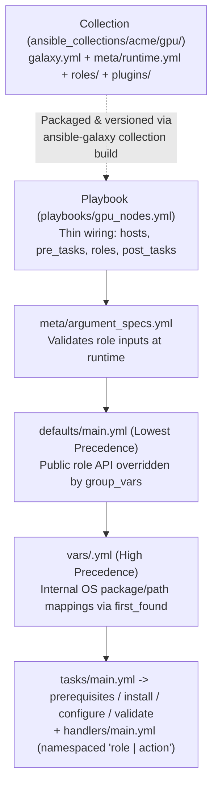

# 4.11 Ansible roles and collections

| | |
|---|---|
| Level | Intermediate |
| Priority tier | 1 |
| Lab venue | ansible-core, ansible-galaxy, Molecule optional |
| Part | Part 4: Automation and infrastructure as code |
| Status | Drafted, labs **untested** |

## Why this matters for AI infrastructure

A GPU cluster's configuration is a stack of concerns that repeat on every node: base OS hardening, time sync, drivers, container runtime, monitoring agents, Slurm clients, filesystem mounts, NCCL tuning. If each lives as an ad-hoc block in a giant playbook, nothing can be reused, tested or versioned. Roles package a unit of configuration behind a clean interface; collections package roles, modules and plugins for distribution. NVIDIA's DeepOps, Kubespray, and most vendor automation are role- and collection-based, and your own platform repository will be too. Good role design is what lets a team of five operate a thousand nodes.

## Prerequisites and outcomes

Needs 4.3 to 4.10. After this chapter you can:

- Create and structure roles with `tasks`, `handlers`, `defaults`, `vars`, `templates`, `files`, `meta`, `library`, `molecule`, and know what each directory is for.
- Apply the interface principle: inputs through documented `defaults/` variables validated by `argument_specs`, no hidden coupling.
- Use roles from playbooks (`roles:`, `import_role`, `include_role`, `tasks_from`), pass parameters, handle dependencies and run order.
- Write OS-portable roles (variables per OS family, `first_found`), idempotent and testable.
- Install and pin third-party roles and collections (Galaxy, Git, Automation Hub, `requirements.yml`), and build, test, version and publish your own collection.
- Organise a repository with playbooks, roles, collections and inventories for a multi-team platform.

## 1. Anatomy of a role

```text
roles/gpu_driver/
├── defaults/main.yml          # public interface: low-precedence defaults users override
├── vars/main.yml              # internal constants (high precedence; avoid user-facing settings here)
├── vars/Debian.yml            # OS-specific internal values (loaded with include_vars/first_found)
├── tasks/main.yml             # entry point
├── tasks/install.yml          # split big roles into task files
├── tasks/configure.yml
├── tasks/validate.yml
├── handlers/main.yml
├── templates/                 # Jinja2 (*.j2)
├── files/                     # static files copied as-is
├── meta/main.yml              # galaxy metadata, dependencies, supported platforms
├── meta/argument_specs.yml    # input validation + documentation
├── library/                   # role-local modules (optional)
├── module_utils/, plugins/    # role-local plugins (optional; usually in collections)
├── README.md                  # purpose, variables, examples, tested platforms
└── molecule/default/          # tests (4.13)
```

Create a skeleton with `ansible-galaxy role init gpu_driver` (or `ansible-galaxy init`). Ansible searches `roles_path`, a `roles/` directory next to the playbook, and installed collections (`namespace.collection.role`).

In *Ansible: Up and Running* Chapter 9 (*Roles: Scaling Up Your Playbooks*), the authors refactor the monolithic `mezzanine.yml` playbook into reusable `database` and `mezzanine` roles (`mezzanine-across-hosts.yml`) and highlight how Ansible resolves relative file paths inside a role:
- **Where `copy`, `script`, and `template` look inside a role:** When a task inside `roles/database/tasks/main.yml` invokes `copy: src=pg_hba.conf ...` (or `script: setadmin.py`), Ansible searches these six locations in order (modeled in `role_file_search_candidates()` in `code/part04/ansible_roles_collections.py`):
  1. `./roles/<role_name>/files/`
  2. `./roles/<role_name>/`
  3. `./roles/<role_name>/tasks/files/`
  4. `./roles/<role_name>/tasks/`
  5. `./files/` (adjacent to the top-level playbook)
  6. `./` (the top-level playbook directory)
  Similarly, `template` searches `./roles/<role_name>/templates/` first before falling back to `./templates/`.
- **How `database` and `mezzanine` split `defaults/main.yml` and `vars/main.yml` (`AUR` Chapter 9 `Examples 9-7` & `9-8`):** In `roles/database/defaults/main.yml`, user-overridable settings like `postgres_packages: [acl, libpq-dev, postgresql, python3-psycopg2]` and `locale: en_US.UTF-8` live in `defaults/`, while internal paths derived from those inputs (`mezzanine_venv_path: "{{ mezzanine_venv_home }}/{{ mezzanine_proj_name }}"`, `mezzanine_settings_path: "{{ mezzanine_proj_path }}/{{ mezzanine_proj_app }}"`) live in `roles/mezzanine/vars/main.yml` and task phases are split across `setup.yml`, `django.yml`, and `nginx.yml` included from `roles/mezzanine/tasks/main.yml`.



### defaults versus vars

- **`defaults/main.yml`** are the lowest-precedence variables: the role's **public API**. Everything a user may reasonably change belongs here with safe defaults.
- **`vars/main.yml`** have high precedence and cannot be overridden by inventory: use sparingly for internal constants or OS-specific mappings the user should not change. A setting placed here and later needed by someone becomes a fight with precedence; if in doubt use `defaults`.
- **Prefix every variable with the role name** (`gpu_driver_branch`, `gpu_driver_blacklist_nouveau`) to avoid collisions across roles (variables are global to the play) and to document origin.
- Distinguish **public** (documented, stable) from **private** variables (prefix with `__role_` by convention).

```yaml
# roles/gpu_driver/defaults/main.yml
gpu_driver_branch: "550"                     # nvidia driver branch
gpu_driver_package_type: "open"              # open | proprietary
gpu_driver_persistence_mode: true
gpu_driver_blacklist_nouveau: true
gpu_driver_hold_packages: true
gpu_driver_fabric_manager: "{{ ansible_local.gpu.nvswitch | default(false) }}"
gpu_driver_validate_gpu_count: 0             # 0 disables the count check
```

### tasks, handlers and entry points

```yaml
# roles/gpu_driver/tasks/main.yml
- name: Include OS-specific variables
  ansible.builtin.include_vars: "{{ lookup('ansible.builtin.first_found', params) }}"
  vars:
    params:
      files:
        - "{{ ansible_facts['distribution'] }}-{{ ansible_facts['distribution_major_version'] }}.yml"
        - "{{ ansible_facts['os_family'] }}.yml"
        - default.yml
      paths: ["{{ role_path }}/vars"]

- name: Prerequisites
  ansible.builtin.import_tasks: prerequisites.yml
  tags: [gpu_driver_prereq]

- name: Install driver
  ansible.builtin.import_tasks: install.yml
  tags: [gpu_driver_install]

- name: Configure
  ansible.builtin.import_tasks: configure.yml
  tags: [gpu_driver_config]

- name: Validate
  ansible.builtin.import_tasks: validate.yml
  when: gpu_driver_validate_gpu_count | int > 0
  tags: [gpu_driver_validate]
```

```yaml
# roles/gpu_driver/handlers/main.yml
- name: gpu_driver | reload nvidia persistence daemon
  ansible.builtin.systemd_service:
    name: nvidia-persistenced
    state: restarted
    daemon_reload: true
```

Handler names are global in a play: namespace them (`role | action`) to avoid collisions.

### meta and dependencies

```yaml
# roles/gpu_driver/meta/main.yml
galaxy_info:
  author: Platform team
  description: Install and configure NVIDIA data-centre drivers
  license: Apache-2.0
  min_ansible_version: "2.16"
  platforms:
    - { name: Ubuntu, versions: [jammy, noble] }
    - { name: EL, versions: ["8", "9"] }
  galaxy_tags: [nvidia, gpu, driver]
dependencies:
  - role: common_base                # runs before this role; keep dependency lists short
```

Dependencies run first, once per play unless `allow_duplicates: true` or parameters differ. Prefer explicit composition in playbooks over deep implicit dependency chains (hard to read, hard to test); use dependencies only for true prerequisites.

### Argument specs: the role's contract

```yaml
# roles/gpu_driver/meta/argument_specs.yml
argument_specs:
  main:
    short_description: Install and configure the NVIDIA driver
    options:
      gpu_driver_branch:
        type: str
        default: "550"
        description: Driver branch to install.
        choices: ["535", "550", "555"]
      gpu_driver_persistence_mode:
        type: bool
        default: true
      gpu_driver_validate_gpu_count:
        type: int
        default: 0
        description: Expected number of GPUs (0 disables validation).
```

Ansible validates role parameters and variables against the spec at run time, fails early with a clear message, and the spec doubles as documentation (`ansible-doc -t role`). Define separate entry points (`main`, `upgrade`, `validate`) when a role has multiple task files callable via `tasks_from`.

## 2. Using roles

```yaml
# Classic: roles run before tasks in the play
- hosts: gpu
  become: true
  roles:
    - common_base
    - role: gpu_driver
      vars: { gpu_driver_branch: "550", gpu_driver_validate_gpu_count: 8 }
      tags: [driver]
    - { role: dcgm, when: "'gpu' in group_names" }

# Static import (fixed at parse time)
- hosts: gpu
  tasks:
    - ansible.builtin.import_role: { name: gpu_driver }

# Dynamic include (runtime decisions, loops, other entry point)
- hosts: gpu
  tasks:
    - name: Run only the validation entry point
      ansible.builtin.include_role:
        name: gpu_driver
        tasks_from: validate
      vars: { gpu_driver_validate_gpu_count: 8 }

    - name: Apply a role once per item
      ansible.builtin.include_role: { name: mount_fs, apply: { tags: [mounts] } }
      loop: "{{ filesystems }}"
      loop_control: { loop_var: fs }
```

Run order: `pre_tasks` → role dependencies and roles → `tasks` → `post_tasks`; handlers flush between sections. A play can mix roles and tasks. `import_role`/`include_role` allow running roles inside the task flow (e.g., after a reboot or after a drain step), which `roles:` cannot.

## 3. Designing good roles

1. **Single responsibility.** One role installs and configures one thing (`gpu_driver`, `container_toolkit`, `chrony`, `slurm_client`, `dcgm_exporter`). A role named `everything` is a playbook in disguise.
2. **Declarative interface, idempotent tasks.** The role converges to the state described by variables; running twice changes nothing (4.6).
3. **No hidden dependencies on inventory structure.** A role should not assume `groups['gpu']` exists; pass the needed data as variables (or document the requirement and assert it) so it is reusable.
4. **Portable by default, explicit when not.** Use `ansible_facts['os_family']` mappings for package names and paths; fail with a clear `assert` on unsupported platforms rather than half-working.
5. **Validate inputs** with argument specs and early `assert`s; **validate outputs** with a `validate` task file that checks real behaviour (`nvidia-smi -L` count, service active, port open).
6. **Safe by default**: no destructive actions without an explicit variable (`gpu_driver_allow_downgrade: false`), no reboots unless `role_allow_reboot: true`, and handle reboot-required flows by returning a fact the playbook can act on (`gpu_driver_reboot_required`).
7. **Check-mode friendly**: read-only probes with `check_mode: false`; avoid failing in `--check` because of earlier unmade changes.
8. **Small, composable task files** (`install`, `configure`, `service`, `validate`) selectable by tags or `tasks_from`.
9. **Document** variables, tags, supported platforms and examples in `README.md`; keep `CHANGELOG.md`; semantic versions.
10. **Test** with Molecule scenarios and linters (4.13).
11. **Don't hide secrets in roles**: accept secrets via variables supplied from Vault/secret stores; use `no_log` internally.
12. **Avoid role-level `vars/` for knobs**, avoid `set_fact` leaking global names; prefer `__role_private` names.

### Example: a compact role for kernel tuning

```yaml
# roles/kernel_tuning/defaults/main.yml
kernel_tuning_sysctl:
  vm.swappiness: 1
  vm.max_map_count: 1048576
  kernel.numa_balancing: 0
  net.core.rmem_max: 268435456
kernel_tuning_sysctl_extra: {}
kernel_tuning_hugepages: 0
kernel_tuning_cpu_governor: performance
kernel_tuning_modules_load: []

# roles/kernel_tuning/tasks/main.yml
- name: Apply sysctl settings
  ansible.posix.sysctl:
    name: "{{ item.key }}"
    value: "{{ item.value }}"
    sysctl_file: /etc/sysctl.d/90-kernel-tuning.conf
    reload: true
  loop: "{{ kernel_tuning_sysctl | combine(kernel_tuning_sysctl_extra) | dict2items }}"
  loop_control: { label: "{{ item.key }}" }

- name: Load modules at boot
  ansible.builtin.copy:
    dest: /etc/modules-load.d/kernel-tuning.conf
    content: "{{ kernel_tuning_modules_load | join('\n') }}\n"
    mode: "0644"
  when: kernel_tuning_modules_load | length > 0

- name: Set CPU governor
  ansible.builtin.command: cpupower frequency-set -g {{ kernel_tuning_cpu_governor }}
  changed_when: false
  failed_when: false           # tolerate VMs without cpufreq; real roles probe /sys first
```

Users override with group_vars: `kernel_tuning_sysctl_extra: { vm.dirty_ratio: 10 }`, keeping the defaults intact via `combine`.

## 4. Galaxy, requirements and sourcing third-party content

```yaml
# requirements.yml
roles:
  - name: geerlingguy.docker
    version: "7.4.1"
  - src: https://git.example.com/platform/ansible-role-chrony.git
    scm: git
    version: v2.3.0
    name: platform.chrony

collections:
  - name: community.general
    version: ">=8.0.0,<10.0.0"
  - name: kubernetes.core
    version: "4.0.0"
  - name: https://git.example.com/platform/ansible-collection-gpu.git
    type: git
    version: 1.4.0
```

```bash
ansible-galaxy role install -r requirements.yml -p roles/
ansible-galaxy collection install -r requirements.yml -p collections/
ansible-galaxy collection list
ansible-doc -t role platform.chrony        # documentation from argument specs
```

Guidance: **pin exact versions** (or tight ranges) and commit `requirements.yml`; mirror dependencies in an internal Automation Hub/Artifactory/Git for availability and supply-chain control; review third-party code before use (roles run as root on your fleet); prefer maintained, collection-packaged roles; vendor critical roles if you cannot trust upstream continuity; run `ansible-lint` and Molecule against upgraded versions in CI before promoting.

## 5. Collections

A **collection** is the distribution format for Ansible content: a namespaced package (`namespace.name`) containing modules, plugins (filter, lookup, inventory, callback, connection), roles, playbooks and documentation. Content is referenced by FQCN (`community.general.ufw`, `nvidia.gpu.gpu_driver`).

```text
ansible_collections/acme/gpu/
├── galaxy.yml                  # name, namespace, version, dependencies, build_ignore
├── README.md, CHANGELOG.rst
├── meta/runtime.yml            # requires_ansible, plugin routing/deprecations
├── plugins/
│   ├── modules/                # custom modules (Python), e.g. gpu_facts.py
│   ├── module_utils/
│   ├── filter/                 # custom filters
│   ├── lookup/ inventory/ callback/ ...
│   └── doc_fragments/
├── roles/
│   ├── gpu_driver/ ...
│   └── dcgm/ ...
├── playbooks/                  # shipped example/entry playbooks
├── docs/ and tests/            # sanity, unit, integration tests (ansible-test)
└── changelogs/                 # antsibull-changelog fragments
```

```yaml
# galaxy.yml
namespace: acme
name: gpu
version: 1.4.0
readme: README.md
authors: [Platform team]
description: GPU node automation for the AI platform
license: [Apache-2.0]
dependencies:
  community.general: ">=8.0.0"
  ansible.posix: ">=1.5.0"
repository: https://git.example.com/platform/ansible-collection-gpu
build_ignore: [".git", "*.tar.gz", "molecule"]
```

Workflow:

```bash
ansible-galaxy collection init acme.gpu           # skeleton
ansible-galaxy collection build                   # creates acme-gpu-1.4.0.tar.gz
ansible-galaxy collection install ./acme-gpu-1.4.0.tar.gz -p collections/
ansible-galaxy collection publish acme-gpu-1.4.0.tar.gz --server automation_hub   # or upload to Artifactory/Galaxy-compatible server
ansible-test sanity --docker default              # style, docs and import checks (run from ansible_collections/acme/gpu)
ansible-test units
ansible-test integration
```

Practices: semantic versioning with a changelog (breaking changes bump major); `meta/runtime.yml` for `requires_ansible` and deprecations; module documentation in `DOCUMENTATION`/`EXAMPLES`/`RETURN` blocks (4.15); CI that builds, lints, tests and publishes on tags; treat the collection like a library with a public interface and a deprecation policy.

### Where to put what

| Content | Home |
|---|---|
| A playbook that glues a particular environment together | Environment/platform repo |
| A reusable unit of configuration | Role (inside a collection if shared across teams) |
| Custom module/filter/lookup/inventory plugin | Collection `plugins/` |
| Group/host variables and inventories | Environment repo (not in roles/collections) |
| Secrets | Vault/secret manager, never in roles |

## 6. Repository layout for a platform team

```text
platform-automation/
├── ansible.cfg
├── requirements.yml
├── collections/                 # installed deps (gitignored) or vendored
├── inventories/{prod,staging,lab}/
├── playbooks/
│   ├── site.yml
│   ├── gpu_nodes.yml
│   ├── slurm.yml
│   └── maintenance/{drain_and_patch.yml,rotate_certs.yml}
├── roles/                       # roles not yet promoted to a collection
├── molecule/ or tests/
├── .ansible-lint, .yamllint, .pre-commit-config.yaml
└── .github/workflows/ci.yml
```

Promote roles from the monorepo into a versioned collection when more than one team consumes them; consume them via `requirements.yml` with pinned versions. Keep playbooks thin (host selection, variable wiring, ordering) and roles fat (the actual logic).

## 7. Role patterns specific to GPU infrastructure

- **Hardware-aware behaviour through facts and variables**: probe GPUs in a `gpu_facts` task (`lspci -d 10de:`, `nvidia-smi -L`, `nvidia-smi nvlink -s`, NVSwitch presence) and publish `ansible_local.gpu.*`; other roles branch on those facts rather than on group names alone.
- **Driver install flows**: handle pre-existing drivers and `nouveau` blacklisting, DKMS vs precompiled modules, package holds, reboot requirements, Fabric Manager on NVSwitch systems, `nvidia-persistenced`, MIG configuration, and validation (`nvidia-smi`, `dcgmi diag -r 1`). Expose a `reboot` decision to the caller.
- **Container runtime**: NVIDIA Container Toolkit configuration for containerd/Docker/CRI-O as a separate role from the driver.
- **Idempotent upgrades**: roles must support changing versions: detect installed version, unload modules if needed, install, verify; refuse to downgrade unless explicitly allowed.
- **Order of roles** on a node: base OS and kernel → drivers → container runtime → monitoring → scheduler/Kubernetes agents → workload prerequisites; document this in the playbook, not hidden in role dependencies.
- **NVIDIA-provided automation** (DeepOps, `nvidia.nvue` for Cumulus/Spectrum switches, network operator manifests, BCM Python/CLI) can be consumed as roles/collections but must be pinned and reviewed like any dependency.

## 8. Lab

First, run the self-checking Python lab (`code/part04/ansible_roles_collections_lab.py`) locally. It verifies runtime `meta/argument_specs.yml` validation (`validate_role_argument_spec`), role dependency traversal and deduplication (`resolve_role_dependency_order` with `allow_duplicates`), and role relative file search precedence (`role_file_search_candidates`, `AUR` Ch. 9 & 15).

```bash
python3 code/part04/ansible_roles_collections_lab.py
```

Next, on a control node with `ansible-core` and `ansible-galaxy` (all interactive shell steps below are `untested here`), work through these exercises:

1. **Extract a role**: take the playbook from 4.9 and extract `app_deploy`, `nginx_proxy`, `postgres` roles; keep behaviour identical (verify with `--check --diff` and a second run).
2. **Interface design**: write `defaults/main.yml` with prefixed variables, `meta/argument_specs.yml`, and `README.md`; test invalid input and see the argument spec error; view with `ansible-doc -t role`.
3. **OS portability**: add `vars/Debian.yml` and `vars/RedHat.yml` with package names; load with `first_found`; run on both families (containers).
4. **Entry points**: split `install`, `configure`, `validate`; call `validate` alone with `include_role: tasks_from`; show how `import_role` vs `roles:` differ for tags and `--list-tasks`.
5. **Dependencies**: create two roles with a dependency; observe run-once semantics and `allow_duplicates`; then replace the dependency with explicit playbook ordering and compare clarity.
6. **Precedence experiment**: put a variable in a role's `vars/main.yml` and `defaults/main.yml`; try overriding from `group_vars`; show why interface variables belong in `defaults`.
7. **Requirements**: write `requirements.yml` with pinned roles and collections (Galaxy and Git); install into local paths; list; break a pin and see the effect.
8. **Collection**: create `acme.gpu` with one role, one filter plugin (3.11 decorators) and one tiny module (4.15); build, install from the tarball, and use by FQCN; run `ansible-test sanity`.
9. **Kernel tuning role**: implement the example with `combine`; override with group vars; run in check mode; add a validate step reading `sysctl -n`.
10. **GPU facts role**: write a role publishing `ansible_local.gpu`; use it from a driver role to decide Fabric Manager installation.
11. **Lint and test**: run `ansible-lint` on the roles; add a Molecule scenario (4.13).
12. **Clean up.**

## 9. Common mistakes

- Roles that are really whole playbooks, or roles split so finely that every playbook needs twenty of them.
- Unprefixed variable names causing collisions; interface variables in `vars/`; hidden reliance on inventory groups.
- Deep dependency chains and `allow_duplicates` tricks; implicit ordering nobody can see.
- Missing input validation: the role fails with obscure errors on a typo.
- Hard-coded package names/paths for one distro; no platform assertions.
- Unpinned Galaxy dependencies that change underneath you; unreviewed third-party roles running as root.
- Non-idempotent roles; handlers with unnamespaced names clobbering each other.
- Secrets embedded in role files; roles that reboot machines unexpectedly.
- No README, no tests, no changelog; breaking interface changes without a major version bump.
- Mixing environment data (inventories) into shared roles/collections.

## 10. Interview angles

- "What is a role? Structure? `defaults` vs `vars`?"
- "How do you design a role interface? How do you validate arguments?" (prefixed defaults, argument specs, asserts.)
- "Role vs collection; when do you build a collection?"
- "How do you manage third-party dependencies safely?" (pin, mirror, review, test upgrades.)
- "`import_role` vs `include_role` vs `roles:`?"
- "How would you make a role portable across Ubuntu and RHEL?"
- "How do you structure automation for several teams and environments?"
- "How do you version and release shared Ansible content?" (SemVer, changelog, CI, Hub/Artifactory.)

## Exercises

1. **Role Directory Anatomy, `defaults/main.yml` vs. `vars/main.yml`, and File Search Paths (`AUR` Chapter 9):** Using `role_file_search_candidates()` in `code/part04/ansible_roles_collections.py`, list the purpose of each directory inside `roles/gpu_driver/`, explain why public knobs belong in `defaults/main.yml` (prefixed with `gpu_driver_`) rather than `vars/main.yml`, and state the 6-path search order when `copy` looks up a relative filename inside a role.
2. **Role Contract Validation (`meta/argument_specs.yml`) and Role Dependencies (`meta/main.yml`, `AUR` Chapter 9):** Using `validate_role_argument_spec()` and `resolve_role_dependency_order()` in `code/part04/ansible_roles_collections.py`, explain: (a) how `meta/argument_specs.yml` validates types, defaults, and `choices` at runtime and generates `ansible-doc -t role` documentation; and (b) how `dependencies:` in `meta/main.yml` execute and deduplicate (`allow_duplicates: false` vs `true`) and why explicit playbook ordering is usually clearer than deep dependency chains.
3. **Invoking Roles (`roles:`, `import_role`, `include_role`, `tasks_from`) and OS Portability (`first_found`):** Compare invoking a role via the play's `roles:` section, `import_role`, and `include_role` (`tasks_from: validate`, `loop:` with `apply: { tags: [...] }`), and show how `include_vars` + `lookup('ansible.builtin.first_found', params)` loads OS-specific internal variables (`Ubuntu-22.yml` -> `Debian.yml` -> `default.yml`).
4. **Designing Reusable GPU Infrastructure Roles (`kernel_tuning`, `gpu_facts`, `gpu_driver`):** Explain how the `kernel_tuning` role uses `kernel_tuning_sysctl | combine(kernel_tuning_sysctl_extra) | dict2items` so callers can add or override a single sysctl without replacing the default dictionary, and why `gpu_driver` exposes `gpu_driver_reboot_required` as a fact rather than rebooting nodes blindly.
5. **Sourcing Third-Party Roles and Collections Safely (`requirements.yml` and `ansible-galaxy`, `AUR` Chapters 9 & 15):** Write a `requirements.yml` pinning both roles (from Galaxy and Git) and collections, show the `ansible-galaxy role/collection install -r requirements.yml` commands, and list the supply-chain controls required before running third-party roles as `root` on a GPU cluster.
6. **Building, Testing (`ansible-test`), and Publishing an Ansible Collection (`galaxy.yml`, `meta/runtime.yml`, `AUR` Chapter 15):** Trace the directory layout of `ansible_collections/acme/gpu/` (`galaxy.yml`, `meta/runtime.yml`, `plugins/{modules,filter,lookup,inventory}`, `roles/`, `playbooks/`, `tests/`), and explain the workflow `ansible-galaxy collection init` -> `build` -> `install` -> `ansible-test sanity/units/integration` -> `publish`.

## Checkpoint questions (20)

<details>
<summary>1. What are the standard subdirectories of an Ansible role, and how do `defaults/main.yml` and `vars/main.yml` differ (`AUR` Chapter 9)?</summary>

A role (`ansible-galaxy role init gpu_driver`) contains:
- **`defaults/main.yml`**: lowest-precedence variables forming the role's **public API** (easily overridden by `group_vars/`, `host_vars/`, or play vars).
- **`vars/main.yml`**: high-precedence variables (ranking **above** inventory `group_vars` and `host_vars`) used only for internal constants or OS-specific mappings (`vars/Debian.yml`) that callers should not override.
- **`tasks/main.yml`**: main task entry point (plus modular files like `install.yml`, `configure.yml`, `validate.yml`).
- **`handlers/main.yml`**, **`templates/`** (`*.j2`), **`files/`** (static files), **`meta/main.yml`** (Galaxy info and dependencies), **`meta/argument_specs.yml`** (input validation), **`library/`** / **`plugins/`**, and **`molecule/`**.
</details>

<details>
<summary>2. Why should every variable and handler inside a role be prefixed with the role's name (`gpu_driver_branch`, `gpu_driver | reload persistence daemon`)?</summary>

In Ansible, role variables and handler names are **global to the play**—not private to the role. If two roles (`gpu_driver` and `slurm_client`) both define a variable named `version` or a handler named `Restart daemon`, one silently overwrites or triggers the other. Prefixing public variables with `role_` (`gpu_driver_branch`), internal variables with `__role_` (`__gpu_driver_pkgs`), and handlers with `role | action` prevents cross-role collisions.
</details>

<details>
<summary>3. Where does Ansible look when a `copy` or `template` task inside `roles/database/tasks/main.yml` references a relative filename like `src: pg_hba.conf` (`AUR` Chapter 9)?</summary>

For `copy` (and `script`), Ansible searches six paths in order without needing any path prefix:
1. `./roles/database/files/pg_hba.conf`
2. `./roles/database/pg_hba.conf`
3. `./roles/database/tasks/files/pg_hba.conf`
4. `./roles/database/tasks/pg_hba.conf`
5. `./files/pg_hba.conf` (next to the playbook)
6. `./pg_hba.conf`
Similarly, `template` checks `./roles/database/templates/` first before falling back to the playbook's `./templates/` directory.
</details>

<details>
<summary>4. How does `meta/argument_specs.yml` validate role inputs and generate documentation?</summary>

When `roles/<role>/meta/argument_specs.yml` defines an entry point (`main:`, `validate:`) with `options:` specifying `type:` (`str`, `int`, `bool`, `list`, `dict`), `required:`, `default:`, `choices:`, and `description:`, Ansible automatically inserts a validation task at the very start of the role at runtime—failing immediately with a clear error message if a caller passes an invalid choice or wrong type—and exposes the specification via **`ansible-doc -t role <role_name>`**.
</details>

<details>
<summary>5. How do role `dependencies:` in `meta/main.yml` execute, when do they deduplicate, and why should deep dependency chains be avoided?</summary>

Roles listed under `dependencies:` in `roles/gpu_driver/meta/main.yml` run **before** `gpu_driver`'s own tasks. If multiple roles in the same play depend on `common_base` with the same parameters, Ansible executes `common_base` **only once** (unless `allow_duplicates: true` is set in `common_base/meta/main.yml`). Keep `dependencies:` minimal and prefer listing roles explicitly in the playbook so operators can see the exact execution order at a glance.
</details>

<details>
<summary>6. Compare the three ways to invoke a role in a playbook: `roles:`, `import_role`, and `include_role`.</summary>

- **`roles:` section at the play level:** Classic declarative list; executes after `pre_tasks` and before `tasks:`.
- **`ansible.builtin.import_role` (inside `tasks:`):** Pre-processed **statically at parse time** at that exact position in the task list; tags and `when:` are copied to every task inside the role, and tasks appear in `--list-tasks`.
- **`ansible.builtin.include_role` (inside `tasks:`):** Executed **dynamically at runtime**; supports **`loop:`** (running a role once per filesystem or vhost), runtime variable names, and calling a specific sub-entry point via **`tasks_from: validate`**.
</details>

<details>
<summary>7. How do you make a role portable across multiple Linux distributions (`Ubuntu` vs. `RHEL/Rocky`)?</summary>

Keep `tasks/main.yml` free of duplicated `when: ansible_os_family == ...` branches on every task by placing OS-specific package names, service names, and config paths in `vars/Ubuntu-22.yml`, `vars/Debian.yml`, and `vars/RedHat.yml`, and loading the most specific match at the top of `tasks/main.yml` via **`include_vars: "{{ lookup('ansible.builtin.first_found', params) }}"`** (plus an early `assert` verifying that `ansible_facts['os_family']` is in the supported list).
</details>

<details>
<summary>8. In the `kernel_tuning` role, why do we define both `kernel_tuning_sysctl` and `kernel_tuning_sysctl_extra: {}` in `defaults/main.yml`?</summary>

Because Ansible replaces dictionaries across precedence layers by default, if a user overrides `kernel_tuning_sysctl: { vm.dirty_ratio: 10 }` in `group_vars`, they would accidentally wipe out the role's baseline defaults (`vm.swappiness`, `vm.max_map_count`, `net.core.rmem_max`). Providing **`kernel_tuning_sysctl_extra: {}`** and looping over `{{ kernel_tuning_sysctl | combine(kernel_tuning_sysctl_extra) | dict2items }}` lets callers add or override individual keys while keeping all baseline defaults intact.
</details>

<details>
<summary>9. Why shouldn't a reusable role hardcode inventory group names like `groups['gpu']` or `groups['slurm_controller']` inside its tasks and templates?</summary>

If a role hardcodes `groups['slurm_controller'][0]`, it breaks immediately in any environment where that group is named `slurm_master` or `control_plane`. Instead, define a role default variable **`slurm_client_controller_host: "{{ groups['slurm_controller'][0] | default('') }}"`** in `defaults/main.yml` (asserting it is non-empty in `tasks/main.yml`), so callers can pass any hostname or group expression without editing the role.
</details>

<details>
<summary>10. Why should a driver or kernel role set a fact (`gpu_driver_reboot_required: true`) instead of rebooting the host unconditionally?</summary>

When multiple roles run in sequence on a GPU node (`common_base` -> `kernel_tuning` -> `gpu_driver` -> `container_toolkit`), having each role trigger its own immediate reboot causes multiple slow server reboots per run—or worse, reboots an undrained production node if someone invokes the role outside a maintenance window. Have the role expose a boolean `role_allow_reboot: false` default and publish a fact (`gpu_driver_reboot_required: true`), letting the top-level maintenance playbook coordinate draining and a single consolidated reboot.
</details>

<details>
<summary>11. How does `requirements.yml` manage both third-party Roles and Collections (`AUR` Chapters 9 & 15)?</summary>

A single `requirements.yml` file can declare two top-level lists—`roles:` (from Ansible Galaxy or Git URLs with `scm: git` and `version: v2.3.0`) and `collections:` (from Galaxy, Automation Hub, or Git with `version: ">=8.0.0,<10.0.0"`). Install them into project-local directories with:
- `ansible-galaxy role install -r requirements.yml -p roles/`
- `ansible-galaxy collection install -r requirements.yml -p collections/`
</details>

<details>
<summary>12. What is an Ansible Collection, and what can it package that a standalone Role cannot (`AUR` Chapter 15)?</summary>

An **Ansible Collection (`namespace.name`, e.g., `acme.gpu` or `community.general`)** is the standard distribution format that packages **roles, custom modules (`plugins/modules/`), module utilities (`plugins/module_utils/`), plugins (`filter`, `lookup`, `inventory`, `callback`, `connection`), playbooks, documentation, and `ansible-test` suites** into a single versioned, namespaced tarball (`acme-gpu-1.4.0.tar.gz`) referenced everywhere by **FQCN** (`acme.gpu.gpu_driver`, `acme.gpu.gpu_facts`).
</details>

<details>
<summary>13. What are the roles of `galaxy.yml` and `meta/runtime.yml` inside a Collection?</summary>

- **`galaxy.yml`** (in the collection root): declares the collection's `namespace`, `name`, semantic `version` (`1.4.0`), `authors`, `license`, collection `dependencies` (`community.general: ">=8.0.0"`), and `build_ignore` patterns used by `ansible-galaxy collection build`.
- **`meta/runtime.yml`**: declares the minimum supported `ansible-core` version (**`requires_ansible: ">=2.15.0"`**), plugin routing/redirects (when renaming modules), and deprecation warnings.
</details>

<details>
<summary>14. What are the commands to initialize, build, install locally, test, and publish a Collection (`AUR` Chapter 15)?</summary>

1. **Initialize skeleton:** `ansible-galaxy collection init acme.gpu`
2. **Build artifact:** `ansible-galaxy collection build` (produces `acme-gpu-1.0.0.tar.gz`).
3. **Install locally for verification:** `ansible-galaxy collection install ./acme-gpu-1.0.0.tar.gz -p ./collections`
4. **Run automated test suites:** `ansible-test sanity --docker default`, `ansible-test units`, and `ansible-test integration` (run from inside `ansible_collections/acme/gpu/`).
5. **Publish:** `ansible-galaxy collection publish ./acme-gpu-1.0.0.tar.gz --server automation_hub` (or Galaxy / Artifactory / Pulp).
</details>

<details>
<summary>15. Where do you place a custom Filter Plugin or custom Module inside a Collection versus inside a standalone project (`AUR` Chapters 10 & 15)?</summary>

- **Inside a Collection (`ansible_collections/acme/gpu/`):** Place custom modules in **`plugins/modules/`** and custom filter plugins in **`plugins/filter/`**, referenced by FQCN (`acme.gpu.my_module`, `{{ x | acme.gpu.my_filter }}`).
- **In a standalone playbook repository:** Place custom modules in **`library/`** and custom filters in **`filter_plugins/`** adjacent to the playbook (or configured in `ansible.cfg`).
</details>

<details>
<summary>16. Why should you prefer using explicit FQCNs (`acme.gpu.my_module`) in tasks over the play-level `collections:` search-list keyword (`AUR` Chapter 15)?</summary>

While `collections: [our_namespace.her_collection]` at the play level (`AUR` Chapter 15 `Example 15-2`) lets tasks write short module names (`her_module:`), relying on implicit search order makes it ambiguous which collection provides a module when a play imports multiple collections, and `ansible-lint`'s `fqcn` rule flags short names. Writing the full FQCN (`our_namespace.her_collection.her_module`) on every task is self-documenting and immune to namespace shadowing.
</details>

<details>
<summary>17. Where should environment inventories (`inventories/prod`, `group_vars`) and secrets live relative to shared Roles and Collections?</summary>

Shared **roles and collections must be 100% environment-agnostic library code**—never commit production IP addresses, hostnames, `inventories/`, `group_vars/`, or Vault secrets inside a reusable role or collection repository. Keep `inventories/{prod,staging,lab}/`, `group_vars/`, Vault secrets, and top-level orchestration playbooks (`playbooks/site.yml`) in the **platform environment repository**, which consumes version-pinned roles/collections via `requirements.yml`.
</details>

<details>
<summary>18. What is the recommended role execution order on a bare-metal GPU cluster node?</summary>

Order roles in `playbooks/gpu_nodes.yml` from lowest hardware/OS layer up to workload schedulers:
1. **`common_base`** (repos, time sync `chrony`, SSH/sudo hardening, users, storage mounts).
2. **`kernel_tuning`** (pinned kernel, sysctls, hugepages, kernel modules, `nouveau` blacklist).
3. **`gpu_facts` & `gpu_driver`** (NVIDIA driver, `nvidia-persistenced`, Fabric Manager on NVSwitch nodes, MIG config, `nvidia-smi` validation).
4. **`container_runtime` & `nvidia_container_toolkit`** (`containerd` / Docker + `nvidia-ctk` CDI/runtime hook).
5. **`monitoring_agents`** (`node_exporter`, `dcgm-exporter`).
6. **`slurm_client` or `kubelet`** (scheduler agent joining the cluster only after all GPU and runtime validations pass).
</details>

<details>
<summary>19. When should a platform team keep a role inside `roles/` in their platform monorepo versus promoting it into a separate versioned Collection?</summary>

Keep a new role in the platform monorepo's **`roles/`** directory while it is evolving rapidly and used only by that single repo. Promote the role (and any shared modules/filters) into a **versioned Collection** (`acme.gpu`) once **two or more repositories or teams** consume it, so downstream teams can pin tested semantic versions (`1.4.0`) in `requirements.yml` and upgrade on their own schedule.
</details>

<details>
<summary>20. What security and supply-chain checks should you apply before adopting a third-party role or collection from Ansible Galaxy?</summary>

Remember that Ansible roles typically execute with **`become: true` (`root`) across your entire fleet** and on the control node (via lookups/local tasks):
1. **Audit the source code** (`tasks/`, `handlers/`, `templates/`, `library/`, `plugins/`) before installation.
2. **Pin exact semantic versions** (or commit SHAs) in `requirements.yml`—never pull floating `main` or unpinned latest in CI/production.
3. **Mirror approved tarballs/repos** into an internal **Private Automation Hub, Pulp, Artifactory, or Nexus** proxy (`AUR` Chapters 15 & 22) so production runs never depend on public internet Galaxy/GitHub availability.
4. Run **`ansible-lint`** and **Molecule** integration tests against any version bump in CI before merging.
</details>

## Sources and review notes

- **Sources read in full:**
  - `ansible-up-and-running-3rd-edition` — Bas Meijer, Lorin Hochstein & René Moser, *Ansible: Up and Running*, 3rd ed., **Chapter 9: Roles: Scaling Up Your Playbooks** (read in full: structure of `database` and `mezzanine` roles, `defaults/main.yml` vs `vars/main.yml`, 6-path relative file search order for `copy`/`script` and `template`, using roles in playbooks with `pre_tasks` and `post_tasks`, `ansible-galaxy init` / `install` / `list` / `remove`, `roles/requirements.yml` with `oefenweb.ntp` `v1.1.33` and `geerlingguy.docker`, and `meta/main.yml` `dependencies:`) and **Chapter 15: Collections** (read in full: `namespace.collection.module` FQCN notation, `requirements.yml` combining `roles:` and `collections:`, play-level `collections:` keyword, role `meta/main.yml` `collections:`, and `ansible-galaxy collection init` -> `build` -> `install -p ./collections` -> `publish` to Galaxy / Red Hat Automation Hub / private servers).
- **Run here:** `python3 code/part04/ansible_roles_collections_lab.py` (3 passed, 0 failed).
- **Explicitly labelled inferences:** The `validate_role_argument_spec`, `resolve_role_dependency_order`, and `role_file_search_candidates` models in `code/part04/ansible_roles_collections.py` and the `gpu_driver`, `kernel_tuning`, and `acme.gpu` collection examples are the author's constructions applying *Ansible: Up and Running* Chapters 9 & 15 to GPU platform engineering (plus original study items 21, 22, 23, 24, 25, 26, 27, 28, 29, and 30).
- **Not verified on live hardware:** Live `ansible-galaxy`, `ansible-doc -t role`, `ansible-test sanity --docker default`, and `cpupower` commands (`535`, `550`, `555`, `2.16`, `7.4.1`, `v2.3.0`, `1.4.0`, `1048576`, `268435456`) are marked (`untested here`) where not executed by `ansible_roles_collections_lab.py`.
