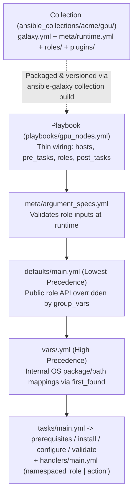

# 4.11 Ansible roles and collections

| | |
|---|---|
| Level | Intermediate |
| Priority tier | 1 |
| Lab venue | ansible-core, ansible-galaxy, Molecule optional |
| Part | Part 4: Automation and infrastructure as code |
| Status | Drafted, labs **untested** |

## Why this matters for AI infrastructure

Think about a GPU cluster whose configuration lives in one giant playbook. Every node repeats the same concerns: base OS hardening, time sync, drivers, container runtime, monitoring agents, Slurm clients, filesystem mounts and NCCL tuning. When each of these is an ad-hoc block, nothing can be reused, tested or versioned. A role packages one unit of configuration behind a clean interface. A collection goes a step further and packages roles, modules and plugins for distribution. NVIDIA's DeepOps, Kubespray and most vendor automation are built from roles and collections, and your own platform repository will be too. Good role design is what lets a team of five operate a thousand nodes.

## Prerequisites and outcomes

This chapter builds on 4.3 to 4.10, so have those close by. When you finish, you should be able to do the following:

- Create and structure roles with `tasks`, `handlers`, `defaults`, `vars`, `templates`, `files`, `meta`, `library` and `molecule`, and know what each directory is for.
- Apply the interface principle: keep inputs in documented `defaults/` variables, validate them with `argument_specs`, and avoid hidden coupling.
- Use roles from playbooks with `roles:`, `import_role`, `include_role` and `tasks_from`, passing parameters and handling dependencies and run order.
- Write OS-portable roles that use variables per OS family and `first_found`, and that stay idempotent and testable.
- Install and pin third-party roles and collections from Galaxy, Git and Automation Hub with `requirements.yml`, then build, test, version and publish your own collection.
- Organise a repository with playbooks, roles, collections and inventories for a multi-team platform.

## 1. Anatomy of a role

You are about to write a role for the NVIDIA driver, and the first question is where each piece goes. A role is a directory with a fixed layout, and each subdirectory has one job. Once you know the layout, anyone who opens the role can find the part they need. The tree below shows what a driver role looks like on disk.

```text
roles/gpu_driver/
├── defaults/main.yml          # public interface: low-precedence defaults users override
├── vars/main.yml              # internal constants (high precedence; avoid user-facing settings here)
├── vars/Debian.yml            # OS-specific internal values (loaded with include_vars/first_found)
├── tasks/main.yml             # entry point
├── tasks/install.yml          # split big roles into task files
├── tasks/configure.yml
├── tasks/validate.yml
├── handlers/main.yml
├── templates/                 # Jinja2 (*.j2)
├── files/                     # static files copied as-is
├── meta/main.yml              # galaxy metadata, dependencies, supported platforms
├── meta/argument_specs.yml    # input validation + documentation
├── library/                   # role-local modules (optional)
├── module_utils/, plugins/    # role-local plugins (optional; usually in collections)
├── README.md                  # purpose, variables, examples, tested platforms
└── molecule/default/          # tests (4.13)
```

Notice that `defaults/` and `vars/` answer different questions. One holds settings a user may change, and the other holds values the role keeps for itself.

Create the skeleton with `ansible-galaxy role init gpu_driver`, or with `ansible-galaxy init`. Ansible then looks for roles in `roles_path`, in a `roles/` directory next to the playbook, and in installed collections under the name `namespace.collection.role`.

The same idea works on a larger playbook. Splitting the monolithic `mezzanine.yml` playbook gives reusable `database` and `mezzanine` roles, and the refactored playbook is `mezzanine-across-hosts.yml`. Ansible also resolves relative file paths inside a role in a fixed order.

Here is where the `copy` module looks. When a task in `roles/database/tasks/main.yml` runs `copy: src=pg_hba.conf ...` or `script: setadmin.py`, Ansible checks these six locations in order. The function `role_file_search_candidates()` in `code/part04/ansible_roles_collections.py` models the same search.

1. `./roles/<role_name>/files/`
2. `./roles/<role_name>/`
3. `./roles/<role_name>/tasks/files/`
4. `./roles/<role_name>/tasks/`
5. `./files/` (adjacent to the top-level playbook)
6. `./` (the top-level playbook directory)

The `template` module works in a similar way. It searches `./roles/<role_name>/templates/` first, and only then falls back to `./templates/`.

The same chapter, in Examples 9-7 and 9-8, shows how the two roles divide their variables. In `roles/database/defaults/main.yml`, settings a user can override live in `defaults/`, such as `postgres_packages: [acl, libpq-dev, postgresql, python3-psycopg2]` and `locale: en_US.UTF-8`. Paths built from those inputs live in `roles/mezzanine/vars/main.yml`, such as `mezzanine_venv_path: "{{ mezzanine_venv_home }}/{{ mezzanine_proj_name }}"` and `mezzanine_settings_path: "{{ mezzanine_proj_path }}/{{ mezzanine_proj_app }}"`. The task phases are split across `setup.yml`, `django.yml` and `nginx.yml`, which `roles/mezzanine/tasks/main.yml` includes.



### defaults versus vars

Getting this split right early saves you from fights over precedence later. `defaults/main.yml` holds the lowest-precedence variables, and together they form the role's public API. Everything a user may reasonably change belongs here, with safe defaults. `vars/main.yml` works the other way. It ranks high enough that inventory cannot override it, so use it sparingly, for internal constants or OS-specific mappings users should not change. A setting placed there and later needed by someone becomes a fight with precedence. If you are in doubt, use `defaults`.

Prefix every variable with the role name, such as `gpu_driver_branch` or `gpu_driver_blacklist_nouveau`. Variables are global to the play, so the prefix prevents collisions between roles and shows where a variable came from. Mark the difference between public and private variables: public ones are documented and stable, and private ones use the `__role_` prefix by convention.

```yaml
# roles/gpu_driver/defaults/main.yml
gpu_driver_branch: "550"                     # nvidia driver branch
gpu_driver_package_type: "open"              # open | proprietary
gpu_driver_persistence_mode: true
gpu_driver_blacklist_nouveau: true
gpu_driver_hold_packages: true
gpu_driver_fabric_manager: "{{ ansible_local.gpu.nvswitch | default(false) }}"
gpu_driver_validate_gpu_count: 0             # 0 disables the count check
```

Each line sets a starting value that a user can override. The `gpu_driver_fabric_manager` line is the only one that reads a fact, and it falls back to `false` when that fact is missing. Notice the `0` on the last line, which turns off the GPU count check.

### tasks, handlers and entry points

The task file is where the role starts running. It loads the OS-specific values first, then runs each phase in turn.

```yaml
# roles/gpu_driver/tasks/main.yml
- name: Include OS-specific variables
  ansible.builtin.include_vars: "{{ lookup('ansible.builtin.first_found', params) }}"
  vars:
    params:
      files:
        - "{{ ansible_facts['distribution'] }}-{{ ansible_facts['distribution_major_version'] }}.yml"
        - "{{ ansible_facts['os_family'] }}.yml"
        - default.yml
      paths: ["{{ role_path }}/vars"]

- name: Prerequisites
  ansible.builtin.import_tasks: prerequisites.yml
  tags: [gpu_driver_prereq]

- name: Install driver
  ansible.builtin.import_tasks: install.yml
  tags: [gpu_driver_install]

- name: Configure
  ansible.builtin.import_tasks: configure.yml
  tags: [gpu_driver_config]

- name: Validate
  ansible.builtin.import_tasks: validate.yml
  when: gpu_driver_validate_gpu_count | int > 0
  tags: [gpu_driver_validate]
```

```yaml
# roles/gpu_driver/handlers/main.yml
- name: gpu_driver | reload nvidia persistence daemon
  ansible.builtin.systemd_service:
    name: nvidia-persistenced
    state: restarted
    daemon_reload: true
```

The validate step runs only when a caller sets `gpu_driver_validate_gpu_count` above zero. Handler names are global in a play too, so give each one a namespace such as `role | action`. That keeps two roles from triggering each other's handlers.

### meta and dependencies

```yaml
# roles/gpu_driver/meta/main.yml
galaxy_info:
  author: Platform team
  description: Install and configure NVIDIA data-centre drivers
  license: Apache-2.0
  min_ansible_version: "2.16"
  platforms:
    - { name: Ubuntu, versions: [jammy, noble] }
    - { name: EL, versions: ["8", "9"] }
  galaxy_tags: [nvidia, gpu, driver]
dependencies:
  - role: common_base                # runs before this role; keep dependency lists short
```

A dependency runs before the role that lists it. It runs once per play, unless `allow_duplicates: true` is set or its parameters differ. Deep chains of dependencies are hard to read and hard to test. Keep the list short, and use dependencies only for true prerequisites. Put the rest of the order in the playbook, where operators can see it.

### Argument specs: the role's contract

```yaml
# roles/gpu_driver/meta/argument_specs.yml
argument_specs:
  main:
    short_description: Install and configure the NVIDIA driver
    options:
      gpu_driver_branch:
        type: str
        default: "550"
        description: Driver branch to install.
        choices: ["535", "550", "555"]
      gpu_driver_persistence_mode:
        type: bool
        default: true
      gpu_driver_validate_gpu_count:
        type: int
        default: 0
        description: Expected number of GPUs (0 disables validation).
```

At run time, Ansible checks role parameters and variables against this spec. A bad value fails early, with a clear message. The spec doubles as documentation, and you can read it with `ansible-doc -t role`. When a role has several task files that callers run on their own, define a separate entry point for each one, such as `main`, `upgrade` or `validate`, and call them with `tasks_from`.

## 2. Using roles

Suppose the driver must run on every GPU node, but only after a drain step on some of them. A `roles:` list alone cannot express that. Ansible offers three ways to call a role, and each suits a different case.

```yaml
# Classic: roles run before tasks in the play
- hosts: gpu
  become: true
  roles:
    - common_base
    - role: gpu_driver
      vars: { gpu_driver_branch: "550", gpu_driver_validate_gpu_count: 8 }
      tags: [driver]
    - { role: dcgm, when: "'gpu' in group_names" }

# Static import (fixed at parse time)
- hosts: gpu
  tasks:
    - ansible.builtin.import_role: { name: gpu_driver }

# Dynamic include (runtime decisions, loops, other entry point)
- hosts: gpu
  tasks:
    - name: Run only the validation entry point
      ansible.builtin.include_role:
        name: gpu_driver
        tasks_from: validate
      vars: { gpu_driver_validate_gpu_count: 8 }

    - name: Apply a role once per item
      ansible.builtin.include_role: { name: mount_fs, apply: { tags: [mounts] } }
      loop: "{{ filesystems }}"
      loop_control: { loop_var: fs }
```

The `roles:` list runs before the play's tasks. `import_role` is fixed at parse time, while `include_role` decides at runtime. It can call `tasks_from` and run once for each item in a list.

Run order is `pre_tasks`, then role dependencies and roles, then `tasks`, then `post_tasks`. Handlers flush between sections, and a play can mix roles and tasks. Because `import_role` and `include_role` sit inside the task flow, they can run a role after a reboot or a drain step, which `roles:` cannot do. Use `roles:` for simple cases, and the other two for mid-task roles.

## 3. Designing good roles

Good roles follow a handful of habits, and each one guards against a particular kind of trouble. As you write a role, check it against these twelve points.

1. Give each role a single responsibility. One role should install and configure one thing, such as `gpu_driver`, `container_toolkit`, `chrony`, `slurm_client` or `dcgm_exporter`. A role named `everything` is a playbook in disguise.
2. Describe the desired state through variables, and make the tasks idempotent, so you can run the role twice and see nothing change (4.6).
3. Consider the inventory. The role should not assume that `groups['gpu']` exists, so pass the data it needs as variables, or document the requirement and assert it.
4. Keep the role portable by default. Use `ansible_facts['os_family']` mappings for package names and paths, and fail with a clear `assert` on an unsupported platform rather than half-working.
5. Validate inputs with argument specs and early `assert`s. Validate outputs with a `validate` task file that checks real behaviour, such as the `nvidia-smi -L` count, whether the service is active, and whether a port is open.
6. Keep the role safe by default. A destructive step should need an explicit variable, such as `gpu_driver_allow_downgrade: false`. A reboot should happen only when `role_allow_reboot: true` is set. When one is needed, return the fact `gpu_driver_reboot_required`, so the playbook can act on it.
7. Keep the role friendly to check mode. Use `check_mode: false` for read-only probes, so `--check` does not fail because of changes that were never made.
8. Split large roles into small task files, such as `install`, `configure`, `service` and `validate`, and select them by tags or `tasks_from`.
9. Document variables, tags, supported platforms and examples in `README.md`. Keep a `CHANGELOG.md`, and use semantic versions.
10. Test the role with Molecule scenarios and linters, which you will meet in 4.13.
11. Never hide secrets in a role. Accept them as variables from Vault or another secret store, and use `no_log` inside the role.
12. Avoid role-level `vars/` for knobs, and avoid `set_fact` that leaks global names. Prefer `__role_private` names for anything internal.

### Example: a compact role for kernel tuning

```yaml
# roles/kernel_tuning/defaults/main.yml
kernel_tuning_sysctl:
  vm.swappiness: 1
  vm.max_map_count: 1048576
  kernel.numa_balancing: 0
  net.core.rmem_max: 268435456
kernel_tuning_sysctl_extra: {}
kernel_tuning_hugepages: 0
kernel_tuning_cpu_governor: performance
kernel_tuning_modules_load: []

# roles/kernel_tuning/tasks/main.yml
- name: Apply sysctl settings
  ansible.posix.sysctl:
    name: "{{ item.key }}"
    value: "{{ item.value }}"
    sysctl_file: /etc/sysctl.d/90-kernel-tuning.conf
    reload: true
  loop: "{{ kernel_tuning_sysctl | combine(kernel_tuning_sysctl_extra) | dict2items }}"
  loop_control: { label: "{{ item.key }}" }

- name: Load modules at boot
  ansible.builtin.copy:
    dest: /etc/modules-load.d/kernel-tuning.conf
    content: "{{ kernel_tuning_modules_load | join('\n') }}\n"
    mode: "0644"
  when: kernel_tuning_modules_load | length > 0

- name: Set CPU governor
  ansible.builtin.command: cpupower frequency-set -g {{ kernel_tuning_cpu_governor }}
  changed_when: false
  failed_when: false           # tolerate VMs without cpufreq; real roles probe /sys first
```

Work through this example as a small case. The defaults set four sysctl values. A user who wants to change only `vm.dirty_ratio` sets `kernel_tuning_sysctl_extra: { vm.dirty_ratio: 10 }` in `group_vars`. The `combine` filter merges that key into the defaults, so the other values stay in place.

## 4. Galaxy, requirements and sourcing third-party content

Your playbooks will pull in roles and collections that other people wrote, and those roles run as root on your fleet. Pin what you use in one file before you install anything.

```yaml
# requirements.yml
roles:
  - name: geerlingguy.docker
    version: "7.4.1"
  - src: https://git.example.com/platform/ansible-role-chrony.git
    scm: git
    version: v2.3.0
    name: platform.chrony

collections:
  - name: community.general
    version: ">=8.0.0,<10.0.0"
  - name: kubernetes.core
    version: "4.0.0"
  - name: https://git.example.com/platform/ansible-collection-gpu.git
    type: git
    version: 1.4.0
```

```bash
ansible-galaxy role install -r requirements.yml -p roles/
ansible-galaxy collection install -r requirements.yml -p collections/
ansible-galaxy collection list
ansible-doc -t role platform.chrony        # documentation from argument specs
```

The first two commands install roles and collections. The last two list what is installed, and `ansible-doc` reads its documentation from the argument specs.

Pin exact versions, or tight ranges, and commit `requirements.yml`. Mirror dependencies in an internal Automation Hub, Artifactory or Git server for availability and supply-chain control. Review third-party code before you use it, because roles run as root. Prefer maintained roles packaged as collections, and vendor the critical ones yourself if you cannot trust the upstream project to keep going. Run `ansible-lint` and Molecule against upgraded versions in CI before anything is promoted.

## 5. Collections

A role works well inside one repository. When content has to travel between repositories and teams, it needs a package format, and a collection is that format. A collection is Ansible's distribution format. It is a namespaced package, named `namespace.name`, that bundles modules, plugins, roles, playbooks and documentation. Plugins come in several kinds, including filter, lookup, inventory, callback and connection. You refer to content by its FQCN, the fully qualified collection name, such as `community.general.ufw` or `nvidia.gpu.gpu_driver`.

```text
ansible_collections/acme/gpu/
├── galaxy.yml                  # name, namespace, version, dependencies, build_ignore
├── README.md, CHANGELOG.rst
├── meta/runtime.yml            # requires_ansible, plugin routing/deprecations
├── plugins/
│   ├── modules/                # custom modules (Python), e.g. gpu_facts.py
│   ├── module_utils/
│   ├── filter/                 # custom filters
│   ├── lookup/ inventory/ callback/ ...
│   └── doc_fragments/
├── roles/
│   ├── gpu_driver/ ...
│   └── dcgm/ ...
├── playbooks/                  # shipped example/entry playbooks
├── docs/ and tests/            # sanity, unit, integration tests (ansible-test)
└── changelogs/                 # antsibull-changelog fragments
```

Notice that the packaging metadata sits at the top, in `galaxy.yml`, and that the code is split between `plugins/` and `roles/`.

```yaml
# galaxy.yml
namespace: acme
name: gpu
version: 1.4.0
readme: README.md
authors: [Platform team]
description: GPU node automation for the AI platform
license: [Apache-2.0]
dependencies:
  community.general: ">=8.0.0"
  ansible.posix: ">=1.5.0"
repository: https://git.example.com/platform/ansible-collection-gpu
build_ignore: [".git", "*.tar.gz", "molecule"]
```

`galaxy.yml` holds the namespace, name, version and dependencies. It also carries `build_ignore` for the files the build should leave out.

```bash
ansible-galaxy collection init acme.gpu           # skeleton
ansible-galaxy collection build                   # creates acme-gpu-1.4.0.tar.gz
ansible-galaxy collection install ./acme-gpu-1.4.0.tar.gz -p collections/
ansible-galaxy collection publish acme-gpu-1.4.0.tar.gz --server automation_hub   # or upload to Artifactory/Galaxy-compatible server
ansible-test sanity --docker default              # style, docs and import checks (run from ansible_collections/acme/gpu)
ansible-test units
ansible-test integration
```

The commands run in this order. You create the skeleton, build the tarball, install that tarball locally, and publish it. Then you run the three `ansible-test` suites from inside `ansible_collections/acme/gpu`.

Use semantic versioning with a changelog, and bump the major version for breaking changes. Set `requires_ansible` and any deprecations in `meta/runtime.yml`. Document modules in `DOCUMENTATION`, `EXAMPLES` and `RETURN` blocks, which 4.15 covers. Run a CI job that builds, lints, tests and publishes whenever you push a tag. Treat the collection like a library, with a public interface and a deprecation policy.

### Where to put what

Before you create a file, decide where it belongs. The table below sends each kind of content to its home.

| Content | Home |
|---|---|
| A playbook that glues a particular environment together | Environment/platform repo |
| A reusable unit of configuration | Role (inside a collection if shared across teams) |
| Custom module/filter/lookup/inventory plugin | Collection `plugins/` |
| Group/host variables and inventories | Environment repo (not in roles/collections) |
| Secrets | Vault/secret manager, never in roles |

Notice that secrets never go into a role or a collection, and that inventories stay in the environment repository. Build a collection when content must be shared between teams, and keep environment data out of it.

## 6. Repository layout for a platform team

A platform team's repository has to hold playbooks, roles, inventories and CI configuration side by side. The layout below shows one way to arrange them.

```text
platform-automation/
├── ansible.cfg
├── requirements.yml
├── collections/                 # installed deps (gitignored) or vendored
├── inventories/{prod,staging,lab}/
├── playbooks/
│   ├── site.yml
│   ├── gpu_nodes.yml
│   ├── slurm.yml
│   └── maintenance/{drain_and_patch.yml,rotate_certs.yml}
├── roles/                       # roles not yet promoted to a collection
├── molecule/ or tests/
├── .ansible-lint, .yamllint, .pre-commit-config.yaml
└── .github/workflows/ci.yml
```

As you read the tree, notice that `inventories/` has one folder per environment, and that `roles/` holds the roles not yet promoted to a collection. Promote a role into a versioned collection when more than one team consumes it. Then you consume it through `requirements.yml` with pinned versions. Keep playbooks thin, covering host selection, variable wiring and ordering. Keep roles fat, since they hold the actual logic.

## 7. Role patterns specific to GPU infrastructure

A GPU node needs roles that understand its hardware. If you write those roles, the patterns below describe what they have to handle, and why.

Start with hardware awareness. Probe the GPUs in a `gpu_facts` task, using `lspci -d 10de:`, `nvidia-smi -L`, `nvidia-smi nvlink -s` and a check for NVSwitch presence. Publish the results as `ansible_local.gpu.*`. Other roles should then branch on those facts, rather than on group names alone.

The driver install flow has the most moving parts. It has to handle pre-existing drivers and `nouveau` blacklisting, DKMS vs precompiled modules, package holds and reboot requirements. It also covers Fabric Manager on NVSwitch systems, `nvidia-persistenced`, MIG configuration and validation with `nvidia-smi` and `dcgmi diag -r 1`. Expose a `reboot` decision to the caller, so the caller can choose when the node restarts.

The NVIDIA Container Toolkit belongs in its own role, separate from the driver. Its configuration covers containerd, Docker and CRI-O.

Upgrades must be idempotent. A role that supports changing versions detects the installed version, unloads modules if needed, installs the new one and verifies it. It should refuse to downgrade unless downgrades are explicitly allowed.

Order matters on a node, so run the base OS and kernel first, then drivers, the container runtime, monitoring, the scheduler or Kubernetes agents, and finally the workload prerequisites. Document this order in the playbook, not in hidden role dependencies.

NVIDIA-provided automation, such as DeepOps, `nvidia.nvue` for Cumulus and Spectrum switches, network operator manifests and the BCM Python and CLI tools, can be consumed as roles or collections. Pin and review it the same way you would any other dependency.

## 8. Lab

Start with the self-checking Python lab, which you can run locally: `code/part04/ansible_roles_collections_lab.py`. It checks three things. It verifies runtime validation of `meta/argument_specs.yml` through `validate_role_argument_spec`. It checks dependency traversal and deduplication through `resolve_role_dependency_order`, which respects `allow_duplicates`. It also checks the relative file search precedence in `role_file_search_candidates`.

```bash
python3 code/part04/ansible_roles_collections_lab.py
```

Next, move to a control node that has `ansible-core` and `ansible-galaxy`. The interactive shell steps below are untested, so you should run them yourself and check the results. Work through these exercises in order, and note what you see at each step.

1. Take the playbook from 4.9 and extract the `app_deploy`, `nginx_proxy` and `postgres` roles. Keep the behaviour identical, and check that with `--check --diff` and a second run.
2. Write `defaults/main.yml` with prefixed variables, `meta/argument_specs.yml` and a `README.md`. Feed the role invalid input to see the argument spec error, then view the result with `ansible-doc -t role`.
3. Add `vars/Debian.yml` and `vars/RedHat.yml` with the package names for each family. Load them with `first_found`, and run the role on both families in containers.
4. Split the role into `install`, `configure` and `validate` entry points. Call `validate` alone with `include_role` and `tasks_from`. Then compare how `import_role` and `roles:` behave with tags and `--list-tasks`.
5. Create two roles, where one depends on the other. Watch the run-once behaviour and what `allow_duplicates` changes. Then replace the dependency with explicit ordering in the playbook, and compare which version reads more clearly.
6. Put one variable in a role's `vars/main.yml` and another in its `defaults/main.yml`. Try to override both from `group_vars`, and show why interface variables belong in `defaults`.
7. Write a `requirements.yml` that pins roles and collections from Galaxy and Git. Install them into local paths and list them. Then break a pin and see what changes.
8. Create `acme.gpu` with one role, one filter plugin using the decorators from 3.11, and one tiny module from 4.15. Build it, install it from the tarball, use it by its FQCN, and run `ansible-test sanity`.
9. Implement the kernel tuning example with `combine`. Override it with group vars, run it in check mode, and add a validate step that reads `sysctl -n`.
10. Write a role that publishes `ansible_local.gpu`, and use it from a driver role to decide whether to install Fabric Manager.
11. Run `ansible-lint` on the roles, and add a Molecule scenario from 4.13.
12. Clean up.

## 9. Common mistakes

Most trouble with roles comes from a few habits, and you may recognise some of them in your own repositories.

Watch for roles that are really whole playbooks. The opposite mistake is splitting roles so finely that every playbook needs twenty of them.

Unprefixed variables collide across roles, and interface variables in `vars/` cannot be overridden. Hidden reliance on inventory groups breaks a role wherever the groups are named differently.

Deep dependency chains and `allow_duplicates` tricks hide the execution order.

A role without input validation fails with obscure errors when a caller makes a typo.

Hard-coded package names and paths work for one distribution only, and a role without platform assertions gives no warning.

Unpinned Galaxy dependencies can change underneath you, and unreviewed third-party roles run as root.

Non-idempotent roles cause trouble, and so do handlers with unnamespaced names that clobber each other.

Secrets embedded in role files are a mistake, and so are roles that reboot machines unexpectedly.

A role with no README, tests or changelog is hard to trust, and breaking interface changes need a major version bump.

Mixing environment data such as inventories into shared roles and collections makes them harder to reuse. Check new roles against this list.

## 10. Interview angles

- "What is a role? Structure? `defaults` vs `vars`?"
- "How do you design a role interface? How do you validate arguments?" (prefixed defaults, argument specs, asserts.)
- "Role vs collection; when do you build a collection?"
- "How do you manage third-party dependencies safely?" (pin, mirror, review, test upgrades.)
- "`import_role` vs `include_role` vs `roles:`?"
- "How would you make a role portable across Ubuntu and RHEL?"
- "How do you structure automation for several teams and environments?"
- "How do you version and release shared Ansible content?" (SemVer, changelog, CI, Hub/Artifactory.)

## Exercises

1. Start with the role's file layout. Using `role_file_search_candidates()` in `code/part04/ansible_roles_collections.py`, say what each directory inside `roles/gpu_driver/` is for. Explain why public knobs belong in `defaults/main.yml`, prefixed with `gpu_driver_`, rather than in `vars/main.yml`. Then state the six-path search order that `copy` follows when it looks up a relative filename inside a role (*Ansible: Up and Running*, Chapter 9).
2. Using `validate_role_argument_spec()` and `resolve_role_dependency_order()` in `code/part04/ansible_roles_collections.py`, explain two things. First, how `meta/argument_specs.yml` checks types, defaults and `choices` at runtime, and how it produces the `ansible-doc -t role` documentation. Second, how `dependencies:` in `meta/main.yml` runs and deduplicates, comparing `allow_duplicates: false` with `allow_duplicates: true`. Explain also why explicit playbook ordering is usually clearer than deep dependency chains (*Ansible: Up and Running*, Chapter 9).
3. Compare calling a role from the play's `roles:` section, with `import_role`, and with `include_role`. Cover `tasks_from: validate` and the `loop:` form with `apply: { tags: [...] }`. Then show how `include_vars` with `lookup('ansible.builtin.first_found', params)` loads OS-specific internal variables, moving from `Ubuntu-22.yml` to `Debian.yml` to `default.yml`.
4. Explain how the `kernel_tuning` role uses `kernel_tuning_sysctl | combine(kernel_tuning_sysctl_extra) | dict2items`. Show how a caller can add or override one sysctl without replacing the whole default dictionary. Then explain why `gpu_driver` exposes `gpu_driver_reboot_required` as a fact rather than rebooting nodes blindly, and how the `gpu_facts` role feeds the driver role.
5. Write a `requirements.yml` that pins roles from Galaxy and from Git, and pins collections too. Show the `ansible-galaxy role install -r requirements.yml` and `ansible-galaxy collection install -r requirements.yml` commands. List the supply-chain controls you need before you run third-party roles as `root` on a GPU cluster (*Ansible: Up and Running*, Chapters 9 and 15).
6. Trace the directory layout of `ansible_collections/acme/gpu/`, including `galaxy.yml`, `meta/runtime.yml`, `plugins/{modules,filter,lookup,inventory}`, `roles/`, `playbooks/` and `tests/`. Then explain the workflow from `ansible-galaxy collection init` through `build` and `install`, the `ansible-test sanity`, `units` and `integration` suites, and finally `publish` (*Ansible: Up and Running*, Chapter 15).

## Checkpoint questions (20)

<details>
<summary>1. What are the standard subdirectories of an Ansible role, and how do `defaults/main.yml` and `vars/main.yml` differ (*Ansible: Up and Running*, Chapter 9)?</summary>

A role created with `ansible-galaxy role init gpu_driver` gets a standard set of subdirectories. The file you will edit most is `defaults/main.yml`. It holds the lowest-precedence variables, which form the role's public API, so `group_vars/`, `host_vars/` or play vars can easily override them. `vars/main.yml` is different. It ranks above inventory `group_vars` and `host_vars`, so use it only for internal constants or OS-specific mappings, such as `vars/Debian.yml`, that callers should not override. `tasks/main.yml` is the entry point, with files like `install.yml`, `configure.yml` and `validate.yml` beside it. The rest of the layout covers handlers (`handlers/main.yml`), templates (`*.j2`), static files, `meta/main.yml` for Galaxy info and dependencies, `meta/argument_specs.yml` for input validation, `library/` or `plugins/`, and `molecule/`.
</details>

<details>
<summary>2. Why should every variable and handler inside a role be prefixed with the role's name (`gpu_driver_branch`, `gpu_driver | reload persistence daemon`)?</summary>

Role variables and handler names are global to the play, not private to the role. If `gpu_driver` and `slurm_client` both define a variable called `version`, or a handler called `Restart daemon`, one of them silently overwrites or triggers the other. Prefix public variables with `role_`, such as `gpu_driver_branch`. Internal variables take the `__role_` prefix, such as `__gpu_driver_pkgs`. Handlers use `role | action`. Together these stop collisions between roles.
</details>

<details>
<summary>3. Where does Ansible look when a `copy` or `template` task inside `roles/database/tasks/main.yml` references a relative filename like `src: pg_hba.conf` (*Ansible: Up and Running*, Chapter 9)?</summary>

For `copy` and `script`, Ansible searches six paths in order, so you do not need a path prefix:
1. `./roles/database/files/pg_hba.conf`
2. `./roles/database/pg_hba.conf`
3. `./roles/database/tasks/files/pg_hba.conf`
4. `./roles/database/tasks/pg_hba.conf`
5. `./files/pg_hba.conf` (next to the playbook)
6. `./pg_hba.conf`

The `template` module checks `./roles/database/templates/` first. Only after that does it fall back to the playbook's `./templates/` directory.
</details>

<details>
<summary>4. How does `meta/argument_specs.yml` validate role inputs and generate documentation?</summary>

You define an entry point in `meta/argument_specs.yml`, such as `main:` or `validate:`, and give it an `options:` block. Each option can set `type:`, `required:`, `default:`, `choices:` and `description:`. Types include `str`, `int`, `bool`, `list` and `dict`. At run time, Ansible inserts a validation task at the very start of the role. If a caller passes a wrong type or an invalid choice, the run fails right away with a clear message. The same spec powers `ansible-doc -t role <role_name>`.
</details>

<details>
<summary>5. How do role `dependencies:` in `meta/main.yml` execute, when do they deduplicate, and why should deep dependency chains be avoided?</summary>

Roles under `dependencies:` in `roles/gpu_driver/meta/main.yml` run before `gpu_driver`'s own tasks. When several roles in one play depend on `common_base` with the same parameters, Ansible runs `common_base` only once. The exception is `allow_duplicates: true` in `common_base/meta/main.yml`. Keep dependencies minimal, and list roles explicitly in the playbook. That way operators can see the exact execution order at a glance.
</details>

<details>
<summary>6. Compare the three ways to invoke a role in a playbook: `roles:`, `import_role`, and `include_role`.</summary>

- **`roles:` at play level:** a classic declarative list. It runs after `pre_tasks` and before `tasks:`.
- **`ansible.builtin.import_role` inside `tasks:`:** Ansible processes it statically, at parse time, at that position in the task list. Tags and `when:` are copied to every task inside the role, and those tasks appear in `--list-tasks`.
- **`ansible.builtin.include_role` inside `tasks:`:** it runs dynamically, at runtime. It supports `loop:`, so you can run a role once per filesystem or vhost. It also accepts variable names decided at runtime, and `tasks_from: validate` calls one specific sub-entry point.
</details>

<details>
<summary>7. How do you make a role portable across multiple Linux distributions (`Ubuntu` vs. `RHEL/Rocky`)?</summary>

Keep `tasks/main.yml` free of a `when: ansible_os_family == ...` branch on every task. Instead, put OS-specific package names, service names and config paths in `vars/Ubuntu-22.yml`, `vars/Debian.yml` and `vars/RedHat.yml`. Load the most specific match at the top of `tasks/main.yml` with `include_vars: "{{ lookup('ansible.builtin.first_found', params) }}"`. Add an early `assert` that checks `ansible_facts['os_family']` against the supported list.
</details>

<details>
<summary>8. In the `kernel_tuning` role, why do we define both `kernel_tuning_sysctl` and `kernel_tuning_sysctl_extra: {}` in `defaults/main.yml`?</summary>

Ansible replaces dictionaries across precedence layers by default. For example, if a user sets `kernel_tuning_sysctl: { vm.dirty_ratio: 10 }` in `group_vars`, they wipe out the role's baseline keys, such as `vm.swappiness`, `vm.max_map_count` and `net.core.rmem_max`. The fix is `kernel_tuning_sysctl_extra: {}` in the defaults, together with the loop over `{{ kernel_tuning_sysctl | combine(kernel_tuning_sysctl_extra) | dict2items }}`. Callers can then add or override single keys and keep every baseline default.
</details>

<details>
<summary>9. Why shouldn't a reusable role hardcode inventory group names like `groups['gpu']` or `groups['slurm_controller']` inside its tasks and templates?</summary>

If a role hardcodes `groups['slurm_controller'][0]`, it breaks as soon as an environment names that group `slurm_master` or `control_plane`. Put the value in a default variable instead, such as `slurm_client_controller_host: "{{ groups['slurm_controller'][0] | default('') }}"` in `defaults/main.yml`. Then assert in `tasks/main.yml` that it is not empty. Callers can pass any hostname or group expression without editing the role.
</details>

<details>
<summary>10. Why should a driver or kernel role set a fact (`gpu_driver_reboot_required: true`) instead of rebooting the host unconditionally?</summary>

A GPU node often runs several roles in sequence: `common_base`, `kernel_tuning`, `gpu_driver`, then `container_toolkit`. If each role reboots right away, one run reboots the node several times. Worse, a role run outside a maintenance window can reboot an undrained production node. So the role exposes `role_allow_reboot: false` as a default and publishes `gpu_driver_reboot_required: true` as a fact. The top-level maintenance playbook can then drain the node and perform one consolidated reboot.
</details>

<details>
<summary>11. How does `requirements.yml` manage both third-party Roles and Collections (*Ansible: Up and Running*, Chapters 9 and 15)?</summary>

One `requirements.yml` file can hold two top-level lists. The `roles:` list pulls from Ansible Galaxy or Git URLs. A Git entry uses `scm: git` and `version: v2.3.0`. The `collections:` list pulls from Galaxy, Automation Hub or Git, and accepts version ranges such as `">=8.0.0,<10.0.0"`. Install each list into a project folder. Use `ansible-galaxy role install -r requirements.yml -p roles/` for roles, and `ansible-galaxy collection install -r requirements.yml -p collections/` for collections.
</details>

<details>
<summary>12. What is an Ansible Collection, and what can it package that a standalone Role cannot (*Ansible: Up and Running*, Chapter 15)?</summary>

An Ansible Collection is named `namespace.name`, such as `acme.gpu` or `community.general`. It is the standard distribution format. One collection can package roles, custom modules in `plugins/modules/`, module utilities in `plugins/module_utils/`, plugins of several kinds (filter, lookup, inventory, callback and connection), playbooks, documentation and `ansible-test` suites. All of it ships as one versioned, namespaced tarball, such as `acme-gpu-1.4.0.tar.gz`. Everything is then referenced by its FQCN, such as `acme.gpu.gpu_driver` and `acme.gpu.gpu_facts`.
</details>

<details>
<summary>13. What are the roles of `galaxy.yml` and `meta/runtime.yml` inside a Collection?</summary>

- **`galaxy.yml`** sits in the collection root. It declares the namespace, the name, the semantic version (`1.4.0`), the authors, the license and the collection dependencies, such as `community.general: ">=8.0.0"`. It also holds the `build_ignore` patterns that `ansible-galaxy collection build` uses.
- **`meta/runtime.yml`** declares the minimum supported `ansible-core` version, `requires_ansible: ">=2.15.0"`. It also holds plugin routing and redirects, which apply when you rename a module, along with deprecation warnings.
</details>

<details>
<summary>14. What are the commands to initialize, build, install locally, test, and publish a Collection (*Ansible: Up and Running*, Chapter 15)?</summary>

1. **Initialize the skeleton:** `ansible-galaxy collection init acme.gpu`
2. **Build the artifact:** `ansible-galaxy collection build`, which produces `acme-gpu-1.0.0.tar.gz`.
3. **Install locally for verification:** `ansible-galaxy collection install ./acme-gpu-1.0.0.tar.gz -p ./collections`
4. **Run the automated test suites:** `ansible-test sanity --docker default`, `ansible-test units` and `ansible-test integration`, all run from inside `ansible_collections/acme/gpu/`.
5. **Publish:** `ansible-galaxy collection publish ./acme-gpu-1.0.0.tar.gz --server automation_hub`, or to Galaxy, Artifactory or Pulp.
</details>

<details>
<summary>15. Where do you place a custom Filter Plugin or custom Module inside a Collection versus inside a standalone project (*Ansible: Up and Running*, Chapters 10 and 15)?</summary>

- **Inside a Collection (`ansible_collections/acme/gpu/`):** put custom modules in **`plugins/modules/`** and custom filter plugins in **`plugins/filter/`**. Reference them by FQCN, such as `acme.gpu.my_module` or `{{ x | acme.gpu.my_filter }}`.
- **In a standalone playbook repository:** put custom modules in **`library/`** and custom filters in **`filter_plugins/`**, next to the playbook. You can also set those locations in `ansible.cfg`.
</details>

<details>
<summary>16. Why should you prefer using explicit FQCNs (`acme.gpu.my_module`) in tasks over the play-level `collections:` search-list keyword (*Ansible: Up and Running*, Chapter 15)?</summary>

The play-level keyword is `collections: [our_namespace.her_collection]`. It lets tasks use short module names, such as `her_module:`. But when a play imports several collections, a short name leaves it unclear which collection provides the module. `ansible-lint`'s `fqcn` rule flags short names as well. Writing the full name, `our_namespace.her_collection.her_module`, on every task documents the source and is immune to namespace shadowing.
</details>

<details>
<summary>17. Where should environment inventories (`inventories/prod`, `group_vars`) and secrets live relative to shared Roles and Collections?</summary>

Shared roles and collections should be 100% environment-agnostic library code. Never commit production IP addresses, hostnames, `inventories/`, `group_vars/` or Vault secrets to a reusable role or collection repository. Keep `inventories/{prod,staging,lab}/`, `group_vars/`, Vault secrets and the top-level playbooks, such as `playbooks/site.yml`, in the platform environment repository. That repository then consumes version-pinned roles and collections through `requirements.yml`.
</details>

<details>
<summary>18. What is the recommended role execution order on a bare-metal GPU cluster node?</summary>

Consider how to order the roles in `playbooks/gpu_nodes.yml`, from the lowest hardware and OS layer up to the workload schedulers. Start with `common_base`, which handles repos, time sync with `chrony`, SSH and sudo hardening, users and storage mounts. Next comes `kernel_tuning`, covering the pinned kernel, sysctls, hugepages, kernel modules and the `nouveau` blacklist. Then `gpu_facts` and `gpu_driver` install the NVIDIA driver, `nvidia-persistenced`, Fabric Manager on NVSwitch nodes, MIG configuration and `nvidia-smi` validation. After that, `container_runtime` and `nvidia_container_toolkit` set up `containerd` or Docker, plus the `nvidia-ctk` CDI or runtime hook. Then `monitoring_agents` adds `node_exporter` and `dcgm-exporter`. Last, `slurm_client` or `kubelet` joins the cluster, but only after every GPU and runtime validation has passed.
</details>

<details>
<summary>19. When should a platform team keep a role inside `roles/` in their platform monorepo versus promoting it into a separate versioned Collection?</summary>

Keep a new role in the monorepo's `roles/` directory while it changes quickly and only one repository uses it. Promote it, along with any shared modules and filters, into a versioned collection such as `acme.gpu` once two or more repositories or teams consume it. Downstream teams can then pin tested versions, such as `1.4.0`, in `requirements.yml` and upgrade on their own schedule.
</details>

<details>
<summary>20. What security and supply-chain checks should you apply before adopting a third-party role or collection from Ansible Galaxy?</summary>

Ansible roles usually run with `become: true`, which means `root`, across your entire fleet, and on the control node through lookups and local tasks. Audit the source in `tasks/`, `handlers/`, `templates/`, `library/` and `plugins/` before you install it. Pin exact semantic versions, or commit SHAs, in `requirements.yml`, and never pull a floating `main` or an unpinned latest into CI or production. Mirror approved tarballs and repositories in a private Automation Hub, Pulp, Artifactory or Nexus proxy, so production never depends on public internet Galaxy or GitHub. Finally, run `ansible-lint` and Molecule integration tests against every version bump in CI before merging.
</details>

## Sources and review notes

- **Sources read in full:**
  - `ansible-up-and-running-3rd-edition` — Bas Meijer, Lorin Hochstein & René Moser, *Ansible: Up and Running*, 3rd ed., **Chapter 9: Roles: Scaling Up Your Playbooks** (read in full: structure of `database` and `mezzanine` roles, `defaults/main.yml` vs `vars/main.yml`, 6-path relative file search order for `copy`/`script` and `template`, using roles in playbooks with `pre_tasks` and `post_tasks`, `ansible-galaxy init` / `install` / `list` / `remove`, `roles/requirements.yml` with `oefenweb.ntp` `v1.1.33` and `geerlingguy.docker`, and `meta/main.yml` `dependencies:`) and **Chapter 15: Collections** (read in full: `namespace.collection.module` FQCN notation, `requirements.yml` combining `roles:` and `collections:`, play-level `collections:` keyword, role `meta/main.yml` `collections:`, and `ansible-galaxy collection init` -> `build` -> `install -p ./collections` -> `publish` to Galaxy / Red Hat Automation Hub / private servers).
- **Run here:** `python3 code/part04/ansible_roles_collections_lab.py` (3 passed, 0 failed).
- **Explicitly labelled inferences:** The `validate_role_argument_spec`, `resolve_role_dependency_order`, and `role_file_search_candidates` models in `code/part04/ansible_roles_collections.py` and the `gpu_driver`, `kernel_tuning`, and `acme.gpu` collection examples are the author's constructions applying *Ansible: Up and Running* Chapters 9 & 15 to GPU platform engineering (plus original study items 21, 22, 23, 24, 25, 26, 27, 28, 29, and 30).
- **Not verified on live hardware:** Live `ansible-galaxy`, `ansible-doc -t role`, `ansible-test sanity --docker default`, and `cpupower` commands (`535`, `550`, `555`, `2.16`, `7.4.1`, `v2.3.0`, `1.4.0`, `1048576`, `268435456`) are marked (`untested here`) where not executed by `ansible_roles_collections_lab.py`.
