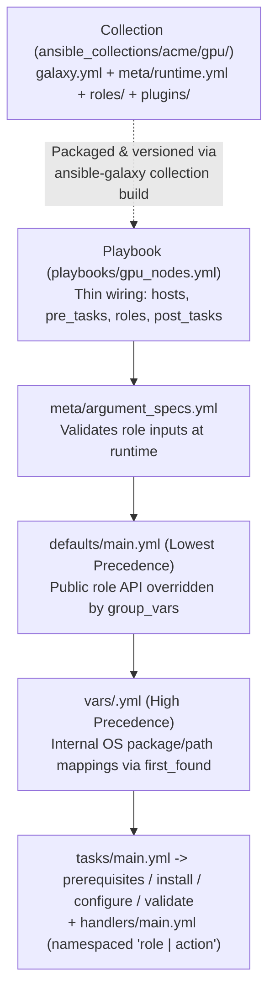

# 4.11 Ansible roles and collections

| | |
|---|---|
| Level | Intermediate |
| Priority tier | 1 |
| Lab venue | ansible-core, ansible-galaxy, Molecule optional |
| Part | Part 4: Automation and infrastructure as code |
| Status | Drafted, labs **untested** |

## Why this matters for AI infrastructure

Think about a GPU cluster whose configuration lives in one giant playbook. Every node repeats the same concerns: base OS hardening, time sync, drivers, container runtime, monitoring agents, Slurm clients, filesystem mounts and NCCL tuning. When each of these is an ad-hoc block, nothing can be reused, tested or versioned. Picture a new rack arriving on a Monday. The platform team copies the whole playbook, changes a few lines by hand, and in a month the two racks have quietly drifted apart. Nobody can say which copy is correct, because nobody can see where one copy stops and the other starts.

A role fixes that by packaging one unit of configuration behind a clean interface. The driver logic lives in one folder, and every playbook that needs a driver calls that folder. A fix made in the role reaches every rack the next time it runs. A collection goes a step further. It packages roles, modules and plugins together and gives them a version number, so a team can say "we run collection 1.4.0" and mean exactly that. NVIDIA's DeepOps, Kubespray and most vendor automation are built from roles and collections, and your own platform repository will be too. Good role design is what lets a team of five operate a thousand nodes, because the team spends its time improving the shared pieces rather than repairing copies.

## Prerequisites and outcomes

This chapter builds on 4.3 to 4.10, so have those close by. When you finish, you should be able to do the following:

- Create and structure roles with `tasks`, `handlers`, `defaults`, `vars`, `templates`, `files`, `meta`, `library` and `molecule`, and know what each directory is for.
- Apply the interface principle: keep inputs in documented `defaults/` variables, validate them with `argument_specs`, and avoid hidden coupling.
- Use roles from playbooks with `roles:`, `import_role`, `include_role` and `tasks_from`, passing parameters and handling dependencies and run order.
- Write OS-portable roles that use variables per OS family and `first_found`, and that stay idempotent and testable.
- Install and pin third-party roles and collections from Galaxy, Git and Automation Hub with `requirements.yml`, then build, test, version and publish your own collection.
- Organise a repository with playbooks, roles, collections and inventories for a multi-team platform.

## 1. Anatomy of a role

A team has the same NTP setup copied into five playbooks, and each copy has drifted a little. A role packages that setup once, with its tasks, defaults and templates in one folder. Every playbook then calls the role, so a fix lands everywhere at the same time. The anatomy below is what sits inside that folder, and why each part is where it is.

You are about to write a role for the NVIDIA driver, and the first question is where each piece goes. Think of a role as a kitchen with labelled drawers. The knives go in one drawer, the recipes in another, and the spare parts in a third. A cook who walks into any kitchen of this design knows where to look, and that is the whole point of the fixed layout. A role is a directory with a fixed layout, and each subdirectory has one job. Once you know the layout, anyone who opens the role can find the part they need without asking the author. The tree below shows what a driver role looks like on disk.

```text
roles/gpu_driver/
├── defaults/main.yml          # public interface: low-precedence defaults users override
├── vars/main.yml              # internal constants (high precedence; avoid user-facing settings here)
├── vars/Debian.yml            # OS-specific internal values (loaded with include_vars/first_found)
├── tasks/main.yml             # entry point
├── tasks/install.yml          # split big roles into task files
├── tasks/configure.yml
├── tasks/validate.yml
├── handlers/main.yml
├── templates/                 # Jinja2 (*.j2)
├── files/                     # static files copied as-is
├── meta/main.yml              # galaxy metadata, dependencies, supported platforms
├── meta/argument_specs.yml    # input validation + documentation
├── library/                   # role-local modules (optional)
├── module_utils/, plugins/    # role-local plugins (optional; usually in collections)
├── README.md                  # purpose, variables, examples, tested platforms
└── molecule/default/          # tests (4.13)
```

Notice that `defaults/` and `vars/` answer different questions. One holds settings a user may change, and the other holds values the role keeps for itself. The tree also shows `tasks/` split into several files. A large role is easier to read when each phase has its own file, and a reader who wants only the validation step can open one short file rather than scrolling a long one.

Create the skeleton with `ansible-galaxy role init gpu_driver`, or with `ansible-galaxy init`. The command writes the empty folders above, so you start from the same shape every other role uses. Ansible then looks for roles in `roles_path`, in a `roles/` directory next to the playbook, and in installed collections under the name `namespace.collection.role`. The name is the address. If a playbook says `gpu_driver` and Ansible cannot find it under the paths it checks, the run fails before any task starts, and the message names the role it could not find.

The same idea works on a larger playbook. Splitting the monolithic `mezzanine.yml` playbook gives reusable `database` and `mezzanine` roles, and the refactored playbook is `mezzanine-across-hosts.yml`. Ansible also resolves relative file paths inside a role in a fixed order.

Here is where the `copy` module looks. Suppose a task in `roles/database/tasks/main.yml` says `copy: src=pg_hba.conf ...`. The task names only the file, not the folder, so Ansible has to search for it. It works like a receptionist with a list of rooms to check. The receptionist looks in the most specific room first, and only moves to the next room when the first is empty. When a task in `roles/database/tasks/main.yml` runs `copy: src=pg_hba.conf ...` or `script: setadmin.py`, Ansible checks these six locations in order, and it stops at the first match. The order matters when two folders hold a file with the same name. The role's own `files/` folder wins over the playbook's folder, which is what you want, because the role carries its own copy. The function `role_file_search_candidates()` in `code/part04/ansible_roles_collections.py` models the same search.

1. `./roles/<role_name>/files/`
2. `./roles/<role_name>/`
3. `./roles/<role_name>/tasks/files/`
4. `./roles/<role_name>/tasks/`
5. `./files/` (adjacent to the top-level playbook)
6. `./` (the top-level playbook directory)

The `template` module works in a similar way. It searches `./roles/<role_name>/templates/` first, and only then falls back to `./templates/`.

The same chapter, in Examples 9-7 and 9-8, shows how the two roles divide their variables. Look at the split as a worked case. In `roles/database/defaults/main.yml`, settings a user can override live in `defaults/`, such as `postgres_packages: [acl, libpq-dev, postgresql, python3-psycopg2]` and `locale: en_US.UTF-8`. A user of the database role may want a different locale, so the value is a default they can change. Paths built from those inputs live in `roles/mezzanine/vars/main.yml`, such as `mezzanine_venv_path: "{{ mezzanine_venv_home }}/{{ mezzanine_proj_name }}"` and `mezzanine_settings_path: "{{ mezzanine_proj_path }}/{{ mezzanine_proj_app }}"`. Nobody should type in the full path by hand, because it is built from the name and home directory. Setting it in `vars/` keeps the assembly in one place. The task phases are split across `setup.yml`, `django.yml` and `nginx.yml`, which `roles/mezzanine/tasks/main.yml` includes, so each phase can be read on its own.



### defaults versus vars

Getting this split right early saves you from fights over precedence later. Precedence is the rule Ansible uses to pick one value when the same variable is set in several places. Think of it as a stack of transparent sheets. The sheet on top shows through, and the sheets beneath it show only where the top one is blank. `defaults/main.yml` sits at the bottom of that stack, so almost any other source can override it. That is exactly what you want for a public setting. The role says, in effect, "this is my starting value, change it if you need to." Everything a user may reasonably change belongs here, with safe defaults. `vars/main.yml` works the other way. It sits high in the stack, high enough that inventory values cannot override it, so use it sparingly, for internal constants or OS-specific mappings users should not change. A setting placed there and later needed by someone becomes a fight with precedence, because the only way to change it is to edit the role. If you are in doubt, use `defaults`. A default that is too easy to override costs you nothing, while a setting that is impossible to override costs a fork of the role.

Prefix every variable with the role name, such as `gpu_driver_branch` or `gpu_driver_blacklist_nouveau`. Variables are global to the play, so a variable called `branch` in one role and `branch` in another would be the same variable. The prefix prevents that collision, and it tells a reader where a variable came from the moment they see it. Mark the difference between public and private variables: public ones are documented and stable, and private ones use the `__role_` prefix by convention. The double underscore is a signal to other readers, "this is internal, do not set it from outside."

```yaml
# roles/gpu_driver/defaults/main.yml
gpu_driver_branch: "550"                     # nvidia driver branch
gpu_driver_package_type: "open"              # open | proprietary
gpu_driver_persistence_mode: true
gpu_driver_blacklist_nouveau: true
gpu_driver_hold_packages: true
gpu_driver_fabric_manager: "{{ ansible_local.gpu.nvswitch | default(false) }}"
gpu_driver_validate_gpu_count: 0             # 0 disables the count check
```

Each line sets a starting value that a user can override. Read the file as a menu with a recommended choice already selected. The `gpu_driver_branch` line picks the driver series, and the `gpu_driver_package_type` line picks between the open and proprietary kernel modules. The `gpu_driver_fabric_manager` line is the only one that reads a fact, which means it looks at what Ansible found on the machine. It falls back to `false` when that fact is missing, so a node without NVSwitch does not fail on a missing value. Notice the `0` on the last line, which turns off the GPU count check. A value of `0` is easier to read than an empty value, because the type stays a number, and the argument spec later in this chapter can check that it is one.

### tasks, handlers and entry points

The task file is where the role starts running. It loads the OS-specific values first, then runs each phase in turn.

```yaml
# roles/gpu_driver/tasks/main.yml
- name: Include OS-specific variables
  ansible.builtin.include_vars: "{{ lookup('ansible.builtin.first_found', params) }}"
  vars:
    params:
      files:
        - "{{ ansible_facts['distribution'] }}-{{ ansible_facts['distribution_major_version'] }}.yml"
        - "{{ ansible_facts['os_family'] }}.yml"
        - default.yml
      paths: ["{{ role_path }}/vars"]

- name: Prerequisites
  ansible.builtin.import_tasks: prerequisites.yml
  tags: [gpu_driver_prereq]

- name: Install driver
  ansible.builtin.import_tasks: install.yml
  tags: [gpu_driver_install]

- name: Configure
  ansible.builtin.import_tasks: configure.yml
  tags: [gpu_driver_config]

- name: Validate
  ansible.builtin.import_tasks: validate.yml
  when: gpu_driver_validate_gpu_count | int > 0
  tags: [gpu_driver_validate]
```

```yaml
# roles/gpu_driver/handlers/main.yml
- name: gpu_driver | reload nvidia persistence daemon
  ansible.builtin.systemd_service:
    name: nvidia-persistenced
    state: restarted
    daemon_reload: true
```

Read the entry point from top to bottom, the way Ansible runs it. The first task loads the OS-specific values, so every later task can use names like `gpu_driver_pkgs` without caring whether the node runs Ubuntu or Rocky. Then the prerequisite, install and configure phases run in that order. Each `import_tasks` line pulls in a file and gives it a tag, so an operator can run only the configuration step with `--tags gpu_driver_config` while the install step stays untouched.

The handler at the bottom does its work only when something notifies it. A task that changes the persistence settings can say `notify: gpu_driver | reload nvidia persistence daemon`, and Ansible then restarts the service once at the end of the play, not once for every change. That is why handlers exist. A handler is a task that waits.

The validate step runs only when a caller sets `gpu_driver_validate_gpu_count` above zero. Handler names are global in a play too, so give each one a namespace such as `role | action`. That keeps two roles from triggering each other's handlers. If two roles both named a handler `restart daemon`, a notify from one could restart the other role's service without anyone meaning it to.

### meta and dependencies

```yaml
# roles/gpu_driver/meta/main.yml
galaxy_info:
  author: Platform team
  description: Install and configure NVIDIA data-centre drivers
  license: Apache-2.0
  min_ansible_version: "2.16"
  platforms:
    - { name: Ubuntu, versions: [jammy, noble] }
    - { name: EL, versions: ["8", "9"] }
  galaxy_tags: [nvidia, gpu, driver]
dependencies:
  - role: common_base                # runs before this role; keep dependency lists short
```

The `galaxy_info` block is the label on the box. It tells Galaxy and any reader who wrote the role, what it does, what license covers it, and which operating systems it was tested on. The `platforms` list is a promise to the caller. A role that lists Ubuntu and EL 8 and 9 is claiming those systems. A caller on a different system should not expect it to work.

A dependency runs before the role that lists it. Imagine a `common_base` role that sets up time sync and SSH hardening. The `gpu_driver` role lists it under `dependencies:`, so a caller gets the base setup first, without remembering to call it. It runs once per play, unless `allow_duplicates: true` is set or its parameters differ. Deep chains of dependencies are hard to read and hard to test. A reader who wants to know why a task ran has to follow the chain up through several `meta/main.yml` files. Keep the list short, and use dependencies only for true prerequisites. Put the rest of the order in the playbook, where operators can see it in one place.

### Argument specs: the role's contract

```yaml
# roles/gpu_driver/meta/argument_specs.yml
argument_specs:
  main:
    short_description: Install and configure the NVIDIA driver
    options:
      gpu_driver_branch:
        type: str
        default: "550"
        description: Driver branch to install.
        choices: ["535", "550", "555"]
      gpu_driver_persistence_mode:
        type: bool
        default: true
      gpu_driver_validate_gpu_count:
        type: int
        default: 0
        description: Expected number of GPUs (0 disables validation).
```

Think of the argument spec as the form a caller must fill in. Each option is one field. The `type` says what kind of value the field accepts, the `default` fills the field when the caller leaves it blank, and `choices` is a drop-down list that rejects anything else. Suppose a caller mistypes the branch in an inventory file, writing a value that is not in the list of choices, so the run stops at the start of the role with a message that names the field and the allowed values. Without the spec, the same typo would reach the package manager and fail later, with a message about a package that does not exist.

At run time, Ansible checks role parameters and variables against this spec. A bad value fails early, with a clear message. The spec doubles as documentation, and you can read it with `ansible-doc -t role`. That means the description you wrote for each option is the same text the next engineer sees, so the form and its help never drift apart. When a role has several task files that callers run on their own, define a separate entry point for each one, such as `main`, `upgrade` or `validate`, and call them with `tasks_from`. Each entry point gets its own form in the spec, so a caller of `validate` sees only the fields that `validate` needs.

## 2. Using roles

A playbook that calls a role should read like a table of contents. The reader sees which roles run on which hosts, and the details live inside the roles. This section shows what the call looks like and what it passes in, so the playbook stays short even when the work behind it is large.

Suppose the driver must run on every GPU node, but only after a drain step on some of them. A `roles:` list alone cannot express that. Ansible offers three ways to call a role, and each suits a different case.

```yaml
# Classic: roles run before tasks in the play
- hosts: gpu
  become: true
  roles:
    - common_base
    - role: gpu_driver
      vars: { gpu_driver_branch: "550", gpu_driver_validate_gpu_count: 8 }
      tags: [driver]
    - { role: dcgm, when: "'gpu' in group_names" }

# Static import (fixed at parse time)
- hosts: gpu
  tasks:
    - ansible.builtin.import_role: { name: gpu_driver }

# Dynamic include (runtime decisions, loops, other entry point)
- hosts: gpu
  tasks:
    - name: Run only the validation entry point
      ansible.builtin.include_role:
        name: gpu_driver
        tasks_from: validate
      vars: { gpu_driver_validate_gpu_count: 8 }

    - name: Apply a role once per item
      ansible.builtin.include_role: { name: mount_fs, apply: { tags: [mounts] } }
      loop: "{{ filesystems }}"
      loop_control: { loop_var: fs }
```

The `roles:` list runs before the play's tasks. `import_role` is fixed at parse time, while `include_role` decides at runtime. It can call `tasks_from` and run once for each item in a list.

Parse time means the moment Ansible reads the playbook and builds its full plan, before any host is touched. A static import is like a printed itinerary. Every stop is written down before the trip starts, and `--list-tasks` can show you all of them. A dynamic include is more like a taxi driver who asks at each corner where to go next. It can decide based on a value that only exists during the run, such as a fact or the result of an earlier task. The price of that flexibility is that you cannot see the full list ahead of time.

Run order is `pre_tasks`, then role dependencies and roles, then `tasks`, then `post_tasks`. Handlers flush between sections, and a play can mix roles and tasks. Because `import_role` and `include_role` sit inside the task flow, they can run a role after a reboot or a drain step, which `roles:` cannot do. A GPU node that must be drained before its driver changes needs exactly that. The drain task runs first, and then the driver role runs in the same play. Use `roles:` for simple cases, and the other two for mid-task roles.

## 3. Designing good roles

A good role does one job and exposes a few clear inputs. A poor role grows into a grab bag that nobody wants to change, because every change might break some caller. The rules below keep a role small enough to test and safe to reuse across teams.

Good roles follow a handful of habits, and each one guards against a particular kind of trouble. Think of these habits as the house rules of a shared workshop. Each rule exists because someone once left a tool in the wrong place, or cut a board to the wrong length, and the next person paid for it. A role that breaks a rule is not necessarily broken today, but it becomes harder to trust every time someone else depends on it. As you write a role, check it against these twelve points.

1. Give each role a single responsibility. One role should install and configure one thing, such as `gpu_driver`, `container_toolkit`, `chrony`, `slurm_client` or `dcgm_exporter`. A role named `everything` is a playbook in disguise.
2. Describe the desired state through variables, and make the tasks idempotent, so you can run the role twice and see nothing change (4.6).
3. Consider the inventory. The role should not assume that `groups['gpu']` exists, so pass the data it needs as variables, or document the requirement and assert it.
4. Keep the role portable by default. Use `ansible_facts['os_family']` mappings for package names and paths, and fail with a clear `assert` on an unsupported platform rather than half-working.
5. Validate inputs with argument specs and early `assert`s. Validate outputs with a `validate` task file that checks real behaviour, such as the `nvidia-smi -L` count, whether the service is active, and whether a port is open.
6. Keep the role safe by default. A destructive step should need an explicit variable, such as `gpu_driver_allow_downgrade: false`. A reboot should happen only when `role_allow_reboot: true` is set. When one is needed, return the fact `gpu_driver_reboot_required`, so the playbook can act on it.
7. Keep the role friendly to check mode. Use `check_mode: false` for read-only probes, so `--check` does not fail because of changes that were never made.
8. Split large roles into small task files, such as `install`, `configure`, `service` and `validate`, and select them by tags or `tasks_from`.
9. Document variables, tags, supported platforms and examples in `README.md`. Keep a `CHANGELOG.md`, and use semantic versions.
10. Test the role with Molecule scenarios and linters, which you will meet in 4.13.
11. Never hide secrets in a role. Accept them as variables from Vault or another secret store, and use `no_log` inside the role.
12. Avoid role-level `vars/` for knobs, and avoid `set_fact` that leaks global names. Prefer `__role_private` names for anything internal.

### Example: a compact role for kernel tuning

```yaml
# roles/kernel_tuning/defaults/main.yml
kernel_tuning_sysctl:
  vm.swappiness: 1
  vm.max_map_count: 1048576
  kernel.numa_balancing: 0
  net.core.rmem_max: 268435456
kernel_tuning_sysctl_extra: {}
kernel_tuning_hugepages: 0
kernel_tuning_cpu_governor: performance
kernel_tuning_modules_load: []

# roles/kernel_tuning/tasks/main.yml
- name: Apply sysctl settings
  ansible.posix.sysctl:
    name: "{{ item.key }}"
    value: "{{ item.value }}"
    sysctl_file: /etc/sysctl.d/90-kernel-tuning.conf
    reload: true
  loop: "{{ kernel_tuning_sysctl | combine(kernel_tuning_sysctl_extra) | dict2items }}"
  loop_control: { label: "{{ item.key }}" }

- name: Load modules at boot
  ansible.builtin.copy:
    dest: /etc/modules-load.d/kernel-tuning.conf
    content: "{{ kernel_tuning_modules_load | join('\n') }}\n"
    mode: "0644"
  when: kernel_tuning_modules_load | length > 0

- name: Set CPU governor
  ansible.builtin.command: cpupower frequency-set -g {{ kernel_tuning_cpu_governor }}
  changed_when: false
  failed_when: false           # tolerate VMs without cpufreq; real roles probe /sys first
```

Work through this example as a small case. The defaults set four sysctl values. A user who wants to change only `vm.dirty_ratio` sets `kernel_tuning_sysctl_extra: { vm.dirty_ratio: 10 }` in `group_vars`. The `combine` filter merges that key into the defaults, so the other values stay in place.

Here is the same merge written out as a small table, so you can see what the loop receives.

| Key | Source | Value used |
|---|---|---|
| `vm.swappiness` | `kernel_tuning_sysctl` default | `1` |
| `vm.max_map_count` | `kernel_tuning_sysctl` default | `1048576` |
| `kernel.numa_balancing` | `kernel_tuning_sysctl` default | `0` |
| `net.core.rmem_max` | `kernel_tuning_sysctl` default | `268435456` |
| `vm.dirty_ratio` | `kernel_tuning_sysctl_extra` in `group_vars` | `10` |

The `dict2items` filter then turns that dictionary into a list of key and value pairs, and the loop applies one pair at a time. Each pair becomes one `sysctl` call. The `loop_control` line keeps the output short by printing only the key name, so a log shows which sysctl changed without printing the whole value set. Note the file the task writes. It is a drop-in file under `/etc/sysctl.d/`, so the setting lives beside the system defaults and does not overwrite them.

## 4. Galaxy, requirements and sourcing third-party content

Your project needs a role that someone else wrote. You could copy it into your repository, but then you would never receive its fixes. A requirements file pins the exact version you tested, and Galaxy is the public place where many such roles are published. Pinning keeps your run the same today and next month. Picture a team that copies a role on Monday and upgrades nothing. By the next year the copy has fallen behind every upstream fix, and nobody remembers which local edits were deliberate. A pinned version avoids that, because the version is written down and changed only on purpose.

Your playbooks will pull in roles and collections that other people wrote, and those roles run as root on your fleet. Pin what you use in one file before you install anything. Galaxy is the public index, and a Git source is a repository you point at directly. The `version` line is the lock. A tag such as `v2.3.0` names a fixed point in a Git history, and a range such as `">=8.0.0,<10.0.0"` lets the collection move within a window you chose.

```yaml
# requirements.yml
roles:
  - name: geerlingguy.docker
    version: "7.4.1"
  - src: https://git.example.com/platform/ansible-role-chrony.git
    scm: git
    version: v2.3.0
    name: platform.chrony

collections:
  - name: community.general
    version: ">=8.0.0,<10.0.0"
  - name: kubernetes.core
    version: "4.0.0"
  - name: https://git.example.com/platform/ansible-collection-gpu.git
    type: git
    version: 1.4.0
```

```bash
ansible-galaxy role install -r requirements.yml -p roles/
ansible-galaxy collection install -r requirements.yml -p collections/
ansible-galaxy collection list
ansible-doc -t role platform.chrony        # documentation from argument specs
```

The first two commands install roles and collections. The last two list what is installed, and `ansible-doc` reads its documentation from the argument specs. Run them in order after you change the file, so the installed versions match what you wrote. The list command is your proof. If it shows a version you did not pin, something else is installing into the same folder, and you should find it before the next run.

Pin exact versions, or tight ranges, and commit `requirements.yml`. Committing the file means the next person who clones the repository gets the same versions you tested. Mirror dependencies in an internal Automation Hub, Artifactory or Git server for availability and supply-chain control. A mirror is your own copy of the public packages, so a deleted upstream repository cannot break your next build. Review third-party code before you use it, because roles run as root. Reading the `tasks/` and `handlers/` folders is a reasonable first pass, because those are the parts that act. Prefer maintained roles packaged as collections, and vendor the critical ones yourself if you cannot trust the upstream project to keep going. "Vendor" means copying the code into your own repository at a fixed version. Run `ansible-lint` and Molecule against upgraded versions in CI before anything is promoted, so an upgrade is tested on a disposable host before it reaches a GPU node.

## 5. Collections

Roles solve one problem at a time. Collections bundle roles, modules and plugins under one name and one version. A collection is the unit you install and pin, so the whole toolkit moves together and you do not chase a dozen separate versions. Picture a GPU platform that depends on a driver role, a DCGM role, a custom filter and a module that reads GPU facts. Without a collection, four separate versions must agree, and a single mismatch can break the run in a confusing way. With a collection, one version number covers all four, and a team that upgrades to 1.4.0 knows that every piece was tested together.

A role works well inside one repository. When content has to travel between repositories and teams, it needs a package format, and a collection is that format. Think of a collection as a shipping box. The box has a label, a manifest that lists what is inside, and a version printed on the side. Anyone who receives the box can check the contents without opening every item. A collection is Ansible's distribution format. It is a namespaced package, named `namespace.name`, that bundles modules, plugins, roles, playbooks and documentation. Plugins come in several kinds, including filter, lookup, inventory, callback and connection. You refer to content by its FQCN, the fully qualified collection name, such as `community.general.ufw` or `nvidia.gpu.gpu_driver`.

```text
ansible_collections/acme/gpu/
├── galaxy.yml                  # name, namespace, version, dependencies, build_ignore
├── README.md, CHANGELOG.rst
├── meta/runtime.yml            # requires_ansible, plugin routing/deprecations
├── plugins/
│   ├── modules/                # custom modules (Python), e.g. gpu_facts.py
│   ├── module_utils/
│   ├── filter/                 # custom filters
│   ├── lookup/ inventory/ callback/ ...
│   └── doc_fragments/
├── roles/
│   ├── gpu_driver/ ...
│   └── dcgm/ ...
├── playbooks/                  # shipped example/entry playbooks
├── docs/ and tests/            # sanity, unit, integration tests (ansible-test)
└── changelogs/                 # antsibull-changelog fragments
```

Notice that the packaging metadata sits at the top, in `galaxy.yml`, and that the code is split between `plugins/` and `roles/`.

```yaml
# galaxy.yml
namespace: acme
name: gpu
version: 1.4.0
readme: README.md
authors: [Platform team]
description: GPU node automation for the AI platform
license: [Apache-2.0]
dependencies:
  community.general: ">=8.0.0"
  ansible.posix: ">=1.5.0"
repository: https://git.example.com/platform/ansible-collection-gpu
build_ignore: [".git", "*.tar.gz", "molecule"]
```

`galaxy.yml` holds the namespace, name, version and dependencies. It also carries `build_ignore` for the files the build should leave out.

```bash
ansible-galaxy collection init acme.gpu           # skeleton
ansible-galaxy collection build                   # creates acme-gpu-1.4.0.tar.gz
ansible-galaxy collection install ./acme-gpu-1.4.0.tar.gz -p collections/
ansible-galaxy collection publish acme-gpu-1.4.0.tar.gz --server automation_hub   # or upload to Artifactory/Galaxy-compatible server
ansible-test sanity --docker default              # style, docs and import checks (run from ansible_collections/acme/gpu)
ansible-test units
ansible-test integration
```

The commands run in this order. You create the skeleton, build the tarball, install that tarball locally, and publish it. Then you run the three `ansible-test` suites from inside `ansible_collections/acme/gpu`. Installing the tarball locally before publishing is the step people skip, and it is the one that catches a missing file. A build can succeed while the package leaves out something a role needs, and the local install shows that gap before anyone else sees it. The `ansible-test` suites check different things. `sanity` looks at style, documentation and imports. `units` tests small Python functions in isolation. `integration` runs the code against a real target.

Use semantic versioning with a changelog, and bump the major version for breaking changes. Semantic versioning uses three numbers, major, minor and patch. A patch changes nothing a caller depends on, a minor adds something new without breaking anything, and a major means a caller may need to edit a playbook. The changelog is the note that explains each bump to the people who read it. Set `requires_ansible` and any deprecations in `meta/runtime.yml`. Document modules in `DOCUMENTATION`, `EXAMPLES` and `RETURN` blocks, which 4.15 covers. Run a CI job that builds, lints, tests and publishes whenever you push a tag. Treat the collection like a library, with a public interface and a deprecation policy.

### Where to put what

New contributors often ask where a file belongs. A simple rule answers most cases. If the code is a reusable module or role that several teams will call, it goes in a collection or a shared role. If it is specific to one environment, it stays in that environment's folder, where a reviewer can see it next to the values it uses. The test is who else needs the file. A role for a lab cluster with one set of IP addresses belongs with that lab. A role that installs a driver on every cluster belongs in a shared package, because the same logic should not be copied into each environment and left to drift.

Before you create a file, decide where it belongs. The table below sends each kind of content to its home.

| Content | Home |
|---|---|
| A playbook that glues a particular environment together | Environment/platform repo |
| A reusable unit of configuration | Role (inside a collection if shared across teams) |
| Custom module/filter/lookup/inventory plugin | Collection `plugins/` |
| Group/host variables and inventories | Environment repo (not in roles/collections) |
| Secrets | Vault/secret manager, never in roles |

Notice that secrets never go into a role or a collection, and that inventories stay in the environment repository. Build a collection when content must be shared between teams, and keep environment data out of it.

## 6. Repository layout for a platform team

A platform team serves many application teams. The repository layout decides who can change what, and how a change travels from a shared role to every environment that uses it. Get the layout right early, because moving files between repositories later is slow and error-prone.

A platform team's repository has to hold playbooks, roles, inventories and CI configuration side by side. The layout below shows one way to arrange them.

```text
platform-automation/
├── ansible.cfg
├── requirements.yml
├── collections/                 # installed deps (gitignored) or vendored
├── inventories/{prod,staging,lab}/
├── playbooks/
│   ├── site.yml
│   ├── gpu_nodes.yml
│   ├── slurm.yml
│   └── maintenance/{drain_and_patch.yml,rotate_certs.yml}
├── roles/                       # roles not yet promoted to a collection
├── molecule/ or tests/
├── .ansible-lint, .yamllint, .pre-commit-config.yaml
└── .github/workflows/ci.yml
```

As you read the tree, notice that `inventories/` has one folder per environment, and that `roles/` holds the roles not yet promoted to a collection. The environment folders keep production and lab values apart, so a change made while testing in the lab cannot reach production by accident. Promote a role into a versioned collection when more than one team consumes it. Then you consume it through `requirements.yml` with pinned versions. The promotion step is a small ceremony with a large payoff, because after it the role has a version, a changelog and a clear owner.

Keep playbooks thin, covering host selection, variable wiring and ordering. Keep roles fat, since they hold the actual logic. A useful way to check the split is to read a playbook aloud. If you hear a long list of package names or file edits, the logic has leaked out of its role and belongs back inside one.

## 7. Role patterns specific to GPU infrastructure

GPU nodes need roles that a generic web role never touches: drivers, fabric settings and kernel parameters. A mistake in these roles can stop a training job or take a node offline. The patterns below show how to package those concerns so they can be tested before they reach hardware.

A GPU node needs roles that understand its hardware. If you write those roles, the patterns below describe what they have to handle, and why.

Start with hardware awareness. Picture two nodes in the same group. One has eight GPUs wired through NVSwitch, and the other was built with a different board. If both get the same role with the same inventory group, the role has to guess what each node contains, and a guess is the wrong tool here. Probe the GPUs in a `gpu_facts` task, using `lspci -d 10de:`, `nvidia-smi -L`, `nvidia-smi nvlink -s` and a check for NVSwitch presence. The `lspci -d 10de:` filter finds NVIDIA devices by their vendor code, `nvidia-smi -L` lists each GPU the driver can see, and the NVLink query reports the high-speed links between them. Publish the results as `ansible_local.gpu.*`, which is a local fact store on the node. Other roles should then branch on those facts, rather than on group names alone. A group name says what someone intended, and a fact says what the machine actually has.

The driver install flow has the most moving parts. It has to handle pre-existing drivers and `nouveau` blacklisting, DKMS vs precompiled modules, package holds and reboot requirements. It also covers Fabric Manager on NVSwitch systems, `nvidia-persistenced`, MIG configuration and validation with `nvidia-smi` and `dcgmi diag -r 1`. Expose a `reboot` decision to the caller, so the caller can choose when the node restarts.

The NVIDIA Container Toolkit belongs in its own role, separate from the driver. Its configuration covers containerd, Docker and CRI-O.

Upgrades must be idempotent. A role that supports changing versions detects the installed version, unloads modules if needed, installs the new one and verifies it. It should refuse to downgrade unless downgrades are explicitly allowed.

Order matters on a node, so run the base OS and kernel first, then drivers, the container runtime, monitoring, the scheduler or Kubernetes agents, and finally the workload prerequisites. Document this order in the playbook, not in hidden role dependencies.

NVIDIA-provided automation, such as DeepOps, `nvidia.nvue` for Cumulus and Spectrum switches, network operator manifests and the BCM Python and CLI tools, can be consumed as roles or collections. Pin and review it the same way you would any other dependency.

## 8. Lab

Build the role yourself rather than only reading about it. Reading a role teaches you its shape, but only writing one shows you where the friction is. Each step ends with a command you can run and a result you can check. If a result differs from the one described, stop and find out why before moving on, because a wrong result in an early step will make every later step confusing.

Start with the self-checking Python lab, which you can run locally: `code/part04/ansible_roles_collections_lab.py`. It checks three things. It verifies runtime validation of `meta/argument_specs.yml` through `validate_role_argument_spec`, so a bad value is rejected the same way Ansible would reject it. It checks dependency traversal and deduplication through `resolve_role_dependency_order`, which respects `allow_duplicates`. It also checks the relative file search precedence in `role_file_search_candidates`, so the six-path order from earlier is tested rather than only described.

```bash
python3 code/part04/ansible_roles_collections_lab.py
```

Next, move to a control node that has `ansible-core` and `ansible-galaxy`. The interactive shell steps below have not been run on live hardware, so you should run them yourself and check the results. Work through these exercises in order, and note what you see at each step.

1. Your 4.9 playbook has three jobs buried in one file: `app_deploy`, `nginx_proxy` and `postgres`. Which three roles would you extract, and how do you confirm the behaviour stayed the same? Use `--check --diff` and a second run to answer.
2. A teammate calls your new role with a value that `meta/argument_specs.yml` does not allow. Which error message appears? Which command shows the documentation a caller would read?
3. The same role must run on Debian and RedHat families. Which package names go in `vars/Debian.yml` and which go in `vars/RedHat.yml`? Which `first_found` lookup picks the right file, and does it work in containers on both families?
4. Your `validate` step must run alone, without the install step. Which `include_role` line with `tasks_from` runs it? How does the output of `--list-tasks` differ between `import_role` and `roles:`?
5. Two roles share a dependency, and the run seems to skip one of them. Which role runs once? What changes when you set `allow_duplicates`? Which version of the playbook, the one with the dependency or the one with explicit ordering, reads more clearly to you?
6. A variable in `vars/main.yml` will not respond to a `group_vars` override. Why does that happen? Which variable belongs in `defaults` instead?
7. Your team pins roles and collections from Galaxy and Git. Which two install commands read `requirements.yml`? Which command shows what is installed, and what changes when you break one pin?
8. You want a small `acme.gpu` collection with one role, one filter and one module. Which build command produces the tarball? Which `ansible-test sanity` run confirms that the package is clean?
9. A group var overrides the kernel tuning defaults on one node. Which check mode run shows the change without applying it? Which `sysctl -n` probe proves the value took effect?
10. Your driver role must decide whether to install Fabric Manager. Which fact does a `gpu_facts` role publish? How does the driver role read it?
11. A new role is ready for review. Which `ansible-lint` run catches style problems? Which Molecule scenario from 4.13 tests it?
12. When you finish, which lab hosts and folders need cleaning up?

## 9. Common mistakes

Role mistakes spread. One bad default lands in every playbook that uses the role, so a small error costs more here than it would in a single playbook. Read this list with the callers of your roles in mind.

Most trouble with roles comes from a few habits, and you may recognise some of them in your own repositories. Each mistake below looks reasonable on the day it is made. A role that does "a little of everything" is convenient at first, and it becomes a burden when a second team needs one piece and cannot take the rest. Read the list as a set of early warnings, and check your own roles against it when a change feels easy.

Watch for roles that are really whole playbooks. The opposite mistake is splitting roles so finely that every playbook needs twenty of them.

Unprefixed variables collide across roles, and interface variables in `vars/` cannot be overridden. Hidden reliance on inventory groups breaks a role wherever the groups are named differently.

Deep dependency chains and `allow_duplicates` tricks hide the execution order.

A role without input validation fails with obscure errors when a caller makes a typo.

Hard-coded package names and paths work for one distribution only, and a role without platform assertions gives no warning.

Unpinned Galaxy dependencies can change underneath you, and unreviewed third-party roles run as root.

Non-idempotent roles cause trouble, and so do handlers with unnamespaced names that clobber each other.

Secrets embedded in role files are a mistake, and so are roles that reboot machines unexpectedly.

A role with no README, tests or changelog is hard to trust, and breaking interface changes need a major version bump.

Mixing environment data such as inventories into shared roles and collections makes them harder to reuse. A role that carries one lab's IP addresses cannot be handed to a second lab without edits, and every edit is a new fork to maintain. Check new roles against this list.

## 10. Interview angles

Role and collection questions probe whether you can share work without sharing risk. Explain versioning, ownership and the way a fix reaches each consumer. A strong answer names a concrete situation, such as a driver fix that must reach three clusters, and then walks through the path the fix takes. A weak answer lists features without saying why any of them matter.

- "What is a role? Structure? `defaults` vs `vars`?"
- "How do you design a role interface? How do you validate arguments?" (prefixed defaults, argument specs, asserts.)
- "Role vs collection; when do you build a collection?"
- "How do you manage third-party dependencies safely?" (pin, mirror, review, test upgrades.)
- "`import_role` vs `include_role` vs `roles:`?"
- "How would you make a role portable across Ubuntu and RHEL?"
- "How do you structure automation for several teams and environments?"
- "How do you version and release shared Ansible content?" (SemVer, changelog, CI, Hub/Artifactory.)

## Exercises

1. A new engineer asks why the public knobs of `roles/gpu_driver/` live in `defaults/main.yml` with the prefix `gpu_driver_`. Which file would you point them to, and why not `vars/main.yml`? Use `role_file_search_candidates()` in `code/part04/ansible_roles_collections.py` to check the answer. Then which six paths does `copy` search, in order, for a relative filename inside a role? (*Ansible: Up and Running*, Chapter 9)
2. A caller passes a bad value to `gpu_driver`, and you want to know who catches it. Which part of `meta/argument_specs.yml` checks the type and the choices? Which command builds the documentation from that same file? (*Ansible: Up and Running*, Chapter 9)
3. A role lists `common_base` under `dependencies:`, and you wonder whether it runs twice. What does `allow_duplicates: false` do? What changes with `allow_duplicates: true`? Why might explicit playbook ordering still be clearer?
4. A caller wants to add one sysctl without replacing the whole default dictionary. Which expression in `kernel_tuning` makes that possible? Why should `gpu_driver` report `gpu_driver_reboot_required` instead of rebooting the node on its own?
5. Your platform pins third-party roles and collections, and an auditor asks how a version gets in. Which `requirements.yml` entries pin a Galaxy role and a Git role? Which two `ansible-galaxy` commands install them? Which supply-chain controls would you show before a third-party role runs as `root` on a GPU cluster? (*Ansible: Up and Running*, Chapters 9 and 15)
6. A reviewer opens `ansible_collections/acme/gpu/` for the first time. Which file holds the version, and which folders hold modules, filters and roles? Which order of commands takes the collection from `init` to `publish`? What does each of the three `ansible-test` suites check? (*Ansible: Up and Running*, Chapter 15)

## Checkpoint questions (20)

<details>
<summary>1. What are the standard subdirectories of an Ansible role, and how do `defaults/main.yml` and `vars/main.yml` differ (*Ansible: Up and Running*, Chapter 9)?</summary>

A role created with `ansible-galaxy role init gpu_driver` gets a standard set of subdirectories. The file you will edit most is `defaults/main.yml`. It holds the lowest-precedence variables, which form the role's public API, so `group_vars/`, `host_vars/` or play vars can easily override them. `vars/main.yml` is different. It ranks above inventory `group_vars` and `host_vars`, so use it only for internal constants or OS-specific mappings, such as `vars/Debian.yml`, that callers should not override. `tasks/main.yml` is the entry point, with files like `install.yml`, `configure.yml` and `validate.yml` beside it. The rest of the layout covers handlers (`handlers/main.yml`), templates (`*.j2`), static files, `meta/main.yml` for Galaxy info and dependencies, `meta/argument_specs.yml` for input validation, `library/` or `plugins/`, and `molecule/`.
</details>

<details>
<summary>2. Why should every variable and handler inside a role be prefixed with the role's name (`gpu_driver_branch`, `gpu_driver | reload persistence daemon`)?</summary>

Role variables and handler names are global to the play, not private to the role. If `gpu_driver` and `slurm_client` both define a variable called `version`, or a handler called `Restart daemon`, one of them silently overwrites or triggers the other. Prefix public variables with `role_`, such as `gpu_driver_branch`. Internal variables take the `__role_` prefix, such as `__gpu_driver_pkgs`. Handlers use `role | action`. Together these stop collisions between roles.
</details>

<details>
<summary>3. Where does Ansible look when a `copy` or `template` task inside `roles/database/tasks/main.yml` references a relative filename like `src: pg_hba.conf` (*Ansible: Up and Running*, Chapter 9)?</summary>

For `copy` and `script`, Ansible searches six paths in order, so you do not need a path prefix:
1. `./roles/database/files/pg_hba.conf`
2. `./roles/database/pg_hba.conf`
3. `./roles/database/tasks/files/pg_hba.conf`
4. `./roles/database/tasks/pg_hba.conf`
5. `./files/pg_hba.conf` (next to the playbook)
6. `./pg_hba.conf`

The `template` module checks `./roles/database/templates/` first. Only after that does it fall back to the playbook's `./templates/` directory.
</details>

<details>
<summary>4. How does `meta/argument_specs.yml` validate role inputs and generate documentation?</summary>

You define an entry point in `meta/argument_specs.yml`, such as `main:` or `validate:`, and give it an `options:` block. Each option can set `type:`, `required:`, `default:`, `choices:` and `description:`. Types include `str`, `int`, `bool`, `list` and `dict`. At run time, Ansible inserts a validation task at the very start of the role. If a caller passes a wrong type or an invalid choice, the run fails right away with a clear message. The same spec powers `ansible-doc -t role <role_name>`.
</details>

<details>
<summary>5. How do role `dependencies:` in `meta/main.yml` execute, when do they deduplicate, and why should deep dependency chains be avoided?</summary>

Roles under `dependencies:` in `roles/gpu_driver/meta/main.yml` run before `gpu_driver`'s own tasks. When several roles in one play depend on `common_base` with the same parameters, Ansible runs `common_base` only once. The exception is `allow_duplicates: true` in `common_base/meta/main.yml`. Keep dependencies minimal, and list roles explicitly in the playbook. That way operators can see the exact execution order at a glance.
</details>

<details>
<summary>6. Compare the three ways to invoke a role in a playbook: `roles:`, `import_role`, and `include_role`.</summary>

- **`roles:` at play level:** a classic declarative list. It runs after `pre_tasks` and before `tasks:`.
- **`ansible.builtin.import_role` inside `tasks:`:** Ansible processes it statically, at parse time, at that position in the task list. Tags and `when:` are copied to every task inside the role, and those tasks appear in `--list-tasks`.
- **`ansible.builtin.include_role` inside `tasks:`:** it runs dynamically, at runtime. It supports `loop:`, so you can run a role once per filesystem or vhost. It also accepts variable names decided at runtime, and `tasks_from: validate` calls one specific sub-entry point.
</details>

<details>
<summary>7. How do you make a role portable across multiple Linux distributions (`Ubuntu` vs. `RHEL/Rocky`)?</summary>

Keep `tasks/main.yml` free of a `when: ansible_os_family == ...` branch on every task. Instead, put OS-specific package names, service names and config paths in `vars/Ubuntu-22.yml`, `vars/Debian.yml` and `vars/RedHat.yml`. Load the most specific match at the top of `tasks/main.yml` with `include_vars: "{{ lookup('ansible.builtin.first_found', params) }}"`. Add an early `assert` that checks `ansible_facts['os_family']` against the supported list.
</details>

<details>
<summary>8. In the `kernel_tuning` role, why do we define both `kernel_tuning_sysctl` and `kernel_tuning_sysctl_extra: {}` in `defaults/main.yml`?</summary>

Ansible replaces dictionaries across precedence layers by default. For example, if a user sets `kernel_tuning_sysctl: { vm.dirty_ratio: 10 }` in `group_vars`, they wipe out the role's baseline keys, such as `vm.swappiness`, `vm.max_map_count` and `net.core.rmem_max`. The fix is `kernel_tuning_sysctl_extra: {}` in the defaults, together with the loop over `{{ kernel_tuning_sysctl | combine(kernel_tuning_sysctl_extra) | dict2items }}`. Callers can then add or override single keys and keep every baseline default.
</details>

<details>
<summary>9. Why shouldn't a reusable role hardcode inventory group names like `groups['gpu']` or `groups['slurm_controller']` inside its tasks and templates?</summary>

If a role hardcodes `groups['slurm_controller'][0]`, it breaks as soon as an environment names that group `slurm_master` or `control_plane`. Put the value in a default variable instead, such as `slurm_client_controller_host: "{{ groups['slurm_controller'][0] | default('') }}"` in `defaults/main.yml`. Then assert in `tasks/main.yml` that it is not empty. Callers can pass any hostname or group expression without editing the role.
</details>

<details>
<summary>10. Why should a driver or kernel role set a fact (`gpu_driver_reboot_required: true`) instead of rebooting the host unconditionally?</summary>

A GPU node often runs several roles in sequence: `common_base`, `kernel_tuning`, `gpu_driver`, then `container_toolkit`. If each role reboots right away, one run reboots the node several times. Worse, a role run outside a maintenance window can reboot an undrained production node. So the role exposes `role_allow_reboot: false` as a default and publishes `gpu_driver_reboot_required: true` as a fact. The top-level maintenance playbook can then drain the node and perform one consolidated reboot.
</details>

<details>
<summary>11. How does `requirements.yml` manage both third-party Roles and Collections (*Ansible: Up and Running*, Chapters 9 and 15)?</summary>

One `requirements.yml` file can hold two top-level lists. The `roles:` list pulls from Ansible Galaxy or Git URLs. A Git entry uses `scm: git` and `version: v2.3.0`. The `collections:` list pulls from Galaxy, Automation Hub or Git, and accepts version ranges such as `">=8.0.0,<10.0.0"`. Install each list into a project folder. Use `ansible-galaxy role install -r requirements.yml -p roles/` for roles, and `ansible-galaxy collection install -r requirements.yml -p collections/` for collections.
</details>

<details>
<summary>12. What is an Ansible Collection, and what can it package that a standalone Role cannot (*Ansible: Up and Running*, Chapter 15)?</summary>

An Ansible Collection is named `namespace.name`, such as `acme.gpu` or `community.general`. It is the standard distribution format. One collection can package roles, custom modules in `plugins/modules/`, module utilities in `plugins/module_utils/`, plugins of several kinds (filter, lookup, inventory, callback and connection), playbooks, documentation and `ansible-test` suites. All of it ships as one versioned, namespaced tarball, such as `acme-gpu-1.4.0.tar.gz`. Everything is then referenced by its FQCN, such as `acme.gpu.gpu_driver` and `acme.gpu.gpu_facts`.
</details>

<details>
<summary>13. What are the roles of `galaxy.yml` and `meta/runtime.yml` inside a Collection?</summary>

- **`galaxy.yml`** sits in the collection root. It declares the namespace, the name, the semantic version (`1.4.0`), the authors, the license and the collection dependencies, such as `community.general: ">=8.0.0"`. It also holds the `build_ignore` patterns that `ansible-galaxy collection build` uses.
- **`meta/runtime.yml`** declares the minimum supported `ansible-core` version, `requires_ansible: ">=2.15.0"`. It also holds plugin routing and redirects, which apply when you rename a module, along with deprecation warnings.
</details>

<details>
<summary>14. What are the commands to initialize, build, install locally, test, and publish a Collection (*Ansible: Up and Running*, Chapter 15)?</summary>

1. **Initialize the skeleton:** `ansible-galaxy collection init acme.gpu`
2. **Build the artifact:** `ansible-galaxy collection build`, which produces `acme-gpu-1.0.0.tar.gz`.
3. **Install locally for verification:** `ansible-galaxy collection install ./acme-gpu-1.0.0.tar.gz -p ./collections`
4. **Run the automated test suites:** `ansible-test sanity --docker default`, `ansible-test units` and `ansible-test integration`, all run from inside `ansible_collections/acme/gpu/`.
5. **Publish:** `ansible-galaxy collection publish ./acme-gpu-1.0.0.tar.gz --server automation_hub`, or to Galaxy, Artifactory or Pulp.
</details>

<details>
<summary>15. Where do you place a custom Filter Plugin or custom Module inside a Collection versus inside a standalone project (*Ansible: Up and Running*, Chapters 10 and 15)?</summary>

- **Inside a Collection (`ansible_collections/acme/gpu/`):** put custom modules in **`plugins/modules/`** and custom filter plugins in **`plugins/filter/`**. Reference them by FQCN, such as `acme.gpu.my_module` or `{{ x | acme.gpu.my_filter }}`.
- **In a standalone playbook repository:** put custom modules in **`library/`** and custom filters in **`filter_plugins/`**, next to the playbook. You can also set those locations in `ansible.cfg`.
</details>

<details>
<summary>16. Why should you prefer using explicit FQCNs (`acme.gpu.my_module`) in tasks over the play-level `collections:` search-list keyword (*Ansible: Up and Running*, Chapter 15)?</summary>

The play-level keyword is `collections: [our_namespace.her_collection]`. It lets tasks use short module names, such as `her_module:`. But when a play imports several collections, a short name leaves it unclear which collection provides the module. `ansible-lint`'s `fqcn` rule flags short names as well. Writing the full name, `our_namespace.her_collection.her_module`, on every task documents the source and is immune to namespace shadowing.
</details>

<details>
<summary>17. Where should environment inventories (`inventories/prod`, `group_vars`) and secrets live relative to shared Roles and Collections?</summary>

Shared roles and collections should be 100% environment-agnostic library code. Never commit production IP addresses, hostnames, `inventories/`, `group_vars/` or Vault secrets to a reusable role or collection repository. Keep `inventories/{prod,staging,lab}/`, `group_vars/`, Vault secrets and the top-level playbooks, such as `playbooks/site.yml`, in the platform environment repository. That repository then consumes version-pinned roles and collections through `requirements.yml`.
</details>

<details>
<summary>18. What is the recommended role execution order on a bare-metal GPU cluster node?</summary>

Consider how to order the roles in `playbooks/gpu_nodes.yml`, from the lowest hardware and OS layer up to the workload schedulers. Start with `common_base`, which handles repos, time sync with `chrony`, SSH and sudo hardening, users and storage mounts. Next comes `kernel_tuning`, covering the pinned kernel, sysctls, hugepages, kernel modules and the `nouveau` blacklist. Then `gpu_facts` and `gpu_driver` install the NVIDIA driver, `nvidia-persistenced`, Fabric Manager on NVSwitch nodes, MIG configuration and `nvidia-smi` validation. After that, `container_runtime` and `nvidia_container_toolkit` set up `containerd` or Docker, plus the `nvidia-ctk` CDI or runtime hook. Then `monitoring_agents` adds `node_exporter` and `dcgm-exporter`. Last, `slurm_client` or `kubelet` joins the cluster, but only after every GPU and runtime validation has passed.
</details>

<details>
<summary>19. When should a platform team keep a role inside `roles/` in their platform monorepo versus promoting it into a separate versioned Collection?</summary>

Keep a new role in the monorepo's `roles/` directory while it changes quickly and only one repository uses it. Promote it, along with any shared modules and filters, into a versioned collection such as `acme.gpu` once two or more repositories or teams consume it. Downstream teams can then pin tested versions, such as `1.4.0`, in `requirements.yml` and upgrade on their own schedule.
</details>

<details>
<summary>20. What security and supply-chain checks should you apply before adopting a third-party role or collection from Ansible Galaxy?</summary>

Ansible roles usually run with `become: true`, which means `root`, across your entire fleet, and on the control node through lookups and local tasks. Audit the source in `tasks/`, `handlers/`, `templates/`, `library/` and `plugins/` before you install it. Pin exact semantic versions, or commit SHAs, in `requirements.yml`, and never pull a floating `main` or an unpinned latest into CI or production. Mirror approved tarballs and repositories in a private Automation Hub, Pulp, Artifactory or Nexus proxy, so production never depends on public internet Galaxy or GitHub. Finally, run `ansible-lint` and Molecule integration tests against every version bump in CI before merging.
</details>

## Sources and review notes

- **Sources read in full:**
  - `ansible-up-and-running-3rd-edition` — Bas Meijer, Lorin Hochstein & René Moser, *Ansible: Up and Running*, 3rd ed., **Chapter 9: Roles: Scaling Up Your Playbooks** (read in full: structure of `database` and `mezzanine` roles, `defaults/main.yml` vs `vars/main.yml`, 6-path relative file search order for `copy`/`script` and `template`, using roles in playbooks with `pre_tasks` and `post_tasks`, `ansible-galaxy init` / `install` / `list` / `remove`, `roles/requirements.yml` with `oefenweb.ntp` `v1.1.33` and `geerlingguy.docker`, and `meta/main.yml` `dependencies:`) and **Chapter 15: Collections** (read in full: `namespace.collection.module` FQCN notation, `requirements.yml` combining `roles:` and `collections:`, play-level `collections:` keyword, role `meta/main.yml` `collections:`, and `ansible-galaxy collection init` -> `build` -> `install -p ./collections` -> `publish` to Galaxy / Red Hat Automation Hub / private servers).
- **Run here:** `python3 code/part04/ansible_roles_collections_lab.py` (3 passed, 0 failed).
- **Explicitly labelled inferences:** The `validate_role_argument_spec`, `resolve_role_dependency_order`, and `role_file_search_candidates` models in `code/part04/ansible_roles_collections.py` and the `gpu_driver`, `kernel_tuning`, and `acme.gpu` collection examples are the author's constructions applying *Ansible: Up and Running* Chapters 9 & 15 to GPU platform engineering (plus original study items 21, 22, 23, 24, 25, 26, 27, 28, 29, and 30).
- **Not verified on live hardware:** Live `ansible-galaxy`, `ansible-doc -t role`, `ansible-test sanity --docker default`, and `cpupower` commands (`535`, `550`, `555`, `2.16`, `7.4.1`, `v2.3.0`, `1.4.0`, `1048576`, `268435456`) are marked as not run in this chapter where `ansible_roles_collections_lab.py` does not execute them.
