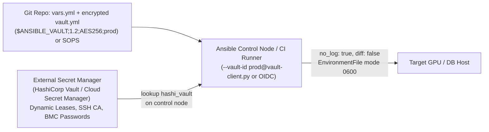

# 4.12 Ansible Vault and secrets management

| | |
|---|---|
| Level | Intermediate |
| Priority tier | 1 |
| Lab venue | ansible-core; optional `vault server -dev` in Docker; `sops` and `age` for the SOPS exercises |
| Part | Part 4: Automation and infrastructure as code |
| Status | Drafted, labs **untested** |

## Why this matters for AI infrastructure

Automation needs the keys to everything: SSH keys and sudo passwords for every node, BMC (Redfish/IPMI) credentials that are root-equivalent over the hardware, registry tokens, cloud service-account keys, database passwords, Slurm and Munge keys, TLS private keys, Hugging Face and API tokens. A leaked automation repository or CI log is a fleet-wide compromise. At the same time, secrets must be available non-interactively to pipelines at 3 a.m. This chapter teaches layered handling: keep secrets out of plaintext Git, encrypt what must live in Git (Ansible Vault, SOPS), fetch dynamic secrets at run time from a secret manager (HashiCorp Vault, cloud managers), prevent leakage through logs and diffs, and rotate when something leaks.

## Prerequisites and outcomes

Needs 4.3 to 4.8 and 4.1 (secrets in Git history). After this chapter you can:

- Encrypt files and individual values with `ansible-vault`, use vault IDs for multiple environments/passwords, edit, rekey, and decrypt safely.
- Structure variables so secrets are discoverable but not exposed (`vault_` prefix pattern), and use them in playbooks with `no_log`.
- Pass vault passwords non-interactively (password files, scripts, client scripts using a secret manager) without weakening security.
- Use HashiCorp Vault, cloud secret managers and SOPS from Ansible and CI; compare approaches.
- Prevent leaks through `--diff`, `-v`, registered variables, templates and shell history; scan for secrets; respond to leaks.
- Design rotation for SSH keys, passwords, tokens and certificates.

## 1. Threat model

| Asset | Where it hides | Typical leak |
|---|---|---|
| SSH private keys, `ansible_password`, sudo passwords | Inventory, group_vars, CI variables | Committed in Git; printed with `-vvv` |
| BMC/IPMI/Redfish credentials | host_vars, role defaults | Shared default passwords; plaintext vars |
| Cloud keys, registry tokens, DB passwords | `.env`, templates, task args | Logs, `--diff`, `debug` output, registered results |
| TLS private keys, Munge/Slurm keys | Files copied by roles | World-readable modes; backups |
| API tokens (Hugging Face, W&B) | Env files, systemd units | `ps` output, unit files readable by all |
| Vault password itself | `.vault_pass` in repo or home | Committed or shared in chat |

Principles: **least privilege** (each pipeline and role gets only needed secrets), **short-lived credentials** where possible (OIDC, dynamic secrets), **encryption at rest** for anything stored, **never in logs**, **auditability** (who read what), and **rotation as a routine** rather than an emergency.

## 2. Ansible Vault

Ansible Vault encrypts files or values with AES-256 (symmetric; the password derives the key via PBKDF2/HMAC). Encrypted content is stored in Git; the password is supplied at run time.

### Files

```bash
ansible-vault create inventories/prod/group_vars/all/vault.yml     # opens $EDITOR on a new encrypted file
ansible-vault encrypt inventories/prod/group_vars/all/vault.yml    # encrypt an existing plaintext file
ansible-vault edit    inventories/prod/group_vars/all/vault.yml
ansible-vault view    inventories/prod/group_vars/all/vault.yml
ansible-vault decrypt inventories/prod/group_vars/all/vault.yml    # avoid; if you do, re-encrypt before commit
ansible-vault rekey   inventories/prod/group_vars/all/vault.yml    # change the password
ansible-playbook site.yml --ask-vault-pass                         # prompt
ansible-playbook site.yml --vault-password-file ~/.vault_pass_prod # file or executable script
```

An encrypted file begins with `$ANSIBLE_VAULT;1.1;AES256` (or `1.2` with a vault ID label) followed by hex ciphertext. Whole-file encryption hides the variable names too, so reviewers cannot see what changed (diffs show opaque blobs).

### The `vault_` indirection pattern

Keep names reviewable by separating **plaintext references** from **encrypted values**:

```yaml
# group_vars/all/vars.yml (plaintext, reviewed in PRs)
db_password: "{{ vault_db_password }}"
registry_token: "{{ vault_registry_token }}"
slurm_munge_key_b64: "{{ vault_munge_key_b64 }}"

# group_vars/all/vault.yml (encrypted)
vault_db_password: "s3cr3t..."
vault_registry_token: "ghp_..."
vault_munge_key_b64: "..."
```

A `grep -r db_password` then shows where the secret is used while the value remains encrypted; `ansible-vault view` shows the vault names. Directory-style `group_vars/all/` (4.5) allows `vars.yml` and `vault.yml` side by side.

### Encrypting single values

```bash
ansible-vault encrypt_string --vault-id prod@prompt 'actual-secret' --name 'vault_db_password'
```

produces an inline `!vault |` block pasted into a vars file; the file stays plaintext and diff-able while the secret value is encrypted. Trade-offs: inline strings are convenient but easy to scatter, harder to rekey (each value must be re-encrypted), and multi-line values need care; many teams prefer one encrypted file per scope.

### Vault IDs: multiple passwords

Use labels to separate environments or roles of access:

```bash
ansible-vault encrypt --vault-id prod@prompt group_vars/prod/vault.yml
ansible-vault encrypt --vault-id dev@~/.vault_pass_dev group_vars/dev/vault.yml
ansible-playbook site.yml --vault-id dev@~/.vault_pass_dev --vault-id prod@prompt
```

Ansible tries the supplied passwords against each vault label. Configure defaults in `ansible.cfg` (`vault_identity_list = dev@~/.vault_pass_dev, prod@~/.vault_pass_prod`). Separate passwords per environment mean a developer with dev access cannot decrypt prod; prod's password is held by fewer people or only by the CI/AAP credential store.

### Providing the vault password without a human

- **Password file** (`--vault-password-file`): simple; protect with `chmod 600`, keep it out of the repository (`.gitignore`), and out of backups and shared drives.
- **Executable script/client script** (any executable file named `*-client` or passed as the password file that prints the password to stdout): fetch the password from your secret manager at run time (macOS Keychain, `pass`, 1Password CLI, AWS/GCP Secret Manager, HashiCorp Vault). This removes the plaintext password from disk. Vault-ID client scripts receive `--vault-id label` and can select per-label passwords.
- **CI/AAP**: store the vault password as a masked CI secret or an AAP "Vault" credential; scope it to protected branches/environments.

Limits and cautions: Vault is **symmetric and static**: everyone with the password can decrypt everything it protects, there is no per-secret access control or audit log, and rotation means re-encrypting. It is excellent for small teams and bootstrap secrets; at scale or for dynamic secrets, combine with a secret manager (section 4).

## 3. Keeping secrets out of output

```yaml
- name: Create database user
  community.postgresql.postgresql_user:
    name: "{{ db_user }}"
    password: "{{ db_password }}"
  no_log: true                       # hide args and results from output, logs and callbacks

- name: Render config containing secrets
  ansible.builtin.template:
    src: app.env.j2
    dest: /etc/fleetapp/app.env
    owner: root
    group: fleetapp
    mode: "0640"
  diff: false                        # do not print the rendered diff
  no_log: true
```

Leak paths to close:

- **`--diff` and `-v/-vvv`** print module arguments and rendered content: set `diff: false` and `no_log: true` on sensitive tasks; avoid running CI at `-vvv`.
- **`register`** on sensitive tasks and later `debug` of the result; also callback plugins that write results to files or services (`log_path`).
- **`command`/`shell` with secrets in arguments** appear in `ps`, shell history, audit logs (`auditd`) and the Ansible task args; pass via files (mode 0600), stdin, or `environment:` (visible in `/proc/PID/environ` to the same user and root).
- **Templates for env files and systemd units**: use `EnvironmentFile=` with mode 0600/0640 and the right owner; avoid `Environment=SECRET=...` in world-readable unit files.
- **Failed task output** in CI logs: `no_log` hides it, which also hinders debugging; temporarily disable only in a controlled session and never in shared logs.
- **Facts caching** (`fact_caching`) can persist secrets that were set as facts: use `cacheable: false` and protect the cache directory.
- **Error messages** from modules sometimes echo arguments: prefer `no_log` over trusting the module.
- **Ansible Vault temp files**: editors may leave swap/backup files (`.swp`, `~`): configure `$EDITOR` and `.gitignore`.
- **Shell history** when using `encrypt_string` with the secret on the command line: use stdin (`--stdin-name`) or prompts.

## 4. External secret managers

### HashiCorp Vault (or OpenBao)

Vault provides authentication (AppRole, JWT/OIDC for CI, Kubernetes, cloud IAM), per-secret ACL policies, audit logs, leases, **dynamic secrets** (short-lived database credentials, cloud tokens, SSH certificates) and encryption as a service.

```yaml
- name: Read a secret at run time
  ansible.builtin.set_fact:
    db_password: "{{ lookup('community.hashi_vault.hashi_vault',
                     'secret=kv/data/prod/fleetapp:db_password',
                     url=vault_url, auth_method='jwt', role_id=..., ) }}"
  no_log: true
  delegate_to: localhost
  run_once: true
```

(Real configuration uses environment variables `VAULT_ADDR`, `VAULT_TOKEN` or the auth-specific parameters; keep tokens out of playbooks.) Considerations: lookups run on the **control node** with the controller's identity; CI authenticates with OIDC so no static token exists; each secret fetch should be least-privilege (policies per pipeline); values you pass into tasks still pass through templates and can leak, so keep `no_log`; for host-side use consider **Vault Agent** or SSH CA to issue short-lived SSH certificates instead of distributing static keys.

### Cloud secret managers

AWS Secrets Manager/SSM Parameter Store (`amazon.aws.aws_secret`, `aws_ssm` lookup), GCP Secret Manager (`google.cloud.gcp_secret_manager` lookup/module), Azure Key Vault (`azure.azcollection`). Authenticate through workload identity (CI OIDC) rather than static keys. Advantages: IAM-based access, audit logs, rotation hooks, regional availability. Pattern: bootstrap a minimal identity, fetch secrets, write them to hosts with strict modes, never persist in logs.

### SOPS (Secrets OPerationS)

SOPS encrypts the **values** in YAML/JSON/ENV/INI files while leaving keys readable, using KMS (AWS/GCP/Azure), age or PGP keys; each file records which recipients can decrypt. It gives reviewable diffs ("`db_password` changed") and per-recipient access control without a shared password.

```yaml
# .sops.yaml
creation_rules:
  - path_regex: inventories/prod/.*secrets\.sops\.yml$
    kms: projects/my-proj/locations/global/keyRings/infra/cryptoKeys/sops
  - path_regex: inventories/lab/.*secrets\.sops\.yml$
    age: age1examplepublickey...
```

```bash
sops inventories/lab/group_vars/all/secrets.sops.yml          # edit in place (decrypts to editor, re-encrypts on save)
sops -d file > /dev/null                                       # verify decryption works
```

Ansible integration: the `community.sops` collection provides a vars plugin (auto-decrypts `*.sops.yml` in `group_vars`), lookup (`community.sops.sops`) and an action to decrypt on the controller. Compared with Ansible Vault: no single shared password, KMS-backed access control and audit trail, partial-file encryption; cost: dependency on KMS/age tooling and a different workflow. SOPS is also the standard for GitOps secrets (Flux integrates natively; Argo CD via plugins), which is why it recurs in Kubernetes automation (4.26).

### Other options

`pass`/`gopass`, 1Password/Bitwarden CLI lookups (`community.general.onepassword`), Kubernetes External Secrets Operator and Sealed Secrets (for cluster secrets), CyberArk/Conjur. Choose one **source of truth** per secret class and avoid copying values between systems.

### Comparison

| | Ansible Vault | SOPS | HashiCorp Vault / cloud manager |
|---|---|---|---|
| Storage | Encrypted in Git | Encrypted in Git (values only) | Central service |
| Access control | Anyone with the password | Per-key/KMS recipients | Fine-grained policies, audit |
| Diffs | Opaque (file) or opaque values | Readable keys | N/A (central) |
| Dynamic/short-lived secrets | No | No | Yes |
| Rotation | Re-encrypt files | Re-encrypt / key rotation | Native leases and rotation |
| Operational weight | Very low | Low to medium | Medium to high |
| Best for | Small teams, bootstrap, labs | Teams wanting Git-stored secrets with real access control; GitOps | Production fleets, dynamic credentials, compliance |

A common production blend: Ansible Vault (or SOPS) holds only the **bootstrap** secrets (the identity needed to reach the secret manager); everything else is fetched at run time.



## 5. SSH keys, sudo and BMC credentials

- **SSH**: prefer SSH certificates from a CA (Vault SSH secrets engine, `step-ca`, Teleport) with short lifetimes over distributing static keys; if using keys, use ed25519, per-user keys, `authorized_key` management via Ansible, passphrases with agent forwarding avoided on bastions, and rotation schedules. Never commit private keys; generate them on the controller or host and distribute only public keys.
- **sudo**: passwordless sudo for the automation account scoped to needed commands (managed by a role validated with `visudo -cf`) beats storing a sudo password; if passwords are required use Vault and `ansible_become_password`.
- **BMC credentials**: Redfish/IPMI users are root-equivalent over the hardware. Use a dedicated automation BMC account with a role limited to needed actions, unique passwords per BMC (rotate with automation; BCM and vendor tools support this), network isolation for the management plane, and fetch credentials from the secret manager at run time (`community.general.redfish_*` modules accept `username`/`password`). Default vendor passwords must be changed at provisioning (Part 7).
- **Munge and Slurm keys, kubeadm tokens, etcd certificates**: generate once, distribute with mode 0400, rotate on schedule; a role should refuse to overwrite an existing key unless forced.
- **Registry and API tokens**: use scoped, read-only, expiring tokens; per-environment tokens; revoke on leak.

## 6. CI/CD integration

- Provide vault passwords or secret-manager identities as **masked, protected** CI secrets scoped to protected branches and environments (4.2); fork PRs get none.
- Prefer OIDC to fetch short-lived credentials at job start; never write secrets to artefacts or caches.
- Run secret scanners (gitleaks, trufflehog, detect-secrets) in pre-commit and CI; enable platform push protection.
- Fail the pipeline if any file matching `vault*`/`*secret*` patterns is plaintext (a `pre-commit` hook can check the `$ANSIBLE_VAULT` header): 

```bash
# pre-commit local hook sketch: ensure vault files are encrypted
for f in $(git ls-files | grep -E '(^|/)vault(\.|_)'); do head -1 "$f" | grep -q '^\$ANSIBLE_VAULT;' || { echo "NOT ENCRYPTED: $f"; exit 1; }; done
```

- Mask secrets in CI logs, restrict who can re-run jobs or read logs, and expire logs.
- Separate duties: the person who can change a playbook should not automatically read the prod vault password; the CI environment protects it.

## 7. Rotation and incident response

**Routine rotation** (design for it from the start):

1. Make every secret replaceable by configuration (no hard-coded values); store a *version* or *created* date beside it.
2. Use overlap: add the new credential, deploy consumers, remove the old (two-phase rotation) to avoid downtime.
3. Automate: playbooks that rotate DB passwords, regenerate SSH host/user certificates, renew TLS certificates (ACME), update BMC passwords across racks, re-encrypt vault files after `rekey`.
4. Record rotations in the change log; alert on credentials approaching expiry.

**When a secret leaks** (Git commit, CI log, chat):

1. Treat as compromised: **revoke/rotate immediately**, before cleaning history.
2. Determine exposure window and use (audit logs, access logs); rotate dependent credentials if the leaked secret could mint others.
3. Remove from current code; purge history only after rotation (4.1: `git filter-repo`); invalidate forks/caches; notify per policy.
4. Add the detection that would have caught it (hook, scanner, policy), and write a short post-incident note.

**Rekeying Ansible Vault**: `ansible-vault rekey` all files with the old password, update password stores and CI secrets, and remove departed members' access by rotating the password (history in Git still contains old ciphertext decryptable with the old password, so also rotate the underlying secrets when someone with access leaves).

## 8. Lab

First, run the self-checking Python lab (`code/part04/ansible_vault_secrets_lab.py`) locally. It verifies `$ANSIBLE_VAULT;1.1;AES256` and `$ANSIBLE_VAULT;1.2;AES256;prod` header parsing and pre-commit plaintext rejection (`parse_ansible_vault_header`), multi-environment Vault ID isolation (`can_decrypt_vault_blob`, `AUR` Ch. 10), and two-phase zero-downtime secret rotation (`TwoPhaseSecretRotator`).

```bash
python3 code/part04/ansible_vault_secrets_lab.py
```

Next, on a control node with `ansible-core` (all interactive shell steps below are `untested here`), work through these exercises:

1. **Vault basics**: create, view, edit, rekey and decrypt an encrypted file; inspect the header; try running a playbook without the password and read the error; commit the encrypted file and examine the Git diff.
2. **Indirection pattern**: restructure variables with `vault_` names; prove `grep` finds usage; run a playbook that uses `db_password` with `no_log`.
3. **Vault IDs**: create `dev` and `prod` vaults with different passwords; show that supplying only the dev password cannot decrypt prod; configure `vault_identity_list`.
4. **Non-interactive passwords**: use a password file (mode 0600, ignored by Git), then a client script that fetches the password from `pass`, Keychain or a Vault KV; remove the plaintext password file.
5. **Leak hunting**: deliberately leak a secret through `--diff`, `-vvv`, `register` + `debug`, `command` args and `Environment=` in a unit; then plug each leak with `no_log`, `diff: false`, file modes and `EnvironmentFile`.
6. **encrypt_string**: create an inline encrypted variable from stdin; compare diff readability and rekey effort with whole-file encryption.
7. **SOPS + age**: install sops/age; encrypt a vars file; configure `community.sops`; use it in a playbook; add a second recipient; show per-recipient access and readable diffs.
8. **HashiCorp Vault**: run `vault server -dev` in Docker; store a KV secret; read it with the `hashi_vault` lookup via a token, then via AppRole; restrict a policy and confirm denial.
9. **Dynamic secret (optional)**: configure the database secrets engine and have Ansible fetch short-lived DB credentials for a deployment.
10. **CI guard**: add gitleaks plus the "vault file must be encrypted" hook to pre-commit/CI; try to commit an unencrypted vault file and a fake token.
11. **Rotation drill**: rotate a DB password and an SSH key using two-phase overlap with zero downtime; record steps and verification.
12. **Leak drill**: simulate a committed token: revoke, rotate, purge history (4.1), verify with `git log -S`, and write the five-line incident note.
13. **Clean up.**

## 9. Common mistakes

- Vault password committed or stored beside the vault file; shared in chat; one password for every environment.
- Encrypting a file and then leaking its contents through `-v`, `--diff`, `debug` or `register`.
- Putting secrets in CLI arguments or `Environment=` lines readable by other users.
- Treating Ansible Vault as access control or audit (it is neither).
- Never rotating; rotating without overlap and causing outages; leaving former employees' access in place.
- Long-lived cloud keys in CI instead of OIDC.
- Copying secrets between systems until the source of truth is unclear.
- Cleaning Git history without revoking first.
- Using default or shared BMC/IPMI passwords across the fleet.
- Disabling `no_log` permanently to debug and forgetting to restore it.

## 10. Interview angles

- "How do you manage secrets in Ansible? Ansible Vault vs HashiCorp Vault vs SOPS."
- "How do you use vault IDs and non-interactive vault passwords in CI?"
- "How do you prevent secrets from showing up in logs and diffs?" (`no_log`, `diff: false`, modes, EnvironmentFile.)
- "A token was committed. What do you do?" (revoke, rotate, assess, purge, prevent.)
- "How do you manage BMC credentials for 1,000 servers?" (unique per device, secret manager, dedicated accounts, isolation, rotation.)
- "How do you give CI cloud access without static keys?" (OIDC.)
- "What are dynamic secrets and why do they matter?"
- "How do you rotate a credential without downtime?" (overlap.)

## Exercises

1. **Ansible Vault Mechanics (`create`, `encrypt`, `view`, `edit`, `rekey`, `encrypt_string`), Header Format, and the `vault_` Indirection Pattern (`AUR` Chapter 10):** Using `parse_ansible_vault_header()` in `code/part04/ansible_vault_secrets.py`, explain: (a) how AES-256 encryption works in Ansible Vault and the difference between `$ANSIBLE_VAULT;1.1;AES256` and `$ANSIBLE_VAULT;1.2;AES256;prod`; (b) why separating `group_vars/all/vars.yml` (`db_password: "{{ vault_db_password }}"`) from encrypted `group_vars/all/vault.yml` beats whole-file encryption without indirection or scattered `encrypt_string` blocks.
2. **Multi-Environment Vault IDs (`--vault-id`, `vault_identity_list`) and Non-Interactive Client Scripts (`AUR` Chapter 10):** Using `can_decrypt_vault_blob()` in `code/part04/ansible_vault_secrets.py`, show how `vault_identity_list = dev@~/.vault_pass_dev, prod@~/.vault_pass_prod` isolates `dev` and `prod` secrets, and explain how an executable `*-client` password script fetches the vault password dynamically from a secret manager or OS keychain so no plaintext `.vault_pass` sits on disk.
3. **Preventing Secret Leakage Across Nine Execution Paths (`no_log`, `diff: false`, `EnvironmentFile`, `cacheable: false`):** Trace the nine leak paths in Section 3 (`--diff`, `-vvv`, `register` + `debug`, CLI args in `ps`/`auditd`, `Environment=` in world-readable systemd units, fact caches, editor `.swp` files, and shell history on `encrypt_string`) and specify the exact Ansible control that closes each leak.
4. **Comparing Ansible Vault, SOPS (`community.sops` with KMS/`age`), and HashiCorp Vault / Cloud Secret Managers:** Compare all three across storage model, access control, Git diff readability, dynamic/short-lived secrets, rotation, and operational weight, and explain how CI uses OIDC/JWT to authenticate to HashiCorp Vault (`community.hashi_vault.hashi_vault`) without static tokens.
5. **Managing High-Privilege Fleet Credentials (SSH CA Certificates, Sudo, Redfish BMCs, and Munge/Slurm Keys):** Explain how to manage (a) SSH access using short-lived SSH CA certificates instead of static private keys, (b) unique per-BMC Redfish credentials fetched at runtime, and (c) cluster-wide shared keys (`/etc/munge/munge.key`, `mode: "0400"`) without overwriting active keys accidentally.
6. **Two-Phase Zero-Downtime Rotation (`TwoPhaseSecretRotator`), Pre-Commit Vault Guards, and Secret Leak Incident Response:** Using `TwoPhaseSecretRotator` in `code/part04/ansible_vault_secrets.py`, explain why single-step password replacement causes outages and how two-phase overlap (Expand -> Roll consumers -> Contract) avoids downtime; then state why `ansible-vault rekey` alone is insufficient when an engineer with the old vault password leaves the team.

## Checkpoint questions (20)

<details>
<summary>1. What cipher and key derivation does Ansible Vault use, and what is the header format of an encrypted Vault file (`AUR` Chapter 10)?</summary>

Ansible Vault uses **symmetric AES-256 encryption** (`AES256`), deriving the encryption and HMAC-SHA256 keys from the user's vault password via PBKDF2. Every encrypted file or inline `!vault |` block starts with the ASCII header **`$ANSIBLE_VAULT;1.1;AES256`** (or **`$ANSIBLE_VAULT;1.2;AES256;<vault-id>`** when encrypted with a named `--vault-id` label), followed by hex-encoded ciphertext lines.
</details>

<details>
<summary>2. Compare the six main `ansible-vault` subcommands (`create`, `encrypt`, `view`, `edit`, `rekey`, `decrypt`) and `encrypt_string` (`AUR` Chapter 10 Table 10-5).</summary>

- **`ansible-vault create file.yml`**: opens `$EDITOR` to author a new file and saves it encrypted on disk.
- **`ansible-vault encrypt file.yml`**: encrypts an existing plaintext file in place.
- **`ansible-vault view file.yml`**: decrypts to stdout/pager without touching the encrypted file on disk.
- **`ansible-vault edit file.yml`**: decrypts to a temporary file in `$EDITOR` and re-encrypts on save.
- **`ansible-vault rekey file.yml`**: changes the vault password on an encrypted file.
- **`ansible-vault decrypt file.yml`**: writes plaintext back to disk (avoid in Git working trees; prefer `view` or `edit`).
- **`ansible-vault encrypt_string --stdin-name 'vault_db_password'`**: reads a single secret from `stdin` (keeping it out of shell history) and outputs an inline `!vault |` YAML block.
</details>

<details>
<summary>3. What is the `vault_` indirection pattern (`group_vars/all/vars.yml` + `group_vars/all/vault.yml`), and why do teams use it?</summary>

When an entire `vault.yml` file is encrypted, its variable names are hidden inside the hex blob—so `git diff` and `grep -rn db_password` cannot see which secrets exist or changed. Under the **`vault_` indirection pattern**, `group_vars/all/` is a directory containing:
1. **`vars.yml` (plaintext):** `db_password: "{{ vault_db_password }}"`
2. **`vault.yml` (encrypted):** `vault_db_password: "s3cr3t..."`
This keeps variable names 100% greppable and reviewable in pull requests while keeping secret values encrypted at rest.
</details>

<details>
<summary>4. How do Vault IDs (`--vault-id` and `vault_identity_list`) isolate `dev` and `prod` secrets in the same repository (`AUR` Chapter 10)?</summary>

By encrypting `group_vars/dev/vault.yml` with `--vault-id dev@~/.vault_dev` and `group_vars/prod/vault.yml` with `--vault-id prod@~/.vault_prod` (and setting `vault_identity_list = dev@~/.vault_dev, prod@~/.vault_prod` in `ansible.cfg`), each file header records its label (`$ANSIBLE_VAULT;1.2;AES256;prod`). Developers can be given only the `dev` vault password to run staging/dev playbooks, while the `prod` vault password is held exclusively by the production CI environment / AWX credential store.
</details>

<details>
<summary>5. How can you supply a Vault password non-interactively without storing a plaintext `.vault_pass` file on disk?</summary>

If the path passed to `--vault-password-file` (or configured in `vault_identity_list`) has the **executable bit set (`chmod +x`)**, Ansible executes it as a script and reads the vault password from its **`stdout`**. A 5-line executable **vault client script** (`vault-pass-client.py`, which receives `--vault-id <label>` if named `*-client`) can fetch the password on demand from macOS Keychain, `pass`, 1Password CLI, or cloud/HashiCorp Vault using your current SSO/OIDC session.
</details>

<details>
<summary>6. Why must tasks that handle secrets set BOTH `no_log: true` AND `diff: false`?</summary>

- **`no_log: true`** masks the task's input arguments and return dictionary (` Censored: 'the output has been hidden due to the fact that no_log: true was specified'`) in stdout, `-vvv` output, callback plugins (`log_path`), and target `/var/log/syslog`.
- **`diff: false`** prevents `ansible-playbook --diff` (`-D`) from printing the before/after unified diff of rendered files (`template`, `copy`, `lineinfile`), which would otherwise print plaintext passwords in CI pull-request comments.
</details>

<details>
<summary>7. Why should secrets never be passed via `command`/`shell` arguments or `Environment=SECRET=...` in systemd unit files?</summary>

- **Command-line arguments** are world-readable to every unprivileged user and container on the host via **`/proc/<pid>/cmdline` (`ps aux`)** and are recorded permanently in `auditd` / syslog exec logs.
- **`Environment=SECRET=...` inside `/etc/systemd/system/app.service`:** Systemd unit files are typically mode `0644` (world-readable) and visible via `systemctl show`. Instead, render secrets into a dedicated **`EnvironmentFile=/opt/fleetapp/shared/fleetapp.env`** with **`owner: root`**, **`group: fleetapp`**, and **`mode: "0600"`** (or `"0640"`).
</details>

<details>
<summary>8. How can Ansible Fact Caching (`fact_caching = jsonfile` or `redis`) accidentally leak secrets, and how do you prevent it?</summary>

If a playbook fetches a secret and stores it with `set_fact: { db_password: "..." }`, verify that **`cacheable: false`** (the default) is kept so the secret is only held in memory for the current run and never written to `.ansible_facts/` JSON files on disk—and ensure any fact cache directory is `0700` and excluded in `.gitignore`.
</details>

<details>
<summary>9. Compare Ansible Vault, Mozilla SOPS (`community.sops`), and HashiCorp Vault / Cloud Secret Managers.</summary>

- **Ansible Vault:** Encrypts whole files or inline strings with a shared symmetric password; zero external infrastructure, ideal for small teams and bootstrap secrets, but has no per-secret audit trail, no dynamic secrets, and opaque whole-file diffs.
- **SOPS (`community.sops`):** Encrypts **only the values** in YAML/JSON/ENV files while leaving keys in cleartext (so `git diff` shows exact keys modified), and encrypts the data key for multiple **AWS/GCP/Azure KMS keys, `age` keys, or PGP keys**—giving per-recipient IAM access control and KMS audit logs without running a Vault server.
- **HashiCorp Vault / Cloud Secret Managers:** Centralized API services providing fine-grained RBAC/IAM policies, full audit logs, automatic rotation, and **dynamic short-lived credentials** (database leases, SSH CA certs, cloud STS tokens).
</details>

<details>
<summary>10. Where does `lookup('community.hashi_vault.hashi_vault', ...)` execute, and how should CI authenticate to HashiCorp Vault?</summary>

Like all Ansible lookups, `hashi_vault` executes **on the Ansible control node** (the CI runner or AWX execution node). In CI, never store a static root/long-lived `VAULT_TOKEN`; instead, configure **JWT/OIDC authentication** on HashiCorp Vault (or Cloud IAM Workload Identity) so the CI job exchanges its short-lived OIDC token for a narrowly scoped, short-TTL Vault token at job startup.
</details>

<details>
<summary>11. Why are SSH Certificate Authorities (`Vault SSH CA`, `step-ca`, `Teleport`) superior to static SSH public keys for managing 1,000 GPU nodes?</summary>

With static SSH keys, onboarding/offboarding an engineer or rotating a compromised automation key requires running Ansible across all 1,000 nodes to update `~/.ssh/authorized_keys` (and nodes offline for maintenance miss the revocation). With an **SSH CA**, each node's `/etc/ssh/sshd_config` trusts a single `TrustedUserCAKeys /etc/ssh/ca.pub` file once at image build time, and the control node / engineer exchanges their OIDC identity for a **short-lived SSH certificate (e.g., valid for 15 minutes)** that expires automatically with zero host-side key churn.
</details>

<details>
<summary>12. How should BMC (`Redfish` / `IPMI`) credentials be managed across a large GPU cluster?</summary>

Because BMC credentials grant full out-of-band hardware control (power off, virtual media boot, BIOS/firmware flash):
1. Change factory default passwords immediately during initial zero-touch provisioning.
2. Create a dedicated automation BMC account with least-privilege operator roles rather than sharing `root`/`ADMIN`.
3. Generate **unique passwords per BMC** (or per rack/security zone) stored in HashiCorp Vault / Secret Manager and fetched at runtime into `community.general.redfish_*` tasks with `no_log: true`.
4. Isolate BMC interfaces strictly on an out-of-band management VLAN unreachable from tenant compute networks.
</details>

<details>
<summary>13. How should a role generate and distribute a shared cluster key such as `/etc/munge/munge.key` for Slurm?</summary>

Generate the random key **once** (either stored in Vault/Secret Manager or generated on the Slurm controller with `creates: /etc/munge/munge.key`), and distribute it to compute nodes with `owner: munge`, `group: munge`, **`mode: "0400"`**, `no_log: true`, and `diff: false`—ensuring that a normal playbook run never regenerates and overwrites the active key on running compute nodes unless an explicit rotation play is invoked.
</details>

<details>
<summary>14. How do you write a `pre-commit` / CI guard that blocks accidentally committing an unencrypted `vault.yml` file?</summary>

Someone who runs `ansible-vault decrypt group_vars/prod/vault.yml` instead of `ansible-vault edit` can easily forget to re-encrypt before `git commit`. Add a pre-commit hook and required CI check that inspects line 1 of every tracked file matching `vault*.yml` or `*secret*.yml`:
```bash
for f in $(git ls-files | grep -E '(^|/)vault(\.|_)'); do
  head -n 1 "$f" | grep -q '^\$ANSIBLE_VAULT;' || { echo "UNENCRYPTED: $f"; exit 1; }
done
```
Complement this with `gitleaks` or `trufflehog` scanning all diffs for high-entropy strings and known token prefixes.
</details>

<details>
<summary>15. Walk through the Two-Phase (Overlap) Credential Rotation pattern for zero-downtime password or key updates.</summary>

If you change a database password or API key on the server and then run Ansible across 50 app nodes to update their `fleetapp.env`, every app node fails authentication during the minutes between the DB change and its local restart. **Two-phase rotation** eliminates downtime:
1. **Phase 1 (Expand):** Create a second valid credential (`user_v2` or secondary API key/cert) on the provider so **both `v1` and `v2` are valid simultaneously**.
2. **Phase 2 (Roll consumers):** Run the Ansible rolling update (`serial`) switching all consumers to `v2` and verifying health.
3. **Phase 3 (Contract):** Once 100% of consumers are verified on `v2` and connection logs show zero `v1` usage, revoke/drop `v1` on the provider.
</details>

<details>
<summary>16. Why is running `ansible-vault rekey` NOT enough when an engineer who knew the production Vault password leaves the organization?</summary>

`ansible-vault rekey` re-encrypts the file in the *new* commit with a new password—**but every previous commit in Git history still contains the old ciphertext encrypted with the old password**. Anyone who retained a copy of the repo (or reads Git history) and knows the old vault password can still decrypt every historical secret in `vault.yml`. Therefore, when rekeying after a departure or password compromise, you **must also rotate the underlying secrets themselves** (DB passwords, tokens, keys) in the target systems.
</details>

<details>
<summary>17. What is the exact 4-step incident-response sequence when a secret leaks in a Git commit or CI build log?</summary>

1. **Revoke and rotate the credential immediately** in the target system (IAM, DB, BMC, registry) before doing anything else.
2. **Audit access logs** across the exposure window to determine if the credential was used and rotate any downstream secrets it could have read.
3. **Remove from current code and purge history** (`git filter-repo` for Git commits; delete the CI build log and expire cached artifacts).
4. **Add automated prevention** (`no_log: true`, `diff: false`, `gitleaks` / `$ANSIBLE_VAULT` header hook) so the same leak vector cannot recur.
</details>

<details>
<summary>18. How do you debug a failing task that has `no_log: true` set without leaking secrets into shared CI logs?</summary>

Never commit `no_log: false` to Git to debug a failure in CI. Instead, reproduce the task locally against a staging/lab host (or in an interactive SSH session using `--limit <host>` and `ANSIBLE_ENABLE_TASK_DEBUGGER=True` or a temporary local `no_log: "{{ not debug_local | default(false) }}"` override outside CI) where stdout is only visible on your own terminal, fix the underlying module error, and verify `no_log: true` is active before committing.
</details>

<details>
<summary>19. How does `.sops.yaml` (`creation_rules`) enforce that production secrets use production KMS keys while lab secrets use developer `age` keys?</summary>

When you run `sops inventories/prod/group_vars/all/secrets.sops.yml`, SOPS matches the file path against **`creation_rules` in `.sops.yaml`** (`path_regex: inventories/prod/.*secrets\.sops\.yml$`) and automatically encrypts the file using the specified cloud KMS key (`projects/my-proj/.../cryptoKeys/sops`), whereas files matching `inventories/lab/.*` are encrypted with the lab `age` public keys—preventing a developer from accidentally encrypting production secrets with a dev key.
</details>

<details>
<summary>20. What is the "Bootstrap Secret" pattern combining Ansible Vault/SOPS with an external Secret Manager?</summary>

Instead of storing 200 individual service passwords, BMC credentials, and API tokens inside Git-tracked `vault.yml` files (which require Git commits and PR merges every time a password rotates), store **only the bootstrap configuration** in Git (or use passwordless CI OIDC) and fetch all operational credentials dynamically at runtime from HashiCorp Vault or AWS/GCP Secret Manager—combining GitOps auditability for code with centralized rotation, leases, and access logs for secrets.
</details>

## Sources and review notes

- **Sources read in full:**
  - `ansible-up-and-running-3rd-edition` — Bas Meijer, Lorin Hochstein & René Moser, *Ansible: Up and Running*, 3rd ed., **Chapter 10: Making Playbooks Appear More Complex — Encrypting Sensitive Data with `ansible-vault`** (read in full: `ansible-vault` commands `encrypt`/`decrypt`/`view`/`edit`/`rekey`/`create`, `$ANSIBLE_VAULT;1.1;AES256` format, `no_log: true`, `--ask-vault-pass`, `--vault-password-file` with `chmod 0600` or executable script, and `vault_identity_list = dev@~/.vault_dev, prod@~/.vault_prod`) and **Chapter 22: CI/CD and Ansible** (`vaultCredentialsId: 'ANSIBLE_VAULT_PASSWORD'` in Jenkins and Ansible Automation Controller credential stores).
  - `nvidia-devops` (`volume-10/11-cicd-for-infrastructure-and-cluster-configuration.md`): secrets management in infrastructure pipelines, HashiCorp Vault, SOPS, and BMC credential hygiene.
- **Run here:** `python3 code/part04/ansible_vault_secrets_lab.py` (3 passed, 0 failed).
- **Explicitly labelled inferences:** The `parse_ansible_vault_header`, `can_decrypt_vault_blob`, and `TwoPhaseSecretRotator` models in `code/part04/ansible_vault_secrets.py`, the `vault_` indirection pattern, and the `.sops.yaml` and pre-commit vault-header check are the author's constructions applying *Ansible: Up and Running* Chapter 10 and `volume-10` to GPU cluster secrets management (plus original study items 21, 22, 23, 24, 25, 26, 27, 28, 29, and 30).
- **Not verified on live hardware:** Live `ansible-vault`, `sops`, `age`, and HashiCorp `vault server -dev` commands (`AES-256`, `1.1`, `1.2`, `0600`, `0640`, `0400`, `3 a.m.`, `1,000` servers) are marked (`untested here`) where not executed by `ansible_vault_secrets_lab.py`.
