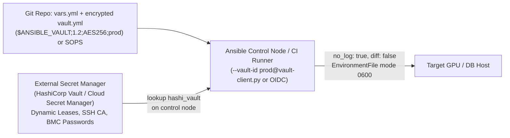

# 4.12 Ansible Vault and secrets management

| | |
|---|---|
| Level | Intermediate |
| Priority tier | 1 |
| Lab venue | ansible-core; optional `vault server -dev` in Docker; `sops` and `age` for the SOPS exercises |
| Part | Part 4: Automation and infrastructure as code |
| Status | Drafted, labs **untested** |

## Why this matters for AI infrastructure

Think about what your automation can reach. Automation needs the keys to everything. That means SSH keys and sudo passwords for every node, and BMC credentials for Redfish/IPMI, which are root-equivalent over the hardware. It also needs registry tokens, cloud service-account keys, database passwords, Slurm and Munge keys, TLS private keys, and Hugging Face and API tokens.

A leaked automation repository or CI log is therefore a fleet-wide compromise. At the same time, pipelines must get these secrets without a person typing a password, and sometimes at 3 a.m. That tension is what this chapter works through.

This chapter teaches layered handling. Keep secrets out of plaintext Git. Encrypt what must live in Git, using Ansible Vault or SOPS. Fetch dynamic secrets at run time from HashiCorp Vault or a cloud secret manager. Prevent leakage through logs and diffs. Rotate when something leaks.

## Prerequisites and outcomes

This chapter builds on sections 4.3 to 4.8, and on section 4.1, which covers secrets in Git history. Finish those first. Here is what the chapter equips you to do:

- You can encrypt files and single values with `ansible-vault`, use vault IDs for several environments or passwords, and edit, rekey and decrypt files safely.
- You can structure variables with the `vault_` prefix pattern, so secrets stay discoverable but not exposed, and use them in playbooks with `no_log`.
- You can pass vault passwords non-interactively, through password files, scripts or client scripts that call a secret manager, without weakening security.
- You can use HashiCorp Vault, cloud secret managers and SOPS from Ansible and CI, and compare the approaches.
- You can prevent leaks through `--diff`, `-v`, registered variables, templates and shell history, scan for secrets, and respond to leaks.
- You can design rotation for SSH keys, passwords, tokens and certificates.

## 1. Threat model

Start by mapping where each secret hides, and how it usually leaks. The table below shows the common cases.

| Asset | Where it hides | Typical leak |
|---|---|---|
| SSH private keys, `ansible_password`, sudo passwords | Inventory, group_vars, CI variables | Committed in Git; printed with `-vvv` |
| BMC/IPMI/Redfish credentials | host_vars, role defaults | Shared default passwords; plaintext vars |
| Cloud keys, registry tokens, DB passwords | `.env`, templates, task args | Logs, `--diff`, `debug` output, registered results |
| TLS private keys, Munge/Slurm keys | Files copied by roles | World-readable modes; backups |
| API tokens (Hugging Face, W&B) | Env files, systemd units | `ps` output, unit files readable by all |
| Vault password itself | `.vault_pass` in repo or home | Committed or shared in chat |

Each row is a secret in a common place that leaks through a common mistake. The rest of this chapter addresses those mistakes one tool at a time.

Six principles keep this under control. Give each pipeline and role only the secrets it needs. That is **least privilege**. Use short-lived credentials where possible, such as OIDC or dynamic secrets. Encrypt anything you store at rest. Never let a secret reach logs. Keep the record auditable, so you can see who read what. Finally, treat rotation as a routine, not an emergency.

## 2. Ansible Vault

Picture a file of database passwords that you want to keep in Git. Ansible Vault encrypts that file, so the stored ciphertext is safe to commit. It uses AES-256 in symmetric mode, which means one password both locks and unlocks the content. That password is turned into the key through PBKDF2/HMAC. Git keeps only the encrypted content, and you supply the password when you run.

### Files

You will mostly use a few `ansible-vault` subcommands on a single file. The block below shows each one, and the comments explain what it does.

```bash
ansible-vault create inventories/prod/group_vars/all/vault.yml     # opens $EDITOR on a new encrypted file
ansible-vault encrypt inventories/prod/group_vars/all/vault.yml    # encrypt an existing plaintext file
ansible-vault edit    inventories/prod/group_vars/all/vault.yml
ansible-vault view    inventories/prod/group_vars/all/vault.yml
ansible-vault decrypt inventories/prod/group_vars/all/vault.yml    # avoid; if you do, re-encrypt before commit
ansible-vault rekey   inventories/prod/group_vars/all/vault.yml    # change the password
ansible-playbook site.yml --ask-vault-pass                         # prompt
ansible-playbook site.yml --vault-password-file ~/.vault_pass_prod # file or executable script
```

An encrypted file starts with the header `$ANSIBLE_VAULT;1.1;AES256`, and the rest is hex ciphertext. With a vault ID label, the version becomes `1.2`. Whole-file encryption also hides the variable names, so reviewers see only opaque blobs in a diff. They cannot tell what changed.

### The `vault_` indirection pattern

The trick is to separate plaintext references from encrypted values. Reviewers can read the plaintext file in a pull request, while the real secrets stay encrypted in another file.

```yaml
# group_vars/all/vars.yml (plaintext, reviewed in PRs)
db_password: "{{ vault_db_password }}"
registry_token: "{{ vault_registry_token }}"
slurm_munge_key_b64: "{{ vault_munge_key_b64 }}"

# group_vars/all/vault.yml (encrypted)
vault_db_password: "s3cr3t..."
vault_registry_token: "ghp_..."
vault_munge_key_b64: "..."
```

Now `grep -r db_password` shows where the secret is used, and the value itself stays encrypted. Running `ansible-vault view` shows the vault names. The `group_vars/all/` directory layout, covered in 4.5, lets `vars.yml` and `vault.yml` sit side by side.

### Encrypting single values

Sometimes a file holds one secret among many plain values. `encrypt_string` encrypts just that value, so the rest of the file stays readable.

```bash
ansible-vault encrypt_string --vault-id prod@prompt 'actual-secret' --name 'vault_db_password'
```

The command produces an inline `!vault |` block. You paste that block into a vars file. The file stays plaintext and diff-able, and only the secret value is encrypted. Inline strings are convenient, but they are easy to scatter around. They are also harder to rekey, because each value must be re-encrypted on its own. Multi-line values need care too. Many teams prefer one encrypted file per scope.

### Vault IDs: multiple passwords

One repository can hold several vault passwords if each one has a label. A label can separate environments, or separate roles of access.

```bash
ansible-vault encrypt --vault-id prod@prompt group_vars/prod/vault.yml
ansible-vault encrypt --vault-id dev@~/.vault_pass_dev group_vars/dev/vault.yml
ansible-playbook site.yml --vault-id dev@~/.vault_pass_dev --vault-id prod@prompt
```

Ansible tries the supplied passwords against each vault label. You can set defaults in `ansible.cfg` with `vault_identity_list = dev@~/.vault_pass_dev, prod@~/.vault_pass_prod`. Separate passwords per environment mean a developer with dev access cannot decrypt prod. The prod password stays with fewer people, or only with the CI/AAP credential store.

### Providing the vault password without a human

Pipelines cannot type a password, so the vault password has to come from somewhere else. There are three common options.

- A password file, passed with `--vault-password-file`, is the simplest. Protect it with `chmod 600`, keep it out of the repository through `.gitignore`, and keep it out of backups and shared drives.
- An executable client script is any executable file named `*-client`, or any executable passed as the password file. It prints the password to stdout. It fetches the password from your secret manager at run time, such as macOS Keychain, `pass`, 1Password CLI, AWS/GCP Secret Manager or HashiCorp Vault. This removes the plaintext password from disk. A vault ID client script receives `--vault-id label` and can select a password for each label.
- In CI or AAP, store the vault password as a masked CI secret, or as an AAP "Vault" credential. Scope it to protected branches or environments.

Ansible Vault has real limits. It is symmetric and static, so everyone with the password can decrypt everything it protects. It has no per-secret access control and no audit log, and rotating it means re-encrypting. It suits small teams and bootstrap secrets well. At scale, or for dynamic secrets, combine it with a secret manager, as section 4 describes.

## 3. Keeping secrets out of output

A secret can leak through a task's own output, so you have to control what Ansible prints. Two settings do most of that work. The YAML below shows both.

```yaml
- name: Create database user
  community.postgresql.postgresql_user:
    name: "{{ db_user }}"
    password: "{{ db_password }}"
  no_log: true                       # hide args and results from output, logs and callbacks

- name: Render config containing secrets
  ansible.builtin.template:
    src: app.env.j2
    dest: /etc/fleetapp/app.env
    owner: root
    group: fleetapp
    mode: "0640"
  diff: false                        # do not print the rendered diff
  no_log: true
```

`no_log: true` hides a task's arguments and results from output, logs and callbacks. `diff: false` stops the rendered diff from printing. Those two settings close the most obvious leaks. The others come from places you might not expect.

The `--diff` flag and the `-v/-vvv` options print module arguments and rendered content. Set `diff: false` and `no_log: true` on sensitive tasks, and avoid running CI at `-vvv`. Results can leak too. A `register` on a sensitive task, followed by a later `debug` of that result, prints the secret. Callback plugins that write results to files or services can leak it as well, through `log_path`.

Secrets in `command` or `shell` arguments can leak in several ways. They appear in `ps`, in shell history, in audit logs such as `auditd`, and in the Ansible task arguments. Pass them through a file with mode 0600, through stdin, or through `environment:`. Beware: `environment:` values are visible in `/proc/PID/environ` to the same user and to root.

Env files and systemd units need the same care. Use `EnvironmentFile=` with mode 0600 or 0640, and the right owner. Avoid `Environment=SECRET=...` in world-readable unit files.

A failed task can print secrets into CI logs. `no_log` hides that output, but it also makes debugging harder. Disable it only in a controlled session, and never where logs are shared. Fact caching is another path, because `fact_caching` can persist secrets that were set as facts. Use `cacheable: false` and protect the cache directory. Module errors can echo arguments too, so prefer `no_log` over trusting the module.

Editors may leave swap and backup files behind, such as `.swp` or `~`. Configure `$EDITOR` and `.gitignore` to handle them. Shell history is the last path. If you run `encrypt_string` with the secret on the command line, the secret lands in history. Use stdin with `--stdin-name`, or a prompt, instead.

Treat `no_log: true` and `diff: false` as the default for any task that handles a secret.

## 4. External secret managers

### HashiCorp Vault (or OpenBao)

Start with what HashiCorp Vault adds. It handles authentication through AppRole, JWT or OIDC for CI, Kubernetes, and cloud IAM. Each secret gets its own ACL policy, and the service keeps audit logs. It also issues leases and dynamic secrets, such as short-lived database credentials, cloud tokens and SSH certificates. It offers encryption as a service too.

```yaml
- name: Read a secret at run time
  ansible.builtin.set_fact:
    db_password: "{{ lookup('community.hashi_vault.hashi_vault',
                     'secret=kv/data/prod/fleetapp:db_password',
                     url=vault_url, auth_method='jwt', role_id=..., ) }}"
  no_log: true
  delegate_to: localhost
  run_once: true
```

A real setup reads `VAULT_ADDR` and `VAULT_TOKEN` from environment variables, or it uses the auth-specific parameters instead. Keep tokens out of playbooks.

Several points matter here. The lookup runs on the **control node**, so it uses the controller's identity. CI authenticates with OIDC, so no static token exists. Each secret fetch should be least-privilege, with policies per pipeline. Values you pass into tasks can still leak through templates, so keep `no_log`. For host-side access, consider Vault Agent, or an SSH CA that issues short-lived SSH certificates instead of distributing static keys.

### Cloud secret managers

AWS Secrets Manager and SSM Parameter Store are reached through `amazon.aws.aws_secret` and the `aws_ssm` lookup. GCP Secret Manager uses `google.cloud.gcp_secret_manager`, as a lookup or a module. Azure Key Vault comes through `azure.azcollection`. Authenticate with workload identity, such as CI OIDC, rather than static keys. The advantages are IAM-based access, audit logs, rotation hooks and regional availability. The usual pattern is to bootstrap a minimal identity, fetch the secrets, write them to hosts with strict modes, and never persist them in logs.

### SOPS (Secrets OPerationS)

SOPS encrypts the values in YAML, JSON, ENV and INI files, and leaves the keys readable. It uses KMS keys from AWS, GCP or Azure, age keys, or PGP keys. Each file records which recipients can decrypt it. The result gives you diffs a reviewer can read, such as "`db_password` changed", and per-recipient access without a shared password.

Here is a sample `.sops.yaml`. Its `creation_rules` decide which key each file uses, based on its path.

```yaml
# .sops.yaml
creation_rules:
  - path_regex: inventories/prod/.*secrets\.sops\.yml$
    kms: projects/my-proj/locations/global/keyRings/infra/cryptoKeys/sops
  - path_regex: inventories/lab/.*secrets\.sops\.yml$
    age: age1examplepublickey...
```

The two commands below edit a file in place, and check that decryption works.

```bash
sops inventories/lab/group_vars/all/secrets.sops.yml          # edit in place (decrypts to editor, re-encrypts on save)
sops -d file > /dev/null                                       # verify decryption works
```

In Ansible, the `community.sops` collection does the rest. Its vars plugin decrypts `*.sops.yml` files in `group_vars` automatically. Its lookup, `community.sops.sops`, is available, and its action decrypts on the controller. Compared with Ansible Vault, SOPS has no single shared password. It adds KMS-backed access control and an audit trail, and it supports partial-file encryption. The cost is a dependency on KMS or age tooling, and a different workflow. SOPS is also the standard for GitOps secrets. Flux integrates it natively, and Argo CD supports it through plugins. That is why it keeps coming up in Kubernetes automation, covered in 4.26.

### Other options

Other tools fill the same role. These include `pass` and `gopass`, 1Password and Bitwarden CLI lookups such as `community.general.onepassword`, Kubernetes External Secrets Operator and Sealed Secrets for cluster secrets, and CyberArk or Conjur. Whichever you choose, pick one **source of truth** for each class of secret. Avoid copying values between systems.

### Comparison

Use the table below to compare the three main options side by side.

| | Ansible Vault | SOPS | HashiCorp Vault / cloud manager |
|---|---|---|---|
| Storage | Encrypted in Git | Encrypted in Git (values only) | Central service |
| Access control | Anyone with the password | Per-key/KMS recipients | Fine-grained policies, audit |
| Diffs | Opaque (file) or opaque values | Readable keys | N/A (central) |
| Dynamic/short-lived secrets | No | No | Yes |
| Rotation | Re-encrypt files | Re-encrypt / key rotation | Native leases and rotation |
| Operational weight | Very low | Low to medium | Medium to high |
| Best for | Small teams, bootstrap, labs | Teams wanting Git-stored secrets with real access control; GitOps | Production fleets, dynamic credentials, compliance |

Ansible Vault has the lowest operational weight, but it offers no dynamic secrets. HashiCorp Vault and cloud managers cost more to run, and they bring fine-grained policies, audit and dynamic credentials. Many production teams combine these. Ansible Vault or SOPS holds only the **bootstrap** secrets, which is the identity needed to reach the secret manager. Everything else is fetched at run time.



If you need short-lived secrets, only a central manager from this table can issue them.

## 5. SSH keys, sudo and BMC credentials

Each kind of access on a fleet needs its own answer. The points below cover SSH, sudo, BMC credentials, shared keys and tokens.

- For SSH, prefer certificates from a CA with short lifetimes, such as the Vault SSH secrets engine, `step-ca` or Teleport, over distributing static keys. If you use keys, choose ed25519 and per-user keys, manage `authorized_key` entries with Ansible, protect keys with passphrases, and avoid agent forwarding on bastions. Set rotation schedules too. Never commit private keys. Generate them on the controller or host, and distribute only the public keys.
- For sudo, passwordless sudo for the automation account, limited to the commands it needs, beats storing a sudo password. Manage that rule with a role validated by `visudo -cf`. If you must use passwords, keep them in Vault and set `ansible_become_password`.
- Redfish and IPMI users are root-equivalent over the hardware, so BMC credentials need care. Create a dedicated automation BMC account, with a role limited to the actions it needs. Give each BMC a unique password, and rotate it with automation, which BCM and vendor tools support. Isolate the management plane on its own network. Fetch credentials from the secret manager at run time, since the `community.general.redfish_*` modules accept `username` and `password`. Change default vendor passwords at provisioning, as Part 7 covers.
- Munge and Slurm keys, kubeadm tokens and etcd certificates are generated once and distributed with mode 0400. Rotate them on a schedule. A role should refuse to overwrite an existing key unless you force it.
- Registry and API tokens should be scoped, read-only and expiring. Use one token per environment, and revoke it on leak.

Decide first whether your hosts will trust an SSH CA, because that decision shapes how every other key is managed.

## 6. CI/CD integration

CI jobs run without a person typing a password, so they need rules of their own. Give vault passwords and secret-manager identities to CI as masked, protected secrets. Scope them to protected branches and environments. Fork pull requests get none, so your secrets stay out of their reach. Prefer OIDC, so each job fetches short-lived credentials when it starts. Never write secrets to artefacts or caches. The CI setup itself is covered in 4.2.

Scan for secrets in two places, in pre-commit and in CI. Tools such as gitleaks, trufflehog and detect-secrets do this. Enable platform push protection as well.

Block plaintext vault files too. Fail the pipeline if any file that matches `vault*` or `*secret*` is plaintext. A `pre-commit` hook can check the `$ANSIBLE_VAULT` header. Here is a sketch of that hook.

```bash
# pre-commit local hook sketch: ensure vault files are encrypted
for f in $(git ls-files | grep -E '(^|/)vault(\.|_)'); do head -1 "$f" | grep -q '^\$ANSIBLE_VAULT;' || { echo "NOT ENCRYPTED: $f"; exit 1; }; done
```

Mask secrets in CI logs, restrict who can re-run jobs or read logs, and expire logs. Keep duties separate, too. The person who can change a playbook should not automatically read the prod vault password. The CI environment protects that password instead.

## 7. Rotation and incident response

Rotation is far easier when you design for it from the start. Work through these four steps.

1. Make every secret replaceable by configuration, with no hard-coded values. Store a *version* or a *created* date beside it.
2. Use overlap. Add the new credential, deploy the consumers, then remove the old one. This two-phase rotation avoids downtime.
3. Automate the work. Playbooks can rotate DB passwords, regenerate SSH host and user certificates, renew TLS certificates through ACME, update BMC passwords across racks, and re-encrypt vault files after `rekey`.
4. Record each rotation in the change log, and alert on credentials that approach expiry.

A leak needs a different response. When a secret appears in a Git commit, a CI log or a chat, act in this order.

1. Treat it as compromised. Revoke or rotate it immediately, before you clean up the history.
2. Work out the exposure window and what was used, using audit and access logs. If the leaked secret could mint other credentials, rotate those too.
3. Remove the secret from current code. Purge history only after rotation, with `git filter-repo`, covered in 4.1. Then invalidate forks and caches, and notify people per policy.
4. Add the detection that would have caught it, such as a hook, a scanner or a policy. Then write a short post-incident note.

Rekeying is one more step. Run `ansible-vault rekey` on all files, using the old password. Then update the password stores and CI secrets. Rotating the password removes a departed member's access. Git history still holds the old ciphertext, and the old password can decrypt it. So when someone with access leaves, also rotate the underlying secrets.

## 8. Lab

Start with the self-checking Python lab. Run it on your own machine with the command below. It checks header parsing for `$ANSIBLE_VAULT;1.1;AES256` and `$ANSIBLE_VAULT;1.2;AES256;prod`, and it confirms that plaintext is rejected by the pre-commit check, through `parse_ansible_vault_header`. It tests isolation between Vault IDs with `can_decrypt_vault_blob`, which Ansible: Up and Running covers in chapter 10. Last, it tests two-phase zero-downtime secret rotation with `TwoPhaseSecretRotator`.

```bash
python3 code/part04/ansible_vault_secrets_lab.py
```

Next, move to a control node with `ansible-core`, where you can run the steps yourself. Every interactive shell step below is `untested here`. Work through these exercises:

1. Start with the basics. Create, view, edit, rekey and decrypt an encrypted file. Inspect the header, then try running a playbook without the password and read the error. Commit the encrypted file and examine the Git diff.
2. Restructure your variables with `vault_` names, and prove that `grep` finds the usage. Then run a playbook that uses `db_password` with `no_log`.
3. Create `dev` and `prod` vaults with different passwords. Show that the dev password alone cannot decrypt prod, then configure `vault_identity_list`.
4. Use a password file with mode 0600 that Git ignores. Then use a client script that fetches the password from `pass`, Keychain or a Vault KV, and remove the plaintext password file.
5. Leak a secret on purpose through `--diff`, `-vvv`, `register` with `debug`, `command` arguments and `Environment=` in a unit. Then plug each leak with `no_log`, `diff: false`, file modes and `EnvironmentFile`.
6. Create an inline encrypted variable from stdin. Compare diff readability and rekey effort with whole-file encryption.
7. Install SOPS and age, and encrypt a vars file. Configure `community.sops`, use it in a playbook, and add a second recipient. Then show per-recipient access and readable diffs.
8. Run `vault server -dev` in Docker and store a KV secret. Read it with the `hashi_vault` lookup via a token, then via AppRole. Restrict a policy and confirm the denial.
9. Optionally, configure the database secrets engine, and have Ansible fetch short-lived DB credentials for a deployment.
10. Add gitleaks and the "vault file must be encrypted" hook to pre-commit and CI. Then try to commit an unencrypted vault file and a fake token.
11. Rotate a DB password and an SSH key using two-phase overlap, with zero downtime. Record the steps and the verification.
12. Simulate a committed token. Revoke it, rotate it, purge history (4.1), and verify with `git log -S`. Then write the five-line incident note.
13. Clean up.

## 9. Common mistakes

Some mistakes involve the vault password itself. Teams commit it, store it beside the vault file, share it in chat, or use one password for every environment. Each of these hands the whole vault to anyone who finds the password.

Other mistakes leak the secrets inside encrypted files. Encrypting a file does not help if its contents leak through `-v`, `--diff`, `debug` or `register`. The same is true of secrets placed in CLI arguments, or in `Environment=` lines that other users can read.

Treating Ansible Vault as access control or as an audit tool is a mistake too. You should not rely on it for either, because it is neither.

Rotation fails in several ways. Some teams never rotate. Others rotate without overlap and cause outages. Some leave former employees' access in place.

Long-lived cloud keys in CI, instead of OIDC, are a mistake. So is copying secrets between systems until the source of truth is unclear, and cleaning Git history without revoking first. Default or shared BMC/IPMI passwords across the fleet are a mistake as well. Finally, disabling `no_log` permanently to debug, and forgetting to restore it, is a mistake too.

## 10. Interview angles

You will likely hear questions like these in interviews. Practise answering each one in your own words. The parenthetical notes list what a good answer covers.

- "How do you manage secrets in Ansible? Ansible Vault vs HashiCorp Vault vs SOPS."
- "How do you use vault IDs and non-interactive vault passwords in CI?"
- "How do you prevent secrets from showing up in logs and diffs?" A good answer covers `no_log`, `diff: false`, file modes and `EnvironmentFile`.
- "A token was committed. What do you do?" A good answer covers revoking, rotating, assessing, purging and preventing.
- "How do you manage BMC credentials for 1,000 servers?" A good answer covers unique passwords per device, a secret manager, dedicated accounts, isolation and rotation.
- "How do you give CI cloud access without static keys?" A good answer uses OIDC.
- "What are dynamic secrets and why do they matter?"
- "How do you rotate a credential without downtime?" A good answer uses overlap.

## Exercises

1. Start with the mechanics of Ansible Vault, which you will use most. Use `parse_ansible_vault_header()` in `code/part04/ansible_vault_secrets.py` to work through the `create`, `encrypt`, `view`, `edit`, `rekey` and `encrypt_string` commands, the header format, and the `vault_` indirection pattern from Ansible: Up and Running, chapter 10. Explain how AES-256 encryption works in Ansible Vault, and what separates `$ANSIBLE_VAULT;1.1;AES256` from `$ANSIBLE_VAULT;1.2;AES256;prod`. Then explain why keeping `group_vars/all/vars.yml` (`db_password: "{{ vault_db_password }}"`) apart from the encrypted `group_vars/all/vault.yml` beats whole-file encryption, and beats scattered `encrypt_string` blocks.
2. Move on to multi-environment vault IDs and non-interactive client scripts, from Ansible: Up and Running, chapter 10. Use `can_decrypt_vault_blob()` in `code/part04/ansible_vault_secrets.py` to show how `--vault-id` and `vault_identity_list = dev@~/.vault_pass_dev, prod@~/.vault_pass_prod` isolate the `dev` and `prod` secrets. Then explain how an executable `*-client` password script fetches the vault password from a secret manager or an OS keychain. That way no plaintext `.vault_pass` sits on disk.
3. Trace the nine leak paths from section 3, and specify the exact control that closes each one. The paths are `--diff`, `-vvv`, `register` with `debug`, CLI arguments visible in `ps` and `auditd`, `Environment=` in world-readable systemd units, fact caches, editor `.swp` files, and shell history on `encrypt_string`. The controls include `no_log`, `diff: false`, `EnvironmentFile` and `cacheable: false`.
4. Compare Ansible Vault, SOPS (`community.sops` with KMS or age) and HashiCorp Vault or cloud secret managers. Look at the storage model, access control, Git diff readability, dynamic secrets, rotation and operational weight. Then explain how CI uses OIDC or JWT to authenticate to HashiCorp Vault with `community.hashi_vault.hashi_vault`, without static tokens.
5. Work out how to manage high-privilege fleet credentials. Explain how to handle SSH access with short-lived SSH CA certificates, instead of static private keys. Then explain how to fetch unique per-BMC Redfish credentials at run time. Last, explain how to manage cluster-wide shared keys, such as `/etc/munge/munge.key` with `mode: "0400"`, without overwriting an active key by accident.
6. Use `TwoPhaseSecretRotator` in `code/part04/ansible_vault_secrets.py` to explain why single-step password replacement causes outages. Then explain how two-phase overlap, with the steps Expand, Roll consumers and Contract, avoids downtime. Finally, explain why `ansible-vault rekey` alone is not enough when an engineer with the old vault password leaves the team.

## Checkpoint questions (20)

<details>
<summary>1. What cipher and key derivation does Ansible Vault use, and what is the header format of an encrypted Vault file (Ansible: Up and Running, chapter 10)?</summary>

Ansible Vault uses symmetric AES-256 encryption (`AES256`). It derives the encryption and HMAC-SHA256 keys from the user's vault password through PBKDF2. Every encrypted file, and every inline `!vault |` block, starts with the ASCII header `$ANSIBLE_VAULT;1.1;AES256`. With a named `--vault-id` label, the header is `$ANSIBLE_VAULT;1.2;AES256;<vault-id>` instead. Hex-encoded ciphertext lines follow the header.
</details>

<details>
<summary>2. Compare the six main `ansible-vault` subcommands (`create`, `encrypt`, `view`, `edit`, `rekey`, `decrypt`) and `encrypt_string` (Ansible: Up and Running, chapter 10, Table 10-5).</summary>

- `ansible-vault create file.yml` opens `$EDITOR` so you can write a new file, then saves it encrypted on disk.
- `ansible-vault encrypt file.yml` encrypts an existing plaintext file in place.
- `ansible-vault view file.yml` decrypts to stdout or a pager, and leaves the encrypted file on disk untouched.
- `ansible-vault edit file.yml` decrypts to a temporary file in `$EDITOR`, then re-encrypts on save.
- `ansible-vault rekey file.yml` changes the vault password of an encrypted file.
- `ansible-vault decrypt file.yml` writes plaintext back to disk. Avoid it in Git working trees, and prefer `view` or `edit`.
- `ansible-vault encrypt_string --stdin-name 'vault_db_password'` reads one secret from `stdin`, which keeps it out of shell history, and outputs an inline `!vault |` YAML block.
</details>

<details>
<summary>3. What is the `vault_` indirection pattern (`group_vars/all/vars.yml` + `group_vars/all/vault.yml`), and why do teams use it?</summary>

When you encrypt a whole `vault.yml` file, its variable names are hidden inside the hex blob. That means `git diff` and `grep -rn db_password` cannot show which secrets exist or changed. The `vault_` indirection pattern fixes this with a `group_vars/all/` directory that holds two files.

1. `vars.yml` (plaintext) contains `db_password: "{{ vault_db_password }}"`.
2. `vault.yml` (encrypted) contains `vault_db_password: "s3cr3t..."`.

Variable names stay 100% greppable and reviewable in pull requests, while the secret values stay encrypted at rest.
</details>

<details>
<summary>4. How do Vault IDs (`--vault-id` and `vault_identity_list`) isolate `dev` and `prod` secrets in the same repository (Ansible: Up and Running, chapter 10)?</summary>

You encrypt `group_vars/dev/vault.yml` with `--vault-id dev@~/.vault_dev`, and `group_vars/prod/vault.yml` with `--vault-id prod@~/.vault_prod`. In `ansible.cfg`, you set `vault_identity_list = dev@~/.vault_dev, prod@~/.vault_prod`. Each file header records its label, such as `$ANSIBLE_VAULT;1.2;AES256;prod`. Developers can get only the `dev` vault password, so they can run dev and staging playbooks. The `prod` vault password stays with the production CI environment or the AWX credential store.
</details>

<details>
<summary>5. How can you supply a Vault password non-interactively without storing a plaintext `.vault_pass` file on disk?</summary>

If the file passed to `--vault-password-file`, or listed in `vault_identity_list`, has the executable bit set (`chmod +x`), Ansible runs it as a script. It reads the vault password from the script's stdout. A 5-line executable vault client script, such as `vault-pass-client.py`, does this. It receives `--vault-id <label>` when it is named `*-client`. The script can fetch the password on demand from macOS Keychain, `pass`, the 1Password CLI, or cloud or HashiCorp Vault, using your current SSO or OIDC session.
</details>

<details>
<summary>6. Why must tasks that handle secrets set BOTH `no_log: true` AND `diff: false`?</summary>

- `no_log: true` hides the task's input arguments and return dictionary. The output shows `Censored: 'the output has been hidden due to the fact that no_log: true was specified'` instead. This applies to stdout, `-vvv` output, callback plugins (`log_path`) and the target host's `/var/log/syslog`.
- `diff: false` stops `ansible-playbook --diff` (`-D`) from printing the before-and-after unified diff of rendered files from `template`, `copy` or `lineinfile`. Without it, a plaintext password could appear in CI pull-request comments.
</details>

<details>
<summary>7. Why should secrets never be passed via `command`/`shell` arguments or `Environment=SECRET=...` in systemd unit files?</summary>

- Command-line arguments are world-readable. Any unprivileged user or container on the host can read them through `/proc/<pid>/cmdline` or `ps aux`. They are also recorded permanently in `auditd` or syslog exec logs.
- Systemd unit files, such as `/etc/systemd/system/app.service`, are typically mode `0644`, so they are world-readable, and `systemctl show` displays them. Instead, render secrets into a dedicated `EnvironmentFile=/opt/fleetapp/shared/fleetapp.env`, with `owner: root`, `group: fleetapp` and `mode: "0600"` (or `"0640"`).
</details>

<details>
<summary>8. How can Ansible Fact Caching (`fact_caching = jsonfile` or `redis`) accidentally leak secrets, and how do you prevent it?</summary>

If a playbook fetches a secret and stores it with `set_fact: { db_password: "..." }`, the secret can end up in the fact cache. Check that `cacheable: false`, which is the default, stays in place. Then the secret is held in memory for the current run only, and never written to `.ansible_facts/` JSON files on disk. Also make sure any fact cache directory is `0700` and excluded in `.gitignore`.
</details>

<details>
<summary>9. Compare Ansible Vault, Mozilla SOPS (`community.sops`), and HashiCorp Vault / Cloud Secret Managers.</summary>

- Ansible Vault encrypts whole files or inline strings with one shared symmetric password. It needs no external infrastructure, which makes it ideal for small teams and bootstrap secrets. It has no per-secret audit trail and no dynamic secrets, and its whole-file diffs are opaque.
- SOPS (`community.sops`) encrypts only the values in YAML, JSON or ENV files, and leaves the keys in cleartext. That means `git diff` shows exactly which keys changed. It encrypts the data key for several recipients: AWS, GCP or Azure KMS keys, age keys, or PGP keys. That gives per-recipient IAM access control and KMS audit logs, with no Vault server to run.
- HashiCorp Vault and cloud secret managers are central API services. They offer fine-grained RBAC or IAM policies, full audit logs and automatic rotation. They also issue dynamic short-lived credentials, such as database leases, SSH CA certificates and cloud STS tokens.
</details>

<details>
<summary>10. Where does `lookup('community.hashi_vault.hashi_vault', ...)` execute, and how should CI authenticate to HashiCorp Vault?</summary>

Like every Ansible lookup, `hashi_vault` runs on the Ansible control node. That is the CI runner or the AWX execution node. In CI, never store a static root or long-lived `VAULT_TOKEN`. Instead, configure JWT or OIDC authentication on HashiCorp Vault, or use Cloud IAM Workload Identity. The CI job then exchanges its short-lived OIDC token for a narrowly scoped Vault token with a short TTL when the job starts.
</details>

<details>
<summary>11. Why are SSH Certificate Authorities (`Vault SSH CA`, `step-ca`, `Teleport`) superior to static SSH public keys for managing 1,000 GPU nodes?</summary>

With static SSH keys, when you onboard or offboard an engineer, you must run Ansible across all 1,000 nodes to update `~/.ssh/authorized_keys`. Rotating a compromised automation key means the same. Nodes that are offline for maintenance miss the revocation. With an SSH CA, each node trusts one CA file. Its `/etc/ssh/sshd_config` contains `TrustedUserCAKeys /etc/ssh/ca.pub`, set once at image build time. The control node or engineer exchanges an OIDC identity for a short-lived SSH certificate, for example one valid for 15 minutes. That certificate expires on its own, with no key churn on the hosts.
</details>

<details>
<summary>12. How should BMC (`Redfish` / `IPMI`) credentials be managed across a large GPU cluster?</summary>

BMC credentials give full out-of-band control of the hardware. That covers power off, virtual media boot, and BIOS or firmware flash. Four steps follow from that.

1. Change factory default passwords right away, during initial zero-touch provisioning.
2. Create a dedicated automation BMC account with least-privilege operator roles. Do not share `root` or `ADMIN`.
3. Generate unique passwords per BMC, or per rack or security zone. Store them in HashiCorp Vault or a secret manager, and fetch them at run time into `community.general.redfish_*` tasks with `no_log: true`.
4. Isolate BMC interfaces on an out-of-band management VLAN that tenant compute networks cannot reach.
</details>

<details>
<summary>13. How should a role generate and distribute a shared cluster key such as `/etc/munge/munge.key` for Slurm?</summary>

Generate the random key once. You can either store it in Vault or a secret manager, or generate it on the Slurm controller with `creates: /etc/munge/munge.key`. Then distribute it to compute nodes with `owner: munge`, `group: munge`, `mode: "0400"`, `no_log: true` and `diff: false`. A normal playbook run then never regenerates the key or overwrites the active key on running compute nodes. Only an explicit rotation play does that.
</details>

<details>
<summary>14. How do you write a `pre-commit` / CI guard that blocks accidentally committing an unencrypted `vault.yml` file?</summary>

Someone who runs `ansible-vault decrypt group_vars/prod/vault.yml`, instead of `ansible-vault edit`, can easily forget to encrypt the file again before `git commit`. Add a pre-commit hook and a required CI check. It inspects line 1 of every tracked file that matches `vault*.yml` or `*secret*.yml`.

```bash
for f in $(git ls-files | grep -E '(^|/)vault(\.|_)'); do
  head -n 1 "$f" | grep -q '^\$ANSIBLE_VAULT;' || { echo "UNENCRYPTED: $f"; exit 1; }
done
```

Pair this with gitleaks or trufflehog, which scan all diffs for high-entropy strings and known token prefixes.
</details>

<details>
<summary>15. Walk through the Two-Phase (Overlap) Credential Rotation pattern for zero-downtime password or key updates.</summary>

Say you change a database password or API key on the server, then run Ansible across 50 app nodes to update their `fleetapp.env`. Every app node fails authentication in the minutes between the DB change and its local restart. Two-phase rotation removes that downtime, in three phases.

1. Phase 1, Expand: create a second valid credential, such as `user_v2` or a secondary API key or cert, on the provider. Now `v1` and `v2` are both valid at the same time.
2. Phase 2, Roll consumers: run the Ansible rolling update with `serial`, switch all consumers to `v2`, and verify their health.
3. Phase 3, Contract: once every consumer is verified on `v2`, and connection logs show zero `v1` use, revoke or drop `v1` on the provider.
</details>

<details>
<summary>16. Why is running `ansible-vault rekey` NOT enough when an engineer who knew the production Vault password leaves the organization?</summary>

`ansible-vault rekey` re-encrypts the file in the new commit, with a new password. Every earlier commit in Git history still holds the old ciphertext, encrypted with the old password. Anyone who kept a copy of the repo, or who reads the history, and who knows the old password can still decrypt every historical secret in `vault.yml`. So when you rekey after a departure or a password compromise, you must also rotate the underlying secrets: DB passwords, tokens and keys in the target systems.
</details>

<details>
<summary>17. What is the exact 4-step incident-response sequence when a secret leaks in a Git commit or CI build log?</summary>

1. Revoke and rotate the credential immediately in the target system, such as IAM, the DB, a BMC or the registry, before anything else.
2. Audit access logs across the exposure window to determine whether the credential was used. Rotate any downstream secrets it could have read.
3. Remove the secret from current code and purge history. For Git commits, use `git filter-repo`. For a CI build log, delete the log and expire cached artifacts.
4. Add automated prevention, such as `no_log: true`, `diff: false`, or a `gitleaks` or `$ANSIBLE_VAULT` header hook, so the same leak vector cannot recur.
</details>

<details>
<summary>18. How do you debug a failing task that has `no_log: true` set without leaking secrets into shared CI logs?</summary>

Never commit `no_log: false` to Git to debug a failure in CI. Reproduce the task locally, against a staging or lab host. You can also work in an interactive SSH session, using `--limit <host>` and `ANSIBLE_ENABLE_TASK_DEBUGGER=True`. Outside CI, a temporary local override, `no_log: "{{ not debug_local | default(false) }}"`, also works. In each case, stdout is visible only on your own terminal. Fix the underlying module error, and verify that `no_log: true` is active before you commit.
</details>

<details>
<summary>19. How does `.sops.yaml` (`creation_rules`) enforce that production secrets use production KMS keys while lab secrets use developer `age` keys?</summary>

When you run `sops inventories/prod/group_vars/all/secrets.sops.yml`, SOPS matches the file path against `creation_rules` in `.sops.yaml`. The rule `path_regex: inventories/prod/.*secrets\.sops\.yml$` matches, so SOPS encrypts the file with the specified cloud KMS key, `projects/my-proj/.../cryptoKeys/sops`. Files that match `inventories/lab/.*` are encrypted with the lab `age` public keys instead. A developer therefore cannot encrypt production secrets with a dev key by mistake.
</details>

<details>
<summary>20. What is the "Bootstrap Secret" pattern combining Ansible Vault/SOPS with an external Secret Manager?</summary>

Do not store 200 separate service passwords, BMC credentials and API tokens in Git-tracked `vault.yml` files. Each password rotation would then need a Git commit and a merged pull request. Instead, store only the bootstrap configuration in Git, or use passwordless CI OIDC. Fetch every operational credential at run time from HashiCorp Vault, or from AWS or GCP Secret Manager. You keep GitOps auditability for the code, and you get central rotation, leases and access logs for the secrets.
</details>

## Sources and review notes

- **Sources read in full:**
  - `ansible-up-and-running-3rd-edition` — Bas Meijer, Lorin Hochstein & René Moser, *Ansible: Up and Running*, 3rd ed., **Chapter 10: Making Playbooks Appear More Complex — Encrypting Sensitive Data with `ansible-vault`** (read in full: `ansible-vault` commands `encrypt`/`decrypt`/`view`/`edit`/`rekey`/`create`, `$ANSIBLE_VAULT;1.1;AES256` format, `no_log: true`, `--ask-vault-pass`, `--vault-password-file` with `chmod 0600` or executable script, and `vault_identity_list = dev@~/.vault_dev, prod@~/.vault_prod`) and **Chapter 22: CI/CD and Ansible** (`vaultCredentialsId: 'ANSIBLE_VAULT_PASSWORD'` in Jenkins and Ansible Automation Controller credential stores).
  - `nvidia-devops` (`volume-10/11-cicd-for-infrastructure-and-cluster-configuration.md`): secrets management in infrastructure pipelines, HashiCorp Vault, SOPS, and BMC credential hygiene.
- **Run here:** `python3 code/part04/ansible_vault_secrets_lab.py` (3 passed, 0 failed).
- **Explicitly labelled inferences:** The `parse_ansible_vault_header`, `can_decrypt_vault_blob`, and `TwoPhaseSecretRotator` models in `code/part04/ansible_vault_secrets.py`, the `vault_` indirection pattern, and the `.sops.yaml` and pre-commit vault-header check are the author's constructions applying *Ansible: Up and Running* Chapter 10 and `volume-10` to GPU cluster secrets management (plus original study items 21, 22, 23, 24, 25, 26, 27, 28, 29, and 30).
- **Not verified on live hardware:** Live `ansible-vault`, `sops`, `age`, and HashiCorp `vault server -dev` commands (`AES-256`, `1.1`, `1.2`, `0600`, `0640`, `0400`, `3 a.m.`, `1,000` servers) are marked (`untested here`) where not executed by `ansible_vault_secrets_lab.py`.
