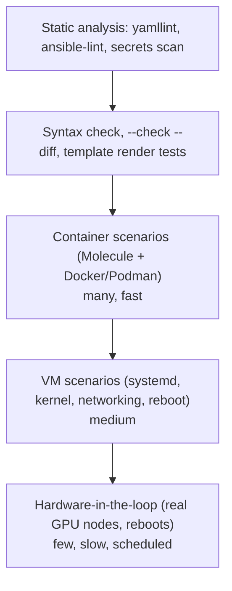

# 4.13 Testing Ansible: ansible-lint, Molecule and CI

| | |
|---|---|
| Level | Intermediate |
| Priority tier | 1 |
| Lab venue | Docker/Podman; `pip install molecule molecule-plugins[docker] ansible-lint yamllint pytest-testinfra` |
| Part | Part 4: Automation and infrastructure as code |
| Status | Drafted, labs **untested** |

## Why this matters for AI infrastructure

Ansible code runs as root on production machines. The cost of an untested role is measured in drained nodes, broken drivers, and unplanned reboots across a cluster. Unlike application code, you cannot unit-test a role against a mock: its behaviour is the effect on an operating system. You can, however, test it cheaply and repeatedly in disposable containers and VMs, check that a second run changes nothing, and verify the resulting state. This chapter builds a test pyramid for automation: lint, syntax, dry-run, converge-and-verify, idempotence, upgrade paths, and the small tier that needs real GPUs.

## Prerequisites and outcomes

Needs 4.6, 4.8, 4.11, and the testing mindset from 3.9. After this chapter you can:

- Configure `yamllint` and `ansible-lint` (profiles, rules, skips, custom rules) and wire them into pre-commit and CI.
- Run syntax and `--check --diff` tests and know their limits.
- Create Molecule scenarios (driver, platforms, provisioner, converge, idempotence, verify, side effects, destroy), including multi-platform matrices and multi-host scenarios.
- Write verification with `ansible.builtin.assert`/`uri`/`command` or `testinfra`; test handlers, templates and error paths.
- Test what containers cannot (systemd, kernel modules, drivers, reboots) using VMs or labelled hardware runners and decide what to cover where.
- Integrate tests in CI with caching, matrices, scheduled runs and release gates; test upgrades from old versions.

## 1. Test pyramid for Ansible



Each layer catches different bugs: lint finds style, deprecated syntax and risky constructs; syntax/check finds structural errors; container Molecule finds logic and idempotency bugs for user-space configuration; VMs cover kernel/systemd/network behaviour; hardware tests cover drivers, firmware, fabrics. Put most tests low in the pyramid and reserve expensive tiers for risks only they can reveal.

## 2. Static analysis

### yamllint

```yaml
# .yamllint
extends: default
rules:
  line-length: { max: 160, level: warning }
  truthy: { allowed-values: ["true", "false"], check-keys: false }
  comments: { min-spaces-from-content: 1 }
  comments-indentation: disable
  braces: { max-spaces-inside: 1 }
  document-start: disable
ignore: |
  .git/
  collections/
  molecule/*/__pycache__/
```

### ansible-lint

`ansible-lint` checks playbooks, roles, collections and task files for rule violations (naming, FQCN, `command` instead of module, missing `changed_when`, risky file permissions, deprecated syntax, `no-handler`, `package-latest`, jinja spacing, YAML formatting) and can auto-fix some (`--fix`).

```yaml
# .ansible-lint
profile: production            # null, min, basic, moderate, safety, shared, production (strictest)
exclude_paths: [.cache/, collections/, molecule/default/collections/]
enable_list: [args, empty-string-compare, no-log-password, no-same-owner]
skip_list: []                  # prefer targeted inline skips with justification
warn_list: [experimental, role-name]
offline: true                  # don't download collections during lint in CI (install them first)
```

```bash
ansible-lint                              # lint the repo per config
ansible-lint --profile production roles/gpu_driver
ansible-lint --fix=all                    # apply safe automatic fixes
ansible-lint -L                           # list rules
ansible-lint --format sarif -q > lint.sarif   # for code-scanning dashboards
```

Inline skips with justification: `# noqa: command-instead-of-module` (task line) or `tags: [skip_ansible_lint]` (legacy). Treat skips as debt and review them. Profiles progress from basic correctness to full production hygiene: adopt `production` for new repositories and ratchet legacy code up one profile at a time.

Other static tools: `yamllint`, `shellcheck` for embedded scripts, `gitleaks` (4.12), `jinja2` linters (`j2lint`), `ansible-playbook --syntax-check`, `ansible-inventory --graph` against test inventories, `check-jsonschema` for variable files with a JSON Schema describing your inventory conventions, `pre-commit` to run all of these locally (4.1).

## 3. Syntax, check mode and render tests

- **Syntax**: `ansible-playbook playbooks/site.yml --syntax-check -i inventories/lab` for each playbook in CI (include variants for each environment so conditional imports are exercised).
- **Check mode**: `--check --diff` against a test inventory (containers or a lab) catches module argument errors and shows intended changes; limitations from 4.6 apply. On a freshly created host check mode may fail legitimately because prerequisites are not yet installed; use it for *drift* tests on already-converged hosts.
- **Render tests for templates**: render each template with representative variable sets (including optional values unset) using the `template` module against `localhost` or Python Jinja2 in unit tests (3.9), compare with golden files, and validate with the target tool (`nginx -t`, `sshd -t`, `visudo -cf`, `promtool check config`). Many bugs live in templates; a golden-file test makes diffs visible in code review.
- **Variable schema**: a JSON Schema or argument spec for role inputs, tested with valid and invalid fixtures.

## 4. Molecule

Molecule is the standard framework for testing roles and collections: it creates instances, runs your role, checks idempotence, verifies results, and destroys instances. Scenarios live in `molecule/<name>/` (the default scenario is `default`).

### Install and initialise

```bash
python3 -m venv .venv && source .venv/bin/activate
pip install "molecule>=6" "molecule-plugins[docker]" ansible-core ansible-lint yamllint pytest-testinfra
cd roles/kernel_tuning
molecule init scenario default --driver-name docker      # or run `molecule init role` for a new role
```

### Scenario files

```yaml
# molecule/default/molecule.yml
driver:
  name: docker
platforms:
  - name: ubuntu2204
    image: geerlingguy/docker-ubuntu2204-ansible:latest      # pin by digest in real use
    pre_build_image: true
    privileged: false
    command: ""
    volumes: ["/sys/fs/cgroup:/sys/fs/cgroup:rw"]
    cgroupns_mode: host
    tmpfs: ["/run", "/tmp"]
  - name: rocky9
    image: geerlingguy/docker-rockylinux9-ansible:latest
    pre_build_image: true
    privileged: false
    volumes: ["/sys/fs/cgroup:/sys/fs/cgroup:rw"]
    cgroupns_mode: host
provisioner:
  name: ansible
  config_options:
    defaults:
      callbacks_enabled: profile_tasks
      interpreter_python: auto_silent
  inventory:
    group_vars:
      all:
        kernel_tuning_sysctl_extra: { vm.dirty_ratio: 10 }
verifier:
  name: ansible
```

```yaml
# molecule/default/converge.yml
- name: Converge
  hosts: all
  become: true
  gather_facts: true
  roles:
    - role: kernel_tuning
```

```yaml
# molecule/default/verify.yml (Ansible-native verifier)
- name: Verify
  hosts: all
  gather_facts: false
  tasks:
    - name: Read sysctl value
      ansible.builtin.command: sysctl -n vm.swappiness
      register: swp
      changed_when: false
    - name: Assert desired value
      ansible.builtin.assert:
        that: swp.stdout | int == 1
        fail_msg: "swappiness is {{ swp.stdout }}"
    - name: Persisted in sysctl.d
      ansible.builtin.slurp: { src: /etc/sysctl.d/90-kernel-tuning.conf }
      register: persisted
    - ansible.builtin.assert:
        that: "'vm.swappiness' in (persisted.content | b64decode)"
```

### The test sequence

```bash
molecule test               # full: dependency, lint(optional), cleanup, destroy, syntax, create, prepare, converge, idempotence, side_effect, verify, cleanup, destroy
molecule create             # create instances
molecule converge           # apply the role (iterate quickly during development)
molecule idempotence        # run again; fails if any task reports changed
molecule verify             # run verifier
molecule login -h ubuntu2204   # shell into an instance to debug
molecule destroy
molecule test --all         # all scenarios
molecule test -s upgrade
```

Key stages:

- **`prepare.yml`** (optional): set up prerequisites that are not under test (install Python, create a fake `/dev` file, start a mock service).
- **`converge.yml`**: apply the role/playbook under test with test variables.
- **`idempotence`**: reruns converge and fails if any task reports `changed`. This one check finds the majority of subtle bugs (`command` without `changed_when`, templates with timestamps, `lineinfile` regex mismatch).
- **`side_effect.yml`** (optional): perform an action between runs, such as deleting a managed file or killing a service, then converge again and verify the role **repairs** it (drift correction test).
- **`verify`**: assert on final state; keep verifications independent of how the role did the work.
- Run `molecule test` locally and in CI; use `molecule converge` + `verify` loops during development; keep instances after failure with `molecule test --destroy never`.

### Verification options

- **Ansible-native** (`verifier: ansible`): assertions with modules (`assert`, `stat`, `slurp`, `uri`, `command`, `service_facts`, `package_facts`). No extra dependency; good for most roles.
- **testinfra** (Python, pytest): expressive host assertions.

```python
# molecule/default/tests/test_default.py
def test_sysctl_persisted(host):
    f = host.file("/etc/sysctl.d/90-kernel-tuning.conf")
    assert f.exists and f.contains("vm.swappiness")

def test_chrony_running(host):
    s = host.service("chrony") if host.system_info.distribution == "ubuntu" else host.service("chronyd")
    assert s.is_running and s.is_enabled

def test_port_listening(host):
    assert host.socket("tcp://127.0.0.1:9400").is_listening
```

Use `verifier: name: testinfra` with the plugin; run with `molecule verify`. Other options: `goss`/`serverspec`, `inspec`.

### Multi-platform and multi-host scenarios

Test on each supported OS (Ubuntu 22.04/24.04, Rocky/RHEL 8/9) via the `platforms` list or a CI matrix passing `MOLECULE_DISTRO`. For roles requiring multiple hosts (Slurm controller + compute nodes, PostgreSQL primary + replica, nginx + app), define several platforms with `groups:` in `molecule.yml` and have `converge.yml` target groups, creating a miniature of production.

### Drivers and what containers cannot do

| Driver | Use | Limits |
|---|---|---|
| Docker/Podman | Fast, cheap, CI-friendly | Shared kernel: no kernel module loading, no sysctl on non-namespaced keys, limited systemd (use systemd-enabled images with cgroup mounts), no reboot, no real NICs, no GPUs (unless the host provides them) |
| Vagrant (libvirt/VirtualBox) | Full VM: own kernel, systemd, reboot, bridges | Slower; local or self-hosted runner |
| Cloud (EC2/GCE/Azure via molecule-plugins) | Realistic networks and instance types | Cost and cleanup; GPU instances expensive |
| Delegated | Your own provisioning | Maximum flexibility |
| Lima/Multipass, KVM, Proxmox | Local/lab VMs | Setup effort |

Design guidance for GPU roles: split logic so most of the role is testable in containers (package repository configuration, templates, unit files, configuration validation with a **stub `nvidia-smi`** script), and add a small **hardware tier** that runs on labelled self-hosted runners with real GPUs for driver install, `nvidia-smi`, `dcgmi diag -r 1`, Fabric Manager, MIG, container toolkit and a short NCCL test. Mark them (`molecule test -s gpu_hw`) and schedule them nightly or on release branches rather than on every push; ensure the GPU runner cleans up (reboots into a known image) after each run. NVIDIA data-centre drivers will not install in an unprivileged container, so do not pretend to test them there: test everything around them.

### Testing handlers, errors and upgrades

- **Handlers**: converge twice with a change between (side effect or changed variable) and verify the service restarted (compare `ActiveEnterTimestamp` or a unit invocation id) or that a marker file was created by the handler in test mode.
- **Failure paths**: a scenario with invalid inputs verifies that argument specs fail with the expected message (`ansible-playbook` expecting failure: use `failed_when` inversion with `block/rescue`, or a CI step that asserts non-zero exit).
- **Upgrade tests**: converge with version N-1 of the role/variables, then with the new version, then verify state and idempotence; essential for drivers and databases. Keep a `prepare.yml` that installs the old state.
- **Drift tests** (`side_effect.yml`): corrupt state (edit a config file, stop a service, change a sysctl) then converge and verify repair.

## 5. Testing playbooks and collections

- Playbooks (not just roles) can be a Molecule scenario using a `converge.yml` that imports the playbook with a test inventory. For monorepos, a `molecule/` directory at the repository root with multi-host scenarios mirrors the full topology on a smaller scale (3 nodes representing login, controller, compute).
- **Collections**: `ansible-test sanity` (style, docs, import checks, validate-modules for module docs), `ansible-test units` (pytest for module code), `ansible-test integration` (targets in `tests/integration/targets/*`) in Docker, matrices over ansible-core versions and Python versions per the collection's support policy.
- **Module unit tests**: custom modules (4.15) should have pytest unit tests with `AnsibleModule` mocked (`set_module_args`, `exit_json` patched) plus integration tests.
- **Inventory plugin tests**: unit test with canned API responses (`responses`/`respx`, 3.9) for dynamic inventory logic.

## 6. CI integration

```yaml
# .github/workflows/ansible-ci.yml
name: ansible-ci
on:
  pull_request:
  push: { branches: [main] }
  schedule: [ { cron: "0 4 * * *" } ]                 # nightly: catch upstream/distro drift
permissions: { contents: read }
jobs:
  lint:
    runs-on: ubuntu-latest
    steps:
    - uses: actions/checkout@v4
    - uses: actions/setup-python@v5
      with: { python-version: "3.12", cache: pip }
    - run: pip install -r requirements-dev.txt && ansible-galaxy collection install -r requirements.yml
    - run: yamllint . && ansible-lint

  molecule:
    needs: lint
    runs-on: ubuntu-latest
    strategy:
      fail-fast: false
      matrix:
        role: [kernel_tuning, chrony_client, dcgm_exporter]
        distro: [ubuntu2204, rockylinux9]
    steps:
    - uses: actions/checkout@v4
    - uses: actions/setup-python@v5
      with: { python-version: "3.12", cache: pip }
    - run: pip install -r requirements-dev.txt
    - name: Molecule
      run: cd roles/${{ matrix.role }} && molecule test
      env:
        MOLECULE_DISTRO: ${{ matrix.distro }}
        PY_COLORS: "1"
        ANSIBLE_FORCE_COLOR: "1"

  gpu-hw:
    if: github.event_name == 'schedule' || contains(github.event.pull_request.labels.*.name, 'test-gpu')
    runs-on: [self-hosted, gpu]
    steps:
    - uses: actions/checkout@v4
    - run: cd roles/gpu_driver && molecule test -s gpu_hw
```

(Action versions and runner labels are examples.) CI practices:

- **Cache** pip and collections; pin `ansible-core` and Molecule versions; use pinned container images (by digest) for platforms so tests are reproducible; refresh them on a schedule to detect upstream breakage.
- **Matrix** across supported OSes and ansible-core versions (current and previous LTS-ish lines); allow experimental versions to fail without blocking.
- **Path filters** so role tests run only when that role changes; run all nightly.
- **Required checks** on protected branches (4.2); publish JUnit/SARIF and Molecule logs as artefacts.
- **Release gates**: tag releases only if lint and the full matrix pass; collection builds happen after tests; sign artefacts.
- **Speed**: use prebuilt Molecule images with Python and systemd already configured; run scenarios in parallel; reuse instances during local development (`molecule converge`, not `test`).
- **Security**: tests run arbitrary code; keep untrusted PRs on runners without credentials; no secrets in Molecule inventories.

## 7. What to test: a checklist per role

1. Converges on every supported platform without errors.
2. Second run reports zero changes (idempotence).
3. Desired state verified (files, services, ports, kernel parameters, users, permissions).
4. Variable overrides take effect; defaults are sane; invalid inputs fail clearly.
5. Handlers fire when config changes and do not when it doesn't.
6. Drift is repaired (delete a file, stop a service, converge again).
7. Upgrades from the previous version work.
8. Uninstall/`state: absent` paths work if offered.
9. Check mode does not error (where applicable).
10. No secrets in logs (`no_log` honoured) and file modes correct.
11. Documentation examples are the tested scenarios.

## 8. Troubleshooting Molecule

| Symptom | Likely cause | Fix |
|---|---|---|
| Container starts but systemd services fail | Image without systemd, wrong cgroup mounts | Use a systemd-ready image; mount cgroups; `cgroupns_mode: host`; or use VMs |
| `Failed to connect` / Python missing | Image lacks Python | Use an Ansible-ready image or run `prepare.yml` to install it via `raw` |
| Idempotence fails | A task reports changed on rerun | Run `molecule converge` twice with `-vv`; inspect the task; add `changed_when`, fix template/regex |
| Role not found | Molecule runs from the wrong directory or roles path | Run from the role directory, set `ANSIBLE_ROLES_PATH`, install dependencies via `requirements.yml` in `molecule/default/` |
| Collections missing in CI | Not installed in the Molecule environment | `dependency: name: galaxy options: requirements-file: requirements.yml` |
| Slow tests | Image pulls, fact gathering, serial scenarios | Pre-pull images, cache, run matrix in parallel, `gather_subset` |
| Tests pass in Docker, fail on real hosts | Kernel/systemd/network differences | Add VM tier; avoid container-specific assumptions |
| Leftover instances | Aborted run | `molecule destroy`; `docker ps -a \| grep molecule` cleanup |

## 9. Lab (untested)

1. **Static gate**: add `.yamllint`, `.ansible-lint` (profile `production`), pre-commit hooks; run on the 4.9/4.11 content; fix findings; add a deliberate violation and watch CI fail.
2. **Molecule scenario**: initialise a Docker scenario for `kernel_tuning` (or another role) on two distros; write converge and Ansible-native verify; run `molecule test`.
3. **Idempotence bug hunt**: add a task with `command: echo >> file`; watch idempotence fail; fix with a module.
4. **Side effect**: add `side_effect.yml` that deletes the managed file and stops a service; confirm the role repairs both.
5. **testinfra**: rewrite verification with testinfra tests; compare readability and speed.
6. **Template tests**: golden-file render tests for a Slurm/NCCL template with several variable sets; run through `nginx -t`/`promtool` analogues where possible.
7. **Argument spec failure**: add a scenario passing an invalid value; assert the expected failure message.
8. **Upgrade test**: converge with the old role version (from Git tag) then the new one; verify state; document any non-idempotent migrations.
9. **Multi-host**: build a three-container scenario (controller, two nodes) for a Slurm-like role with a stub scheduler; verify cross-host config rendering from `hostvars`.
10. **GPU stub**: create a fake `nvidia-smi` script used by the driver role's validate tasks in containers; then describe the extra hardware scenario that would run on a real GPU runner.
11. **CI**: implement the workflow with a matrix and path filters; add the nightly schedule; make lint and Molecule required checks.
12. **Collection tests**: run `ansible-test sanity` and a small unit test for a custom filter/module.
13. **Clean up** containers/VMs.

Mark tested only after execution.

## 10. Common mistakes

- Treating lint passing as correctness; skipping rules wholesale.
- Testing only the happy path on one OS; no idempotence or drift tests.
- Containers pretending to be hosts: testing kernel- or driver-dependent behaviour where it cannot work.
- Unpinned images and tool versions causing random CI breakage (or, conversely, never refreshing and missing upstream changes).
- Verification that re-implements the role logic instead of checking outcomes.
- Molecule tests that depend on the Internet (package mirrors) without caching or retries; flaky tests tolerated.
- Giving CI credentials to untrusted PR runs; Molecule inventories containing secrets.
- Running expensive GPU or VM tiers on every commit, then disabling them when they annoy people.
- No upgrade tests, so the first upgrade happens on production.

## 11. Interview angles

- "How do you test Ansible roles?" (lint, syntax, Molecule converge/idempotence/verify, matrix.)
- "What does Molecule's idempotence test catch?" 
- "How do you test a role that installs GPU drivers?" (stub in containers, hardware runner tier, VM tier for kernel.)
- "What can't containers test?" (kernel, reboot, real network/GPU, full systemd).
- "How do you structure CI for many roles?" (path filters, matrix, nightly full run, required checks.)
- "How do you test upgrades and drift correction?" 
- "How do you keep tests deterministic?" (pin images/versions, avoid time and network dependencies.)

## 12. Checkpoint questions (30)

1. What does `yamllint` check? **A:** YAML syntax and style.
2. What does `ansible-lint` check? **A:** Ansible best practices and risky constructs.
3. What are lint profiles? **A:** Increasingly strict rule sets (min to production).
4. What does `--fix` do in ansible-lint? **A:** Auto-applies safe fixes.
5. What does `--syntax-check` verify? **A:** Playbook parsing only.
6. Limits of check mode? **A:** Command tasks skipped; dependent tasks mispredict.
7. What is Molecule? **A:** Framework to test roles in disposable instances.
8. Molecule test stages? **A:** create, prepare, converge, idempotence, side_effect, verify, destroy.
9. What does idempotence test do? **A:** Re-runs and fails on any change.
10. What is `side_effect.yml`? **A:** Mutates state between runs to test repair.
11. What is `prepare.yml`? **A:** Sets up prerequisites not under test.
12. Verifier options? **A:** Ansible-native, testinfra (also goss, inspec).
13. Drivers? **A:** Docker, Podman, Vagrant, cloud, delegated.
14. Why VMs sometimes? **A:** Kernel, systemd, reboot, networking.
15. Why not container GPU driver tests? **A:** Drivers need kernel and hardware access.
16. How test GPU roles then? **A:** Stub tools in containers plus labelled hardware runners.
17. How test multiple OSes? **A:** `platforms` list or CI matrix.
18. How test multi-host roles? **A:** Multi-platform scenarios with groups.
19. How test templates? **A:** Render with fixtures, golden files, validate with tool.
20. What is `ansible-test` for? **A:** Collection sanity, unit and integration tests.
21. How speed up CI? **A:** Cache, path filters, parallel matrix, prebuilt images.
22. Why nightly schedule? **A:** Catch upstream and distro drift.
23. What's an upgrade test? **A:** Converge old then new version and verify.
24. What is a drift test? **A:** Corrupt state then converge to verify repair.
25. Handler test method? **A:** Change config, converge, verify restart.
26. How test invalid input? **A:** Scenario expecting argument spec failure.
27. Why pin container images? **A:** Reproducibility.
28. Why not secrets in Molecule? **A:** Tests run in CI with broad access.
29. How debug a failing instance? **A:** `molecule login`, `--destroy never`.
30. What should verification check? **A:** Outcomes, not implementation.

## 13. Sources and review notes

**Written in original words.** Principal sources:

- Rene Moser and Lorin Hochstein, *Ansible: Up and Running*, 3rd edition (chapter 14 on testing and chapter 22 on integrating Ansible with CI).
- Ansible Lint, Molecule, testinfra and `ansible-test` documentation.
- The testing approach reuses the general patterns of chapter 3.9 and the CI design of chapter 4.2.
- Examples are the author's constructions.

**Flagged for verification before publishing:** Molecule configuration schema (driver names moved to `molecule-plugins`), image names, `ansible-lint` profile and rule names for your version, GitHub Actions syntax, and every code listing; all labs are **untested**.
